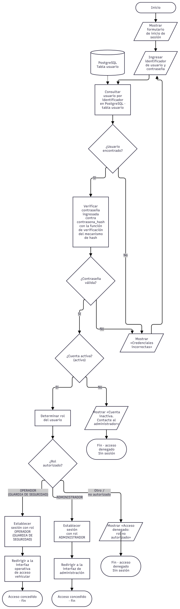
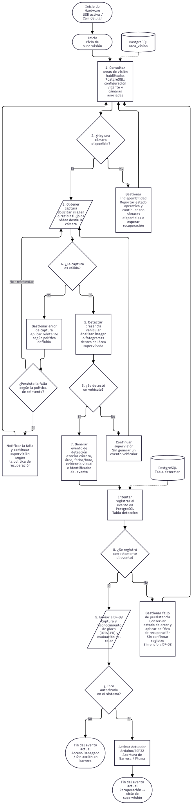
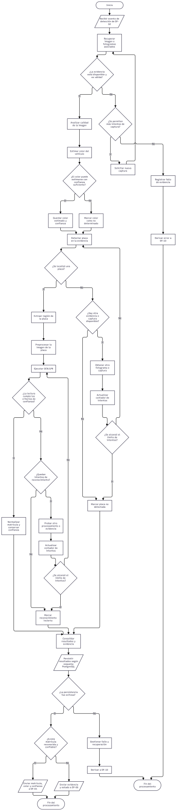
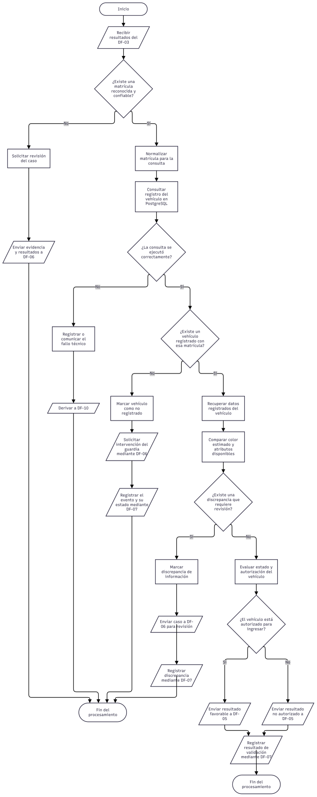
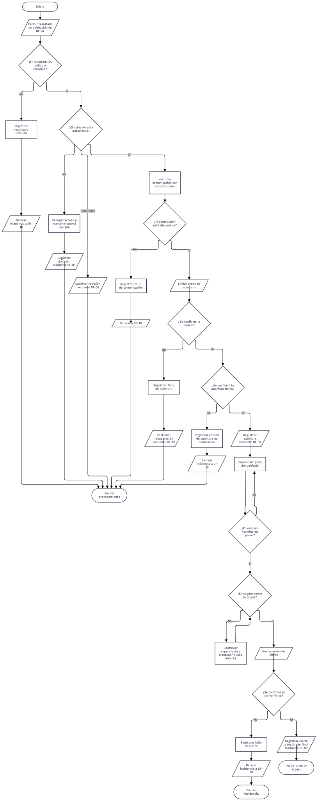
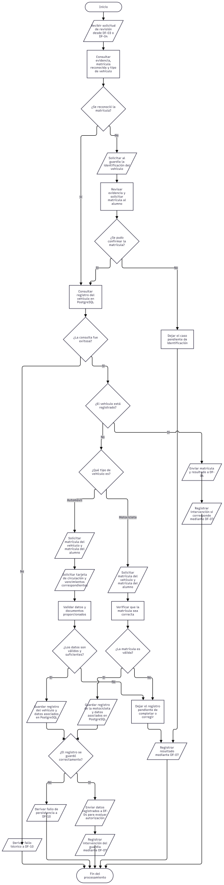
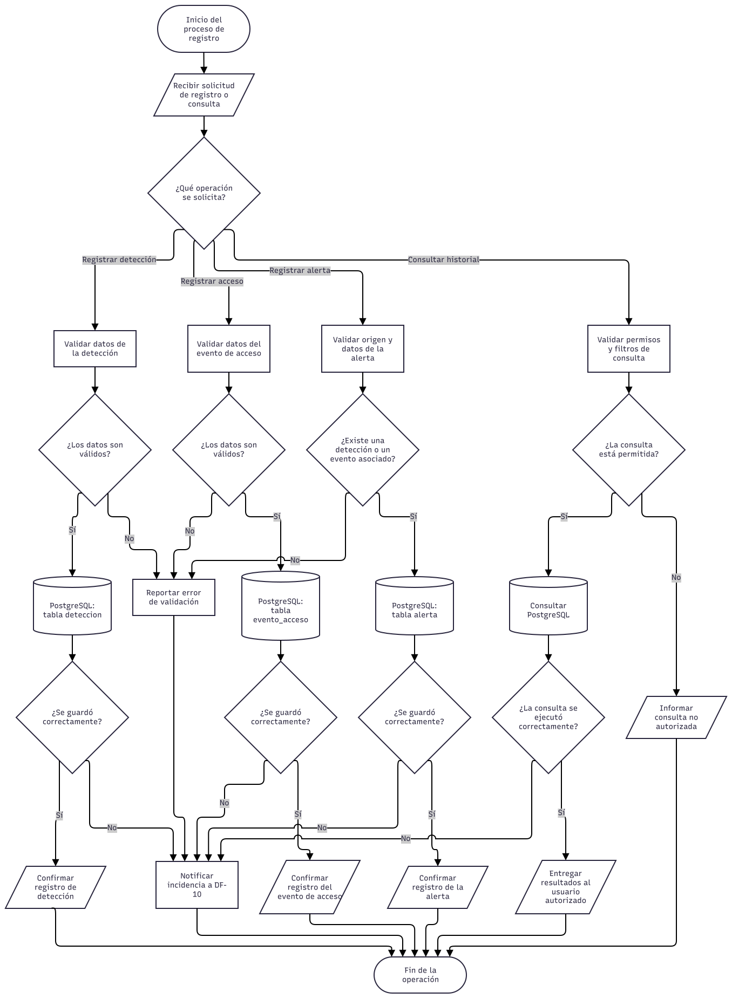
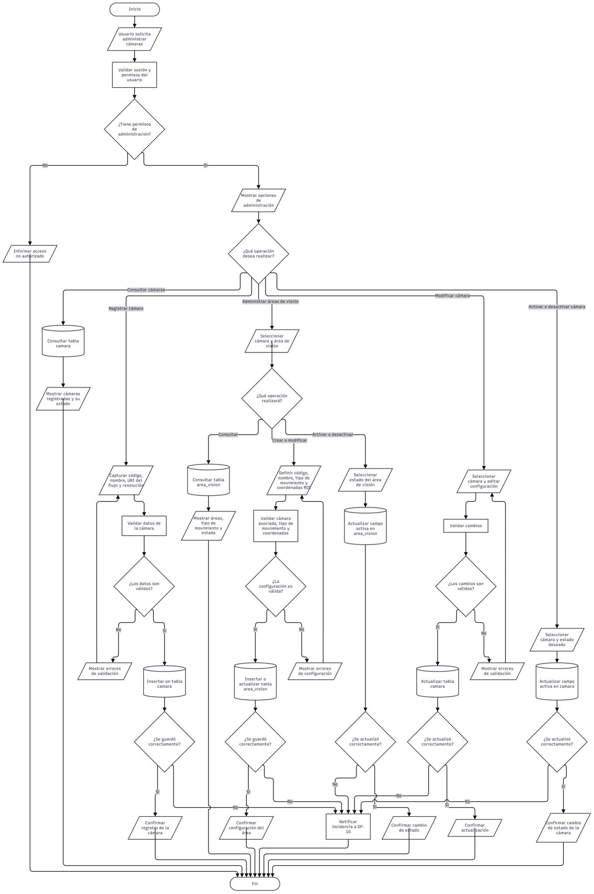
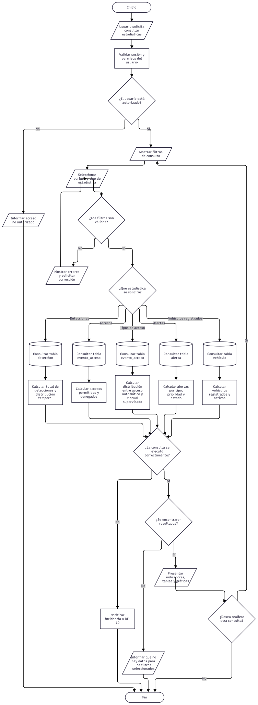

# 11 — Diagramas de flujo de VIGÍA Vision Systems

## Propósito

Documentar visualmente los procesos operativos de VIGÍA Vision Systems mediante diagramas de flujo que representen las etapas, entradas, salidas, decisiones, excepciones y resultados de cada proceso.

Este directorio reúne los diez diagramas de flujo definidos para el alcance actual del sistema. Cada diagrama se presenta en formato SVG para facilitar su visualización desde Markdown y conservar una representación vectorial.

## Contenido del directorio

| Orden | Identificador | Diagrama de flujo                                      | Archivo                  |
| ----: | ------------- | ------------------------------------------------------ | ------------------------ |
|     1 | DF-01         | Autenticación e inicio de sesión                       | `DF-01_VIGIA.drawio.svg` |
|     2 | DF-02         | Detección de un vehículo en el acceso                  | `DF-02_VIGIA.drawio.svg` |
|     3 | DF-03         | Captura de imagen y reconocimiento de placas (OCR/LPR) | `DF-03_VIGIA.drawio.svg` |
|     4 | DF-04         | Validación de la placa y consulta de autorización      | `DF-04_VIGIA.drawio.svg` |
|     5 | DF-05         | Decisión de acceso y control de la pluma               | `DF-05_VIGIA.drawio.svg` |
|     6 | DF-06         | Supervisión del acceso por el guardia de seguridad     | `DF-06_VIGIA.drawio.svg` |
|     7 | DF-07         | Registro y consulta de eventos de acceso               | `DF-07_VIGIA.drawio.svg` |
|     8 | DF-08         | Configuración y administración de cámaras              | `DF-08_VIGIA.drawio.svg` |
|     9 | DF-09         | Consulta de estadísticas del sistema                   | `DF-09_VIGIA.drawio.svg` |
|    10 | DF-10         | Manejo de errores, pérdida de conexión y recuperación  | `DF-10_VIGIA.drawio.svg` |

## DF-01 — Autenticación e inicio de sesión

Representa el proceso de autenticación del usuario, la validación de sus credenciales y el acceso a las funciones disponibles según sus permisos.

[Ver archivo SVG](DF-01_VIGIA.drawio.svg)

## DF-02 — Detección de un vehículo en el acceso

Representa la supervisión de las cámaras y las áreas de visión habilitadas para detectar la presencia de vehículos e iniciar el procesamiento correspondiente.

[Ver archivo SVG](DF-02_VIGIA.drawio.svg)

## DF-03 — Captura de imagen y reconocimiento de placas (OCR/LPR)

Describe la captura de evidencia visual, la evaluación de calidad de imagen, la detección de la matrícula y la obtención de los resultados del reconocimiento.

[Ver archivo SVG](DF-03_VIGIA.drawio.svg)

## DF-04 — Validación de la placa y consulta de autorización

Representa la consulta de la matrícula en PostgreSQL, la comprobación del registro del vehículo y la determinación de su condición de autorización conforme a las reglas del sistema.

[Ver archivo SVG](DF-04_VIGIA.drawio.svg)

## DF-05 — Decisión de acceso y control de la pluma

Describe el control de apertura y cierre de la pluma, la supervisión del paso mediante el sensor infrarrojo y la apertura manual supervisada por el guardia, respetando las condiciones de seguridad física.

[Ver archivo SVG](DF-05_VIGIA.drawio.svg)

## DF-06 — Supervisión del acceso por el guardia de seguridad

Representa la intervención del guardia ante matrículas no reconocidas, vehículos no registrados o casos que requieren revisión manual, conforme al procedimiento de registro y validación establecido.

[Ver archivo SVG](DF-06_VIGIA.drawio.svg)

## DF-07 — Registro y consulta de eventos de acceso

Describe la persistencia de detecciones, eventos de acceso y alertas en PostgreSQL, así como la consulta del historial por usuarios autorizados.

[Ver archivo SVG](DF-07_VIGIA.drawio.svg)

## DF-08 — Configuración y administración de cámaras

Representa el registro, consulta, modificación, activación y desactivación de cámaras y áreas de visión, incluida la configuración de las regiones de interés (ROI).

[Ver archivo SVG](DF-08_VIGIA.drawio.svg)

## DF-09 — Consulta de estadísticas del sistema

Describe la consulta y presentación de indicadores calculados a partir de los registros de detecciones, accesos, vehículos y alertas almacenados en PostgreSQL.

[Ver archivo SVG](DF-09_VIGIA.drawio.svg)

## DF-10 — Manejo de errores, pérdida de conexión y recuperación

Representa la identificación y gestión de fallos en cámaras, reconocimiento, PostgreSQL, configuración y control de la pluma, así como los intentos de recuperación y las condiciones para reanudar la operación.

[Ver archivo SVG](DF-10_VIGIA.drawio.svg)

## Formato y mantenimiento

- **Formato de visualización:** SVG.
- **Herramienta de elaboración:** draw.io / diagrams.net.
- **Ubicación:** `Docs/GEST_PROY_SOFT/11_Diagrama_de_flujo/`.
- **Índice documental:** este archivo `README.md`.

Los archivos SVG se muestran directamente en este documento y también pueden abrirse individualmente mediante sus enlaces.

Cuando se modifique un diagrama, se debe actualizar su archivo SVG correspondiente y verificar que la imagen siga siendo visible desde este índice.

## Criterios de consistencia

Los diagramas deben mantener coherencia con la arquitectura y el esquema de PostgreSQL de VIGÍA Vision Systems.

1. Cada diagrama debe respetar la responsabilidad funcional asignada.
2. Las decisiones de autorización deben distinguirse del control físico de la pluma.
3. Las detecciones, los eventos de acceso y las alertas deben tratarse como registros diferentes.
4. Los errores técnicos deben derivarse al proceso de gestión de errores y recuperación.
5. La configuración de cámaras y áreas de visión debe distinguirse de su operación durante la detección.
6. Las funciones que todavía no estén implementadas deben identificarse como parte del alcance previsto, no como capacidades verificadas.

## Estado documental

Los diez diagramas están organizados en este índice. Su aprobación definitiva requiere verificar el contenido de cada SVG y comprobar su consistencia con la implementación vigente del sistema.
