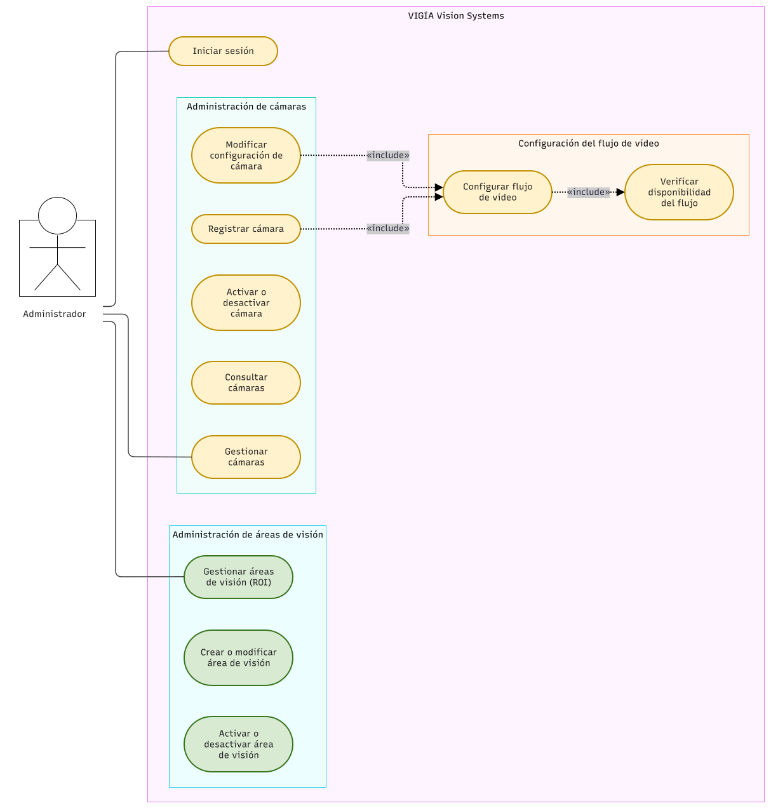
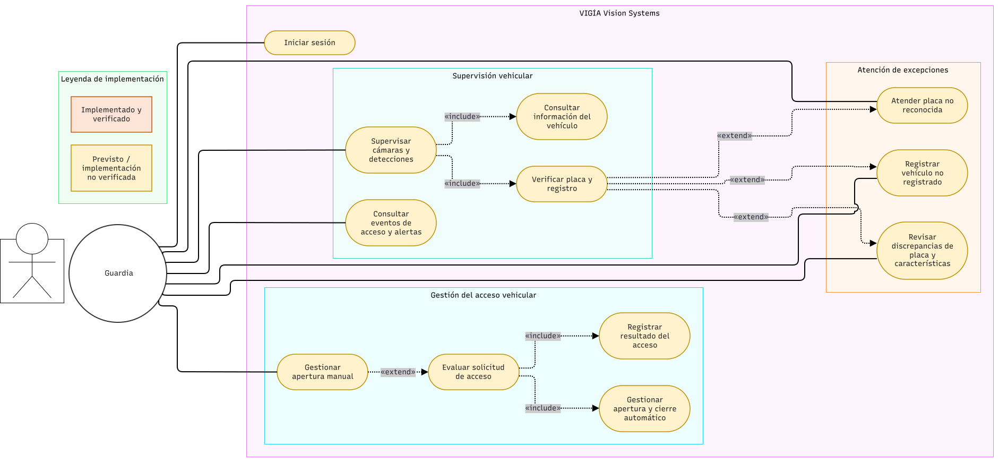

# Diagramas de Casos de Uso — VIGÍA Vision Systems

Esta sección presenta los diagramas de casos de uso del sistema VIGÍA Vision Systems, organizados según los actores y sus responsabilidades funcionales.

## DCU-01. Casos de uso del administrador

Representa las interacciones del administrador con el sistema y las funcionalidades correspondientes a su rol.

**Archivo fuente:** [`DCU-01_VIGIA_ADMIN.drawio.svg`](DCU-01_VIGIA_ADMIN.drawio.svg)

## DCU-02. Casos de uso del guardia

Representa las interacciones del guardia con el sistema y las funcionalidades relacionadas con la operación y supervisión del acceso vehicular.

**Archivo fuente:** [`DCU-02_VIGIA_GUARDIA.drawio.svg`](DCU-02_VIGIA_GUARDIA.drawio.svg)

## Convenciones

Los diagramas se presentan en formato SVG, exportado desde draw.io. Las imágenes originales se conservan como archivos independientes dentro de esta carpeta.

Estos diagramas describen las funcionalidades y las interacciones entre actores y sistema; no representan la implementación interna de los componentes.
