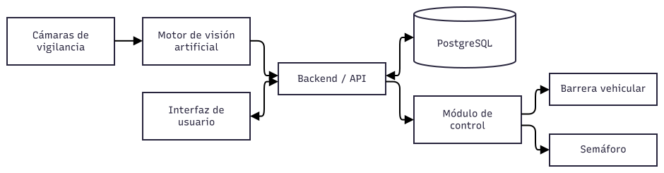
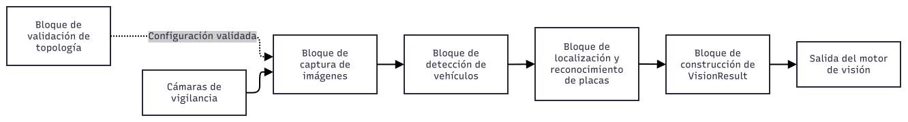
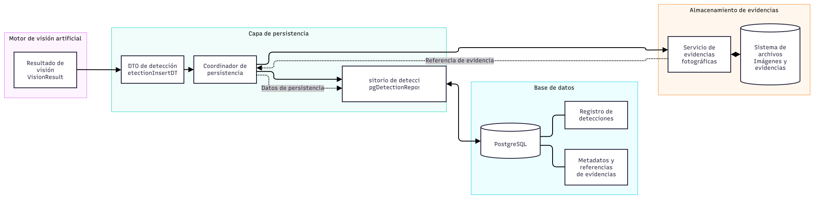

# Diagramas de Bloques — VIGÍA Vision Systems

Esta sección presenta la arquitectura de VIGÍA Vision Systems mediante tres diagramas de bloques complementarios. Cada diagrama representa un nivel específico de la arquitectura, desde la visión global del sistema hasta el motor de visión artificial y la persistencia de datos.

## DB-01. Arquitectura general del sistema

Presenta la visión global de VIGÍA Vision Systems, sus principales componentes y las relaciones arquitectónicas entre los subsistemas.

**Archivo fuente:** [`DB-01_ARQUITECTURA.drawio.svg`](DB-01_ARQUITECTURA.drawio.svg)

## DB-02. Arquitectura interna del motor de visión artificial

Representa los componentes responsables de la captura y el procesamiento de imágenes, la detección de vehículos, el reconocimiento de placas y la generación de resultados de visión, según el alcance de implementación documentado.

**Archivo fuente:** [`DB-02_ARQUITECTURA_MOTOR.drawio.svg`](DB-02_ARQUITECTURA_MOTOR.drawio.svg)

## DB-03. Arquitectura de persistencia y almacenamiento de evidencias

Presenta los componentes relacionados con la preparación y persistencia de los datos de detección, el acceso a PostgreSQL y el almacenamiento de evidencias fotográficas.

**Archivo fuente:** [`DB-03_ARQUITECTURA_PERSISTENCIA.drawio.svg`](DB-03_ARQUITECTURA_PERSISTENCIA.drawio.svg)

## Consideraciones arquitectónicas

Los diagramas de bloques describen los componentes, sus responsabilidades y sus relaciones. No sustituyen a los diagramas de flujo, que detallan los pasos de ejecución y las decisiones de un proceso.

Las conexiones y funcionalidades representadas deben mantenerse alineadas con los contratos entre módulos, los modelos de dominio, el esquema de PostgreSQL y la implementación vigente.

## Formato

Los diagramas están almacenados en formato SVG exportado desde draw.io. Las referencias utilizadas en este documento son relativas a los archivos de la misma carpeta, por lo que se conserva la estructura documental del proyecto.
