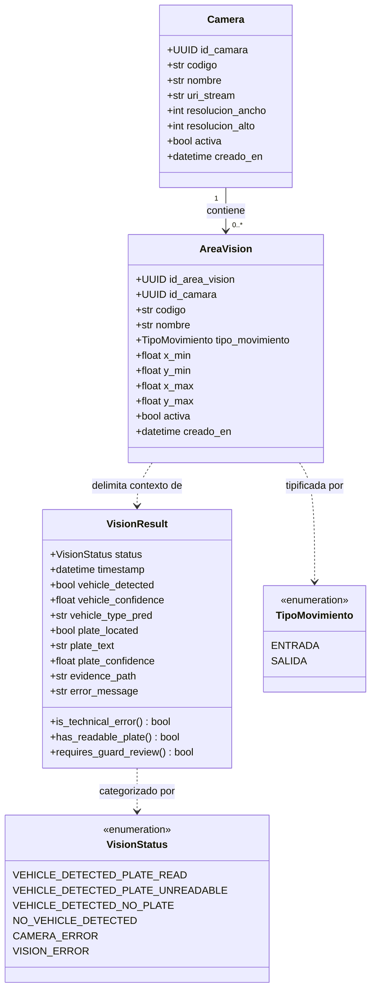

# DOC-01. Modelos de Dominio: Subsistema de Visión V1

## 1. Control Documental
* **Proyecto:** VIGÍA Vision Systems
* **Subsistema:** `VIGIA_Vision` & `VIGIA_Core`
* **Documento:** DOC-01 — Modelos de Dominio para V1
* **Fase:** Fase 1 — Especificación Formal y Arquitectura de Dominio
* **Estado:** Propuesta Técnica Ajustada con Decisiones Funcionales Aprobadas (Pendiente de Aprobación Técnica Final)
* **Versión:** 1.2.0
* **Fecha:** 27 de octubre de 2026
* **Autor:** Arquitectura de Software VIGÍA

---

## 2. Objetivo
Definir los modelos de dominio, entidades, contratos técnicos y directrices de persistencia del subsistema de visión computacional (`VIGIA_Vision`) para la Versión 1 (V1) de VIGÍA Vision Systems. 

El documento establece una arquitectura sencilla, funcional y mantenible que satisface el caso de uso rector de control de acceso vehicular en caseta, reutiliza estrictamente los contratos inmutables de `VIGIA_Core`, respeta el esquema relacional existente de PostgreSQL (`V001__baseline_schema.sql`) y evita introducir infraestructura o abstracciones asíncronas innecesarias para la primera versión.

---

## 3. Alcance de V1

### 3.1. Decisiones Funcionales Aprobadas
1. **Topología de Cámaras Físicas:** La instalación física de la caseta en V1 contará con **dos cámaras físicas independientes**:
   * Una cámara física dedicada exclusivamente al carril de **ENTRADA** (`CAM-ENTRADA`).
   * Una cámara física dedicada exclusivamente al carril de **SALIDA** (`CAM-SALIDA`).
2. **Requisitos de Configuración Operativa Simultánea:** A nivel de aplicación, la configuración funcional operativa de V1 exige el cumplimiento simultáneo de las siguientes cinco condiciones:
   * Exactamente dos cámaras físicas registradas para la operación: una de `ENTRADA` y otra de `SALIDA`.
   * Exactamente dos áreas operativas activas en todo el sistema.
   * Una sola área operativa activa asociada a cada cámara.
   * El área de visión de `CAM-ENTRADA` debe tener obligatoriamente `tipo_movimiento = 'ENTRADA'`.
   * El área de visión de `CAM-SALIDA` debe tener obligatoriamente `tipo_movimiento = 'SALIDA'`.
   *(Nota de alcance: Estas son reglas funcionales que debe validar la capa de aplicación. El DDL de PostgreSQL no restringe el número de áreas por cámara ni impone unicidad por `tipo_movimiento`; en la base de datos la cardinalidad relacional continúa siendo `Camera 1 --> 0..* AreaVision`).*
3. **Reutilización del Contrato Canónico:** Consumo directo e inmutable del modelo `VisionResult` y el enum `VisionStatus` definidos en `VIGIA_Core/domain/vision_result.py`.
4. **Entorno de Red del Prototipo:** Operación provisional del prototipo móvil a través de la red local privada de la caseta, asumiendo y documentando las limitaciones de seguridad inherentes.
5. **Procesamiento Síncrono:** La ejecución de visión en V1 opera de forma síncrona directa (captura $\to$ decodificación $\to$ inferencia YOLO/LPR $\to$ emisión de `VisionResult`), reflejando el flujo verificado en el prototipo `VR_Semaforo`.

### 3.2. Propuestas Técnicas Sujetas a Validación Posterior
* Generación asistida de códigos QR para facilitar la apertura de la interfaz web móvil en el dispositivo.
* Mecanismos de autenticación y credenciales de dispositivo para despliegues de producción fuera de redes controladas.
* Política definitiva de selección entre imagen original e imagen anotada para la evidencia de acceso.

### 3.3. Exclusiones Explícitas de V1
* **Entidad `PositionAssignment`:** No se implementa una entidad ni tabla independiente de asignación o historial de posiciones; la relación directa entre `Camera` y `AreaVision` resuelve la necesidad operativa en V1.
* **Entidades `PairingRequest` y `CameraSession`:** No se implementan protocolos de emparejamiento con PIN temporal, tokens de sesión Bearer, límites de reintentos ni reconexión con estado.
* **Abstracciones Asíncronas Complejas:** No se implementan colas de mensajes, workers en segundo plano ni políticas obligatorias de descarte de fotogramas (`DROPPED`).
* **Grabación Continua:** No se contempla grabación continua de video ni almacenamiento masivo de cuadros sin interés vehicular.

---

## 4. Fuentes Analizadas y Evidencia Verificada

El diseño se fundamenta en la inspección directa del repositorio:

1. **`VIGIA_Core/domain/vision_result.py`:** [HECHO VERIFICADO]
   * Define el contrato canónico inmutable `@dataclass(frozen=True) class VisionResult`.
   * Atributos: `status` (`VisionStatus`), `timestamp` (`datetime` UTC), `vehicle_detected` (`bool`), `vehicle_confidence` (`Optional[float]`), `vehicle_type_pred` (`Optional[str]`), `plate_located` (`bool`), `plate_text` (`Optional[str]`), `plate_confidence` (`Optional[float]`), `evidence_path` (`Optional[str]`), `error_message` (`Optional[str]`).
   * Invariantes en `__post_init__`: Si `status` es `CAMERA_ERROR` o `VISION_ERROR`, `vehicle_detected` no puede ser `True`. Si `plate_text` está presente, `plate_confidence` no puede ser `None`. Las confianzas deben pertenecer al rango $[0.0, 1.0]$.
2. **`VIGIA_Core/domain/access_decision.py`:** [HECHO VERIFICADO]
   * Define los contratos de decisión normativa: `AccessResult` (`PERMITIDO`, `DENEGADO`), `TipoMovimiento` (`ENTRADA`, `SALIDA`), `TipoAcceso` (`AUTOMATICO`, `MANUAL_SUPERVISADO`), `MotivoDecision` y el enum de interfaz `AccessState`.
   * Demuestra la separación estricta: `VIGIA_Vision` interpreta imágenes; `VIGIA_Core` decide el acceso.
3. **`BD/migrations/V001__baseline_schema.sql`:** [HECHO VERIFICADO]
   * Tabla `camara` (líneas 267-297): PK `id_camara UUID`, `codigo VARCHAR(30) UNIQUE NOT NULL`, `nombre VARCHAR(100) NOT NULL`, `uri_stream TEXT NOT NULL`, `resolucion_ancho INTEGER`, `resolucion_alto INTEGER`, `activa BOOLEAN DEFAULT TRUE`, `creado_en TIMESTAMPTZ`.
   * Tabla `area_vision` (líneas 307-344): PK `id_area_vision UUID`, `id_camara UUID NOT NULL REFERENCES camara(id_camara) ON DELETE RESTRICT`, `codigo VARCHAR(30) NOT NULL`, `nombre VARCHAR(100) NOT NULL`, `tipo_movimiento VARCHAR(10) NOT NULL CHECK (tipo_movimiento IN ('ENTRADA', 'SALIDA'))`, coordenadas normalizadas `x_min, y_min, x_max, y_max NUMERIC(4,3)`, `activa BOOLEAN DEFAULT TRUE`. Restricción `UNIQUE (id_camara, codigo)`.
   * Tabla `deteccion` (líneas 350-401): PK `id_deteccion UUID`, `id_area_vision UUID NOT NULL REFERENCES area_vision(id_area_vision)`, `fecha_hora TIMESTAMPTZ`, `placa_detectada VARCHAR(20)`, `confianza_placa NUMERIC(4,3)`, `confianza_vehiculo NUMERIC(4,3)`, `tipo_vehiculo_pred VARCHAR(20)`, `ruta_evidencia_foto TEXT`.
4. **`VR_Semaforo/vision/processor.py` y `app.py`:** [HECHO VERIFICADO]
   * Inferencia síncrona directa mediante YOLOv11 (`contar_carritos` / `vision_pipeline.process`).
   * Manejo de *Active Learning*: Si la confianza de detección vehicular cae en $[0.20, 0.50)$, activa `guardar_frame = True` y ejecuta `cv2.imwrite("dataset_dudoso/duda_<timestamp>.jpg", frame)`. Las detecciones con confianza $\ge 0.50$ o los cuadros sin detección no se guardan en disco en el código actual.
   * `VR_Semaforo/database.py` tiene 0 bytes; el prototipo actual no persiste detecciones en base de datos.
5. **`Docs/01_estructura_del_proyecto.md` y `Docs/02_arquitectura_del_sistema.md`:** [HECHO VERIFICADO]
   * Establecen las fronteras modulares: `VIGIA_Vision` observa e interpreta; `VIGIA_Core` decide y coordina; `VIGIA_IoT` interactúa con actuadores y sensores.

---

## 5. Principios de Modelado
1. **Fidelidad al Esquema Relacional:** Los modelos persistidos de dominio reflejan estrictamente las tablas existentes en PostgreSQL V1 sin inventar columnas ni requerir nuevas migraciones.
2. **Reutilización sin Redundancia:** Prohibición absoluta de crear modelos alternativos o copias locales de `VisionResult`.
3. **Distinción entre Esquema y Reglas de Negocio:** La cardinalidad de base de datos (`Camera 1 --> 0..* AreaVision`) se mantiene abierta, mientras que la regla operativa de "exactamente dos áreas activas globales" se aplica y valida a nivel de aplicación.
4. **Ortogonalidad de Estados:** La habilitación administrativa (`camara.activa`) es independiente de la disponibilidad técnica en tiempo real.
5. **Simplicidad de Flujo (KISS):** Procesamiento síncrono y directo sin capas de abstracción innecesarias en V1.

---

## 6. Inventario y Clasificación de Modelos

| Modelo / Contrato | Módulo Propietario | Clasificación | Estado de la Decisión | Justificación y Respaldo |
| :--- | :--- | :--- | :---: | :--- |
| **`VisionResult`** | `VIGIA_Core.domain` | Value Object Inmutable | **Decisión Aprobada** | [HECHO VERIFICADO] Contrato canónico inmutable de salida de visión. |
| **`VisionStatus`** | `VIGIA_Core.domain` | Enum de Dominio | **Decisión Aprobada** | [HECHO VERIFICADO] Estados semánticos del resultado de inferencia. |
| **`AccessDecision`** | `VIGIA_Core.domain` | Modelo de Decisión | **Decisión Aprobada** | [HECHO VERIFICADO] Decisión de acceso (`PERMITIDO`/`DENEGADO`). |
| **`Camera`** | `VIGIA_Vision.domain` | Entidad Persistida | **Decisión Aprobada** | [HECHO VERIFICADO] Mapea con la tabla `camara` en PostgreSQL. |
| **`AreaVision`** | `VIGIA_Vision.domain` | Entidad Persistida | **Decisión Aprobada** | [HECHO VERIFICADO] Mapea con la tabla `area_vision` en PostgreSQL. |
| **`TipoMovimiento`** | `VIGIA_Core.domain` / DDL | Enum de Dominio | **Decisión Aprobada** | [HECHO VERIFICADO] Sentido del flujo (`ENTRADA`, `SALIDA`). |
| **`PositionAssignment`** | N/A | Entidad Independiente | **Pospuesto / No Requerido** | [DECISIÓN APROBADA] La relación `(Camera, AreaVision)` cubre la necesidad en V1. |
| **`CameraSession`** | N/A | Entidad de Sesión | **Pospuesto** | [DECISIÓN APROBADA] El transporte en V1 no maneja sesiones continuas con estado. |
| **`PairingRequest`** | N/A | Objeto Transitorio | **Pospuesto** | [DECISIÓN APROBADA] Sustituido por registro administrativo directo asistido por QR. |
| **`ProcessingRequest`** | `VIGIA_Vision` | Objeto de Ejecución | **Opcional Futuro (No Aprobado)** | [DECISIÓN PROPUESTA] No requerido en el flujo síncrono de V1; se evalúa para fases concurrentes. |
| **`CameraAvailability`** | `VIGIA_Vision` | Objeto en Memoria | **Opcional Futuro (No Aprobado)** | [DECISIÓN PROPUESTA] Capacidad futura para supervisar la presencia de señal en runtime. |

---

## 7. Modelos de Dominio Principales

### 7.1. `Camera`
* **Tipo:** Entidad de Dominio Persistida (Mapeo: tabla `camara`).
* **Responsabilidad:** Representar una fuente de captura óptica física instalada, inventariada y configurada en el sistema.
* **Atributos:**
  * `id_camara` (`UUID`): Identificador único global (Clave Primaria). [HECHO VERIFICADO]
  * `codigo` (`str`): Nemotécnico alfanumérico único (ej. `'CAM-ENTRADA'`, `'CAM-SALIDA'`). [HECHO VERIFICADO]
  * `nombre` (`str`): Etiqueta descriptiva para interfaces de supervisión (ej. `'Cámara Carril Entrada'`). [HECHO VERIFICADO]
  * `uri_stream` (`str`): Descriptor del origen de video (RTSP, índice local `/dev/video0` o endpoint HTTP). [HECHO VERIFICADO]
  * `resolucion_ancho` (`Optional[int]`): Ancho nativo en píxeles ($>0$). [HECHO VERIFICADO]
  * `resolucion_alto` (`Optional[int]`): Alto nativo en píxeles ($>0$). [HECHO VERIFICADO]
  * `activa` (`bool`): Indicador administrativo de habilitación operativa en el sistema (por defecto `True`). [HECHO VERIFICADO]
  * `creado_en` (`datetime`): Marca de tiempo de registro del dispositivo en el sistema. [HECHO VERIFICADO]
* **Invariantes del Dominio:**
  * `codigo` debe ser único en el sistema, no nulo y sin espacios en blanco marginales (`BTRIM(codigo) <> ''`).
  * `uri_stream` no puede ser una cadena vacía.
  * Si se especifica resolución, `resolucion_ancho` y `resolucion_alto` deben ser simultáneamente mayores a cero.

### 7.2. `AreaVision`
* **Tipo:** Entidad de Dominio Persistida (Mapeo: tabla `area_vision`).
* **Responsabilidad:** Delimitar una región de interés rectangular (ROI) normalizada dentro del encuadre óptico y asociarla al sentido del flujo vehicular.
* **Atributos:**
  * `id_area_vision` (`UUID`): Identificador único (Clave Primaria). [HECHO VERIFICADO]
  * `id_camara` (`UUID`): Referencia foránea a la cámara física titular (`NOT NULL`). [HECHO VERIFICADO]
  * `codigo` (`str`): Nemotécnico local único por cámara (ej. `'ROI-01'`). [HECHO VERIFICADO]
  * `nombre` (`str`): Nombre descriptivo (ej. `'Zona Lectura Acceso'`). [HECHO VERIFICADO]
  * `tipo_movimiento` (`str`): Sentido del flujo vehicular. Restringido por esquema a: `'ENTRADA'` o `'SALIDA'`. [HECHO VERIFICADO]
  * `x_min`, `y_min`, `x_max`, `y_max` (`float`): Coordenadas normalizadas en rango $[0.0, 1.0]$. [HECHO VERIFICADO]
  * `activa` (`bool`): Habilitación operativa de la región. [HECHO VERIFICADO]
  * `creado_en` (`datetime`): Fecha y hora de configuración. [HECHO VERIFICADO]
* **Invariantes del Dominio:**
  * Coordenadas válidas: $0.0 \le x_{min} < x_{max} \le 1.0$ y $0.0 \le y_{min} < y_{max} \le 1.0$.
  * La tupla `(id_camara, codigo)` debe ser estrictamente única.

### 7.3. Validación de las Áreas Operativas en V1 [DECISIÓN APROBADA]
La configuración operativa aprobada para la V1 exige el cumplimiento simultáneo de las siguientes cinco condiciones:
1. **Dos Cámaras Físicas:** Exactamente dos cámaras físicas registradas para la operación (`CAM-ENTRADA` y `CAM-SALIDA`).
2. **Dos Áreas Globales:** Exactamente dos áreas operativas activas en todo el sistema.
3. **Asociación 1:1:** Una sola área operativa activa asociada a cada cámara.
4. **Sentido Entrada:** El área de `CAM-ENTRADA` debe tener obligatoriamente `tipo_movimiento = 'ENTRADA'`.
5. **Sentido Salida:** El área de `CAM-SALIDA` debe tener obligatoriamente `tipo_movimiento = 'SALIDA'`.

> **Distinción Arquitectónica Clave:**  
> Estas cinco condiciones constituyen **reglas funcionales de negocio que deben ser validadas por la lógica de la aplicación** (servicio de configuración / inicio).  
> **No están impuestas por el DDL de PostgreSQL**, el cual mantiene la cardinalidad abierta `Camera 1 --> 0..* AreaVision` y no prohíbe tener varias áreas con el mismo `tipo_movimiento`. No se introducirán restricciones DDL adicionales en V1.

---

## 8. Integración con `VisionResult`

### 8.1. Contrato Canónico de Salida
El subsistema `VIGIA_Vision` no define estructuras de datos propias para el resultado de inferencia. Al procesar un fotograma, genera directamente una instancia del contrato inmutable `VisionResult` definido en `VIGIA_Core.domain.vision_result`.

```text
┌────────────────┐        Fotograma         ┌──────────────────────┐
│     Cámara     │ ───────────────────────> │  Pipeline de Visión  │
│ (Entrada/Sal)  │   (Lectura síncrona)     │ (YOLOv11 + LPR/OCR)  │
└────────────────┘                          └──────────┬───────────┘
                                                       │
                                                       │ Emite (Inmutable)
                                                       ▼
                                            ┌──────────────────────┐
                                            │     VisionResult     │
                                            │     (VIGIA_Core)     │
                                            └──────────┬───────────┘
                                                       │
                           ┌───────────────────────────┴───────────────────────────┐
                           ▼                                                       ▼
               ┌───────────────────────┐                               ┌───────────────────────┐
               │      VIGIA_Core       │                               │      PostgreSQL       │
               │ (Decisión de Acceso)  │                               │  (Tabla 'deteccion')  │
               └───────────────────────┘                               └───────────────────────┘
```

### 8.2. Mapeo Hacia Persistencia y Delimitación de Responsabilidad
* **Decisión Funcional Aprobada:** La política de V1 exige conservar fotografías de detecciones vehiculares relevantes y, por separado, las imágenes dudosas destinadas a aprendizaje activo.
* **Implementación Pendiente de Especificación Técnica:**
  * El esquema PostgreSQL (`BD/migrations/V001__baseline_schema.sql`, línea 358) dispone de la columna `deteccion.ruta_evidencia_foto TEXT NULL`.
  * **Aclaración fundamental:** La columna `deteccion.ruta_evidencia_foto` permite almacenar una referencia textual relativa a la fotografía, pero **no implementa por sí sola el almacenamiento físico del archivo en disco ni la persistencia de la detección**.
  * La lógica de negocio que guardará físicamente el archivo en el sistema de archivos, insertará la tupla en la tabla `deteccion` y gestionará las excepciones está pendiente de implementación en las capas de servicio de `VIGIA_Vision`.

| Atributo en `VisionResult` | Columna en Tabla `deteccion` | Tipo en PostgreSQL | Condición |
| :--- | :--- | :--- | :--- |
| *(Contexto de ejecución)* | `id_area_vision` | `UUID` | Obligatorio (`NOT NULL`). |
| `timestamp` | `fecha_hora` | `TIMESTAMPTZ` | Instante de la inferencia (UTC). |
| `plate_text` | `placa_detectada` | `VARCHAR(20)` | `NULL` si no se localizó o no se leyó. |
| `plate_confidence` | `confianza_placa` | `NUMERIC(4,3)` | Probabilidad OCR en $[0.0, 1.0]$. |
| `vehicle_confidence` | `confianza_vehiculo` | `NUMERIC(4,3)` | Confianza del detector YOLO en $[0.0, 1.0]$. |
| `vehicle_type_pred` | `tipo_vehiculo_pred` | `VARCHAR(20)` | Categoría inferida ('AUTOMOVIL', etc.). |
| `evidence_path` | `ruta_evidencia_foto` | `TEXT` | Ruta relativa al archivo en disco (o `NULL` si no se conservó). |

---

## 9. Diagrama de Dominio (Mermaid)

El diagrama modela exclusivamente las entidades y contratos aprobados para V1, reflejando las cardinalidades reales respaldadas por el DDL y el código:



* **Nota Arquitectónica sobre Relaciones:** Se utiliza una asociación ordinaria `Camera "1" --> "0..*" AreaVision` (no composición estricta), ya que en el DDL la eliminación de una cámara está restringida por la existencia de áreas (`ON DELETE RESTRICT`), y las áreas son configuraciones dependientes referenciadas por clave foránea.

---

## 10. Flujo Móvil y Seguridad del Prototipo [DECISIÓN APROBADA]

### 10.1. Estado Real del Código
* [HECHO VERIFICADO]: En el prototipo `VR_Semaforo`, la ruta `/mobile` entrega la interfaz HTML sin parámetros ni tokens, y `/capture-mobile` recibe multipart sin exigir credenciales ni validar la identidad de la cámara.
* [HECHO VERIFICADO]: No existe generación ni lectura de códigos QR implementada en el repositorio.

### 10.2. Directrices de Seguridad para V1
1. **El QR como Herramienta de Configuración:** La propuesta de generar un código QR para abrir `https://<host>:<port>/mobile?cam=<codigo>` se mantiene exclusivamente como una **propuesta de conveniencia de configuración** para evitar que el operador teclee la URL en el navegador móvil.
2. **El Parámetro de URL NO es una Credencial:** Incluir `?cam=CAM-ENTRADA` en una URL identifica el destino de las imágenes, pero **no autentica al dispositivo**. Cualquier cliente en la red puede forjar capturas haciéndose pasar por dicha cámara.
3. **Aislamiento Provisional por Red Privada:** Para el prototipo de V1, se acepta el riesgo de operar sin autenticación criptográfica de cliente, bajo la premisa de que los dispositivos móviles se conectarán exclusivamente a través de la **red Wi-Fi privada y cerrada de la caseta**.
4. **Delimitación de Alcance:** La autenticación robusta de dispositivos, gestión de certificados de cliente, claves API o tokens firmados quedan expresamente **pendientes para una fase posterior de producción**.

---

## 11. Política de Fotografías y Evidencias para V1

### 11.1. Lineamientos Funcionales Aprobados
1. **Decisión Funcional Aprobada:**
   * Conservar fotografías asociadas a detecciones vehiculares relevantes para el control de acceso o la auditoría.
   * Conservar por separado las imágenes dudosas destinadas a aprendizaje activo (*Active Learning*).
   * No grabar video continuo ni almacenar indiscriminadamente todos los fotogramas recibidos.
2. **Comportamiento Observado en Prototipo (No Política de Producción):**
   * En `VR_Semaforo/vision/processor.py` se observó el guardado en `dataset_dudoso/duda_<timestamp>.jpg` para confianzas de detección en $[0.20, 0.50)$. Este rango y directorio constituyen **un comportamiento observado del prototipo experimental**, no una política definitiva ni aprobada para producción.
3. **Gestión de Memoria en Cuadros no Guardados:**
   * Los fotogramas que no cumplan criterios de conservación no se guardan en disco. Su ciclo de vida en memoria permanece sujeto al alcance de las variables locales y a la recolección de basura estándar del entorno de ejecución de Python.
4. **Manejo de Fallos de Almacenamiento:**
   * Si la escritura de una fotografía en disco falla (por problemas de permisos, cuota o errores de E/S), el sistema **no debe registrar una ruta inexistente ni declarar que la evidencia ha sido conservada**.
   * Debe registrarse el fallo técnico en los logs de la aplicación y persistirse la detección con `ruta_evidencia_foto = NULL`. La política definitiva de recuperación y notificación de fallos permanece **pendiente de diseño e implementación**.

### 11.2. Puntos Técnicos Pendientes de Implementación
* **Criterio Exacto de Relevancia:** El umbral numérico de confianza para determinar qué detecciones vehiculares son "relevantes" para auditoría queda pendiente de calibración con el modelo final.
* **Formato de Evidencia (Original vs. Anotada):** La decisión sobre almacenar la fotografía original limpia o la imagen anotada con los recuadros de YOLO permanece pendiente de definición operativa.
* **Módulos de Persistencia:** El desarrollo del código encargado de escribir en disco, insertar registros en la tabla `deteccion` y validar pruebas unitarias asociadas queda pendiente para la fase de construcción de `VIGIA_Vision`.

### 11.3. Retención y Depuración Futura de Evidencias
* **Alcance Estricto de V1:** En la versión V1 **NO se implementará ningún proceso automático de eliminación de fotografías**, ni servicios de limpieza en segundo plano, ni tareas programadas (*cron jobs*), ni políticas automáticas de expiración.
* **Proyección de Mejora Futura:** Se contempla como mejora posterior permitir que las fotografías que ya no sean necesarias, incluidas evidencias antiguas, puedan eliminarse de forma controlada para optimizar el almacenamiento.
* **Plazo de Referencia Propuesto (No Aprobado):** Se propone evaluar un plazo de conservación de referencia de **seis meses** para las fotografías. Este plazo **NO constituye un requisito aprobado, ni un estándar definitivo, ni una obligación legal formalizada**.
* **Independencia entre Evidencia y Auditoría:**
   * La depuración futura de una fotografía física en disco **deberá ser estrictamente independiente de la conservación del registro de detección o del evento de acceso asociado**.
   * **No se borrarán registros de auditoría automáticamente como consecuencia de eliminar una fotografía**. Las filas de las tablas `deteccion` y `evento_acceso` se conservarán separadas de la evidencia fotográfica.
   * El procedimiento futuro de depuración deberá permitir identificar referencias a fotografías eliminadas o faltantes (por ejemplo, verificando la existencia del archivo antes de servirlo) **sin inventar columnas ni tablas en el esquema actual**.
   * Si en el futuro se requiere registrar formalmente el resultado de una depuración en base de datos, primero se deberá evaluar el esquema existente y aprobar el mecanismo correspondiente mediante una migración formal.

---

## 12. Dependencias con Documentos Posteriores (DOC-02 a DOC-06)
* **DOC-02 (Migración de Base de Datos):** Ratifica que el esquema relacional existente `V001__baseline_schema.sql` soporta los modelos `Camera` y `AreaVision` sin requerir nuevas migraciones en PostgreSQL para V1.
* **DOC-03 (Asignación de Posiciones):** Desarrollará el procedimiento de configuración para asociar la cámara física `CAM-ENTRADA` al área operativa de `ENTRADA` y `CAM-SALIDA` al área de `SALIDA`, formalizando la asignación sin entidades intermedias.
* **DOC-04 (Contratos entre Módulos):** Especificará las firmas de los métodos del servicio síncrono de visión y el consumo estandarizado de `VisionResult` por parte de `VIGIA_Core`.
* **DOC-05 (Plan de Pruebas Unitarias):** Definirá las pruebas de validación de invariantes de `Camera`, `AreaVision` y el cumplimiento de las aserciones de `VisionResult`.
* **DOC-06 (Matriz de Trazabilidad):** Mapeará los requisitos funcionales RF-01, RF-02, RF-03 y RF-13 contra los modelos y políticas consolidadas en este documento.

---

## 13. Criterios Verificables de Aceptación de DOC-01
Para considerar formalmente aceptada la especificación de DOC-01 por el equipo técnico, se debe verificar:
1. **Fidelidad al DDL:** Los atributos de `Camera` y `AreaVision` corresponden con exactitud a las tablas `camara` y `area_vision` de `V001__baseline_schema.sql`.
2. **Cardinalidad Relacional vs. Regla Funcional:** Se representa en el modelo relacional `Camera 1 --> 0..* AreaVision`, especificando que la exigencia de exactamente dos cámaras físicas, exactamente dos áreas activas (una de `ENTRADA` y una de `SALIDA`) y una sola área por cámara es una regla funcional que valida la aplicación, no el DDL.
3. **Integridad de Contratos:** No existe duplicación de `VisionResult`; se referencia exclusivamente su definición en `VIGIA_Core.domain.vision_result`.
4. **Ausencia de Sobrediseño:** No figuran en el inventario aprobado ni en el diagrama de dominio entidades como `PositionAssignment`, `PairingRequest`, `CameraSession`, `ProcessingRequest` ni `ImagePayload`.
5. **Transparencia en Seguridad y Evidencias:** Se declara la naturaleza síncrona del flujo, la ausencia de autenticación robusta en el prototipo móvil, la separación entre política aprobada e implementación pendiente para evidencias, y la no existencia de mecanismos de borrado automático en V1.
