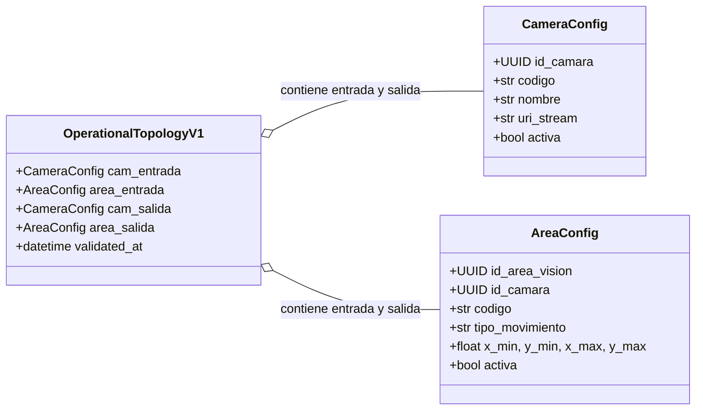
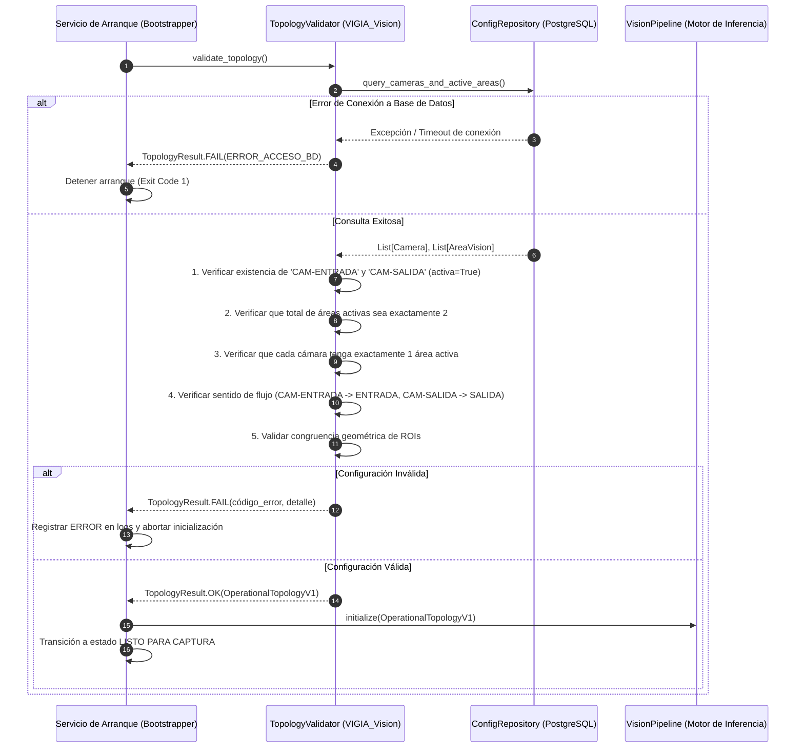

# DOC-03. Asignación y Validación de Posiciones Operativas

## 1. Control Documental
* **Proyecto:** VIGÍA Vision Systems
* **Subsistema:** `VIGIA_Vision` & `VIGIA_Core`
* **Documento:** DOC-03 — Asignación y Validación de Posiciones Operativas (Topología V1)
* **Fase:** Fase 1 — Especificación Formal y Validación de Topología
* **Estado:** Propuesta Técnica Aprobada para Diseño
* **Versión:** 1.0.0
* **Fecha:** 27 de octubre de 2026
* **Autor:** Arquitectura de Software VIGÍA

---

## 2. Objetivo y Alcance
Definir el contrato funcional, las reglas de negocio y la secuencia de validación técnica que el sistema VIGÍA debe ejecutar durante la fase de inicialización (*startup handshake*) antes de permitir la captura de video, la ingesta de fotogramas o la inferencia de visión artificial en la Versión 1 (V1).

El propósito central es **bloquear de forma determinista el arranque del motor de visión si la topología física y lógica de la caseta no cumple con la configuración estricta de dos posiciones operativas**: una dedicada a la Entrada y otra dedicada a la Salida.

---

## 3. Fuentes Analizadas y Evidencias
1. **Modelos de Dominio:** `Docs/fase_1/DOC-01_modelos_dominio.md` (Sección 7.3: validación de áreas operativas).
2. **Auditoría de Esquema SQL:** `Docs/fase_1/DOC-02_auditoria_esquema_bd.md` (Sección 3: distinción entre restricciones DDL y reglas de aplicación).
3. **Esquema Relacional:** `BD/migrations/V001__baseline_schema.sql`:
   * Tabla `camara` (líneas 267–297): PK `id_camara`, `codigo UNIQUE`, `uri_stream`, `activa`.
   * Tabla `area_vision` (líneas 307–344): PK `id_area_vision`, `id_camara FK`, `tipo_movimiento CHECK IN ('ENTRADA', 'SALIDA')`, `x_min, y_min, x_max, y_max NUMERIC(4,3)`, `activa`.
4. **Flujo de Ejecución del Prototipo:** `VR_Semaforo/vision/service.py` y `VR_Semaforo/app.py`.

---

## 4. Reglas Funcionales Obligatorias de V1

Para que el sistema se declare en estado operativo válido, la configuración leída de PostgreSQL debe cumplir simultáneamente las siguientes **ocho reglas funcionales**:

| Regla | Código de Regla | Definición Operativa | Nivel de Validación |
| :---: | :--- | :--- | :---: |
| **R1** | `VAL-CAM-ENTRADA` | Debe existir registrada y habilitada (`activa = TRUE`) la cámara con código `'CAM-ENTRADA'`. | Regla de Aplicación |
| **R2** | `VAL-CAM-SALIDA` | Debe existir registrada y habilitada (`activa = TRUE`) la cámara con código `'CAM-SALIDA'`. | Regla de Aplicación |
| **R3** | `VAL-AREAS-TOTAL` | Deben existir **exactamente dos** áreas de visión operativas activas (`activa = TRUE`) en todo el sistema. | Regla de Aplicación |
| **R4** | `VAL-ASOC-1A1` | Cada cámara operativa (`CAM-ENTRADA` y `CAM-SALIDA`) debe tener **exactamente un área activa asociada**. | Regla de Aplicación |
| **R5** | `VAL-MOV-ENTRADA` | El área activa asociada a `CAM-ENTRADA` debe tener obligatoriamente `tipo_movimiento = 'ENTRADA'`. | Regla de Aplicación |
| **R6** | `VAL-MOV-SALIDA` | El área activa asociada a `CAM-SALIDA` debe tener obligatoriamente `tipo_movimiento = 'SALIDA'`. | Regla de Aplicación |
| **R7** | `VAL-ROI-GEOM` | Las coordenadas de las dos áreas activas deben cumplir $0.0 \le x_{min} < x_{max} \le 1.0$ y $0.0 \le y_{min} < y_{max} \le 1.0$, y ser congruentes con la resolución de captura. | DDL (CHECK) + Aplicación |
| **R8** | `VAL-BLOCK-START` | El motor de visión **no debe iniciar el bucle de procesamiento** si cualquiera de las reglas R1 a R7 no se satisface. | Regla de Aplicación |

> **Nota de Integridad Arquitectónica:**  
> Como se demostró en DOC-02, el DDL de PostgreSQL define una cardinalidad relacional abierta `Camera 1 --> 0..* AreaVision`. Por tanto, las reglas R1, R2, R3, R4, R5, R6 y R8 son **responsabilidad absoluta del validador de la capa de aplicación**. La regla R7 está respaldada por la restricción `ck_area_vision_coordenadas` en SQL, pero la aplicación debe verificar que el rectángulo no sea infinitesimal frente a la resolución del stream.

---

## 5. Modelo de Configuración Operativa

El modelo de configuración en memoria durante el arranque no crea tablas nuevas ni duplica entidades. Se compone de estructuras inmutables que encapsulan la topología validada:

---

## 6. Secuencia de Validación Técnica

El proceso de arranque sigue un flujo determinista fail-fast ejecutado por el componente `TopologyValidator`:

---

## 7. Tratamiento y Taxonomía de Errores

Para garantizar un diagnóstico inmediato en los logs de auditoría y evitar mensajes genéricos, el validador clasificará las anomalías bajo la siguiente taxonomía:

| Código de Error Técnico | Condición Disparadora | Severidad | Acción del Sistema |
| :--- | :--- | :---: | :--- |
| `ERR_BD_CONEXION` | Fallo de conexión o timeout al consultar PostgreSQL. | **Crítica** | Abortar arranque. Reintentar según política de backoff. |
| `ERR_CAM_ENTRADA_FALTANTE` | No existe la cámara con `codigo = 'CAM-ENTRADA'` en la base de datos. | **Crítica** | Abortar arranque. Notificar configuración incompleta. |
| `ERR_CAM_SALIDA_FALTANTE` | No existe la cámara con `codigo = 'CAM-SALIDA'` en la base de datos. | **Crítica** | Abortar arranque. Notificar configuración incompleta. |
| `ERR_CAM_INACTIVA` | `CAM-ENTRADA` o `CAM-SALIDA` existe pero tiene `activa = FALSE`. | **Crítica** | Abortar arranque. Indicar habilitación administrativa requerida. |
| `ERR_AREAS_TOTAL_INVALIDO` | El conteo global de áreas con `activa = TRUE` es distinto de 2 ($N < 2$ o $N > 2$). | **Crítica** | Abortar arranque. Especificar lista de IDs de áreas encontradas. |
| `ERR_ASOCIACION_AREA_CAMARA` | Una cámara operativa tiene 0 o $>1$ áreas activas asociadas. | **Crítica** | Abortar arranque. Indicar qué cámara incumple la relación 1:1. |
| `ERR_MOVIMIENTO_INVERTIDO` | El área de `CAM-ENTRADA` no es `'ENTRADA'` o la de `CAM-SALIDA` no es `'SALIDA'`. | **Crítica** | Abortar arranque. Prevenir cruce de decisiones normativas. |
| `ERR_ROI_DEGENERADA` | Las coordenadas ROI son idénticas ($x_{min} = x_{max}$ o $y_{min} = y_{max}$) o el área resultante es menor al umbral mínimo técnico ($< 0.01$). | **Crítica** | Abortar arranque. Notificar calibración de ROI requerida. |

> **Distinción Operativa Fundamental:**  
> La bandera `camara.activa = TRUE` representa la **habilitación administrativa y lógica** del dispositivo en el catálogo del sistema. No debe confundirse con la **disponibilidad técnica del flujo de video** (cable desconectado, cámara apagada o fallo RTSP). Si la topología administrativa es válida pero el stream de video no responde, el validador aprueba la topología y es el componente de ingesta de captura el que reporta el fallo técnico en tiempo de ejecución (`CAMERA_ERROR`).

---

## 8. Criterios de Aceptación y Casos de Prueba Verificables

Para considerar cumplida la validación de la topología V1, se definen los siguientes casos de prueba concretos:

### CP-TOP-01: Configuración Nominal Correcta
* **Tipo:** Prueba de Integración.
* **Entrada (BD):**
  * `camara`: `('CAM-ENTRADA', activa=TRUE)`, `('CAM-SALIDA', activa=TRUE)`.
  * `area_vision`: `(id_cam_ent, 'ROI-ENT', 'ENTRADA', [0.1, 0.2, 0.9, 0.8], activa=TRUE)`, `(id_cam_sal, 'ROI-SAL', 'SALIDA', [0.1, 0.2, 0.9, 0.8], activa=TRUE)`.
* **Resultado Esperado:** `validate_topology()` retorna `SUCCESS`. El motor de visión recibe la topología y procede al arranque.

### CP-TOP-02: Ausencia de Cámara `CAM-SALIDA`
* **Tipo:** Prueba Unitaria / Integración.
* **Entrada (BD):** Solo existe registrada `CAM-ENTRADA`.
* **Resultado Esperado:** Retorna `FAILURE` con código `ERR_CAM_SALIDA_FALTANTE`. El arranque se bloquea con código de salida distinto de 0.

### CP-TOP-03: Cámara Adicional No Afecta si no Interfiere
* **Tipo:** Prueba Unitaria.
* **Entrada (BD):** Existen `CAM-ENTRADA` (activa), `CAM-SALIDA` (activa) y una tercera cámara `CAM-AUX` (inactiva o sin áreas activas asociadas). Las áreas activas totales del sistema siguen siendo exactamente 2 asociadas a Entrada y Salida.
* **Resultado Esperado:** `validate_topology()` retorna `SUCCESS`. Las cámaras accesorias sin áreas operativas son ignoradas por el validador de V1.

### CP-TOP-04: Cámara Operativa Inactiva
* **Tipo:** Prueba Unitaria.
* **Entrada (BD):** `CAM-ENTRADA` tiene `activa = FALSE`.
* **Resultado Esperado:** Retorna `FAILURE` con código `ERR_CAM_INACTIVA`. Motor bloqueado.

### CP-TOP-05: Áreas Activas Insuficientes ($N = 1$)
* **Tipo:** Prueba Unitaria.
* **Entrada (BD):** Existe área activa para Entrada, pero el área de Salida tiene `activa = FALSE`.
* **Resultado Esperado:** Retorna `FAILURE` con código `ERR_AREAS_TOTAL_INVALIDO` (esperadas 2, encontradas 1).

### CP-TOP-06: Más de Dos Áreas Activas en el Sistema ($N = 3$)
* **Tipo:** Prueba Unitaria.
* **Entrada (BD):** Existen 3 áreas activas registradas en la tabla `area_vision`.
* **Resultado Esperado:** Retorna `FAILURE` con código `ERR_AREAS_TOTAL_INVALIDO` (esperadas 2, encontradas 3). Motor bloqueado.

### CP-TOP-07: Dos Áreas Activas Asociadas a una Misma Cámara
* **Tipo:** Prueba Unitaria.
* **Entrada (BD):** `CAM-ENTRADA` tiene asociadas dos áreas activas; `CAM-SALIDA` no tiene ninguna asociada.
* **Resultado Esperado:** Retorna `FAILURE` con código `ERR_ASOCIACION_AREA_CAMARA` señalando a `CAM-ENTRADA`. Motor bloqueado.

### CP-TOP-08: Sentidos de Movimiento Invertidos
* **Tipo:** Prueba Unitaria.
* **Entrada (BD):** El área asociada a `CAM-ENTRADA` tiene `tipo_movimiento = 'SALIDA'`, y el área asociada a `CAM-SALIDA` tiene `tipo_movimiento = 'ENTRADA'`.
* **Resultado Esperado:** Retorna `FAILURE` con código `ERR_MOVIMIENTO_INVERTIDO`. Motor bloqueado para evitar fallos de seguridad física.

### CP-TOP-09: Coordenadas ROI Inválidas o Degeneradas
* **Tipo:** Prueba Unitaria.
* **Entrada (BD):** Área de Entrada configurada con $x_{min} = 0.5$, $x_{max} = 0.501$, $y_{min} = 0.1$, $y_{max} = 0.101$ (ancho y alto inferiores al umbral útil de resolución).
* **Resultado Esperado:** Retorna `FAILURE` con código `ERR_ROI_DEGENERADA`. Motor bloqueado.

### CP-TOP-10: Error de Conectividad con PostgreSQL
* **Tipo:** Prueba de Integración con Mock de Fallo de Red.
* **Entrada:** `ConfigRepository` lanza excepción de timeout o conexión rechazada al consultar `camara`.
* **Resultado Esperado:** Retorna `FAILURE` con código `ERR_BD_CONEXION`. La aplicación registra el stack trace en logs de error y no entra en bucle infinito de intentos no controlados.

---

## 9. Dependencias con Documentos Posteriores
* **DOC-04 (Contratos entre Módulos):** Definirá formalmente la interfaz del servicio `TopologyValidator` (`validate_topology() -> TopologyResult`) y su inyección en el orquestador principal de `VIGIA_Vision`.
* **DOC-05 (Plan de Pruebas Unitarias):** Incorporará los casos de prueba CP-TOP-01 al CP-TOP-10 dentro del conjunto automatizado de tests de integración y mocks de configuración.
* **DOC-06 (Matriz de Trazabilidad):** Asociará los requisitos RF-01 (Captura de video) y RF-05 (Validación de invariantes de seguridad) con las reglas R1 a R8 formalizadas en este documento.
