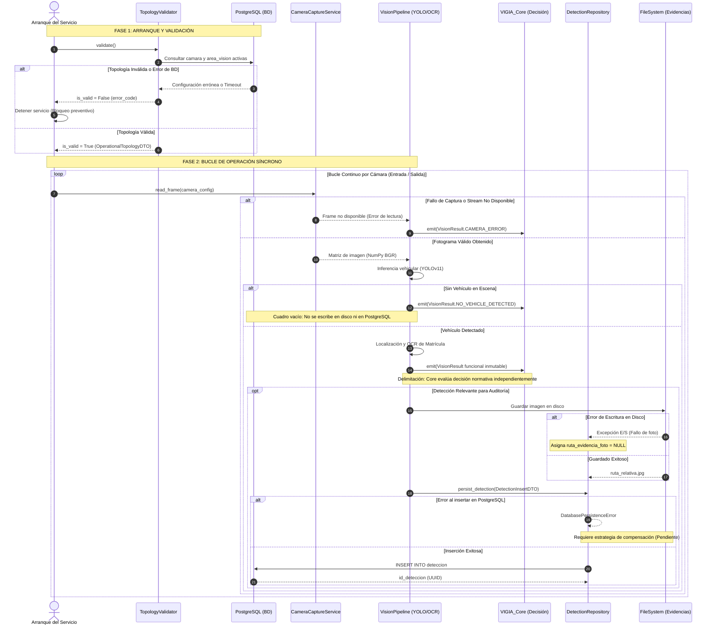

# DOC-04. Contratos entre Módulos

## 1. Control Documental
* **Proyecto:** VIGÍA Vision Systems
* **Subsistema:** `VIGIA_Vision`, `VIGIA_Core`, `VIGIA_IoT`, `VIGIA_API`
* **Documento:** DOC-04 — Contratos entre Módulos
* **Fase:** Fase 1 — Especificación Formal e Interfaces de Integración
* **Estado:** Propuesta Técnica de Contratos (Pendiente de Validación y Aprobación Técnica Final)
* **Versión:** 1.0.0
* **Fecha:** 27 de octubre de 2026
* **Autor:** Arquitectura de Software VIGÍA

---

## 1. Propósito y Alcance

### 1.1. Propósito
Definir de manera rigurosa, tipada e inequívoca las interfaces de comunicación, firmas de métodos, estructuras de datos de entrada/salida y políticas de manejo de excepciones entre los módulos que participan en el ciclo de captura, validación de topología, inferencia de visión artificial y persistencia relacional en la Versión 1 (V1) de VIGÍA Vision Systems.

### 1.2. Alcance
* **Dentro del Alcance de V1:**
  * Contrato de inicialización y validación de topología operativa (`TopologyValidator`).
  * Contrato de captura de fotogramas desde fuentes ópticas físicas (`CameraCaptureService`).
  * Contrato canónico del motor de inferencia de visión artificial (`VisionInferenceEngine` $\to$ `VisionResult`).
  * Contrato de persistencia relacional de detecciones y almacenamiento físico de evidencias (`DetectionRepository`).
  * Taxonomía y propagación de errores técnicos entre capas.
* **Fuera del Alcance de V1:**
  * Reglas de autorización y decisiones de apertura/cierre de barreras (responsabilidad exclusiva de `VIGIA_Core` y `VIGIA_Automation`).
  * Control de pines de microcontroladores y protocolos seriales (responsabilidad de `VIGIA_IoT`).
  * Streaming continuo por WebSockets o WebRTC hacia clientes externos (Fase 6 en `VIGIA_API`).

---

## 2. Arquitectura y Módulos Reales

A partir de la inspección directa del código fuente, las migraciones DDL y la documentación arquitectónica, se establece la matriz de estado real de los módulos:

| Módulo | Responsabilidad Verificada | Entradas | Salidas | Dependencias | Estado Real de Implementación | Discrepancias Detectadas |
| :--- | :--- | :--- | :--- | :--- | :--- | :--- |
| **`VIGIA_Core.domain`** | Modelos canónicos inmutables de dominio y decisión. | Datos de inferencia, políticas de acceso. | `VisionResult`, `AccessDecision`. | Biblioteca estándar de Python (`dataclasses`, `typing`, `uuid`). | **Implementado y Verificado** en [`VIGIA_Core/domain/vision_result.py`](file:///c:/GEST.PROY.TI/Software/VIGIA_Vision_Systems/VIGIA_Core/domain/vision_result.py) y [`access_decision.py`](file:///c:/GEST.PROY.TI/Software/VIGIA_Vision_Systems/VIGIA_Core/domain/access_decision.py). | Docstring de `VisionResult` lista `'AUTOBUS'`, pero el DDL SQL solo admite `'OTRO'`. |
| **`VIGIA_Vision`** | Captura, preprocesamiento e inferencia de vehículos y matrículas. | Streams de video / imágenes. | `VisionResult` inmutable hacia Core. | OpenCV, PyTorch, Ultralytics YOLOv11. | **Propuesto para V1**. En el repo solo existen carpetas vacías `capture/` y `detection/` con `README.md`. | En `VR_Semaforo` el prototipo procesa frames de forma acoplada con Arduino. |
| **`VR_Semaforo` (PoC)** | Prototipo experimental de semáforo inteligente. | Webcam local / HTTP POST móvil. | JSON a frontend, pulsos a Arduino por serial. | Flask, OpenCV, PyTorch, Ultralytics, PySerial. | **Implementado y Verificado** como prototipo de referencia aislado. | Monolítico; `database.py` tiene 0 bytes; no persiste en PostgreSQL. |
| **Base de Datos (PostgreSQL)** | Persistencia de catálogos, configuración y auditoría. | Conexiones SQL / Parámetros tipados. | Tuplas relacionales, claves foráneas. | PostgreSQL 16+, extensión `pgcrypto`. | **Implementado y Verificado** en migraciones `V000` a `V003`. | Ningún componente Python actual invoca las tablas `camara` o `deteccion`. |
| **`VIGIA_IoT`** | Control de hardware físico (barrera, servomotor, lazo inductivo). | Órdenes de actuación validadas. | Confirmación de sensores de tope y despeje. | Microcontroladores (Arduino/ESP32). | **Fase 0 (Documental)**. Solo contiene `README.md`. | No implementado en código VIGIA. |
| **`VIGIA_API`** | Exposición de servicios REST y WebSockets hacia el Dashboard. | Peticiones HTTP de clientes web/móvil. | Respuestas JSON, eventos en tiempo real. | Framework web asíncrono (FastAPI / Flask). | **Fase 0 (Documental)**. Solo contiene `README.md`. | No implementado en código VIGIA. |

---

## 3. Contrato de Arranque y Validación de Topología

### 3.1. Definición de la Interfaz
Conforme a lo fundamentado en DOC-03, el servicio de visión debe validar de forma *fail-fast* la topología operativa en PostgreSQL antes de instanciar recursos de captura o inferencia:

```python
# Contrato Propuesto para V1 (VIGIA_Vision.config.topology_validator)
from dataclasses import dataclass
from typing import Optional
from uuid import UUID

@dataclass(frozen=True)
class CameraConfigDTO:
    id_camara: UUID
    codigo: str
    nombre: str
    uri_stream: str
    activa: bool

@dataclass(frozen=True)
class AreaConfigDTO:
    id_area_vision: UUID
    id_camara: UUID
    codigo: str
    nombre: str
    tipo_movimiento: str  # 'ENTRADA' | 'SALIDA'
    x_min: float
    y_min: float
    x_max: float
    y_max: float
    activa: bool

@dataclass(frozen=True)
class OperationalTopologyDTO:
    cam_entrada: CameraConfigDTO
    area_entrada: AreaConfigDTO
    cam_salida: CameraConfigDTO
    area_salida: AreaConfigDTO

@dataclass(frozen=True)
class TopologyValidationResult:
    is_valid: bool
    topology: Optional[OperationalTopologyDTO] = None
    error_code: Optional[str] = None
    error_detail: Optional[str] = None

class ITopologyValidator:
    def validate(self) -> TopologyValidationResult:
        """
        Consulta PostgreSQL y verifica las 8 reglas obligatorias de DOC-03:
        1. Existe 'CAM-ENTRADA' y activa=True
        2. Existe 'CAM-SALIDA' y activa=True
        3. Total de áreas activas en el sistema es exactamente 2
        4. Exactamente 1 área activa asociada por cámara operativa
        5. Área de CAM-ENTRADA tiene tipo_movimiento = 'ENTRADA'
        6. Área de CAM-SALIDA tiene tipo_movimiento = 'SALIDA'
        7. Coordenadas ROI válidas en [0.0, 1.0] y no degeneradas
        8. Bloqueo determinista del arranque si cualquier regla se incumple
        """
        ...
```

### 3.2. Aclaración Fundamental: Topología vs. Disponibilidad de Stream
* **Validación de Topología (Lógica/Administrativa):** Garantiza que la configuración relacional de la caseta es válida y consistente (existen las dos cámaras físicas, sus dos áreas operativas activas con movimientos correspondientes y ROIs válidas).
* **Disponibilidad del Stream (Técnica/Runtime):** **No está garantizada por una topología válida**. Que la fila exista en PostgreSQL con `activa = TRUE` no asegura que el cable de red esté conectado, que el dispositivo móvil esté encendido o que el servidor RTSP responda. Dicha falla es manejada por el contrato de captura en tiempo de ejecución.

---

## 4. Contrato de Captura de Fotogramas

### 4.1. Responsabilidades del Componente de Captura
1. Recibir la configuración validada de la cámara (`CameraConfigDTO`).
2. Abrir y mantener el descriptor del origen de video (`cv2.VideoCapture` para streams locales/RTSP, o receptor de peticiones para ingesta móvil).
3. Entregar una matriz bidimensional/tridimensional de imagen decodificada (NumPy BGR `uint8`) lista para inferencia.
4. Detectar desconexiones, fotogramas corruptos o pérdida de señal.
5. Liberar descriptores de archivo (`release()`) ante detención.

### 4.2. Firma Propuesta para V1
```python
# Contrato Propuesto para V1 (VIGIA_Vision.capture.base)
from typing import Optional, Tuple
import numpy as np

class CaptureError(Exception):
    """Excepción base para fallos de adquisición de video."""
    pass

class CameraUnavailableError(CaptureError):
    """La cámara no responde, descriptor no abierto o stream caído."""
    pass

class FrameCorruptedError(CaptureError):
    """El fotograma no pudo ser decodificado o viene vacío."""
    pass

class IFrameCaptureSource:
    def read_frame(self) -> Tuple[bool, Optional[np.ndarray]]:
        """
        Lee el siguiente cuadro disponible.
        Retorna:
          (True, frame_ndarray) ante lectura exitosa.
          (False, None) si la cámara no pudo entregar el fotograma.
        """
        ...
    
    def release(self) -> None:
        """Libera descriptores de hardware o sockets de red."""
        ...
```

---

## 5. Contrato del Motor de Visión Artificial

### 5.1. Referencia Canónica: `VisionResult`
*Evidencia Verificada:* [`VIGIA_Core/domain/vision_result.py`](file:///c:/GEST.PROY.TI/Software/VIGIA_Vision_Systems/VIGIA_Core/domain/vision_result.py), líneas 20–124.

* **Estados Semánticos (`VisionStatus`):**
  * `VEHICLE_DETECTED_PLATE_READ`: Vehículo presente y placa leída con certeza.
  * `VEHICLE_DETECTED_PLATE_UNREADABLE`: Vehículo presente, placa ilegible o con baja confianza.
  * `VEHICLE_DETECTED_NO_PLATE`: Vehículo presente sin matrícula visible.
  * `NO_VEHICLE_DETECTED`: Cuadro procesado sin vehículos en la escena.
  * `CAMERA_ERROR`: Fallo técnico de hardware o lectura de frame.
  * `VISION_ERROR`: Excepción no controlada durante la inferencia matemática de IA.
* **Invariantes Obligatorias Validadas en `__post_init__`:**
  * Si `status` es error técnico (`CAMERA_ERROR` o `VISION_ERROR`), `vehicle_detected` debe ser obligatoriamente `False`.
  * Si `plate_text` está presente, `plate_confidence` debe existir obligatoriamente ($0.0 \le c \le 1.0$).
  * Las confianzas (`vehicle_confidence`, `plate_confidence`) deben encontrarse en el rango cerrado $[0.0, 1.0]$.
* **Principio de Diseño:** `VIGIA_Vision` es el productor exclusivo de `VisionResult`. No se permite crear contratos alternativos ni copias de esta clase.

### 5.2. Discrepancia Técnica y Alternativas: `AUTOBUS` vs. `OTRO`
* **Situación Verificada:**
  * En `VIGIA_Core/domain/vision_result.py` (L66), el docstring define como valores esperados: `'AUTOMOVIL'`, `'CAMIONETA'`, `'MOTOCICLETA'`, `'AUTOBUS'`, `'CAMION'`.
  * En `BD/migrations/V001__baseline_schema.sql` (L384–391), la restricción `ck_deteccion_tipo_vehiculo` exige:
    `CHECK (tipo_vehiculo_pred IS NULL OR tipo_vehiculo_pred IN ('AUTOMOVIL', 'CAMIONETA', 'CAMION', 'MOTOCICLETA', 'OTRO'))`.
  * En `VR_Semaforo/vision/processor.py` (L51), el modelo YOLOv11 filtra las clases COCO `classes=[2, 3, 5, 7]` correspondientes a `car` (2), `motorcycle` (3), `bus` (5) y `truck` (7). En el prototipo actual, esta salida se utiliza exclusivamente para conteo vehicular y no para clasificar o persistir en base de datos.
* **Alternativas Posibles y Consecuencias:**
  1. *Alternativa 1 (Mapeo en la Capa de Aplicación / Repositorio):*
     * *Mecanismo:* Si el clasificador produce `'AUTOBUS'`, la capa de persistencia lo traduce a `'OTRO'` (o `'CAMION'`) antes de ejecutar el `INSERT`.
     * *Consecuencia:* Respeta el DDL actual sin requerir migraciones. Sin embargo, degrada la precisión semántica al perder la distinción explícita de autobuses en la base de datos.
  2. *Alternativa 2 (Ampliación Formal del Esquema mediante Migración DDL V004):*
     * *Mecanismo:* Modificar el constraint `ck_deteccion_tipo_vehiculo` para incorporar explícitamente `'AUTOBUS'`.
     * *Consecuencia:* Mantiene la riqueza semántica alineada entre modelo de IA, dominio y base de datos, pero exige versionar y ejecutar una migración DDL adicional en PostgreSQL.
  * **Estado de la Decisión:** **Pendiente de Decisión Colegiada**. Ninguna de las dos alternativas se asume como definitiva en este documento hasta contar con la aprobación funcional.

---

## 6. Contrato de Persistencia y Evidencia

### 6.1. Especificación de la Interfaz del Repositorio
```python
# Contrato Propuesto para V1 (VIGIA_Vision.repository.detection_repository)
from dataclasses import dataclass
from datetime import datetime
from typing import Optional
from uuid import UUID

@dataclass(frozen=True)
class DetectionInsertDTO:
    """
    Datos estructurados requeridos para insertar en la tabla relacional 'deteccion'.
    Mapea de forma estricta contra las columnas y restricciones de V001__baseline_schema.sql.
    """
    id_area_vision: UUID                  # NOT NULL, FK a area_vision
    fecha_hora: datetime                  # NOT NULL, TIMESTAMPTZ
    placa_detectada: Optional[str]        # NULL o cadena en mayúsculas sin espacios ni guiones
    confianza_placa: Optional[float]      # NULL o float en [0.0, 1.0]
    confianza_vehiculo: Optional[float]   # NULL o float en [0.0, 1.0]
    tipo_vehiculo_pred: Optional[str]     # NULL o valor compatible con ck_deteccion_tipo_vehiculo
    ruta_evidencia_foto: Optional[str]    # NULL o ruta relativa válida (no vacía)

class IDetectionRepository:
    def persist_detection(self, data: DetectionInsertDTO) -> UUID:
        """
        Inserta un registro en la tabla relacional 'deteccion'.
        Retorna el id_deteccion generado por PostgreSQL.
        Lanza DatabasePersistenceError ante fallos de conexión o violación de CHECK.
        Nota: No realiza almacenamiento de archivos físicos en disco.
        """
        ...
```

### 6.2. Delimitación de Responsabilidades y Gestión de Evidencias
* **Persistencia Relacional vs. Almacenamiento de Archivos:**
  * `IDetectionRepository` es responsable **exclusivamente de la persistencia de datos relacionales en PostgreSQL** (tabla `deteccion`).
  * El guardado físico del archivo de imagen en disco local es responsabilidad de un componente independiente de almacenamiento (`IFileStorageService`).
  * La columna `deteccion.ruta_evidencia_foto` almacena únicamente una referencia textual relativa; **no garantiza por sí misma la existencia, integridad ni persistencia del archivo en disco**.
* **Diferenciación de Tipos de Evidencia Visual:**
  1. *Imagen Original Capturada:* Fotograma crudo recibido de la cámara (NumPy BGR / JPEG sin procesar). Esencial para auditoría forense sin alteraciones.
  2. *Imagen Anotada:* Fotograma intervenido con las cajas delimitadoras (*bounding boxes*), etiquetas de clase y porcentajes de confianza dibujados por YOLO (`result.plot()`). Facilita la supervisión humana inmediata por parte del operador de caseta.
  3. *Evidencia para Aprendizaje Activo (*Active Learning*):* Fotogramas con detección ambigua o baja confianza (en `VR_Semaforo`, rango $[0.20, 0.50)$ guardado en `dataset_dudoso/`) destinados exclusivamente al reentrenamiento del modelo.
  * **Estado de la Decisión:** La elección operativa entre almacenar la imagen original o la anotada para la auditoría de acceso general continúa **pendiente de validación funcional**.
* **Análisis de Fallos Parciales (Falta de Atomicidad 2PC):**
  * Al no existir una transacción atómica entre el sistema de archivos del sistema operativo y PostgreSQL, se presentan dos escenarios de fallo:
    1. *Fallo A (Fallo de Escritura en Disco):* El archivo JPEG no se puede escribir (disco lleno o permisos).  
       *Tratamiento:* Se registra el error en logs y se invoca `persist_detection()` con `ruta_evidencia_foto = NULL`. La auditoría de la detección se conserva.
    2. *Fallo B (Fallo de Inserción SQL tras Guardado de Imagen):* La imagen JPEG se escribe exitosamente en disco, pero el `INSERT` en PostgreSQL falla (caída de red o violación de restricción).  
       *Consecuencia:* Se genera un **archivo huérfano en disco** sin fila asociada en la base de datos.  
       *Alternativas de Mitigación (Decisión Pendiente):*
       * *Estrategia 1 (Eliminación Compensatoria Inmediata):* En el bloque `except` de inserción SQL, intentar eliminar defensivamente el archivo recién escrito (`os.remove()`).
       * *Estrategia 2 (Proceso Periódico de Reconciliación):* Un script o tarea de mantenimiento detecta archivos en el directorio de evidencias cuya ruta no figure en la tabla `deteccion` y los purga.  
       *Aclaración:* **Ninguna de estas estrategias de compensación está implementada actualmente**. Su diseño definitivo queda pendiente de resolución.

### 6.3. Restricción SQL y Normalización de Matrículas
* **Restricción Real en DDL (`V001__baseline_schema.sql`, L364–370):**
  ```sql
  CHECK (
      placa_detectada IS NULL
      OR (
          placa_detectada = UPPER(BTRIM(placa_detectada))
          AND placa_detectada !~ '[[:space:]-]'
          AND placa_detectada <> ''
      )
  )
  ```
* **Estado de la Normalización:**
  * El DDL exige mayúsculas y prohíbe espacios y guiones en `placa_detectada`.
  * **No se debe aplicar una eliminación arbitraria de caracteres sin validación previa**. Suprimir caracteres sin control puede alterar matrículas no convencionales.
  * El sistema no posee una columna separada para almacenar el texto crudo emitido por el OCR.
  * **Decisión Pendiente:** Queda pendiente aprobar formalmente el catálogo de expresiones regulares y la política de normalización segura que validará el texto reconocido antes de autorizar su persistencia en PostgreSQL.

---

## 7. Contratos y Taxonomía de Errores

| Categoría de Error | Origen Técnico | Excepción / Estado Asociado | Impacto en el Sistema | Acción / Comportamiento |
| :--- | :--- | :--- | :---: | :--- |
| **Topología Inválida** | Base de Datos / Configuración | `TopologyValidationError` (códigos de DOC-03) | **Crítico** | **Bloquea el arranque** del motor de visión. El servicio termina con código de salida no nulo. |
| **Fallo de Conexión a BD** | Red / PostgreSQL caído | `DatabaseConnectionError` | **Crítico** | Bloquea arranque o pausa el bucle con política de reintentos escalonados. |
| **Fallo de Cámara / Stream** | Pérdida de señal / Cable desconectado | `CameraUnavailableError` $\to$ `VisionStatus.CAMERA_ERROR` | **Operativo (Local)** | No bloquea el sistema. Emite `VisionResult(status=CAMERA_ERROR)` hacia Core. Reintenta conexión. |
| **Fallo de Inferencia IA** | Excepción en PyTorch / Memoria GPU | `InferenceExecutionError` $\to$ `VisionStatus.VISION_ERROR` | **Transaccional (Cuadro)** | Emite `VisionResult(status=VISION_ERROR)` con mensaje técnico. El motor continúa operando el siguiente cuadro. |
| **Fallo de Almacenamiento Foto** | Disco lleno / Permisos de E/S | `StorageWriteError` | **Secundario** | No detiene el motor. Se persiste la fila en `deteccion` con `ruta_evidencia_foto = NULL`. |
| **Fallo de Inserción SQL** | Violación de CHECK / Timeout SQL | `DatabasePersistenceError` | **Operativo** | Registra error crítico en log. Dispara alerta técnica sin detener el servicio. |

---

## 8. Flujo de Extremo a Extremo (Diagrama Mermaid)



---

## 9. Matriz de Contratos de Integración

| ID Contrato | Módulo Emisor | Módulo Receptor | Datos Intercambiados | Condiciones Previas | Resultado Esperado | Posibles Errores | Estado de Implementación |
| :---: | :--- | :--- | :--- | :--- | :--- | :--- | :---: |
| **C-01** | `Bootstrapper` | `TopologyValidator` | Solicitud de validación sin parámetros. | Conexión con PostgreSQL disponible. | `TopologyValidationResult` con topología o código de error. | `ERR_BD_CONEXION`, errores de DOC-03. | **Propuesto para V1** |
| **C-02** | `TopologyValidator` | PostgreSQL | Consulta SQL relacional sobre `camara` y `area_vision`. | Base de datos inicializada (`V000`–`V003`). | Conjunto de tuplas relacionales tipadas. | Conexión rechazada, timeout de red. | **Propuesto para V1** (Esquema verificado) |
| **C-03** | Motor de Visión | `CameraCaptureService` | Descriptor de cámara (`uri_stream`, resolución). | Topología validada previamente. | `(True, ndarray)` o `(False, None)`. | Stream no responde, socket roto. | **Propuesto para V1** (PoC existe en `VR_Semaforo`) |
| **C-04** | Motor de Visión | `VIGIA_Core` | Instancia inmutable de `VisionResult`. | Cuadro evaluado por pipeline de IA. | Entrega del resultado estructurado hacia decisión. | Violación de invariantes en `__post_init__`. | **Verificado** en `VIGIA_Core` |
| **C-05** | Motor de Visión | Almacenamiento Local | Matriz de imagen + Metadatos de compresión JPEG. | Detección vehicular confirmada en carril. | Ruta de archivo escrita en disco. | Disco lleno, permisos denegados. | **Propuesto para V1** (PoC parcial en `VR_Semaforo`) |
| **C-06** | Motor de Visión | `DetectionRepository` | `DetectionInsertDTO` (placa, confianzas, ruta foto). | Área operativa válida y conexión BD activa. | Clave primaria `id_deteccion UUID`. | Violación de CHECK de placa o tipo de vehículo. | **Propuesto para V1** (Esquema verificado) |

---

## 10. Decisiones Técnicas Pendientes

Las siguientes decisiones permanecen abiertas y no deben resolverse mediante supuestos sin validación colegiada:

1. **Resolución de la Discrepancia `AUTOBUS` vs. `OTRO`:**
   * *Estado:* Pendiente de Decisión Colegiada.
   * *Alternativas:* Mapeo transitorio en la capa de persistencia hacia `'OTRO'` vs. ampliación formal del DDL mediante migración V004.
2. **Definición Formal de Formatos de Matrícula y Normalización:**
   * *Estado:* Pendiente de Especificación Técnica.
   * *Riesgo:* Eliminar guiones o espacios a ciegas puede adulterar matrículas no estándar. Se requiere aprobar las expresiones regulares oficiales de validación.
3. **Umbral Numérico de Confianza para Persistencia de Evidencia:**
   * *Estado:* Pendiente de calibración experimental con el modelo final YOLOv11 en caseta.
4. **Política Formal de Reconciliación ante Fallos Parciales de Inserción:**
   * *Estado:* Pendiente de diseño de software (eliminación inmediata defensiva vs. proceso por lotes de purga de archivos huérfanos).
5. **Formato Gráfico de la Evidencia Almacenada:**
   * *Estado:* Pendiente de validación operativa entre imagen limpia original o imagen anotada con recuadros de detección.

---

## 11. Criterios de Aceptación del Documento

Para considerar técnicamente consistente y aprobado este documento DOC-04:
1. **Fidelidad Contractual:** Todos los atributos y estados de `VisionResult` coinciden exactamente con la clase inmutable de `VIGIA_Core/domain/vision_result.py`.
2. **Coherencia con DOC-03:** Las 8 reglas de validación de topología se integran formalmente en la secuencia de arranque sin contradicciones.
3. **Alineación con el DDL:** Todos los campos y tipos del contrato `DetectionInsertDTO` respetan los tipos de datos y restricciones CHECK de `BD/migrations/V001__baseline_schema.sql`.
4. **Desacoplamiento de Responsabilidades:** No se atribuyen al motor de visión decisiones de acceso vehicular (autorizar/denegar) ni control de hardware.
5. **Transparencia de Implementación:** Se distingue explícitamente entre el código existente en `VIGIA_Core` y `VR_Semaforo`, las tablas existentes en PostgreSQL y los componentes propuestos para construcción en `VIGIA_Vision`.

---

## 12. Trazabilidad y Fuentes de Información
* **Modelos de Dominio:** [`Docs/fase_1/DOC-01_modelos_dominio.md`](file:///c:/GEST.PROY.TI/Software/VIGIA_Vision_Systems/Docs/fase_1/DOC-01_modelos_dominio.md)
* **Auditoría de Esquema:** [`Docs/fase_1/DOC-02_auditoria_esquema_bd.md`](file:///c:/GEST.PROY.TI/Software/VIGIA_Vision_Systems/Docs/fase_1/DOC-02_auditoria_esquema_bd.md)
* **Validación de Posiciones:** [`Docs/fase_1/DOC-03_asignacion_validacion_posiciones.md`](file:///c:/GEST.PROY.TI/Software/VIGIA_Vision_Systems/Docs/fase_1/DOC-03_asignacion_validacion_posiciones.md)
* **Línea Base DDL:** [`BD/migrations/V001__baseline_schema.sql`](file:///c:/GEST.PROY.TI/Software/BD/migrations/V001__baseline_schema.sql)
* **Contrato Canónico de Salida:** [`VIGIA_Core/domain/vision_result.py`](file:///c:/GEST.PROY.TI/Software/VIGIA_Vision_Systems/VIGIA_Core/domain/vision_result.py)
* **Contrato de Decisión de Acceso:** [`VIGIA_Core/domain/access_decision.py`](file:///c:/GEST.PROY.TI/Software/VIGIA_Vision_Systems/VIGIA_Core/domain/access_decision.py)
* **Prototipo Funcional de Captura e Inferencia:** [`VR_Semaforo/vision/processor.py`](file:///c:/GEST.PROY.TI/Software/VIGIA_Vision_Systems/VR_Semaforo/vision/processor.py) y [`VR_Semaforo/app.py`](file:///c:/GEST.PROY.TI/Software/VIGIA_Vision_Systems/VR_Semaforo/app.py)
