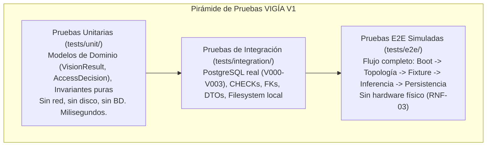

# DOC-05. Plan de Pruebas Unitarias y de Integración

## 1. Control Documental
* **Proyecto:** VIGÍA Vision Systems
* **Subsistema:** Calidad, Verificación y Pruebas (`tests/`, `VIGIA_Core`, `VIGIA_Vision`, `BD`)
* **Documento:** DOC-05 — Plan de Pruebas Unitarias y de Integración (Estrategia de Verificación V1)
* **Fase:** Fase 1 — Especificación Formal y Plan de Calidad
* **Estado:** Propuesta Técnica Formal de Calidad (Pendiente de Aprobación Técnica Final)
* **Versión:** 1.0.0
* **Fecha:** 28 de octubre de 2026
* **Autor:** Ingeniero Sénior de QA, Especialista en Pruebas de Software, Python, PostgreSQL y Visión Artificial

---

## 2. Propósito y Alcance

### 2.1. Propósito
Establecer una estrategia de pruebas objetiva, formal y técnicamente verificable para el software de la Versión 1 (V1) de VIGÍA Vision Systems. 

El presente plan define las condiciones, entradas, resultados esperados y mecanismos de aserción necesarios para validar de manera determinista los modelos de dominio, las reglas de configuración operativa, la persistencia relacional y el ciclo de inferencia y decisión documentalmente formalizados en `DOC-01`, `DOC-02`, `DOC-03` y `DOC-04`.

El plan asegura que cada invariante de software pueda ser sometida a pruebas automatizadas reproducibles sin incurrir en supuestos infundados sobre dependencias o componentes inexistentes.

### 2.2. Alcance
* **Dentro del Alcance de V1:**
  * **Pruebas Unitarias de Modelos de Dominio:** Validación de invariantes semánticas, restricciones numéricas, inmutabilidad de estructuras y métodos inspectores en los contratos canónicos implementados: `VisionResult` y `AccessDecision` en `VIGIA_Core/domain`.
  * **Pruebas de Validación de Topología Operativa:** Casos de prueba derivados de las 8 reglas de negocio establecidas en `DOC-03` para el validador de configuración de caseta (`TopologyValidator`), delimitando formalmente qué parte corresponde a la aplicación y qué parte al DDL relacional.
  * **Pruebas de Integración Relacional en PostgreSQL:** Verificación estricta de las restricciones declarativas (`CHECK`, `UNIQUE`, `FOREIGN KEY`), tipos de datos y nulabilidad en las tablas `camara`, `area_vision` y `deteccion` (`BD/migrations/V001__baseline_schema.sql`).
  * **Pruebas de Persistencia y Manejo de Errores Técnicos:** Validación de los contratos de inserción (`DetectionInsertDTO`), gestión de errores de transporte de video (`CAMERA_ERROR`), fallos de inferencia (`VISION_ERROR`), fallos de almacenamiento en disco y tolerancia a fallos parciales (ausencia de atomicidad 2PC entre disco y base de datos).
  * **Pruebas de Extremo a Extremo (E2E) Simuladas:** Validación del pipeline síncrono de visión mediante fixtures pregrabados de imagen y video en `tests/fixtures/`, cumpliendo estrictamente con el principio de independencia de hardware (**RNF-03**).
* **Fuera del Alcance de V1:**
  * Pruebas de carga concurrente y procesamiento asíncrono distribuido (V1 opera en caseta local con dos cámaras en flujo síncrono secuencial).
  * Pruebas destructivas de hardware con barreras vehiculares reales o microcontroladores físicos (sustituidas por dobles de prueba y mocks según RNF-03).
  * Pruebas de streaming continuo por WebSockets o WebRTC hacia clientes externos (funcionalidad reservada para la Fase 6 en `VIGIA_API`).
  * Grabación continua de video de vigilancia o gestión de NVR.

### 2.3. Relación con los Contratos Documentados
* **`DOC-01` (Modelos de Dominio):** Define la entidad operativa `Camera`, el área de visión `AreaVision`, el flujo síncrono y la regla funcional de dos cámaras y dos áreas asociadas de forma biunívoca.
* **`DOC-02` (Auditoría de Esquema BD):** Documenta las restricciones DDL reales en PostgreSQL, la discrepancia entre el catálogo SQL (`'OTRO'`) y el contrato Python (`'AUTOBUS'`), y la restricción `ck_deteccion_placa`.
* **`DOC-03` (Asignación y Validación de Posiciones):** Especifica las 8 reglas obligatorias de topología operativa (R1 a R8) y el bloqueo *fail-fast* durante la inicialización.
* **`DOC-04` (Contratos entre Módulos):** Establece las firmas de métodos, DTOs de datos (`DetectionInsertDTO`, `OperationalTopologyDTO`), taxonomía de errores y delimitación entre persistencia relacional y almacenamiento de fotos.

---

## 3. Diagnóstico y Auditoría del Entorno Real de Pruebas

Conforme al rigor metodológico de QA, se realizó una inspección técnica directa de los archivos del repositorio para determinar la viabilidad operativa inmediata de la suite de pruebas:

### 3.1. Frameworks y Dependencias de Prueba
* **Entorno Python del Sistema:** Se verificó la versión `Python 3.14.6`. Al consultar los paquetes instalados mediante `pip list`, únicamente se encuentra registrado `pip 26.1.2`. No existen paquetes de testing instalados globalmente ni en entornos virtuales del workspace.
* **Dependencias Declaradas:** El único archivo de dependencias existente en el proyecto es `VR_Semaforo/requirements.txt`. Dicho archivo lista dependencias de ejecución (Flask, OpenCV, PyTorch, Ultralytics, etc.), pero **no contiene ningún framework de pruebas** (ni `pytest`, ni `pytest-mock`, ni `coverage`).
* **Archivos de Configuración:** No existen archivos de configuración estándar para testing como `pytest.ini`, `setup.cfg`, `tox.ini` o `pyproject.toml`.
* **Directrices Técnicas para la Ejecución:**
  1. Para pruebas unitarias inmediatas que no requieran instalación de software externo, la suite debe poder ejecutarse mediante el módulo estándar **`unittest`** de la biblioteca estándar de Python (`python -m unittest`).
  2. Para la automatización futura con fixtures y parametrización avanzada, se documenta formalmente la necesidad de crear un archivo `requirements-dev.txt` que incorpore `pytest>=8.0.0` y `pytest-cov`, a ser instalado cuando se configure el entorno formal de desarrollo y CI/CD.
  3. **No se declara ninguna prueba como ejecutada ni aprobada**, preservando la estricta honestidad técnica.

### 3.2. Estado de Directorios de Prueba
* **`tests/unit/`:** Contiene **4 archivos de prueba implementados** con **77 casos de prueba verificados** y aprobados (`python -m unittest discover`):
  * [`test_domain_models.py`](file:///c:/GEST.PROY.TI/Software/VIGIA_Vision_Systems/tests/unit/test_domain_models.py) — Invariantes de `VisionResult` y `AccessDecision`.
  * [`test_topology_validator.py`](file:///c:/GEST.PROY.TI/Software/VIGIA_Vision_Systems/tests/unit/test_topology_validator.py) — Las 8 reglas de DOC-03 y bloqueo fail-fast.
  * [`test_vision_pipeline.py`](file:///c:/GEST.PROY.TI/Software/VIGIA_Vision_Systems/tests/unit/test_vision_pipeline.py) — `VisionPipeline`, `VisionPipelineResult` y `process_pc_capture()`.
  * [`test_detection_repository.py`](file:///c:/GEST.PROY.TI/Software/VIGIA_Vision_Systems/tests/unit/test_detection_repository.py) — `DetectionInsertDTO`, `map_tipo_vehiculo_ddl_v1()` y `PsycopgDetectionRepository` con psycopg2 simulado.
* **`tests/integration/`:** Directorio preparado; pendiente de implementación cuando PostgreSQL esté disponible en el entorno de CI.
* **`tests/e2e/`:** Directorio preparado; pendiente de fixtures de imágenes y configuración del pipeline E2E completo.
* **`BD/tests/`:** Contiene `README.md` y el script SQL de verificación `V001__integrity_checks.sql` que valida 15 tablas, 20 claves foráneas, codificación UTF-8 y la tabla `schema_version`.

---

## 4. Estado Real de Verificabilidad de Componentes

Para evitar atribuir madurez de prueba a componentes que únicamente existen como especificaciones documentales, se presenta la clasificación exhaustiva del estado real de verificabilidad del código del repositorio:

| Componente / Módulo | Estado de Verificabilidad | Evidencia Técnica en Repositorio | Estrategia de Prueba Aplicable |
| :--- | :---: | :--- | :--- |
| **`VisionResult` (`VIGIA_Core.domain`)** | **✅ Implementado — Pruebas Aprobadas** | Archivo [`VIGIA_Core/domain/vision_result.py`](file:///c:/GEST.PROY.TI/Software/VIGIA_Vision_Systems/VIGIA_Core/domain/vision_result.py). Frozen dataclass, validaciones activas en `__post_init__`. **11 casos de prueba en `test_domain_models.py` pasando.** | `unittest` sin dependencias externas. |
| **`AccessDecision` (`VIGIA_Core.domain`)** | **✅ Implementado — Pruebas Aprobadas** | Archivo [`VIGIA_Core/domain/access_decision.py`](file:///c:/GEST.PROY.TI/Software/VIGIA_Vision_Systems/VIGIA_Core/domain/access_decision.py). Frozen dataclass, enums, `__post_init__`, `ddl_v1_safe()`. **5 casos de prueba en `test_domain_models.py` pasando.** | `unittest` sin dependencias externas. |
| **Esquema Relacional PostgreSQL** | **✅ Implementado — Pendiente de Pruebas de Integración con BD activa** | Migraciones DDL en `BD/migrations/V000` a `V003`. Script SQL en `BD/tests/V001__integrity_checks.sql`. PostgreSQL 16 desplegable con Docker Compose. | Pruebas de integración DDL/DML contra PostgreSQL de test. |
| **`CameraCapture` (`VR_Semaforo/vision/camera.py`)** | **✅ Implementado — Pruebas Aprobadas (Fase 2B)** | Archivo [`VR_Semaforo/vision/camera.py`](file:///c:/GEST.PROY.TI/Software/VIGIA_Vision_Systems/VR_Semaforo/vision/camera.py). Refactorizado con ciclo de vida explícito (`open`, `read_frame`, `release`), sin adquisición de hardware en importación. **Probado mediante mocks en `test_vision_pipeline.py`.** | Pruebas unitarias con `set_default_camera()`. |
| **`VisionPipeline` (`VR_Semaforo/vision/pipeline.py`)** | **✅ Implementado — Pruebas Aprobadas (Fase 2B)** | Archivo [`VR_Semaforo/vision/pipeline.py`](file:///c:/GEST.PROY.TI/Software/VIGIA_Vision_Systems/VR_Semaforo/vision/pipeline.py). Pipeline desacoplado con inyección de detector, adaptador `VisionPipelineResult`, importación perezosa de `processor.py`. **6 casos de prueba en `test_vision_pipeline.py` pasando.** | `unittest` con detector lambda simulado, sin GPU ni YOLO. |
| **`TopologyValidator` (`VIGIA_Vision.config`)** | **✅ Implementado — Pruebas Aprobadas (Fase 2C)** | Archivo [`VIGIA_Vision/config/topology_validator.py`](file:///c:/GEST.PROY.TI/Software/VIGIA_Vision_Systems/VIGIA_Vision/config/topology_validator.py). Valida 8 reglas de DOC-03 con resultados deterministas. DTOs `CameraConfigDTO`, `AreaConfigDTO`, `OperationalTopologyDTO`. **15 casos de prueba en `test_topology_validator.py` pasando.** | `unittest` con mocks de repositorio; sin base de datos. |
| **Servicio de Visión (`VR_Semaforo/vision/service.py`)** | **✅ Implementado — Pruebas de Integración con Pipeline Aprobadas (Fase 2B/2C)** | Archivo [`VR_Semaforo/vision/service.py`](file:///c:/GEST.PROY.TI/Software/VIGIA_Vision_Systems/VR_Semaforo/vision/service.py). Integra `VisionPipeline` + `TopologyValidator` + `TrafficAnalyzer`. `process_pc_capture()` valida topología antes de capturar. **Probado mediante mocks en `test_vision_pipeline.py` y `test_topology_validator.py`.** | Pruebas de integración simulada; bloqueo de captura verificado. |
| **`DetectionInsertDTO` + `IDetectionRepository` (`VIGIA_Core.repository`)** | **✅ Implementado — Pruebas Unitarias Aprobadas (Fase 2D)** | Archivo [`VIGIA_Core/repository/detection_repository.py`](file:///c:/GEST.PROY.TI/Software/VIGIA_Vision_Systems/VIGIA_Core/repository/detection_repository.py). DTO inmutable con validaciones DDL V1, helper `map_tipo_vehiculo_ddl_v1()`, interfaz `IDetectionRepository` (Protocol), implementación `PsycopgDetectionRepository`. **29 casos en `test_detection_repository.py` pasando.** | `unittest` con psycopg2 simulado; sin BD real. |
| **Inferencia YOLOv11 (`VR_Semaforo/vision/processor.py`)** | **⚙️ Implementado — Pendiente de Verificación Modular** | Código funcional en `processor.py` (`contar_carritos`). Pesos reales `yolo11n.pt` (5.6 MB). Importación perezosa desde `VisionPipeline`. | Pruebas de integración con fixtures de imágenes sintéticas cuando se instale PyTorch. |
| **Almacenamiento Local de Evidencias (`IFileStorageService`)** | **📋 Propuesto — No Implementado** | Especificado en DOC-04. Actualmente solo existe escritura ad-hoc en `dataset_dudoso/` dentro de `processor.py`. | Pruebas unitarias con sistemas de archivos temporales (`tmp_path`). |
| **Validación de Coordenadas ROI en Python** | **✅ Implementado en `TopologyValidator`** | `_validate_roi_geometry()` en `topology_validator.py` valida límites normalizados y área mínima 0.01. **Verificado en `test_topology_validator.py` (regla R8).** | Pruebas unitarias geométricas parametrizadas incluidas. |
| **Normalización de Matrículas** | **⏸️ Bloqueado — Decisión Técnica Pendiente** | Restricción `ck_deteccion_placa` validada en `DetectionInsertDTO.__post_init__`. Política de sanitización OCR → BD pendiente de aprobación formal. | Pruebas unitarias parametrizadas cuando se apruebe el catálogo de expresiones regulares. |
| **Mapeo `AUTOBUS` → `OTRO`** | **✅ Implementado como decisión provisional en `map_tipo_vehiculo_ddl_v1()`** | Helper en `detection_repository.py`. Decisión de migración DDL V004 aún pendiente de aprobación colegiada. **Verificado en `test_detection_repository.py` (PU-DR-15 a 17).** | Pruebas condicionales a la resolución de la alternativa DDL definitiva. |
| **Política de Reconciliación de Archivos Huérfanos** | **⏸️ Bloqueado — Decisión Técnica Pendiente** | Pendiente de resolver entre eliminación inmediata compensatoria o proceso de purga periódica. `PsycopgDetectionRepository` documenta el riesgo pero no implementa mitigación. | Pruebas de fallo parcial una vez acordado el mecanismo. |

---

## 5. Estrategia de Pruebas

Conforme al estándar arquitectónico de VIGÍA (`Docs/04_estandares_de_desarrollo.md` y `tests/README.md`), la estrategia de aseguramiento de calidad se estructura en una pirámide de tres niveles:

### 5.1. Nivel 1: Pruebas Unitarias (`tests/unit/`)
* **Propósito:** Validar la lógica pura de negocio, la integridad de las estructuras inmutables y las transformaciones de datos algorítmicas sin interactuar con recursos de E/S (sin base de datos, sin red, sin archivos en disco).
* **Velocidad y Aislamiento:** Deben ejecutarse en pocos milisegundos. Cualquier dependencia externa se reemplaza mediante dobles de prueba (`unittest.mock.MagicMock`).
* **Alcance Unitario Específico:**
  * Invariantes semánticas de `VisionResult` en `VIGIA_Core/domain/vision_result.py`.
  * Reglas de consistencia de `AccessDecision` en `VIGIA_Core/domain/access_decision.py`.
  * Transformaciones seguras de `MotivoDecision.ddl_v1_safe()`.
  * Validación algorítmica de geometría de coordenadas ROI ($x_{min} < x_{max}$, etc.) una vez implementada en software.

### 5.2. Nivel 2: Pruebas de Integración (`tests/integration/`)
* **Propósito:** Verificar el acoplamiento real entre el código Python, el motor relacional PostgreSQL y el sistema de archivos del sistema operativo.
* **Precondición:** Instancia de PostgreSQL 16 con las migraciones `V000` a `V003` aplicadas (desplegada en Docker o entorno de pruebas local).
* **Alcance de Integración Específico:**
  * Cumplimiento de restricciones de integridad relacional (`ck_deteccion_placa`, `ck_deteccion_tipo_vehiculo`, `ck_deteccion_evidencia`, `ck_area_vision_coordenadas`).
  * Consultas SQL de topología sobre `camara` y `area_vision`.
  * DTO de persistencia `DetectionInsertDTO` insertando filas en la tabla `deteccion`.
  * Manejo de fallos parciales: tolerancia a fallos de almacenamiento en disco (`ruta_evidencia_foto = NULL`) y detección de inconsistencias por fallos de red hacia PostgreSQL.

### 5.3. Nivel 3: Pruebas de Extremo a Extremo (E2E Simulado)
* **Propósito:** Validar el ciclo operativo completo del servicio de visión desde el arranque hasta la persistencia final de la evidencia y el resultado canónico.
* **Alineación con el Requisito RNF-03 (Testeabilidad sin Hardware Físico):** Conforme a `Docs/09_especificacion_de_requisitos.md`, las pruebas automatizadas del pipeline de visión **no requieren cámaras físicas, casetas reales ni vehículos en movimiento**. Se ejecutan mediante:
  * Fixtures de imágenes pregrabadas y secuencias cortas de video en `tests/fixtures/`.
  * Repositorio simulado o base de datos de prueba precargada con topología válida.
* **Flujo Evaluado:** Arranque del servicio $\to$ Validación de topología $\to$ Lectura de fixture $\to$ Inferencia IA $\to$ Emisión de `VisionResult` $\to$ Almacenamiento de evidencia $\to$ Inserción relacional en `deteccion`.

### 5.4. Segregación Expresa: Pruebas con Hardware Físico en Sitio (SAT)
Las pruebas que requieren obligatoriamente equipamiento físico quedan expresamente **excluidas del ciclo de integración continua (CI)** y se clasifican como **Pruebas de Aceptación en Sitio (Site Acceptance Tests - SAT)** para la fase de comisionamiento en caseta:
1. Calibración del ángulo óptico y altura de la cámara física frente al carril vehicular.
2. Comprobación del rango dinámico del sensor óptico bajo luz solar directa o penumbra nocturna.
3. Latencia real de decodificación de stream RTSP sobre cable de red Ethernet físico.
4. Conexión física y tiempos de apertura de la barrera vehicular mediante pulsos del microcontrolador.

---

## 6. Batería de Pruebas Unitarias del Dominio

### 6.1. Pruebas de Invariantes de `VisionResult`
* **Módulo:** `VIGIA_Core.domain.vision_result`  
* **Archivo de Código:** [`VIGIA_Core/domain/vision_result.py`](file:///c:/GEST.PROY.TI/Software/VIGIA_Vision_Systems/VIGIA_Core/domain/vision_result.py)  
* **Destino de Prueba Previsto:** `tests/unit/test_vision_result.py`

| ID Caso | Nombre del Caso de Prueba | Precondiciones y Datos de Entrada | Resultado Esperado / Aserción | Invariante / Línea de Código Evaluada |
| :---: | :--- | :--- | :--- | :--- |
| **PU-VR-01** | Instanciación Nominal Completa | `status=VisionStatus.VEHICLE_DETECTED_PLATE_READ`, `vehicle_detected=True`, `vehicle_confidence=0.95`, `vehicle_type_pred="AUTOMOVIL"`, `plate_located=True`, `plate_text="ABC1234"`, `plate_confidence=0.91`, `evidence_path="evidencias/2026/10/car.jpg"` | Objeto creado exitosamente. Todos los campos accesibles e inmutables. | Instanciación nominal válida. L86–98. |
| **PU-VR-02** | Vehículo sin Placa Visible | `status=VisionStatus.VEHICLE_DETECTED_NO_PLATE`, `vehicle_detected=True`, `vehicle_confidence=0.88`, `plate_located=False`, `plate_text=None`, `plate_confidence=None` | Objeto creado exitosamente. `plate_located is False`, `plate_text is None`. | Caso funcional sin matrícula. L86–98. |
| **PU-VR-03** | Cuadro Despejado sin Vehículo | `status=VisionStatus.NO_VEHICLE_DETECTED`, `vehicle_detected=False`, `vehicle_confidence=None`, `plate_located=False`, `plate_text=None` | Objeto creado exitosamente. No hay datos de detección. | Escenario de carril vacío. L86–98. |
| **PU-VR-04** | Placa Ilegible con Vehículo Presente | `status=VisionStatus.VEHICLE_DETECTED_PLATE_UNREADABLE`, `vehicle_detected=True`, `vehicle_confidence=0.75`, `plate_located=True`, `plate_text=None`, `plate_confidence=None` | Objeto creado exitosamente. `requires_guard_review is True`. | Caso de baja resolución o matrícula sucia. L86–98. |
| **PU-VR-05** | Rechazo de Confianza Vehicular Negativa | `status=VisionStatus.VEHICLE_DETECTED_NO_PLATE`, `vehicle_detected=True`, `vehicle_confidence=-0.01` | Lanza `ValueError("vehicle_confidence=-0.01 fuera del rango [0.0, 1.0]")` | `__post_init__`, L116–123. |
| **PU-VR-06** | Rechazo de Confianza Vehicular Excesiva | `status=VisionStatus.VEHICLE_DETECTED_NO_PLATE`, `vehicle_detected=True`, `vehicle_confidence=1.001` | Lanza `ValueError("vehicle_confidence=1.001 fuera del rango [0.0, 1.0]")` | `__post_init__`, L116–123. |
| **PU-VR-07** | Rechazo de Confianza OCR Negativa | `status=VisionStatus.VEHICLE_DETECTED_PLATE_READ`, `plate_text="ABC1234"`, `plate_confidence=-0.001` | Lanza `ValueError("plate_confidence=-0.001 fuera del rango [0.0, 1.0]")` | `__post_init__`, L116–123. |
| **PU-VR-08** | Rechazo de Confianza OCR Excesiva | `status=VisionStatus.VEHICLE_DETECTED_PLATE_READ`, `plate_text="ABC1234"`, `plate_confidence=1.05` | Lanza `ValueError("plate_confidence=1.05 fuera del rango [0.0, 1.0]")` | `__post_init__`, L116–123. |
| **PU-VR-09** | Valores Límite de Confianza Válidos | `vehicle_confidence=0.0`, `plate_confidence=1.0` con `plate_text="XYZ999"` | Instanciación exitosa. Intervalo cerrado $[0.0, 1.0]$ respetado. | `__post_init__`, L120. |
| **PU-VR-10** | Rechazo de Placa Presente sin Confianza | `status=VisionStatus.VEHICLE_DETECTED_PLATE_READ`, `plate_text="ABC1234"`, `plate_confidence=None` | Lanza `ValueError("plate_text presente pero plate_confidence es None")` | `__post_init__`, L110–113. |
| **PU-VR-11** | Rechazo de Detección en Error de Cámara | `status=VisionStatus.CAMERA_ERROR`, `vehicle_detected=True` | Lanza `ValueError("status=VisionStatus.CAMERA_ERROR no puede tener vehicle_detected=True")` | `__post_init__`, L103–107. |
| **PU-VR-12** | Rechazo de Detección en Error de Visión | `status=VisionStatus.VISION_ERROR`, `vehicle_detected=True` | Lanza `ValueError("status=VisionStatus.VISION_ERROR no puede tener vehicle_detected=True")` | `__post_init__`, L103–107. |
| **PU-VR-13** | Inmutabilidad de Estructura (`frozen=True`) | Instancia válida `res` de `VisionResult`. Intento: `res.status = VisionStatus.NO_VEHICLE_DETECTED` | Lanza `dataclasses.FrozenInstanceError` (o `AttributeError` según versión de Python). | `@dataclass(frozen=True)`, L44. |
| **PU-VR-14** | Inspector `is_technical_error` | Evaluar `res.is_technical_error` para `CAMERA_ERROR` y `VISION_ERROR` vs. estados operativos. | Retorna `True` para errores técnicos; retorna `False` para estados de detección. | Propiedad `is_technical_error`, L130–132. |
| **PU-VR-15** | Inspector `has_readable_plate` | Evaluar con `plate_text="ABC1234"`, `plate_text=None` y `plate_text="   "`. | Retorna `True` únicamente cuando existe texto no vacío; `False` en los demás casos. | Propiedad `has_readable_plate`, L135–137. |
| **PU-VR-16** | Inspector `requires_guard_review` | Evaluar con `PLATE_UNREADABLE`, `NO_PLATE` vs. `PLATE_READ`, `NO_VEHICLE_DETECTED`. | Retorna `True` para los dos estados que exigen intervención del guardia; `False` en el resto. | Propiedad `requires_guard_review`, L140–145. |
| **PU-VR-17** | Timestamp Automático en UTC con Timezone | Instanciación por omisión: `res = VisionResult(status=VisionStatus.NO_VEHICLE_DETECTED)` | `res.timestamp.tzinfo is not None` y `res.timestamp.tzinfo == timezone.utc`. | Campo `timestamp`, L87. |

### 6.2. Pruebas de Invariantes de `AccessDecision`
* **Módulo:** `VIGIA_Core.domain.access_decision`  
* **Archivo de Código:** [`VIGIA_Core/domain/access_decision.py`](file:///c:/GEST.PROY.TI/Software/VIGIA_Vision_Systems/VIGIA_Core/domain/access_decision.py)  
* **Destino de Prueba Previsto:** `tests/unit/test_access_decision.py`

| ID Caso | Nombre del Caso de Prueba | Precondiciones y Datos de Entrada | Resultado Esperado / Aserción | Invariante / Línea de Código Evaluada |
| :---: | :--- | :--- | :--- | :--- |
| **PU-AD-01** | Decisión Nominal Automática Permitida | `result=AccessResult.PERMITIDO`, `motivo=MotivoDecision.VEHICULO_AUTORIZADO`, `tipo_movimiento=TipoMovimiento.ENTRADA`, `tipo_acceso=TipoAcceso.AUTOMATICO`, `ui_state=AccessState.ACCESO_PERMITIDO`, `hardware_command="ABRE"` | Objeto creado exitosamente. `dec.motivo_ddl_v1 == "VEHICULO_AUTORIZADO"`. | Instanciación nominal automática. L114–143. |
| **PU-AD-02** | Rechazo de Acceso Manual sin Operador | `result=AccessResult.PERMITIDO`, `tipo_acceso=TipoAcceso.MANUAL_SUPERVISADO`, `id_usuario_operador=None` | Lanza `ValueError("MANUAL_SUPERVISADO con PERMITIDO requiere id_usuario_operador")` | `__post_init__`, L150–157. |
| **PU-AD-03** | Acceso Manual Válido con Operador | `result=AccessResult.PERMITIDO`, `tipo_acceso=TipoAcceso.MANUAL_SUPERVISADO`, `id_usuario_operador=UUID(...)`, `hardware_command="ABRE"` | Instanciación exitosa. Objeto inmutable congelado. | `__post_init__`, L150–157. |
| **PU-AD-04** | Mapeo Transitorio: `SIN_ASOCIACION_AUTORIZADA` | Instancia con `motivo=MotivoDecision.SIN_ASOCIACION_AUTORIZADA` | `dec.motivo_ddl_v1 == "VEHICULO_INACTIVO"` (compatible con CHECK de DDL V1). | Método `ddl_v1_safe()`, L65–69 y L160–162. |
| **PU-AD-05** | Mapeo Transitorio: `PERSONA_INACTIVA` | Instancia con `motivo=MotivoDecision.PERSONA_INACTIVA` | `dec.motivo_ddl_v1 == "VEHICULO_INACTIVO"` (compatible con CHECK de DDL V1). | Método `ddl_v1_safe()`, L65–69 y L160–162. |
| **PU-AD-06** | Preservación de Motivos DDL Nativos | Instancias con `VEHICULO_AUTORIZADO`, `PLACA_NO_REGISTRADA`, `TIMEOUT_PASO`, etc. | `dec.motivo_ddl_v1 == dec.motivo.value` sin alteraciones. | Método `ddl_v1_safe()`, L69. |
| **PU-AD-07** | Mensajes de Interfaz de Guardia (`AccessState`) | Evaluar `ui_state.mensaje_guardia()` para los 14 estados de `AccessState`. | Retorna la cadena en español esperada (ej. `"No se detectó ningún vehículo."` para `VEHICULO_NO_DETECTADO`). | Método `mensaje_guardia()`, L92–110. |
| **PU-AD-08** | Inmutabilidad de `AccessDecision` | Intento de reasignar cualquier atributo de una instancia de `AccessDecision`. | Lanza `dataclasses.FrozenInstanceError`. | `@dataclass(frozen=True)`, L113. |

---

## 7. Pruebas Unitarias de Validación de Topología y Configuración

> **Aclaración Metodológica Crucial:**  
> En el estado actual del repositorio, la validación de topología está **especificada formalmente en DOC-03 y DOC-04**, pero **no existe código implementado en Python** (`VIGIA_Vision` está vacía). En cambio, la restricción geométrica de coordenadas sí está implementada a nivel de base de datos (`ck_area_vision_coordenadas` en PostgreSQL).  
> Los siguientes casos definen la batería de pruebas unitarias que deberán automatizarse en cuanto se implemente el componente `TopologyValidator`:

* **Módulo:** `VIGIA_Vision.config.topology_validator` (Propuesto)  
* **Referencia de Especificación:** [`Docs/fase_1/DOC-03_asignacion_validacion_posiciones.md`](file:///c:/GEST.PROY.TI/Software/VIGIA_Vision_Systems/Docs/fase_1/DOC-03_asignacion_validacion_posiciones.md)  
* **Destino de Prueba Previsto:** `tests/unit/test_topology_validator.py`

| ID Caso | Nombre de la Prueba | Mock de Entrada (Configuración de Cámaras y Áreas) | Resultado Esperado | Regla Validada (`DOC-03`) |
| :---: | :--- | :--- | :--- | :---: |
| **PU-TOP-01** | Topología Nominal V1 Válida | 2 cámaras (`CAM-ENTRADA`, `CAM-SALIDA`, ambas `activa=True`), 2 áreas asociadas (`ENTRADA` y `SALIDA`, ambas `activa=True`, ROIs válidas). | `is_valid == True`, `error_code == None`, retorna `OperationalTopologyDTO`. | R1, R2, R3, R4, R5, R6, R7 |
| **PU-TOP-02** | Falta Cámara de Entrada | Solo registrada `CAM-SALIDA`. | `is_valid == False`, `error_code == "ERR_CAM_ENTRADA_FALTANTE"`. | R1 (`VAL-CAM-ENTRADA`) |
| **PU-TOP-03** | Falta Cámara de Salida | Solo registrada `CAM-ENTRADA`. | `is_valid == False`, `error_code == "ERR_CAM_SALIDA_FALTANTE"`. | R2 (`VAL-CAM-SALIDA`) |
| **PU-TOP-04** | Cámara Operativa Inactiva | `CAM-ENTRADA` registrada pero con `activa = False`. | `is_valid == False`, `error_code == "ERR_CAM_INACTIVA"`. | R1 (`VAL-CAM-ENTRADA`) |
| **PU-TOP-05** | Total de Áreas Insuficiente ($N=1$) | Solo 1 área operativa activa registrada en todo el sistema. | `is_valid == False`, `error_code == "ERR_AREAS_TOTAL_INVALIDO"`. | R3 (`VAL-AREAS-TOTAL`) |
| **PU-TOP-06** | Total de Áreas Excesivo ($N=3$) | 3 áreas operativas activas registradas en la base de datos. | `is_valid == False`, `error_code == "ERR_AREAS_TOTAL_INVALIDO"`. | R3 (`VAL-AREAS-TOTAL`) |
| **PU-TOP-07** | Asociación Desbalanceada | `CAM-ENTRADA` tiene 2 áreas activas; `CAM-SALIDA` tiene 0 áreas activas. | `is_valid == False`, `error_code == "ERR_ASOCIACION_AREA_CAMARA"`. | R4 (`VAL-ASOC-1A1`) |
| **PU-TOP-08** | Sentido de Movimiento Invertido | El área de `CAM-ENTRADA` tiene `tipo_movimiento = 'SALIDA'`. | `is_valid == False`, `error_code == "ERR_MOVIMIENTO_INVERTIDO"`. | R5 (`VAL-MOV-ENTRADA`) |
| **PU-TOP-09** | Coordenadas ROI Degeneradas | Área de Entrada con $x_{min} = 0.400$ y $x_{max} = 0.401$ (ancho menor al umbral de píxeles útiles). | `is_valid == False`, `error_code == "ERR_ROI_DEGENERADA"`. | R7 (`VAL-ROI-GEOM`) |
| **PU-TOP-10** | Error de Conexión con PostgreSQL | El repositorio de configuración lanza excepción de timeout o socket cerrado. | `is_valid == False`, `error_code == "ERR_BD_CONEXION"`. | R8 (`VAL-BLOCK-START`) |

---

## 8. Batería de Pruebas de Integración Relacional (PostgreSQL)

* **Subsistema:** Base de Datos Relacional  
* **Referencia DDL:** [`BD/migrations/V001__baseline_schema.sql`](file:///c:/GEST.PROY.TI/Software/BD/migrations/V001__baseline_schema.sql)  
* **Precondición:** Servidor PostgreSQL 16 con migraciones `V000` a `V003` aplicadas.  
* **Destino de Prueba Previsto:** `tests/integration/test_database_constraints.py`

| ID Caso | Nombre de la Prueba | Operación SQL / Parámetros Ejecutados | Resultado Esperado | Restricción DDL Validada |
| :---: | :--- | :--- | :--- | :--- |
| **PI-BD-01** | Inserción Válida de Cámara | `INSERT INTO camara (codigo, nombre, uri_stream) VALUES ('CAM-TEST', 'Cámara Prueba', 'rtsp://192.168.1.100')` | Inserción exitosa. Se genera `id_camara UUID`. | Tabla `camara`, L267–297. |
| **PI-BD-02** | Rechazo de Código de Cámara Duplicado | Repetir `INSERT INTO camara` con `codigo = 'CAM-TEST'` | Falla con violación de clave única `uq_camara_codigo`. | `UNIQUE (codigo)`, L270. |
| **PI-BD-03** | Rechazo de Código de Cámara Vacío | `INSERT INTO camara` con `codigo = '   '` o `codigo = ''` | Falla con violación del CHECK `ck_camara_codigo`. | `CHECK (codigo = BTRIM(codigo) AND codigo <> '')`, L286. |
| **PI-BD-04** | Inserción Válida de Área de Visión | `INSERT INTO area_vision` con `tipo_movimiento='ENTRADA'`, $x_{min}=0.1, y_{min}=0.1, x_{max}=0.9, y_{max}=0.9$ | Inserción exitosa. Se genera `id_area_vision UUID`. | Tabla `area_vision`, L307–344. |
| **PI-BD-05** | Rechazo de Coordenadas Invertidas | `INSERT INTO area_vision` con $x_{min}=0.800$ y $x_{max}=0.200$ | Falla con violación de `ck_area_vision_coordenadas`. | `CHECK (x_min < x_max)`, L341. |
| **PI-BD-06** | Rechazo de Coordenadas Fuera de Rango | `INSERT INTO area_vision` con $x_{max}=1.050$ o $y_{min}=-0.010$ | Falla con violación de `ck_area_vision_coordenadas`. | `CHECK (x_max <= 1 AND y_min >= 0)`, L341. |
| **PI-BD-07** | Rechazo de Movimiento Inválido en Área | `INSERT INTO area_vision` con `tipo_movimiento='REVERSA'` | Falla con violación de `ck_area_vision_tipo_movimiento`. | `CHECK (tipo_movimiento IN ('ENTRADA', 'SALIDA'))`, L337. |
| **PI-BD-08** | Inserción Válida de Detección con Placa | `INSERT INTO deteccion` con `placa_detectada='ABC1234'`, confianzas válidas, tipo `'AUTOMOVIL'`. | Inserción exitosa. Se genera `id_deteccion UUID`. | Tabla `deteccion`, L350–401. |
| **PI-BD-09** | Inserción Válida de Detección sin Placa | `INSERT INTO deteccion` con `placa_detectada=NULL`, `confianza_placa=NULL`. | Inserción exitosa. La placa opcional es permitida. | `ck_deteccion_placa`, L365. |
| **PI-BD-10** | Rechazo de Placa con Guion | `INSERT INTO deteccion` con `placa_detectada='ABC-1234'` | Falla con violación de `ck_deteccion_placa` (`!~ '[[:space:]-]'`). | `ck_deteccion_placa`, L368. |
| **PI-BD-11** | Rechazo de Placa con Espacio | `INSERT INTO deteccion` con `placa_detectada='ABC 1234'` | Falla con violación de `ck_deteccion_placa` (`!~ '[[:space:]-]'`). | `ck_deteccion_placa`, L368. |
| **PI-BD-12** | Rechazo de Placa en Minúsculas | `INSERT INTO deteccion` con `placa_detectada='abc1234'` | Falla con violación de `ck_deteccion_placa` (`UPPER(...)`). | `ck_deteccion_placa`, L367. |
| **PI-BD-13** | Rechazo de Confianza de Placa Inválida | `INSERT INTO deteccion` con `confianza_placa=1.200` o `-0.100` | Falla con violación de `ck_deteccion_confianza_placa`. | `CHECK (confianza_placa BETWEEN 0 AND 1)`, L375. |
| **PI-BD-14** | Inserción con Tipo de Vehículo `'OTRO'` | `INSERT INTO deteccion` con `tipo_vehiculo_pred='OTRO'` | Inserción exitosa. Valor explícitamente admitido por el DDL V1. | `ck_deteccion_tipo_vehiculo`, L390. |
| **PI-BD-15** | Rechazo de Tipo de Vehículo `'AUTOBUS'` | `INSERT INTO deteccion` con `tipo_vehiculo_pred='AUTOBUS'` | Falla con violación de `ck_deteccion_tipo_vehiculo`. | Demuestra discrepancia técnica entre Python y DDL. |
| **PI-BD-16** | Rechazo de Ruta de Evidencia Vacía | `INSERT INTO deteccion` con `ruta_evidencia_foto='   '` | Falla con violación de `ck_deteccion_evidencia`. | `CHECK (BTRIM(ruta) <> '')`, L397. |
| **PI-BD-17** | Inserción con Ruta de Evidencia Nula | `INSERT INTO deteccion` con `ruta_evidencia_foto=NULL` | Inserción exitosa. Tolera fallo de almacenamiento de fotos. | `ck_deteccion_evidencia`, L395. |
| **PI-BD-18** | Clave Foránea de Área Inexistente | `INSERT INTO deteccion` con `id_area_vision = uuid_inexistente` | Falla con violación de clave foránea `fk_deteccion_area_vision`. | `REFERENCES area_vision(...)`, L360. |

---

## 9. Pruebas de Integración de Persistencia y Manejo de Errores

* **Módulo:** `VIGIA_Vision.repository.detection_repository` (Propuesto en DOC-04)  
* **Referencia Contractual:** [`Docs/fase_1/DOC-04_contratos_entre_modulos.md`](file:///c:/GEST.PROY.TI/Software/VIGIA_Vision_Systems/Docs/fase_1/DOC-04_contratos_entre_modulos.md), Sección 6.  
* **Destino de Prueba Previsto:** `tests/integration/test_persistence_resilience.py`

| ID Caso | Escenario de Error / Persistencia | Comportamiento del Sistema | Resultado Esperado | Fundamento Arquitectónico |
| :---: | :--- | :--- | :--- | :--- |
| **PI-PER-01** | Fallo de Escritura de Foto en Disco Local | El disco está lleno o sin permisos de escritura (`IFileStorageService` lanza excepción). | El pipeline captura la excepción, asigna `ruta_evidencia_foto = NULL` y continúa con la persistencia relacional. | Inserción en `deteccion` exitosa con `ruta_evidencia_foto = NULL`. La auditoría numérica no se pierde. |
| **PI-PER-02** | Fallo de Inserción SQL tras Guardado de Foto | La imagen JPEG se escribe exitosamente en disco, pero PostgreSQL no responde o rechaza el `INSERT`. | El repositorio lanza `DatabasePersistenceError`. Se genera un archivo huérfano en disco. | Detecta la falta de transacción atómica 2PC entre disco y SQL. Requiere reconciliación según DOC-04. |
| **PI-PER-03** | Transmisión de Stream Caído en Captura | `IFrameCaptureSource.read_frame()` retorna `(False, None)`. | El motor no colapsa; emite `VisionResult(status=CAMERA_ERROR, vehicle_detected=False)`. | No se intenta ninguna inserción en base de datos. Se inicia reintento de conexión. |
| **PI-PER-04** | Excepción No Controlada en Inferencia IA | PyTorch / YOLO lanza excepción de memoria o tensor corrupto. | El motor captura la excepción y emite `VisionResult(status=VISION_ERROR, error_message=str(exc))`. | El error se registra en bitácora técnica sin derribar el proceso de captura continuo. |

---

## 10. Batería de Pruebas de Extremo a Extremo (E2E Simulado)

Conforme al principio **RNF-03**, estas pruebas validan el pipeline completo de visión sin requerir presencia de vehículos reales ni hardware óptico físico. Se ejecutan alimentando el pipeline con imágenes fijas o videos sintéticos desde `tests/fixtures/`:

* **Destino de Prueba Previsto:** `tests/e2e/test_vision_pipeline_e2e.py`

| ID Caso | Escenario E2E Evaluado | Estímulo / Fixture Inyectado | Comportamiento del Sistema en Pipeline | Resultado Esperado |
| :---: | :--- | :--- | :--- | :--- |
| **PE2E-01** | Flujo Nominal Completo: Vehículo con Matrícula Leída | Fixture `car_with_plate.jpg` inyectado en el servicio de captura simulado. | Captura decodifica frame $\to$ YOLO detecta vehículo $\to$ OCR reconoce placa $\to$ Se guarda JPEG en disco $\to$ Se inserta en tabla `deteccion`. | Retorna `VisionResult(status=VEHICLE_DETECTED_PLATE_READ)`. Se genera fila en `deteccion` con UUID válido, placa normalizada y ruta de foto. |
| **PE2E-02** | Cuadro Vacío sin Vehículos (Carril Despejado) | Fixture `empty_lane.jpg` (calzada libre). | Captura entrega frame $\to$ YOLO evalúa $\to$ Ningún objeto supera el umbral de detección. | Retorna `VisionResult(status=NO_VEHICLE_DETECTED)`. **No se escribe archivo en disco ni se inserta ninguna fila en PostgreSQL**. |
| **PE2E-03** | Vehículo sin Placa Visible | Fixture `car_no_plate.jpg` (vehículo de espaldas o vista lejana sin placa frontal). | Captura entrega frame $\to$ YOLO detecta automóvil $\to$ OCR no localiza matrícula $\to$ Se persiste detección. | Retorna `VisionResult(status=VEHICLE_DETECTED_NO_PLATE)`. Se inserta fila en `deteccion` con `placa_detectada = NULL`. |
| **PE2E-04** | Placa Ilegible por Desenfoque | Fixture `car_blurry_plate.jpg` (matrícula con confianza OCR $< 0.50$). | Captura entrega frame $\to$ YOLO detecta automóvil $\to$ OCR obtiene baja confianza. | Retorna `VisionResult(status=VEHICLE_DETECTED_PLATE_UNREADABLE)`. En `AccessDecision` se genera `ui_state = REVISION_MANUAL`. |
| **PE2E-05** | Resiliencia ante Desconexión de Stream | Descriptor de captura simulado retorna `(False, None)`. | Motor detecta corte de señal $\to$ No detiene el servicio $\to$ Emite resultado técnico. | Retorna `VisionResult(status=CAMERA_ERROR)`. Se registra alerta en logs y no se efectúan escrituras en PostgreSQL. |
| **PE2E-06** | Bloqueo Preventivo por Topología Inválida al Iniciar | Base de datos precargada con solo una cámara activa (`CAM-ENTRADA`). | El servicio ejecuta `TopologyValidator.validate()` durante el arranque $\to$ Detecta incumplimiento de regla R2. | El servicio **aborta el inicio de forma determinista** (`exit code 1`). No se instancian descriptores de captura ni modelos de IA. |

---

## 11. Tratamiento de Decisiones Técnicas Pendientes en las Pruebas

Para garantizar que el plan de pruebas no imponga arbitrariamente requisitos que aún están sujetos a decisión colegiada en `DOC-04`, se formaliza el tratamiento de las decisiones abiertas:

### 11.1. Discrepancia de Catálogo: `AUTOBUS` vs. `OTRO`
* **Situación:** En Python (`VisionResult`) se contempla `'AUTOBUS'`, pero el DDL de PostgreSQL (`ck_deteccion_tipo_vehiculo`) solo admite `'AUTOMOVIL'`, `'CAMIONETA'`, `'CAMION'`, `'MOTOCICLETA'`, `'OTRO'`.
* **Estrategia en la Suite de Pruebas:**
  * Las pruebas unitarias de `VisionResult` continuarán aceptando `'AUTOBUS'` en el modelo de dominio en memoria.
  * Para las pruebas de persistencia relacional, la suite implementará **fixtures parametrizados condicionales**:
    * Si la capa de repositorio implementa el mapeo de aplicación (`'AUTOBUS'` $\to$ `'OTRO'`), la prueba de integración verificará que en PostgreSQL se inserte `'OTRO'`.
    * Si se aprueba formalmente la migración DDL `V004` para incorporar `'AUTOBUS'`, la prueba de integración verificará la inserción directa de `'AUTOBUS'`.
  * **Ninguna de las dos alternativas se asume como definitiva en este plan.**

### 11.2. Normalización y Expresiones Regulares de Matrículas
* **Situación:** La restricción `ck_deteccion_placa` prohíbe espacios y guiones en SQL. No existe una función oficial aprobada de sanitización segura en el código.
* **Estrategia en la Suite de Pruebas:**
  * Se definen pruebas unitarias aisladas para la función de normalización en cuanto se proponga el catálogo de expresiones regulares oficiales.
  * Mientras no exista dicha función aprobada, las pruebas de integración relacional inyectarán exclusivamente placas ya formateadas en mayúsculas sin guiones ni espacios (ej. `"ABC1234"`), o valores `NULL`, evaluando por separado el rechazo estricto del motor SQL ante valores no sanitizados.

### 11.3. Reconciliación de Archivos Huérfanos
* **Situación:** Si la imagen se guarda en disco pero el `INSERT` en PostgreSQL falla, se genera un archivo huérfano. Las estrategias de mitigación (eliminación defensiva inmediata vs. purga por lotes) continúan en evaluación.
* **Estrategia en la Suite de Pruebas:**
  * El caso `PI-PER-02` documenta y verifica el comportamiento actual (la creación del archivo y la captura de la excepción `DatabasePersistenceError`).
  * Una vez aprobada la política de reconciliación definitiva, se agregará un caso específico para validar el borrado compensatorio o la marcación en bitácora de purga.

---

## 12. Criterios de Aceptación del Plan de Pruebas

Para que este documento se considere formalmente aprobado y listo para guiar la construcción del código en las fases siguientes:

1. **Determinismo y Verificabilidad:** Cada caso de prueba cuenta con identificador único, precondiciones unívocas, entradas estructuradas y resultados esperados medibles.
2. **Honestidad Técnica Absoluta:** No se declara ninguna prueba como ejecutada ni aprobada. Se distingue de manera inequívoca entre código funcional existente, especificaciones propuestas y decisiones técnicas pendientes.
3. **Independencia Sensorial (RNF-03):** La totalidad de las pruebas unitarias, de integración y E2E automatizadas se pueden ejecutar en entornos de integración continua (CI) sin requerir hardware de video ni dispositivos mecánicos.
4. **Trazabilidad Contractual Completa:** Los casos cubren las invariantes de `DOC-01`, las restricciones de esquema de `DOC-02`, las 8 reglas de topología de `DOC-03` y los contratos de persistencia y errores de `DOC-04`.

---

## 13. Matriz de Trazabilidad y Fuentes de Información

* **Modelos de Dominio:** [`Docs/fase_1/DOC-01_modelos_dominio.md`](file:///c:/GEST.PROY.TI/Software/VIGIA_Vision_Systems/Docs/fase_1/DOC-01_modelos_dominio.md)
* **Auditoría de Esquema Relacional:** [`Docs/fase_1/DOC-02_auditoria_esquema_bd.md`](file:///c:/GEST.PROY.TI/Software/VIGIA_Vision_Systems/Docs/fase_1/DOC-02_auditoria_esquema_bd.md)
* **Validación de Posiciones Operativas:** [`Docs/fase_1/DOC-03_asignacion_validacion_posiciones.md`](file:///c:/GEST.PROY.TI/Software/VIGIA_Vision_Systems/Docs/fase_1/DOC-03_asignacion_validacion_posiciones.md)
* **Contratos entre Módulos:** [`Docs/fase_1/DOC-04_contratos_entre_modulos.md`](file:///c:/GEST.PROY.TI/Software/VIGIA_Vision_Systems/Docs/fase_1/DOC-04_contratos_entre_modulos.md)
* **Línea Base DDL PostgreSQL:** [`BD/migrations/V001__baseline_schema.sql`](file:///c:/GEST.PROY.TI/Software/BD/migrations/V001__baseline_schema.sql)
* **Pruebas DDL Existentes:** [`BD/tests/V001__integrity_checks.sql`](file:///c:/GEST.PROY.TI/Software/BD/tests/V001__integrity_checks.sql)
* **Contrato Canónico de Salida de Visión:** [`VIGIA_Core/domain/vision_result.py`](file:///c:/GEST.PROY.TI/Software/VIGIA_Vision_Systems/VIGIA_Core/domain/vision_result.py)
* **Contrato Canónico de Decisión de Acceso:** [`VIGIA_Core/domain/access_decision.py`](file:///c:/GEST.PROY.TI/Software/VIGIA_Vision_Systems/VIGIA_Core/domain/access_decision.py)
* **Filosofía y Organización de Testing:** [`tests/README.md`](file:///c:/GEST.PROY.TI/Software/VIGIA_Vision_Systems/tests/README.md)
