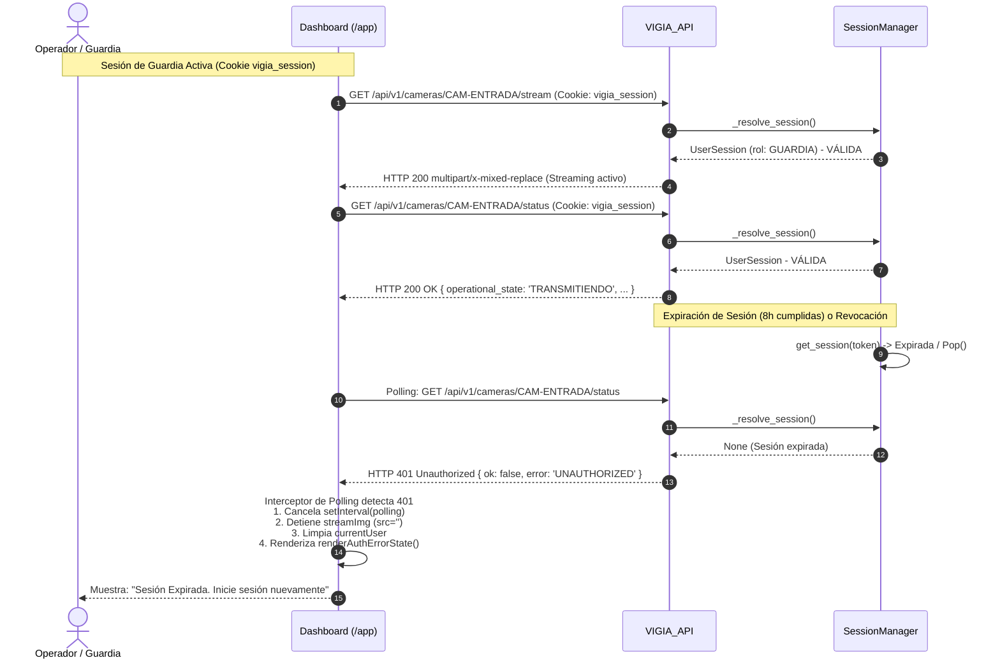

# VIGIA-AUTH-01 — Verificación de Seguridad de Streams y Sesiones

**Proyecto:** VIGÍA Vision Systems  
**Módulo:** Seguridad, Autenticación y Transmisión de Video (`VIGIA_API`, `VIGIA_Dashboard`)  
**Documento:** `Docs/fase_1/VIGIA-AUTH-01_VERIFICACION.md`  
**Fecha:** 2026-11-08  
**Tipo de Ejecución:** **ESTRICTAMENTE DE SOLO LECTURA (READ-ONLY AUDIT)**  
**Aislamiento:** Completamente aislado del motor de inferencia (`YoloVehicleDetector`, PyTorch/CUDA)  

---

## 1. Resumen Ejecutivo

En el marco de la auditoría técnica `VIGIA-PLATFORM-01`, se identificaron posibles debilidades en el control de acceso a las transmisiones de video en tiempo real (MJPEG) y al estado operativo de las cámaras.

La presente verificación técnica confirma de manera exhaustiva y sin alterar el estado del sistema los siguientes hallazgos:

1.  **Exposición Incondicional de Streams y Estado:** Los endpoints `GET /api/v1/cameras/<codigo>/stream`, `GET /api/v1/cameras/<codigo>/status` y `GET /api/v1/cameras/<codigo>/live` carecen de decoradores de autenticación y de cualquier control en capas superiores (middleware o WSGI). Cualquier cliente en la red puede consumir video en vivo e información de detecciones vehiculares sin presentar credenciales.
2.  **Persistencia Visual de Sesión Vencida en Frontend:** En caso de que la sesión del operador expire en el servidor o el proceso backend se reinicie, el Dashboard web retiene la interfaz de monitoreo como "operativa" de forma indefinida, continuando la reproducción del stream y ocultando los fallos de autenticación.
3.  **Desconexión Forzosa por Reinicio de Servidor:** Las sesiones de usuario son 100% volátiles en la memoria RAM del servidor. Un reinicio del backend destruye todas las sesiones, provocando discrepancias de sincronización con los clientes conectados.

Se presenta a continuación el análisis forense de código, la matriz de verificación clasificada y el diseño de corrección mínima sin impacto en el motor de inferencia.

---

## 2. Investigación A — Autorización y Control de Acceso a Endpoints

### 2.1 Inspección Detallada de Rutas de Video y Estado

Se inspeccionó la totalidad del archivo [`VIGIA_Vision_Systems/VIGIA_API/ingest_service.py`](file:///C:/GEST.PROY.TI/Software/VIGIA_Vision_Systems/VIGIA_API/ingest_service.py):

#### A. Endpoint `GET /api/v1/cameras/<codigo_camara>/stream` (Líneas 1844–1910)
```python
# ingest_service.py:1844-1845
@app.route("/api/v1/cameras/<codigo_camara>/stream", methods=["GET"])
def stream_camera_mjpeg(codigo_camara: str):
    """
    Emite un flujo continuo MJPEG (multipart/x-mixed-replace) con los fotogramas anotados
    en tiempo real para visualización directa en el Dashboard (VIGIA-CAM-01).
    """
```
*   **Decoradores locales:** Carece de `@require_session_auth` y de `@require_rbac`.
*   **Validaciones internas:** Solo verifica `_is_camera_registered(codigo_clean)` (línea 1851). No lee cookies (`vigia_session`), cabeceras `Authorization` ni parámetros de consulta.
*   **Entrega de información:** Genera un flujo multipart JPEG continuo en tiempo real con bounding boxes y etiquetas de inferencia.

#### B. Endpoint `GET /api/v1/cameras/<codigo_camara>/status` (Líneas 1912–1978)
```python
# ingest_service.py:1912-1913
@app.route("/api/v1/cameras/<codigo_camara>/status", methods=["GET"])
def get_camera_operational_status(codigo_camara: str):
    """
    Retorna el estado operativo en tiempo real de la cámara y sus indicadores de visión.
    """
```
*   **Decoradores locales:** Carece de `@require_session_auth` y de `@require_rbac`.
*   **Validaciones internas:** Solo verifica la existencia de la cámara (línea 1918).
*   **Entrega de información:** Retorna payload JSON con: `operational_state`, `is_transmitting`, `vehicle_detected`, `tipo_vehiculo`, `confianza`, `in_roi` y número de secuencia.

#### C. Endpoint `GET /api/v1/cameras/<codigo_camara>/live` (Líneas 1794–1843)
```python
# ingest_service.py:1794-1795
@app.route("/api/v1/cameras/<codigo_camara>/live", methods=["GET"])
def get_camera_live_frame(codigo_camara: str):
    """
    Retorna el fotograma JPEG anotado más reciente de la cámara con metadatos en encabezados.
    """
```
*   **Decoradores locales:** Sin decoradores de autenticación.
*   **Entrega de información:** Entrega el fotograma estático más reciente con metadatos en cabeceras HTTP (`X-Vehicle-Detected`, `X-Vehicle-Type`, `X-In-ROI`, etc.).

---

### 2.2 Rastreo de Middleware y Capas Superiores

Siguiendo el mandato de no concluir vulnerabilidad únicamente por la ausencia de un decorador local, se auditó exhaustivamente la cadena de ejecución previa:

1.  **Middleware `@app.before_request` ([`ingest_service.py:581-619`](file:///C:/GEST.PROY.TI/Software/VIGIA_Vision_Systems/VIGIA_API/ingest_service.py#L581-L619)):
    *   La única función registrada es `validate_csrf()`.
    *   La línea 588 restringe su ejecución de forma explícita:
        ```python
        if request.method in ("POST", "PUT", "DELETE", "PATCH"):
        ```
    *   Para solicitudes HTTP `GET`, **`validate_csrf()` retorna de inmediato sin ejecutar ninguna comprobación**.
2.  **Middleware `@app.after_request` ([`ingest_service.py:620-645`](file:///C:/GEST.PROY.TI/Software/VIGIA_Vision_Systems/VIGIA_API/ingest_service.py#L620-L645)):
    *   Aplica cabeceras `X-Content-Type-Options: nosniff`, `X-Frame-Options: DENY`, `Cache-Control` y cabeceras CORS. No realiza autenticación.
3.  **Servidor WSGI / Capa de Red ([`ingest_service.py:3898-3948`](file:///C:/GEST.PROY.TI/Software/VIGIA_Vision_Systems/VIGIA_API/ingest_service.py#L3898-L3948)):**
    *   La aplicación es servida directamente por Waitress (`run_ingest_server`) en HTTPS o por Werkzeug `run_simple` en HTTP plano.
    *   No existe un proxy inverso intermedio (como Nginx o Traefik), ni API Gateway, ni filtro de autenticación a nivel de socket.
4.  **Conclusión de Capas Superiores:** **No existe ningún mecanismo de protección perimetral o de middleware que intercepte o valide las solicitudes `GET` hacia `/stream`, `/status` o `/live`.**

---

### 2.3 Preguntas Obligatorias de la Investigación A

| # | Pregunta Obligatoria | Dictamen | Evidencia y Hallazgo Técnico |
|---|---|---|---|
| **1** | ¿Exige sesión válida? | **NO** `[CONFIRMADO]` | Tanto `/stream` como `/status` y `/live` se ejecutan sin llamar a `_resolve_session()`, sin inspeccionar `request.cookies` y sin invocar `SessionManager`. |
| **2** | ¿Verifica autorización sobre la cámara solicitada? | **NO** `[CONFIRMADO]` | No existe comprobación de asignación usuario-cámara. La única validación es si el string del código existe en el catálogo topológico (`_is_camera_registered`). |
| **3** | ¿Distingue autenticación de autorización? | **NO** `[CONFIRMADO]` | Al no autenticar al llamador, el concepto de autorización es inexistente en estos tres endpoints. En las rutas donde sí aplica (`/api/v1/cameras`, `/api/v1/devices`), se usa `@require_rbac`, distinguiendo 401 (sin sesión) de 403 (rol no admitido). |
| **4** | ¿Puede entregar información sin credenciales? | **SÍ** `[CONFIRMADO]` | Cualquier cliente HTTP que realice `GET /api/v1/cameras/CAM-ENTRADA/stream` recibe el video en vivo. Si realiza `GET /api/v1/cameras/CAM-ENTRADA/status`, recibe telemetría e inferencia vehicular sin autenticación. |
| **5** | ¿Tiene alguna excepción intencional documentada? | **NO** `[CONFIRMADO]` | No existe documentación técnica ni comentarios en código que justifiquen la exposición pública de los streams de caseta. La omisión obedeció a la dificultad de enviar cabeceras personalizadas en etiquetas HTML ``. |

---

### 2.4 Relación Usuario, Cámara y Área en el Modelo de Datos

Se auditó el esquema relacional en [`BD/migrations/V001__baseline_schema.sql`](file:///C:/GEST.PROY.TI/Software/BD/migrations/V001__baseline_schema.sql):

*   **Modelo de Autorización Actual:** Es un modelo **RBAC global por roles** (`ADMINISTRADOR`, `OPERADOR`/`GUARDIA`, `AUDITOR`).
*   **Asignación Fina de Cámaras:** **No existe tabla relacional `usuario_camara` ni `usuario_area`**.
*   **Regla de Negocio:**
    *   Todo `ADMINISTRADOR` y todo `GUARDIA` activo tiene autorización implícita sobre **todas las cámaras de la caseta** (`CAM-ENTRADA`, `CAM-SALIDA`).
    *   El rol `AUDITOR` tiene prohibido el acceso a la supervisión operativa (recibe HTTP 403).

---

## 3. Investigación B — Ciclo de Vida y Seguridad de Sesiones

### 3.1 Mecanismo de Sesión

1.  **Creación:** `AuthService.authenticate(username, password)` ([`auth_service.py:44`](file:///C:/GEST.PROY.TI/Software/VIGIA_Vision_Systems/VIGIA_API/security/auth_service.py#L44)) verifica el hash Argon2id. Si es exitoso, delega en `SessionManager.create_session(user)` ([`session_manager.py:68`](file:///C:/GEST.PROY.TI/Software/VIGIA_Vision_Systems/VIGIA_API/security/session_manager.py#L68)).
2.  **Token Criptográfico:** `secrets.token_urlsafe(32)` genera un identificador opaco aleatorio de 256 bits de entropía.
3.  **Almacenamiento del Estado:** Se almacena en la estructura en memoria `SessionManager._sessions: Dict[str, UserSession]`.
4.  **Transporte de Credencial:** Endpoint `POST /api/v1/auth/login` emite la cookie:
    ```http
    Set-Cookie: vigia_session=<token_32_bytes>; Max-Age=28800; Path=/; SameSite=Strict; HttpOnly; [Secure]
    ```
5.  **Atributos de Seguridad de la Cookie:**
    *   `HttpOnly=True`: Inaccesible desde JavaScript (`document.cookie`), protegiendo contra robo por XSS.
    *   `SameSite=Strict`: El navegador solo la adjunta en peticiones que se originan en el mismo sitio, protegiendo contra CSRF.
    *   `Path=/`: Válida para todo el dominio.
    *   `Secure=request.is_secure`: Activo en HTTPS.

### 3.2 Expiración, Revocación y Reinicio

*   **Expiración Absoluta:**
    *   Fijada en 8 horas (`DEFAULT_SESSION_TTL_SECONDS = 28800`, [`session_manager.py:28`](file:///C:/GEST.PROY.TI/Software/VIGIA_Vision_Systems/VIGIA_API/security/session_manager.py#L28)).
    *   `expires_at = created_at + 8 hours`. No existe extensión por actividad.
    *   La purga es perezosa: al invocar `get_session(token)`, si `session.is_expired()`, la sesión se elimina de memoria y retorna `None` ([`session_manager.py:117-120`](file:///C:/GEST.PROY.TI/Software/VIGIA_Vision_Systems/VIGIA_API/security/session_manager.py#L117-L120)).
*   **Comportamiento ante Reinicio del Backend `[CONFIRMADO]`:**
    *   Dado que `_sessions` es un diccionario Python en la memoria del proceso, **un reinicio del servidor borra instantáneamente el 100% de las sesiones activas**.
    *   Todas las cookies emitidas con anterioridad son rechazadas de inmediato con HTTP 401 en la siguiente petición protegida.
*   **Revocación (Logout):**
    *   `POST /api/v1/auth/logout` llama a `SessionManager.revoke_session(tok)` (línea 993) eliminando el token de memoria y emitiendo `response.delete_cookie("vigia_session")`. Es idempotente y efectivo.
*   **Concurrencia:**
    *   `SessionManager` está protegido por un `threading.RLock()` ([`session_manager.py:61`](file:///C:/GEST.PROY.TI/Software/VIGIA_Vision_Systems/VIGIA_API/security/session_manager.py#L61)). Todas las lecturas y mutaciones son atómicas y thread-safe.

---

## 4. Investigación C — Consumo en Frontend y Diagnóstico de Desincronización

### 4.1 Consumo de Streams y Estado en el Dashboard

Se analizó la vista de monitoreo [`VIGIA_Vision_Systems/VIGIA_Dashboard/web/js/views/cameras-view.js`](file:///C:/GEST.PROY.TI/Software/VIGIA_Vision_Systems/VIGIA_Dashboard/web/js/views/cameras-view.js):

#### A. Transmisión MJPEG
*   La imagen de video se consume mediante la etiqueta nativa:
    ```javascript
    // cameras-view.js:343
    streamImg.src = apiService.getCameraLiveStreamUrl(cam.codigo);
    ```
*   **Envío de Cookies:** Al estar servido el dashboard desde el mismo origen (`/app`), el navegador envía automáticamente la cookie `vigia_session` en la petición del elemento ``.
*   **Comportamiento ante Error:**
    ```javascript
    // cameras-view.js:448-452
    streamImg.addEventListener('error', () => {
      if (isViewDestroyed || currentGeneration !== viewGenerationToken) return;
      playbackErrorOverlay.hidden = false;
      scheduleAutoReconnect();
    });
    ```
    Si el endpoint `/stream` retornara un HTTP 401, el navegador **no expone el código de estado HTTP** al evento `error` del elemento ``. El frontend asume una falla de red, muestra *"Reconectando transmisión..."* y reintenta 5 veces hasta mostrar *"ERROR PERSISTENTE"*.

#### B. Polling Operativo de Estado
*   Se ejecuta cada 3000 ms llamando a `GET /api/v1/cameras/<codigo>/status`:
    ```javascript
    // cameras-view.js:547-553
    let statusData;
    try {
      statusData = await apiService.getCameraStatus(code);
    } catch (_) {
      // Ignorar fallas transitorias de red en polling sin degradar la vista
      continue;
    }
    ```
*   **Supresión Silenciosa de Errores `[CONFIRMADO]`:** El bloque `catch (_)` **suprime cualquier excepción**, incluyendo un hipotético error de autenticación `AuthError (401)`.
*   **Retención de Datos Obsoletos:** Si `statusData` es `undefined` (por fallo o 401), el código ejecuta `continue;`. Los elementos visuales en el DOM (`statusPill`, `detInfo`, etiquetas de vehículos detectados) **conservan intacto su último estado renderizado**.
*   **Presentación Engañosa:** El Dashboard puede presentar una cámara con la pastilla verde `TRANSMITIENDO` y datos de vehículos detectados minutos después de que el backend se haya detenido o la sesión haya expirado.

---

## 5. Matriz de Clasificación de Hallazgos

| ID | Hallazgo Evaluado | Clasificación | Archivos y Líneas | Justificación y Evidencia Técnica |
|---|---|---|---|---|
| **H-01** | `GET /stream` accesible sin autenticación ni sesión válida. | **CONFIRMADO** | [`ingest_service.py:1844`](file:///C:/GEST.PROY.TI/Software/VIGIA_Vision_Systems/VIGIA_API/ingest_service.py#L1844) | No posee `@require_session_auth` ni validación manual. `@app.before_request` no filtra peticiones GET. |
| **H-02** | `GET /status` accesible sin autenticación ni sesión válida. | **CONFIRMADO** | [`ingest_service.py:1912`](file:///C:/GEST.PROY.TI/Software/VIGIA_Vision_Systems/VIGIA_API/ingest_service.py#L1912) | No posee decorador RBAC. Entrega telemetría y resultados de inferencia vehicular a llamadas anónimas. |
| **H-03** | `GET /live` accesible sin autenticación ni sesión válida. | **CONFIRMADO** | [`ingest_service.py:1794`](file:///C:/GEST.PROY.TI/Software/VIGIA_Vision_Systems/VIGIA_API/ingest_service.py#L1794) | Entrega fotogramas JPEG anotados y metadatos en cabeceras sin validar sesión. |
| **H-04** | Existencia de autorización granular por cámara/usuario. | **FALSO POSITIVO** | [`V001__baseline_schema.sql`](file:///C:/GEST.PROY.TI/Software/BD/migrations/V001__baseline_schema.sql) | No existe granularidad usuario-cámara en el diseño. La autorización es exclusivamente por rol institucional (ADMINISTRADOR / GUARDIA). |
| **H-05** | Supresión de errores de autenticación en polling de frontend. | **CONFIRMADO** | [`cameras-view.js:550`](file:///C:/GEST.PROY.TI/Software/VIGIA_Vision_Systems/VIGIA_Dashboard/web/js/views/cameras-view.js#L550) | `catch (_) { continue; }` silencia errores 401 y previene la transición a la pantalla de sesión expirada. |
| **H-06** | Retención visual de estado operativo tras expirar la sesión. | **CONFIRMADO** | [`cameras-view.js:555`](file:///C:/GEST.PROY.TI/Software/VIGIA_Vision_Systems/VIGIA_Dashboard/web/js/views/cameras-view.js#L555) | Si la petición falla, el DOM retiene la última información operativa recibida de manera indefinida. |
| **H-07** | Inconsistencia de sesiones ante reinicios del servidor. | **CONFIRMADO** | [`session_manager.py:62`](file:///C:/GEST.PROY.TI/Software/VIGIA_Vision_Systems/VIGIA_API/security/session_manager.py#L62) | Las sesiones solo existen en RAM. Un reinicio desautentica a todos los guardias pero el frontend no se entera de inmediato. |

---

## 6. Investigación D — Diseño de la Corrección Mínima (Sin Implementar)

Para solucionar de raíz estos riesgos sin alterar la inferencia de visión ni quebrar la compatibilidad de streaming en el navegador, se formula la siguiente propuesta técnica:



### 6.1 Política Común de Autorización en Backend

1.  **Protección de Endpoints con `@require_rbac`:**
    *   Decorar `stream_camera_mjpeg` (`/stream`), `get_camera_operational_status` (`/status`) y `get_camera_live_frame` (`/live`) con:
        ```python
        @require_rbac("ADMINISTRADOR", "GUARDIA")
        ```
    *   Esto garantiza que solo usuarios autenticados con rol activo puedan abrir la conexión.
2.  **Compatibilidad Nativa con Etiquetas HTML ``:**
    *   Como el Dashboard se sirve desde el mismo origen (`/app`), el navegador envía la cookie `vigia_session` (`SameSite=Strict`) en la petición del elemento ``. No se requiere pasar tokens en la URL.
3.  **Terminación de Streams Abiertos ante Expiración en Servidor:**
    *   Actualmente, el generador `generate_mjpeg()` corre en un bucle `while True` infinito sin volver a consultar la sesión.
    *   *Corrección:* Dentro del bucle del generador, cada $N$ segundos (ej. cada 15 segundos o al evaluar el cerrojo), verificar `sess_mgr.get_session(token)`. Si la sesión ya expiró o fue revocada en el servidor, interrumpir el generador con `break` para cerrar la conexión TCP del stream inmediatamente.

### 6.2 Sincronización y Manejo de Errores en Frontend

1.  **Detección de 401 en el Polling de Estado (`cameras-view.js`):**
    *   Modificar el bloque de captura en `updateOperationalStatus()`:
        ```javascript
        let statusData;
        try {
          statusData = await apiService.getCameraStatus(code);
        } catch (err) {
          if (err instanceof AuthError && err.status === 401) {
            // Cancelar intervalos activos y mostrar estado de autenticación requerida
            cleanupViewLifecycle();
            renderAuthErrorState(err);
            return;
          }
          // Marcar degradación visual si la falla es transitoria de red
          refs.statusPill.className = 'camera-status-pill camera-status-pill--nosignal';
          refs.statusText.textContent = 'SIN SEÑAL';
          continue;
        }
        ```
2.  **Mitigación de Estados Falsos en Desconexión:**
    *   Si transcurren más de 6 segundos sin recibir respuesta exitosa de `/status`, la tarjeta debe transicionar a `SIN SEÑAL` en lugar de mantener `TRANSMITIENDO`.

### 6.3 Pruebas de Regresión y Seguridad Recomendadas

1.  **Test de Acceso Anónimo a Stream (Negativo):** Petición `GET /api/v1/cameras/CAM-ENTRADA/stream` sin cookies debe responder `HTTP 401 Unauthorized` con JSON estructurado.
2.  **Test de Acceso con Rol Auditor (Prohibido):** Petición con cookie de usuario con rol `AUDITOR` debe responder `HTTP 403 Forbidden`.
3.  **Test de Acceso con Sesión de Guardia (Positivo):** Petición con cookie de `guardia_dev` debe responder `HTTP 200` con `Content-Type: multipart/x-mixed-replace`.
4.  **Test de Terminación de Stream por Logout:** Al invocar `POST /api/v1/auth/logout`, un stream activo debe cortarse en menos de 15 segundos.
5.  **Test de Frontend ante 401 en Polling:** Simular una respuesta 401 en `/status` y verificar que la interfaz oculte el video y presente la pantalla de reautenticación.

---

## 7. Dictamen Final

### **DICTAMEN: CORRECCIÓN PREVIA OBLIGATORIA (BLOQUEANTE PARA PRODUCCIÓN)**

**Justificación:**
1.  VIGÍA Vision Systems **no puede operar en un entorno de producción o de red institucional con la política actual**, ya que cualquier persona o dispositivo conectado a la LAN física (incluyendo teléfonos de visitantes o equipos en la misma subred) puede acceder directamente a los flujos de video de las cámaras de seguridad sin requerir usuario ni contraseña.
2.  La vulnerabilidad de desincronización en el frontend representa un riesgo operacional en caseta: el guardia puede creer que el sistema está supervisando el carril cuando en realidad la sesión ha caído y los datos presentados son obsoletos.
3.  La corrección técnica propuesta es **mínima, de bajo riesgo y completamente desacoplada del motor de visión**, requiriendo únicamente la adición de decoradores existentes en 3 endpoints de `ingest_service.py` y el ajuste del manejo de errores en `cameras-view.js`.

Se recomienda programar la implementación de este paquete de corrección (**VIGIA-AUTH-01**) de forma prioritaria antes de abrir el acceso del sistema a redes no controladas.
