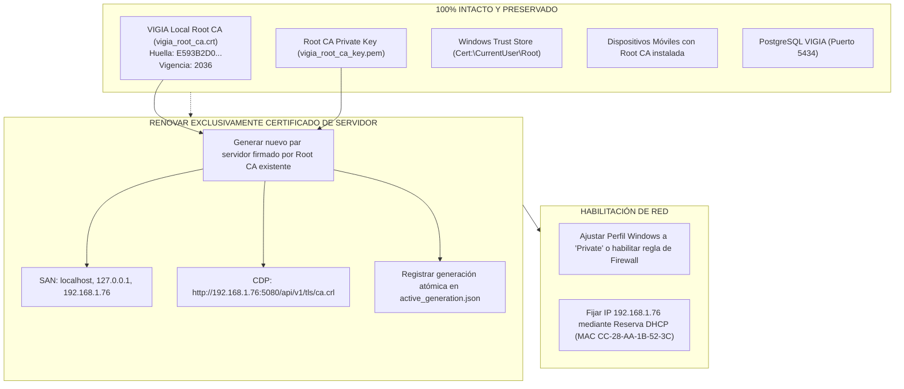

# VIGIA-NET-02 — Validación de Identidad TLS y Acceso LAN

## Control Documental
- **Identificador:** `VIGIA-NET-02`
- **Fase:** Fase 1 — Hardening de Infraestructura y Conectividad LAN
- **Fecha de Ejecución:** 8 de noviembre de 2026
- **Naturaleza de la Actividad:** Auditoría pasiva de red física, identidad criptográfica TLS, firewall y publicación de servicios (Sin regeneración de certificados ni modificaciones de puertos)
- **Dictamen:** **B — Requiere ajuste**

---

## 1. Verificación de Interfaces de Red e IP LAN

### 1.1 Interfaces de Red Detectadas en el Host
Se ejecutó una inspección exhaustiva de los adaptadores de red de Windows (`Get-NetIPConfiguration`, `Get-NetIPAddress`, `Get-NetIPInterface`):

| Nombre de Interfaz | Tipo / Adaptador | Dirección IPv4 | Origen | Estado | Métrica |
| :--- | :--- | :--- | :---: | :---: | :---: |
| **Ethernet** | Realtek PCIe GbE Family Controller | **`192.168.1.76`** | **DHCP** | **Connected (Principal)** | **25** |
| **Conexión de área local\* 2** | Microsoft Wi-Fi Direct Virtual Adapter | `192.168.137.1` | Manual | Connected (Hotspot/ICS) | N/A |
| **Wi-Fi** | MediaTek Wi-Fi 6 MT7921 | `192.168.1.78` | DHCP | Disconnected | 50 |
| **VMware VMnet1** | VMware Virtual Ethernet Adapter | `192.168.152.1` | DHCP | Adaptador virtual filtrado | N/A |
| **vEthernet (WSL)** | Hyper-V Virtual Ethernet Adapter | `172.23.64.1` | Manual | Red interna de contenedores | N/A |
| **Loopback** | Software Loopback Interface 1 | `127.0.0.1` | Local | Host local | N/A |

### 1.2 Interfaz LAN Utilizada
- **Interfaz Activa:** `Ethernet` (Índice de interfaz 12).
- **Dirección MAC:** `CC-28-AA-1B-52-3C`.
- **Enlace de red:** 1 Gbps dúplex completo.
- **Puerta de Enlace Predeterminada (Gateway):** `192.168.1.254` (Módem/Router Infinitum).
- **Prioridad de Ruteo:** La interfaz `Ethernet` posee métrica de interfaz 25 (prioritaria sobre Wi-Fi con métrica 50). La ruta por omisión del kernel (`0.0.0.0/0`) utiliza `192.168.1.76`.

### 1.3 Evaluación de DHCP y Recomendación de Reserva
- **Condición Actual:** La dirección IP `192.168.1.76` proviene de una asignación dinámica vía DHCP gestionada por el router `192.168.1.254`.
- **Evidencia de Inestabilidad Histórica de IP:**
  1. `06/Nov/2026`: Emisión del par TLS vigente con IP `10.159.253.185`.
  2. Sesión previa de pruebas: Dirección IP `192.168.1.75`.
  3. Sesión actual: Dirección IP `192.168.1.76`.
- **Evaluación de Riesgo:** En una infraestructura con seguridad estricta basada en certificados X.509 locales y validación de nombres alternativos del sujeto (SAN), cualquier renovación de arrendamiento DHCP que modifique la IP del host invalida de inmediato:
  - El certificado de servidor HTTPS (los navegadores móviles emitirán `ERR_CERT_COMMON_NAME_INVALID`).
  - La URL del Punto de Distribución de Revocación (CDP) `http://<IP>:5080/api/v1/tls/ca.crl`.
  - Los códigos QR generados y compartidos previamente con dispositivos móviles.
- **Recomendación:** Es imperativo establecer una **reserva estática DHCP** en el módem/router (`192.168.1.254`) asociando de forma permanente la dirección MAC `CC-28-AA-1B-52-3C` a una IP fija elegida (ej. `192.168.1.76`), o alternativamente configurar la IP estática directamente en el adaptador de red de Windows.

### 1.4 IP Anunciada por el Motor VIGÍA
El módulo [`VIGIA_Core/network/lan_detector.py`](file:///c:/GEST.PROY.TI/Software/VIGIA_Vision_Systems/VIGIA_Core/network/lan_detector.py) fue evaluado en modo aislado:
- **Candidato Recomendado Detectado:** `Ethernet` (`192.168.1.76`), `is_recommended=True`.
- **Adaptadores Filtrados:** Descartó automáticamente adaptadores de VMware (`VMnet1`), Hyper-V/WSL y loopback.
- **URLs Resueltas:**
  - `local_url`: `https://127.0.0.1:5001`
  - `recommended_lan_url`: `https://192.168.1.76:5001`
  - `effective_qr_base_url`: `https://192.168.1.76:5001`
- **Conclusión:** El algoritmo de descubrimiento dinámico de VIGÍA anuncia correctamente la IP actual `192.168.1.76`.

---

## 2. Auditoría Criptográfica del Certificado TLS Activo

Se inspeccionaron directamente los archivos en [`VIGIA_Vision_Systems/certs/`](file:///c:/GEST.PROY.TI/Software/VIGIA_Vision_Systems/certs/):

```
VIGIA_Vision_Systems/certs/
├── vigia_root_ca.crt
├── vigia_root_ca_key.pem
├── vigia_root_ca.crl
├── vigia_cert.pem
├── vigia_key.pem
└── active_generation.json
```

### 2.1 Certificado Hoja de Servidor ([`certs/vigia_cert.pem`](file:///c:/GEST.PROY.TI/Software/VIGIA_Vision_Systems/certs/vigia_cert.pem))

| Parámetro X.509 | Valor Auditado | Evaluación Técnica |
| :--- | :--- | :--- |
| **Subject** | `CN=VIGIA LAN Server (10.159.253.185), O=VIGIA Vision Systems, C=MX` | Configurado para la IP antigua de la sesión del 6 de noviembre |
| **Issuer** | `CN=VIGIA Local Root CA, OU=Seguridad e Infraestructura LAN, O=VIGIA Vision Systems, C=MX` | Emitido por la Root CA local autorizada |
| **Número de Serie** | `0x7fc3ffa2e0a987457e85eec32ffe3cd5969db44f` | Único y firmado |
| **Vigencia** | `06/11/2026 19:16:20 UTC` a `04/02/2027 19:21:20 UTC` | **Vigente** (90 días) |
| **Key Usage** | `digital_signature=True, key_encipherment=True` | Estándar para cifrado TLS RSA |
| **Extended Key Usage (EKU)** | `['serverAuth']` (`1.3.6.1.5.5.7.3.1`) | Conforme a RFC 5280 para autenticación de servidor |
| **Huella SHA-256** | `5638445B35DBFA860F0F636B7EB53B6C9AACF3BD01149DC77410E65F61263D17` | Hash criptográfico verificado |
| **SAN (Subject Alternative Name)** | `['localhost', '127.0.0.1', '10.159.253.185']` | **NO CONTIENE LA IP LAN ACTUAL (`192.168.1.76`)** |
| **CRL Distribution Point (CDP)** | `http://10.159.253.185:5080/api/v1/tls/ca.crl` | Apunta a la IP previa inalcanzable |

### 2.2 Certificado Raíz ([`certs/vigia_root_ca.crt`](file:///c:/GEST.PROY.TI/Software/VIGIA_Vision_Systems/certs/vigia_root_ca.crt))

| Parámetro X.509 | Valor Auditado | Evaluación Técnica |
| :--- | :--- | :--- |
| **Subject / Issuer** | `CN=VIGIA Local Root CA, OU=Seguridad e Infraestructura LAN, O=VIGIA Vision Systems, C=MX` | Autosignado, BasicConstraints CA=True |
| **Número de Serie** | `0x3ea27ada909ae956076339933cd76b434d7ff986` | Estable |
| **Vigencia** | `02/11/2026 00:19:29 UTC` a `30/10/2036 00:24:29 UTC` | **Vigente** (10 años) |
| **Huella SHA-256** | `E593B2D0B808BD8F8E97582ECDEBEAD29AEBC0F9F4BA9EF6ADB2D8E4362E4F4D` | Hash maestro de confianza |
| **Trust Store de Windows** | `Cert:\CurrentUser\Root` | **[OK] INSTALADO Y CONFIABLE** (verificado vía `.\vigia.ps1 verify-ca`) |
| **Cadena Criptográfica** | Firma RSA-SHA256 entre Root CA y Servidor | **VÁLIDA (Matemáticamente comprobada)** |

### 2.3 Comparativa: SAN vs IP LAN Actual

```text
SAN en Certificado Vigente: [ 'localhost', '127.0.0.1', '10.159.253.185' ]
IP LAN Actual del Host   :   192.168.1.76
Resultado de Coincidencia:   MISMATCH CRÍTICO (192.168.1.76 NOT IN SAN)
```

- **Impacto Local (Windows Host):** Las conexiones locales a `https://127.0.0.1:5001` o `https://localhost:5001` son **100% confiables** y validadas por Windows sin ninguna advertencia de seguridad.
- **Impacto en Dispositivos Móviles (LAN):** Cualquier dispositivo externo que acceda mediante `https://192.168.1.76:5001` (o mediante el código QR) **será bloqueado** por el navegador móvil con el error:
  `ERR_CERT_COMMON_NAME_INVALID` / `Hostname/IP does not match certificate SAN`.
- **Acción Respetada:** Conforme a la regla obligatoria (*"No regenerar ni modificar certificados en esta fase"*), el certificado **no fue modificado ni sustituido**.

---

## 3. Auditoría de Publicación de Servicios, Red y Firewall

### 3.1 Bind del Backend HTTPS
- **Configuración Declarativa ([`Software/.env`](file:///c:/GEST.PROY.TI/Software/.env)):**
  - `VIGIA_DEV_HOST=0.0.0.0`
  - `VIGIA_DEV_PORT=5001`
- **Comportamiento en Ingest Service:**
  Al iniciar, el backend ejecuta el enlace en `0.0.0.0:5001`, quedando expuesto a todas las interfaces locales y externas disponibles.
- **Estado Actual del Puerto 5001:** Socket inactivo / libre. El backend no se encuentra en ejecución (apagado de forma controlada conforme a restricciones).

### 3.2 Firewall de Windows Defender
Se inspeccionó la configuración del firewall mediante PowerShell y utilidades nativas (`Get-NetConnectionProfile`, `netsh advfirewall`):
- **Perfil de Red Activo:** `Public` (Red detectada: `INFINITUM0870` en interfaz `Ethernet`).
- **Política del Perfil Público:** `BlockInbound, AllowOutbound` (Bloqueo total por omisión de paquetes SYN entrantes no solicitados).
- **Reglas de Entrada Existentes:** **No existe ninguna regla de entrada para el puerto TCP 5001 ni para el puerto TCP 5080.**
- **Diagnóstico:** Si un teléfono celular conectado al Wi-Fi del módem intenta alcanzar `https://192.168.1.76:5001`, el firewall de Windows descartará silenciosamente la conexión entrante, provocando un fallo de tiempo de espera (`ERR_TIMED_OUT`), aun si el backend estuviese levantado.

### 3.3 Generación de URL del QR y URL Móvil
Inspección del endpoint `POST /api/v1/cameras/pairing/request` en [`ingest_service.py`](file:///c:/GEST.PROY.TI/Software/VIGIA_Vision_Systems/VIGIA_API/ingest_service.py):
- El backend rechaza de forma estricta direcciones de loopback (`127.0.0.1`, `localhost`) para enrolamiento móvil.
- Utiliza la URL calculada por `resolve_access_urls`:
  `https://192.168.1.76:5001/mobile?claim=<claim_token>&cam=<codigo_camara>`
- Conclusión: La lógica de generación de URLs y códigos QR ya es compatible con la nueva IP `192.168.1.76`. El único impedimento radica en el SAN del certificado y el bloqueo de firewall.

### 3.4 Publicación de CRL (Puerto 5080)
- **Configuración:** `VIGIA_CRL_HTTP_PORT=5080`.
- **Servicio:** Al arrancar el backend en modo TLS, se inicia en segundo plano el servidor dedicado `CRLHttpServer` escuchando en `0.0.0.0:5080` (HTTP) para cumplir con el RFC 5280 y la validación de revocación nativa de Schannel / Android.
- **Estado Actual:** El CDP del certificado actual apunta a la IP obsoleta `10.159.253.185:5080`. Se requiere que el CDP refleje la IP `192.168.1.76:5080`.

---

## 4. Propuesta de Resolución Estratégica (Sin Comprometer la PKI)

Para resolver la compatibilidad LAN conservando íntegramente la cadena de confianza, se plantea una intervención quirúrgica en tres etapas controladas:



### Principios Fundamentales de la Estrategia:
1. **Conservación Absoluta de la Root CA:**
   - La Root CA (`vigia_root_ca.crt`) y su clave privada (`vigia_root_ca_key.pem`) **NO se regeneran**.
   - Ningún dispositivo cliente ni el almacén de Windows requerirá reinstalar el certificado raíz.
2. **Generación Automatizada del Par Hoja:**
   - La arquitectura de VIGÍA ya implementa en [`ingest_service.py`](file:///c:/GEST.PROY.TI/Software/VIGIA_Vision_Systems/VIGIA_API/ingest_service.py) (líneas 3890-3904) la verificación preventiva de SAN. Al detectar que la IP activa (`192.168.1.76`) difiere del certificado existente, invoca la renovación del certificado de servidor reutilizando la Root CA existente:
     ```python
     generate_vigia_local_ca_bundle(
         target_ip="192.168.1.76",
         cert_dir="certs",
         overwrite=True
     )
     ```
   - Esto creará una nueva generación inmutable (`certs/generations/gen_.../vigia_cert.pem`), actualizará el manifiesto atómico `active_generation.json` y actualizará el enlace canónico `vigia_cert.pem`.
3. **Mantenimiento de la CRL y CDP:**
   - La CRL continuará firmada por la Root CA autorizada.
   - La nueva extensión CDP del certificado apuntará a `http://192.168.1.76:5080/api/v1/tls/ca.crl`.
4. **Habilitación de Red sin Apertura Indiscriminada de Puertos:**
   - Ejecutar el cambio de categoría de red para `INFINITUM0870` de `Public` a `Private` (comportamiento estándar en redes LAN de desarrollo), O BIEN registrar una regla de entrada estricta y acotada en Windows Defender Firewall para los puertos `5001` y `5080` de VIGÍA.

---

## 5. Tabla de Riesgos y Mitigaciones

| Riesgo Identificado | Impacto | Severidad | Mitigación Recomendada |
| :--- | :--- | :---: | :--- |
| **SAN Mismatch (`10.159.253.185` vs `192.168.1.76`)** | Móviles rechazan conexión con `ERR_CERT_COMMON_NAME_INVALID`. | **Alta** | Re-emisión controlada de la hoja de servidor con SAN `192.168.1.76` preservando la Root CA. |
| **Firewall en Perfil Público (`BlockInbound`)** | Peticiones móviles descartadas silenciosamente (`ERR_TIMED_OUT`). | **Alta** | Habilitar regla de entrada local en Windows para TCP 5001 y 5080 o cambiar categoría a `Private`. |
| **Volatilidad de Arrendamiento DHCP** | Si el router reasigna la IP, el certificado volverá a ser incompatible. | **Media** | Crear una reserva estática DHCP para la MAC `CC-28-AA-1B-52-3C` en el módem `192.168.1.254`. |
| **Aislamiento de Clientes Wi-Fi (AP Isolation)** | Móvil no puede alcanzar host aun con firewall abierto si el router aísla tráfico Wi-Fi/Ethernet. | **Baja** | Probar ping/curl desde el móvil una vez iniciado el servidor para descartar AP isolation. |

---

## 6. Dictamen Final

```
================================================================================
DICTAMEN: B — Requiere ajuste
================================================================================
```

### Justificación Técnica:
1. **La infraestructura criptográfica base es sólida:** La Root CA está vigente por 10 años, instalada en el almacén de Windows y matemáticamente validada.
2. **Existe incompatibilidad de identidad en la hoja:** El certificado de servidor actual contiene la IP antigua `10.159.253.185` en sus SAN y CDP, por lo que el acceso móvil a `https://192.168.1.76:5001` fallará por validación TLS de nombre de host.
3. **El Firewall de Windows bloquea conexiones entrantes:** El perfil actual `Public` bloquea peticiones externas hacia el puerto `5001` por falta de regla de entrada.
4. **Camino de solución identificado y no destructivo:** El ajuste requiere exclusivamente: (a) re-emitir el certificado hoja de servidor firmado con la Root CA existente, y (b) habilitar el tráfico entrante en Windows para los puertos 5001 y 5080.
