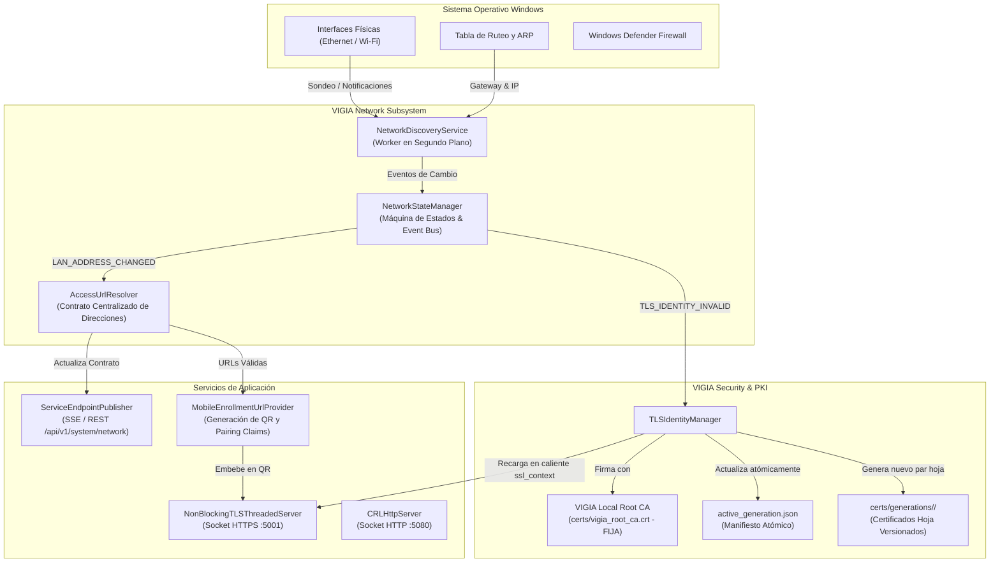

# VIGIA-NET-03 — Arquitectura de Red Dinámica y Descubrimiento Automático

## Control Documental
- **Identificador:** `VIGIA-NET-03`
- **Fase:** Fase 1 — Hardening de Infraestructura, Conectividad LAN y Resiliencia DHCP
- **Fecha de Elaboración:** 8 de noviembre de 2026
- **Naturaleza de la Actividad:** Auditoría profunda de red y diseño arquitectónico formal (Solo lectura; sin modificación de código, configuraciones, certificados ni firewall)
- **Dictamen:** **A — Diseño técnicamente viable**

---

## 1. Resumen Ejecutivo

En entornos reales de operación LAN (redes comerciales o residenciales de ISP con direccionamiento dinámico DHCP), la dirección IPv4 del servidor VIGÍA es susceptible de cambiar tras reinicios del módem/router, expiración del tiempo de arrendamiento (*lease time*) o conmutaciones entre interfaces físicas (Ethernet y Wi-Fi).

La auditoría actual (`VIGIA-NET-01` y `VIGIA-NET-02`) demostró que:
1. El servidor ha transitado por tres direcciones IP distintas en diferentes sesiones (`10.159.253.185`, `192.168.1.75` y `192.168.1.76`).
2. El certificado de servidor vigente sólo avala en sus SAN las IPs `127.0.0.1`, `localhost` y `10.159.253.185`.
3. El módulo de descubrimiento actual (`lan_detector.py`) opera en modalidad estática (*one-shot* en el arranque), sin monitoreo continuo de cambios de interfaz.
4. El servidor web `NonBlockingTLSThreadedServer` no cuenta actualmente con un manejador reactivo que actualice su `SSLContext` en caliente ante variaciones de IP sin reiniciar el proceso.

Este documento establece la **Arquitectura de Red Dinámica y Descubrimiento Automático**, permitiendo que VIGÍA opere con total resiliencia frente a variaciones DHCP, garantice la validez continua de la identidad TLS para clientes móviles sin comprometer la Root CA existente, y mantenga un contrato centralizado de URLs en tiempo real.

---

## 2. Auditoría del Subsistema de Descubrimiento Actual

### 2.1 Inspección de [`VIGIA_Core/network/lan_detector.py`](file:///c:/GEST.PROY.TI/Software/VIGIA_Vision_Systems/VIGIA_Core/network/lan_detector.py)

| Componente / Función | Comportamiento Auditado | Limitación Identificada |
| :--- | :--- | :--- |
| **Detección de Interfaces** (`psutil.net_if_addrs`) | Lee interfaces del SO e inspecciona familias `AF_INET`. | Solo se ejecuta al invocar la función; carece de eventos push o demonio de monitoreo continuo. |
| **Selección de Interfaz Primaria** (`get_default_route_ip`) | Abre un socket UDP efímero hacia `8.8.8.8:80` para consultar la tabla de ruteo del kernel. | Falla o produce resultados indeterminados en redes LAN aisladas sin salida a Internet (offline / air-gapped). |
| **Métricas de Rutas de Windows** | No consulta las métricas nativas del SO (`Get-NetIPInterface`, `RouteMetric`). | Si coexisten Ethernet y Wi-Fi con IPs válidas en la misma subred, la selección puede oscilar si la ruta UDP cambia. |
| **IPv4 vs IPv6** | Estrictamente filtrado a `AF_INET` IPv4 privada (RFC 1918). | No soporta IPv6 ULA (RFC 4193) ni direccionamiento híbrido si la red LAN opera en dual-stack. |
| **Filtrado de Adaptadores** (`VIRTUAL_INTERFACE_KEYWORDS`) | Filtra por palabras clave: `vethernet`, `wsl`, `vmware`, `virtualbox`, `docker`, etc. | Eficaz y determinista; previene anuncios erróneos hacia redes de contenedores locales. |
| **Tratamiento de Múltiples Interfaces** | Selecciona la recomendada según coincidencia con `default_route_ip`. | Si la interfaz primaria pierde el cable de red, no conmuta automáticamente a la interfaz secundaria activa en tiempo de ejecución. |
| **Tolerancia a Fallos** | Lanza `NetworkDiscoveryError` o `NoLanAddressError`. | Si no hay red al arrancar, el servidor aborta (`sys.exit(1)`) en lugar de entrar en estado degradado en espera de red. |

---

## 3. Auditoría de Publicación de URLs y Enrolamiento QR

### 3.1 Flujo Actual de URLs
1. **Resolución:** `resolve_access_urls(port, tls_enabled)` resuelve un diccionario con `local_url`, `lan_urls`, `recommended_lan_url` y `effective_qr_base_url`.
2. **Generación QR ([`ingest_service.py:2109`](file:///c:/GEST.PROY.TI/Software/VIGIA_Vision_Systems/VIGIA_API/ingest_service.py)):**
   ```python
   pairing_url = f"{qr_base_url}/mobile?claim={raw_claim_token}&cam={target_cam.codigo}"
   ```
3. **Puntos Críticos Detectados:**
   - **Vulnerabilidad de TTL del Claim:** Si un usuario genera un QR para enrolar su cámara móvil (TTL = 10 minutos) y durante ese lapso ocurre una renovación DHCP que cambia la IP del host, la URL embebida en el QR impreso/en pantalla queda huérfana. El móvil apuntará a una IP que ya no pertenece al servidor VIGÍA.
   - **Desconexión entre Frontend y Backend:** El dashboard web del administrador no recibe notificaciones automáticas si la IP LAN cambia; los enlaces de previsualización de transmisiones pueden quedar desactualizados hasta que el usuario refresque manualmente el navegador.

### 3.2 Contrato Centralizado de Direcciones (*Address Contract*)
Se define la especificación unificada que todas las capas del sistema deben consumir:

```json
{
  "contract_version": 1,
  "node_id": "vigia-lan-host",
  "transport": "https",
  "port": 5001,
  "crl_port": 5080,
  "primary_interface": {
    "name": "Ethernet",
    "mac": "CC-28-AA-1B-52-3C",
    "ipv4": "192.168.1.76",
    "prefix_len": 24,
    "gateway": "192.168.1.254"
  },
  "endpoints": {
    "local_base": "https://127.0.0.1:5001",
    "lan_base": "https://192.168.1.76:5001",
    "dashboard_local": "https://127.0.0.1:5001/app",
    "dashboard_lan": "https://192.168.1.76:5001/app",
    "mobile_enrollment_base": "https://192.168.1.76:5001/mobile",
    "api_base": "https://192.168.1.76:5001/api/v1",
    "root_ca_download": "https://192.168.1.76:5001/api/v1/tls/ca.crt",
    "crl_distribution": "http://192.168.1.76:5080/api/v1/tls/ca.crl"
  },
  "status": "HEALTHY",
  "updated_at": "2026-11-08T12:00:00Z"
}
```

---

## 4. Evaluación Comparativa: Identidad TLS en Redes Dinámicas

Se evaluaron formalmente dos estrategias para resolver la identidad TLS y la confianza en dispositivos móviles:

| Criterio de Evaluación | Alternativa A: Nombre DNS Estable (`vigia.home.arpa`) | Alternativa B: Certificados Dinámicos por IP (Recomendada) |
| :--- | :--- | :--- |
| **Estabilidad de Nombre** | **Excelente:** `vigia.home.arpa` nunca cambia sin importar la IP. | **Variable:** Requiere actualizar el SAN cada vez que cambia la IP LAN. |
| **Compatibilidad con Routers Domésticos / ISP** | **Inviable:** Módem Infinitum no permite registrar dominios DNS internos ni editar registros tipo A locales. | **100% Compatible:** No depende de ninguna función del módem/router. |
| **Soporte Móvil Android** | **Deficiente:** Android utiliza DoT (*Private DNS*) por omisión hacia servidores públicos (`dns.google`). Los nombres locales no públicos fallan al resolverse sin configuración manual en cada teléfono. | **Excelente:** Navegación por IP directa (`https://192.168.1.76:5001`). Una vez que la Root CA está instalada y la IP está en el SAN, la validación es instantánea. |
| **Soporte Móvil iOS** | Requiere configuración de perfil DNS o mDNS (`vigia.local`), con limitaciones en Safari para certificados locales. | Totalmente soportado mediante perfiles de Root CA e IP en SAN. |
| **Dependencia de Software Adicional** | **Alta:** Obligaría a desplegar un servidor DNS local (ej. CoreDNS, dnsmasq o Pi-hole en Docker) y configurar el router para entregarlo por DHCP. | **Nula:** Totalmente autónomo dentro de la arquitectura de VIGÍA. |
| **Preservación de la Root CA** | Idéntica. | **Total:** La Root CA (`vigia_root_ca.crt`) permanece inmutable en ambos casos. |
| **Complejidad de Recarga** | Baja (el certificado no cambia). | Media (requiere recarga en caliente de `SSLContext` en el servidor HTTP). |

### Conclusión Técnica de la Comparativa
La **Alternativa A (DNS estable)** introduce dependencias críticas de infraestructura de red externa (servidores DNS locales, configuración de módems ISP, mitigación de Android DoT) que escapan al control de la plataforma VIGÍA.
La **Alternativa B (Certificados Dinámicos por IP con Root CA fija)** es **autónoma, autocontenida y compatible con cualquier entorno de red**, por lo que se selecciona como la arquitectura oficial de VIGÍA.

---

## 5. Auditoría de Firewall de Windows

### 5.1 Estado Actual
- **Perfil Activo:** `Public` (Red Ethernet `INFINITUM0870`).
- **Política por Omisión:** `BlockInbound, AllowOutbound`.
- **Reglas Existentes para VIGÍA:** Ninguna regla de entrada para los puertos `5001` ni `5080`.
- **Riesgo:** Sin regla de entrada, todo intento de conexión desde clientes móviles LAN es descartado silenciosamente por el kernel (`ERR_TIMED_OUT`).

### 5.2 Propuesta de Reglas Mínimas de Menor Privilegio
Para evitar abrir puertos indiscriminadamente en redes públicas no seguras:

1. **Regla de Servicio VIGÍA HTTPS:**
   - **Nombre:** `VIGIA-Inbound-HTTPS-5001`
   - **Protocolo:** `TCP`
   - **Puerto Local:** `5001`
   - **Acción:** `Allow`
   - **Perfiles:** `Private` (y condicionalmente `Public` restringido por IP).
   - **Ámbito de Direcciones Remotas:** Estrictamente rangos privados RFC 1918: `192.168.0.0/16`, `10.0.0.0/8`, `172.16.0.0/12`.
2. **Regla de Distribución CRL HTTP:**
   - **Nombre:** `VIGIA-Inbound-CRL-5080`
   - **Protocolo:** `TCP`
   - **Puerto Local:** `5080`
   - **Acción:** `Allow`
   - **Ámbito:** Idéntico a la regla HTTPS.

---

## 6. Arquitectura Objetivo Propuesta

### 6.1 Diagrama de Componentes



### 6.2 Especificación Detallada de Componentes

#### 1. `NetworkDiscoveryService`
- **Responsabilidad:** Monitorear continuamente los adaptadores físicos de red en un hilo en segundo plano con bajo consumo de CPU.
- **Mecanismo de Detección:** Sondeo adaptativo (cada 3 segundos en estado estable; inmediato ante errores de red) combinando `psutil.net_if_addrs()` con la consulta de interfaz primaria nativa de Windows.
- **Aislamiento:** No tiene dependencias de Flask ni de la interfaz gráfica.

#### 2. `NetworkStateManager`
- **Responsabilidad:** Administrar la máquina de estados del estado de red y coordinar los componentes mediante un Event Bus determinista.
- **Estados Operativos:**
  - `INITIALIZING`: Descubrimiento inicial de red.
  - `LAN_ONLINE`: IP válida asignada, enlace activo y verificado.
  - `IP_MIGRATING`: Se detectó un cambio de dirección IP; en proceso de actualización de certificados y URLs.
  - `DISCONNECTED`: No existe ninguna interfaz física con enlace activo.
- **Eventos Despachados:**
  - `NETWORK_INTERFACE_CHANGED`: Cambio de adaptador activo (ej. desconexión de Ethernet y conmutación a Wi-Fi).
  - `LAN_ADDRESS_CHANGED`: La dirección IP privada cambió (ej. de `192.168.1.75` a `192.168.1.76`).
  - `NETWORK_UNAVAILABLE`: Caída total del enlace físico.
  - `NETWORK_RESTORED`: Restauración de la conectividad tras desconexión.
  - `TLS_IDENTITY_INVALID`: El certificado hoja de servidor no contiene la IP LAN activa en sus SAN.
  - `ACCESS_URLS_UPDATED`: Nuevo contrato de direcciones emitido y disponible.

#### 3. `AccessUrlResolver`
- **Responsabilidad:** Actuar como la **Única Fuente de Verdad** (*Single Source of Truth*) para todas las URLs del sistema.
- **Comportamiento:** Mantiene en memoria una copia inmutable del `AddressContract`. Ningún controlador, vista de frontend ni generador de códigos QR puede concatenar cadenas `https://` o puertos por su cuenta; todos consultan este resolver.

#### 4. `TLSIdentityManager`
- **Responsabilidad:** Garantizar la correspondencia criptográfica entre la IP activa del host y el certificado TLS del servidor, sin intervención manual.
- **Reglas Criptográficas Innegociables:**
  - La Root CA (`certs/vigia_root_ca.crt`) y su clave privada (`certs/vigia_root_ca_key.pem`) **nunca se tocan**.
  - Si la IP activa no coincide con los SAN de `active_generation.json`, genera una nueva carpeta `certs/generations/gen_<timestamp>_<uuid>/`, firma el certificado hoja con la Root CA, actualiza atómicamente `active_generation.json` mediante renombrado atómico POSIX/Windows (`os.replace`) y actualiza los enlaces `vigia_cert.pem` / `vigia_key.pem`.
- **Recarga en Caliente de `ssl_context`:**
  Aprovecha la arquitectura de `NonBlockingTLSThreadedServer` (que invoca `self.ssl_context.wrap_socket` por conexión):
  ```python
  def reload_tls_context(self, new_cert_path: Path, new_key_path: Path) -> None:
      new_ctx = load_ssl_context(str(new_cert_path), str(new_key_path))
      # Sustitución atómica de referencia en memoria
      self.ssl_context = new_ctx
      logger.info("Contexto TLS recargado exitosamente en caliente sin interrumpir el socket TCP.")
  ```

#### 5. `ServiceEndpointPublisher`
- **Responsabilidad:** Exponer el contrato de direcciones en el endpoint `GET /api/v1/system/network/contract` y emitir eventos Server-Sent Events (SSE) hacia el dashboard web del administrador.

#### 6. `MobileEnrollmentUrlProvider`
- **Responsabilidad:** Gestionar la emisión de tokens y códigos QR para teléfonos móviles.
- **Protección ante Condiciones de Carrera:**
  Si se detecta el evento `LAN_ADDRESS_CHANGED` mientras existen tokens claim activos en estado `PENDING`:
  - Invalida los claims huérfanos con el estado `IP_EXPIRED`.
  - Notifica a la interfaz gráfica del administrador para que regenere el código QR con la nueva URL válida.
  - Previene que un guardia escanee un QR que apunte a una dirección extinta.

---

### 6.3 Diagrama de Secuencia: Transición DHCP y Renovación en Caliente

```mermaid
sequenceDiagram
    autonumber
    actor Router as Router / DHCP Server
    participant NDS as NetworkDiscoveryService
    participant NSM as NetworkStateManager
    participant TIM as TLSIdentityManager
    participant RCA as Root CA (Inmutable)
    participant Server as NonBlockingTLSThreadedServer
    participant AUR as AccessUrlResolver
    participant SSE as ServiceEndpointPublisher
    actor Admin as Dashboard Admin
    actor Mobile as Teléfono Móvil

    Router->>NDS: Reasigna IP DHCP: 192.168.1.75 -> 192.168.1.76
    Note over NDS: Detecta discrepancia de IP en sondeo
    NDS->>NSM: Evento: LAN_ADDRESS_CHANGED (new_ip="192.168.1.76")
    
    activate NSM
    NSM->>TIM: Evento: TLS_IDENTITY_INVALID
    activate TIM
    TIM->>RCA: Firma nueva hoja con SAN=[127.0.0.1, localhost, 192.168.1.76]
    RCA-->>TIM: Retorna vigia_cert.pem nuevo
    TIM->>TIM: Guarda en generations/gen_... y actualiza active_generation.json
    TIM->>Server: reload_tls_context(new_cert, new_key)
    Note over Server: ssl_context actualizado en caliente; socket TCP permanece abierto
    deactivate TIM

    NSM->>AUR: Actualiza AddressContract con 192.168.1.76
    AUR-->>SSE: Contrato de Direcciones Actualizado
    SSE->>Admin: SSE Notificación: NETWORK_UPDATED (URLs refrescadas)
    deactivate NSM

    Admin->>Server: POST /api/v1/cameras/pairing/request
    Server->>AUR: get_mobile_enrollment_url()
    AUR-->>Server: https://192.168.1.76:5001/mobile?claim=...
    Server-->>Admin: Retorna nuevo código QR con IP 192.168.1.76
    Admin-->>Mobile: Muestra QR en pantalla
    Mobile->>Server: GET https://192.168.1.76:5001/mobile (Handshake TLS exitoso)
    Note over Mobile,Server: TLS Validado: Root CA confía y 192.168.1.76 está en el SAN
```

---

## 7. Plan de Implementación por Fases

Para respetar la integridad del sistema y las restricciones operativas, la implementación se dividirá en cuatro fases secuenciales:

| Fase | Alcance Técnico | Entregables / Archivos Impactados | Criterio de Aceptación |
| :---: | :--- | :--- | :--- |
| **Fase 1** | Refactorización del descubrimiento pasivo y Address Contract en `VIGIA_Core`. | `VIGIA_Core/network/lan_detector.py`<br/>`VIGIA_Core/network/address_contract.py` | Pruebas unitarias de resolución y contrato sin dependencias externas. |
| **Fase 2** | Implementación del Worker `NetworkDiscoveryService` y `NetworkStateManager`. | `VIGIA_Core/network/discovery_service.py`<br/>`VIGIA_Core/network/state_manager.py` | Detección reactiva de desconexiones y eventos de cambio de IP. |
| **Fase 3** | Gestión de recarga en caliente de `ssl_context` en `NonBlockingTLSThreadedServer`. | `VIGIA_API/ingest_service.py`<br/>`VIGIA_Vision_Systems/certs/` | Recarga en vuelo del certificado sin interrumpir transmisiones MJPEG activas (AUTH-01). |
| **Fase 4** | Integración con el flujo de enrolamiento móvil y notificación SSE al dashboard. | `VIGIA_API/ingest_service.py`<br/>`VIGIA_Dashboard/web/js/` | El código QR y los enlaces del frontend se actualizan automáticamente al cambiar la IP. |

---

## 8. Estrategia de Verificación y Pruebas

### 8.1 Pruebas Unitarias
- `test_network_address_contract.py`: Valida estructura inmutable y serialización JSON del contrato de red.
- `test_tls_reload_context.py`: Verifica que `NonBlockingTLSThreadedServer.reload_tls_context` sustituya el objeto `ssl.SSLContext` y que un nuevo socket realice el handshake con el nuevo certificado sin reiniciar el hilo de escucha.
- `test_claim_invalidation_on_ip_change.py`: Valida que al emitirse `LAN_ADDRESS_CHANGED`, los claims pendientes pasen a estado de error y no se consuman erróneamente.

### 8.2 Pruebas de Integración
- Simulación de conmutación de IP: Modificar la IP de interfaz mockeada y confirmar que el Event Bus dispare la secuencia completa: generación de par hoja en `generations/`, actualización de `active_generation.json`, recarga de `ssl_context` y actualización de `AddressContract`.

### 8.3 Pruebas Físicas Reales
- Validar mediante dispositivo móvil físico (Android / iOS) que, tras una renovación de arrendamiento en el router Infinitum, el escaneo del nuevo código QR cargue la interfaz móvil en `https://192.168.1.76:5001/mobile` con candado verde (validación de certificado completa por la Root CA previamente instalada).

---

## 9. Interacción con AUTH-01 y Mitigación de Condiciones de Carrera

- **Preservación de Transmisiones MJPEG Activas:**
  Las transmisiones de video (`GET /api/v1/cameras/<codigo>/stream`) protegidas por RBAC en AUTH-01 viajan sobre sockets TCP ya establecidos. La recarga de `self.ssl_context` en el servidor **solo afecta a las nuevas conexiones entrantes**. Las transmisiones activas de guardias o administradores continuarán fluyendo por el socket TCP existente sin cortarse, a menos que la interfaz de red física sufra un corte total a nivel de enlace de datos.
- **Sincronización Concurrente:**
  La escritura de `active_generation.json` y la actualización de `self.ssl_context` se protegerán con un `threading.Lock` reentrante para asegurar que ninguna petición entrante lea un estado intermedio durante la renovación criptográfica.

---

## 10. Dictamen Final

```
================================================================================
DICTAMEN: A — Diseño técnicamente viable
================================================================================
```

### Justificación Técnica:
1. **Factibilidad Criptográfica Total:** La plataforma VIGÍA ya cuenta con una Root CA local válida por 10 años que permite emitir certificados hoja en caliente sin requerir interacción del usuario ni invalidar los trust stores existentes.
2. **Arquitectura No Invasiva:** No requiere alterar los motores de visión (YOLO/CUDA), la base de datos PostgreSQL, los procesos de Changarro ni la lógica de seguridad RBAC de AUTH-01.
3. **Autonomía Absoluta:** Al descartar la dependencia de servidores DNS locales frágiles y optar por la resolución dinámica de certificados por IP con recarga en caliente de `ssl_context`, el sistema opera de manera autosuficiente en cualquier entorno de red LAN o Wi-Fi.
