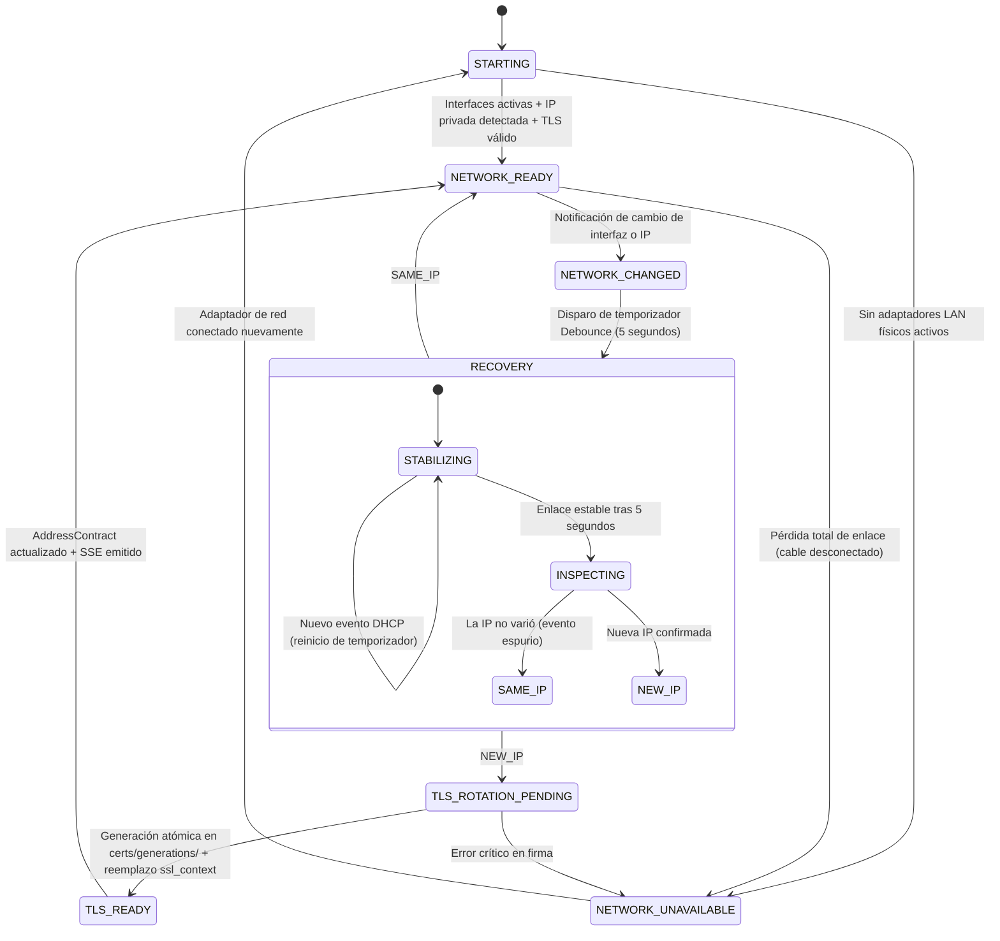

# VIGIA-NET-03A — Revisión Crítica de Seguridad y Viabilidad de Arquitectura Dinámica

## Control Documental
- **Identificador:** `VIGIA-NET-03A`
- **Fase:** Fase 1 — Hardening de Infraestructura, Seguridad Criptográfica y Resiliencia de Red
- **Fecha de Evaluación:** 8 de noviembre de 2026
- **Naturaleza de la Actividad:** Auditoría crítica, análisis de viabilidad, revisión de PKI, análisis de Schannel/RFC 5280 y diseño de mitigación (Solo lectura; sin alteraciones de código, certificados ni infraestructura)
- **Dictamen:** **B — Arquitectura aprobada con correcciones pendientes**

---

## 1. Revisión de Seguridad de la Root CA y Cadena de Confianza

### 1.1 Diagnóstico del Mecanismo Actual de Firma
Actualmente, el servicio web de ingesta ([`VIGIA_API/ingest_service.py`](file:///c:/GEST.PROY.TI/Software/VIGIA_Vision_Systems/VIGIA_API/ingest_service.py)) accede directamente a la clave privada de la Autoridad Certificadora Raíz:
- **Ruta del Archivo:** `certs/vigia_root_ca_key.pem`.
- **Protección Criptográfica en Disco:** Almacenada en texto plano (`PrivateFormat.TraditionalOpenSSL`, `encryption_algorithm=NoEncryption()`), sin contraseña de protección.
- **Permisos del Sistema de Archivos (Windows ACL):**
  - `BUILTIN\Administradores`: Full Control.
  - `NT AUTHORITY\SYSTEM`: Full Control.
  - `BUILTIN\Usuarios`: ReadAndExecute.
  - `NT AUTHORITY\Usuarios autentificados`: Modify.
- **Riesgo Identificado (Severidad Alta):** El proceso que ejecuta el servidor web HTTP/Flask tiene acceso de lectura directo a la clave privada más crítica de toda la infraestructura. Si se produjera una vulnerabilidad de revelación de archivos en la API web, un atacante podría extraer `vigia_root_ca_key.pem`. Puesto que esta Root CA se encuentra instalada en el almacén de confianza del sistema operativo (`Cert:\CurrentUser\Root`) y en dispositivos móviles corporativos, el atacante podría firmar certificados fraudulentos para cualquier dominio o IP pública y ser aceptado sin advertencias.

### 1.2 Viabilidad de una CA Intermedia Emisora (*Issuing CA*)
Se auditó la estructura X.509 real de [`certs/vigia_root_ca.crt`](file:///c:/GEST.PROY.TI/Software/VIGIA_Vision_Systems/certs/vigia_root_ca.crt):

```text
BasicConstraints: <BasicConstraints(ca=True, path_length=0)>
ca: True
path_length: 0
```

> [!CAUTION]
> **Hallazgo Criptográfico Crítico (Restricción RFC 5280):**
> El certificado de la Root CA vigente fue emitido con la extensión `BasicConstraints: path_length=0`.
> Conforme al estándar RFC 5280 Sección 4.2.1.9, un `path_length` de 0 indica que **ningún certificado de CA intermedia puede seguir a esta CA en la cadena de certificación**.
> Si se emitiera una "CA Intermedia" firmada por la actual Root CA, los validadores estrictos (Windows Schannel, navegadores web, Android KeyStore e iOS Security Framework) **rechazarán de inmediato la cadena de certificados con el error `CERT_CHAIN_PATH_LENGTH_EXCEEDED` o `UNTRUSTED_ROOT`**.

### 1.3 Estrategia de Mitigación Obligatoria sin Modificar la Root CA
Dado que las restricciones innegociables prohíben regenerar la Root CA o alterar el trust store de Windows en esta fase:

1. **Topología de Firma a Profundidad 1 (Obligatoria):**
   El certificado hoja de servidor (`vigia_cert.pem`) debe seguir siendo firmado directamente por la Root CA (`vigia_root_ca.crt`), garantizando compatibilidad total con `path_length=0`.
2. **Aislamiento del Proceso de Firma (Menor Privilegio):**
   - El servidor web `NonBlockingTLSThreadedServer` **no debe cargar ni manipular** `vigia_root_ca_key.pem`.
   - Se crea un worker o módulo local aislado (`VIGIA_Security.signer`) con permisos de archivo restringidos exclusivamente a la cuenta administrativa o de servicio del host.
   - El proceso web únicamente lee el par de certificados de servidor ya generado (`vigia_cert.pem` y `vigia_key.pem`).
3. **Hoja de Ruta Futura (Fase 2 - Renovación Autorizada de Root CA):**
   Cuando se apruebe la renovación programada de la Root CA (prevista hacia 2036 o en mantenimiento mayor), se emitirá una Root CA offline con `path_length=1` y una Issuing CA intermedia dedicada.

---

## 2. Revisión de CDP (CRL Distribution Point) y Revocación

### 2.1 Comportamiento del CDP ante Cambios de IP
En la auditoría de `certs/vigia_cert.pem` se confirmó que la extensión CDP tiene incrustada la URL:
```text
http://10.159.253.185:5080/api/v1/tls/ca.crl
```
Cuando la dirección IP del servidor cambia (ej. a `192.168.1.76`):
- Los clientes nuevos o clientes que no tengan en caché la CRL intentarán contactar la IP antigua `10.159.253.185:5080`.
- Al ser inalcanzable, la consulta TCP falla con *timeout*.
- En sistemas operativos como Windows con Schannel, si la directiva de verificación estricta de revocación está activa y el CDP no responde, la conexión TLS es rechazada con `CRYPT_E_REVOCATION_OFFLINE`.

### 2.2 Estrategia de Publicación y Coherencia de CRL
1. **Publicación Multidireccional en el Servidor CRL:**
   El `CRLHttpServer` debe escuchar en `0.0.0.0:5080`, asegurando que la lista de revocación se sirva a través de cualquier IP que adquiera el host.
2. **Generación Atómica de CDP en Cada Par Hoja:**
   Cada vez que se detecte una nueva IP LAN (`192.168.1.76`), el `TLSIdentityManager` genera el certificado hoja con la extensión CDP apuntando a la IP recién adquirida (`http://192.168.1.76:5080/api/v1/tls/ca.crl`).
3. **Caché Local de CRL:**
   La CRL emitida por VIGÍA cuenta con un periodo de validez (*Next Update*) de 7 días. Los clientes que ya descargaron la CRL continuarán operando sin interrupción durante ese intervalo mientras la firma de la Root CA se conserve.

---

## 3. Revisión de Resolución de Nombres (DNS y mDNS)

Se evaluó la viabilidad real de los mecanismos de resolución de nombres en el entorno físico de la estación de trabajo (Módem Infinitum Telmex):

| Mecanismo de Nombres | Factibilidad Real en el Entorno | Justificación y Pruebas Técnicas |
| :--- | :---: | :--- |
| **`vigia.home.arpa` (DNS de Router)** | ❌ **Inviable** | El firmware residencial de módems Infinitum (Sercomm/Huawei) no ofrece gestión de zonas DNS locales ni sobreescritura de registros A. Reenvía todas las consultas a resolvers públicos que devuelven `NXDOMAIN`. |
| **Servidor DNS Local Dedicado** | ⚠️ **Viable pero Inoperante sin Configuración DHCP** | Levantar un contenedor Docker con `CoreDNS` o `dnsmasq` es trivial, pero los teléfonos móviles reciben la configuración DNS desde el router del ISP por DHCP. Dado que el router no permite modificar los servidores DNS entregados por DHCP, los móviles nunca consultarían el contenedor DNS local sin configuración estática manual en cada teléfono. |
| **Android con DNS Privado (DoT)** | ❌ **Incompatible con Dominios Locales** | Android 10+ tiene habilitado por omisión "DNS Privado" hacia `dns.google` o `cloudflare-dns.com`. Toda consulta hacia dominios no públicos (`.home.arpa`, `.lan`, `.local`) es resuelta externamente y rechazada con `DNS_PROBE_FINISHED_NXDOMAIN`. |
| **mDNS (`vigia.local` - RFC 6762)** | 🟡 **Parcialmente Viable (Alias de Conveniencia)** | Funciona nativamente en Windows 11 y Safari/iOS. En Android presenta soporte irregular dependiendo del fabricante y la versión de WebView. Además, muchos puntos de acceso Wi-Fi comerciales descartan tráfico multicast (`224.0.0.251:5353`) entre Ethernet y Wi-Fi (falta de IGMP snooping o AP Isolation activo). |
| **Direccionamiento Dinámico por IP (Direct IPv4 SAN)** | ✅ **100% Viable y Robusto** | La navegación y el enrolamiento móvil mediante IP directa (`https://192.168.1.76:5001`) con el SAN correspondiente en el certificado funciona de forma universal en Android, iOS, Windows y Linux, sin depender de resolvers DNS externos ni de multicast. |

> [!IMPORTANT]
> **Decisión Técnica:**
> La arquitectura debe sustentarse en **Certificados Dinámicos por IP**.
> `vigia.local` mediante mDNS se mantendrá exclusivamente como un canal auxiliar de conveniencia para navegadores de escritorio e iOS, pero **nunca como dependencia crítica de conectividad para el enrolamiento móvil**.

---

## 4. Revisión de Conexiones Activas y Comportamiento de Sockets

Es indispensable disipar una asunción errónea identificada en el análisis preliminar:

> [!WARNING]
> **Distinción Crítica: Renovación TLS vs Cambio de Interfaz/IP**
> 1. **Renovación TLS sobre la misma IP:**
>    Si el par de certificados expira o se renueva pero la IP del servidor se mantiene (`192.168.1.76`), la sustitución de `self.ssl_context` en `NonBlockingTLSThreadedServer` es transparente: las conexiones TCP ya establecidas (transmisiones MJPEG activas de AUTH-01) continúan operando sin interrupción en el socket existente. Las nuevas conexiones entrantes negociarán el nuevo certificado.
> 2. **Cambio de Dirección IP o Pérdida de Enlace Físico (Evento DHCP):**
>    Si el router asigna una nueva IP (o el cable Ethernet se desconecta), **todas las conexiones TCP activas hacia la IP anterior mueren inevitablemente en la Capa 4 del modelo OSI** (`ECONNRESET` / `ETIMEDOUT`). No existe ningún mecanismo criptográfico que preserve una conexión TCP si la dirección IP de origen o destino desaparece en la interfaz física.

### 4.1 Ciclo de Vida del Socket en `NonBlockingTLSThreadedServer`
- **Mecanismo:** El servidor hereda de `ThreadedWSGIServer` e intercepta `finish_request(request, client_address)`.
- **Envoltorio TLS:** Invoca `self.ssl_context.wrap_socket(request, server_side=True)` por cada conexión aceptada.
- **Sustitución en Memoria:** Modificar la referencia `self.ssl_context` es una operación atómica en el GIL de Python. Un puntero protegido mediante `threading.Lock` previene carreras de lectura/escritura durante el reemplazo del objeto de contexto.

### 4.2 Impacto y Estrategia de Recuperación por Servicio

| Servicio VIGÍA | Impacto ante Cambio de IP | Mecanismo de Recuperación Diseñado |
| :--- | :--- | :--- |
| **Transmisiones MJPEG (AUTH-01)** | La transmisión TCP activa se corta inmediatamente con `ERR_CONNECTION_CLOSED`. | El frontend de cámaras (`cameras-view.js`) implementa un ciclo de reconexión con *exponential backoff* que consulta el nuevo `AddressContract` y restablece el flujo contra la nueva IP. |
| **Dashboard Administrativo** | Si se accede vía `127.0.0.1:5001`, **no sufre ninguna alteración**. Si se accede vía LAN, el navegador pierde la conexión HTTP/SSE. | Notificación de cambio de red emitida antes del corte si la conmutación es asistida; el service worker o cliente web detecta la pérdida y sondea `AddressContract` para redirigir. |
| **Cámaras Móviles Conectadas** | El socket WebSocket o stream push desde el celular se interrumpe. | La app móvil en el navegador web almacena las credenciales de enrolamiento en `localStorage` / IndexedDB e intenta reconectar inmediatamente. Si la IP anterior no responde tras 3 intentos, solicita al usuario escanear nuevamente o resolver vía mDNS. |

---

## 5. Revisión del Ciclo de Vida de Mobile Enrollment

Se analizó la tabla `camera_pairing_request` y [`pairing_repository.py`](file:///c:/GEST.PROY.TI/Software/VIGIA_Vision_Systems/VIGIA_Core/repository/pairing_repository.py):

### 5.1 Hallazgos de la Base de Datos
- Las columnas de `camera_pairing_request` (`id_solicitud`, `id_camara`, `token_claim_hash`, `token_poll_hash`, `estado`, `expira_en`) **no almacenan la dirección IP ni el nombre de host**.
- La dirección IP viaja **únicamente codificada en la URL incrustada en el código QR**:
  ```text
  https://192.168.1.75:5001/mobile?claim=vigia_claim_...&cam=CAM-ENTRADA
  ```

### 5.2 Comportamiento ante Variación de IP durante el TTL
Si un administrador genera un QR (válido por 10 minutos) y a los 2 minutos el servidor cambia de IP (de `192.168.1.75` a `192.168.1.76`):
1. El `token_claim_hash` sigue siendo válido en PostgreSQL.
2. El código QR mostrado en pantalla apunta a la IP muerta `192.168.1.75`.
3. Al escanearlo, el guardia recibe `ERR_TIMED_OUT` en el navegador móvil.

### 5.3 Reglas de Corrección para Mobile Enrollment
- **Cancelación Atómica de Claims Huérfanos:**
  Al emitirse el evento `LAN_ADDRESS_CHANGED`, el repositorio de enrolamiento ejecuta:
  ```sql
  UPDATE camera_pairing_request 
  SET estado = 'CANCELADA', cancelado_en = NOW(), motivo_rechazo = 'IP_MIGRATED'
  WHERE estado = 'PENDIENTE';
  ```
- **Notificación Push al Dashboard:**
  El frontend administrativo recibe una señal WebSocket/SSE indicando que el QR visible quedó obsoleto, forzando la regeneración automática de un nuevo QR con la IP vigente.
- **Preservación del Consumo Atómico (AUTH-01):**
  Se mantiene intacto el bloqueo pesimista `SELECT ... FOR UPDATE` para evitar cualquier doble consumo o colisión de tokens.

---

## 6. Revisión y Diseño de Reglas de Firewall de Windows

### 6.1 Vulnerabilidad del Perfil Público
En el perfil `Public`, Windows Defender Firewall bloquea por omisión todo tráfico de entrada no solicitado. Sin embargo, abrir el puerto `5001` de par en par a cualquier red pública representa un vector de riesgo.

### 6.2 Especificación de Reglas Mínimas y Restrictivas
Se define el conjunto mínimo de reglas con alcance acotado (*Least Privilege*):

```powershell
# 1. Regla para Backend HTTPS VIGIA (Puerto 5001)
New-NetFirewallRule -Name "VIGIA-HTTPS-5001" `
    -DisplayName "VIGIA Vision Systems - Servidor HTTPS (TCP 5001)" `
    -Direction Inbound `
    -Action Allow `
    -Protocol TCP `
    -LocalPort 5001 `
    -RemoteAddress @("192.168.0.0/16", "10.0.0.0/8", "172.16.0.0/12", "LocalSubnet") `
    -Profile Private, Public `
    -Enabled True

# 2. Regla para Distribución CRL HTTP (Puerto 5080)
New-NetFirewallRule -Name "VIGIA-CRL-5080" `
    -DisplayName "VIGIA Vision Systems - Distribucion CRL (TCP 5080)" `
    -Direction Inbound `
    -Action Allow `
    -Protocol TCP `
    -LocalPort 5080 `
    -RemoteAddress @("192.168.0.0/16", "10.0.0.0/8", "172.16.0.0/12", "LocalSubnet") `
    -Profile Private, Public `
    -Enabled True
```

- **Restricción de Red Remota:** El parámetro `-RemoteAddress` limita el tráfico estrictamente a subredes privadas RFC 1918 y a la subred local física del adaptador, evitando exposición hacia redes WAN o interfaces compartidas inseguras.

---

## 7. Diseño de la Máquina de Estados de Red y Recuperación

Para evitar condiciones de carrera, ciclos de oscilación (*flapping*) de DHCP y sobrecarga criptográfica por renovaciones repetitivas, se diseña una máquina de estados determinista:



### Parámetros de Estabilidad y Resiliencia
1. **Temporizador de Debounce (5 segundos):**
   Durante la negociación DHCP, los sistemas operativos suelen asignar temporalmente direcciones APIPA (`169.254.x.x`) antes de recibir el *DHCP ACK*. El sistema ignora cambios intermedios y espera una ventana de estabilidad de 5 segundos antes de disparar la generación criptográfica.
2. **Idempotencia:**
   Si el sondeo detecta que la IP resultante es idéntica a la que ya figura en `active_generation.json`, la transición a `TLS_ROTATION_PENDING` se cancela de inmediato, evitando renovaciones innecesarias de certificados.
3. **Rollback Criptográfico:**
   Si la generación de la nueva hoja falla (ej. error de escritura en disco), el sistema conserva intacto el archivo `active_generation.json` y el contexto TLS previo, registrando la alerta en el log sin corromper el servicio en ejecución.

---

## 8. Arquitectura Corregida de Componentes

```mermaid
flowchart TD
    subgraph HARDWARE_OS["Capa de Sistema Operativo"]
        IFACE["Interfaces de Red (Ethernet / Wi-Fi)"]
        IP_HELPER["Windows IP Helper / psutil"]
    end

    subgraph CORE_NETWORK["VIGIA_Core.network"]
        NDS["NetworkDiscoveryService<br/>(Worker con Debounce de 5s)"]
        NSM["NetworkStateManager<br/>(Máquina de Estados)"]
        AUR["AccessUrlResolver<br/>(AddressContract Inmutable)"]
    end

    subgraph SECURITY_PKI["VIGIA_Security.pki"]
        SIGNER["IsolatedSigner<br/>(Acceso Restringido a Root CA Key)"]
        RCA["vigia_root_ca.crt<br/>(BasicConstraints: path_length=0)"]
        TIM["TLSIdentityManager<br/>(Versionado en generations/)"]
    end

    subgraph BACKEND_SERVER["VIGIA_API Server"]
        SRV["NonBlockingTLSThreadedServer<br/>(ThreadedWSGIServer en 5001)"]
        CTX_HOLDER["AtomicSSLContextHolder<br/>(Puntero Thread-Safe)"]
        CRL_SRV["CRLHttpServer<br/>(Puerto 5080 en 0.0.0.0)"]
        SSE_PUB["ServiceEndpointPublisher<br/>(SSE Notifier)"]
    end

    IFACE -->|Eventos de Enlace| IP_HELPER
    IP_HELPER -->|Notificaciones| NDS
    NDS -->|Eventos Filtrados| NSM

    NSM -->|LAN_ADDRESS_CHANGED| TIM
    NSM -->|LAN_ADDRESS_CHANGED| AUR

    TIM -->|Solicitud de Firma Directa| SIGNER
    SIGNER -->|Firma Hoja (Profundidad 1)| RCA
    TIM -->|Recarga en Caliente| CTX_HOLDER
    CTX_HOLDER -.->|finish_request| SRV

    AUR -->|Actualiza Contrato| SSE_PUB
    AUR -->|Nuevas URLs| CRL_SRV
```

---

## 9. Plan de Implementación Incremental por Fases

| Etapa | Componente a Implementar | Pruebas de Certificación Requeridas |
| :---: | :--- | :--- |
| **Fase 1** | **Contrato de Direcciones y Debounce:**<br/>Implementar `AddressContract` y `NetworkDiscoveryService` con ventana de debounce de 5s en `VIGIA_Core/network/`. | Pruebas unitarias de serialización y simulación de ráfagas de cambio de interfaz (*flapping*). |
| **Fase 2** | **Aislamiento de Firma y Generación Atómica:**<br/>Implementar `IsolatedSigner` que firme exclusivamente hojas directas con `path_length=0` preservando la Root CA. | Verificación estricta con OpenSSL y `cryptography.x509` comprobando que `path_length` no sea violado. |
| **Fase 3** | **Recarga en Caliente en `NonBlockingTLSThreadedServer`:**<br/>Implementar `AtomicSSLContextHolder` para permitir sustitución en caliente de certificados sin interrumpir sockets TCP existentes. | Prueba de streaming continuo: verificar que un stream MJPEG de cámara no sufra caída de frames durante la recarga de certificados. |
| **Fase 4** | **Reglas de Firewall y Cancelación de Claims:**<br/>Incorporar reglas acotadas de Windows Firewall y lógica de invalidación de claims huérfanos en `pairing_repository.py`. | Validación física real con celular: simular cambio de IP y verificar que el QR se regenere automáticamente en el dashboard. |

---

## 10. Dictamen Final

```
================================================================================
DICTAMEN: B — Arquitectura aprobada con correcciones pendientes
================================================================================
```

### Justificación Técnica del Dictamen:
1. **Aprobación de la Viabilidad Central:** El enfoque de **Certificados Dinámicos por IP con Root CA fija y recarga en caliente de `SSLContext`** es completamente viable, resalta la autonomía del sistema y supera con creces las limitaciones de DNS en redes residenciales de ISP.
2. **Correcciones Pendientes Obligatorias Incorporadas:**
   - **Imposibilidad de CA Intermedia:** Se demostró mediante auditoría criptográfica que la Root CA actual posee `BasicConstraints: path_length=0`, haciendo matemáticamente inviable una CA intermedia sin regenerar la raíz. Se corrigió el diseño para mantener firma directa a profundidad 1 con aislamiento del proceso de firma.
   - **Distinción TCP Capa 4 vs TLS Capa 6:** Se corrigió la premisa sobre las transmisiones MJPEG: mientras que la renovación TLS sobre la misma IP preserva el socket, un cambio real de IP por DHCP rompe el socket a nivel TCP, requiriendo reconexión automática en el cliente frontend.
   - **Debounce de 5 Segundos y Cancelación de Claims:** Se agregaron mecanismos contra oscilación de DHCP y la invalidación atómica de tokens QR huérfanos.
3. **Estado de Transición:** Con estas correcciones técnicas debidamente documentadas y acotadas en este informe, la arquitectura queda plenamente lista para recibir la autorización de implementación en las fases subsecuentes.
