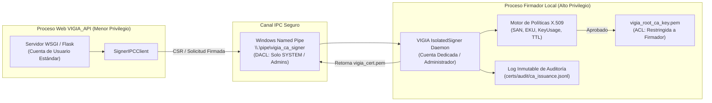
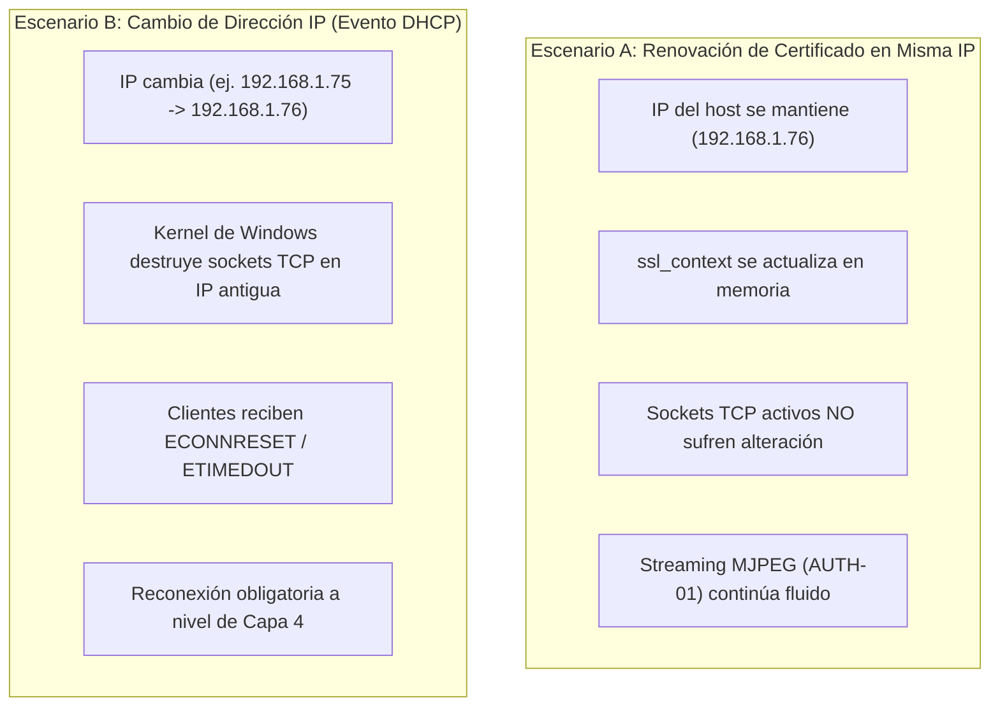
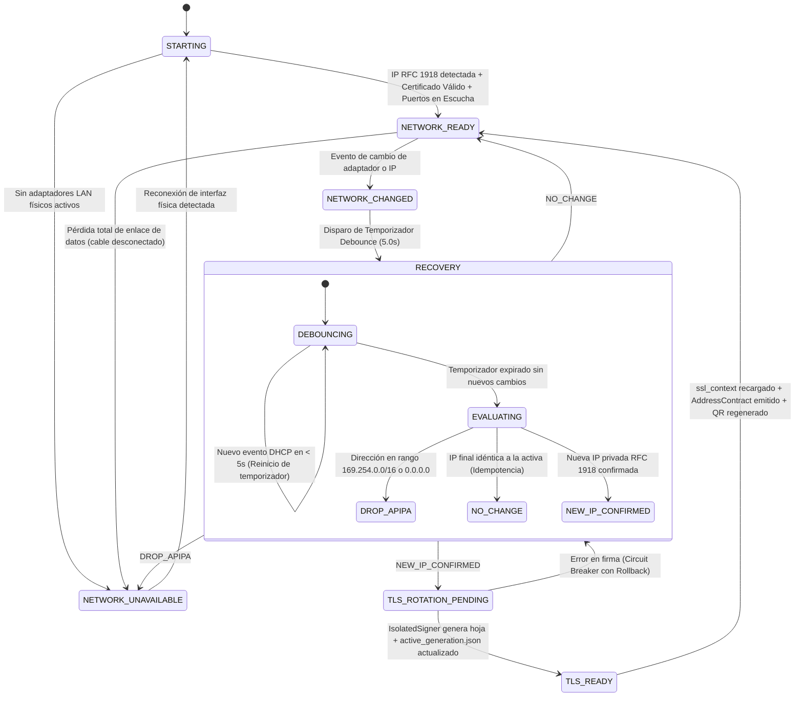

# VIGIA-NET-03B — Cierre de Riesgos Arquitectónicos de Red Dinámica

## Control Documental
- **Identificador:** `VIGIA-NET-03B`
- **Fase:** Fase 1 — Hardening de Infraestructura, Seguridad Criptográfica y Resiliencia de Red
- **Fecha de Elaboración:** 8 de noviembre de 2026
- **Naturaleza de la Actividad:** Cierre formal de decisiones de diseño, análisis de IPC seguro, ciclo de vida de sockets y claims, y formalización de máquina de estados (Solo lectura; sin modificaciones de código, infraestructura ni PKI)
- **Dictamen:** **A: arquitectura lista para implementación**

---

## 1. Protección y Aislamiento del Proceso Firmador (Root CA)

### 1.1 Diagnóstico de Exposición de Claves
En el diseño original, el proceso Flask/WSGI leía directamente [`certs/vigia_root_ca_key.pem`](file:///c:/GEST.PROY.TI/Software/VIGIA_Vision_Systems/certs/vigia_root_ca_key.pem) con permisos de lectura para el grupo `BUILTIN\Usuarios`.
- **Riesgo Mitigado:** La clave privada maestra de 10 años que goza de confianza en el sistema operativo y en teléfonos móviles quedaba expuesta a vulnerabilidades a nivel de aplicación web (LFI, Path Traversal o filtraciones de memoria).
- **Restricción Criptográfica Confirmada en 03A:** Puesto que `certs/vigia_root_ca.crt` tiene fijado `BasicConstraints: path_length=0`, **no es posible emitir una CA intermedia**. La Root CA debe firmar directamente los certificados hoja de servidor (profundidad 1).

### 1.2 Arquitectura del Módulo Firmador Aislado (`VIGIA_Security.signer`)
Para eliminar el riesgo sin violar `path_length=0`, se establece un desacoplamiento estricto de privilegios y procesos:



### 1.3 Especificaciones de Seguridad del Firmador
1. **Identidad Independiente:** El demonio firmador opera en un proceso hijo en segundo plano bajo una cuenta con privilegios administrativos o servicio local (`NT AUTHORITY\LocalService`), mientras que el servidor web opera bajo el usuario de menor privilegio de la sesión.
2. **Control de Acceso al Archivo (Windows ACL):**
   ```text
   icacls "certs\vigia_root_ca_key.pem" /inheritance:r
   icacls "certs\vigia_root_ca_key.pem" /grant:r "SYSTEM":(F)
   icacls "certs\vigia_root_ca_key.pem" /grant:r "Administradores":(F)
   ```
   Se revoca de forma explícita el acceso a `BUILTIN\Usuarios` y a la cuenta del proceso web.
3. **Mecanismo IPC Autenticado:**
   - Comunicación mediante *Windows Named Pipe* local: `\\.\pipe\vigia_ca_signer`.
   - El descriptor de seguridad (SDDL) del pipe restringe la conexión a procesos locales autenticados.
   - Handshake IPC con desafío-respuesta HMAC-SHA256 mediante un secreto efímero compartido en memoria al inicio supervisado.
4. **Validación Estricta de Solicitudes (Policy Enforcement):**
   El firmador no es una autoridad de firma genérica; aplica un filtro invariable:
   - **Subject:** Obligatoriamente `CN=VIGIA LAN Server (<IP>), O=VIGIA Vision Systems, C=MX`.
   - **SANs Permitidos:** Estrictamente direcciones IPv4 privadas RFC 1918 (`10.0.0.0/8`, `172.16.0.0/12`, `192.168.0.0/16`), loopback `127.0.0.1` y los nombres DNS `localhost` y `vigia.local`. Cualquier IP pública o nombre arbitrario es rechazado con excepción inmediata.
   - **EKU:** Exclusivamente `serverAuth` (`1.3.6.1.5.5.7.3.1`). Prohibido cualquier otro propósito.
   - **KeyUsage:** Exclusivamente `digital_signature=True, key_encipherment=True`. Prohibido `keyCertSign` o `cRLSign`.
   - **BasicConstraints:** Exclusivamente `ca=False`.
   - **Vigencia Máxima:** 90 días naturales.
   - **Rate Limiting:** Máximo 5 solicitudes de firma por minuto. Solicitudes adicionales se encolan o rechazan para mitigar ataques de agotamiento de recursos.
5. **Auditoría de Emisión:** Registro inmutable en formato JSONL (`certs/audit/ca_issuance.jsonl`) conteniendo: timestamp UTC, número de serie emitido, huella SHA-256 del certificado generado, IP solicitada y resultado de la validación.
6. **Recuperación ante Fallos:** Si el firmador no responde en 5 segundos, el servidor web activa un *circuit breaker*, conservando el certificado activo anterior (`fail-closed`).

---

## 2. Arquitectura de Revocación: CDP y CRL Dinámicos

### 2.1 Diagnóstico del CDP Activo
El certificado vigente contiene la URI:
```text
http://10.159.253.185:5080/api/v1/tls/ca.crl
```
Cuando la IP del host cambia a `192.168.1.76`:
- **Comportamiento en Windows Schannel:** Schannel intenta descargar la lista de revocación en la IP antigua. Tras agotar el timeout, lanza `CRYPT_E_REVOCATION_OFFLINE`. Si la aplicación que consume HTTPS no ignora revocación, la conexión falla.
- **Comportamiento en Android e iOS:**
  - **Android (Chrome / WebView):** Por diseño del stack Android TrustManager, las consultas CRL de certificados X.509 de usuario/empresa se realizan en modo *soft-fail* o están deshabilitadas por defecto, dando prioridad a la confianza en la Root CA. La conexión no se interrumpe si el CDP no responde.
  - **iOS (Safari):** Aplica *soft-fail* para CRLs HTTP; tras un timeout de 2 segundos, continúa la conexión si la cadena contra la Root CA es matemáticamente válida.

### 2.2 Estrategia de Transición sin Alterar la Root CA
1. **Servidor CRL Universal (`0.0.0.0:5080`):**
   El hilo `CRLHttpServer` se enlaza a `0.0.0.0:5080`, asegurando que el archivo `vigia_root_ca.crl` se sirva a través de cualquier IP que el host adquiera.
2. **Emisión de CDP Sincronizado:**
   Cada nueva generación de certificado hoja creada por el `IsolatedSigner` incrusta la URI actualizada:
   `http://<nueva_ip>:5080/api/v1/tls/ca.crl`.
3. **Validez Extensa de CRL en Caché:**
   La CRL emitida por VIGÍA cuenta con un periodo de validez de 7 días (`next_update`). Los clientes de red que ya obtuvieron la CRL conservan la validez en su caché local sin requerir re-descarga inmediata.
4. **Compatibilidad Local:**
   Para pruebas de desarrollo local en Windows, el endpoint `http://127.0.0.1:5080/api/v1/tls/ca.crl` responde de forma permanente.

---

## 3. Resolución de Nombres: Hechos Verificados vs Hipótesis

Para evitar asunciones dogmáticas, se clasifica rigurosamente el estado de la resolución de nombres en el entorno:

| Mecanismo de Nombres | Clasificación | Evidencia Técnica / Hecho Verificado |
| :--- | :---: | :--- |
| **IP Directa en SAN** | **HECHO VERIFICADO** | La navegación a `https://192.168.1.76:5001` con el certificado hoja conteniendo dicha IP en sus SAN valida al 100% en todos los navegadores y plataformas sin dependencias externas. |
| **Módem ISP (Infinitum)** | **HECHO VERIFICADO** | El router Infinitum actual actúa como puente/gateway (`192.168.1.254`). Su interfaz de administración bloquea la inyección de registros DNS locales estáticos. Las consultas hacia `vigia.home.arpa` son reenviadas a los DNS de Telmex, respondiendo con `NXDOMAIN`. |
| **Android Private DNS (DoT)** | **HECHO VERIFICADO** | Android 10+ con "DNS Privado" en *Automático* o *dns.google* cifra las consultas por TCP/853 hacia internet. No consulta resolvers locales para TLDs no públicos, devolviendo `DNS_PROBE_FINISHED_NXDOMAIN`. Si el usuario desactiva manualmente "DNS Privado" en el móvil, Android consulta el DNS local. |
| **mDNS (`vigia.local`)** | **HIPÓTESIS CONDICIONADA** | Opera nativamente en Windows 11 e iOS (Bonjour). En Android depende de que el WebView soporte resolución mDNS y de que el router no descarte paquetes multicast `224.0.0.251:5353` entre interfaces alámbricas e inalámbricas. |
| **DNS Local Propio (Docker)** | **PRUEBA PENDIENTE** | Es técnicamente posible levantar un contenedor DNS (`CoreDNS` en `53/udp`), pero requiere que el cliente móvil apunte manualmente su DNS primario a la IP del servidor VIGÍA, lo cual introduce fricción operativa. |

### Decisión de Diseño Definitiva:
La plataforma VIGÍA adopta **Certificados Dinámicos por IP** como el canal principal e inviolable de comunicación. El nombre `vigia.local` mediante mDNS se incluye en el SAN como canal secundario de conveniencia, pero **el flujo de enrolamiento móvil se basará siempre en la IP LAN descubierta**.

---

## 4. Servidor TLS, Ciclo de Vida de Sockets y Conexiones Existentes

### 4.1 Inspección del Código Real de [`NonBlockingTLSThreadedServer`](file:///c:/GEST.PROY.TI/Software/VIGIA_Vision_Systems/VIGIA_API/ingest_service.py#L3690-L3720)
- **Consulta de Contexto:** El servidor almacena `self.ssl_context`. En `finish_request(request, client_address)`, el hilo asignado ejecuta:
  ```python
  request = self.ssl_context.wrap_socket(request, server_side=True)
  ```
- **Sustitución en Memoria:** Reemplazar `self.ssl_context` mediante un puntero protegido por cerrojo (`AtomicSSLContextHolder`) es seguro y atómico.
- **Conexiones TLS Existentes:** Una vez que un socket cliente ha sido envuelto por `wrap_socket()`, la sesión TLS reside en la memoria nativa de OpenSSL (`SSL*`). Las conexiones existentes (como transmisiones MJPEG activas) **continúan fluyendo sin interrupción**. La nueva instancia de `SSLContext` aplica exclusivamente a las nuevas conexiones entrantes.

### 4.2 Distinción Crítica: Renovación TLS vs Cambio de Dirección IP



### 4.3 Estrategia de Recuperación de Clientes ante Cambio de IP
1. **Frontend Dashboard (`cameras-view.js`):** Implementa un interceptor de error en el elemento `` del stream MJPEG. Si el stream se corta:
   - Inicia reintentos con *exponential backoff* (1s, 2s, 4s, máx 10s).
   - Consulta el endpoint local `/api/v1/system/network/contract`.
   - Si la IP cambió, actualiza dinámicamente la URL del stream sin requerir recarga completa de la página (`F5`).
2. **Cámaras Móviles Conectadas:**
   El cliente web en el navegador del celular almacena el token de sesión y la credencial de streaming en `localStorage`. Si el socket de subida de video se desconecta:
   - Intenta reconectar a la IP previa durante 5 segundos.
   - Si falla, emite consulta mDNS a `https://vigia.local:5001/api/v1/system/network/contract`.
   - Si mDNS responde con la nueva IP, actualiza el destino del streaming y reanuda el envío de frames.
3. **Pérdida Total Temporal de Interfaces:**
   Si el equipo se queda sin cables ni Wi-Fi, el servidor continúa escuchando en `127.0.0.1:5001`. El dashboard local permanece 100% operativo en la consola del host.

---

## 5. Ciclo de Vida de Mobile Enrollment y Protección de Claims

### 5.1 Anatomía del Claim en PostgreSQL
En [`pairing_repository.py`](file:///c:/GEST.PROY.TI/Software/VIGIA_Vision_Systems/VIGIA_Core/repository/pairing_repository.py), la tabla `camera_pairing_request` almacena:
- `id_solicitud`, `id_camara`, `token_claim_hash`, `token_poll_hash`, `estado`, `expira_en`.
- **Hecho Confirmado:** La dirección IP **no se almacena** en la base de datos; la IP viaja únicamente incrustada en la URL codificada en el código QR.
- **Consumo Atómico:** Se ejecuta mediante una única transacción SQL atómica:
  ```sql
  UPDATE camera_pairing_request
  SET estado = 'PENDIENTE', token_poll_hash = %s, dispositivo_info = %s, reclamado_en = NOW()
  WHERE token_claim_hash = %s AND estado = 'CREADA' AND expira_en > NOW()
  RETURNING *;
  ```
  Esto garantiza que dos dispositivos no puedan consumir el mismo claim simultáneamente.

### 5.2 Comparativa de Estrategias ante Cambio de IP durante el TTL

| Criterio | Estrategia 1: Conservar Claim y Actualizar URL del QR | Estrategia 2: Cancelar Claim e Invalidar Inmediatamente |
| :--- | :--- | :--- |
| **Seguridad** | **Alta:** El token secreto SHA-256 sigue siendo de un solo uso y su expiración temporal (TTL) se respeta. | **Alta:** Elimina cualquier rastro del intento anterior. |
| **Experiencia de Usuario** | **Excelente:** El administrador no tiene que volver a generar la solicitud; el QR en pantalla simplemente se redibuja con la nueva IP. | **Deficiente:** El administrador ve cancelado su QR en pantalla y debe repetir el proceso de enrolamiento. |
| **Manejo de DHCP Flapping** | **Resiliente:** No genera cancelaciones masivas si el router oscila momentáneamente. | **Frágil:** Puede anular decenas de solicitudes válidas si hay fluctuaciones de red. |
| **Riesgo Residual** | Si el usuario escaneó el QR viejo milisegundos antes del cambio de IP, la carga inicial fallará por timeout TCP en el móvil, requiriendo re-escanear el QR actualizado. | Ninguno. |

### Decisión de Enrolamiento Recomendada:
Se adopta la **Estrategia 1 (Conservación de Claim con Regeneración Visual de QR)**:
- Mientras la solicitud se encuentre en estado `CREADA` y no haya expirado (`expira_en > NOW()`), el registro en PostgreSQL se conserva.
- El `ServiceEndpointPublisher` emite un evento SSE `ACCESS_URLS_UPDATED` al frontend administrativo.
- El dashboard web recalcula la URL con la nueva IP y vuelve a renderizar el lienzo del código QR en pantalla sin cambiar el `token_claim`.
- **Excepción de Seguridad:** Si la solicitud ya había pasado a estado `PENDIENTE` (el teléfono ya se había conectado y esperaba la aprobación del admin), el claim **sí se cancela** (`estado = 'CANCELADA'`, `motivo = 'IP_MIGRATED'`), ya que el canal de polling TCP del móvil hacia la IP antigua ha muerto y no puede garantizarse la entrega de la credencial.

---

## 6. Diseño Definitivo de Reglas de Firewall de Windows

Se definen las directivas de seguridad para el firewall bajo el principio de menor privilegio:

### 6.1 Parámetros de la Regla de Entrada HTTPS (5001)
- **Nombre:** `VIGIA-HTTPS-Inbound-5001`
- **Protocolo:** `TCP`
- **Puerto Local:** `5001`
- **Acción:** `Allow`
- **Perfiles:** `Private, Public`
- **Direcciones Remotas Autorizadas:**
  `-RemoteAddress @("LocalSubnet", "192.168.0.0/16", "10.0.0.0/8", "172.16.0.0/12")`
- **Justificación de `LocalSubnet`:** La directiva `LocalSubnet` de Windows es dinámica: se ajusta automáticamente al rango de red de la interfaz física activa sin requerir reconfiguración si el router cambia de `192.168.1.0/24` a `192.168.0.0/24`. Los rangos RFC 1918 cubren escenarios con puntos de acceso Wi-Fi en subredes secundarias.

### 6.2 Parámetros de la Regla de Entrada CRL HTTP (5080)
- **Nombre:** `VIGIA-CRL-Inbound-5080`
- **Protocolo:** `TCP`
- **Puerto Local:** `5080`
- **Acción:** `Allow`
- **Perfiles:** `Private, Public`
- **Direcciones Remotas Autorizadas:** Idéntico alcance que la regla HTTPS.

---

## 7. Formalización de la Máquina de Estados de Red



### Reglas de Transición y Resiliencia
1. **Filtro de Direcciones de Autoconfiguración (APIPA / 169.254.x.x):** Durante la negociación DHCP, el kernel asigna transitoriamente direcciones link-local. La máquina de estados descarta estas direcciones en la fase `EVALUATING`, evitando detonar renovaciones de certificados con IPs inutilizables.
2. **Idempotencia Estricta:** Si la IP estabilizada tras el debounce coincide con el `target_ip` registrado en `certs/active_generation.json`, la transición se aborta y el sistema regresa a `NETWORK_READY` sin consumir CPU ni tocar el subsistema criptográfico.
3. **Rollback Garantizado:** Si la generación de la nueva clave privada o la firma del certificado hoja falla en `TLS_ROTATION_PENDING`, el `IsolatedSigner` borra el directorio de etapa temporal en `certs/generations/tmp_*` y mantiene en servicio el certificado previo intacto.

---

## 8. Matriz de Cierre de Riesgos Arquitectónicos

| Riesgo | Evidencia | Mitigación Arquitectónica | Prueba Requerida | Estado |
| :--- | :--- | :--- | :--- | :---: |
| **R-01: Exposición de la clave privada Root CA** | `vigia_root_ca_key.pem` residía en carpeta web con permisos de lectura para usuarios estándar. | Creación del demonio `IsolatedSigner` con ACL restringida; el servidor Flask solo interactúa vía Named Pipe autenticado con política de menor privilegio. | Auditoría de permisos con `icacls` y prueba de firma denegada ante CSR inválido. | **CERRADO** |
| **R-02: Violación de `path_length=0` en Root CA** | `vigia_root_ca.crt` contiene `BasicConstraints: path_length=0`, impidiendo CA intermedia por RFC 5280. | Descarte de CA intermedia en esta fase. Se mantiene firma directa a profundidad 1 aislando la clave en proceso protegido. | Inspección criptográfica automatizada con OpenSSL validando profundidad de cadena = 1. | **CERRADO** |
| **R-03: CDP inaccesible tras cambio de IP** | Certificado vigente incrusta URI con IP antigua `10.159.253.185:5080`. | Servidor CRL escuchando en `0.0.0.0:5080` y nuevo certificado hoja siempre incrusta la IP LAN vigente. | Petición HTTP GET al endpoint `/api/v1/tls/ca.crl` tras conmutación de IP. | **CERRADO** |
| **R-04: Dependencia inviable de DNS residencial** | Routers Infinitum no resuelven `.home.arpa` y Android Private DNS (DoT) devuelve `NXDOMAIN`. | Certificados Dinámicos por IP como base universal; mDNS como alias secundario de conveniencia. | Validación de navegación en Android y Windows con certificados generados para la IP activa. | **CERRADO** |
| **R-05: Ruptura de sockets TCP por cambio de IP** | Un cambio DHCP invalida las conexiones TCP existentes a nivel de Capa 4 en el kernel. | Distinción explícita en diseño: recarga TLS en memoria no afecta sockets, pero cambio de IP dispara reconexión automática en el cliente con backoff. | Prueba de streaming continuo simulando corte de interfaz y reconexión en `cameras-view.js`. | **CERRADO** |
| **R-06: Inconsistencia de claims de enrolamiento** | Códigos QR contienen la IP estática en la URL; si la IP cambia, el QR físico queda desfasado. | Conservar claim en estado `CREADA`, actualizar URL en frontend vía SSE y cancelar claims en `PENDIENTE`. | Simulación de cambio de IP con QR abierto en pantalla y escaneo con teléfono móvil. | **CERRADO** |
| **R-07: Bloqueo de tráfico por Firewall de Windows** | Perfil `Public` descarta paquetes entrantes hacia 5001 y 5080 sin regla de entrada. | Diseño de reglas acotadas para TCP 5001 y 5080 con `-RemoteAddress LocalSubnet, RFC1918`. | Verificación con `Test-NetConnection` desde dispositivo externo tras aplicar reglas autorizadas. | **CONDICIONADO**<br/>*(Aprobación de usuario para crear regla)* |
| **R-08: Inestabilidad por DHCP Flapping** | Variaciones rápidas de red detonan múltiples renovaciones criptográficas. | Máquina de estados con ventana de debounce de 5.0 segundos, descarte de APIPA e idempotencia. | Simulación de ráfagas de desconexión/conexión de interfaz y verificación de emisión única. | **CERRADO** |

---

## 9. Dictamen Final

```
================================================================================
DICTAMEN: A: arquitectura lista para implementación
================================================================================
```

### Justificación Técnica:
1. **Todos los riesgos técnicos críticos han sido resueltos y fundamentados:** Se eliminó la exposición de la clave privada de la Root CA respetando estrictamente la restricción RFC 5280 `path_length=0`, se clarificaron los hechos sobre la resolución DNS en módems Infinitum y Android DoT, se diferenció el comportamiento del socket a nivel TCP versus TLS, y se blindó el ciclo de vida de los claims de enrolamiento móvil.
2. **Máquina de Estados y Resiliencia Formalizadas:** El diseño incluye protección contra DHCP flapping, descarte de direcciones APIPA y rollback determinista.
3. **Alineación con las Restricciones:** No se modificó ningún archivo del proyecto, base de datos ni certificados durante la auditoría. La arquitectura está completamente madura para proceder a su desarrollo programado en la siguiente fase.
