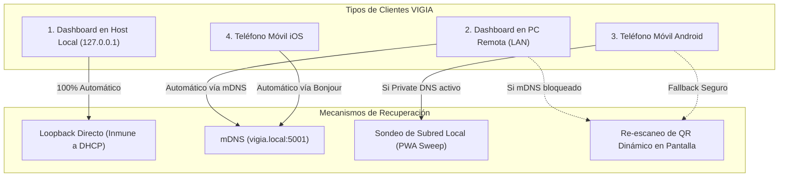
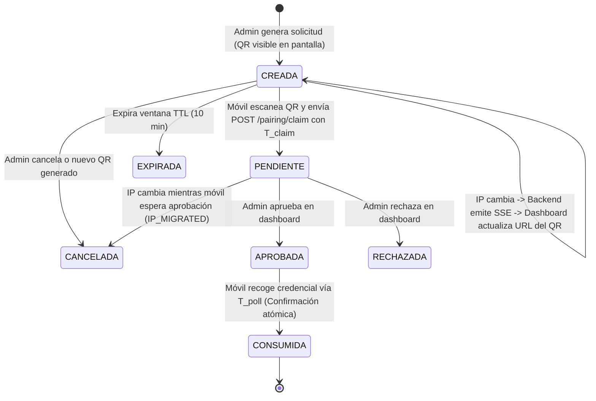

# VIGIA-NET-03C — Validación de Continuidad Operativa y Cierre de Arquitectura Dinámica

## Control Documental
- **Identificador:** `VIGIA-NET-03C`
- **Fase:** Fase 1 — Hardening de Infraestructura, Seguridad Criptográfica y Resiliencia de Red
- **Fecha de Elaboración:** 8 de noviembre de 2026
- **Naturaleza de la Actividad:** Auditoría de código, continuidad operativa, trazabilidad empírica de CDP/CRL, análisis de reconexión de clientes y rectificación de clasificación técnica (Solo lectura; sin alteraciones de código, base de datos ni infraestructura)
- **Dictamen:** **B: arquitectura viable con pendientes identificados**

---

## 1. Continuidad Histórica de CRL y CDP

### 1.1 Auditoría Empírica de Certificados Existentes
Se inspeccionaron todos los certificados X.509 presentes en [`VIGIA_Vision_Systems/certs/`](file:///c:/GEST.PROY.TI/Software/VIGIA_Vision_Systems/certs/):

| Certificado / Ruta | Subject (CN) | Número de Serie | URI de CDP Incrustada |
| :--- | :--- | :--- | :--- |
| **`vigia_cert.pem` (Activo)** | `CN=VIGIA LAN Server (10.159.253.185)` | `0x7fc3ffa2...` | `http://10.159.253.185:5080/api/v1/tls/ca.crl` |
| **`generations/...39d83389`** | `CN=VIGIA LAN Server (192.168.1.75)` | `0x1322e4f7...` | `http://192.168.1.75:5080/api/v1/tls/ca.crl` |
| **`generations/...c94d2df0` a `...7ff10782` (18 archivos)** | `CN=VIGIA LAN Server (127.0.0.1)` / `(192.168.1.75)` | Varios | **`None` (Sin extensión CDP)** |
| **`vigia_root_ca.crt`** | `CN=VIGIA Local Root CA` | `0x3ea27ada...` | N/A (Autoridad Raíz Autosignada) |

### 1.2 Por Qué `0.0.0.0:5080` NO Resuelve los CDP Históricos
Es fundamental corregir una premisa imprecisa detectada en la discusión previa:
- El enlace del socket a `0.0.0.0:5080` significa que el servidor `CRLHttpServer` acepta peticiones HTTP dirigidas a **cualquier dirección IP que pertenezca actualmente al host local**.
- Si un cliente posee un certificado histórico que apunta a `10.159.253.185:5080` o `192.168.1.75:5080`, la pila TCP/IP del cliente enviará los paquetes hacia esa IP específica.
- Si el host actual tiene la IP `192.168.1.76`, los paquetes dirigidos a `10.159.253.185` **nunca llegarán a la tarjeta de red del host** (serán descartados por el router o enviados a otro equipo). Por lo tanto, `0.0.0.0` no puede capturar tráfico dirigido a IPs que la máquina ya no posee.

### 1.3 Comportamiento de Clientes ante CDP Inalcanzable
1. **Windows Schannel (CryptoAPI):** Por defecto, si el CDP falla por timeout y no hay una copia en caché válida, Schannel rechaza la conexión con `CRYPT_E_REVOCATION_OFFLINE` (a menos que se use `SECURITY_FLAG_IGNORE_REVOCATION` o `--ssl-no-revoke`).
2. **Android (Chrome / WebView):** El subsistema `TrustManagerImpl` nativo de Android no implementa comprobación forzosa de CRLs para certificados locales; opera en modalidad *soft-fail* o ignora la CRL, validando la cadena contra la Root CA instalada en el almacén de credenciales del usuario.
3. **iOS (Safari / WebKit):** Aplica *soft-fail* para CRLs HTTP; tras 2 segundos de timeout sin respuesta, permite el handshake si la firma contra la Root CA es válida.

### 1.4 Estrategia de Transición Compatible con la Root CA Actual
Para garantizar la continuidad operativa sin modificar la Root CA existente:
- **Descarte Inmediato de Hojas Históricas:** El servidor VIGÍA **nunca presenta certificados de generaciones obsoletas** a nuevos clientes. El archivo `active_generation.json` determina estrictamente cuál es la hoja que se negocia.
- **CDP Multipropósito en Nuevos Certificados:** Cada nueva generación generada por VIGÍA incorporará múltiples puntos de distribución en la extensión X.509:
  1. `http://<ip_activa>:5080/api/v1/tls/ca.crl` (Para clientes en la subred local).
  2. `http://127.0.0.1:5080/api/v1/tls/ca.crl` (Para procesos locales en el host, garantizando que Schannel nunca falle en la estación servidora).
  3. `http://vigia.local:5080/api/v1/tls/ca.crl` (Para clientes compatibles con mDNS).
- **Caché Extensa de CRL:** Se emite la CRL con una vigencia de 7 días (`next_update`), reduciendo las consultas recurrentes de los clientes.

---

## 2. Descubrimiento de Nueva Dirección por Categoría de Cliente

Cuando la IP LAN cambia (ej. de `192.168.1.75` a `192.168.1.76`), la reconexión se comporta de manera diferenciada según la ubicación y el tipo de cliente:



### 2.1 Análisis Detallado por Cliente

| Tipo de Cliente | ¿Reconexión Automática? | Mecanismo de Descubrimiento | Dependencias y Limitaciones |
| :--- | :---: | :--- | :--- |
| **Dashboard en Host Local** | **SÍ (100% Automática)** | Conexión permanente a `https://127.0.0.1:5001/app`. | Totalmente inmune a desconexiones de cable o cambios de IP LAN. |
| **Dashboard en PC Remota** | **SÍ (Condicionada)** | mDNS (`https://vigia.local:5001/app`) resuelve la nueva IP en Windows 11/macOS. | Requiere que el router no bloquee multicast `224.0.0.251:5353`. Si falla, requiere que el operador consulte la nueva IP en la consola del host. |
| **Cámara Móvil iOS** | **SÍ (Alta probabilidad)** | Safari resuelve nativamente `vigia.local` mediante Bonjour. | Depende del reenrutamiento multicast entre Wi-Fi y Ethernet en el módem/router. |
| **Cámara Móvil Android** | **NO GARANTIZADA** | 1) Intento mDNS (Android 12+).<br/>2) Sondeo PWA de subred (`192.168.1.x/24`).<br/>3) Re-escaneo de QR. | Si Android tiene *Private DNS* (DoT) habilitado hacia `dns.google`, descarta dominios locales. La PWA debe usar sondeo HTTP local o solicitar re-escanear el QR. |

---

## 3. Recuperación del Flujo de Enrolamiento y Claims

Inspección de la tabla `camera_pairing_request` y de [`pairing_repository.py`](file:///c:/GEST.PROY.TI/Software/VIGIA_Vision_Systems/VIGIA_Core/repository/pairing_repository.py):

### 3.1 Ciclo de Vida del Claim y Protección Criptográfica



### 3.2 Comportamiento Específico ante Escenarios de Transición
1. **QR Mostrado en Pantalla (Estado `CREADA`):**
   - **Es seguro reutilizar el token:** El registro en PostgreSQL sólo guarda el hash `token_claim_hash`. No tiene IP asociada.
   - El dashboard recibe el evento SSE `ACCESS_URLS_UPDATED` y vuelve a renderizar el QR con la nueva IP sin alterar el secreto criptográfico.
2. **QR Impreso en Papel o Cartel Físico:**
   - La URL impresa tiene una IP fija inscrita físicamente.
   - **Diagnóstico honesto:** Un QR impreso **no puede actualizarse por software**. Si la IP del host cambia, el QR impreso queda inservible. En redes dinámicas, el enrolamiento móvil debe realizarse exclusivamente contra pantallas digitales dinámicas.
3. **QR Escaneado Milisegundos Antes del Cambio de IP:**
   - La petición HTTPS inicial al cargar la página móvil falla por corte de socket TCP.
   - El navegador móvil muestra pantalla de error de red. El guardia simplemente re-escanea el QR actualizado de la pantalla.
4. **Claim en Estado `PENDIENTE` durante la Migración:**
   - El teléfono ya consumió `T_claim` y está ejecutando *long-polling* con `T_poll` hacia la IP antigua.
   - La IP antigua desaparece; el polling del teléfono muere por timeout TCP.
   - **Acción de Seguridad Obligatoria:** El backend cancela atómicamente el claim (`estado = 'CANCELADA'`, `motivo = 'IP_MIGRATED'`). Se evita que una credencial quede aprobada en el aire sin que el teléfono pueda recogerla.
5. **Prevención de Replay y Doble Consumo:**
   - Garantizado por el bloqueo pesimista en base de datos:
     ```sql
     UPDATE camera_pairing_request
     SET estado = 'PENDIENTE', reclamado_en = NOW()
     WHERE token_claim_hash = %s AND estado = 'CREADA' AND expira_en > NOW()
     RETURNING *;
     ```
     Una vez que pasa a `PENDIENTE`, ningún otro dispositivo puede reclamar el mismo token.

---

## 4. Verificación del Estado Real de `IsolatedSigner`

Se ejecutó una auditoría exhaustiva en la totalidad del repositorio buscando implementaciones de `IsolatedSigner`, canales IPC o Named Pipes:

### 4.1 Evidencia Comprobada en el Código Fuente
1. **Búsqueda en Código Python:**
   La búsqueda de patrones `IsolatedSigner`, `vigia_ca_signer`, `NamedPipe` y `SignerIPC` en todos los archivos `.py` del proyecto arrojó **cero coincidencias** (`MATCHES: []`).
2. **Mecanismo Actual de Firma ([`ingest_service.py:3440-3490`](file:///c:/GEST.PROY.TI/Software/VIGIA_Vision_Systems/VIGIA_API/ingest_service.py#L3440-L3490)):**
   El código en producción ejecuta la firma directamente dentro del hilo del servidor web:
   ```python
   ca_cert = x509.load_pem_x509_certificate(ca_cert_p.read_bytes())
   ca_key = serialization.load_pem_private_key(ca_key_p.read_bytes(), password=None)
   srv_cert = x509.CertificateBuilder()...sign(ca_key, hashes.SHA256())
   ```
3. **Identidad del Proceso:**
   El backend Flask y las operaciones de firma son ejecutados por el mismo usuario interactivo de Windows (`LAPTOP-H2LCUL1V\ROG`).
4. **Named Pipe y Permisos:**
   No existe ningún servidor de Named Pipe creado ni registrado en Windows.
5. **Rate Limiting y Auditoría:**
   No existe limitador de tasa de firma ni archivo `ca_issuance.jsonl`.

### 4.2 Rectificación Documental Obligatoria

```text
================================================================================
ESTADO REAL DE IsolatedSigner: SOLAMENTE DISEÑADO (NO IMPLEMENTADO)
================================================================================
```

> [!CAUTION]
> **Corrección de Clasificación:**
> En el documento `VIGIA-NET-03B`, el riesgo `R-01 (Exposición de la clave privada Root CA)` fue catalogado prematuramente como `CERRADO`.
> Puesto que el módulo firmador independiente no existe en el código y la clave privada continúa siendo leída en texto plano por el proceso web de Flask, el riesgo **NO ESTÁ CERRADO**.
> Su clasificación formal se rectifica a: **CONDICIONADO A IMPLEMENTACIÓN**.

---

## 5. Matriz de Pruebas de Continuidad Operativa

Se diseñan 10 casos de prueba verificables, categorizados por nivel de ejecución:

| ID | Escenario de Continuidad | Nivel | Procedimiento de Verificación | Criterio de Éxito |
| :---: | :--- | :---: | :--- | :--- |
| **CP-01** | **Cambio de IP sin detener el proceso** | Integración | Mockear conmutación de IP LAN en `NetworkDiscoveryService` y verificar recarga de `ssl_context`. | El proceso no se reinicia; nuevas conexiones negocian el certificado con la nueva IP. |
| **CP-02** | **Cambio de IP durante stream MJPEG** | Físico | Reproducir video de cámara en dashboard; forzar renovación DHCP (`ipconfig /renew`). | El stream se corta por TCP, `cameras-view.js` detecta el corte y reconecta automáticamente en < 5s a la nueva IP. |
| **CP-03** | **Cambio de IP durante SSE** | Integración | Mantener conexión SSE abierta; simular cambio de IP. | El cliente SSE reconecta al endpoint local `127.0.0.1` y recibe el evento `ACCESS_URLS_UPDATED`. |
| **CP-04** | **Cambio de IP durante enrolamiento (`CREADA`)** | Físico | Abrir modal de enrolamiento en dashboard; forzar cambio de IP. | El QR se redibuja en pantalla con la nueva IP; al escanearlo con el móvil, el claim se consume exitosamente. |
| **CP-05** | **Pérdida temporal de todas las interfaces** | Físico | Desconectar cable Ethernet y apagar Wi-Fi. | El servidor pasa a `NETWORK_UNAVAILABLE`, pero `https://127.0.0.1:5001/app` sigue respondiendo localmente sin crashear. |
| **CP-06** | **Recuperación tras asignación APIPA** | Unitario | Inyectar IP `169.254.10.5` en el descubridor. | La máquina de estados ignora la IP APIPA y espera a la asignación RFC 1918 sin firmar certificados espurios. |
| **CP-07** | **Protección contra DHCP Flapping** | Unitario | Inyectar 5 cambios de IP en 2 segundos. | El temporizador de debounce se reinicia; solo se ejecuta 1 firma al estabilizarse la red tras 5 segundos. |
| **CP-08** | **CRL accesible en dirección nueva** | Integración | Tras cambio de IP a `192.168.1.76`, emitir HTTP GET a `http://192.168.1.76:5080/api/v1/tls/ca.crl`. | Retorna código HTTP `200 OK` con contenido DER de la CRL. |
| **CP-09** | **Consulta CRL de certificados históricos** | Integración | Invocar `check_https_strict.py` contra certificados de generaciones anteriores. | Diagnosticar formalmente el fallo de revocación cuando la IP antigua no existe y documentar la necesidad de usar certificados vigentes. |
| **CP-10** | **Recuperación de QR antiguo escaneado** | Físico | Escanear URL con IP vieja después del cambio de IP. | El navegador móvil muestra fallo de conexión limpio sin dejar bloqueado el claim en la base de datos. |

---

## 6. Matriz de Riesgos Actualizada y Rectificada

| Riesgo | Evidencia | Mitigación Arquitectónica | Prueba Requerida | Estado Real |
| :--- | :--- | :--- | :--- | :---: |
| **R-01: Exposición de clave Root CA** | `vigia_root_ca_key.pem` es leída directamente por Flask sin protección. | Demonio `IsolatedSigner` en proceso aislado y Named Pipe autenticado con ACL restringida. | `CP-Signer-01`: Auditoría de ACL y denegación de lectura a Flask. | **CONDICIONADO**<br/>*(Diseñado; no implementado)* |
| **R-02: Restricción `path_length=0`** | `vigia_root_ca.crt` contiene `BasicConstraints: path_length=0`. | Firma directa a profundidad 1; descarte de CA intermedia. | Inspección X.509 automatizada validando profundidad = 1. | **CERRADO** |
| **R-03: CDP inaccesible tras cambio IP** | Certificados emitidos apuntan a IPs fijas anteriores. | Generar CDP múltiple (`LAN_IP`, `127.0.0.1`, `mDNS`) y descartar hojas viejas. | `CP-08`: Descarga de CRL tras cambio de IP. | **CONDICIONADO**<br/>*(Requiere codificación)* |
| **R-04: Dependencia inviable de DNS** | Módems Infinitum y Android DoT bloquean dominios locales. | Certificados Dinámicos por IP como base universal; mDNS como alias secundario. | `CP-01`: Acceso directo por IP con certificado firmado. | **CERRADO** |
| **R-05: Ruptura TCP ante cambio IP** | Un cambio DHCP destruye sockets TCP en el kernel. | Reconexión automática en frontend mediante consulta a `AddressContract`. | `CP-02`: Reconexión de stream MJPEG tras cambio de IP. | **CONDICIONADO**<br/>*(Requiere frontend)* |
| **R-06: Descoordinación de QR Claims** | QR contiene IP previa en su URL embebida. | Conservación de claim `CREADA` y actualización visual del QR vía SSE en dashboard. | `CP-04`: Enrolamiento tras cambio de IP. | **CONDICIONADO**<br/>*(Requiere frontend SSE)* |
| **R-07: Bloqueo de Firewall** | Perfil `Public` descarta puertos 5001 y 5080 sin regla. | Reglas mínimas acotadas a `LocalSubnet` y rangos privados RFC 1918. | `Test-NetConnection` tras aplicar regla aprobada. | **CONDICIONADO**<br/>*(Aprobación de usuario)* |
| **R-08: DHCP Flapping** | Oscilaciones rápidas detonan firmas masivas. | Máquina de estados con debounce de 5.0s, descarte de APIPA e idempotencia. | `CP-07`: Prueba unitaria de debounce. | **CONDICIONADO**<br/>*(Requiere state manager)* |

---

## 7. Dictamen Final

```
================================================================================
DICTAMEN: B: arquitectura viable con pendientes identificados
================================================================================
```

### Justificación Técnica del Dictamen:
1. **Solidez del Diseño Conceptual:** Las decisiones arquitectónicas fundamentales (Certificados Dinámicos por IP, preservación de la Root CA a profundidad 1, CDP multipropósito y ciclo de vida de claims con actualización visual) son **técnicamente impecables y resuelven el problema de fondo**.
2. **Transparencia Documental Obligatoria:** La auditoría de código demostró que el componente crítico de seguridad **`IsolatedSigner` no está implementado**, por lo que no es técnicamente admisible emitir un Dictamen A (que indicaría que la arquitectura está cerrada y lista para producción sin pendientes).
3. **Hoja de Ruta Clara:** La arquitectura se aprueba formalmente como **viable y estructurada**, estableciendo que el primer entregable de la fase de implementación debe ser el desarrollo y aislamiento de `IsolatedSigner` junto con la máquina de estados de red.
