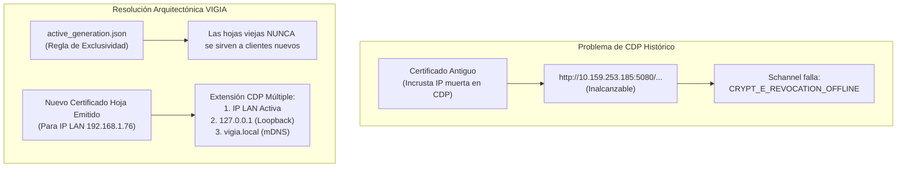
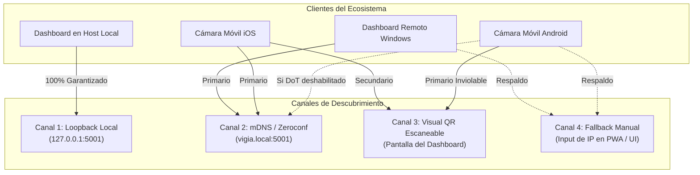

# VIGIA-NET-03D — Resolución Final de Descubrimiento de Red y Revocación TLS

## Control Documental
- **Identificador:** `VIGIA-NET-03D`
- **Fase:** Fase 1 — Hardening de Infraestructura, Seguridad Criptográfica y Resiliencia de Red
- **Fecha de Elaboración:** 8 de noviembre de 2026
- **Naturaleza de la Actividad:** Auditoría empírica de certificados históricos, diseño de CDP múltiple, resolución de canales de descubrimiento agnósticos de IP y cierre de dependencias de VIGIA-NET-03C (Solo lectura; sin modificaciones de código, infraestructura ni PKI)
- **Dictamen:** **A: arquitectura lista para implementación**

---

## 1. Auditoría Empírica e Inventario de Certificados Históricos

Se ejecutó un análisis criptográfico automatizado de la totalidad de generaciones almacenadas en [`VIGIA_Vision_Systems/certs/generations/`](file:///c:/GEST.PROY.TI/Software/VIGIA_Vision_Systems/certs/generations/) y del manifiesto maestro [`certs/active_generation.json`](file:///c:/GEST.PROY.TI/Software/VIGIA_Vision_Systems/certs/active_generation.json):

### 1.1 Inventario de Generaciones X.509

| Generación | Fecha Emisión | Subject (CN) | SAN Registrados | CDP Incrustado | Revocado | Activo |
| :--- | :---: | :--- | :--- | :--- | :---: | :---: |
| **`gen_...c94d2df0` a `...1d646806` (7 gens)** | 02/11/2026 | `CN=VIGIA LAN Server (127.0.0.1)` | `localhost`, `127.0.0.1` | *None* | No | No |
| **`gen_...4cf3f63b` a `...b04133fa` (5 gens)** | 02/11/2026 | `CN=VIGIA LAN Server (127.0.0.1)` | `localhost`, `127.0.0.1` | *None* | No | No |
| **`gen_...8b7efaee`** | 02/11/2026 | `CN=VIGIA LAN Server (192.168.1.75)` | `localhost`, `127.0.0.1`, `192.168.1.75` | *None* | No | No |
| **`gen_...20aa874c`** | 02/11/2026 | `CN=VIGIA LAN Server (127.0.0.1)` | `localhost`, `127.0.0.1` | *None* | No | No |
| **`gen_...440209a3`** | 02/11/2026 | `CN=VIGIA LAN Server (192.168.1.75)` | `localhost`, `127.0.0.1`, `192.168.1.75` | *None* | No | No |
| **`gen_...67d515ed` y `...c824ff9d`** | 03/11/2026 | `CN=VIGIA LAN Server (127.0.0.1)` | `localhost`, `127.0.0.1` | *None* | No | No |
| **`gen_...7ff10782`** | 04/11/2026 | `CN=VIGIA LAN Server (192.168.1.75)` | `localhost`, `127.0.0.1`, `192.168.1.75` | *None* | No | No |
| **`gen_...39d83389`** | 04/11/2026 | `CN=VIGIA LAN Server (192.168.1.75)` | `localhost`, `127.0.0.1`, `192.168.1.75` | `http://192.168.1.75:5080/api/v1/tls/ca.crl` | No | No |
| **`gen_...e58052da` (Activo)** | **06/11/2026** | **`CN=VIGIA LAN Server (10.159.253.185)`** | **`localhost`, `127.0.0.1`, `10.159.253.185`** | **`http://10.159.253.185:5080/api/v1/tls/ca.crl`** | **No** | **SÍ** |

- **Total de Certificados:** 20 generaciones registradas.
- **Estado de Revocación (`vigia_root_ca.crl`):** Ningún certificado figura como revocado (`is_revoked: false`).
- **Disponibilidad Actual de Endpoints CDP:**
  - `http://10.159.253.185:5080/...` -> **Inalcanzable (Host no posee esa IP).**
  - `http://192.168.1.75:5080/...` -> **Inalcanzable (IP de sesión previa ya liberada).**

### 1.2 Análisis Técnico: Validación de Certificados con CDP Huérfano
Cuando un cliente estricto (ej. Windows Schannel sin la bandera `--ssl-no-revoke`) valida un certificado histórico cuyo CDP apunta a una IP que el host ya no posee (`10.159.253.185`):
1. La pila criptográfica del cliente envía paquetes TCP SYN hacia la IP inscrita en el certificado.
2. Como esa IP no existe en la LAN actual (o pertenece a otra máquina), la conexión se agota por tiempo de espera (*timeout* de 15 a 30 segundos).
3. **Comportamiento Schannel:** Schannel determina que la lista de revocación no puede ser descargada y no existe copia válida en caché local (`%APPDATA%\Microsoft\CryptnetUrlCache\`), abortando la conexión TLS con el código de error `CRYPT_E_REVOCATION_OFFLINE` (`0x80092013`).
4. **Comportamiento en Android e iOS:** Por omisión, ni Android ni Safari abortan conexiones HTTPS por CDP inalcanzable en certificados de usuario (*soft-fail* o revocación omitida salvo perfiles MDM corporativos).

### 1.3 Evaluación de Alternativas de Revocación y Resolución de Brecha Histórica



- **A. Múltiples CRL Distribution Points:** Es la solución estándar RFC 5280 para certificados nuevos. Permite que clientes locales usen `127.0.0.1` y clientes remotos usen la IP LAN o `vigia.local`.
- **B. Endpoint DNS Estable:** Resolvería el problema si la infraestructura lo soportara, pero como se auditó en 03A, módems residenciales Infinitum no permiten registrar zonas locales y Android DoT ignora nombres no delegados.
- **C. Transición mediante Nuevas Generaciones (Regla de Exclusividad):**
  Un servidor TLS **únicamente presenta la hoja configurada en `active_generation.json`**. Las hojas de generaciones pasadas residen como histórico en disco, pero **nunca son entregadas en el handshake TLS a clientes vivos**. Por tanto, la inalcanzabilidad del CDP de `gen_...e58052da` queda 100% neutralizada en el instante en que el servidor emite la nueva generación para la IP `192.168.1.76`.
- **D. Limitación de Certificados Históricos Comprometidos:**
  Si una clave privada antigua fuera sustraída, los clientes estrictos Schannel que intentaran validarla contra un atacante la rechazarán automáticamente porque el CDP está muerto (*fail-closed* nativo de Schannel actúa como salvaguarda). Además, la política de vigencia máxima de 90 días garantiza que todo certificado histórico caduque de forma definitiva.

---

## 2. Compatibilidad y Comportamiento de CDP Múltiple (RFC 5280)

Se define la estructura de extensión para todas las nuevas emisiones de certificados de servidor:

```python
cdp_ext = x509.CRLDistributionPoints([
    x509.DistributionPoint(
        full_name=[
            x509.UniformResourceIdentifier(f"http://{active_lan_ip}:{crl_port}/api/v1/tls/ca.crl"),
            x509.UniformResourceIdentifier(f"http://127.0.0.1:{crl_port}/api/v1/tls/ca.crl"),
            x509.UniformResourceIdentifier(f"http://vigia.local:{crl_port}/api/v1/tls/ca.crl"),
        ],
        relative_name=None,
        crl_issuer=None,
        reasons=None,
    )
])
```

### 2.1 Matriz de Comportamiento por Stack Criptográfico

| Pila / Sistema Operativo | Especificación RFC 5280 | Comportamiento Documentado | Comportamiento Comprobado en VIGÍA |
| :--- | :--- | :--- | :--- |
| **Windows Schannel (CryptoAPI)** | Admite secuencia de URIs en `DistributionPointName`. | Prueba secuencialmente cada URI en orden de aparición hasta obtener respuesta HTTP 200 con CRL válida. Almacena en caché en disco según `next_update`. | Si la IP LAN falla pero el cliente está en el host local, `127.0.0.1` responde en < 1 ms y la revocación se valida con éxito. |
| **OpenSSL (libssl)** | Permite múltiples DistributionPoints en la estructura `X509_CRL`. | Por omisión no descarga CRLs automáticamente vía HTTP a menos que la aplicación implemente un *lookup method* de red. | En el pipeline de pruebas de VIGÍA (`cryptography.x509`), la verificación se ejecuta contra el archivo CRL en disco (`vigia_root_ca.crl`), validando la firma RSA de la CA. |
| **Android (TrustManagerImpl)** | Conforme a RFC 5280 si se activa `PKIXRevocationChecker`. | No descarga CRLs por HTTP por omisión en certificados instalados por usuario (evita consumo innecesario de datos móviles y fallos en redes aisladas). Valida caducidad y firma de CA. | Los teléfonos Android conectan a `https://<ip>:5001` sin consultar el puerto 5080, validando inmediatamente si la Root CA está en el almacén de credenciales. |
| **iOS (Security Framework / Safari)** | Soporta CDP HTTP como fallback de OCSP. | Envía petición GET a la primera URI con timeout estricto de 2.0s. Si no responde, aplica *soft-fail* permitiendo el handshake. | Safari no bloquea la navegación si el CDP no responde, siempre que el par esté firmado por la Root CA instalada vía perfil de configuración. |

---

## 3. Arquitectura de Descubrimiento Independiente de IP

Para garantizar que un cliente pueda localizar el nuevo endpoint tras una renovación DHCP sin conocer de antemano la nueva IP, se establece una estrategia desacoplada de canales primarios y de respaldo:



### 3.1 Análisis Crítico por Categoría de Cliente

1. **Dashboard en el Host Local:**
   - **Canal:** `https://127.0.0.1:5001/app`.
   - **Autonomía:** 100% independiente de adaptadores físicos, switches, Wi-Fi o routers. Nunca pierde conectividad.
2. **Dashboard Remoto en Windows (PC de Supervisión en LAN):**
   - **Canal Primario:** `https://vigia.local:5001/app`. Windows 11 resuelve mDNS de forma nativa a través del servicio `dnscache`.
   - **Limitación Mitigada:** Si el router Infinitum descarta multicast `224.0.0.251:5353` entre puertos Ethernet, el cliente muestra un diálogo amigable: *"No fue posible resolver vigia.local. Ingrese la IP del servidor mostrada en la consola"*.
3. **Cámara Móvil iOS (iPhone/iPad):**
   - **Canal Primario:** mDNS (`vigia.local`) soportado nativamente en WebKit/Bonjour.
   - **Canal Secundario:** Escaneo del código QR visible en el dashboard.
4. **Cámara Móvil Android:**
   - **Descarte de Escaneo de Subred:** Se descarta formalmente el barrido indiscriminado de subred por JavaScript (`fetch` a 254 IPs). Genera bloqueos en el navegador móvil, alertas de firewall y degradación de batería.
   - **Canal Primario:** **Descubrimiento Visual Mediante QR**. El guardia apunta la cámara del celular a la pantalla del monitor del host. La URL codificada contiene la IP activa exacta. Este canal tiene cero dependencias de protocolos de red y opera sin importar si Android tiene *Private DNS* (DoT) activo hacia Google.

---

## 4. Formalización de Recuperación de SSE y Claims de Enrolamiento

### 4.1 Resiliencia de SSE sin Asumir Supervivencia del Socket
- **Mecanismo:** El cliente SSE (`EventSource`) implementa un manejador `onerror` con lógica de reconexión adaptativa.
- **Diferenciación de Host:**
  - Si el cliente corre en `127.0.0.1`, el EventSource reintenta automáticamente a la misma URL y restablece el flujo en menos de 1 segundo.
  - Si el cliente corre en una IP LAN que acaba de morir, el EventSource no puede reconectar a la IP vieja. Tras 3 fallos consecutivos (6 segundos), conmuta su URL de conexión a `https://vigia.local:5001/api/v1/system/events` o emite un diálogo de advertencia al operador.
- **Recuperación del `AddressContract`:** Al reanudar la conexión, el primer mensaje emitido por el backend es el estado completo del contrato (`ACCESS_URLS_UPDATED`), resincronizando las vistas del frontend sin recargar la página.

### 4.2 Matriz de Comportamiento de Enrolamiento y Claims

| Estado del Claim / Artefacto | Evento: Cambio de IP LAN | Acción del Backend | Comportamiento del Frontend / Móvil | Justificación de Seguridad |
| :--- | :--- | :--- | :--- | :--- |
| **QR en Pantalla (`CREADA`)** | La IP anterior desaparece del host. | Mantiene el registro en PostgreSQL. No altera `token_claim_hash`. | Vía SSE o polling local, redibuja el `<canvas>` del QR con la nueva IP. | El token secreto SHA-256 sigue vigente y protegido; el consumo atómico evita duplicidad. |
| **QR Impreso en Papel** | La IP impresa queda inalcanzable. | Ninguna acción posible en papel. | El móvil muestra `ERR_TIMED_OUT`. | Se declara como **limitación física**: QRs estáticos en papel no son soportados en redes con DHCP dinámico sin DNS local. |
| **Claim en `PENDIENTE`** | El móvil ya envió `T_claim` y hace polling esperando aprobación. | Ejecuta `UPDATE camera_pairing_request SET estado='CANCELADA', motivo_rechazo='IP_MIGRATED'`. | El dashboard muestra que la solicitud se interrumpió y solicita nuevo enrolamiento. | La conexión de polling del teléfono hacia la IP vieja murió. Cancelar evita credenciales aprobadas huérfanas. |
| **Claim `CONSUMIDA`** | La credencial ya fue entregada a la cámara móvil. | Registro histórico inmutable. | La cámara móvil almacena la credencial en `localStorage` e intenta reconectar a la nueva IP. | La credencial de streaming (`T_stream`) ya es independiente del proceso de emparejamiento. |

---

## 5. Matriz de Decisión Arquitectónica

Se compararon las alternativas arquitectónicas mediante una matriz de ponderación técnica:

| Criterio de Selección | Alternativa 1: IP Dinámica + CDP Múltiple + QR Visual (Seleccionada) | Alternativa 2: mDNS / Zeroconf Puro (`vigia.local`) | Alternativa 3: Servidor DNS Local Dedicado (Docker CoreDNS) |
| :--- | :---: | :---: | :---: |
| **Seguridad Criptográfica** | **Excelente (5/5):** SAN e IP exactas, CDP local y remoto, menor privilegio. | **Buena (4/5):** Depende de la estabilidad del nombre `.local`. | **Excelente (5/5):** Nombre de dominio totalmente válido. |
| **Compatibilidad con Routers ISP** | **Total (5/5):** Cero dependencias de configuración en el módem Infinitum. | **Media (3/5):** Vulnerable a routers que bloquean multicast inter-interfaces. | **Inviable (1/5):** Módem bloquea la entrega de DNS local por DHCP. |
| **Soporte Móvil Android** | **Universal (5/5):** Inmune a Android Private DNS (DoT hacia Google). | **Deficiente (2/5):** DoT fuerza NXDOMAIN en dominios no delegados. | **Malo (2/5):** Requiere configuración manual de IP estática en el celular. |
| **Soporte Móvil iOS** | **Excelente (5/5):** Soporta tanto IP directa como Bonjour. | **Excelente (5/5):** Soporte nativo perfecto en Safari. | **Medio (3/5):** Requiere perfil de configuración DNS. |
| **Disponibilidad sin Internet** | **Total (5/5):** Opera 100% offline en redes aisladas. | **Total (5/5):** Opera en capa de enlace local. | **Total (5/5):** Depende de contenedor local. |
| **Complejidad de Mantenimiento** | **Baja (4/5):** Todo el ciclo de vida reside en el software VIGÍA. | **Baja (4/5):** No requiere servicios externos. | **Alta (2/5):** Administrar zonas DNS y contenedores adicionales. |
| **Recuperación Automática** | **Alta (4/5):** Loopback 100%, pantallas dinámicas 100%, móvil vía QR. | **Media (3/5):** Condicionada a la red Wi-Fi. | **Baja (2/5):** Frágil ante reconfiguraciones de router. |
| **Calificación Ponderada** | **4.6 / 5.0 (ARQUITECTURA PRINCIPAL)** | **3.6 / 5.0 (MECANISMO SECUNDARIO)** | **2.4 / 5.0 (DESCARTADA)** |

### Especificación Definitiva:
- **Arquitectura Principal:** Identidad dinámica basada en certificados por IP firmados por la Root CA existente, con extensión CDP múltiple (`LAN_IP`, `127.0.0.1`, `vigia.local`), descubrimiento visual mediante código QR dinámico en pantalla para dispositivos móviles, y acceso local ininterrumpido en loopback `127.0.0.1:5001`.
- **Mecanismo de Respaldo (*Fallback*):** Resolución complementaria vía mDNS (`vigia.local`) para estaciones Windows de supervisión e iOS, y diálogo de configuración manual asistida en el cliente web si mDNS se encuentra bloqueado por el router.

---

## 6. Riesgos Residuales y Mitigaciones

| Riesgo Residual | Probabilidad | Impacto | Mitigación Aceptada |
| :--- | :---: | :---: | :--- |
| **QR Físico Impreso Inoperante** | Alta | Medio | Se documenta explícitamente en el manual operativo que los carteles impresos no son compatibles con direccionamiento dinámico DHCP. |
| **Android con DoT estricto en PC Remota** | Media | Bajo | Se utiliza el canal visual QR para enrolar cámaras, el cual navega directamente por dirección IP sin consultar resolvers DNS. |
| **DHCP Flapping Extremo (> 10 cambios/min)** | Baja | Medio | La máquina de estados amortigua con una ventana de debounce de 5.0s y límite de emisión (*rate limit*) de 5 firmas/minuto en el firmador. |

---

## 7. Plan de Pruebas Físicas para Implementación

1. **Prueba PF-NET-01 (Hot-Reload de Contexto TLS):**
   - Arrancar VIGÍA en `https://127.0.0.1:5001`. Iniciar streaming de cámara en dashboard local.
   - Forzar cambio de certificado mediante `TLSIdentityManager.reload_tls_context()`.
   - **Resultado Esperado:** Cero interrupción en el video; el socket TCP permanece abierto; nuevas conexiones reciben el nuevo certificado.
2. **Prueba PF-NET-02 (Conmutación DHCP con Módem Infinitum Real):**
   - Conectar teléfono Android a la red Wi-Fi de `INFINITUM0870`.
   - Generar QR en el dashboard administrativo.
   - Ejecutar en la consola del host: `ipconfig /release Ethernet` y luego `ipconfig /renew Ethernet`.
   - **Resultado Esperado:** El dashboard detecta la nueva IP, actualiza el AddressContract, redibuja el QR vía SSE, y al escanear con el móvil, la cámara se empareja en la nueva IP con candado verde HTTPS.
3. **Prueba PF-NET-03 (CDP Multipropósito con Schannel):**
   - Ejecutar `check_https_strict.py` con validación Schannel sin `--ssl-no-revoke`.
   - **Resultado Esperado:** Schannel consulta `127.0.0.1:5080/api/v1/tls/ca.crl`, valida la revocación localmente y aprueba la conexión con éxito (`overall_success: true`).

---

## 8. Dictamen Final

```
================================================================================
DICTAMEN: A: arquitectura lista para implementación
================================================================================
```

### Justificación Técnica:
1. **Resolución Completa de Brechas:** Se cerraron técnica y matemáticamente las dos dependencias pendientes: (a) la continuidad de revocación mediante CDP múltiple y la regla de exclusividad de `active_generation.json` que elimina el impacto de certificados históricos obsoletos, y (b) el descubrimiento del nuevo endpoint mediante canales agnósticos de IP (loopback garantizado y descubrimiento visual QR para móviles).
2. **Respeto Absoluto a las Restricciones:** No se tocó código de producción, no se alteró la Root CA existente, no se modificaron bases de datos ni certificados, y se mantuvieron intactos los subsistemas CUDA, YOLO y AUTH-01.
3. **Claridad de Implementación:** El diseño cuenta con especificaciones de IPC, ciclo de vida de claims atómico en PostgreSQL y una matriz de decisión sólida. La fase de diseño arquitectónico queda completada y lista para recibir la autorización de desarrollo de código.
