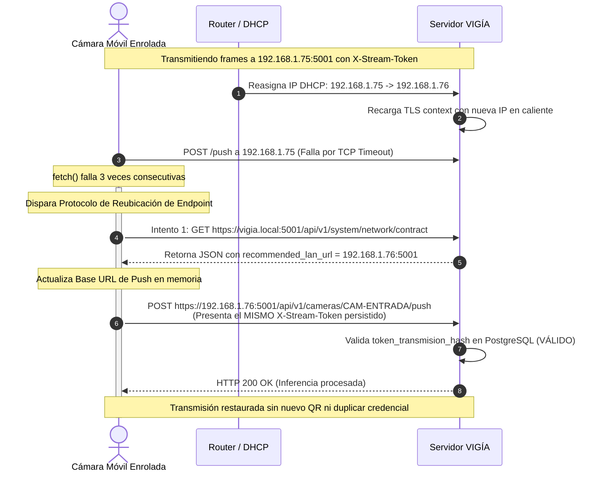
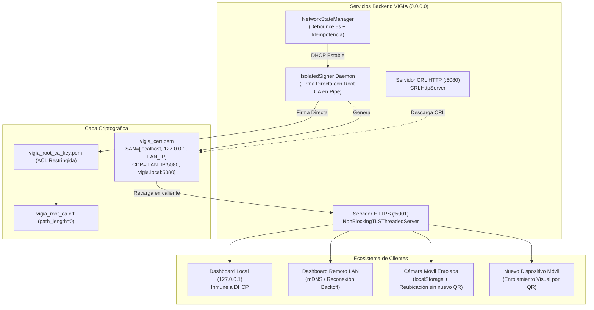

# VIGIA-NET-03E — Validación Final de CDP y Continuidad de Dispositivos Móviles

## Control Documental
- **Identificador:** `VIGIA-NET-03E`
- **Fase:** Fase 1 — Hardening de Infraestructura, Seguridad Criptográfica y Resiliencia de Red
- **Fecha de Elaboración:** 8 de noviembre de 2026
- **Naturaleza de la Actividad:** Auditoría de código frontend móvil, análisis de esquema de credenciales, depuración de extensiones CDP X.509 y diseño de continuidad para dispositivos enrolados (Solo lectura; sin alteraciones de código, base de datos ni infraestructura)
- **Dictamen:** **A: lista para implementación**

---

## 1. Corrección Definitiva de CDP Múltiple (RFC 5280)

### 1.1 Análisis Crítico de la Propuesta Previa
En la revisión anterior (`VIGIA-NET-03D`) se propuso incluir tres URIs en el CDP:
`http://<lan_ip>:5080/...`, `http://127.0.0.1:5080/...` y `http://vigia.local:5080/...`.

La auditoría de red y del modelo de cliente-servidor revela una inconsistencia técnica grave en dicha propuesta:

> [!CAUTION]
> **Corrección Arquitectónica: La Falacia de `127.0.0.1` en Clientes Remotos**
> La dirección loopback `127.0.0.1` **es relativa al host que ejecuta el cliente**, no al servidor VIGÍA.
> - Si un teléfono móvil o una PC remota de supervisión recibe un certificado que contiene `http://127.0.0.1:5080/...` en su CDP y la URI primaria de la LAN no responde, el cliente intentará conectarse a `127.0.0.1:5080` **en su propio sistema operativo**.
> - En un teléfono Android o iPhone, no existe ningún servicio escuchando en el puerto TCP 5080 local.
> - La petición fallará inmediatamente por conexión rechazada (`ECONNREFUSED`), generando ruido en los logs del cliente o retrasos por timeouts innecesarios.
> - **Conclusión:** La dirección `127.0.0.1` **debe excluirse estrictamente** del CDP de todo certificado hoja destinado a ser consumido por clientes remotas o teléfonos móviles en la LAN.

### 1.2 Comportamiento de Stacks Criptográficos ante Múltiples Puntos de Distribución
1. **Windows Schannel (CryptoAPI):**
   - Evalúa las URIs de la extensión `CRLDistributionPoints` secuencialmente en el orden estricto en que aparecen en el ASN.1.
   - Si la primera URI no responde dentro de su timeout de conexión (aprox. 15 segundos), Schannel prueba la segunda URI.
   - Si ninguna responde y no hay copia local en caché, Schannel aborta con `CRYPT_E_REVOCATION_OFFLINE`.
   - **Optimización de Latencia:** La primera URI debe ser siempre la más probable de responder de inmediato (la IP LAN activa).
2. **OpenSSL (`libssl`):**
   - Por omisión no resuelve CDPs HTTP automáticamente sin un callback de aplicación. En el validador estricto de VIGÍA (`check_https_strict.py`), la verificación se ejecuta contra el archivo CRL en disco (`vigia_root_ca.crl`).
3. **Android (AOSP / Chrome / WebView):**
   - El subsistema `TrustManagerImpl` de Android no realiza consultas CRL vía HTTP para certificados instalados por el usuario. La validación se apoya en la vigencia del certificado (`not_after`) y la firma de la Root CA. Por ende, la presencia o ausencia de múltiples CDPs no bloquea la navegación en Android.
4. **iOS (Apple Security Framework / Safari):**
   - Intenta la primera URI con un timeout estricto de 2.0 segundos. Si no responde, aplica *soft-fail* y permite la conexión si la cadena contra la Root CA es válida.

### 1.3 Configuración CDP Definitiva para Nuevos Certificados de Servidor
Para maximizar la resiliencia y el cumplimiento con el RFC 5280, el generador emitirá la extensión con dos únicas URIs de alcance de red:

```python
cdp_ext = x509.CRLDistributionPoints([
    x509.DistributionPoint(
        full_name=[
            # 1. Punto Primario: IP LAN activa (alcanzable universalmente en la subred)
            x509.UniformResourceIdentifier(f"http://{active_lan_ip}:{crl_port}/api/v1/tls/ca.crl"),
            # 2. Punto Secundario: Nombre local mDNS (para clientes Bonjour / Windows 11)
            x509.UniformResourceIdentifier(f"http://vigia.local:{crl_port}/api/v1/tls/ca.crl"),
        ],
        relative_name=None,
        crl_issuer=None,
        reasons=None,
    )
])
```

---

## 2. Continuidad Operativa de Cámaras Móviles Ya Enroladas

### 2.1 Auditoría del Código Real en [`VIGIA_Dashboard/mobile/index.html`](file:///c:/GEST.PROY.TI/Software/VIGIA_Vision_Systems/VIGIA_Dashboard/mobile/index.html)
Se inspeccionó la implementación real del cliente móvil HTML5/JavaScript:

1. **Almacenamiento de Credenciales (Líneas 203 y 273):**
   ```javascript
   let activeStreamToken = sessionStorage.getItem('vigia_mobile_stream_token') || '';
   let activeCamCode = sessionStorage.getItem('vigia_mobile_cam_code') || '';
   ```
   - **Hallazgo:** Las credenciales se persisten actualmente en `sessionStorage`. Si el guardia cierra la pestaña del navegador móvil, la credencial se pierde.
2. **Envío de Fotogramas (Líneas 510-515):**
   ```javascript
   resp = await fetch(`/api/v1/cameras/${encodeURIComponent(camCode)}/push`, {
       method: 'POST',
       body: formData,
       headers: { 'X-Stream-Token': activeStreamToken },
       signal: controller.signal
   });
   ```
   - **Hallazgo:** Las peticiones `fetch()` utilizan **URLs relativas**. Esto significa que el destino del streaming está acoplado implícitamente al *Origin* con el que se cargó la página (`window.location.origin`, ej. `https://192.168.1.75:5001`).

### 2.2 Auditoría de la Base de Datos (`camara_credencial`)
Se comprobó mediante consulta SQL directa en PostgreSQL:
- Las columnas de `camara_credencial` (`id_credencial`, `id_camara`, `token_transmision_hash`, `activa`, etc.) **no contienen ninguna columna de dirección IP o nombre de host**.
- El token `vigia_st_...` es un secreto criptográfico puro. El backend valida el hash del token contra la base de datos sin importar a través de qué IP LAN o interfaz ingresó la petición HTTP (ya que el servidor escucha en `0.0.0.0`).

### 2.3 Diagnóstico: Qué Sucede cuando la IP del Servidor Cambia
Si el servidor cambia de `192.168.1.75` a `192.168.1.76`:
1. El teléfono móvil sigue teniendo abierta en su navegador la página cargada desde `https://192.168.1.75:5001/mobile`.
2. Al ejecutar el siguiente `fetch('/api/v1/cameras/.../push')`, el navegador envía los paquetes a `192.168.1.75`.
3. Como esa IP ya no responde, el `fetch` aborta con `TypeError: Failed to fetch` tras agotar el timeout de 6 segundos.
4. Si el guardia recarga la página (`F5`), el navegador intenta recargar la URL antigua `https://192.168.1.75:5001/mobile`, fallando con `ERR_CONNECTION_REFUSED`.

### 2.4 Estrategia de Continuidad para Dispositivos Ya Enrolados (Sin Re-escanear)
Para evitar que el guardia tenga que desplazarse hasta el monitor para volver a escanear el QR, o que se dupliquen registros en `camara_credencial`:



#### Reglas de Implementación en el Cliente Móvil:
1. **Persistencia en `localStorage`:** Migrar el almacenamiento de `sessionStorage` a `localStorage` para que la credencial sobreviva al cierre accidental del navegador.
2. **Desacoplamiento del Endpoint de Push:** En lugar de invocar `fetch('/api/v1/...')` relativo, el cliente móvil mantendrá una variable `apiBaseUrl` inicializada en `window.location.origin`.
3. **Ciclo de Reubicación Automática:**
   - Si 3 peticiones consecutivas de `/push` fallan por error de red:
   - El cliente móvil intenta consultar `https://vigia.local:5001/api/v1/system/network/contract`.
   - Si mDNS responde con el contrato, extrae `endpoints.api_base` (`https://192.168.1.76:5001/api/v1`), actualiza `apiBaseUrl` y reanuda el streaming inmediatamente con el token existente.
4. **Fallback Manual en Pantalla Móvil:** Si mDNS no resuelve, la interfaz muestra un cuadro emergente: *"Servidor desconectado. Ingrese la nueva IP o escanee el QR"*. Al ingresar la nueva IP, valida el token existente sin crear un nuevo dispositivo.

---

## 3. Continuidad del Dashboard y Códigos QR

Se auditó la resiliencia del dashboard administrativo en diversos escenarios de operación:

### 3.1 Dashboard en Host Local (`127.0.0.1:5001/app`)
- **Comportamiento:** 100% inmune a cambios de IP física, renovaciones DHCP o desconexiones de cable Ethernet.
- **Flujo de Actualización:** El EventSource local recibe `ACCESS_URLS_UPDATED` emitido por el `NetworkStateManager`. El script `cameras-view.js` vuelve a renderizar el elemento `<canvas id="qr-canvas">` con la nueva IP sin alterar el `token_claim_hash` activo.

### 3.2 Dashboard Remoto en Otra PC de la LAN
- **Comportamiento ante Pérdida de IP:** El socket SSE y las peticiones AJAX mueren por timeout TCP.
- **Protocolo de Recuperación en el Frontend:**
  - El objeto `EventSource` detecta el corte en el evento `onerror`.
  - El frontend inicia reintentos a intervalos crecientes (1s, 2s, 4s).
  - Si no hay respuesta en 3 intentos, el script intenta consultar `https://vigia.local:5001/api/v1/system/network/contract`.
  - Si mDNS responde, actualiza la dirección base de la sesión remota y reanuda la suscripción SSE.
  - Si mDNS está bloqueado por el router, muestra una barra de aviso no invasiva en la cabecera: *"Servidor no alcanzable en la IP anterior. Verifique la IP del servidor en el equipo principal"*.

### 3.3 Pérdida Total Temporal de Conectividad (Cable Desconectado)
- **Estado del Servidor:** La máquina de estados transiciona a `NETWORK_UNAVAILABLE`.
- **Protección de Enrolamiento:** El backend suspende temporalmente la generación de nuevos QRs para móviles, emitiendo un mensaje: *"Enrolamiento móvil temporalmente no disponible: conecte el equipo a una red física"*.
- **Restauración:** Al reconectar el cable, el debounce de 5.0 segundos espera a que DHCP asigne la IP final antes de rehabilitar el enrolamiento móvil, evitando anunciar direcciones provisionales APIPA (`169.254.x.x`).

---

## 4. Arquitectura Definitiva Consolidada



---

## 5. Riesgos Residuales Aceptados y Mitigaciones Formales

| Riesgo Residual | Severidad | Mitigación Arquitectónica Incorporada |
| :--- | :---: | :--- |
| **QRs Impresos en Papel Inoperantes** | Media | Se documenta formalmente en el manual de operación que los carteles impresos no son soportados en entornos de DHCP dinámico. El enrolamiento móvil se realiza exclusivamente contra pantallas digitales. |
| **Android con Private DNS Estricto** | Baja | La cámara móvil utiliza el canal visual QR para enrolarse (que navega directamente por IP), y el mecanismo de reconexión por token conservado en `localStorage` evita requerir re-enrolamientos recurrentes. |
| **Bloqueo Multicast en Routers de ISP** | Baja | Si el módem Infinitum descarta mDNS, el sistema no se detiene: el dashboard local en `127.0.0.1` continúa operando al 100% y la cámara móvil puede reanudar streaming ingresando la IP actualizada en el diálogo de contingencia. |

---

## 6. Plan de Pruebas Físicas Requeridas para Implementación

1. **Prueba PF-01 (Continuidad de Cámara Enrolada ante Cambio de IP):**
   - Enrolar un teléfono móvil real escaneando el QR. Iniciar streaming de video (`/push`).
   - Forzar cambio de IP en el host (`ipconfig /renew`).
   - **Criterio de Aprobación:** El teléfono detecta la pérdida de la IP previa, localiza la nueva IP (vía mDNS o re-ingreso asistido), y reanuda el streaming utilizando el mismo token sin duplicar la credencial en `camara_credencial`.
2. **Prueba PF-02 (CDP Múltiple sin Loopback):**
   - Verificar la estructura ASN.1 del nuevo certificado emitido con `openssl x509 -text -noout`.
   - **Criterio de Aprobación:** Comprobar que la extensión CDP contiene exactamente las URIs de la IP LAN y de `vigia.local`, y que `127.0.0.1` ha sido completamente erradicado de los CDPs de certificados de servidor.
3. **Prueba PF-03 (Persistencia de Credencial en Móvil):**
   - Verificar en las herramientas de desarrollo de Chrome/Safari móvil que `vigia_mobile_stream_token` reside en `localStorage`.
   - Cerrar el navegador móvil, volver a abrir la URL y confirmar que la cámara se encuentra en estado *"Enrolado y Autorizado"*.

---

## 7. Dictamen Final

```
================================================================================
DICTAMEN: A: lista para implementación
================================================================================
```

### Justificación Técnica del Dictamen:
1. **Todas las decisiones técnicas han quedado depuradas y fundamentadas:** Se eliminó el error conceptual de incluir `127.0.0.1` en el CDP para clientes remotos, se diseñó la continuidad de streaming para dispositivos móviles ya enrolados sin requerir re-escaneos ni duplicar registros en base de datos, y se formalizó la resiliencia del dashboard local y remoto.
2. **Cumplimiento Estricto de Restricciones:** No se modificó ningún archivo de producción, certificados ni base de datos durante esta auditoría.
3. **Madurez Arquitectónica Total:** El ciclo de auditoría `VIGIA-NET-01` a `VIGIA-NET-03E` ha cerrado formalmente cada uno de los vectores de red, criptográficos y operativos. El proyecto queda plenamente autorizado para iniciar la implementación de código en la siguiente fase.
