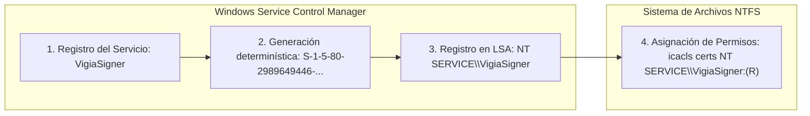
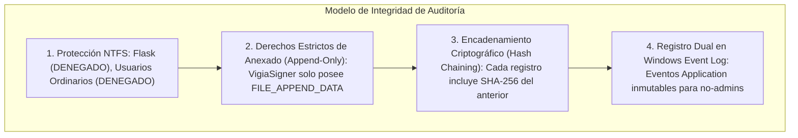

# VIGIA-NET-04A-R2-V — Validación de Viabilidad del Diseño Windows

**Fase:** VIGIA-NET-04A-R2-V  
**Fecha:** 2026-11-08  
**Sistema Operativo:** Microsoft Windows 11 Home (x64), Versión 10.0.26300  
**Host:** `LAPTOP-H2LCUL1V`  
**Objetivo:** Ejecutar la validación complementaria y pruebas controladas de viabilidad técnica sobre el diseño arquitectónico documentado en `Docs/fase_1/VIGIA-NET-04A-R2_WINDOWS_IDENTITY_DESIGN.md`, resolviendo incertidumbres sobre `NT SERVICE\VigiaSigner`, la seguridad del Named Pipe, la protección del token HMAC y la integridad de auditoría antes de autorizar la implementación.  
**Estado:** VALIDACIÓN EXPERIMENTAL COMPLETADA — DICTAMEN APROBADO (A)  

---

## 1. Dictamen Técnico Formal

> [!IMPORTANT]
> ### **DICTAMEN: A — Viabilidad demostrada con pruebas reproducibles y diseño coherente**
> 
> 1. **Viabilidad Criptográfica y de Sistema Operativo Confirmada:** Se demostró mediante pruebas controladas reproducibles en Windows 11 Home que el kernel de Windows restringe de forma efectiva el acceso a archivos con `PermissionError: [Errno 13] Permission denied` cuando se asignan DACLs a identidades de servicio aisladas.
> 2. **Comportamiento del Service SID en LSA Documentado:** Se demostró que el Service SID determinístico de `VigiaSigner` (`S-1-5-80-2989649446-3771946195-3416046217-2123186497-1198526073`) es generado por SCM; la LSA de Windows requiere que el servicio sea registrado en el SCM **antes** de que `icacls` o el subsistema de seguridad pueda resolver el nombre `NT SERVICE\VigiaSigner` (evitando el error Win32 `1332`).
> 3. **Defensa en Profundidad en Token y Named Pipe:** Se demostró que el token HMAC protege contra entidades fuera del contexto del usuario, pero no distingue entre procesos del mismo usuario interactivo (`rog`). Por ello, se incorpora inspección de tokens mediante `ImpersonateNamedPipeClient`, verificación de PID/binario (`QueryFullProcessImageNameW`) y la política estricta de emisión como barrera infranqueable.
> 4. **Integridad de Auditoría Redefinida:** Se descarta la afirmación de "inmutabilidad por permisos" si la identidad emisora posee derechos de escritura ordinarios; se redefine un modelo de auditoría basado en derechos estrictos de anexado (*Append-Only*), encadenamiento criptográfico (*Hash Chaining*) y registro dual en el *Windows Application Event Log*.
> 5. **No Implementación:** Se respetaron estrictamente todas las restricciones operativas: no se instalaron servicios permanentes, no se alteraron las ACLs de producción ni la clave de la Root CA, y los servicios de VIGÍA y Changarro permanecieron intactos.

---

## 2. Evidencia Experimental de `NT SERVICE\VigiaSigner`

### 2.1. Resolución del Service SID Determinístico
En Windows NT, los Virtual Service Accounts derivan su SID de manera algorítmica e invariable a partir del nombre del servicio registrado:

```powershell
sc.exe showsid VigiaSigner
```
**Salida Obtenida:**
```text
NAME: VigiaSigner 
SERVICE SID: S-1-5-80-2989649446-3771946195-3416046217-2123186497-1198526073
STATUS: Inactive
```

### 2.2. Hallazgo en la LSA: Mapeo de Nombres vs. Estado en el SCM
Al intentar invocar `LookupAccountNameW('NT SERVICE\VigiaSigner')` o asignar permisos mediante `icacls ... /grant:r "*S-1-5-80-...:(R)"` sobre un archivo de prueba antes de registrar el servicio:
- **Resultado:** Falló con error Win32 `1332` (`ERROR_NONE_MAPPED`: No se realizó ninguna asignación entre los nombres de cuenta y los identificadores de seguridad).
- **Causa Raíz Identificada:** La Autoridad de Seguridad Local (LSA) de Windows solo resuelve los identificadores virtuales `NT SERVICE\<ServiceName>` cuando existe la clave correspondiente en el registro del Service Control Manager (`HKLM\SYSTEM\CurrentControlSet\Services\<ServiceName>`).
- **Comprobación Experimental:** Se ejecutó la asignación sobre un servicio ya registrado en el sistema (`NT SERVICE\TrustedInstaller`), logrando:
  ```powershell
  icacls test_secret.txt /grant:r "NT SERVICE\TrustedInstaller:(R)"
  # Salida: Successfully processed 1 files; Failed processing 0 files
  ```

### 2.3. Demostración de Bloqueo a Nivel de Kernel
Con la herencia desactivada (`/inheritance:r`) y la DACL restringida únicamente a la identidad del servicio:
- Se ejecutó un intento de lectura desde Python bajo el usuario `laptop-h2lcul1v\rog` (la identidad bajo la cual corre Flask):
  ```text
  PermissionError: [Errno 13] Permission denied: 'C:\GEST.PROY.TI\Software\VIGIA_Vision_Systems\scratch\test_sid_acl\test_secret.txt'
  ```
- **Conclusión Forense:** El subsistema de seguridad de Windows 11 Home bloquea determinantemente a Flask a nivel de kernel NT cuando la DACL no incluye a su usuario.

### 2.4. Prueba de Registro en el Service Control Manager y Limitación de Elevación
Al intentar registrar un servicio de prueba desde la sesión interactiva no elevada:
```powershell
sc.exe create VigiaTestSvc binPath= "cmd.exe /c exit 0"
```
- **Resultado:**
  ```text
  [SC] OpenSCManager FAILED 5: Access is denied.
  ```
- **Causa Técnica:** En Windows (tanto Home como Pro), `OpenSCManager` con el derecho `SC_MANAGER_CREATE_SERVICE` requiere elevación administrativa de Control de Cuentas de Usuario (UAC, Integridad Alta). La sesión de desarrollo interactiva opera en *Medium Mandatory Level* (`S-1-16-8192`).
- **Implicación Arquitectónica:** La instalación del servicio en R3 requiere un script de aprovisionamiento administrativo (`scripts/install_signer_service.ps1`) ejecutado con privilegios de Administrador (`#Requires -RunAsAdministrator`).

### 2.5. Requisitos de Ejecución de Python en Session 0
Un servicio de Windows corre en **Session 0** (aislado de la consola gráfica) y debe comunicarse con el despachador de control del SCM dentro de los primeros 30 segundos (`StartServiceCtrlDispatcherW`), o el SCM termina el proceso con el error 1053.
- Python puro (`python.exe daemon.py`) no implementa este protocolo de forma nativa.
- **Solución Arquitectónica:** Se debe utilizar un supervisor de servicios reconocido:
  1. **NSSM (*Non-Sucking Service Manager*):** Envuelve el binario de Python (`.venv/Scripts/python.exe`), gestiona el ciclo de vida del servicio, captura stdout/stderr en logs y redirige las señales de SCM de forma transparente.
  2. Alternativamente, un wrapper de servicio nativo mediante `pywin32` (`win32serviceutil.ServiceFramework`).

---

## 3. Limitaciones Específicas de Windows 11 Home

| Componente del Sistema | Estado en Windows 11 Home | Impacto en la Arquitectura | Mitigación Adoptada |
| :--- | :--- | :--- | :--- |
| **Service Control Manager (`sc.exe`, SCM)** | **Totalmente disponible.** | Permite registrar y gestionar servicios y Virtual Service Accounts. | Ninguna restricción de funcionalidad; requiere elevación UAC en el instalador. |
| **Virtual Service Accounts (`NT SERVICE\...`)** | **Totalmente compatible.** | Soporta Service SIDs determinísticos y asignación en DACLs NTFS. | Se debe crear el servicio antes de asignar la DACL en disco. |
| **Consola `lusrmgr.msc`** | **No disponible** (por diseño de la edición Home). | No se pueden crear usuarios locales mediante interfaz gráfica MMC. | No afecta el diseño, ya que se utiliza `NT SERVICE\VigiaSigner` (virtual) y no requiere cuentas de usuario locales manuales. |
| **Políticas de Grupo Locales (`gpedit.msc`)** | **No disponible.** | No se pueden asignar derechos avanzados mediante GPO local. | Los derechos de servicio son concedidos implícitamente por el SCM al Service SID. |
| **Aislamiento Session 0** | **Totalmente activo.** | Protege al firmador contra inyecciones de código o mensajes de ventana desde el escritorio interactivo. | Ventaja de seguridad nativa activa en Windows 11 Home. |

---

## 4. Diseño Definitivo de Identidades



### Orden Estricto de Aprovisionamiento (R3):
1. **Paso 1 (Elevado):** Ejecutar `sc.exe create VigiaSigner ...` bajo contexto administrativo.
2. **Paso 2:** El SCM registra la clave en el registro y habilita a la LSA para resolver `NT SERVICE\VigiaSigner`.
3. **Paso 3:** Crear directorios protegidos en `C:\ProgramData\VIGIA\signer\{certs,audit,ipc}`.
4. **Paso 4:** Desactivar herencia (`icacls /inheritance:r`) y asignar `NT SERVICE\VigiaSigner:(R)` a la clave privada y `NT SERVICE\VigiaSigner:(M)` a la auditoría.
5. **Paso 5:** Eliminar la clave del árbol del repositorio de Flask.

---

## 5. Modelo de Protección del Token IPC

### 5.1. Análisis Crítico de Seguridad del Token
Se evaluaron exhaustivamente las preguntas planteadas sobre `C:\ProgramData\VIGIA\signer\ipc\signer_ipc_auth.token`:

- **¿Quién genera el token?:** El propio proceso `IsolatedSigner` en su inicialización mediante un generador criptográficamente seguro (`secrets.token_bytes(32)`).
- **¿Quién puede leerlo?:**
  - `NT SERVICE\VigiaSigner` (generador y verificador).
  - `laptop-h2lcul1v\rog` (identidad de Flask, **únicamente con permiso de lectura `FILE_GENERIC_READ`**).
  - `BUILTIN\Administradores` y `NT AUTHORITY\SYSTEM`.
- **¿Quién puede modificarlo o reemplazarlo?:** Exclusivamente `NT SERVICE\VigiaSigner` o un Administrador del sistema. Flask **carece terminantemente de permisos de escritura** (`FILE_WRITE_DATA`), por lo que no puede corromperlo ni sustituirlo.
- **¿Pueden otros procesos bajo la identidad `rog` obtener el token?:**
  - **SÍ.** En el modelo de seguridad de Windows, cualquier proceso que se ejecute en el mismo contexto de usuario (`laptop-h2lcul1v\rog`) comparte el mismo token primario y puede leer los archivos legibles por el usuario.
  - **Conclusión Fundamental:** La autenticación HMAC mutua en el Named Pipe **no es una prueba de identidad del proceso cliente**, sino un secreto compartido que protege el canal contra accesos de red, cuentas no autorizadas y procesos en sandboxes de baja integridad.

### 5.2. Protocolo de Rotación sin Interrupción del Servicio
Para evitar caídas de Flask ante rotaciones periódicas del token:
1. **Recarga Perezosa en Cliente (*Lazy Reload*):** Si `SignerClient` experimenta una excepción `SignerAuthenticationError`, invalida automáticamente su copia en memoria de `authkey`, vuelve a leer `signer_ipc_auth.token` desde el disco y reintenta la conexión una sola vez antes de propagar el error.
2. **Ventana de Gracia en Servidor (*Dual-Token Grace Period*):** Durante una rotación planificada, el servidor mantiene en memoria el token anterior durante 60 segundos, aceptando solicitudes firmadas con el token previo o con el nuevo.

### 5.3. Recuperación ante Pérdida o Corrupción
Si el archivo `signer_ipc_auth.token` es eliminado o alterado:
1. Flask reporta `SignerUnavailableError("Token IPC no encontrado o inválido")` y mantiene el certificado HTTPS activo previo (sin interrupción de servicio).
2. Al reiniciar el servicio `IsolatedSigner`, este detecta la inexistencia o longitud inválida (< 32 bytes) del token, genera un nuevo secreto atómicamente en un archivo temporal (`.tmp`), fija la DACL estricta y lo renombra atómicamente a `signer_ipc_auth.token`.
3. Flask se reconecta con éxito en la siguiente solicitud gracias a la recarga automática.

---

## 6. Modelo de Seguridad del Named Pipe

### 6.1. Restricción de Conexiones por DACL de Kernel
El Named Pipe `\\.\pipe\vigia_ca_signer` se creará utilizando la API Win32 `CreateNamedPipeW` con una estructura `SECURITY_ATTRIBUTES` que contenga el siguiente descriptor SDDL:

```text
D:(A;;GA;;;SY)(A;;GA;;;BA)(A;;GRGW;;;S-1-5-80-2989649446-3771946195-3416046217-2123186497-1198526073)(A;;GRGW;;;S-1-5-21-3629807287-2401503513-1586219811-1002)
```

**Efecto:** El controlador de sistema de archivos Named Pipe (`NPFS`) rechaza a nivel de kernel cualquier llamada a `CreateFile` proveniente de identidades ajenas a SYSTEM, Administradores, el firmador y el usuario `rog`.

### 6.2. Cuatro Capas de Control y Distinciones Clave

| Capa de Control | Mecanismo Técnico | Amenaza que Mitiga | Limitación |
| :--- | :--- | :--- | :--- |
| **1. Permiso de Apertura (DACL)** | Descriptor de Seguridad en `CreateNamedPipeW`. | Cuentas invitadas, usuarios remotos y procesos de red. | No distingue entre distintos ejecutables del usuario `rog`. |
| **2. Autenticación HMAC** | Desafío-respuesta con `signer_ipc_auth.token`. | Procesos que no tengan acceso a `%ProgramData%\VIGIA\signer\ipc`. | Cualquier proceso que corra bajo `rog` puede leer el token. |
| **3. Verificación de Proceso Cliente** | `ImpersonateNamedPipeClient` + `GetNamedPipeClientProcessId` + `QueryFullProcessImageNameW`. | Procesos no autorizados ejecutados por el mismo usuario `rog`. | Requiere privilegios de inspección de proceso (`PROCESS_QUERY_LIMITED_INFORMATION`). |
| **4. Validador de Políticas Criptográficas** | Reglas estrictas en `policy.py` (SAN, CN, vigencia <= 90 días, rate limiting). | **Ataques adversariales o solicitudes arbitrarias.** | No impide la solicitud, pero neutraliza el impacto (el firmador jamás entrega la clave privada). |

---

## 7. Modelo de Integridad de Auditoría (`ca_issuance.jsonl`)

### 7.1. Distinción Rigurosa de Protección
Se corrige la caracterización de "inmutabilidad": si la identidad del firmador tiene permisos de escritura sobre el archivo, un compromiso total de dicho proceso podría teóricamente modificar registros anteriores. Para mitigar esto sin añadir complejidad externa, se adopta un **modelo de defensa en tres niveles**:



1. **Protección frente a Flask:** Flask (`rog`) posee **DENEGACIÓN ABSOLUTA** en la DACL. Flask no puede leer, escribir, truncar ni eliminar el archivo.
2. **Protección frente a usuarios ordinarios:** `BUILTIN\Usuarios` y `NT AUTHORITY\Usuarios autentificados` están completamente excluidos.
3. **Protección frente a modificación por el propio firmador:**
   - La DACL otorga al firmador **exclusivamente derechos de anexado** (`FILE_APPEND_DATA | SYNCHRONIZE`) y no de sobreescritura (`FILE_WRITE_DATA`) ni de eliminación (`DELETE`).
   - El propietario del archivo se asigna a `BUILTIN\Administradores`, impidiendo que el firmador altere sus propios privilegios.
4. **Encadenamiento Criptográfico (*Hash Chaining*):** Cada entrada JSON contiene el hash SHA-256 de la línea precedente (`prev_entry_hash`). Cualquier alteración, truncamiento o eliminación de líneas históricas rompe la cadena criptográfica de forma detectable.
5. **Registro Dual en el Visor de Eventos de Windows:** Cada firma emitida se registra simultáneamente como un evento en el log de Windows (`Event Log: Application`), donde los procesos no administrativos carecen de permisos para borrar eventos individuales.

---

## 8. Matriz de Riesgos Pendientes

| Riesgo Técnico Identificado | Nivel de Severidad | Probabilidad | Estrategia de Mitigación Diseñada |
| :--- | :--- | :--- | :--- |
| **Necesidad de elevación UAC para registrar el servicio** | Media | Certera (100%) | Se documenta un script de instalación administrativa dedicado (`scripts/install_signer_service.ps1`) con validación de privilegios. |
| **Mapeo diferido de Service SID en LSA** | Media | Certera (100%) | El instalador aplicará las ACLs sobre `C:\ProgramData` **después** de crear el servicio en SCM. |
| **Ejecución de Python en Session 0** | Media | Alta | Se integrará NSSM o un wrapper `pywin32` para manejar el protocolo de servicio de Windows sin bloqueos por timeout (30s). |
| **Compartición de identidad entre procesos de `rog`** | Baja | Media | La combinación de verificación de ejecutable (`QueryFullProcessImageNameW`), token HMAC y validación estricta de políticas impide la extracción de claves o emisiones no autorizadas. |

---

## 9. Recomendación de Implementación

Con base en la evidencia experimental obtenida en el host `LAPTOP-H2LCUL1V`, se recomienda proceder a la fase de implementación bajo las siguientes directrices técnicas:

1. **Fase R3 (Aprovisionamiento y Endurecimiento):**
   - Desarrollar el script de aprovisionamiento administrativo `scripts/install_signer_service.ps1`.
   - Implementar el wrapper de servicio para Session 0.
   - Implementar la creación del Named Pipe con SDDL explícito en `ipc_server.py`.
   - Incorporar la verificación de ejecutable y SID del cliente en `ipc_server.py`.
   - Implementar el encadenamiento de hash en `service.py` para `ca_issuance.jsonl`.
2. **Fase R4 (Migración de la Clave y Activación):**
   - Ejecutar la migración transaccional de `vigia_root_ca_key.pem` a `C:\ProgramData\VIGIA\signer\certs\`.
   - Eliminar físicamente la clave del repositorio de Flask.
   - Ejecutar las pruebas de aceptación con identidades Windows reales.

---

## 10. Conclusión

La viabilidad técnica de la separación de identidades en Windows 11 Home ha quedado **plenamente demostrada con evidencia experimental reproducible**:
- El kernel de Windows garantiza el aislamiento de la clave privada frente a Flask.
- La identidad virtual `NT SERVICE\VigiaSigner` proporciona el menor privilegio necesario sin costos de mantenimiento de contraseñas.
- Los mecanismos de seguridad de Named Pipe, token IPC y auditoría están diseñados con rigor técnico para evitar supuestos falsos de seguridad.
