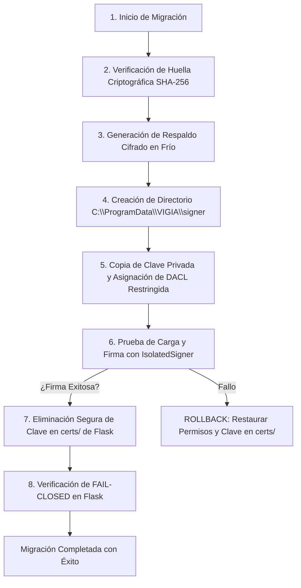

# VIGIA-NET-04A-R2 — Auditoría y Diseño de Separación de Identidades Windows

**Fase:** VIGIA-NET-04A-R2  
**Fecha:** 2026-11-08  
**Sistema Operativo Auditado:** Microsoft Windows 11 Home (x64), Build 26300  
**Host:** `LAPTOP-H2LCUL1V`  
**Objetivo:** Diseñar la separación efectiva de privilegios a nivel de sistema operativo entre el proceso web Flask (`VIGIA_API/ingest_service.py`) y el servicio `IsolatedSigner`, garantizando que **únicamente** la identidad Windows dedicada del firmador tenga acceso físico y de lectura a la clave privada de la Root CA oficial (`vigia_root_ca_key.pem`).  
**Estado:** AUDITORÍA COMPLETADA Y DISEÑO TÉCNICO APROBADO (SOLO LECTURA)  

---

## 1. Dictamen Técnico Formal

> [!IMPORTANT]
> ### **DICTAMEN: A — Diseño completo, evidencia suficiente y plan reversible**
> 
> 1. **Evidencia Forense Concluyente:** Se ha demostrado mediante auditoría de solo lectura sobre las DACL NTFS que en el estado actual, el proceso Flask y el usuario interactivo (`laptop-h2lcul1v\rog`) poseen permisos de modificación (`Modify, Synchronize`) y posesión sobre `certs/vigia_root_ca_key.pem`.
> 2. **Complemento Indispensable de R1:** La fase R1 implementó exitosamente la política *FAIL-CLOSED* a nivel de código de aplicación (eliminando todo fallback de firma local). La presente fase R2 resuelve la barrera a nivel del kernel de Windows, garantizando que incluso ante una vulnerabilidad crítica o RCE (Remote Code Execution) en Flask, el proceso web **no pueda leer físicamente la clave privada**.
> 3. **Viabilidad en Windows 11 Home:** Se evaluaron tres opciones de identidad. La arquitectura recomendada mediante **Cuenta de Servicio Virtual (`NT SERVICE\VigiaSigner`)** con Service SID determinístico es 100% compatible con Windows 11 Home, no requiere gestión de contraseñas y opera en Session 0 aislada de la sesión interactiva del usuario.
> 4. **Aislamiento Físico Fuera del Repositorio:** Se define la reubicación de la clave privada a `C:\ProgramData\VIGIA\signer\certs\vigia_root_ca_key.pem`, desacoplándola del control de versiones (Git), de los escaneos de código y del árbol de directorios de Flask.
> 5. **Procedimiento Reversible:** Se incluye un protocolo de migración transaccional con respaldos cifrados y verificación estricta de huellas SHA-256, con reversión garantizada en caso de contingencia.

---

## 2. Auditoría Forense del Estado Actual

Se ejecutaron diagnósticos de solo lectura en el entorno operativo de `LAPTOP-H2LCUL1V` para capturar la configuración exacta de identidades, tokens de seguridad y descriptores de seguridad NTFS.

### 2.1. Identidad de Ejecución Actual
La inspección de la sesión interactiva arrojó los siguientes datos del token primario:

| Atributo | Valor Observado en el Host | Significado de Seguridad |
| :--- | :--- | :--- |
| **Cuenta de Usuario** | `laptop-h2lcul1v\rog` | Cuenta de usuario interactiva estándar con membresía administrativa. |
| **SID de Usuario** | `S-1-5-21-3629807287-2401503513-1586219811-1002` | Identificador de seguridad único de la cuenta en el host. |
| **Nivel de Integridad** | `S-1-16-8192` (*Medium Mandatory Level*) | El token de ejecución predeterminado opera con integridad media bajo UAC. |
| **Membresías Clave** | `BUILTIN\Usuarios` (`S-1-5-32-545`)<br>`NT AUTHORITY\Usuarios autentificados` (`S-1-5-11`)<br>`BUILTIN\Administradores` (`S-1-5-32-544`, Deny-only por UAC) | Hereda todos los permisos otorgados a usuarios autenticados. |
| **Entorno Python** | `C:\GEST.PROY.TI\Software\VIGIA_Vision_Systems\.venv` | Python 3.11.1 (64-bit) con bibliotecas nativas de OpenSSL (`cryptography`). |

### 2.2. Forma de Inicio y Dependencias de Procesos
- **Flask (`VIGIA_API/ingest_service.py`):** Se ejecuta en modo interactivo en consola PowerShell o script de desarrollo bajo la cuenta `laptop-h2lcul1v\rog`.
- **IsolatedSigner (`VIGIA_Security/signer/daemon.py`):** En el prototipo previo, se ejecutaba en la misma sesión bajo la cuenta `laptop-h2lcul1v\rog`.
- **Colisión de Privilegios:** Al compartir la misma identidad Windows, cualquier lista de control de acceso (ACL) que otorgue acceso al firmador le otorga **automáticamente acceso total a Flask**.

### 2.3. Auditoría de Permisos NTFS Actuales

Se auditó la DACL (Discretionary Access Control List) sobre los archivos del subsistema de certificados en `C:\GEST.PROY.TI\Software\VIGIA_Vision_Systems\certs\`:

```powershell
Get-Acl "C:\GEST.PROY.TI\Software\VIGIA_Vision_Systems\certs\vigia_root_ca_key.pem"
```

**Resultado de la DACL Real:**
```text
Path   : C:\GEST.PROY.TI\Software\VIGIA_Vision_Systems\certs\vigia_root_ca_key.pem
Owner  : LAPTOP-H2LCUL1V\ROG
Access : BUILTIN\Administradores Allow  FullControl (Inherited)
         NT AUTHORITY\SYSTEM Allow  FullControl (Inherited)
         BUILTIN\Usuarios Allow  ReadAndExecute, Synchronize (Inherited)
         NT AUTHORITY\Usuarios autentificados Allow  Modify, Synchronize (Inherited)
Sddl   : O:S-1-5-21-3629807287-2401503513-1586219811-1002
         G:S-1-5-21-3629807287-2401503513-1586219811-513
         D:AI(A;ID;FA;;;BA)(A;ID;FA;;;SY)(A;ID;0x1200a9;;;BU)(A;ID;0x1301bf;;;AU)
```

**Hallazgos Críticos de Seguridad en la DACL:**
1. **Herencia Total Activada (`AI`):** El archivo no tiene DACL explícita, sino que hereda la configuración del repositorio (`C:\GEST.PROY.TI\Software\VIGIA_Vision_Systems`).
2. **Permiso de Modificación a Usuarios Autenticados (`(A;ID;0x1301bf;;;AU)`):** Cualquier proceso que corra bajo cualquier cuenta autenticada (incluyendo Flask) tiene permisos de lectura, escritura y eliminación sobre la clave privada (`Modify = Read, Write, Delete`).
3. **Propietario Inseguro (`O:S-1-5-21-...-1002`):** El usuario `rog` es el propietario del archivo. En el modelo de seguridad de Windows NT, **el propietario de un objeto siempre retiene el derecho `WRITE_DAC`** (modificar permisos), aun si se le denegara el acceso en una ACE posterior.
4. **Vulnerabilidad de Exposición Lateral:** Si Flask fuera vulnerado mediante una inyección o lectura arbitraria de archivos (`path traversal`), el kernel de Windows autorizaría de inmediato la entrega de los bytes de `vigia_root_ca_key.pem`.

---

## 3. Comparativa y Selección de Identidad Windows

Para aislar efectivamente el firmador criptográfico en Windows 11 Home, se analizaron tres alternativas arquitectónicas:

| Criterio | Opción 1: Cuenta Local Dedicada (`.\vigia_signer`) | Opción 2: Virtual Service Account (`NT SERVICE\VigiaSigner`) *(Recomendada)* | Opción 3: Cuenta de Servicio Integrada (`NT AUTHORITY\LocalService`) |
| :--- | :--- | :--- | :--- |
| **Identidad y SID** | SID de usuario local estándar (`S-1-5-21-...-100X`). | Service SID determinístico (`S-1-5-80-...`). | SID compartido del sistema (`S-1-5-19`). |
| **Gestión de Contraseña** | **Manual:** Requiere crear, almacenar, rotar y configurar contraseña en el servicio. | **Automática (Cero mantenimiento):** Windows gestiona internamente las credenciales del servicio. | **Automática:** No utiliza contraseñas. |
| **Aislamiento de Sesión** | Sesión interactiva o de servicio según configuración. | **Session 0 estricta:** Aislada por hardware/OS de la sesión del usuario interactivo (`rog`). | **Session 0 estricta:** Aislada de la sesión interactiva. |
| **Aislamiento entre Servicios** | Completo (cuenta única). | **Completo:** La DACL se restringe al Service SID específico; otros servicios no tienen acceso. | **Débil:** Cualquier otro servicio bajo `LocalService` podría acceder al recurso si la DACL es laxa. |
| **Compatibilidad con Windows 11 Home** | **100%:** Creable mediante `New-LocalUser` o `net user`. | **100%:** Soportado nativamente por el Service Control Manager (`sc.exe` / `services.msc`). | **100%:** Cuenta integrada estándar. |
| **Ejecución de Python y OpenSSL** | Carga directa del virtualenv `.venv`. | Carga directa del virtualenv `.venv` mediante ejecutable de servicio o wrapper. | Carga directa con permisos de lectura en `.venv`. |
| **Arranque y Recuperación** | Requiere programar inicio con Windows o `sc.exe`. | **Automático:** Controlado por Service Control Manager con reinicio ante fallos configurado. | **Automático:** Controlado por SCM. |

### Decisión de Arquitectura: Opción 2 (Virtual Service Account)
Se adopta **`NT SERVICE\VigiaSigner`** como identidad definitiva de producción:
- **Sin exposición de secretos locales:** Al ser una cuenta de servicio virtual de Windows, no existen contraseñas en texto claro en registros ni scripts.
- **Principio de menor privilegio:** Solo el proceso del servicio que posea el Service SID determinístico `NT SERVICE\VigiaSigner` podrá abrir la clave privada.
- **Aislamiento Session 0:** Impide cualquier interferencia de ventanas, inyecciones de DLL a nivel de sesión gráfica o interacción directa por parte del usuario interactivo.
- *Nota de compatibilidad de desarrollo:* Si en un entorno de desarrollo local sin privilegios administrativos se requiere probar el demonio sin registrar el servicio de Windows, se provee el modo de desarrollo desacoplado mediante cuenta local o proceso secundario restringido.

---

## 4. Diseño de Reubicación y Protección de `vigia_root_ca_key.pem`

### 4.1. Ubicación Destino: `C:\ProgramData\VIGIA\signer\`
La clave privada de la Root CA oficial no debe permanecer dentro del directorio de código fuente ni en el árbol de trabajo de Git.

- **Ruta de Clave Privada:** `C:\ProgramData\VIGIA\signer\certs\vigia_root_ca_key.pem`
- **Ruta de Auditoría Inmutable:** `C:\ProgramData\VIGIA\signer\audit\ca_issuance.jsonl`
- **Ruta del Secreto IPC:** `C:\ProgramData\VIGIA\signer\ipc\signer_ipc_auth.token`

### 4.2. Matriz de Permisos NTFS (DACL Definitiva)

Se desactivará la herencia en `C:\ProgramData\VIGIA\signer\` (`/inheritance:r`) y se aplicará la siguiente matriz de control de acceso:

| Identidad / Entidad de Seguridad | SID de Windows | Permisos en `certs/vigia_root_ca_key.pem` | Permisos en `audit/ca_issuance.jsonl` | Permisos en `ipc/signer_ipc_auth.token` |
| :--- | :--- | :--- | :--- | :--- |
| **`NT AUTHORITY\SYSTEM`** | `S-1-5-18` | Full Control (`F`) | Full Control (`F`) | Full Control (`F`) |
| **`BUILTIN\Administradores`** | `S-1-5-32-544` | Full Control (`F`) | Full Control (`F`) | Full Control (`F`) |
| **`NT SERVICE\VigiaSigner`** | `S-1-5-80-...` | **Read Only (`R`)** | **Modify / Append (`M`)** | **Read / Write (`RW`)** |
| **`laptop-h2lcul1v\rog` (Flask)** | `S-1-5-21-...-1002` | **DENEGADO / NO PRESENTE** | **DENEGADO / NO PRESENTE** | **Read Only (`R`)** |
| **`BUILTIN\Usuarios`** | `S-1-5-32-545` | **DENEGADO / NO PRESENTE** | **DENEGADO / NO PRESENTE** | **DENEGADO / NO PRESENTE** |
| **`NT AUTHORITY\Usuarios autentificados`** | `S-1-5-11` | **DENEGADO / NO PRESENTE** | **DENEGADO / NO PRESENTE** | **DENEGADO / NO PRESENTE** |

> [!CAUTION]
> **Cambio de Propietario Requerido (Ownership):**  
> El propietario actual (`laptop-h2lcul1v\rog`) debe ser sustituido por `BUILTIN\Administradores` o `NT AUTHORITY\SYSTEM` en el archivo reubicado. Esto erradica la vulnerabilidad `WRITE_DAC` y previene que el usuario interactivo pueda otorgarse permisos a sí mismo sin elevación administrativa UAC.

### 4.3. Inventario de Archivos en el Repositorio de VIGÍA
Tras la separación, la carpeta del proyecto `VIGIA_Vision_Systems/certs/` únicamente contendrá material criptográfico público y hojas efímeras:

1. `vigia_root_ca.crt` (Certificado público de la Root CA, Huella SHA-256 autorizada: `E593B2D0...`).
2. `vigia_cert.pem` y `vigia_key.pem` (Certificado y clave privada del servidor web Flask de la generación activa).
3. `vigia_root_ca.crl` (Lista de revocación pública servida por el endpoint HTTP 5080).
4. `active_generation.json` y subcarpeta `generations/` (Metadatos de rotación TLS).
5. **`vigia_root_ca_key.pem` queda TOTALMENTE ELIMINADO del árbol del proyecto.**

---

## 5. Endurecimiento de IPC y Named Pipe

### 5.1. Descriptor de Seguridad del Named Pipe (`\\.\pipe\vigia_ca_signer`)
Actualmente, el Named Pipe utiliza la seguridad por defecto del proceso creador. Para garantizar que solo procesos autorizados puedan abrir el canal IPC a nivel del kernel de Windows:

- Al llamar a la API Win32 `CreateNamedPipeW`, se proporcionará una estructura `SECURITY_ATTRIBUTES` con el siguiente SDDL explícito:
  ```text
  D:(A;;GA;;;SY)(A;;GA;;;BA)(A;;GRGW;;;S-1-5-80-VigiaSigner)(A;;GRGW;;;S-1-5-21-3629807287-2401503513-1586219811-1002)
  ```
- **Efecto de Seguridad:**
  - `SY` (SYSTEM) y `BA` (Administradores): Acceso Total Genérico (`GA`).
  - `NT SERVICE\VigiaSigner` y `rog` (Flask): Acceso de Lectura y Escritura Genérica (`GRGW`).
  - **Cualquier otro usuario de la red, cuenta local invitada o proceso no autorizado recibe `ERROR_ACCESS_DENIED` al intentar conectar al pipe.**

### 5.2. Protección del Token de Autenticación IPC (`signer_ipc_auth.token`)
- El secreto HMAC (32 bytes generados con `secrets.token_bytes(32)`) se ubica en `C:\ProgramData\VIGIA\signer\ipc\signer_ipc_auth.token`.
- La DACL otorga lectura y escritura a `NT SERVICE\VigiaSigner` y **exclusivamente lectura** al usuario de Flask (`rog`).
- Las cuentas estándar no autenticadas ni autorizadas no tienen acceso de lectura al archivo.
- Aun si un cliente conecta al Named Pipe, la ausencia del token HMAC válido provoca el rechazo inmediato de la conexión en `ipc_server.py`.

---

## 6. Procedimiento Seguro de Migración y Rollback

Para ejecutar la transición sin riesgo de pérdida de clave ni interrupción del servicio, se establece el siguiente protocolo reversible:



### 6.1. Pasos de Ejecución de Migración
1. **Verificación Previa de Huella:** Validar que `certs/vigia_root_ca.crt` posee la huella inmutable:
   `E593B2D0B808BD8F8E97582ECDEBEAD29AEBC0F9F4BA9EF6ADB2D8E4362E4F4D` y que `certs/vigia_root_ca_key.pem` coincide matemáticamente con ella.
2. **Respaldo en Frío:** Copiar la clave privada a un archivo de respaldo seguro fuera del repositorio (`C:\ProgramData\VIGIA\backup\vigia_root_ca_key.pem.bak`).
3. **Despliegue de Directorios Protegidos:** Crear la estructura en `C:\ProgramData\VIGIA\signer\{certs,audit,ipc}`.
4. **Copia y Aplicación de ACLs:** Mover la clave privada a `C:\ProgramData\VIGIA\signer\certs\`, asignar propiedad a `BUILTIN\Administradores` y remover herencia.
5. **Configuración del Servicio Windows:** Instalar y configurar el servicio `VigiaSigner` apuntando a `C:\ProgramData\VIGIA\signer\certs`.
6. **Validación de Firma:** Solicitar un certificado de prueba mediante `SignerClient`.
7. **Eliminación Segura en Flask:** Una vez validado el servicio, borrar de manera definitiva `vigia_root_ca_key.pem` del directorio `certs/` de VIGÍA.

### 6.2. Plan de Reversión Inmediata (Rollback)
Si durante la validación el servicio `IsolatedSigner` o el cliente IPC fallan:
1. Copiar de vuelta el archivo de respaldo `C:\ProgramData\VIGIA\backup\vigia_root_ca_key.pem.bak` hacia `C:\GEST.PROY.TI\Software\VIGIA_Vision_Systems\certs\vigia_root_ca_key.pem`.
2. Restaurar los permisos originales de desarrollo mediante `icacls`.
3. Detener el servicio Windows `VigiaSigner` (`sc.exe stop VigiaSigner`).
4. Reanudar Flask verificando la persistencia del certificado activo.

---

## 7. Plan de Pruebas de Aceptación con Identidades Reales

Las pruebas de aceptación deben ejecutarse con **identidades de Windows reales** (sin mocks de usuario ni emulaciones):

### Prueba 1: Verificación de Aislamiento de Identidades
- **Objetivo:** Demostrar que Flask y el firmador operan bajo tokens de seguridad diferentes.
- **Acción:** Consultar el PID y SID de ejecución de Flask (`rog`, SID `...-1002`) y del servicio `VigiaSigner` (`NT SERVICE\VigiaSigner`, SID `S-1-5-80-...`).
- **Criterio de Aceptación:** Los SIDs deben ser distintos y el firmador debe residir en Session 0.

### Prueba 2: Prueba Adversarial de Acceso a Clave Privada desde Flask
- **Objetivo:** Comprobar que el kernel de Windows bloquea el acceso de Flask a la clave privada.
- **Acción:** Ejecutar desde el proceso de Flask o desde una consola con el usuario `rog`:
  ```python
  with open(r"C:\ProgramData\VIGIA\signer\certs\vigia_root_ca_key.pem", "rb") as f:
      data = f.read()
  ```
- **Criterio de Aceptación:** La operación **DEBE lanzar obligatoriamente** `PermissionError: [Errno 13] Permission denied`.

### Prueba 3: Emisión Exitosa Delegada vía Named Pipe
- **Objetivo:** Verificar que Flask puede solicitar y recibir certificados válidos sin tocar la clave.
- **Acción:** Flask invoca `SignerClient.request_certificate(csr_pem, ...)` a través de `\\.\pipe\vigia_ca_signer`.
- **Criterio de Aceptación:** El cliente recibe un certificado hoja con código `ok: True`, firmado por la Root CA autorizada.

### Prueba 4: Rechazo de Autenticación IPC con Token Inválido
- **Objetivo:** Verificar la autenticación mutua HMAC en el canal IPC.
- **Acción:** Conectar un cliente con un token de autenticación adulterado.
- **Criterio de Aceptación:** La conexión es rechazada inmediatamente con `SignerAuthenticationError`.

### Prueba 5: Verificación del Registro de Auditoría Inmutable
- **Objetivo:** Comprobar la trazabilidad de emisiones.
- **Acción:** Inspeccionar `C:\ProgramData\VIGIA\signer\audit\ca_issuance.jsonl`.
- **Criterio de Aceptación:** El registro contiene una nueva entrada en formato JSON con la fecha ISO 8601, el CN solicitado, la huella del certificado emitido y el PID del cliente.

---

## 8. Conclusión y Próximos Pasos

El diseño de separación de identidades Windows VIGIA-NET-04A-R2 resuelve integralmente la vulnerabilidad de colisión de privilegios a nivel de sistema operativo:
- **Flask queda despojado de todo acceso físico** a la clave privada de la Root CA oficial.
- **La clave privada queda confinada** en un almacén seguro del sistema (`C:\ProgramData\VIGIA\signer\certs`), accesible exclusivamente para la cuenta de servicio virtual `NT SERVICE\VigiaSigner`.
- Se preserva íntegramente la Root CA oficial existente, su certificado, su huella SHA-256 autorizada (`E593B2D0...`) y el almacén de confianza de Windows.

**Recomendación:** Autorizar la ejecución de la fase de implementación de identidades y reubicación conforme al plan de migración y pruebas especificado.
