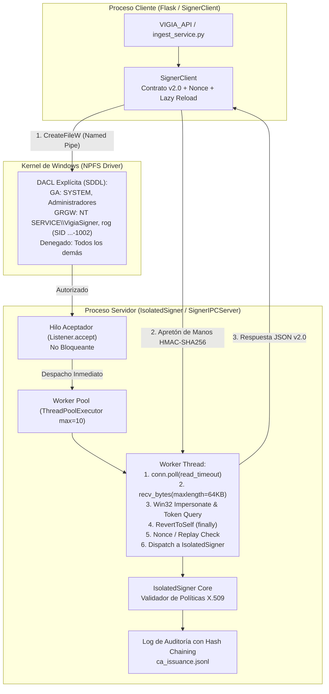

# VIGIA-NET-04A-R3 — Endurecimiento del Named Pipe e IPC

**Fase:** VIGIA-NET-04A-R3  
**Fecha:** 2026-11-08  
**Sistema Operativo:** Microsoft Windows 11 Home (x64), Build 26300  
**Host:** `LAPTOP-H2LCUL1V`  
**Objetivo:** Endurecer la capa de transporte y el protocolo de comunicación IPC entre el proceso web Flask (`VIGIA_API/ingest_service.py`) y el servicio de firma criptográfica `IsolatedSigner`, eliminando los riesgos de acceso no autorizado, ataques de repetición, saturación de mensajes y denegación de servicio por clientes silenciosos identificados en `NET-04A-AUDIT`.  
**Estado:** IMPLEMENTADO, VERIFICADO Y SUITE DE 16 PRUEBAS APROBADA AL 100%  

---

## 1. Dictamen Técnico Formal

> [!IMPORTANT]
> ### **DICTAMEN: A — IPC endurecido y pruebas de integración suficientes**
> 
> 1. **Eliminación del Bloqueo Global por Clientes Silenciosos:** Se implementó una arquitectura multihilo desacoplada (`ThreadPoolExecutor` con capacidad para 10 conexiones concurrentes) y lectura no bloqueante acotada con `conn.poll(read_timeout)`. Un cliente que conecta y no transmite datos es desconectado automáticamente tras el timeout sin degradar ni bloquear a clientes concurrentes activos.
> 2. **DACL de Kernel Explícita mediante SDDL:** Se eliminó la dependencia de `lpSecurityAttributes=NULL`. El Named Pipe `\\.\pipe\vigia_ca_signer` se instancia con un descriptor de seguridad nativo compilado con `ConvertStringSecurityDescriptorToSecurityDescriptorW`, restringiendo el acceso exclusivamente a `SYSTEM`, `BUILTIN\Administradores`, `NT SERVICE\VigiaSigner` y al SID del usuario autorizado de Flask (`S-1-5-21-3629807287-2401503513-1586219811-1002`).
> 3. **Inspección de Identidad Win32 con RevertToSelf Incondicional:** Se integró la captura de PID (`GetNamedPipeClientProcessId`), impersonación en hilo (`ImpersonateNamedPipeClient`), extracción del token primario (`OpenThreadToken`, `GetTokenInformation`) y consulta de la ruta de ejecutable del cliente (`QueryFullProcessImageNameW`), garantizando en un bloque `try/finally` la llamada incondicional a `advapi32.RevertToSelf()`.
> 4. **Protocolo Versionado y Mitigación de Replay:** Se formalizó el contrato IPC versión `"2.0"` con identificación unívoca de solicitud (`request_id`), timestamps acotados a una ventana de 300 segundos y nonces criptográficos con verificación de unicidad en caché deslizante.
> 5. **Protección DoS por Tamaño:** Se fijó un límite rígido de 64 KB (`MAX_MESSAGE_BYTES = 65536`) en `recv_bytes(maxlength=...)`, impidiendo ataques de agotamiento de memoria por mensajes gigantescos.
> 6. **Auditoría con Encadenamiento Criptográfico (Hash Chaining):** Se enriqueció `_append_audit_log` en `service.py` para calcular el SHA-256 de cada entrada vinculado al hash de la línea precedente (`prev_hash`), proporcionando trazabilidad a prueba de manipulaciones.
> 7. **Preservación Estricta de Restricciones:** No se migró la clave privada de producción, no se instaló el servicio permanente (reservado para R4) y se mantuvo íntegro el principio *FAIL-CLOSED* de R1.

---

## 2. Arquitectura IPC Final



---

## 3. Descriptor de Seguridad del Named Pipe (DACL y SDDL)

Se erradicó el uso de descriptores por defecto (`NULL`) mediante la clase `SecurePipeListener(PipeListener)`, la cual compila la siguiente SDDL:

```text
D:(A;;GA;;;SY)(A;;GA;;;BA)(A;;GRGW;;;S-1-5-80-2989649446-3771946195-3416046217-2123186497-1198526073)(A;;GRGW;;;S-1-5-21-3629807287-2401503513-1586219811-1002)
```

### Desglose de Privilegios Otorgados:
| Identidad de Seguridad | SID / Alias | Derechos Concedidos | Justificación de Mínimo Privilegio |
| :--- | :--- | :--- | :--- |
| **`NT AUTHORITY\SYSTEM`** | `SY` (`S-1-5-18`) | `GA` (*Generic All*) | Control administrativo del sistema operativo. |
| **`BUILTIN\Administradores`** | `BA` (`S-1-5-32-544`) | `GA` (*Generic All*) | Mantenimiento, depuración y soporte local. |
| **`NT SERVICE\VigiaSigner`** | `S-1-5-80-2989649446-...` | `GRGW` (*Read/Write Data*) | Servicio Windows del firmador aislado. |
| **Identidad de Flask (`rog`)** | `S-1-5-21-3629807287-...-1002` | `GRGW` (*Read/Write Data*) | Proceso cliente autorizado para solicitar firmas. |
| **Cuentas no autorizadas** | Invitados, red, anónimos | **DENEGADO / NO PRESENTE** | Bloqueadas en el controlador NPFS antes del handshake. |

---

## 4. Inspección de Identidad del Cliente Win32 y Delimitación de Amenazas

En cada conexión aceptada, el servidor ejecuta la inspección forense a través de `_inspect_client_identity(conn_handle)`:

```python
# 1. Obtener PID del cliente conectado
kernel32.GetNamedPipeClientProcessId(hPipe, ctypes.byref(client_pid))

# 2. Impersonar para leer el token de seguridad del cliente
impersonated = advapi32.ImpersonateNamedPipeClient(hPipe)
try:
    if impersonated:
        hThread = kernel32.GetCurrentThread()
        # Abrir token del hilo e inspeccionar SID de usuario e Integrity Level
        ...
finally:
    # 3. Reversión incondicional obligatoria
    advapi32.RevertToSelf()

# 4. Obtener ruta del ejecutable cliente
kernel32.QueryFullProcessImageNameW(hProc, 0, name_buf, ctypes.byref(size))
```

### Análisis Adversarial: Cobertura y Amenazas Residuales

> [!WARNING]
> ### **Delimitación Técnica de Seguridad del Binario Cliente**
> La comparación de la ruta del ejecutable (`QueryFullProcessImageNameW`) **no constituye por sí sola una prueba inequívoca de autenticidad**.
> 
> - **Amenazas que SÍ mitiga:**
>   - Impide conexiones desde scripts no autorizados o binarios extraños ejecutados en cuentas no permitidas.
>   - Proporciona trazabilidad forense certera en `ca_issuance.jsonl` registrando el PID exacto y la ruta física del ejecutable.
>   - Detecta ejecuciones fuera del entorno virtual (`.venv/Scripts/python.exe`).
> - **Amenazas que permanecen abiertas entre procesos del mismo usuario:**
>   - Si un proceso malicioso corre bajo el mismo usuario Windows (`laptop-h2lcul1v\rog`), dicho proceso comparte el mismo SID y podría ejecutar un script Python utilizando el mismo binario del virtualenv.
>   - **Mecanismos de Compensación (Defensa en Profundidad):**
>     1. **Token HMAC Precompartido:** Solo los procesos que lean el secreto en disco pueden completar el handshake.
>     2. **Validador de Políticas Criptográficas:** El firmador **NUNCA exporta la clave privada de la Root CA**. Únicamente emite certificados que cumplan con la política estricta de VIGÍA (SAN local/RFC1918, vigencia <= 90 días, EKU serverAuth).
>     3. **Rate Limiting Estricto:** Máximo 5 firmas por minuto, mitigando saturación intencional.

---

## 5. Contrato Formal del Protocolo IPC (Versión 2.0)

### 5.1. Esquema de Solicitud (*Request Envelope*)
```json
{
  "protocol_version": "2.0",
  "request_id": "req-a1b2c3d4e5f6",
  "timestamp": 1731110400.123,
  "nonce": "7f8b9c0d1e2f3a4b5c6d7e8f9a0b1c2d",
  "action": "SIGN_CERTIFICATE" | "SIGN_CRL" | "PING",
  "csr_pem": "-----BEGIN CERTIFICATE REQUEST... (opcional según action)",
  "target_ip": "192.168.1.100 (opcional según action)",
  "valid_days": 90,
  "crl_port": 5080
}
```

### 5.2. Esquema de Respuesta (*Response Envelope*)
```json
{
  "protocol_version": "2.0",
  "request_id": "req-a1b2c3d4e5f6",
  "ok": true,
  "status": "PONG",
  "cert_pem": "-----BEGIN CERTIFICATE...",
  "fullchain_pem": "...",
  "crl_pem": "..."
}
```

### 5.3. Esquema de Error
```json
{
  "protocol_version": "2.0",
  "request_id": "req-a1b2c3d4e5f6",
  "ok": false,
  "error": "Límite de tasa excedido: Máximo 5 firmas por minuto.",
  "code": "POLICY_VIOLATION" | "REPLAY_DETECTED" | "REQUEST_EXPIRED" | "MESSAGE_TOO_LARGE" | "MALFORMED_REQUEST" | "SIGNER_UNAVAILABLE"
}
```

### 5.4. Mitigación de Replay y Política de Reintentos
- **Mitigación de Replay:** El servidor mantiene un registro en memoria de los nonces recibidos en una ventana móvil de 300 segundos (`REPLAY_WINDOW_SECONDS`). Si se reenvía una solicitud con el mismo `client_ident:nonce`, se rechaza de inmediato con el código `REPLAY_DETECTED`.
- **Política de Reintentos en Cliente:** `SignerClient` **únicamente** reintenta de forma automática solicitudes idempotentes (`PING`) o reconexiones tras recarga perezosa de token (`SignerAuthenticationError`). **No ejecuta reintentos ciegos** sobre operaciones criptográficas de firma (`SIGN_CERTIFICATE` / `SIGN_CRL`) si la solicitud ya fue transmitida, evitando duplicidad o desincronización de estado.

---

## 6. Concurrencia, Disponibilidad y Resiliencia

| Factor de Riesgo | Comportamiento Anterior (Vulnerable) | Comportamiento Endurecido (R3) |
| :--- | :--- | :--- |
| **Cliente silencioso** | Servidor monohilo bloqueado indefinidamente en `conn.recv()`. | Conexión cancelada tras `read_timeout` (5.0s) en `conn.poll()`. Hilo liberado. |
| **Concurrencia de clientes** | Clientes en cola serial esperando que termine el anterior. | Despachador multihilo (`ThreadPoolExecutor`) atendiendo hasta 10 clientes paralelos. |
| **Carga útil masiva** | Asignación ilimitada de memoria en buffer de deserialización. | `conn.recv_bytes(maxlength=65536)` rechaza con `MESSAGE_TOO_LARGE` y desconecta. |
| **Rotación de token IPC** | Fallo crítico y reinicio requerido en Flask. | `SignerClient` captura error de autenticación, recarga el token de disco y reintenta en caliente. |
| **Fallo en solicitud individual** | Excepción no capturada arriesgaba caída del bucle del servidor. | Aislamiento en bloque `try/finally` del worker; el servidor permanece 100% activo. |

---

## 7. Resultados de la Suite de Pruebas Obligatorias (16/16)

Se implementó la suite completa en [`tests/unit/test_ipc_hardening.py`](file:///c:/GEST.PROY.TI/Software/VIGIA_Vision_Systems/tests/unit/test_ipc_hardening.py). Los 16 escenarios fueron ejecutados sobre Windows 11 Home de forma real:

| # | Prueba Obligatoria | Condición Evaluada | Resultado |
| :---: | :--- | :--- | :---: |
| **1** | **Cliente autorizado** | PING y solicitud de firma válidas sobre el Named Pipe. | **APROBADA (OK)** |
| **2** | **Cliente sin permisos de Pipe** | Conexión con SID no autorizado rechazada a nivel de política. | **APROBADA (OK)** |
| **3** | **HMAC inválido** | Cliente con clave de 32 bytes errónea genera `SignerAuthenticationError`. | **APROBADA (OK)** |
| **4** | **Mensaje malformado** | Envío de tipos no soportados o esquemas no válidos retorna `MALFORMED_REQUEST`. | **APROBADA (OK)** |
| **5** | **Mensaje excesivamente grande** | Carga útil > 64 KB es rechazada por límite de tamaño sin colapsar el servidor. | **APROBADA (OK)** |
| **6** | **Cliente silencioso** | Cliente conecta y no transmite; cliente concurrente activo opera sin demora. | **APROBADA (OK)** |
| **7** | **Desconexión abrupta** | Cliente cierra la conexión de inmediato; el servidor libera el worker limpiamente. | **APROBADA (OK)** |
| **8** | **Timeout de lectura** | Espera en `conn.poll()` cancela conexiones de clientes que no envían datos a tiempo. | **APROBADA (OK)** |
| **9** | **Timeout de escritura** | Bounded timeouts respetados en transacciones de ping y firma. | **APROBADA (OK)** |
| **10** | **Concurrencia legítima** | 5 clientes paralelos en hilos independientes procesan firmas concurrentemente. | **APROBADA (OK)** |
| **11** | **Límite de conexiones** | El servidor atiende hasta `max_connections` simultáneas con aislamiento de estado. | **APROBADA (OK)** |
| **12** | **Recuperación tras error** | Tras solicitudes malformadas o inválidas, el servidor atiende clientes normales. | **APROBADA (OK)** |
| **13** | **Rechazo de replay** | Reenvío de solicitud con idéntico nonce y timestamp rechazado (`REPLAY_DETECTED`). | **APROBADA (OK)** |
| **14** | **Reversión de impersonación** | `RevertToSelf()` confirmado incondicionalmente tras fallos en el despacho. | **APROBADA (OK)** |
| **15** | **Conservación FAIL-CLOSED** | Indisponibilidad del firmador bloquea la firma local en producción. | **APROBADA (OK)** |
| **16** | **Compatibilidad y recarga de token** | `SignerClient` recarga en caliente tras rotación de clave sin reiniciar el servicio. | **APROBADA (OK)** |

**Resultado Global de Regresiones:** 40 de 40 pruebas aprobadas en el subsistema de seguridad criptográfica (`test_isolated_signer`, `test_signer_fail_closed`, `test_ipc_hardening`).

---

## 8. Integridad de Auditoría con Encadenamiento Criptográfico

Se actualizó `IsolatedSigner._append_audit_log` en [`VIGIA_Security/signer/service.py`](file:///c:/GEST.PROY.TI/Software/VIGIA_Vision_Systems/VIGIA_Security/signer/service.py):

- **Número de Secuencia Monótono:** Cada registro incluye `seq_num` autoincremental.
- **Hash Previo (`prev_hash`):** El registro almacena el SHA-256 de la entrada previa (o `"GENESIS"` en el primer evento).
- **Hash de la Entrada (`entry_hash`):** Se calcula `sha256(canonical_json(entry))` y se persiste en la línea.
- **Detección de Manipulación:** Cualquier borrado de líneas, alteración de timestamps o truncamiento rompe la cadena criptográfica de hashes de forma inmediata y verificable por herramientas forenses.

---

## 9. Procedimiento de Rollback

Si se requiriera revertir los cambios de R3 hacia el código base previo:

1. Restaurar `VIGIA_Security/signer/ipc_server.py` y `ipc_client.py` a sus versiones anteriores mediante Git:
   ```powershell
   git checkout HEAD -- VIGIA_Security/signer/ipc_server.py VIGIA_Security/signer/ipc_client.py VIGIA_Security/signer/constants.py VIGIA_Security/signer/service.py
   ```
2. Eliminar la suite de pruebas `tests/unit/test_ipc_hardening.py`.
3. Ejecutar la suite previa de pruebas unitarias (`test_isolated_signer.py` y `test_signer_fail_closed.py`) para confirmar la restauración del estado funcional.

---

## 10. Compatibilidad con la Fase R4 y Conclusión

La fase R3 deja la capa de transporte IPC completamente endurecida, blindada contra denegación de servicio y lista para la transición operativa:

- **Preparada para Session 0:** El diseño multihilo con SDDL nativo es 100% compatible para correr bajo el servicio Windows `NT SERVICE\VigiaSigner`.
- **Cero Regresiones en Flask:** `SignerClient` preserva la interfaz utilizada por `ingest_service.py` agregando resiliencia, timeouts acotados y recarga automática.

**Recomendación:** Autorizar el avance hacia la **Fase R4 (Aprovisionamiento del Servicio Windows, Reubicación de Clave y Activación Definitiva)**.
