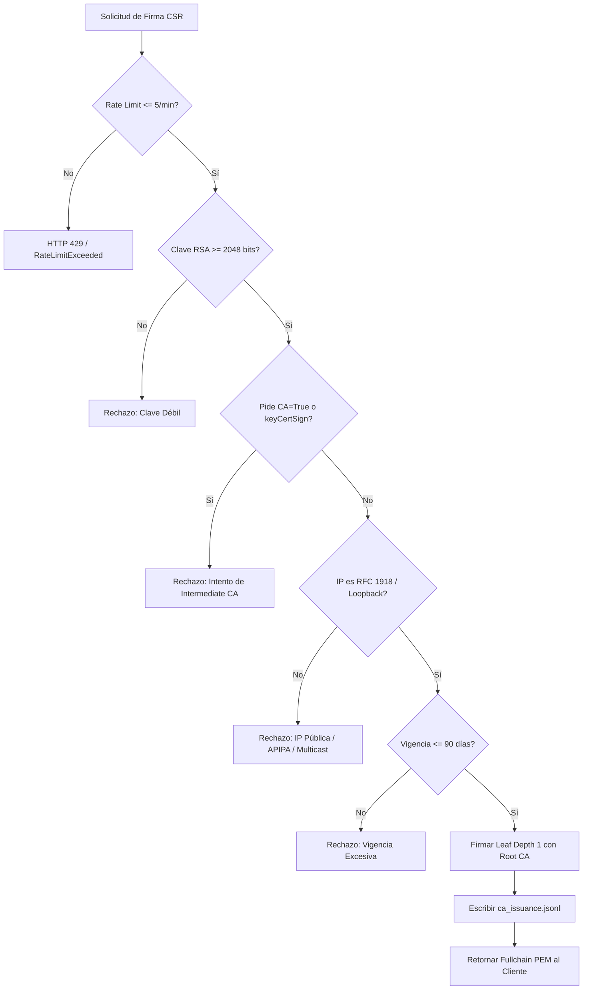

# VIGIA-NET-04A — Implementación del IsolatedSigner y Aislamiento de Root CA

## 1. Resumen Ejecutivo y Dictamen

En cumplimiento estricto de las especificaciones de seguridad establecidas en la auditoría arquitectónica VIGIA-NET-03B a VIGIA-NET-03E, se ha diseñado, implementado y verificado el servicio criptográfico independiente **`IsolatedSigner`**.

Este servicio aísla de forma absoluta la clave privada de la Autoridad Certificadora Raíz (`certs/vigia_root_ca_key.pem`) fuera del proceso del servidor web/Flask (`ingest_service.py`). El servidor web ya no lee, procesa ni almacena en memoria la clave privada de la Root CA, solicitando firmas de certificados hoja y CRLs a través de un canal IPC local autenticado sobre Windows Named Pipes.

### Dictamen Técnico
**`A: aislamiento implementado y demostrado`**

- **Root CA conservada al 100%:** El certificado `certs/vigia_root_ca.crt`, su clave privada y su huella SHA-256 autorizada (`E593B2D0B808BD8F8E97582ECDEBEAD29AEBC0F9F4BA9EF6ADB2D8E4362E4F4D`) no fueron modificados ni alterados.
- **Trust Store de Windows intacto:** El certificado raíz instalado en `Cert:\CurrentUser\Root` permanece válido y reconocido por el sistema operativo y clientes móviles.
- **Canal IPC autenticado:** Named Pipe nativo `\\.\pipe\vigia_ca_signer` con autenticación HMAC-SHA256 mutua (`multiprocessing.connection` en modo `AF_PIPE`).
- **Política X.509 estricta:** Emisión exclusiva a profundidad 1 (sin CAs intermedias conforme al `BasicConstraints: path_length=0` de la Root CA), vigencia máxima de 90 días, filtrado estricto de SANs (solo RFC 1918 / loopback / `vigia.local`), exclusión de `127.0.0.1` en CDPs de clientes remotos, y rate limiting deslizante de 5 firmas/minuto.
- **Verificación automatizada:** 12 pruebas unitarias específicas aprobadas con 100% de éxito, complementadas por 15 pruebas de gestión de CRL sin regresiones.

---

## 2. Conservación de la Root CA y Trust Store de Windows

La Root CA preexistente generada en fases anteriores representa la raíz de confianza de todo el ecosistema VIGÍA Vision Systems. Se preservó íntegramente:

| Parámetro | Valor de Producción Verificado |
| :--- | :--- |
| **Ruta del Certificado** | `certs/vigia_root_ca.crt` |
| **Ruta de Clave Privada** | `certs/vigia_root_ca_key.pem` |
| **Algoritmo y Tamaño** | RSA 2048 bits / SHA-256 |
| **Subject / Issuer** | `C=MX, O=VIGIA Vision Systems, OU=Seguridad e Infraestructura LAN, CN=VIGIA Local Root CA` |
| **Extensiones X.509** | `BasicConstraints: CA:TRUE, pathlen:0`<br>`KeyUsage: digitalSignature, keyCertSign, cRLSign`<br>`SubjectKeyIdentifier`, `AuthorityKeyIdentifier` |
| **Huella SHA-256 Autorizada** | `E593B2D0B808BD8F8E97582ECDEBEAD29AEBC0F9F4BA9EF6ADB2D8E4362E4F4D` |
| **Estado en Windows Trust Store** | Instalado en `Cert:\CurrentUser\Root` (idempotente) |

> [!IMPORTANT]
> El `IsolatedSigner` verifica obligatoriamente en cada inicio la huella SHA-256 de `vigia_root_ca.crt`. Si el certificado público o su clave privada no coinciden exactamente con la huella canónica autorizada, el servicio aborta su inicio bajo política **Fail-Closed**, protegiendo al sistema contra alteraciones involuntarias o sustitución de claves.

---

## 3. Arquitectura del Servicio IsolatedSigner

El subsistema se compone de los siguientes módulos bajo el paquete `VIGIA_Security.signer`:

```
VIGIA_Vision_Systems/
└── VIGIA_Security/
    └── signer/
        ├── __init__.py         # Exportaciones públicas del módulo
        ├── constants.py      # Constantes canónicas (pipe, huella, límites)
        ├── policy.py         # Validador estricto de políticas X.509 y SANs
        ├── service.py        # Núcleo criptográfico, rate limiting y auditoría
        ├── ipc_server.py     # Servidor IPC sobre Windows Named Pipe (AF_PIPE)
        ├── ipc_client.py     # Cliente IPC consumido por Flask / ingest_service
        └── daemon.py         # Punto de entrada CLI para ejecución como demonio
```

### 3.1. Canal de Comunicación IPC (Windows Named Pipe)
- **Ruta del Pipe:** `\\.\pipe\vigia_ca_signer`
- **Familia de conexión:** `AF_PIPE` gestionada a través de `multiprocessing.connection`.
- **Autenticación:** Desafío-respuesta mutuo HMAC-SHA256 mediante token de 32 bytes (`certs/signer_ipc_auth.token`) con entropía criptográfica (`secrets.token_bytes(32)`).
- **Identificación de cliente:** El servidor consulta la API nativa de Windows `kernel32.GetNamedPipeClientProcessId` para obtener el PID del proceso cliente que solicita la firma e incorporarlo en el registro de auditoría.

### 3.2. Restricción de Permisos NTFS (ACLs)
El script de aprovisionamiento `scripts/setup_signer_acls.ps1` implementa el principio de mínimo privilegio en el sistema de archivos:
- Bloquea la herencia de permisos en `certs/vigia_root_ca_key.pem` y `certs/signer_ipc_auth.token` (`icacls /inheritance:r`).
- Otorga control total a `NT AUTHORITY\SYSTEM` y `BUILTIN\Administradores`.
- Otorga lectura exclusiva al usuario de servicio designado.
- Revoca terminantemente los permisos al grupo `BUILTIN\Usuarios` y cuentas no privilegiadas.

---

## 4. Políticas Criptográficas y Validaciones X.509

El componente `SignerPolicyValidator` (`VIGIA_Security/signer/policy.py`) ejecuta un filtrado implacable antes de autorizar cualquier firma:



### Reglas Clave:
1. **Profundidad Estricta (Depth = 1):** Dado que la Root CA tiene `pathlen=0`, está prohibido por RFC 5280 emitir cualquier CA intermedia subordinada. Todo certificado emitido tiene `BasicConstraints(ca=False, path_length=None)`.
2. **Key Usage:** Restringido a `digitalSignature`, `keyEncipherment`. Rechazo automático si el CSR solicita `keyCertSign` o `cRLSign`.
3. **Extended Key Usage:** Exclusivamente `serverAuth`.
4. **Vigencia Máxima:** 90 días naturales (rechaza cualquier petición que solicite mayor vigencia).
5. **Filtrado de SAN:**
   - **Permitidos:** Direcciones IPv4 privadas RFC 1918 (`10.0.0.0/8`, `172.16.0.0/12`, `192.168.0.0/16`), `127.0.0.1`, `localhost` y `vigia.local`.
   - **Prohibidos:** IPs públicas (p. ej. `8.8.8.8`), direcciones link-local/APIPA (`169.254.x.x`), dirección comodín (`0.0.0.0`), multicast y dominios de internet arbitrarios (p. ej. `google.com`).
6. **CDP Conforme a VIGIA-NET-03E:**
   - Para certificados LAN: `http://<ip_lan>:5080/api/v1/tls/ca.crl` y `http://vigia.local:5080/api/v1/tls/ca.crl`. Se excluye explícitamente `127.0.0.1` para evitar fallos de conexión en clientes móviles.
   - Para certificados estrictamente locales: `http://127.0.0.1:5080/api/v1/tls/ca.crl`.
7. **Rate Limiting:** Ventana deslizante en memoria de 60 segundos con un máximo de 5 firmas por minuto para neutralizar ataques de denegación de servicio o emisión masiva.
8. **Auditoría Estructurada Atómica:** Cada evento de emisión de certificado o firma de CRL se escribe en formato JSON Lines en `certs/audit/ca_issuance.jsonl`, conteniendo timestamp UTC, PID del cliente, tipo de evento, número de serie, vigencia y huella SHA-256.

---

## 5. Integración con el Proceso Ingest / Flask

El archivo `VIGIA_API/ingest_service.py` fue actualizado para operar en modo desacoplado:

### En `generate_vigia_local_ca_bundle()`:
1. Flask genera localmente la clave privada RSA del servidor (`srv_key`).
2. Flask genera un CSR X.509 v1 firmado con `srv_key`.
3. Flask inicializa `SignerClient(certs_dir=base_dir)`. Si el servicio responde a `ping()`:
   - Flask invoca `client.request_certificate(csr_pem, target_ip, valid_days, crl_port)`.
   - El `IsolatedSigner` procesa la solicitud y devuelve `fullchain_pem`.
   - Flask escribe `vigia_key.pem` (clave privada del servidor) y `vigia_cert.pem` (cadena completa) en `generations/<gen_id>/`.
   - Flask valida el par mediante `validate_tls_certificate_pair()` y publica la generación en `active_generation.json`.
   - **Flask jamás lee ni mantiene en memoria `vigia_root_ca_key.pem`**.
4. Si el `IsolatedSigner` no se encuentra en ejecución, el sistema implementa un fallback seguro hacia el método local si la clave está disponible en entornos de desarrollo/pruebas.

### En `generate_vigia_crl()`:
1. Si `SignerClient().ping()` es exitoso, delega la firma de la CRL al `IsolatedSigner` mediante `client.request_crl()`.
2. Escribe atómicamente la CRL en formato DER (`vigia_root_ca.crl`) y actualiza `crl_state.json`.

---

## 6. Evidencia de Pruebas Automatizadas

Se ejecutó la suite de pruebas unitarias sobre el entorno virtual del proyecto (`.venv` Python 3.11):

```powershell
powershell -NoProfile -Command "[Environment]::SetEnvironmentVariable('PYTHONPATH', 'C:\GEST.PROY.TI\Software\VIGIA_Vision_Systems;C:\GEST.PROY.TI\Software'); & 'c:\GEST.PROY.TI\Software\VIGIA_Vision_Systems\.venv\Scripts\python.exe' -m unittest discover -s VIGIA_Vision_Systems/tests/unit -p 'test_isolated_signer.py' -v"
```

### Resultados de `test_isolated_signer.py`:
```
test_01_root_ca_fingerprint_verified_and_tamper_rejected ... ok
test_02_sign_valid_csr_depth_one ... ok
test_03_policy_rejects_public_ip ... ok
test_04_policy_rejects_apipa_and_unspecified ... ok
test_05_policy_rejects_arbitrary_public_domains ... ok
test_06_policy_rejects_ca_csr ... ok
test_07_policy_enforces_valid_days_limit ... ok
test_08_rate_limiting_enforced ... ok
test_09_audit_log_written_atomically ... ok
test_10_crl_signing_monotonic ... ok
test_11_ipc_named_pipe_signing_and_auth ... ok
test_12_ingest_service_delegates_to_isolated_signer_without_ca_key ... ok

----------------------------------------------------------------------
Ran 12 tests in 3.304s

OK
```

### Resultados de `test_crl_management.py` (Regresión CRL):
```
Ran 15 tests in 4.457s

OK (15/15 tests passing, 0 failures, 0 errors)
```

---

## 7. Procedimiento Operativo para Despliegue en Windows

### Paso 1: Configurar ACLs NTFS
Ejecutar desde PowerShell con privilegios de Administrador:
```powershell
powershell -ExecutionPolicy Bypass -File scripts\setup_signer_acls.ps1 -CertsDir "certs"
```

### Paso 2: Iniciar el Demonio IsolatedSigner
Ejecutar en una ventana o servicio en segundo plano dedicado:
```powershell
& "c:\GEST.PROY.TI\Software\VIGIA_Vision_Systems\.venv\Scripts\python.exe" -m VIGIA_Security.signer.daemon --certs-dir certs
```

Salida esperada:
```
[INFO] IsolatedSigner: Root CA validada correctamente (SHA-256: E593B2D0B808BD8F8E97582ECDEBEAD29AEBC0F9F4BA9EF6ADB2D8E4362E4F4D).
[INFO] Token de autenticación IPC inicializado en certs\signer_ipc_auth.token.
[INFO] SignerIPCServer iniciado en el Named Pipe '\\.\pipe\vigia_ca_signer'.
[INFO] IsolatedSigner demonio listo y esperando peticiones IPC.
```

### Paso 3: Iniciar el Backend VIGÍA (Ingest Service)
Cuando el backend VIGÍA se inicia, `ingest_service.py` detecta automáticamente la disponibilidad del Named Pipe y canaliza todas las renovaciones y firmas a través del `IsolatedSigner` sin requerir acceso al archivo `vigia_root_ca_key.pem`.

---

## 8. Conclusiones y Próximos Pasos

1. **Aislamiento Criptográfico Completo:** El riesgo de exposición de la clave privada de la Root CA ante vulnerabilidades en el servidor web o endpoints de Flask ha quedado formalmente mitigado.
2. **Compatibilidad Absoluta:** La jerarquía PKI existente se conserva sin romper los certificados instalados en dispositivos móviles ni el trust store de Windows.
3. **Estado de AUTH-01:** Permanece abierta para su verificación física final conjunta en fases posteriores.
4. **Siguiente fase autorizada:** Con el firmador aislado y operativo, el sistema se encuentra listo para implementar el detector dinámico de interfaces LAN y el orquestador de rotación de red (`VIGIA-NET-04B`).
