# VIGIA-OPT-CUDA-01 — Habilitación de Aceleración NVIDIA CUDA para YOLO

| Metadato | Valor |
| :--- | :--- |
| **Documento** | `VIGIA-OPT-CUDA-01_IMPLEMENTACION.md` |
| **Versión** | 1.0.0 |
| **Fase** | Fase 1 — Caracterización, Optimización y Piloto Aislado |
| **Estado** | **CERRADO — APROBADO** |
| **Marco Normativo** | `VIGIA-VISION-OPT-00_METODOLOGIA_OPTIMIZACION.md` (R2)<br>`VIGIA-VISION-OPT-03_AUDITORIA_OPORTUNIDADES.md` |
| **Hardware Validado** | NVIDIA GeForce RTX 4050 Laptop GPU (6144 MB VRAM, Ada Lovelace sm_89) |
| **Driver NVIDIA** | Driver Version: 566.36 (WDDM), Soporte CUDA Driver: 12.7 |
| **Fecha de Ejecución** | 2026-11-04 / 2026-11-05 |
| **Dictamen Final** | **APROBADO** (GPU plenamente funcional, Speedup 1.88x, 0 regresiones) |

---

## 1. Diagnóstico Inicial del Entorno

Previo a cualquier intervención, se realizó una auditoría técnica del entorno virtual `.venv` y del subsistema de hardware y software del host:

### 1.1 Entorno `.venv` Existente
* **Versión de Python:** Python 3.11.1 (64-bit AMD64, MSC v.1934).
* **Versión de Pip:** 22.3.1.
* **Versión de PyTorch Instalada:** `2.14.1+cpu`.
* **Ubicación del Paquete PyTorch:** `C:\Users\ROG\AppData\Local\Programs\Python\Python311\Lib\site-packages\torch\__init__.py`.
* **Disponibilidad de CUDA en `.venv`:** `torch.cuda.is_available() == False` (`torch.version.cuda == None`).
* **Configuración en `pyvenv.cfg`:**
  ```ini
  home = C:\Users\ROG\AppData\Local\Programs\Python\Python311
  include-system-site-packages = true
  version = 3.11.1
  executable = C:\Users\ROG\AppData\Local\Programs\Python\Python311\python.exe
  command = C:\Users\ROG\AppData\Local\Programs\Python\Python311\python.exe -m venv --system-site-packages C:\GEST.PROY.TI\Software\VIGIA_Vision_Systems\.venv
  ```
* **Dependencias de Visión:**
  - `ultralytics`: 8.4.171
  - `numpy`: 2.4.6
  - `opencv-python (cv2)`: 4.13.0
  - `psutil`: 7.0.0
  - `torchvision`: 0.29.1+cpu

### 1.2 Causa Raíz de PyTorch CPU-Only
El archivo `pyvenv.cfg` del entorno `.venv` tiene habilitada la directiva `include-system-site-packages = true`. Al no existir una distribución local de PyTorch instalada en `.venv\Lib\site-packages`, el intérprete delega la resolución hacia la instalación base del sistema (`AppData\Local\Programs\Python\Python311`), la cual cuenta con una compilación CPU-only (`2.14.1+cpu`), inhabilitando de facto el acceso al hardware NVIDIA disponible.

### 1.3 Hardware y Driver NVIDIA
* **GPU:** NVIDIA GeForce RTX 4050 Laptop GPU (Arquitectura Ada Lovelace, núcleo AD107).
* **Compute Capability:** **8.9** (sm_89).
* **VRAM Dedicada Total:** 6140.5 MB (~6 GB GDDR6).
* **Driver NVIDIA:** **566.36** (WDDM 3.2).
* **Capacidad Máxima de CUDA del Driver:** **CUDA 12.7**.
* **Estado Térmico y Energético en Reposo:** 44 °C - 46 °C, P8 (3 W de consumo basal).

---

## 2. Preparación y Aislamiento del Entorno CUDA

En estricta observancia de las restricciones del proyecto ("*No reemplazar ni eliminar el entorno Python existente sin autorización*"), se configuró un entorno virtual dedicado y desacoplado denominado [`.venv_cuda`](file:///C:/GEST.PROY.TI/Software/VIGIA_Vision_Systems/.venv_cuda):

1. **Creación del Entorno Aislado:**
   ```powershell
   python -m venv --system-site-packages C:\GEST.PROY.TI\Software\VIGIA_Vision_Systems\.venv_cuda
   ```
2. **Actualización de Pip:** Se actualizó `pip` dentro de `.venv_cuda` de 22.3.1 a **26.3** para subsanar incompatibilidades en la resolución de metadatos de wheels modernos de PyPI.
3. **Distribución Oficial de PyTorch Seleccionada:**
   * Paquete: `torch==2.6.0+cu124` y `torchvision==0.21.0+cu124`.
   * Índice Oficial: `https://download.pytorch.org/whl/cu124`.
   * **Justificación Técnica:** Los wheels oficiales de PyTorch para CUDA 12.4 incorporan de manera autocontenida todos los runtimes binarios necesarios (`cudart64_12.dll`, `cublas64_12.dll`, `cudnn_adv64_9.dll`, etc.), lo que hace innecesario instalar el CUDA Toolkit a nivel del sistema operativo. La versión CUDA 12.4 es nativamente compatible con el Compute Capability 8.9 de la RTX 4050 y el driver 566.36.
4. **Instalación Local en `.venv_cuda`:**
   ```powershell
   .\.venv_cuda\Scripts\python.exe -m pip install torch==2.6.0+cu124 torchvision==0.21.0+cu124 --extra-index-url https://download.pytorch.org/whl/cu124
   .\.venv_cuda\Scripts\python.exe -m pip install psycopg2-binary qrcode
   ```
5. **Independencia Comprobada:**
   * `.venv` permanece 100% inalterado y puramente CPU (`torch 2.14.1+cpu`, `cuda.is_available() == False`).
   * `.venv_cuda` dispone de aceleración GPU activa (`torch 2.6.0+cu124`, `cuda.is_available() == True`).

---

## 3. Validación de GPU y Operaciones Matemáticas

Se ejecutó un script de verificación exhaustiva para constatar la funcionalidad del hardware y el backend cuDNN:

```python
import torch

assert torch.cuda.is_available() == True
assert torch.cuda.get_device_name(0) == "NVIDIA GeForce RTX 4050 Laptop GPU"
assert torch.cuda.get_device_capability(0) == (8, 9)
assert torch.backends.cudnn.is_available() == True

# Creación de tensores en GPU
a = torch.randn(2000, 2000, device='cuda', dtype=torch.float32)
b = torch.randn(2000, 2000, device='cuda', dtype=torch.float32)
torch.cuda.synchronize()

# Operación matemática masiva (Matmul)
c = torch.matmul(a, b)
torch.cuda.synchronize()

# Transferencia bidireccional CPU <-> GPU
c_cpu = c.cpu()
assert c_cpu.device.type == "cpu"
```

### Resultados de la Validación:
* **Identificación del Dispositivo:** `NVIDIA GeForce RTX 4050 Laptop GPU`.
* **Capacidad de Cómputo:** `(8, 9)`.
* **Versión de cuDNN:** `9.1.0` (código de biblioteca `90100`).
* **Multiplicación Matricial ($2000 \times 2000$):** Ejecutada exitosamente con sincronización estricta.
* **Consumo de Memoria VRAM en Operación:**
  - Asignada (`memory_allocated`): **56.12 MB**.
  - Pico alcanzado (`max_memory_allocated`): **56.13 MB**.
  - Reservada (`memory_reserved`): **70.00 MB**.
* **Telemetría `nvidia-smi` post-ejecución:** Recuperación inmediata a estado de reposo (0% utilización, VRAM liberada).

---

## 4. Benchmark Comparativo YOLO11n: CPU vs. GPU (RTX 4050)

Se implementó el script reproducible [`scripts/run_cuda_benchmark.py`](file:///C:/GEST.PROY.TI/Software/VIGIA_Vision_Systems/scripts/run_cuda_benchmark.py) para evaluar el comportamiento del modelo activo [`yolo11n.pt`](file:///C:/GEST.PROY.TI/Software/VIGIA_Vision_Systems/yolo11n.pt).

### 4.1 Parámetros Metodológicos del Benchmark
* **Modelo Evaluado:** [`yolo11n.pt`](file:///C:/GEST.PROY.TI/Software/VIGIA_Vision_Systems/yolo11n.pt) oficial (5.61 MB).
* **Imágenes de Prueba:** 10 fotogramas vehiculares originales de producción provenientes de `evidencias_vigia/20261104/CAM-ENTRADA/*_orig.jpg`.
* **Resolución de Inferencia:** Cuadrada $640 \times 640$ píxeles (`imgsz=640`).
* **Parámetros de Inferencia:** `conf=0.25`, `iou=0.70`, `classes=[0, 2, 3, 5, 7]`.
* **Warm-up:** 10 iteraciones preliminares antes de registrar métricas.
* **Muestras Medidas:** 10 iteraciones completas por imagen (100 inferencias por dispositivo/precisión).
* **Sincronización:** Llamada explícita a `torch.cuda.synchronize()` antes y después de cada bloque de medición para evitar solapamientos asíncronos.

### 4.2 Desglose de Latencias y Tiempos Medidos

| Etapa Temporal | CPU (FP32) | CUDA (FP32) | CUDA (FP16 / Half) | Speedup FP32 vs CPU | Speedup FP16 vs CPU |
| :--- | :---: | :---: | :---: | :---: | :---: |
| **Tiempo de Carga de Pesos ($T_{\text{load}}$)** | 41.54 ms | **33.75 ms** | 38.56 ms | 1.23x | 1.08x |
| **Tiempo de Warm-up (10 iteraciones)** | 2481.57 ms | **801.57 ms** | 504.21 ms | 3.10x | 4.92x |
| **Preprocesamiento ($T_{\text{prep}}$, media)** | 0.98 ms | **0.71 ms** | 0.64 ms | 1.38x | 1.53x |
| **Inferencia Pura ($T_{\text{infer}}$, media)** | 15.02 ms | **7.98 ms** | 8.22 ms | **1.88x** | **1.83x** |
| **Inferencia Pura ($T_{\text{infer}}$, p50)** | 15.18 ms | **8.12 ms** | 8.25 ms | **1.87x** | 1.84x |
| **Inferencia Pura ($T_{\text{infer}}$, p95)** | 17.69 ms | **9.11 ms** | 9.08 ms | **1.94x** | 1.95x |
| **Postproceso / NMS ($T_{\text{post}}$, media)** | 0.51 ms | 1.23 ms | 1.04 ms | 0.41x (overhead CPU/GPU) | 0.49x |
| **Latencia Total / Frame ($T_{\text{total}}$, media)** | 16.85 ms | **10.23 ms** | **10.17 ms** | **1.65x** | **1.66x** |
| **Latencia Total / Frame ($T_{\text{total}}$, p95)** | 19.90 ms | **10.75 ms** | **10.70 ms** | **1.85x** | **1.86x** |
| **Throughput Efectivo YOLO** | 59.3 FPS | **97.8 FPS** | **98.3 FPS** | **+64.9%** | **+65.8%** |

```mermaid
xychart-beta
    title "Descomposición de Latencia de Inferencia YOLO11n (ms)"
    x-axis ["Preproceso", "Inferencia Pura", "Postproceso/NMS", "Latencia Total E2E"]
    y-axis "Milisegundos" 0 --> 20
    bar [0.98, 15.02, 0.51, 16.85]
    bar [0.71, 7.98, 1.23, 10.23]
    bar [0.64, 8.22, 1.04, 10.17]
```



### 4.3 Utilización de Recursos de la RTX 4050
* **VRAM Asignada por YOLO11n:** **27.60 MB** (FP32) / **20.80 MB** (FP16).
* **VRAM Pico del Motor (Buffers + Activaciones):** **75.78 MB** (FP32) / **57.90 MB** (FP16).
* **Fracción de la Capacidad de la GPU Utilizada:** Menos del **1.24%** de los 6144 MB disponibles.
* **Margen para Expansión:** El presupuesto de VRAM permite holgadamente soportar múltiples ranuras concurrentes, modelos de segmentación adicionales o procesamiento por lotes (*batch processing*) sin riesgo de desbordamiento de memoria (`OOM`).

---

## 5. Comparación y Consistencia Numérica de Detecciones

Se contrastaron las detecciones emitidas por CPU frente a CUDA para verificar la integridad semántica del motor de visión:

| Métrica de Consistencia | CPU vs CUDA (FP32) | CPU vs CUDA (FP16 / Half) | Interpretación Normativa |
| :--- | :---: | :---: | :--- |
| **Total de Imágenes Comparadas** | 10 | 10 | Fotogramas reales de entrada vehicular. |
| **Detecciones Emparejadas** | 12 / 12 | 12 / 12 | 100% de vehículos detectados en ambos modos. |
| **Discrepancia en Etiquetas de Clase** | **0** | **0** | Acuerdo categórico absoluto (automóviles, camiones, motocicletas). |
| **MAE de Puntuación de Confianza** | **0.000531** | **0.000845** | Diferencia media $\approx 0.05\%$, sin impacto en umbrales de decisión. |
| **MAE de Coordenadas de Bounding Box** | **0.0248 px** | **0.0412 px** | Desviación inferior a $1/40$ de píxel (sub-píxel). |
| **Solape Medio (IoU Overlap)** | **0.99971** | **0.99958** | Coincidencia espacial prácticamente idéntica ($> 0.999$). |

> [!NOTE]
> **Sobre la Equivalencia Numérica:** En estricta conformidad con OPT-00-R2 y las directivas de la tarea, no se declara una "equivalencia numérica idéntica bit a bit" ($MAE \neq 0$). Las sutiles diferencias observadas ($MAE_{\text{box}} = 0.0248\text{ px}$, $MAE_{\text{conf}} = 0.00053$) son inherentes a la computación en punto flotante IEEE 754 acelerada por cuDNN, donde el orden no conmutativo de las reducciones paralelas en los núcleos Tensor/CUDA introduce microvariaciones numéricas normales que carecen de impacto operativo.

---

## 6. Pruebas de Regresión del Repositorio

Se ejecutó la suite completa de pruebas unitarias existentes en el proyecto (`tests/unit`) bajo ambos entornos:

| Suite / Entorno | Total Pruebas | Pasaron | Fallaron | Estado |
| :--- | :---: | :---: | :---: | :---: |
| **`.venv` (Entorno Base CPU)** | **277** | **277** | **0** | **100% OK (28.45s)** |
| **`.venv_cuda` (Entorno Acelerado)** | **277** | **277** | **0** | **100% OK (26.71s)** |

* **Pruebas que pasaron:** 277 de 277 en ambos entornos.
* **Pruebas que fallaron por dependencias:** 0 (se instalaron `psycopg2-binary` y `qrcode` en `.venv_cuda` para igualar paridad de paquetes).
* **Pruebas que no pudieron ejecutarse:** 0.
* **Fallos preexistentes:** 0.
* **Integridad del Repositorio:** Cero regresiones en autenticación RBAC, PKI/CRL, captura de fotogramas, validación de topología ni en el piloto de persistencia asíncrona.

---

## 7. Propuesta de Integración Mínima con Fallback Controlado

En estricta observancia de la regla de no alterar el código de producción sin autorización previa, se formaliza la siguiente propuesta de arquitectura de integración mínima:

### 7.1 Mecanismo de Selección de Dispositivo
Añadir una variable de configuración en `VIGIA_Config` y variables de entorno:
* `VIGIA_INFERENCE_DEVICE`: Modos soportados: `"auto"`, `"cuda"`, `"cpu"` (por defecto: `"auto"`).

```python
def resolve_inference_device(preferred: str = "auto") -> str:
    """
    Resuelve el dispositivo óptimo de inferencia con sondeo preventivo
    y degradación suave (fallback) a CPU.
    """
    mode = preferred.lower().strip()
    if mode == "cpu":
        return "cpu"
    
    if mode in ("auto", "cuda"):
        try:
            import torch
            if torch.cuda.is_available() and torch.cuda.device_count() > 0:
                # Sondeo preventivo con micro-tensor en GPU
                _probe = torch.zeros(1, device="cuda")
                torch.cuda.synchronize()
                logger.info(
                    "Aceleración CUDA habilitada: %s (Capability %s)",
                    torch.cuda.get_device_name(0),
                    torch.cuda.get_device_capability(0),
                )
                return "cuda:0"
        except Exception as exc:
            logger.warning("Sondeo preventivo de CUDA fallido (%s). Activando fallback a CPU.", exc)
    
    if mode == "cuda":
        logger.error("Dispositivo 'cuda' solicitado explícitamente pero no disponible.")
        raise RuntimeError("CUDA no disponible y configurado en modo estricto.")

    return "cpu"
```

### 7.2 Tolerancia a Fallos en Tiempo de Ejecución (Runtime Fallback)
En [`VIGIA_Vision/detection/yolo_detector.py`](file:///C:/GEST.PROY.TI/Software/VIGIA_Vision_Systems/VIGIA_Vision/detection/yolo_detector.py):
1. El detector recibe `device=resolved_device`.
2. Si durante `model.predict()` se captura una excepción crítica de GPU (`torch.cuda.OutOfMemoryError` o fallo en driver):
   - Se emite una alerta crítica estructurada.
   - Se libera la memoria caché de CUDA (`torch.cuda.empty_cache()`).
   - Se conmuta dinámicamente el detector al dispositivo `"cpu"`.
   - Se reintenta de forma inmediata el fotograma actual sobre CPU, garantizando **cero caídas del servicio de ingesta**.

---

## 8. Limitaciones y Riesgos Residuales

1. **Gestión Térmica en Portátil:** La NVIDIA RTX 4050 Laptop GPU en chasis portátil puede experimentar *thermal throttling* si se somete a inferencias continuas de video sin pausas durante horas prolongadas a temperatura ambiente elevada. En los benchmarks de 100 iteraciones se mantuvo estable a 46 °C - 52 °C.
2. **Overhead de Transferencia en Postprocesamiento:** Mientras que la inferencia pura acelera **1.88x**, el postprocesamiento/NMS experimenta un incremento menor de tiempo (0.51 ms en CPU vs 1.23 ms en CUDA) debido a la transferencia de descriptores y cajas delimitadoras entre memoria VRAM y memoria host. Aun así, la ganancia neta por fotograma es de **6.62 ms ahorrados** por inferencia.
3. **Restricción de Versión de Ultralytics:** La versión 8.4.171 de Ultralytics emite advertencias ante el parámetro deprecated `half=True` recomendando cuantización moderna, aunque opera correctamente.

---

## 9. Dictamen Técnico Final

> ### **DICTAMEN TÉCNICO: APROBADO**
> 
> * **Aceleración Demostrada:** Se ha verificado fehacientemente la ejecución de YOLO11n sobre la GPU NVIDIA GeForce RTX 4050 con un **Speedup de inferencia pura de 1.88x** (reducción de **15.02 ms** a **7.98 ms**).
> * **Cero Regresiones:** El entorno base de CPU permanece intacto y la suite de pruebas del proyecto pasa al 100% (277/277 OK).
> * **Consistencia Total:** Cero discrepancias de clases y fidelidad espacial con IoU de **0.99971**.
> * **Consumo Mínimo de VRAM:** Solo **75.78 MB** de pico en VRAM, garantizando estabilidad operativa.
> * **Listo para Integración:** La propuesta de conmutación `"auto"` / `"cuda"` / `"cpu"` con fallback seguro se encuentra formalizada y lista para su implementación controlada en la siguiente fase.
