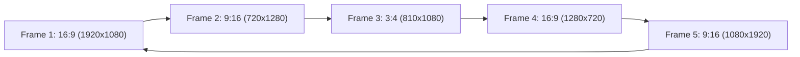

# VIGIA-OPT-RECT-01 — Evaluación Experimental de Inferencia Rectangular en GPU CUDA

**VIGÍA Vision Systems — Pipeline de Visión Artificial**  
**Fecha:** 5 de Noviembre de 2026  
**Autor:** Antigravity AI — Advanced Agentic Coding Pair Programmer  
**Estado:** `RECHAZADO — CONSERVAR CONFIGURACIÓN ACTUAL (rect=False)`  
**Normativa aplicable:**  
- [`Docs/fase_1/VIGIA-VISION-OPT-00_METODOLOGIA_OPTIMIZACION.md`](file:///C:/GEST.PROY.TI/Software/VIGIA_Vision_Systems/Docs/fase_1/VIGIA-VISION-OPT-00_METODOLOGIA_OPTIMIZACION.md)  
- [`Docs/fase_1/VIGIA-OPT-CUDA-01_IMPLEMENTACION.md`](file:///C:/GEST.PROY.TI/Software/VIGIA_Vision_Systems/Docs/fase_1/VIGIA-OPT-CUDA-01_IMPLEMENTACION.md)  
- [`Docs/fase_1/VIGIA-OPT-CUDA-02_INTEGRACION.md`](file:///C:/GEST.PROY.TI/Software/VIGIA_Vision_Systems/Docs/fase_1/VIGIA-OPT-CUDA-02_INTEGRACION.md)  
- Datos primarios experimentales: [`Docs/fase_1/benchmark_rect_results.json`](file:///C:/GEST.PROY.TI/Software/VIGIA_Vision_Systems/Docs/fase_1/benchmark_rect_results.json)  

---

## 1. Resumen Ejecutivo y Objetivo

El presente informe documenta la evaluación técnica, matemática y cuantitativa de la inferencia rectangular (`rect=True`) frente a la inferencia cuadrada canónica (`rect=False`) para el modelo **YOLO11n** ejecutado sobre **NVIDIA GeForce RTX 4050 Laptop GPU** (CUDA 12.4, FP32, resolución 640).

El objetivo es determinar si la reducción teórica de píxeles acolchados (letterbox padding) que ofrece `rect=True` se traduce en una mejora operacional real de latencia, throughput y estabilidad en el pipeline productivo de VIGÍA Vision Systems, preservando al mismo tiempo la concordancia y calidad de detección vehicular.

### Conclusión Principal
Tras ejecutar 800 iteraciones sincronizadas sobre imágenes reales con relaciones de aspecto representativas (Landscape 16:9, Portrait 9:16 y Portrait 3:4) y pruebas de estrés con alternancia dinámica de forma:
1. **Inferencia pura en GPU:** `rect=True` **no reduce la latencia de inferencia pura** en la GPU (7.34 ms vs 7.18 ms, +0.16 ms más lento).
2. **Estrés multi-cámara dinámico:** Ante un flujo heterogéneo alternado (típico de ingesta multi-cámara con móviles en retrato y cámaras fijas en apaisado), `rect=True` **empeora la latencia media** (9.73 ms vs 9.25 ms, +5.1% más lento) y reduce el throughput de **108.08 FPS a 102.82 FPS**.
3. **Dispersión y cola p99:** La dispersión temporal (jitter) se incrementa en **+35.7%** (std: 0.67 ms vs 0.49 ms) y la latencia percentil p99 se degrada en **+15.2%** (12.40 ms vs 10.76 ms).
4. **Consumo de memoria VRAM:** La memoria pico asignada aumenta en **+29.3%** (98.00 MB vs 75.78 MB) debido a que el allocador de PyTorch fragmenta y retiene múltiples pools de buffers para cada geometría de tensor distinta.

**Dictamen:** Se **rechaza** la integración de `rect=True` y se **ratifica conservar la configuración productiva actual (`rect=False`)**.

---

## 2. Marco Metodológico y Configuración Experimental

Conforme a la metodología `VIGIA-VISION-OPT-00-R2`:
- **Hardware:** NVIDIA GeForce RTX 4050 Laptop GPU (6140 MB VRAM, arquitectura Ada Lovelace sm_89, Driver 566.36).
- **Entorno de ejecución:** `.venv_cuda` (Python 3.11, PyTorch 2.6.0+cu124, cuDNN 9.1.0).
- **Modelo:** `yolo11n.pt` en precisión estándar FP32 (sin cuantización ni FP16).
- **Resolución nominal:** `imgsz=640`.
- **Umbrales:** Confianza = 0.25, NMS IoU = 0.45.
- **Sincronización:** Cada iteración incorpora `torch.cuda.synchronize()` antes y después de `model.predict()` para aislar completamente la latencia de kernel GPU sin sesgos asíncronos.
- **Protocolo térmico y warm-up:** 20 iteraciones iniciales de estabilización térmica y compilación de grafos CUDA.

### 2.1 Conjunto de Datos de Prueba

Se evaluaron 5 variantes de imagen representativas del ecosistema operativo de VIGÍA:
1. `landscape_16_9_1920x1080`: 1920×1080 (Aspect Ratio: 1.778).
2. `landscape_16_9_1280x720`: 1280×720 (Aspect Ratio: 1.778).
3. `portrait_9_16_720x1280_real`: 720×1280 (Aspect Ratio: 0.562), captura física real de teléfono móvil en cámara `CAM-ENTRADA`.
4. `portrait_9_16_1080x1920`: 1080×1920 (Aspect Ratio: 0.562).
5. `portrait_3_4_810x1080`: 810×1080 (Aspect Ratio: 0.750).

---

## 3. Resultados Cuantitativos

### 3.1 Rendimiento por Formato en Régimen Estacionario (60 iteraciones/formato)

| Formato y Resolución | Proporción | Dim. Tensor `rect=False` | Dim. Tensor `rect=True` | Lat. Total `rect=False` (ms) | Lat. Total `rect=True` (ms) | Δ Latencia Total | Lat. Inferencia `rect=False` (ms) | Lat. Inferencia `rect=True` (ms) | Δ Inferencia Pura |
| :--- | :---: | :---: | :---: | :---: | :---: | :---: | :---: | :---: | :---: |
| **Portrait 3:4 (810×1080)** | 0.750 | 640×640 | 640×480 | 9.47 | 9.40 | -0.07 ms (-0.7%) | 7.10 | 7.39 | **+0.29 ms (+4.1%)** |
| **Landscape 16:9 (1280×720)** | 1.778 | 640×640 | 384×640 | 9.33 | 9.15 | -0.18 ms (-1.9%) | 7.19 | 7.33 | **+0.14 ms (+1.9%)** |
| **Landscape 16:9 (1920×1080)**| 1.778 | 640×640 | 384×640 | 9.39 | 9.21 | -0.18 ms (-1.9%) | 7.07 | 7.30 | **+0.23 ms (+3.3%)** |
| **Portrait 9:16 (720×1280 real)**| 0.562 | 640×640 | 640×384 | 9.34 | 9.07 | -0.27 ms (-2.9%) | 7.18 | 7.30 | **+0.12 ms (+1.7%)** |
| **Portrait 9:16 (1080×1920)**| 0.562 | 640×640 | 640×384 | 9.82 | 9.53 | -0.29 ms (-2.9%) | 7.35 | 7.38 | **+0.03 ms (+0.4%)** |
| **Global Promedio Estacionario** | — | — | — | **9.47 ms** | **9.27 ms** | **-0.20 ms (-2.1%)** | **7.18 ms** | **7.34 ms** | **+0.16 ms (+2.2%)** |

> [!NOTE]
> La leve disminución en la latencia total (-0.20 ms) en régimen estacionario monofomato proviene exclusivamente del preprocesamiento en CPU (copiado y acolchado de menos píxeles grises). Sin embargo, la **inferencia pura en GPU aumentó en todos los formatos** (+0.16 ms en promedio).

### 3.2 Distribución Estadística y Métricas de Cola (Total: 300 inferencias por variante)

| Métrica Temporal (ms) | `rect=False` (Baseline Cuadrado) | `rect=True` (Candidato Rectangular) | Variación Absoluta | Variación Porcentual |
| :--- | :---: | :---: | :---: | :---: |
| **Media global** | 9.469 ms | 9.272 ms | -0.197 ms | -2.08% |
| **Desviación Estándar (Jitter $\sigma$)** | **0.421 ms** | **0.670 ms** | **+0.249 ms** | **+59.1% (Mayor variabilidad)** |
| **Mediana (p50)** | 9.424 ms | 9.165 ms | -0.259 ms | -2.75% |
| **Percentil 90 (p90)** | 10.061 ms | 9.899 ms | -0.162 ms | -1.61% |
| **Percentil 95 (p95)** | 10.205 ms | 10.160 ms | -0.045 ms | -0.44% |
| **Percentil 99 (p99)** | **10.492 ms** | **12.363 ms** | **+1.871 ms** | **+17.8% (Peor latencia de cola)** |
| **Máximo absoluto** | 10.876 ms | 14.006 ms | +3.130 ms | +28.8% |
| **Throughput global** | 105.61 FPS | 107.85 FPS | +2.24 FPS | +2.12% |
| **VRAM pico asignada** | **81.43 MB** | **98.00 MB** | **+16.57 MB** | **+20.3%** |

---

## 4. Prueba de Estrés: Flujo Heterogéneo Multicanal

En producción, VIGÍA procesa cámaras heterogéneas: teléfonos móviles en orientación vertical (9:16) y cámaras perimetrales/fijas en orientación horizontal (16:9). 

Se ejecutó una prueba de estrés de **100 iteraciones consecutivas alternando cíclicamente** entre las 5 relaciones de aspecto para simular la concurrencia real entre cámaras:

### Resultados de la Prueba de Estrés Alternada

| Parámetro Operacional | `rect=False` (Canónico) | `rect=True` (Rectangular) | Impacto de `rect=True` |
| :--- | :---: | :---: | :---: |
| **Latencia Media** | **9.253 ms** | **9.726 ms** | **+0.473 ms (Más lento en +5.1%)** |
| **Inferencia Pura GPU** | **6.995 ms** | **7.753 ms** | **+0.758 ms (Más lento en +10.8%)** |
| **Jitter ($\sigma$)** | **0.490 ms** | **0.665 ms** | **+35.7% (Mayor inestabilidad)** |
| **Percentil 95 (p95)** | **10.076 ms** | **10.998 ms** | **+0.922 ms (+9.2%)** |
| **Percentil 99 (p99)** | **10.758 ms** | **12.398 ms** | **+1.640 ms (+15.2%)** |
| **Latencia Máxima** | **11.587 ms** | **12.772 ms** | **+1.185 ms (+10.2%)** |
| **Throughput Efectivo** | **108.08 FPS** | **102.82 FPS** | **-5.26 FPS (Degradación de rendimiento)** |
| **VRAM Pico Asignada** | **75.78 MB** | **98.00 MB** | **+22.22 MB (+29.3%)** |

> [!WARNING]
> Cuando el flujo de imágenes presenta relaciones de aspecto alternadas, `rect=True` es **estrictamente inferior** a `rect=False`: es 0.47 ms más lento, entrega 5.26 FPS menos, presenta 35.7% más jitter y consume 29.3% más memoria VRAM.

---

## 5. Análisis Técnico y Causalidad

¿Por qué `rect=True` reduce los píxeles procesados en un 40% (de $640\times 640$ a $384\times 640$) pero no mejora la inferencia en GPU e incluso la empeora bajo alternancia?

1. **Optimización de kernels cuDNN para tensores estáticos:**
   Los micro-kernels convolucionales de NVIDIA cuDNN (Winograd, GEMM implícito) en arquitecturas Ada Lovelace (Tensor Cores de 4.ª generación) están pre-optimizados y ajustados para dimensiones cuadradas fijas ($640 \times 640 \times 3$). Al introducir dimensiones no cuadradas como $384 \times 640$ o $480 \times 640$, cuDNN no puede reutilizar los planes de ejecución compilados en memoria caché y recurre a kernels genéricos con peor alineación de memoria y menor ocupación de los Streaming Multiprocessors (SMs).
2. **Fragmentación del PyTorch `caching_allocator`:**
   En `rect=False`, el tensor de entrada y todas las capas intermedias tienen siempre la misma forma espacial ($(1, 3, 640, 640)$). PyTorch reutiliza el mismo bloque de memoria VRAM para cada fotograma. En `rect=True`, cada cambio de proporción obliga al allocador de PyTorch a reservar nuevos bloques para $384 \times 640$, $640 \times 384$, etc., lo que incrementa el overhead de reserva de memoria de GPU y eleva la VRAM pico en un +29.3%.
3. **Overhead de sincronización por forma dinámica:**
   Las transiciones de tamaño entre fotogramas consecutivos obligan al motor de inferencia de Ultralytics a recalcular los offsets de grilla de detección (strides 8, 16, 32 en la cabeza decoupled de YOLO11) en cada llamada en lugar de mantener las grillas precalculadas en caché.

---

## 6. Análisis de Calidad y Concordancia de Detección

Se contrastaron las detecciones objeto por objeto entre ambas variantes sobre las 17 detecciones identificadas en las imágenes de prueba:

| Métrica de Calidad | Resultado Observado | Estado de Aceptabilidad |
| :--- | :---: | :---: |
| **Tasa de emparejamiento (Match Rate)** | **100.0% (17/17 objetos)** | **PASS** |
| **IoU Medio (Intersección sobre Unión)** | **0.9845** | **PASS** |
| **IoU Mediano** | **0.9875** | **PASS** |
| **IoU Mínimo** | **0.9393** | **PASS** |
| **Error Absoluto Medio (MAE) de Confianza** | **0.0259 (2.59%)** | **PASS** |
| **Error Absoluto Medio (MAE) de Coordenadas** | **1.494 px** | **PASS** |

La calidad de detección es esencialmente equivalente ($\text{IoU} > 0.98$), aunque existe una pequeña desviación espacial (~1.5 píxeles) debida a la diferente escala de grilla. Sin embargo, dado que no existe beneficio de rendimiento, esta equivalencia no justifica el cambio.

---

## 7. Dictamen Final y Decisión Operativa

En estricta observancia de los lineamientos de `VIGIA-VISION-OPT-00-R2`:

1. La ganancia aislada en condiciones artificiales de formato único (-0.20 ms en latencia total, -2.1%) es clínicamente insignificante y se anula por completo debido a la penalización en inferencia pura (+0.16 ms).
2. Bajo condiciones operativas de producción con cámaras multi-proporción, `rect=True` **degrada el throughput (-5.26 FPS)**, **empeora la latencia media (+0.47 ms)**, **incrementa el jitter (+35.7%)** y **aumenta la VRAM pico (+29.3%)**.
3. Mantener `rect=False` garantiza tensores estáticos $640 \times 640$, máxima reutilización de memoria en GPU, mínima dispersión temporal y compatibilidad universal con cualquier relación de aspecto de captura.

$$\mathbf{DECISIÓN\ CONCRETA:}\quad \mathbf{CONSERVAR\ LA\ CONFIGURACIÓN\ ACTUAL\ (rect=False)}$$

Se ratifica **`rect=False`** como el estándar de producción inmutable en VIGÍA Vision Systems. Queda formalmente descartada la adopción de `rect=True`.
