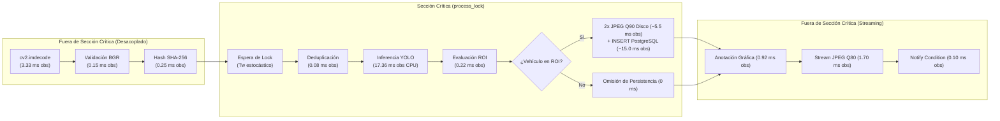
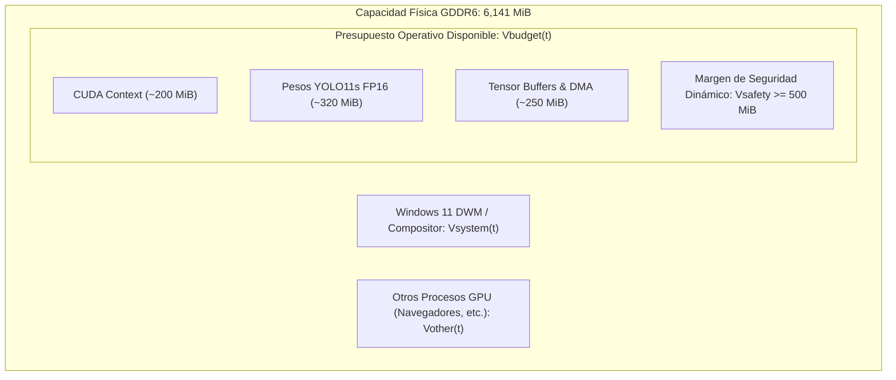
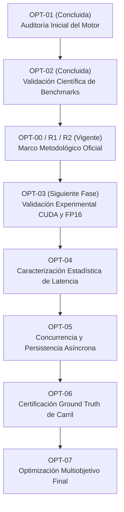

# VIGIA-VISION-OPT-00 — Formalización Matemática y Metodología de Optimización del Motor de Visión

**Proyecto:** VIGÍA Vision Systems  
**Fase:** VIGIA-VISION-OPT-00 (Marco Metodológico Oficial y Formalización Científica)  
**Revisión:** OPT-00-R2 (Corrección Final de Consistencia Estadística y Validación de Presupuestos)  
**Tipo de Documento:** Norma Técnica Metodológica y Marco Matemático de Evaluación  
**Fecha de Emisión Original:** 04 de Noviembre de 2026  
**Fecha de Revisión R1:** 04 de Noviembre de 2026  
**Fecha de Revisión R2:** 04 de Noviembre de 2026  
**Entorno de Referencia:** Host Windows 11 / AMD Ryzen 9 7940HX (16C/32T) / NVIDIA GeForce RTX 4050 Laptop GPU (6 GB VRAM)  
**Estado:** NORMA METODOLÓGICA OFICIAL VIGENTE (Revisión R2)  

---

## 1. Declaración de Propósito y Principio Rector

La presente norma técnica constituye el marco metodológico, matemático y experimental oficial para la conducción de todas las auditorías, experimentos, parametrizaciones y optimizaciones sobre el motor de visión artificial de **VIGÍA Vision Systems**.

Cualquier propuesta de optimización futura (migración a GPU, aceleración en media precisión FP16, motores TensorRT, inferencia rectangular, reestructuración de bloqueos de concurrencia o calibración de umbrales) deberá regirse estrictamente por los modelos analíticos y el protocolo experimental aquí formalizados.

### Principio Rector Innegociable

$$\boxed{
\text{Optimización Válida}
=
\text{Mejora Demostrada}
+
\text{Calidad Preservada (No Inferioridad)}
+
\text{Estabilidad Verificable}
}$$

> [!IMPORTANT]
> Ninguna modificación será promovida al entorno de producción basándose exclusivamente en el incremento de fotogramas por segundo (FPS) o la reducción aislada de latencia. Si una alteración degrada la sensibilidad de detección vehicular, incrementa los falsos positivos en carril, introduce fugas de memoria o desestabiliza la concurrencia multicanal, será calificada como **RECHAZADA** independientemente de su velocidad teórica.

---

## 2. Clasificación Epistemológica de Resultados

Para erradicar ambigüedades en la literatura técnica del proyecto, toda cifra o conclusión reportada en los informes de optimización deberá pertenecer y ser explícitamente etiquetada dentro de una de las siguientes cinco categorías epistemológicas:

1. **Resultado Medido ($T_{\text{obs}}$ / Dato Empírico):** Magnitud numérica obtenida mediante instrumentación directa, verificable y repetible sobre el hardware físico y software del sistema (e.g. tiempo de ejecución medido con `time.perf_counter()`, memoria VRAM leída con `nvidia-smi` en una traza unificada).
2. **Resultado Reproducido:** Medición independiente que confirma un resultado previo bajo las mismas condiciones y variables controladas (e.g. la latencia de inferencia en CPU de ~18 ms reportada en OPT-01 y confirmada en OPT-02).
3. **Estimación Técnica ($T_{\text{est}}$ / Modelo Analítico Sintético):** Valor derivado de la agregación de subcomponentes medidos de forma independiente o extrapolaciones analíticas respaldadas en arquitectura de hardware (e.g. la suma de tiempos de subetapas desacopladas o proyecciones de latencia basadas en TFLOPs y ancho de banda GDDR6).
4. **Hipótesis Experimental ($H_0 / H_1$):** Proposición tentativa que postula una relación causal entre variables y que requiere validación o refutación experimental formal (e.g. la hipótesis de que la interpolación de OpenCV causaba la caída de confianza a 960x960, refutada en OPT-02).
5. **Conclusión No Verificada:** Deducción que carece de un conjunto de datos suficientemente representativo o de un diseño experimental concluyente para ser aceptada como certeza científica (e.g. asegurar $mAP_{50} \ge 90\%$ sin evaluar un conjunto de test independiente).

### Taxonomía Formal de Tiempos y Factores de Aceleración

En concordancia con lo anterior, los cálculos temporales se desglosan formalmente en:
- **$T_{\text{obs}}$ (Tiempo Observado):** Latencia empírica registrada en una traza unificada real de extremo a extremo.
- **$T_{\text{est}}$ (Tiempo Estimado):** Agregación analítica sintetizada a partir de mediciones aisladas de componentes desacoplados ($T_{\text{est}} = \sum T_{i,\text{obs}}$).
- **$T_{\text{proj}}$ (Tiempo Proyectado):** Latencia analítica prevista tras aplicar una optimización teórica a uno o varios componentes ($T_{\text{proj}} = \sum T_{i,\text{proj}}$).
- **$S_{\text{teórico}}$ (Speedup Teórico):** Factor analítico de aceleración derivado de la Ley de Amdahl sobre tiempos estimados/proyectados ($S_{\text{teórico}} = \frac{T_{\text{est}}}{T_{\text{proj}}}$).
- **$S_{\text{exp}}$ (Speedup Experimental):** Cociente directo entre mediciones observadas reales antes y después de una intervención física en el sistema ($S_{\text{exp}} = \frac{T_{\text{obs, base}}}{T_{\text{obs, opt}}}$).

---

## 3. M1 — Modelo Matemático de Rendimiento y Latencia

El rendimiento temporal del sistema VIGÍA no es un número escalar estático, sino una composición estocástica de tiempos de procesamiento y tiempos de espera.

> [!NOTE]
> Los valores numéricos del diagrama anterior corresponden a observaciones aisladas ($T_{i,\text{obs}}$) obtenidas mediante micro-benchmarking en OPT-02 y representan un **modelo analítico sintético**, no una traza continua monolítica de producción.

### 3.1 Formalización para Etapas Secuenciales

En una secuencia de $n$ operaciones donde cada etapa $i$ comienza estrictamente tras finalizar la anterior, la latencia total acumulada $T_{\text{seq}}$ es la suma aritmética directa de sus componentes:

$$T_{\text{seq}} = \sum_{i=1}^{n} T_i$$

### 3.2 Formalización para Pipelines Concurrentes y Cuellos de Botella de Bloqueo

En el servidor `VIGIA_API`, las solicitudes de ingesta concurrente compiten por recursos compartidos y cerrojos reentrantes (`process_lock`). La latencia de atención de un fotograma para una cámara $k$ se modela analíticamente como:

$$T_{\text{backend}}(k) = T_{\text{pre\_lock}} + T_{\text{wait\_lock}}(k) + T_{\text{crit\_section}}(k) + T_{\text{post\_lock}}$$

Donde:
- **$T_{\text{pre\_lock}}$:** Tiempo de decodificación y validación previa fuera del bloqueo:
  $$T_{\text{pre\_lock}} = T_{\text{decode}} + T_{\text{validate}} + T_{\text{hash}}$$
- **$T_{\text{wait\_lock}}(k)$:** Tiempo de espera pasiva en cola mientras otra cámara retiene el cerrojo global. Si hay $m$ cámaras procesando antes que la cámara $k$:
  $$T_{\text{wait\_lock}}(k) = \sum_{j=1}^{m} T_{\text{crit\_section}}(j)$$
- **$T_{\text{crit\_section}}(k)$:** Tiempo de retención de la sección crítica:
  $$T_{\text{crit\_section}}(k) = T_{\text{dedup}} + T_{\text{yolo\_predict}} + T_{\text{roi}} + \mathbb{I}_{\text{persist}} \cdot \left( T_{\text{evidence\_enc}} + T_{\text{disk\_write}} + T_{\text{db\_insert}} \right)$$
  Donde $\mathbb{I}_{\text{persist}} \in \{0, 1\}$ es la función indicadora que se activa únicamente cuando se detecta un vehículo válido dentro del ROI delimitado.
- **$T_{\text{post\_lock}}$:** Tiempo de renderizado visual y compresión para streaming:
  $$T_{\text{post\_lock}} = T_{\text{annotate}} + T_{\text{stream\_encode}} + T_{\text{condition\_notify}}$$

### 3.3 Niveles Jerárquicos de Latencia

Se establecen cuatro fronteras de medición que no deben confundirse:

1. **Latencia de Inferencia Pura ($T_{\text{infer\_raw}}$):** Tiempo de cómputo del grafo convolucional hacia adelante (*forward-pass*) ejecutado en el dispositivo de cómputo:
   $$T_{\text{infer\_raw}} = t_{\text{forward\_end}} - t_{\text{forward\_start}}$$
2. **Latencia de `model.predict()` ($T_{\text{predict}}$):** Tiempo completo reportado por el motor Ultralytics, integrando transformación de tensores y supresión de no-máximos:
   $$T_{\text{predict}} = T_{\text{preprocess}} + T_{\text{infer\_raw}} + T_{\text{postprocess}}$$
   *(En OPT-02 medido en CPU: $1.2 \text{ ms} + 17.4 \text{ ms} + 1.2 \text{ ms} = 19.8 \text{ ms}$)*.
3. **Latencia de Procesamiento Backend ($T_{\text{backend}}$):** Tiempo transcurrido desde la recepción del payload HTTP push en Flask hasta la emisión del JSON de respuesta:
   $$T_{\text{backend}} = T_{\text{pre\_lock}} + T_{\text{wait\_lock}} + T_{\text{crit\_section}}$$
4. **Latencia de Extremo a Extremo ($T_{\text{E2E}}$):** Tiempo integral desde la exposición física del sensor fotográfico del teléfono móvil hasta el refresco del fotograma en el Dashboard:
   $$T_{\text{E2E}} = T_{\text{sensor\_exposure}} + T_{\text{canvas\_blob}} + T_{\text{http\_transit}} + T_{\text{backend}} + T_{\text{mjpeg\_transit}} + T_{\text{dom\_render}}$$

### 3.4 Operadores Estadísticos Formales, Incertidumbre y Cuantiles

Dado un vector muestral de latencias ordenado crecientemente:

$$\mathbf{T} = \left( T_{(1)}, T_{(2)}, \dots, T_{(N)} \right), \quad T_{(1)} \le T_{(2)} \le \dots \le T_{(N)}$$

Se definen los descriptores oficiales:

- **Media Muestral ($\bar{T}$):**
  $$\bar{T} = \frac{1}{N} \sum_{i=1}^{N} T_i$$
- **Desviación Estándar Muestral ($\sigma_T$):**
  $$\sigma_T = \sqrt{\frac{1}{N - 1} \sum_{i=1}^{N} \left( T_i - \bar{T} \right)^2}$$
- **Mediana ($p50$):**
  $$p50 = \begin{cases}
  T_{\left(\frac{N+1}{2}\right)} & \text{si } N \text{ es impar} \\
  \frac{1}{2} \left( T_{\left(\frac{N}{2}\right)} + T_{\left(\frac{N}{2} + 1\right)} \right) & \text{si } N \text{ es par}
  \end{cases}$$
- **Percentiles Empíricos ($p_k$):**
  Calculados mediante fórmulas estándar de interpolación lineal de estadísticos de orden (e.g. tipo Hyndman-Fan):
  $$p_k = T_{(\lfloor r \rfloor)} + (r - \lfloor r \rfloor) \cdot \left( T_{(\lfloor r \rfloor + 1)} - T_{(\lfloor r \rfloor)} \right), \quad r = 1 + \frac{k}{100} (N - 1)$$

#### Relación entre Tamaño Muestral, Cuantiles e Incertidumbre
Cualquier muestra finita de tamaño $N \ge 1$ permite evaluar matemáticamente una función cuantil empírica. Sin embargo, la **calidad e incertidumbre muestral** de dicha estimación varía drásticamente según el cuantil evaluado:
- **Para la mediana ($p50$):** La densidad muestral es máxima en el centro de la distribución; tamaños muestrales moderados ($N \ge 20$ a $30$) ofrecen estimaciones relativamente estables bajo distribuciones unimodales.
- **Para cuantiles de cola extrema ($p95$ y $p99$):** La varianza asintótica de un estimador de cuantil $\hat{q}_p$ está dada por:
  $$\text{Var}(\hat{q}_p) \approx \frac{p(1 - p)}{N \cdot [f(q_p)]^2}$$
  Donde $f(q_p)$ es la función de densidad de probabilidad evaluada en el cuantil. Dado que $f(q_p) \to 0$ en las colas extremas, la incertidumbre muestral crece sustancialmente.
  - Con $N < 100$, calcular $p99$ es técnicamente posible mediante fórmulas de interpolación, pero el resultado carece de soporte suficiente en la cola y se encuentra dominado por la variabilidad del valor máximo muestral $T_{(N)}$.
  - Las cotas orientativas $N \ge 60$ (para $p95$) y $N \ge 300$ (para $p99$) se clasifican formalmente como **referencias empíricas de diseño**, no como garantías universales de precisión. La precisión real debe cuantificarse siempre mediante intervalos de confianza.

#### Métodos Obligatorios de Intervalos de Confianza
- **Para la Media:** Intervalo $t$ de Student al nivel $(1 - \alpha)$:
  $$CI_{1-\alpha}(\bar{T}) = \left[ \bar{T} - t_{\alpha/2, N-1} \frac{\sigma_T}{\sqrt{N}}, \; \bar{T} + t_{\alpha/2, N-1} \frac{\sigma_T}{\sqrt{N}} \right]$$
- **Para Percentiles:** Intervalos de confianza basados en estadísticos de orden binomial (libres de distribución paramétrica):
  $$P\left( T_{(j)} \le \theta_p \le T_{(k)} \right) = \sum_{i=j}^{k-1} \binom{N}{i} p^i (1-p)^{N-i} \ge 1 - \alpha$$
  o mediante Remuestreo Bootstrap con aceleración y corrección de sesgo (BCa, $\ge 1,000$ remuestreos).

#### Diferenciación de Observaciones:
- **Mediciones Intra-Ejecución:** Serie temporal de latencias tomadas dentro de una misma sesión continua (evalúan jitter y contención, pero presentan autocorrelación serial).
- **Réplicas Experimentales Independientes:** Sesiones ejecutadas tras reiniciar el proceso o reposar el sistema (evalúan reproducibilidad frente a estados del sistema operativo, memoria caché y temperatura inicial).

---

## 4. M2 — Modelo de Aceleración Computacional y Eficiencia

### 4.1 Definición de Aceleración (*Speedup*) y Reducción de Latencia

Para dos configuraciones experimentales donde la configuración optimizada se compara contra una línea base manteniendo **todas las variables restantes rigurosamente constantes**:

$$\text{Speedup Experimental} (S_{\text{exp}}) = \frac{T_{\text{obs, baseline}}}{T_{\text{obs, optimized}}}$$

$$\text{Reducción Experimental} (\Delta T_{\text{exp}}) = 1 - \frac{T_{\text{obs, optimized}}}{T_{\text{obs, baseline}}} = 1 - \frac{1}{S_{\text{exp}}}$$

### 4.2 Ley de Amdahl: Modelo Analítico Ilustrativo del Techo de Rendimiento

La Ley de Amdahl delimita matemáticamente el impacto teórico de acelerar una etapa específica del pipeline. Si una fracción $P \in [0, 1]$ del tiempo total de la línea base es susceptible de ser acelerada por un factor $S_{\text{stage}}$, el Speedup global del sistema está acotado por:

$$S_{\text{teórico}} = \frac{1}{(1 - P) + \frac{P}{S_{\text{stage}}}}$$

$$\lim_{S_{\text{stage}} \to \infty} S_{\text{teórico}} = \frac{1}{1 - P}$$

#### Modelo Analítico Ilustrativo basado en Mediciones Desacopladas (OPT-01 / OPT-02):

> [!NOTE]
> El siguiente cálculo no constituye una medición empírica de una única transacción integrada continua en producción. Es un **modelo analítico sintético** ($T_{\text{est}}$) construido a partir de componentes medidos de forma aislada en OPT-02 para ilustrar la limitación del cuello de botella de I/O.

- En un fotograma hipotético donde concurren detección y persistencia completa, la latencia agregada estimada es:
  $$T_{\text{est, baseline}} \approx 54.0 \text{ ms}$$
- La inferencia de visión en CPU (YOLO11n a 640) toma $T_{\text{infer, obs}} \approx 17.4 \text{ ms}$, representando una fracción:
  $$P_{\text{infer}} = \frac{17.4}{54.0} \approx 0.322 \quad (32.2\%)$$
- La persistencia síncrona observada (disco + base de datos) toma $T_{\text{persist, obs}} \approx 20.5 \text{ ms}$ (~5.5 ms disco + ~15.0 ms PostgreSQL), representando:
  $$P_{\text{io}} = \frac{20.5}{54.0} \approx 0.380 \quad (38.0\%)$$

**Caso A: Proyección Teórica de Acelerar Inferencia con GPU sin Desacoplar I/O:**
Si la GPU NVIDIA RTX 4050 alcanzara la latencia proyectada de $T_{\text{infer, proj}} \approx 2.0 \text{ ms}$ ($S_{\text{stage}} = \frac{17.4}{2.0} = 8.7\times$):
$$S_{\text{teórico}} = \frac{1}{(1 - 0.322) + \frac{0.322}{8.7}} = \frac{1}{0.678 + 0.037} = \frac{1}{0.715} \approx \mathbf{1.40\times}$$
$$\Delta T_{\text{proj}} = 1 - \frac{1}{1.40} \approx \mathbf{28.5\% \text{ de reducción global estimada}}$$

> [!WARNING]
> **Techo Teórico de Amdahl:** Aún si la GPU tuviese latencia cero ($S_{\text{infer}} \to \infty$), si el I/O síncrono de persistencia permanece dentro del flujo de atención, la aceleración global máxima del ciclo integrado jamás podrá superar:
> $$S_{\max} = \frac{1}{1 - 0.322} \approx \mathbf{1.47\times}$$
> Este límite demuestra analíticamente que la optimización de inferencia en GPU debe complementarse de forma obligatoria con el desacoplamiento asíncrono de persistencia si se aspira a una aceleración global $> 3\times$.

---

## 5. M3 — Modelo de Calidad de Detección y Evaluación Semántica

La evaluación de calidad de detección requiere contrastar formalmente las cajas predichas por la red neuronal contra un conjunto de verdad fundamental (*Ground Truth*).

### 5.1 Métrica de Solapamiento Espacial: Intersección sobre Unión (IoU)

Dada una caja predicha $B_p = [x_{1p}, y_{1p}, x_{2p}, y_{2p}]$ y una caja de verdad fundamental $B_{gt} = [x_{1g}, y_{1g}, x_{2g}, y_{2g}]$:

$$\text{IoU}(B_p, B_{gt}) = \frac{\text{Área}(B_p \cap B_{gt})}{\text{Área}(B_p \cup B_{gt})} = \frac{\text{Área}(B_p \cap B_{gt})}{\text{Área}(B_p) + \text{Área}(B_{gt}) - \text{Área}(B_p \cap B_{gt})}$$

### 5.2 Criterio de Correspondencia (*Matching*) y Matriz de Confusión

Para un umbral de solapamiento preestablecido $\tau_{\text{IoU}}$ (típicamente $\tau_{\text{IoU}} = 0.50$):
- **Verdadero Positivo ($TP$):** Predicción $B_p$ con $\text{IoU}(B_p, B_{gt}) \ge \tau_{\text{IoU}}$ y $\text{clase}(B_p) = \text{clase}(B_{gt})$. Cada caja $B_{gt}$ solo puede asociarse a una única predicción $B_p$ (la de mayor confianza).
- **Falso Positivo ($FP$):** Predicción $B_p$ que no solapa con ningún $B_{gt}$ ($\text{IoU} < \tau_{\text{IoU}}$), predicción duplicada sobre un $B_{gt}$ ya asociado, o predicción cuya clase no coincide.
- **Falso Negativo ($FN$):** Caja de verdad fundamental $B_{gt}$ que no fue detectada por ninguna predicción con $\text{IoU} \ge \tau_{\text{IoU}}$ y clase coincidente.

### 5.3 Métricas Derivadas Oficiales

$$\text{Precision} (P) = \frac{TP}{TP + FP}$$

$$\text{Recall} (R) = \frac{TP}{TP + FN}$$

$$F_1\text{-Score} = 2 \cdot \frac{P \cdot R}{P + R} = \frac{2 \cdot TP}{2 \cdot TP + FP + FN}$$

### 5.4 Average Precision (AP) y mean Average Precision (mAP)

Para cada clase vehicular $c \in \{\text{car}, \text{truck}, \text{bus}, \text{motorcycle}\}$, integrando la curva Precision-Recall interpolada:

$$AP_c = \int_{0}^{1} p_{\text{interp}}(r) \, dr$$

- **$mAP_{50}$:** Media de $AP_c$ calculada al umbral único $\tau_{\text{IoU}} = 0.50$:
  $$mAP_{50} = \frac{1}{|C|} \sum_{c \in C} AP_c(\tau_{\text{IoU}} = 0.50)$$
- **$mAP_{50-95}$:** Media integral sobre 10 umbrales de IoU equidistantes:
  $$mAP_{50-95} = \frac{1}{10 \cdot |C|} \sum_{k=0}^{9} \sum_{c \in C} AP_c(\tau_{\text{IoU}} = 0.50 + 0.05 \cdot k)$$

### 5.5 Prohibición Metodológica de Confianza como Métrica de Calidad

> [!CAUTION]
> **Prohibición Expresa:** La confianza promedio predicha por el modelo ($\bar{c} = \frac{1}{M}\sum c_i$) **NUNCA** debe emplearse como métrica de exactitud, precisión o calidad de detección.
> 
> *Justificación Teórica (Demostrada en OPT-02):*
> - En la imagen 4 a 960x960, el modelo predijo un objeto con **alta confianza (0.833)**, pero la clase asignada fue `skateboard` (error semántico).
> - En las imágenes 8 a 12 a 1280x1280, el modelo predijo objetos con **confianza del 0.99**, pero correspondían a ratones de computadora (`mouse`), no a vehículos.
> - Evaluar únicamente la confianza media de predicción $\bar{c}$ produce conclusiones engañosas. La calidad científica se evalúa **exclusivamente mediante Precision, Recall y mAP contra Ground Truth**.

### 5.6 Marco de Contraste Estadístico: Pruebas de No Inferioridad

En entornos de control de acceso físico, una optimización computacional no puede ser aprobada simplemente porque "no se observó una caída evidente" en una prueba exploratoria. Toda evaluación de calidad debe formularse bajo el paradigma estadístico de **No Inferioridad**:

$$\begin{cases}
H_0: \Delta Q \le -\delta & \text{(La configuración optimizada es inferior por un margen superior a } \delta\text{)} \\
H_1: \Delta Q > -\delta & \text{(La configuración optimizada es estadísticamente no inferior)}
\end{cases}$$

Donde:
- $\Delta Q = Q_{\text{opt}} - Q_{\text{baseline}}$ representa la diferencia en la métrica de calidad evaluada (e.g. $\Delta R = \text{Recall}_{\text{opt}} - \text{Recall}_{\text{baseline}}$ o $\Delta P = \text{Precision}_{\text{opt}} - \text{Precision}_{\text{baseline}}$).
- $\delta > 0$ es el **Margen de No Inferioridad (*Non-inferiority margin*)**, que define el deterioro máximo admisible antes de que una pérdida de sensibilidad sea inaceptable para la operación.

> [!IMPORTANT]
> **Regla de Asignación de $\delta$:** Queda explícitamente prohibido asignar valores numéricos arbitrarios a $\delta$ en la norma metodológica sin especificación de los requisitos de negocio y tolerancia a fallos del control de acceso físico.
> 
> **Procedimiento de Decisión:** Se calcula el límite inferior del intervalo de confianza unilateral al nivel $(1 - \alpha)$:
> $$CI_{\text{lower}}(\Delta Q) > -\delta \implies \text{Se rechaza } H_0 \text{ y se declara No Inferioridad formal.}$$
> Las pruebas estadísticas deben ser pareadas sobre el mismo conjunto idéntico de fotogramas (e.g. prueba de McNemar para concordancia de clasificaciones binarias o prueba de rangos con signo de Wilcoxon para distribuciones de AP).

---

## 6. M4 — Modelo de Recursos Computacionales y Estabilidad

El hardware del sistema no cuenta con recursos ilimitados. Las pruebas de optimización deben respetar las fronteras físicas del sistema host.

### 6.1 Presupuesto Dinámico de Memoria Gráfica (VRAM)

La asignación de memoria en GPU debe satisfacer en todo instante:

$$V_{\text{vigia, peak}}(t) \le V_{\text{budget}}(t) = V_{\text{total}} - V_{\text{system}}(t) - V_{\text{other\_processes}}(t) - V_{\text{safety}}$$

Donde:
- **$V_{\text{total}} = 6,141 \text{ MiB}$:** Capacidad física reportada por hardware en la **NVIDIA GeForce RTX 4050 Laptop GPU** (bus de 96 bits GDDR6).
- **$V_{\text{system}}(t)$:** Memoria ocupada por el Desktop Window Manager (DWM) y subsistemas del sistema operativo.
- **$V_{\text{other\_processes}}(t)$:** Memoria ocupada por procesos externos activos en GPU (navegadores web, terminales aceleradas, Electron, etc.), consultable mediante herramientas NVML / `nvidia-smi`.
- **$V_{\text{safety}}$:** Margen estocástico de seguridad para evitar *paging* a memoria RAM o fallos OOM en CUDA ($V_{\text{safety}} \ge 500\text{ MiB}$).

#### Prevención de Doble Contabilidad en Mediciones de Driver
En herramientas como `nvidia-smi`, la métrica agregada de memoria utilizada representa:
$$V_{\text{used, obs}}(t) = V_{\text{system}}(t) + V_{\text{other\_processes}}(t) + V_{\text{vigia}}(t)$$

Por tanto, en el instante previo a iniciar la carga de VIGÍA ($V_{\text{vigia}} = 0$), la memoria libre observable directamente es:
$$V_{\text{free, obs}}(t) = V_{\text{total}} - V_{\text{used, obs}}(t) = V_{\text{total}} - \big( V_{\text{system}}(t) + V_{\text{other\_processes}}(t) \big)$$

El presupuesto operativo utilizable se calcula de forma directa y libre de doble contabilidad como:
$$V_{\text{budget}}(t) = V_{\text{free, obs}}(t) - V_{\text{safety}}$$

#### Distinción de Conceptos de Memoria GPU:
1. **Memoria Libre Observada ($V_{\text{free, obs}}$):** Espacio GDDR6 disponible según el driver antes de inicializar el motor.
2. **Memoria Reservada Externa ($V_{\text{system}} + V_{\text{other\_processes}}$):** Espacio retenido por el compositor gráfico y aplicaciones ajenas a VIGÍA.
3. **Memoria Asignada a VIGÍA ($V_{\text{vigia, allocated}}$):** Tensores, pesos y contexto reclamados por PyTorch / Ultralytics.
4. **Presupuesto Efectivamente Utilizable ($V_{\text{budget}}$):** Límite máximo admisible que la asignación de VIGÍA no debe superar.
- **Clasificación del Umbral Provisional de 4,000 MiB:** Se mantiene como **presupuesto provisional de diseño** hasta contar con mediciones sistemáticas en la fase experimental OPT-03.

### 6.2 Componentes de la Memoria en Inferencia

$$\text{VRAM}_{\text{peak}} = \text{VRAM}_{\text{context}} + \text{VRAM}_{\text{weights}} + \text{VRAM}_{\text{activations}}(\text{imgsz}, \text{batch}) + \text{VRAM}_{\text{dma\_pinned}}$$

- Al emplear media precisión **FP16**, $\text{VRAM}_{\text{weights}}$ y $\text{VRAM}_{\text{activations}}$ se reducen teóricamente en un **50%** respecto a FP32.

### 6.3 Modelo Estadístico de Estabilidad de Memoria e Inferencia de Deriva

En entornos de ejecución reales (CPython, PyTorch Caching Allocator, Windows VirtualAlloc), la memoria no evoluciona como una curva suave y continua. Las derivadas instantáneas nulas ($\frac{dM}{dt} = 0$) son físicamente inviables debido a la cuantización de pools, la fragmentación y los ciclos del Garbage Collector.

Se establece el **Modelo de Regresión de Estabilidad de Memoria**:

$$M(k) = \beta_0 + \beta_1 k + \epsilon(k), \quad k \in \{1, 2, \dots, K\}, \; k > k_{\text{warmup}}$$

Donde:
- $k$: Índice de la iteración de inferencia o fotograma procesado tras el período de warm-up.
- $M(k)$: Memoria consumida observada (RAM RSS en host o VRAM asignada en dispositivo).
- $M_0 \equiv \beta_0$: Memoria base inicial tras estabilización de warm-up.
- $\beta_1$: **Tasa de deriva de memoria (*memory drift rate*)**.
- $CI_{1-\alpha}(\beta_1) = [\hat{\beta}_{1,\text{lower}}, \; \hat{\beta}_{1,\text{upper}}]$: Intervalo de confianza al $(1 - \alpha)$ de la pendiente.
- $\epsilon(k)$: Residuo estocástico transitorio de allocators y recolectores.

#### Formulación de Contraste y Corrección Lógica de Inferencia:
$$\begin{cases}
H_0: \beta_1 \le 0 & \text{(Comportamiento compatible con estabilidad)} \\
H_1: \beta_1 > 0 & \text{(Evidencia de crecimiento positivo sistemático)}
\end{cases}$$

Regla de decisión estándar:
$$p < \alpha \implies \text{Rechazar } H_0 \text{ a favor de } H_1 \quad (\text{Evidencia estadísticamente significativa de crecimiento})$$

> [!CAUTION]
> **Principio de Inferencia Negativa:** No rechazar $H_0$ ($p \ge \alpha$) **NO equivale a demostrar estabilidad o ausencia de fugas**. La falta de significancia estadística puede derivarse simplemente de una muestra reducida o de una elevada dispersión transitoria del allocator (baja potencia estadística).

#### Margen de Tolerancia Operacional ($\epsilon_M$) y Zonas de Decisión:
Para formalizar la aceptación técnica de estabilidad, se define un **Margen de Crecimiento Operacionalmente Tolerable ($\epsilon_M \ge 0$)**, derivado de la capacidad de memoria disponible y el horizonte temporal requerido ($K_{\text{operacional}}$):

$$\epsilon_M = \frac{V_{\text{safety}}}{K_{\text{operacional}}}$$

Se establecen formalmente cuatro zonas de diagnóstico:
1. **Evidencia Estadística de Crecimiento / Fuga Detectada:**
   $$\hat{\beta}_{1,\text{lower}} > 0 \quad (p < \alpha)$$
   Se demuestra crecimiento sistemático; el cambio se califica como **`RECHAZADO`**.
2. **Crecimiento Operacionalmente Significativo / Riesgo de Saturación:**
   $$\hat{\beta}_{1,\text{upper}} > \epsilon_M$$
   El límite superior del intervalo de confianza proyecta que la memoria acumulada podría agotar el margen de seguridad disponible en el horizonte operacional; cambio **`RECHAZADO`**.
3. **Ausencia de Evidencia Suficiente (Indeterminación Muestral):**
   $$0 \in CI_{1-\alpha}(\beta_1) \quad \land \quad \hat{\beta}_{1,\text{upper}} > \epsilon_M$$
   No se detecta crecimiento estadísticamente significativo, pero la incertidumbre muestral es demasiado amplia para descartar una fuga operacional; cambio catalogado como **`EVIDENCIA INSUFICIENTE`**.
4. **Estabilidad Demostrada dentro del Margen Operativo:**
   $$\hat{\beta}_{1,\text{upper}} \le \epsilon_M$$
   Se demuestra estadísticamente, con nivel de confianza $(1 - \alpha)$, que la tasa de crecimiento máxima plausible no excede la tolerancia operacional admisible. Condición requerida para emitir **`APROBADO`**.

#### Limitaciones de la Regresión Lineal ante Dinámicas del Allocator:
Las series temporales de memoria pueden manifestar autocorrelación residual ($AR(1)$), comportamientos en escalera (*step functions* cuando el PyTorch Caching Allocator reserva un nuevo bloque maestro) y caídas discontinuas por recolección de basura. Por ende, la regresión lineal se considera un **modelo auxiliar de tamizaje**, debiendo complementarse en auditorías profundas con la inspección de bloques libres y fragmentados (`torch.cuda.memory_reserved()` vs `memory_allocated()`).

### 6.4 Auditoría y Clasificación de Criterios Operativos

| Criterio Operativo | Valor Numérico | Clasificación Normativa | Fundamento Técnico y Condiciones de Medición |
|---|---|---|---|
| **Temperatura GPU ($T_{\text{GPU}}$)** | $< 75^\circ\text{C}$ | **Umbral Provisional de Ingeniería** | Diseñado para operar por debajo del umbral de *thermal throttling* agresivo de NVIDIA (~86°C en arquitecturas móviles). Se mide mediante sensor NVML (`temperature.gpu`). Provisional hasta obtener perfiles térmicos en pruebas de estrés sostenidas en el chasis ASUS. |
| **Temperatura CPU ($T_{\text{CPU}}$)** | $< 85^\circ\text{C}$ | **Umbral Provisional de Ingeniería** | Diseñado con margen de seguridad respecto al límite térmico TjMax de AMD Ryzen 9 7940HX (100°C). Se mide vía contadores WMI / hardware. Provisional. |
| **Evaluación de Estabilidad Temporal** | $\ge 1,000$ iteraciones | **Protocolo Estándar de Régimen Continuo** | Dimensión muestral suficiente para permitir que el PyTorch caching allocator estabilice sus bloques preasignados y se ejecuten al menos 10 ciclos de recolección de basura. |
| **Hardware de Referencia Verificado** | AMD Ryzen 9 7940HX (16C/32T) | **Hardware Confirmado por Inventario** | Identificación verificada en el sistema host (`Win32_Processor`: AMD Ryzen 9 7940HX with Radeon Graphics, 16 núcleos físicos, 32 lógicos), confirmando la exactitud de los informes OPT-01 y OPT-02. |

---

## 7. M5 — Modelo de Optimización Multiobjetivo y Selección Pareto

La selección de la configuración final del motor de visión constituye un problema formal de optimización matemática con restricciones funcionales heterogéneas.

### 7.1 Formalización del Problema Primario

$$\min_{\theta \in \Theta} T_{p95}(\theta)$$

Sujeto al conjunto de restricciones operacionales:

$$\begin{cases}
\Delta \text{Recall}(\theta) > -\delta_R & \text{(No inferioridad en detección: no omitir vehículos en acceso)} \\
\Delta \text{Precision}(\theta) > -\delta_P & \text{(No inferioridad en precisión: acotar falsos positivos)} \\
\text{VRAM}_{\text{peak}}(\theta) \le V_{\text{budget}} & \text{(Respeto estricto del presupuesto dinámico de GPU)} \\
\text{CPU}_{\text{cores}}(\theta) \le C_{\max} & \text{(Liberación de CPU: } \le 25\% \text{ de uso total en host)} \\
\hat{\beta}_{1,\text{upper}}(\text{RAM}) \le \epsilon_{M,\text{RAM}} & \text{(Estabilidad demostrada en RAM dentro de margen tolerable)} \\
\hat{\beta}_{1,\text{upper}}(\text{VRAM}) \le \epsilon_{M,\text{VRAM}} & \text{(Estabilidad demostrada en VRAM dentro de margen tolerable)} \\
\frac{N_{\text{excepciones}}}{N_{\text{total}}} = 0 & \text{(Tolerancia cero a excepciones no controladas en régimen nominal)}
\end{cases}$$

### 7.2 Vector de Configuración ($\theta$)

$$\theta = \Big( \text{arch}, \text{device}, \text{precision}, \text{imgsz}, \text{rect}, \tau_{\text{conf}}, \tau_{\text{iou}}, \text{worker\_pool} \Big)$$

Donde:
- $\text{arch} \in \{\text{yolo11n}, \text{yolo11s}, \text{yolo11m}\}$
- $\text{device} \in \{\text{cpu}, \text{cuda:0}\}$
- $\text{precision} \in \{\text{fp32}, \text{fp16}\}$
- $\text{imgsz} \in \{640, 960, 1280\}$
- $\text{rect} \in \{\text{False}, \text{True}\}$
- $\tau_{\text{conf}} \in [0.40, 0.70]$
- $\tau_{\text{iou}} \in [0.40, 0.50]$
- $\text{worker\_pool} \in \{\text{sync}, \text{async\_executor}\}$

### 7.3 Frontera de Pareto y Dominancia

Una configuración $\theta_A$ domina a $\theta_B$ ($\theta_A \succ \theta_B$) si y solo si:

$$\forall \, m \in \{T_{p95}, \text{VRAM}\}: m(\theta_A) \le m(\theta_B) \quad \land \quad \forall \, q \in \{P, R\}: q(\theta_A) \ge q(\theta_B)$$

$$\land \quad \exists \, j : j(\theta_A) \text{ es estrictamente superior a } j(\theta_B)$$

El conjunto de configuraciones no dominadas conforma el **Frente de Pareto**. Solo aquellas configuraciones situadas sobre el frente podrán someterse a homologación para despliegue operacional.

---

## 8. Protocolo Experimental Oficial (15 Pasos Obligatorios)

Todo experimento de optimización en VIGÍA deberá documentarse en un informe técnico estructurado que cubra de forma obligatoria los siguientes 15 puntos:

1. **Hipótesis Experimental ($H_0$ y $H_1$):** Formulación unívoca de las hipótesis nula y alternativa a contrastar.
2. **Objetivo Técnico Cuantificable:** Meta numérica medible (e.g. "reducir $T_{p95}$ en al menos un 20% verificando no inferioridad en Recall con margen $\delta_R$").
3. **Variables Independientes:** Factor(es) manipulados deliberadamente (e.g. `rect=True` vs `rect=False`, FP16 vs FP32).
4. **Variables Dependientes:** Métricas registradas ($T_{\text{infer}}$, $T_{\text{wall}}$, $\text{VRAM}_{\text{peak}}$, Precision, Recall, deriva $\beta_1$).
5. **Variables Controladas:** Factores mantenidos estáticamente idénticos durante toda la prueba (mismo hardware, driver, pesos, dataset, umbral IoU).
6. **Entorno de Ejecución:** Versión exacta de SO, driver NVIDIA, CUDA Toolkit, PyTorch, Ultralytics y modelos de CPU/GPU.
7. **Dataset y Manifiesto de Integridad:** Lista de archivos de entrada con su tamaño en bytes y firma criptográfica SHA-256.
8. **Diseño Muestral y Tamaño Muestral Justificado:**
   - Tamizaje exploratorio funcional preliminar: $N \ge 20$ (clasificado como **referencia mínima exploratoria**).
   - Estimación de cuantiles de cola extrema: valores orientativos de diseño $N \ge 60$ ($p95$) y $N \ge 300$ ($p99$), acompañados obligatoriamente del reporte de intervalos de confianza.
   - Diferenciación explícita entre mediciones repetidas intra-ejecución y réplicas experimentales independientes.
9. **Procedimiento de Calentamiento (*Warm-up*):** Ejecución previa y descarte explícito de al menos 5 iteraciones dummy antes de comenzar a cronometrar.
10. **Protocolo de Réplicas:** Ejecuciones independientes espaciadas para capturar la variabilidad del sistema operativo.
11. **Instrumentación y Sincronización Rigurosa:**
    - En CPU: `time.perf_counter()` delimitando exclusivamente la función evaluada.
    - **En GPU CUDA (OBLIGATORIO):** Invocar `torch.cuda.synchronize()` inmediatamente antes y después de la región temporal a evaluar, forzando el drenaje de la cola asíncrona de comandos del driver antes de leer el reloj de alta resolución.
12. **Resultados Cuantitativos Brutos:** Tablas completas con todas las observaciones registradas sin agregación previa.
13. **Análisis Estadístico e Intervalos de Confianza:**
    - Reporte obligatorio de media muestral $\bar{T}$, desviación estándar $\sigma_T$, mediana $p50$, $p95$ y $p99$.
    - Intervalos de confianza al 95% para la media y para los percentiles evaluados.
14. **Declaración Explícita de Limitaciones:** Reconocimiento formal de sesgos muestrales, condiciones no evaluadas y validez de generalización.
15. **Dictamen Técnico Fundado:** Clasificación de la prueba bajo uno de los tres estados de aceptación oficiales.

---

## 9. Aplicación de los Modelos a los Resultados Históricos (OPT-01 y OPT-02)

Para asegurar la trazabilidad histórica, se formalizan las mediciones obtenidas en las fases previas conforme a la taxonomía epistemológica oficial:

### 9.1 Caso de Estudio 1: Inferencia Cuadrada vs Rectangular (`640_square` vs `640_rect`)

En OPT-02 se midió el impacto de habilitar `rect=True` sobre las 12 imágenes del corpus de prueba:

#### Dimensiones y Áreas Tensoriales:
- **`640_square` (Padding simétrico):**
  $$A_s = 640 \times 640 = 409,600 \text{ px}^2$$
- **`640_rect` (Padding mínimo módulo 32 sobre 9:16):**
  $$A_r = 384 \times 640 = 245,760 \text{ px}^2$$
- **Reducción de Área Tensorial:**
  $$\Delta A = 1 - \frac{245,760}{409,600} = 1 - 0.60 = \mathbf{40.0\%}$$

#### Tiempos Observados Medidos (Wall-Clock):
- $T_{\text{square, obs}} = 25.14 \text{ ms}$
- $T_{\text{rect, obs}} = 19.79 \text{ ms}$

#### Cálculos de Aceleración Experimental:
$$S_{\text{exp}} = \frac{T_{\text{square, obs}}}{T_{\text{rect, obs}}} = \frac{25.14}{19.79} \approx \mathbf{1.2703 \times} \quad (1.27\times)$$

$$\Delta T_{\text{exp}} = 1 - \frac{19.79}{25.14} = 1 - 0.7872 \approx \mathbf{21.28\%}$$

> [!NOTE]
> **Lección Metodológica:** La reducción de área de píxeles ($\Delta A = 40\%$) **no es equivalente ni lineal** a la reducción de tiempo ($\Delta T = 21.28\%$). Las capas de cuello de botella, el despacho de hilos OpenMP en CPU y el postprocesamiento imponen un piso de tiempo constante independiente del área de entrada.

### 9.2 Caso de Estudio 2: Desglose de Componentes de Backend (OPT-02)

Mediciones empíricas obtenidas con 20 repeticiones sobre imágenes de 720x1280 (mediciones desacopladas):

| Componente del Pipeline | Latencia Media ($T_{i,\text{obs}}$) | Latencia p95 ($T_{i,\text{obs}}$) | Fracción Estimada sin Persist. | Fracción Estimada con Persist. |
|---|---|---|---|---|
| `cv2.imdecode` (720x1280) | 3.33 ms | 3.70 ms | 18.9% | 8.0% |
| `YOLO11n predict` (640 CPU) | 17.36 ms | 20.20 ms | **98.6%** *(de la inferencia)* | 41.8% |
| `ROI pointPolygonTest` | 0.22 ms | 0.39 ms | 1.2% | 0.5% |
| `2x JPEG Q90 Evidencias` | 3.69 ms | 4.24 ms | 0.0% | 8.9% |
| `INSERT PostgreSQL 16` | ~15.00 ms | ~22.00 ms | 0.0% | **36.1%** |
| `render_annotated_frame` | 0.92 ms | 1.49 ms | 5.2% | 2.2% |
| `1x JPEG Q80 Stream` | 1.70 ms | 2.18 ms | 9.6% | 4.1% |

- **Tiempo Estimado Sección Crítica (Sin Persistencia):** $17.36 + 0.22 \approx \mathbf{17.58 \text{ ms}}$.
- **Tiempo Estimado Sección Crítica (Con Persistencia):** $17.36 + 0.22 + 3.69 + 1.50 \text{ (disco)} + 15.00 \approx \mathbf{37.77 \text{ ms}}$ (hasta 52 ms en p95).

---

## 10. Criterios Oficiales de Aceptación y Rechazo

Toda evaluación futura concluirá con uno de los siguientes tres dictámenes técnicos estandarizados:

### 1. `APROBADO`
Se emite cuando y solo cuando:
- Se demuestra una reducción estadísticamente significativa en $T_{p95}$ ($p < 0.05$ en contraste pareado).
- Se demuestra **No Inferioridad estadística** en las métricas de calidad contra el baseline sobre el conjunto Ground Truth:
  $$CI_{\text{lower}}(\Delta R) > -\delta_R \quad \land \quad CI_{\text{lower}}(\Delta P) > -\delta_P$$
- La huella de memoria gráfica se mantiene estrictamente dentro del presupuesto operativo dinámico calculado ($\text{VRAM}_{\text{peak}} \le V_{\text{budget}}$).
- Se demuestra estabilidad temporal verificable mediante la cota superior del intervalo de deriva de memoria dentro del margen de tolerancia operacional ($\hat{\beta}_{1,\text{upper}} \le \epsilon_M$) y cero excepciones en $\ge 1,000$ iteraciones en régimen continuo.

### 2. `RECHAZADO`
Se emite si la configuración propuesta incurre en cualquiera de las siguientes fallas críticas:
- Incremento comprobado de la latencia $p95$ o $p99$ en el pipeline de extremo a extremo.
- Evidencia de inferioridad de detección (rechazo de no inferioridad o caída en Recall/Precision superior a $\delta$).
- Detección de fuga de memoria con evidencia estadística positiva de crecimiento ($\hat{\beta}_{1,\text{lower}} > 0$ con $p < \alpha$) o cota superior que exceda el margen disponible ($\hat{\beta}_{1,\text{upper}} > \epsilon_M$).
- Superación de los límites térmicos provisionales ($T_{\text{GPU}} \ge 75^\circ\text{C}$ o $T_{\text{CPU}} \ge 85^\circ\text{C}$) o sobrepaso de VRAM que provoque paginado a RAM (*paging*).
- Inducción de condiciones de carrera o bloqueos mutuos (*deadlocks*) en la ingesta concurrente.

### 3. `EVIDENCIA INSUFICIENTE`
Se emite cuando:
- El tamaño muestral no satisface la justificación de precisión requerida para la métrica reportada o la estimación de cuantiles carece de soporte muestral.
- En pruebas de memoria, el intervalo de confianza de la pendiente contiene al cero ($0 \in CI(\beta_1)$) pero la cota superior excede el margen admisible ($\hat{\beta}_{1,\text{upper}} > \epsilon_M$), impidiendo confirmar estabilidad.
- El dataset empleado no representa el dominio operacional del carril de acceso.
- Se omitió el procedimiento de calentamiento (*warm-up*) o la sincronización explícita (`torch.cuda.synchronize()`).
- Se intenta justificar calidad mediante la "confianza promedio" $\bar{c}$ sin contrastar cajas contra Ground Truth.
- Se evalúan cambios de calidad sin contrastar una prueba de hipótesis de no inferioridad formal.

---

## 11. Hoja de Ruta y Continuidad Metodológica (Fases OPT-00 a OPT-07)

1. **VIGIA-VISION-OPT-01 (Concluida):** Auditoría técnica inicial, inventario de hardware y detección de la ausencia de soporte CUDA en el entorno virtual.
2. **VIGIA-VISION-OPT-02 (Concluida):** Validación científica de reproducibilidad, análisis forense de preprocesamiento, verificación de tensores 384x640 y refutación de hipótesis sesgadas.
3. **VIGIA-VISION-OPT-00 / OPT-00-R2 (Vigente / Fase Actual):** Establecimiento formal de las ecuaciones matemáticas, modelos analíticos, límites estocásticos, no inferioridad, estabilidad de memoria e inventario verificado.
4. **VIGIA-VISION-OPT-03 (Siguiente Fase Experimental):** Habilitación controlada de aceleración por GPU sobre la RTX 4050 con PyTorch CUDA 12.4, validación de inferencia en FP16 y medición rigurosa con `torch.cuda.synchronize()`.
5. **VIGIA-VISION-OPT-04:** Caracterización estadística exhaustiva de la latencia de extremo a extremo ($T_{\text{E2E}}$) bajo distribución de tráfico continuo.
6. **VIGIA-VISION-OPT-05:** Refactorización arquitectónica de `process_lock`, migración de I/O de evidencias y PostgreSQL a hilos worker asíncronos y particionamiento de bloqueos por cámara.
7. **VIGIA-VISION-OPT-06:** Curación y anotación formal de fotogramas del carril de acceso para validación matemática de Precision, Recall, $mAP_{50}$ y $mAP_{50-95}$ bajo pruebas de no inferioridad.
8. **VIGIA-VISION-OPT-07:** Ejecución del modelo de optimización multiobjetivo M5, selección de la configuración óptima en el frente de Pareto y congelamiento de parámetros para despliegue operacional.

---

## 12. Historial de Revisiones

| Versión | Fecha | Autor / Rol | Naturaleza del Cambio | Justificación Técnica |
|---|---|---|---|---|
| **OPT-00** | 04/Nov/2026 | Sistema de Visión VIGÍA | Emisión original del marco metodológico. | Formalización de modelos M1 a M5 y protocolo experimental. |
| **OPT-00-R1** | 04/Nov/2026 | Auditoría de Métodos Formales | Revisión de rigor matemático, estadístico y validación normativa. | Corrección de inconsistencias analíticas, delimitación de Amdahl, sustitución del modelo de memoria, formulación de No Inferioridad y justificación de cuantiles. |
| **OPT-00-R2** | 04/Nov/2026 | Auditoría de Consistencia Estadística | Corrección final de consistencia estadística y validación de presupuestos. | Corrección lógica de la regla de decisión en estabilidad de memoria (incorporación de margen $\epsilon_M$ e intervalos de confianza, eliminación de inferencia errónea $p \ge \alpha$), corrección de estimabilidad de cuantiles de cola extrema, desagregación sin doble contabilidad de VRAM y confirmación de inventario de procesador Ryzen 9 7940HX. |

### Resumen de Modificaciones Introducidas en la Revisión R2:

1. **Corrección Lógica de la Prueba de Estabilidad de Memoria:**
   - Se corrigió la regla de inferencia: el no rechazo de la hipótesis nula ($p \ge \alpha$) **no demuestra estabilidad ni ausencia de fugas** (ausencia de evidencia no es evidencia de ausencia).
   - Se incorporó formalmente el **Margen de Crecimiento Operacionalmente Tolerable ($\epsilon_M$)** calculado a partir del presupuesto de seguridad y la duración del ciclo operativo: $\epsilon_M = \frac{V_{\text{safety}}}{K_{\text{operacional}}}$.
   - Se estructuró el criterio de decisión basado en el intervalo de confianza de la pendiente $CI_{1-\alpha}(\beta_1)$: la estabilidad se demuestra únicamente cuando la cota superior satisface $\hat{\beta}_{1,\text{upper}} \le \epsilon_M$.
   - Se explicitó que la regresión lineal es un modelo auxiliar que no sustituye la inspección de fragmentación y allocators no lineales.
2. **Corrección de Tamaños Muestrales y Cuantiles Extremos:**
   - Se eliminó la afirmación de que el percentil $p99$ es matemáticamente inestimable con $N < 100$. Se explicó que puede calcularse mediante estadísticos de orden e interpolación, pero su incertidumbre muestral es severa.
   - Se reclasificaron las cotas $N \ge 60$ ($p95$) y $N \ge 300$ ($p99$) como **referencias orientativas preliminares**, requiriendo siempre intervalos de confianza binomiales o bootstrap.
   - Se formalizó la diferenciación entre mediciones repetidas intra-ejecución (autocorrelacionadas) y réplicas independientes entre ejecuciones.
3. **Presupuesto Dinámico de VRAM sin Doble Contabilidad:**
   - Se desagregó la fórmula incorporando procesos externos: $V_{\text{budget}}(t) = V_{\text{total}} - V_{\text{system}}(t) - V_{\text{other\_processes}}(t) - V_{\text{safety}}$.
   - Se demostró cómo calcularlo directamente a partir de la memoria libre observada en el driver ($V_{\text{free, obs}} - V_{\text{safety}}$) para evitar doble contabilidad.
   - Se definieron con precisión los cuatro conceptos operativos de memoria en GPU.
4. **Verificación de Hardware:**
   - Se confirmó formalmente mediante inventario físico `Win32_Processor` que el procesador corresponde a **AMD Ryzen 9 7940HX with Radeon Graphics** (16 núcleos físicos, 32 lógicos), validando la veracidad de los reportes históricos OPT-01 y OPT-02.

---
*Fin del Documento Normativo VIGIA-VISION-OPT-00-R2 — VIGÍA Vision Systems 2026*
