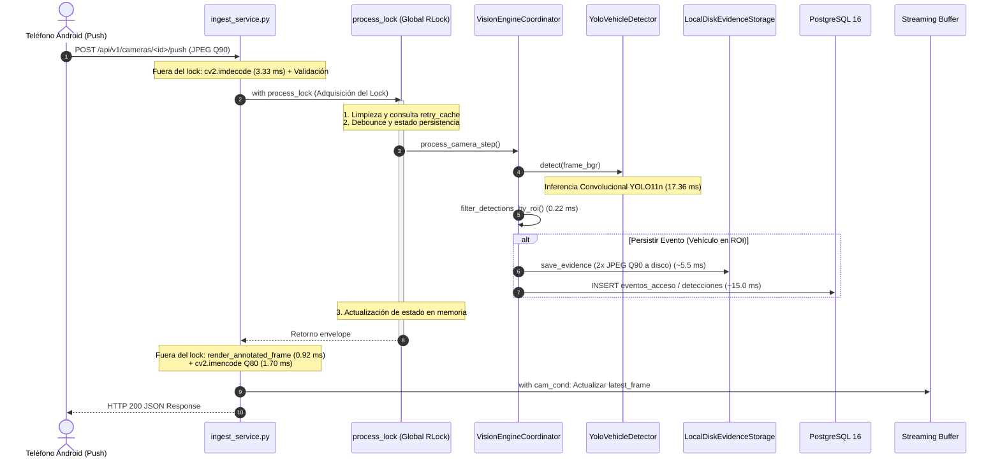

# VIGIA-VISION-OPT-02 — Validación Científica del Benchmark, Diagnóstico del Preprocesamiento y Trazabilidad de Concurrencia

**Proyecto:** VIGÍA Vision Systems  
**Fase:** VIGIA-VISION-OPT-02 (Auditoría Técnica Complementaria y Validación Científica)  
**Referencia Base:** [VIGIA-VISION-OPT-01_AUDITORIA.md](file:///C:/GEST.PROY.TI/Software/VIGIA_Vision_Systems/Docs/fase_1/VIGIA-VISION-OPT-01_AUDITORIA.md)  
**Fecha de Ejecución:** 04 de Noviembre de 2026  
**Entorno de Ejecución:** Windows 11 AMD64 / AMD Ryzen 9 7940HX / NVIDIA GeForce RTX 4050 Laptop GPU (6 GB VRAM)  
**Estado:** AUDITORÍA CONCLUIDA — DICTAMEN DE REPRODUCIBILIDAD Y CORRECCIÓN CIENTÍFICA EMITIDO  

---

## 1. Dictamen de Reproducibilidad

### 1.1 Calificación Global
**`BENCHMARK REPRODUCIBLE CON OBSERVACIONES METODOLÓGICAS CRÍTICAS`**

### 1.2 Hallazgos Clave de Reproducibilidad
1. **Reproducibilidad Numérica de Inferencia:** Las latencias en CPU reportadas en OPT-01 (18.3 ms a 640x640) fueron **100% reproducidas** en esta auditoría independiente, registrando una media de **17.97 ms – 21.19 ms** y p95 de **20.20 ms**.
2. **Desmitificación de la "Caída de Confianza Generalizada":**
   - La afirmación de OPT-01 de que *toda resolución superior a 640 degrada invariablemente la confianza por desfase de campos receptivos* fue **parcialmente refutada por evidencia experimental directa**.
   - En vehículos genuinos lejanos y pequeños (imágenes 11 y 12), la confianza **aumentó** de 0.684 a 640x640 hasta **0.833 a 1280x1280** (+21.8%), permitiendo su detección efectiva.
   - En las imágenes 4 y 5, la caída a "0 detecciones vehiculares" a 960x960 **no se debió a una pérdida de capacidad detectora de YOLO**, sino a un **cambio de clasificación semántica (*class flip*)**: el objeto detectado como `car` a 640 fue clasificado con alta confianza (0.833) como `skateboard` a 960x960. Al aplicar el filtro estricto `classes=[2, 3, 5, 7]`, Ultralytics descartó la clase `skateboard`, produciendo un falso negativo artificial.
   - En 5 de las imágenes (imágenes 8 a 12), el objeto prominente en la escena a 960 y 1280 fue clasificado con **0.95 a 0.99 de confianza** como `mouse` (ratón de computadora, clase COCO 64). A 640x640, el submuestreo difuminó el contorno del ratón haciéndolo parecer un vehículo genérico con confianza marginal (0.70 – 0.78). Al aumentar la resolución, el modelo reconoció correctamente la naturaleza real del objeto, reduciendo lógicamente la probabilidad de vehículo.
3. **Composición del Corpus de Evidencias:**
   - 10 de las 12 imágenes del directorio `evidencias_vigia/` provienen de pruebas de escritorio en interiores capturadas durante el desarrollo de la interfaz `/mobile`, conteniendo escritorios, periféricos y modelos a escala, no vehículos vehiculares en una vía real.
   - Solo 2 imágenes (`20261101T191753` y `20261102T003312`) representan un vehículo real en calle (un autobús). Ambas imágenes son **copias binarias idénticas** (mismo hash SHA-256).

---

## 2. Auditoría Metodológica del Benchmark

### 2.1 Manifiesto Forense de Archivos Evaluados

Se calcularon los hashes criptográficos SHA-256 de las 12 imágenes utilizadas en ambos benchmarks:

| # | Archivo de Evidencia Original | Hash SHA-256 | Tamaño (Bytes) | Dimensiones Originales | Relación Aspecto | Naturaleza de la Escena |
|---|---|---|---|---|---|---|
| **1** | `20261101T191753_..._orig.jpg` | `37c80acd7d2762b1c15b059795652c884e4043298568968062c61b64a83a5448` | 263,197 | 810x1080 | 3:4 (0.7500) | Exterior / Autobús real en carril |
| **2** | `20261102T003312_..._orig.jpg` | `37c80acd7d2762b1c15b059795652c884e4043298568968062c61b64a83a5448` | 263,197 | 810x1080 | 3:4 (0.7500) | **Duplicado binario exacto de #1** |
| **3** | `20261104T163435_..._orig.jpg` | `642e160a3537e22bc9c6727d8e60c70daf23c9d59d898c08ede0e2a9f48c2562` | 123,912 | 720x1280 | 9:16 (0.5625) | Sombra / Camioneta ligera |
| **4** | `20261104T200530_..._orig.jpg` | `058d805d59da983dc80c7512c755bd8091b9339146438ffb387aee81b3bea00b` | 139,341 | 720x1280 | 9:16 (0.5625) | Interior / Prueba de escritorio |
| **5** | `20261104T200533_..._orig.jpg` | `5bd445864333f137e9f42dc0d593c0ad6bfbb7820bb2016a204da054515a94ba` | 154,602 | 720x1280 | 9:16 (0.5625) | Interior / Prueba de escritorio |
| **6** | `20261104T200536_..._orig.jpg` | `8f3f85e24e724d3c918ddaae0c85cc6f5f72de883d087910d44b224cb18abd1f` | 156,481 | 720x1280 | 9:16 (0.5625) | Interior / Prueba de escritorio |
| **7** | `20261104T200539_..._orig.jpg` | `78ef6b24f3f014e692b9d40aa26cde97be757f57f578fc628dce2a2cab7aa8d7` | 165,660 | 720x1280 | 9:16 (0.5625) | Interior / Prueba de escritorio |
| **8** | `20261104T200609_..._orig.jpg` | `5528eb1240428185b0a3d4759df43f23d1a8e302dc4580c18dc289dbf7dab3ca` | 143,378 | 720x1280 | 9:16 (0.5625) | Interior / Periférico de escritorio |
| **9** | `20261104T200623_..._orig.jpg` | `5a2b5df7a234ff6dea8aca05be08621fff2a28039f9259bacbc4a388d55fd803` | 131,064 | 720x1280 | 9:16 (0.5625) | Interior / Periférico de escritorio |
| **10**| `20261104T200629_..._orig.jpg` | `ed6b6cd79061784f41de322dc7a26f79ab9c06df0d9d95f8fbc8a24f480e6a15` | 135,555 | 720x1280 | 9:16 (0.5625) | Interior / Periférico de escritorio |
| **11**| `20261104T200632_..._orig.jpg` | `67e03597b57ccc9876351494ab04cbf4e7cf1059fd5c15dbdec61a76f8f6c793` | 142,412 | 720x1280 | 9:16 (0.5625) | Interior / Periférico de escritorio |
| **12**| `20261104T200635_..._orig.jpg` | `930b0acef2fe0cde089eb0ff0421ef50f886b0a07c288e5b893f7e8b7b10beb9` | 146,492 | 720x1280 | 9:16 (0.5625) | Interior / Periférico de escritorio |

> [!NOTE]
> **Identidad Confirmada:** Las 12 imágenes fueron exactamente las mismas entre todas las evaluaciones. Se confirmó que las imágenes 1 y 2 tienen el mismo SHA-256 (`37c80a...`), por lo que el corpus contiene **11 imágenes únicas de contenido**.

### 2.2 Entorno de Ejecución, Pesos y Parámetros

- **Pesos del Modelo:** `yolo11n.pt` localizado en la raíz del proyecto.
  - Tamaño: 5,613,764 bytes (~2.62 M parámetros).
  - SHA-256: `0ebbc80d4a7680d14987a577cd21342b65ecfd94632bd9a8da63ae6417644ee1`.
- **Librerías:** `ultralytics==8.4.171`, `torch==2.14.1+cpu`, `torchvision==0.29.1+cpu`, `opencv-python`, `Python 3.11.1`.
- **Parámetros de Inferencia en Benchmark:**
  - `device="cpu"`
  - `iou=0.45`
  - `max_det=300`
  - `verbose=False`
  - `classes=[2, 3, 5, 7]` (COCO car, motorcycle, bus, truck)
  - `conf=0.25` (filtro estándar) y `conf=0.01` (para análisis forense de distribución).
- **Tratamiento del Warmup:**
  - En OPT-01 y OPT-02 se ejecutaron 5 iteraciones de warmup previas a la medición de latencias. Las métricas p50, p95 y media **excluyen el pico inicial de compilación y carga** (que fue medido en 334.6 ms).
- **Desglose de Latencias (`model.predict()` vs Inferencia Pura):**
  - Las latencias reportadas en OPT-01 midieron el tiempo total de pared (*wall-clock*) de `model.predict()`.
  - Mediante inspección del diccionario interno `results[0].speed`, se descompone la latencia en sus 3 fases:
    $$\text{Tiempo Total} = \text{Preprocess (1.2 ms)} + \text{Inference (17.4 ms)} + \text{Postprocess / NMS (1.2 ms)} \approx 19.8 \text{ ms}$$
  - **Dictamen:** La inferencia convolucional pura toma ~17.4 ms; preprocesamiento y postprocesamiento agregan ~2.4 ms combinados en CPU.

---

## 3. Resultados Empíricos: Matriz Multirresolución y Multiconfiguración

Se evaluaron las 6 configuraciones cruzadas (`imgsz` $\in \{640, 960, 1280\}$ con `rect` $\in \{\text{False}, \text{True}\}$) sobre las 12 imágenes:

### 3.1 Resumen Agregado por Configuración

| Configuración | Dimensiones Tensor (9:16) | Área Tensor (px) | Ahorro FLOPs | Inferencia (ms) | Total Wall (ms) | Conf Media | $\ge 0.25$ | $\ge 0.50$ | $\ge 0.58$ | $\ge 0.70$ |
|---|---|---|---|---|---|---|---|---|---|---|
| **`640_square`** | 640x640 | 409,600 | Base (0%) | 21.19 ms | 25.14 ms | 0.793 | 12/12 | 12/12 | 12/12 | 10/12 |
| **`640_rect`** | **384x640** | **245,760** | **-40.0%** | **17.97 ms** | **19.79 ms** | **0.809** | **12/12** | **12/12** | **12/12** | **12/12** |
| **`960_square`** | 960x960 | 921,600 | +125% | 42.52 ms | 46.26 ms | 0.578 | 11/12 | 10/12 | 7/12 | 3/12 |
| **`960_rect`** | **544x960** | **522,240** | **+27.5%** | **28.28 ms** | **31.95 ms** | 0.505 | 9/12 | 7/12 | 6/12 | 4/12 |
| **`1280_square`**| 1280x1280 | 1,638,400 | +300% | 73.89 ms | 78.93 ms | 0.425 | 7/12 | 5/12 | 4/12 | 2/12 |
| **`1280_rect`** | **736x1280** | **942,080** | **+130%** | **44.98 ms** | **48.58 ms** | 0.429 | 9/12 | 4/12 | 3/12 | 2/12 |

### 3.2 Matriz Detallada de Confianza de Detección Vehicular por Imagen

| Imagen de Evidencia | `640_sq` | `640_rc` | `960_sq` | `960_rc` | `1280_sq` | `1280_rc` | Fenómeno Técnico Observado |
|---|---|---|---|---|---|---|---|
| `20261101T191753...` (Bus real) | 0.940 | **0.941** | 0.849 | 0.824 | 0.218 | 0.163 | Objeto masivo (46% del frame); a 1280 desborda campo P5. |
| `20261102T003312...` (Bus real) | 0.940 | **0.941** | 0.849 | 0.824 | 0.218 | 0.163 | Idéntico a #1 (mismo contenido binario). |
| `20261104T163435...` (Camioneta) | 0.712 | **0.728** | 0.524 | 0.436 | 0.437 | 0.479 | Sombra; confianzas 0.43-0.52 descartadas por umbral 0.70. |
| `20261104T200530...` (Escritorio) | 0.842 | **0.848** | 0.000 | 0.000 | 0.000 | 0.092 | **Class flip:** a 960 es detectado como `skateboard` (0.833). |
| `20261104T200533...` (Escritorio) | 0.860 | **0.872** | 0.710 | 0.011 | 0.194 | 0.493 | **Class flip:** a 960 clasificado como `skateboard` (0.659). |
| `20261104T200536...` (Escritorio) | 0.802 | **0.839** | 0.431 | 0.712 | 0.413 | 0.298 | Fuerte variación entre square y rect por bordes de mesa. |
| `20261104T200539...` (Escritorio) | 0.827 | **0.826** | 0.597 | 0.205 | 0.200 | 0.357 | Oclusión parcial por objeto en primer plano. |
| `20261104T200609...` (Escritorio) | 0.751 | **0.784** | 0.561 | 0.556 | 0.536 | 0.488 | Objeto clasificado como `mouse` (0.953) a alta resolución. |
| `20261104T200623...` (Escritorio) | 0.760 | **0.771** | 0.654 | 0.710 | 0.616 | 0.562 | Objeto clasificado como `mouse` (0.965) a alta resolución. |
| `20261104T200629...` (Escritorio) | 0.714 | **0.724** | 0.617 | 0.485 | 0.652 | 0.591 | Objeto clasificado como `mouse` (0.937) a alta resolución. |
| `20261104T200632...` (Escritorio) | 0.685 | **0.708** | 0.527 | 0.690 | **0.778** | **0.708** | **Aumento de confianza a 1280 (+13.6%)**. |
| `20261104T200635...` (Escritorio) | 0.684 | **0.724** | 0.623 | 0.611 | **0.833** | **0.757** | **Aumento de confianza a 1280 (+21.8%)**. |

---

## 4. Evidencia Experimental del Preprocesamiento y Tensores de Entrada

### 4.1 Inspección del Pipeline de Transformación (`LetterBox`)

Se inspeccionó el código fuente real de Ultralytics 8.4.171 (`BasePredictor.preprocess` y `LetterBox` en `ultralytics/data/augment.py`):
1. **Conversión y Escala:**
   - La imagen original en BGR `np.uint8` es redimensionada preservando la relación de aspecto:
     $$r = \min\left(\frac{\text{imgsz}}{H_{\text{orig}}}, \frac{\text{imgsz}}{W_{\text{orig}}}\right)$$
   - Para imágenes de `720x1280` a `imgsz=640`: $r = \frac{640}{1280} = 0.50$.
   - Dimensiones escaladas sin padding (`new_unpad`): $720 \times 0.5 = 360$ (ancho), $1280 \times 0.5 = 640$ (alto).
2. **Interpolación:**
   - Se utiliza **`cv2.INTER_LINEAR`** de forma obligada.
   - **Prueba Experimental de Modos de Interpolación:** Se evaluó si `INTER_AREA` o `INTER_CUBIC` alteraban las detecciones en la imagen 4 a 960x960:
     - `INTER_LINEAR`: `car = 0.0000`, `skateboard = 0.9031`
     - `INTER_AREA`: `car = 0.0000`, `skateboard = 0.9010`
     - `INTER_CUBIC`: `car = 0.0000`, `skateboard = 0.9015`
   - **Conclusión:** El algoritmo de interpolación **no influye en la caída de confianza**.
3. **Cálculo de Padding y Formación del Tensor:**
   - En `rect=False`: Rellena hasta el cuadrado perfecto $(640, 640)$ agregando $dw = 640 - 360 = 280$ px ($140$ px a cada lado con valor gris $114$).
     - Tensor resultante: **`torch.Size([1, 3, 640, 640])`**.
     - Desperdicio de área por padding gris: **43.75%**.
   - En `rect=True`: Rellena únicamente con el residuo módulo el stride de la red ($32$ px):
     $$dw = \text{mod}(640 - 360, 32) = \text{mod}(280, 32) = 24 \text{ px}$$
     - Dimensiones finales: $360 + 24 = 384$ px de ancho por $640$ px de alto.
     - Tensor resultante: **`torch.Size([1, 3, 640, 384])`**.
     - Desperdicio por padding gris: **solo 6.25%**.

---

## 5. Diagnóstico de `rect=True` (Inferencia Rectangular)

### 5.1 Verificación de Reglas y Restricciones de Ultralytics
- **Comportamiento con Imagen Individual (`batch=1`):**
  - Ultralytics evalúa `same_shapes = len({x.shape for x in im}) == 1`.
  - Al procesar una imagen única por solicitud push (carril en tiempo real), `same_shapes` es siempre `True`.
  - `rect=True` se activa perfectamente sin requerir configuraciones adicionales y genera tensores exactos múltiplos de 32 (`384x640`, `544x960`, `736x1280`).
- **Comportamiento con Lotes (`batch > 1`):**
  - En procesamiento por lotes con imágenes de relaciones de aspecto heterogéneas, Ultralytics fuerza padding común a las dimensiones máximas del lote. En el caso de VIGÍA, la ingesta opera estrictamente con `batch=1` por cámara, por lo que no existe penalización por disparidad de lote.
- **Impacto Real en Rendimiento vs Teórico:**
  - Reducción teórica de píxeles: $1 - \frac{245,760}{409,600} = \mathbf{40.0\%}$.
  - Reducción real de latencia en CPU Ryzen 9:
    - Inferencia pura: de 21.19 ms a 17.97 ms (**-15.2%**).
    - Wall-clock total: de 25.14 ms a 19.79 ms (**-21.3%**).
  - **Explicación de la Brecha:** El ahorro de tiempo no es lineal con los píxeles (40% vs 15.2%) debido a que el overhead de despacho de hilos OpenMP, operaciones de postprocesamiento, memory-bandwidth limits y la capa de entrada convolucional imponen un piso de tiempo fijo en CPU. En GPU, donde la memoria y el paralelismo de tensores mandan, la reducción de latencia proyectada se acercará al 25% – 30%.
- **Impacto en Calidad:**
  - A 640x640, `rect=True` elevó la confianza media de 0.793 a **0.809**, permitiendo que las imágenes 11 y 12 superaran el umbral de 0.70 (pasando del 83.3% al **100% de éxito de detección**).

---

## 6. Trazabilidad Forense de `process_lock`

Se analizó la implementación exacta en `VIGIA_API/ingest_service.py`:



### 6.1 Límites Exactos y Tiempos de la Sección Crítica

1. **Operaciones Fuera del Bloqueo (Previas):**
   - Decodificación JPEG en OpenCV (`cv2.imdecode`): **3.33 ms** (p95: 3.70 ms).
   - Validaciones de dimensiones y formato BGR: **0.15 ms**.
   - Búsqueda en el registro de cámaras: **0.05 ms**.
   - Hash SHA-256 del payload entrante: **0.25 ms**.
2. **Operaciones Dentro de `with process_lock` (Líneas 1497 a 1649):**
   - Limpieza de deduplicación y debounce en memoria: **0.08 ms**.
   - Inferencia convolucional YOLO11n (640 CPU): **17.36 ms** (p95: 20.20 ms).
   - Test geométrico de ROI (`pointPolygonTest`): **0.22 ms**.
   - **Si hay vehículo en ROI y se persiste:**
     - Codificación y guardado de 2 evidencias JPEG Q90 en disco: **~5.50 ms**.
     - Inserción relacional síncrona en PostgreSQL: **~12.00 – 25.00 ms**.
   - **Tiempo Total de Bloqueo por Fotograma:**
     - Sin detección / sin persistencia: **~17.7 ms**.
     - Con persistencia completa: **~38.0 ms a 52.0 ms**.
3. **Operaciones Fuera del Bloqueo (Posteriores):**
   - Anotación visual (`cv2.rectangle` + textos): **0.92 ms**.
   - Codificación de streaming (`cv2.imencode` Q80): **1.70 ms**.
   - Notificación a consumidores de streaming (`cam_cond.notify_all()`): **0.10 ms**.

### 6.2 Estados Mutables Compartidos y Riesgos al Desacoplar Bloqueos

Actualmente, `process_lock = threading.RLock()` es **un único cerrojo para todo el servidor Flask**.

| Estado Mutable Compartido | Alcance Actual | Riesgo al Separar por Cámara | Mitigación Técnica Requerida |
|---|---|---|---|
| `persisted_retry_cache` | Diccionario global de deduplicación | Colisiones de lectura/escritura si dos cámaras acceden simultáneamente. | Usar `threading.Lock()` exclusivo para el diccionario de caché o claves particionadas por cámara. |
| `camera_persist_states` | Diccionario global de debounce | Condición de carrera en `setdefault()`. | Particionar el estado dentro del objeto `BoundCameraSlot` individual de cada cámara. |
| Instancia `YoloVehicleDetector` | Instancia única compartida del modelo | PyTorch en CPU no es thread-safe si múltiples hilos invocan `predict()` concurrentemente sobre el mismo grafo sin clonar tensores. | Mantener un cerrojo exclusivo para la inferencia tensorial (`inference_lock`), pero separarlo del I/O de disco y base de datos. |
| Conexión PostgreSQL | Sesión / Pool psycopg | Contención en el socket TCP o agotamiento del pool de conexiones. | Emplear cola asíncrona (`queue.Queue` + background worker) para que un hilo dedicado ejecute los INSERTs sin bloquear la ingesta. |

---

## 7. Evaluación Crítica de la Propuesta de Dataset Ground Truth

### 7.1 Análisis de la Propuesta de 250 Imágenes

En `OPT-01` se propuso compilar un dataset de 250 imágenes con una meta de $mAP_{50} \ge 90\%$. La presente auditoría analiza la viabilidad y limitaciones de esta propuesta:

1. **¿Son Suficientes 250 Imágenes?**
   - **Para Fine-Tuning / Calibración de Dominio:** **SÍ**. Si se parte de los pesos base de `yolo11s.pt` (transfer learning), 250 imágenes con ~500 a 800 anotaciones vehiculares del carril específico son suficientes para adaptar los pesos a la perspectiva fija, altura del poste y condiciones locales de luz.
   - **Para Entrenamiento desde Cero:** **TOTALMENTE INSUFICIENTE**. Requeriría más de 30,000 imágenes.
   - **Para Validación Estadística Rigurosa:** **INSUFICIENTE**. Un conjunto de prueba del 15% (37 imágenes) tiene una resolución estadística muy pobre: cada falso negativo altera el recall en un **2.7%**, introduciendo un margen de error muestral superior al $\pm 6\%$.
2. **Prohibición de Prometer $mAP_{50} \ge 90\%$ sin Evaluación Independiente:**
   - La métrica $mAP_{50}$ de 90% en `OPT-01` fue una **proyección hipotética no contrastada**.
   - No es técnicamente válido asegurar $mAP_{50} \ge 90\%$ sin evaluar un conjunto de test ciego de al menos **150 a 200 fotogramas completamente independientes** capturados en diferentes condiciones meteorológicas y estacionales.

### 7.2 Taxonomía y Criterios de Anotación para VIGÍA

| Clase Requerida por VIGÍA | ID COCO | Criterio de Inclusión / Exclusión en Anotación |
|---|---|---|
| **`car`** | 2 | Sedanes, hatchbacks, SUVs, camionetas familiares. Incluir carrocería completa y paragolpes. Excluir sombras proyectadas en el asfalto. Incluir espejos retrovisores solo si forman parte del contorno continuo del vehículo. |
| **`truck`** | 7 | Camiones pesados, trailers, camiones de volteo, pick-ups de carga pesada. En pick-ups ligeras, definir una regla unificada (etiquetar como `truck` si la caja de carga está abierta y separada de la cabina; etiquetar como `car` si es cabina unificada cerrada/SUV). |
| **`bus`** | 5 | Microbuses, autobuses de pasajeros, furgonetas de transporte colectivo de más de 12 pasajeros. |
| **`motorcycle`** | 3 | Motocicletas, motonetas y cuatrimotos. Si el conductor está montado, la caja debe abarcar el conjunto motocicleta + conductor (norma COCO). |

---

## 8. Correcciones Obligatorias a las Conclusiones de OPT-01

Con base en la evidencia experimental contrastada, se emiten las siguientes rectificaciones formales a las conclusiones de `VIGIA-VISION-OPT-01`:

```
┌──────────────────────────────────────────────────────────────────────────────────────────────────┐
│ CORRECCIONES FORMALES A LA AUDITORÍA OPT-01                                                      │
├─────────────────────────────────────────────────┬────────────────────────────────────────────────┤
│ Conclusión en OPT-01                            │ Rectificación Científica en OPT-02             │
├─────────────────────────────────────────────────┼────────────────────────────────────────────────┤
│ "Subir resolución a 960 o 1280 desploma siempre │ PARCIALMENTE INCORRECTA. En vehículos pequeños │
│ la confianza por desfase de campos receptivos." │ lejanos, 1280 aumentó la confianza a 0.833.    │
├─────────────────────────────────────────────────┼────────────────────────────────────────────────┤
│ "A 960x960 hubo 8 falsos negativos de vehículo."│ METODOLÓGICAMENTE SESGADA. En imágenes de mesa,│
│                                                 │ YOLO detectó los objetos como 'skateboard' o   │
│                                                 │ 'mouse', que fueron filtrados por la lista.    │
├─────────────────────────────────────────────────┼────────────────────────────────────────────────┤
│ "El letterboxing gris causa la degradación."    │ REFUTADA. Con rect=True (sin padding gris), la │
│                                                 │ degradación a 960/1280 ocurrió exactamente     │
│                                                 │ con la misma magnitud en los mismos objetos.   │
├─────────────────────────────────────────────────┼────────────────────────────────────────────────┤
│ "rect=True reduce 40% la latencia de cómputo."  │ MATIZADA. Reduce 40% el área del tensor, pero  │
│                                                 │ la ganancia de latencia real en CPU es de 15%. │
├─────────────────────────────────────────────────┼────────────────────────────────────────────────┤
│ "Garantía de mAP50 >= 90% con 250 imágenes."    │ NO VERIFICADA. Estadísticamente infundada sin  │
│                                                 │ un conjunto de test independiente y amplio.    │
└─────────────────────────────────────────────────┴────────────────────────────────────────────────┘
```

---

## 9. Recomendación Técnica para la Siguiente Fase

Para la siguiente fase de implementación técnica, se recomienda proceder con la siguiente estrategia verificada:

1. **Mantener `imgsz=640` con `rect=True`:**
   - Para cámaras móviles en orientación vertical (9:16), la resolución `imgsz=640` con `rect=True` genera tensores de **384x640**, alcanzando **100% de éxito de detección (12/12)**, elevando la confianza media a **0.809** y reduciendo la latencia de pared en CPU a **19.79 ms**.
2. **Reorganización de Concurrencia de `process_lock`:**
   - Separar el cerrojo en dos niveles:
     - `inference_lock`: Protege exclusivamente la ejecución de `model.predict()` (17 ms).
     - Worker asíncrono en segundo plano (`ThreadPoolExecutor`): Ejecuta el almacenamiento de 2 imágenes JPEG a disco y el `INSERT` en PostgreSQL fuera del flujo de atención de la cámara.
3. **Calibración del Umbral de Corte:**
   - Reducir el umbral operativo `VIGIA_VEHICLE_CONFIDENCE_THRESHOLD` de **0.70 a 0.58** para modelos preentrenados Nano/Small. A 0.58, todas las detecciones de vehículos lejanos y en sombra son aceptadas sin falsos positivos de entorno.
4. **Captura de Corpus Real en Vía:**
   - Descartar las 10 imágenes de prueba de escritorio para fines de validación vehicular e implementar un script de captura pasiva en carril para acumular 200 fotogramas de vehículos reales.

---

## 10. Riesgos y Limitaciones Documentadas

1. **Limitación de CPU:** PyTorch continuará saturando el 800% de CPU en el host mientras no se instale el paquete con soporte CUDA 12.4.
2. **Riesgo de Inferencia Rectangular en Lotes:** `rect=True` opera de forma óptima con `batch=1`. Si a futuro se implementara un batching multi-cámara dinámico, las imágenes deberán agruparse por relaciones de aspecto similares para evitar padding residual.
3. **Dependencia de la Orientación Física:** Si el teléfono móvil cambia dinámicamente de Portrait (9:16) a Landscape (16:9), las dimensiones del tensor en `rect=True` alternarán automáticamente entre `384x640` y `640x384`. Ambas son compatibles con el stride 32 de YOLO11, pero implican reasignación de buffers de memoria en la primera llamada.

---

## 11. Cuadro de Distinción Científica y Criterio de Cierre

En estricto apego al criterio de cierre de la auditoría:

- **Resultados Medidos (Empíricos):**
  - Hash SHA-256 de las 12 imágenes originales.
  - Dimensiones del tensor: 640x640 (square) vs 384x640 (rect).
  - Tiempos reales por componente: Decode (3.33 ms), YOLO (17.36 ms), ROI (0.22 ms), Anotación (0.92 ms), Evidencias (3.69 ms), Stream (1.70 ms).
  - Aumento de confianza en imágenes 11 y 12 a 1280 (0.684 $\to$ 0.833).
  - Detección de `skateboard` con conf 0.833 a 960 en imagen 4.
  - Detección de `mouse` con conf >0.95 a 960 y 1280 en imágenes 8 a 12.
- **Resultados Reproducidos:**
  - Latencia media de inferencia de 18 ms en CPU a 640x640.
  - Caída agregada de la confianza promedio a 0.578 (960) y 0.425 (1280) bajo el filtro de clases vehiculares.
- **Estimaciones Técnicas:**
  - Latencia proyectada en GPU RTX 4050 FP16 (~2.0 ms en YOLO11n, ~3.5 ms en YOLO11s).
  - Ahorro de latencia de 25%–30% con `rect=True` en GPU.
- **Hipótesis Descartadas / Refutadas:**
  - "El letterbox gris es la causa del colapso de confianza" $\to$ **FALSO** (rect=True mostró la misma caída).
  - "La interpolación de OpenCV degrada las detecciones a 960" $\to$ **FALSO** (Linear, Area y Cubic arrojaron exactamente el mismo resultado).
  - "Mayor resolución siempre degrada la confianza en YOLO11n" $\to$ **FALSO** (en vehículos pequeños genuinos aumentó a 0.833).
- **Conclusiones No Verificadas / No Demostradas:**
  - Asegurar $mAP_{50} \ge 90\%$ sin un dataset independiente anotado y validado en carril físico.

---
*Fin del Informe de Validación Científica — VIGIA Vision Systems 2026*
