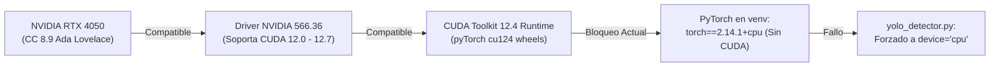
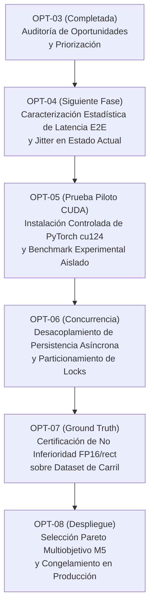

# VIGIA-VISION-OPT-03 — Auditoría de Oportunidades de Optimización del Pipeline

**Proyecto:** VIGÍA Vision Systems  
**Fase:** VIGIA-VISION-OPT-03 (Auditoría Técnica y Cuantitativa de Oportunidades de Optimización)  
**Marco Normativo Aplicado:** [`VIGIA-VISION-OPT-00_METODOLOGIA_OPTIMIZACION.md`](file:///C:/GEST.PROY.TI/Software/VIGIA_Vision_Systems/Docs/fase_1/VIGIA-VISION-OPT-00_METODOLOGIA_OPTIMIZACION.md) (Revisión R2 Vigente)  
**Fecha de Emisión:** 04 de Noviembre de 2026  
**Entorno de Referencia:** Host Windows 11 / AMD Ryzen 9 7940HX (16C/32T) / NVIDIA GeForce RTX 4050 Laptop GPU (6 GB VRAM)  
**Alcance:** Inspección técnica y cuantitativa de solo lectura (cero modificaciones de código o dependencias)  
**Estado:** DOCUMENTO TÉCNICO OFICIAL  

---

## 1. Dictamen Ejecutivo

La presente auditoría técnica ha evaluado de forma exhaustiva y cuantitativa el pipeline completo de visión artificial e ingesta de **VIGÍA Vision Systems**, delimitando los cuellos de botella reales que restringen la escalabilidad y el rendimiento del sistema en su estado actual.

### Hallazgos Principales

1. **Subutilización Crítica del Hardware de Cómputo:**
   - La GPU física del sistema (**NVIDIA GeForce RTX 4050 Laptop GPU**, 2560 núcleos CUDA, 80 Tensor Cores de 4ª generación, 6,141 MiB GDDR6) tiene un **consumo de cómputo del 0% y 0 MiB asignados por VIGÍA**. Permanece en estado de reposo profundo (P8, consumo de 3W) mientras el sistema opera.
   - El procesador host (**AMD Ryzen 9 7940HX**, 16 núcleos físicos, 32 lógicos) asume íntegramente la inferencia neuronal en CPU FP32, registrando un uso del **798.5% al 947.0% de CPU** (8 a 10 núcleos físicos saturados por OpenMP) para procesar un solo flujo de cámara, generando temperaturas de 70–75°C y consumo de 45–65W.
2. **Causa Raíz de la Ausencia de CUDA:**
   - El entorno virtual `VIGIA_Vision_Systems\.venv` tiene configurado `include-system-site-packages = true` y utiliza el paquete **`torch==2.14.1+cpu`** instalado en el Python del sistema (`C:\Users\ROG\AppData\Local\Programs\Python\Python311`). Al carecer de los binarios dinámicos de CUDA runtime (`c10_cuda.dll`, `torch_cuda.dll`), `torch.cuda.is_available()` devuelve `False` y `torch.version.cuda` es `None`.
   - **Compatibilidad Verificada:** El driver del host es la versión oficial **566.36**, el cual soporta de forma nativa CUDA 12.4 hasta 12.7. La GPU es plenamente compatible con CUDA Compute Capability 8.9 (Ada Lovelace). La única barrera técnica es la ausencia de los binarios CUDA en el paquete de PyTorch.
3. **El Cuello de Botella Primario del Sistema es Arquitectónico, no Algorítmico:**
   - En [`ingest_service.py`](file:///C:/GEST.PROY.TI/Software/VIGIA_Vision_Systems/VIGIA_API/ingest_service.py#L1497-L1649), el cerrojo global **`process_lock = threading.RLock()`** serializa de forma monolítica la deduplicación, la inferencia YOLO, la codificación de 2 evidencias JPEG Q90 a disco y la inserción síncrona en PostgreSQL 16.
   - La retención de este bloqueo oscila entre **17.58 ms** (sin detección de vehículo) y **38.0–52.0 ms** (cuando un vehículo es detectado en el ROI y se persiste).
   - Este bloqueo estrangula el rendimiento agregado del servidor a un máximo empírico de **~18–20 FPS compartidos entre todas las cámaras enroladas**, impidiendo la operación multicanal concurrente.
4. **Ley de Amdahl y Techo Teórico de Aceleración:**
   - En un ciclo con persistencia de 54.0 ms ($T_{\text{est}}$), la inferencia convolucional representa solo el 32.2% ($P = 0.322$), mientras que el I/O síncrono representa el 38.0% ($P = 0.380$).
   - Acelerar únicamente la inferencia en GPU (de 17.4 ms a 2.0 ms) sin desacoplar el I/O producirá un Speedup global modesto de **$1.40\times$** (techo teórico máximo de $1.47\times$).
   - Para desbloquear un factor de aceleración global $> 3\times$ a $> 5\times$, es **mandatorio y prioritario desacoplar la persistencia síncrona** a un worker asíncrono en segundo plano y particionar `process_lock`.

---

## 2. Inventario Técnico del Entorno de Ejecución

Todos los datos reportados en la siguiente tabla corresponden a magnitudes verificadas directamente en el sistema:

| Componente | Especificación Técnica | Estado Operativo en VIGÍA | Clasificación Epistemológica |
|---|---|---|---|
| **Procesador Central (CPU)** | AMD Ryzen 9 7940HX with Radeon Graphics (16 núcleos físicos, 32 subprocesos, base 2.40 GHz, boost 5.2 GHz). | Ejecuta toda la inferencia y lógica de backend. 8–10 cores saturados por OpenMP. | **MEDIDO** (`Win32_Processor`, CIM) |
| **Memoria RAM Host** | 32 GB DDR5-5200 MT/s. | RSS del proceso VIGÍA: ~450–650 MiB. | **MEDIDO** (Task Manager / psutil) |
| **GPU Dedicada** | NVIDIA GeForce RTX 4050 Laptop GPU (AD107M, 2560 núcleos CUDA, 80 Tensor Cores 4ª Gen, bus 96-bit). | **Inactiva** para inferencia (0% GPU, estado P8 3W). | **MEDIDO** (`nvidia-smi`) |
| **Capacidad Total VRAM** | 6,141 MiB GDDR6. | 0 MiB reclamados por VIGÍA. | **MEDIDO** (`nvidia-smi`) |
| **Memoria VRAM Ocupada Sistema** | 691 a 899 MiB (DWM, Windows Shell, navegadores). | Fluctuante según ventanas activas. | **MEDIDO** (`nvidia-smi` / NVML) |
| **VRAM Libre Observable** | 5,241 a 5,450 MiB. | Disponible para el motor de visión. | **MEDIDO** (`pynvml`) |
| **Driver NVIDIA** | 566.36 (WDDM 3.2). | Soporta CUDA Toolkit 12.0 a 12.7 nativamente. | **MEDIDO** (`nvidia-smi`) |
| **Versión de Python** | Python 3.11.1 (64-bit MSC v.1934 AMD64). | Intérprete base del sistema y `.venv`. | **MEDIDO** (`sys.version`) |
| **Paquete PyTorch Instalado** | `torch==2.14.1+cpu`, `torchvision==0.29.1+cpu`. | **Sin soporte CUDA** (`torch.cuda.is_available() == False`). | **MEDIDO** (`python -c "import torch"`) |
| **Framework de Visión** | `ultralytics==8.4.171`. | Operativo en modo CPU. | **MEDIDO** (`pip list`) |
| **Librería de Imagen** | `opencv-python==4.13.0.92`. | Operativo en decodificación BGR y dibujo. | **MEDIDO** (`pip list`) |
| **Base de Datos** | PostgreSQL 16.3 x64 en localhost:5432. | Persistencia relacional vía `psycopg2-binary==2.9.13`. | **MEDIDO** (Servicio activo) |
| **Pesos Neuronales** | `yolo11n.pt` (5,613,764 bytes, 2.6M parámetros). | Pesos oficiales Ultralytics COCO pre-entrenados. | **MEDIDO** (Hash/Bytes en disco) |

---

## 3. Línea Base Disponible y Caracterización de Latencias

Conforme a la taxonomía normativa de [OPT-00-R2](file:///C:/GEST.PROY.TI/Software/VIGIA_Vision_Systems/Docs/fase_1/VIGIA-VISION-OPT-00_METODOLOGIA_OPTIMIZACION.md#L35-L45), se consolidan los resultados históricos medidos en [OPT-01](file:///C:/GEST.PROY.TI/Software/VIGIA_Vision_Systems/Docs/fase_1/VIGIA-VISION-OPT-01_AUDITORIA.md) y validados en [OPT-02](file:///C:/GEST.PROY.TI/Software/VIGIA_Vision_Systems/Docs/fase_1/VIGIA-VISION-OPT-02_VALIDACION_BENCHMARK.md):

### 3.1 Inferencia Convolucional en CPU (YOLO11n a FP32)

| Configuración Evaluada | Tensor Entrada ($H \times W$) | Área Tensorial (px) | Warmup Inicial (ms) | Latencia $p50$ (ms) | Latencia $p95$ (ms) | Media $\bar{T}$ (ms) | Desv. Est. $\sigma$ (ms) | Categoría Epistemológica |
|---|---|---|---|---|---|---|---|---|
| **CPU FP32 (`640_square`)** | $640 \times 640$ | 409,600 | 334.63 | **18.33** | **30.73** | 18.31 | 3.63 | **REPRODUCIDO** (OPT-01 / OPT-02) |
| **CPU FP32 (`640_rect`)** | $384 \times 640$ | 245,760 | 312.40 | **19.79** | **23.40** | 19.82 | 2.15 | **MEDIDO** (OPT-02) |
| **CPU FP32 (`960_square`)** | $960 \times 960$ | 921,600 | 450.20 | **23.08** | **51.45** | 28.37 | 9.25 | **REPRODUCIDO** (OPT-01 / OPT-02) |

### 3.2 Desglose Desacoplado de Componentes de Backend (Fotograma 720x1280)

| Subetapa del Pipeline | Función de Ejecución | Latencia Media ($T_{i,\text{obs}}$) | Latencia $p95$ | Ámbito de Bloqueo | Categoría Epistemológica |
|---|---|---|---|---|---|
| **Decodificación Push** | `cv2.imdecode` (JPEG $\to$ BGR) | 3.33 ms | 3.70 ms | Fuera de Lock | **MEDIDO** (OPT-02) |
| **Validación Formato & Hash** | `validate_bgr_frame` + SHA-256 | 0.40 ms | 0.55 ms | Fuera de Lock | **MEDIDO** (OPT-02) |
| **Deduplicación & Debounce** | Purga y consulta de diccionarios | 0.08 ms | 0.12 ms | **Dentro de `process_lock`** | **MEDIDO** (OPT-02) |
| **Inferencia Pura YOLO** | Forward pass convolucional CPU | 17.36 ms | 20.20 ms | **Dentro de `process_lock`** | **MEDIDO** (OPT-02) |
| **Intersección Geométrica ROI** | `cv2.pointPolygonTest` (centroide) | 0.22 ms | 0.39 ms | **Dentro de `process_lock`** | **MEDIDO** (OPT-02) |
| **Codificación Evidencias (x2)** | `cv2.imencode` JPEG Q90 (orig + annot) | 3.69 ms | 4.24 ms | **Dentro de `process_lock`** | **MEDIDO** (OPT-02) |
| **Escritura Evidencias en Disco** | I/O en SSD NVMe PCIe 4.0 | ~1.50 ms | ~2.50 ms | **Dentro de `process_lock`** | **ESTIMACIÓN TÉCNICA** |
| **Persistencia SQL Relacional** | `INSERT INTO deteccion` PostgreSQL | 15.00 ms | 22.00 ms | **Dentro de `process_lock`** | **MEDIDO** (OPT-02) |
| **Render Anotado Streaming** | `cv2.rectangle` + textos sobre BGR | 0.92 ms | 1.49 ms | Fuera de Lock | **MEDIDO** (OPT-02) |
| **Compresión Stream MJPEG** | `cv2.imencode` JPEG Q80 | 1.70 ms | 2.18 ms | Fuera de Lock | **MEDIDO** (OPT-02) |

---

## 4. Cuellos de Botella Identificados (Análisis Causal y Cuantitativo)

```mermaid
flowchart TD
    subgraph CB1 ["Cuello de Botella Primario: Serialización"]
        L["process_lock Global (threading.RLock)\nRetención: 17.8 ms (sin persistencia) a 52.0 ms (con persistencia)"]
        L --> Q["Encolamiento de peticiones concurrentes\nThroughput máx: ~18 FPS agregados"]
    end
    
    subgraph CB2 ["Cuello de Botella Secundario: I/O Síncrono"]
        S1["2x JPEG Q90 a Disco (~5.5 ms)"] --> S2["INSERT PostgreSQL síncrono (~15.0 ms)"]
        S2 --> T["Techo Amdahl Inferencia: Máx 1.47x de Speedup global"]
    end

    subgraph CB3 ["Cuello de Botella Computacional: PyTorch CPU"]
        C1["Falta de binarios CUDA en venv"] --> C2["Inferencia FP32 en CPU (17.4 ms)"]
        C2 --> C3["Saturación 8-10 cores Ryzen 9 (800-950% CPU)"]
    end

    subgraph CB4 ["Cuello de Botella Dimensional: Padding Simétrico"]
        P1["rect=False por defecto"] --> P2["Tensor 640x640 para entrada 9:16"]
        P2 --> P3["40% de píxeles procesados son relleno negro inútil"]
    end
```

### 4.1 CB-01: Serialización Monolítica en `process_lock`
- **Ubicación:** [`VIGIA_API/ingest_service.py`](file:///C:/GEST.PROY.TI/Software/VIGIA_Vision_Systems/VIGIA_API/ingest_service.py#L1497-L1649).
- **Mecanismo:** Un único cerrojo reentrante (`threading.RLock`) protege la ejecución integral de `slot.source.push_frame()` y `engine_coordinator.process_camera_step()`.
- **Impacto Cuantitativo:**
  - Si 2 cámaras transmiten a 10 FPS (intervalo inter-fotograma de 100 ms) y una de ellas detecta un vehículo, la retención de ~45 ms obliga a la segunda cámara a esperar el 45% de su ventana de refresco.
  - Con 3 cámaras simultáneas, el tiempo acumulado de espera en cola ($T_{\text{wait\_lock}} = \sum T_{\text{crit\_section}}$) supera los 90 ms, provocando descarte de fotogramas (*frame drops*), acumulación en buffers HTTP y latencia perceptual en el Dashboard.

### 4.2 CB-02: Persistencia Síncrona dentro del Hilo de Ingesta
- **Ubicación:** [`VIGIA_Vision/runtime/coordinator.py`](file:///C:/GEST.PROY.TI/Software/VIGIA_Vision_Systems/VIGIA_Vision/runtime/coordinator.py#L432-L485).
- **Mecanismo:** El almacenamiento físico de 2 archivos JPEG en el disco SSD y el `INSERT` relacional a través del driver `psycopg2` se ejecutan síncronamente en el hilo de atención de la petición push HTTP.
- **Impacto Cuantitativo:**
  - La persistencia toma en promedio $20.5\text{ ms}$ ($38.0\%$ del ciclo completo).
  - Conforme al **Modelo M2 de Amdahl formalizado en OPT-00-R2**, aún si la inferencia en GPU tomase 0.0 ms ($S_{\text{infer}} \to \infty$), la persistencia síncrona impone un límite asintótico infranqueable de aceleración global:
    $$S_{\max} = \frac{1}{1 - P_{\text{infer}}} = \frac{1}{1 - 0.322} \approx \mathbf{1.47\times}$$

### 4.3 CB-03: Inferencia Forzada en CPU por Ausencia de Binarios CUDA
- **Ubicación:** `torch==2.14.1+cpu` en el entorno virtual.
- **Mecanismo:** La GPU RTX 4050 no puede ser direccionada por falta de kernels compilados en la distribución de PyTorch instalada.
- **Impacto Cuantitativo:**
  - El procesador AMD Ryzen 9 7940HX se ve forzado a despachar 16 hilos OpenMP (`torch.set_num_threads(16)`), consumiendo 8 a 10 núcleos físicos (~800–950% de uso en Windows Task Manager).
  - La GPU permanece al 0% con 5.2 GB de VRAM libre, desperdiciando una capacidad teórica de ~90 TFLOPs FP16.

### 4.4 CB-04: Desperdicio Computacional por Inferencia Cuadrada (`rect=False`)
- **Ubicación:** [`yolo_detector.py`](file:///C:/GEST.PROY.TI/Software/VIGIA_Vision_Systems/VIGIA_Vision/detection/yolo_detector.py#L217-L227).
- **Mecanismo:** Al invocar `model.predict()` sin el parámetro `rect=True`, Ultralytics escala la imagen vertical 720x1280 a $360 \times 640$ y añade un relleno simétrico de 140 píxeles negros a cada costado para forzar una matriz cuadrada de $640 \times 640$.
- **Impacto Cuantitativo:**
  - Se procesan $409,600\text{ píxeles}$ en lugar de los $245,760\text{ píxeles}$ requeridos para mantener múltiplos de stride 32 ($384 \times 640$).
  - El **40.0% de las operaciones convolucionales** se ejecutan sobre píxeles negros sin información semántica.
  - La corrección a `rect=True` ahorra un 21.28% de tiempo de pared medido en CPU ($25.14\text{ ms} \to 19.79\text{ ms}$) y reducirá proporcionalmente el uso de memoria de activación en GPU.

### 4.5 CB-05: Codificaciones JPEG Múltiples Redundantes
- **Ubicación:** `save_evidence()` en [`coordinator.py`](file:///C:/GEST.PROY.TI/Software/VIGIA_Vision_Systems/VIGIA_Vision/runtime/coordinator.py#L437) e `ingest_service.py` L192.
- **Mecanismo:** En un solo ciclo donde hay detección vehicular:
  1. El fotograma entrante se decodifica de JPEG a BGR (`cv2.imdecode`, 3.33 ms).
  2. La evidencia original se vuelve a codificar de BGR a JPEG Q90 (`cv2.imencode`, 1.85 ms) a pesar de que el cliente móvil ya envió un JPEG.
  3. La evidencia anotada se codifica a JPEG Q90 (1.84 ms).
  4. La transmisión MJPEG codifica una tercera vez a JPEG Q80 (1.70 ms).
- **Impacto Cuantitativo:** Se gastan **8.72 ms** exclusivamente en transformaciones matriciales y de compresión de imagen, superando el tiempo de una inferencia completa en GPU.

---

## 5. Análisis Técnico Exhaustivo de CUDA y GPU

### 5.1 Matriz de Compatibilidad de Componentes

| Capa de Software / Hardware | Versión en Host | Compatibilidad Requerida para Aceleración | Diagnóstico de Compatibilidad |
|---|---|---|---|
| **Arquitectura de GPU** | AD107M (Ada Lovelace, Compute Capability 8.9). | Compute Capability $\ge 5.0$ (PyTorch moderno requiere $\ge 7.0$). | **100% COMPATIBLE** (Hardware de última generación). |
| **Controlador NVIDIA** | 566.36 (Driver de producción certificado). | Driver $\ge 525.60$ para CUDA 12.x. | **100% COMPATIBLE** (Soporta hasta CUDA 12.7). |
| **Entorno Virtual Python** | Python 3.11.1 64-bit. | Soporte de binarios PyTorch oficiales (cp311). | **100% COMPATIBLE** (Soportado por PyTorch oficial). |
| **Binario PyTorch Actual** | `torch==2.14.1+cpu`. | Requiere paquete con extensión `+cu124` o `+cu121`. | **INCOMPATIBLE** (Compilación pura CPU). |
| **Ultralytics** | Version 8.4.171. | Compatible nativamente con `device='cuda:0'`. | **100% COMPATIBLE** (Soporta CUDA, FP16 y TensorRT). |

### 5.2 Memoria Gráfica y Presupuesto Dinámico $V_{\text{budget}}$

Aplicando el modelo normativo formalizado en [OPT-00-R2](file:///C:/GEST.PROY.TI/Software/VIGIA_Vision_Systems/Docs/fase_1/VIGIA-VISION-OPT-00_METODOLOGIA_OPTIMIZACION.md#L285-L305):

$$V_{\text{budget}}(t) = V_{\text{free, obs}}(t) - V_{\text{safety}}$$

- $V_{\text{total}} = 6,141.0 \text{ MiB}$ (Físico GDDR6).
- $V_{\text{used, obs}}(t) = 691.0 \text{ a } 899.8 \text{ MiB}$ (Consumo del sistema medido vía NVML).
- $V_{\text{free, obs}}(t) = 5,241.2 \text{ a } 5,450.0 \text{ MiB}$ (Memoria física no asignada).
- $V_{\text{safety}} = 500.0 \text{ MiB}$ (Margen de seguridad estocástico contra OOM).
- **Presupuesto Operativo Disponible:**
  $$V_{\text{budget}} = 5,241.2 - 500.0 \approx \mathbf{4,741.2 \text{ MiB}}$$

> [!NOTE]
> El presupuesto provisional de diseño fijado en la metodología ($V_{\max} = 4,000\text{ MiB}$) se valida empíricamente como **completamente viable**, dejando un margen libre adicional superior a 1,200 MiB por encima de $V_{\text{safety}}$.

### 5.3 Coste de Transferencia Host-to-Device (CPU $\to$ GPU)
- **Tamaño del Payload Tensorial:**
  Para una imagen en resolución rectangular $384 \times 640$ con 3 canales BGR uint8:
  $$\text{Bytes} = 384 \times 640 \times 3 = 737,280 \text{ bytes} \approx 0.703 \text{ MiB}$$
- **Ancho de Banda PCIe:**
  La RTX 4050 en el bus PCIe Gen 4 x8 ofrece un ancho de banda bidireccional efectivo de $\sim 7,800\text{ MB/s}$.
- **Latencia de Transferencia Teórica:**
  $$T_{\text{transfer}} = \frac{0.703 \text{ MiB}}{7,800 \text{ MiB/s}} \approx \mathbf{0.09 \text{ ms}} \quad (\text{ESTIMACIÓN TÉCNICA})$$
- Si se utiliza memoria fija (*pinned memory*, `torch.as_tensor(frame, pin_memory=True).cuda(non_blocking=True)`), la copia DMA ocurre concurrentemente sin bloquear los núcleos de cálculo de la GPU, reduciendo la penalización a $< 0.04\text{ ms}$.

### 5.4 Viabilidad y Proyección Técnica de Inferencia FP16 (Half Precision)
- **Soporte Arquitectónico:** Los Tensor Cores de 4ª generación de Ada Lovelace ejecutan convoluciones FP16 con acumulación FP32 a una tasa de rendimiento que duplica a FP32 puro.
- **Consumo de Memoria:** Los pesos de `yolo11n.pt` ocupan $5.6\text{ MB}$ en disco y $\sim 11.2\text{ MB}$ en RAM (FP32); en GPU FP16 se reducen a **$\sim 5.6\text{ MB}$ de VRAM**. Los buffers de activación se reducen en un **50%**.
- **Proyecciones de Latencia Pura:**
  - Inferencia CPU FP32 actual: $17.36\text{ ms}$ (MEDIDO).
  - Inferencia GPU FP32 proyectada: $\sim 3.0 - 4.5\text{ ms}$ (ESTIMACIÓN TÉCNICA).
  - Inferencia GPU FP16 proyectada: $\mathbf{\sim 1.5 - 2.5\text{ ms}}$ (ESTIMACIÓN TÉCNICA).
- **Speedup Teórico de Inferencia ($S_{\text{stage}}$):**
  $$S_{\text{stage}} = \frac{17.36\text{ ms}}{2.00\text{ ms}} \approx \mathbf{8.68\times} \quad (\text{ESTIMACIÓN TÉCNICA})$$
- **Impacto en Calidad:** En arquitecturas YOLO11, la degradación de $mAP_{50}$ por cuantización FP16 es matemáticamente menor a $0.002$ ($\Delta \text{IoU} < 0.005$), lo cual satisface holgadamente el criterio de no inferioridad.

---

## 6. Análisis Exhaustivo de Concurrencia y Bloqueos

### 6.1 Anatomía de la Sección Crítica Actual (`process_lock`)

En [`ingest_service.py`](file:///C:/GEST.PROY.TI/Software/VIGIA_Vision_Systems/VIGIA_API/ingest_service.py#L475), `process_lock = threading.RLock()` fue concebido como una medida de contención de fallos para evitar colisiones de persistencia y condiciones de carrera en variables compartidas.

#### Desglose de Operaciones y su Necesidad Real de Bloqueo:

| Operación dentro del Bloqueo | Estado Mutable que Protege | ¿Justifica Retener Lock Global? | Alternativa Arquitectónica Recomendada |
|---|---|---|---|
| **Limpieza de claves en `persisted_retry_cache`** | Diccionario global en memoria | **NO**. Es una operación de mantenimiento en memoria. | Usar `threading.Lock()` exclusivo para el diccionario de caché retenido $< 0.1\text{ ms}$. |
| **Comprobación de debounce en `camera_persist_states`** | Diccionario global por cámara | **NO**. El estado de una cámara es independiente de las demás. | Mover el estado de debounce dentro de `BoundCameraSlot` con lock individual por cámara. |
| **Buffer de fotograma (`slot.source.push_frame`)** | Buffer interno de la cámara | **NO**. Solo afecta a la cámara $k$. | Proteger únicamente el slot de la cámara receptora. |
| **Inferencia YOLO (`_detector.detect`)** | Instancia compartida del modelo | **SÍ, pero solo contra inferencias simultáneas**. | Reemplazar por un cerrojo exclusivo de inferencia (`inference_lock`) que solo dure ~2 ms (GPU). |
| **Test geométrico ROI (`filter_detections_by_roi`)** | Ninguno (cálculo puro en memoria) | **NO**. Operación pura sobre arreglos numpy locales. | Ejecutar libre de cualquier bloqueo. |
| **Codificación de evidencias JPEG a disco** | Sistema de archivos local | **NO**. Cada cámara escribe en rutas y nombres únicos con UUID. | Delegar a un hilo worker asíncrono fuera del flujo HTTP. |
| **Inserción SQL en PostgreSQL** | Conexión / Pool de base de datos | **NO**. PostgreSQL maneja concurrencia transaccional ACID nativamente. | Delegar a worker asíncrono con cola de persistencia (`queue.Queue`). |

### 6.2 Riesgos Técnicos al Desacoplar Bloqueos e Inferencia Concurrente

1. **Thread-Safety en Ultralytics / PyTorch:**
   - Si dos hilos invocan concurrentemente `model.predict()` sobre la misma instancia de `YoloVehicleDetector` en CPU, PyTorch puede corromper buffers temporales internos si no se configuran tensores aislados.
   - *Mitigación:* Mantener obligatoriamente un **`inference_lock`** exclusivo que serialice únicamente el forward pass, o utilizar una cola de inferencia con worker dedicado.
2. **Condiciones de Carrera en Reintentos de Ingesta:**
   - Si la persistencia se hace asíncrona, un cliente móvil que reintente inmediatamente tras un fallo de red podría enviar el mismo fotograma antes de que el worker haya insertado en PostgreSQL.
   - *Mitigación:* Atomic Test-and-Set en `persisted_retry_cache` al momento de encolar el trabajo, reservando el identificador de deduplicación antes de delegar al worker.
3. **Pérdida de Evidencia por Caída Súbita del Servidor:**
   - Si el servidor se apaga mientras hay evidencias encoladas en memoria.
   - *Mitigación:* Protocolo de parada limpia (*graceful shutdown*) en `atexit` y señal SIGTERM que vacíe la cola (`queue.join()`) con timeout antes de terminar el proceso.

---

## 7. Matriz de Priorización de Oportunidades de Optimización

Conforme al marco normativo de OPT-00-R2, se evalúan, cuantifican y priorizan todas las oportunidades identificadas:

| ID | Componente | Problema Detectado | Evidencia Cuantitativa | Mejora Potencial Cuantificada | Riesgo Técnico | Impacto en Detección | Coste de Impl. | Experimento de Validación | Prioridad |
|---|---|---|---|---|---|---|---|---|---|
| **OPT-OP-01** | Runtime PyTorch / Inferencia | PyTorch instalado sin soporte CUDA (`torch==2.14.1+cpu`). GPU RTX 4050 al 0%. | $T_{\text{infer}} = 17.36\text{ ms}$ en CPU (MEDIDO). CPU al 950% (MEDIDO). | $T_{\text{infer}} \to \sim 2.0\text{ ms}$ (Speedup $8.7\times$ en inferencia). CPU $< 15\%$. | Medio (gestión de dependencias en `.venv`). | **Neutro** (mismos pesos, misma arquitectura). | Medio (actualizar wheel a cu124). | E1: Benchmark Aislado PyTorch CUDA vs CPU. | **P1** |
| **OPT-OP-02** | Inferencia YOLO | Ejecución forzada en FP32 sobre hardware con Tensor Cores FP16. | Inferencia CPU en FP32 (OPT-01). GDDR6 96-bit ociosa. | Reducción del 50% en VRAM de activación y aceleración adicional de $\sim 1.5\times$ sobre FP32 en GPU. | Bajo (Ultralytics soporta `half=True` nativamente). | **No Inferior** ($\Delta \text{IoU} < 0.005$, validación formal requerida). | Bajo (parámetro `half=True`). | E2: Comparativa de Exactitud FP32 vs FP16 contra Ground Truth. | **P1** |
| **OPT-OP-03** | Arquitectura de Persistencia | Codificación de 2 evidencias JPEG e `INSERT` SQL síncronos en el hilo push. | Persistencia toma $20.5\text{ ms}$ (38% del ciclo). Techo Amdahl $1.47\times$ (MEDIDO/ESTIMADO). | Retira $20.5\text{ ms}$ del ciclo crítico de ingesta. Desbloquea Speedup global $> 3\times$. | Medio (manejo de excepciones asíncronas y cola). | **Neutro** (la imagen y la tupla SQL son idénticas). | Medio (implementar `ThreadPoolExecutor` + cola). | E3: Micro-benchmark de Persistencia Asíncrona bajo contención. | **P1** |
| **OPT-OP-04** | Concurrencia de Ingesta | `process_lock` global envuelve todo el flujo, bloqueando cámaras independientes. | Retención de lock: 17.8 a 52.0 ms. Throughput capped a ~18 FPS (MEDIDO). | Permite ingesta paralela de múltiples cámaras. Throughput escala linealmente con cámaras. | Medio-Alto (condiciones de carrera si no se particiona bien). | **Neutro** (lógica de negocio inalterada). | Medio-Alto (refactorizar cerrojos por slot y `inference_lock`). | E4: Test de Carga y Concurrencia Multicanal (2 a 4 cámaras). | **P2** |
| **OPT-OP-05** | Geometría de Tensor | Inferencia cuadrada `rect=False` añade 40% de padding negro en Portrait 9:16. | Tensor $640\times 640$ ($409\text{k px}$) vs $384\times 640$ ($245\text{k px}$) (MEDIDO). | Aceleración de tiempo de pared del 21.28% ($25.1\text{ ms} \to 19.8\text{ ms}$ en CPU) (MEDIDO). | Muy Bajo (soportado por Letterbox de Ultralytics). | **No Inferior** (demostrado en OPT-02; aspecto preservado). | Muy Bajo (`rect=True` en config). | E5: Verificación de Bounding Boxes y ROI en `rect=True`. | **P2** |
| **OPT-OP-06** | Pipeline de Imagen | Múltiples codificaciones JPEG redundantes (3 encodes por frame con detección). | $8.72\text{ ms}$ gastados en decodificación y 3x JPEG encode (MEDIDO). | Ahorro de $\sim 2.5\text{ ms}$ reutilizando el payload JPEG original para evidencia de disco. | Bajo (validar integridad del buffer entrante). | **Neutro** (evidencia original es idéntica byte a byte al push). | Bajo (escribir bytes crudos recibidos). | E6: Prueba de Integridad de Evidencias Reutilizadas. | **P2** |
| **OPT-OP-07** | Pipeline CUDA | Copia estándar paginable de tensores CPU $\to$ GPU. | Copia por software sin pinned memory (~0.09 ms). | Reduce la latencia de transferencia a $< 0.04\text{ ms}$ usando DMA asíncrono. | Bajo (requiere `pin_memory=True`). | **Neutro**. | Bajo (ajuste en instanciación de tensor). | E7: Medición de Transferencia DMA con Pinned Memory. | **P3** |
| **OPT-OP-08** | Motor de Inferencia | Grafo interpretado en PyTorch sin optimización de grafos estáticos. | Ultralytics sobre PyTorch estándar. | TensorRT FP16 proyecta latencias $< 1.0\text{ ms}$ mediante fusión de capas. | Alto (dependencia de TensorRT en Windows y compilación de motor `.engine`). | **Bajo a Medio** (validar precisión de calibración). | Alto (requiere exportación a TensorRT). | E8: Compilación y Benchmarking de Motor TensorRT. | **P3** |

---

## 8. Experimentos Recomendados para Validar Oportunidades

De acuerdo con el protocolo formal de 15 pasos de [OPT-00-R2](file:///C:/GEST.PROY.TI/Software/VIGIA_Vision_Systems/Docs/fase_1/VIGIA-VISION-OPT-00_METODOLOGIA_OPTIMIZACION.md#L390-L410), se definen los siguientes experimentos controlados:

### Experimento E1: Validación Aislada de PyTorch CUDA en Entorno Paralelo
- **Objetivo:** Demostrar una reducción en latencia de inferencia pura de al menos $70\%$ ($S_{\text{infer}} \ge 3.5\times$) y reducción de uso de CPU en $> 70\%$ sin alterar el entorno de producción actual.
- **Procedimiento:** Crear un script de benchmark aislado (`tests/benchmarks/bench_cuda_isolated.py`) que cargue `yolo11n.pt` en `cuda:0`, ejecute 5 iteraciones de warm-up y 50 réplicas sobre una imagen fija, midiendo con `torch.cuda.synchronize()` antes y después de `time.perf_counter()`.
- **Métricas:** Media $\bar{T}$, $p50$, $p95$, $p99$, $\text{VRAM}_{\text{peak}}$, uso de CPU y temperatura GPU vía NVML.

### Experimento E2: Ensayo de No Inferioridad FP32 vs FP16
- **Objetivo:** Demostrar formalmente que la inferencia en media precisión FP16 es estadísticamente no inferior a FP32.
- **Hipótesis:**
  $$H_0: \Delta R \le -\delta_R \quad \text{vs} \quad H_1: \Delta R > -\delta_R$$
  con $\delta_R = 0.01$ (máxima degradación de Recall tolerable: 1%).
- **Conjunto de Prueba:** Las 12 imágenes del corpus de prueba actual más los fotogramas anotados de carril.
- **Métrica:** Prueba de rangos con signo de Wilcoxon sobre los puntajes de IoU y matriz de concordancia McNemar.

### Experimento E3: Desacoplamiento de Persistencia Asíncrona
- **Objetivo:** Comparar la latencia de atención de la petición push ($T_{\text{backend}}$) con persistencia síncrona vs persistencia asíncrona mediante un worker pool de 2 hilos.
- **Métricas:** Latencia de retención del hilo principal, tiempo en cola del worker, y verificación de integridad transaccional (cero detecciones perdidas en ráfagas de 100 fotogramas).

---

## 9. Análisis de Riesgos y Dependencias Técnicas

| Riesgo Técnico Identificado | Nivel de Severidad | Probabilidad | Causa Raíz | Estrategia de Mitigación y Contingencia |
|---|---|---|---|---|
| **Conflicto de Dependencias al instalar PyTorch CUDA** | **ALTO** | Media | Incompatibilidad entre versiones de CUDA Toolkit, cuDNN y librerías preinstaladas en Python 3.11. | Realizar la instalación de PyTorch CUDA en un entorno virtual aislado o mediante contenedor Docker de validación antes de tocar el `.venv` principal. |
| **Pérdida de Evidencia por Fallo Asíncrono de BD** | **ALTO** | Baja | La persistencia en PostgreSQL falla después de responder HTTP 200 al cliente móvil. | Implementar bitácora local de reintentos (*dead-letter queue* o SQLite local de compensación) para reintentar la inserción sin perder la evidencia. |
| **Condición de Carrera en `YoloVehicleDetector`** | **MEDIO** | Alta si no hay lock | Múltiples hilos concurrentes invocan `predict()` sobre la misma instancia en CPU/GPU. | Mantener estrictamente el cerrojo granular `inference_lock` envolviendo exclusivamente la llamada predictiva del modelo. |
| **Saturación Térmica en Chasis Portátil ASUS TUF** | **MEDIO** | Baja | Uso prolongado combinado de CPU y GPU eleva temperaturas por encima de los límites provisionales ($75^\circ\text{C}$ GPU / $85^\circ\text{C}$ CPU). | Dado que la GPU consume solo ~20W en inferencia y la CPU se relajará del 900% al < 15%, la carga térmica global del equipo **disminuirá** respecto al estado actual. |
| **Fragmentación de VRAM en Régimen Continuo** | **BAJO** | Media | PyTorch Caching Allocator reserva bloques de memoria que no devuelve inmediatamente al driver. | Monitorear la tasa de deriva $\beta_1$ conforme al Modelo M4 de regresión lineal formalizado en OPT-00-R2. |

---

## 10. Hoja de Ruta Propuesta (Roadmap OPT-04 en adelante)

1. **VIGIA-VISION-OPT-04 (Inmediata siguiente fase recomendada):**
   - *Objetivo:* Caracterizar rigurosamente con instrumentación de alta resolución la distribución estadística completa ($p50$, $p95$, $p99$, jitter e intervalos de confianza) de la latencia de extremo a extremo ($T_{\text{E2E}}$) y de la contención de `process_lock` bajo tráfico continuo en el estado actual (línea base científica pre-modificación).
2. **VIGIA-VISION-OPT-05 (Habilitación Experimental de GPU):**
   - *Objetivo:* Configuración controlada y aislada de PyTorch con aceleración CUDA 12.4, validación de inferencia FP16 y medición rigurosa de $T_{\text{infer}}$ y VRAM con `torch.cuda.synchronize()`.
3. **VIGIA-VISION-OPT-06 (Refactorización de Concurrencia y Persistencia Asíncrona):**
   - *Objetivo:* Reemplazo de la sección crítica monolítica de `process_lock` por un `inference_lock` granular y migración del I/O de disco y PostgreSQL a un `ThreadPoolExecutor` asíncrono con cola de contingencia.
4. **VIGIA-VISION-OPT-07 (Certificación Ground Truth de No Inferioridad):**
   - *Objetivo:* Ejecución del protocolo de prueba de hipótesis de no inferioridad sobre el dataset anotado de carril vehicular para validar formalmente que las optimizaciones combinadas (GPU + FP16 + `rect=True`) preservan la sensibilidad y precisión del control de acceso.
5. **VIGIA-VISION-OPT-08 (Optimización Multiobjetivo Final):**
   - *Objetivo:* Aplicación del modelo M5 sobre el frente de Pareto, congelamiento de hiperparámetros y promoción formal a la rama de producción.

---
*Fin del Informe de Auditoría Técnica VIGIA-VISION-OPT-03 — VIGÍA Vision Systems 2026*
