# VIGIA-VISION-OPT-05 — Auditoría y Diseño de Arquitectura de Persistencia Asíncrona

**Estado:** Documento de Diseño Arquitectónico Normativo (Revisión R3 — Cierre de Idempotencia, Recuperación y Orden Causal)  
**Fecha:** 2026-11-04  
**Autor:** Antigravity AI — Advanced Agentic Coding  
**Proyecto:** VIGÍA Vision Systems  
**Marco Metodológico de Referencia:** `Docs/fase_1/VIGIA-VISION-OPT-00_METODOLOGIA_OPTIMIZACION.md` (Revisión R2)  
**Documentos Base de Auditoría:** OPT-00 (R2), OPT-01, OPT-02, OPT-03, OPT-04 (R1), OPT-05 (R1, R2)  

---

## 1. Dictamen Ejecutivo (Revisado R3)

1. **Diagnóstico del Cuello de Botella:** La auditoría del código de producción (`ingest_service.py`, `coordinator.py`, `evidence_storage.py`, `detection_repository.py`) y las mediciones experimentales de OPT-04-R1 confirman que el cerrojo global reentrante `process_lock` retiene la exclusión mutua durante **$38.48\text{ ms}$** ($p_{50}$) en el escenario E4 (fotograma con detección en ROI). De ese lapso, **$20.52\text{ ms}$ ($53.3\%$ del tiempo de bloqueo)** se consumen en operaciones de I/O puramente bloqueantes: doble codificación JPEG a disco NVMe ($3.72\text{ ms} + 1.46\text{ ms}$) y una transacción síncrona a PostgreSQL ($14.80\text{ ms}$).
2. **Impacto en Concurrencia y Techo de Throughput:** Bajo el régimen síncrono actual, la capacidad teórica del servidor con persistencia activa está estrangulada a $\Theta_{\text{teor}} = 1000 / 38.48 \approx \mathbf{26.0\text{ FPS}}$ agregados. Cuando dos cámaras transmiten concurrentemente, la contención del cerrojo eleva el percentil $p_{95}$ de latencia del backend a $73.97\text{ ms}$ ($+66.3\%$).
3. **Alternativa Arquitectónica Seleccionada:** Tras una evaluación comparativa multicriterio de cuatro estrategias (cola en memoria, Transactional Outbox, spool en disco y arquitectura híbrida), se selecciona la **Arquitectura Híbrida: Spool de Staging Atómico en Disco NVMe con Cola Acotada en Memoria y Workers Particionados por Ranura de Cámara**.
4. **Beneficio Proyectado (Ley de Amdahl):** Desacoplar la persistencia del camino crítico reduce la retención de `process_lock` de $38.48\text{ ms}$ a $\sim \mathbf{18.00\text{ ms}}$ en CPU ($2.14\times$ de aceleración en retención de bloqueo). Cuando se implemente aceleración GPU CUDA FP16 en fases posteriores ($\sim 1.5\text{ ms}$ de inferencia), la retención del cerrojo caerá de $22.02\text{ ms}$ a apenas $\sim \mathbf{1.57\text{ ms}}$ ($14.0\times$ de reducción de bloqueo).
5. **Garantías Formalizadas y Corrección de Durabilidad (R1):**
   - *Durabilidad en Memoria vs. Disco:* Se formaliza que **ningún trabajo encolado exclusivamente en RAM puede considerarse durable ante caídas del proceso (crash/abort)**. La confirmación HTTP previa al commit proporciona semántica *At-Most-Once* ante terminaciones anómalas a menos que se aplique un spool sincrónico en NVMe pre-ack ($\sim 1.5\text{ ms}$ de overhead), evaluado a fondo en la Sección 19 y cerrado normativamente en las Secciones 20 y 21.
   - *Consistencia de Evidencias:* Se explicita que **no existe atomicidad conjunta (2PC) entre el sistema de archivos (NTFS/POSIX) y PostgreSQL**. La consistencia eventual se asegura mediante renombramiento atómico temporal (`.tmp` $\to$ `fsync` $\to$ `replace`), compensación transaccional (`rollback_evidence`) y reconciliador de arranque (`SpoolReconciler`).
   - *Presupuesto de Memoria Real:* El desacoplamiento mantiene en cola únicamente payloads JPEG comprimidos ($\sim 160\text{ KB}$), requiriendo $\sim 32.3\text{ MB}$ bajo saturación total ($128$ tareas) y un techo transitorio con fragmentación de $\le \mathbf{45.5\text{ MB}}$ a $\mathbf{55.0\text{ MB}}$ global (objetivo provisional), evitando la inflación inviable de $\sim 354\text{ MB}$ que provocaría encolar arreglos BGR crudos (Sección 19.6 y 20.5).
6. **Resolución de Decisiones Operativas (R2):** La Sección 20 formaliza la matriz definitiva de decisiones técnicas vinculantes para OPT-06: definición estricta de los niveles `VOLATILE_RAM` vs `NVME_SPOOL`, taxonomía de identificadores frente a la ausencia de restricciones únicas en el esquema PostgreSQL actual, comportamiento del cliente móvil (que no envía `X-Idempotency-Key` ni reintenta HTTP 429), política de no-bloqueo de cámara ante desvío a DLQ con registro explícito de discontinuidad, y corrección estadística de los criterios de aceptación bajo la regla Newey-West $\text{CI}_{\text{upper}}(\beta_1) \le \epsilon_M$ de OPT-00-R2.
7. **Cierre Definitivo de Identidad, Durabilidad y Orden Causal (R3):** La Sección 21 resuelve definitivamente los cuatro aspectos pendientes de la arquitectura:
   - *Separación entre Identidad e Integridad:* Se demuestra que el hash del contenido binario (`content_hash`) no puede representar la identidad de una captura lógica (caso de capturas legítimas idénticas consecutivas de una escena estática). Se establece la cuádruple separación: `task_id`, `capture_id`, `content_hash` e `id_deteccion`.
   - *Desagregación de Durabilidad y DLQ:* Se demuestra que la presencia de un archivo `.dlq` **no equivale a persistencia confirmada en PostgreSQL**, formalizándose el protocolo de reprocesamiento y confirmación de cuarentena.
   - *Secuencia Causal Monótona:* Se introduce `camera_sequence` como reloj lógico estricto por cámara (reemplazando la suposición inválida de que UUIDv7 sustituye una secuencia causal), regulando el tratamiento y marcaje de discontinuidades ante desvíos a DLQ.
   - *Preservación de Calidad según OPT-00-R2:* Se adopta el marco formal de No Inferioridad $\text{CI}_{\text{lower}}(\Delta Q) > -\delta$ sobre Ground Truth, dejando el parámetro $\delta$ clasificado formalmente como decisión pendiente de calibración de negocio.
8. **Estado de Implementación:** Conforme a las restricciones estrictas de la tarea, **no se ha modificado código de producción, esquema de base de datos ni contratos de dominio**. Este documento constituye el diseño normativo vinculante, completo y definitivamente cerrado para la fase de implementación OPT-06.

---

## 2. Arquitectura Actual Verificada

A partir de la inspección directa del código fuente en el repositorio, se verifican las siguientes características del pipeline de producción:

```
[HECHO VERIFICADO EN CÓDIGO]
```

### 2.1 Cadena de Componentes y Responsabilidades
1. **Punto de Entrada HTTP (`VIGIA_API/ingest_service.py` L1260-L1720):**
   - Recibe la solicitud multipart/form-data `POST /api/v1/cameras/<codigo_camara>/push`.
   - Ejecuta validaciones previas fuera del cerrojo: autenticación HMAC / pairing token (`pairing_repo.validate_stream_token`), decodificación JPEG con OpenCV (`cv2.imdecode`) y validación de contrato de dimensiones (`validate_bgr_frame`).
   - Calcula el hash SHA-256 del payload crudo (`hashlib.sha256(raw_bytes).hexdigest()`) y obtiene el token de idempotencia (`X-Idempotency-Key` o `X-Request-Id`).
2. **Adquisición del Bloqueo Global (`ingest_service.py` L475 y L1497):**
   - Se adquiere `process_lock = threading.RLock()` compartido por todas las cámaras del sistema.
   - Verifica la caché de deduplicación en memoria: `persisted_retry_cache: Dict[Tuple[str, str], Dict[str, Any]]`.
   - Evalúa el filtro de debounce temporal (`debounce_ttl = 3.0s`) por cámara (`camera_persist_states`).
   - Inserta el fotograma BGR en el buffer de cámara: `seq = slot.source.push_frame(frame_bgr)`.
3. **Coordinador del Motor de Visión (`VIGIA_Vision/runtime/coordinator.py` L261-L490):**
   - Método `process_camera_step(codigo_camara, persist_as_new_event)` ejecutado íntegramente bajo `process_lock`.
   - Lee el fotograma desde la ranura (`slot.source.read_frame()`).
   - Valida el fotograma BGR y proyecta el polígono normalizado a coordenadas absolutas de píxel (`project_normalized_roi`).
   - Invoca la inferencia síncrona del detector: `raw_candidates = self._detector.detect(frame)`.
   - Filtra las cajas candidatas por umbral de confianza y pertenencia geométrica del centroide al ROI (`filter_detections_by_roi`).
4. **Almacenamiento de Evidencias en Disco (`VIGIA_Vision/runtime/evidence_storage.py` L240-L380):**
   - Si `should_persist` es verdadero:
     - Renderiza la imagen anotada con el polígono ROI en cian y las cajas vehiculares en verde (`render_annotated_frame`).
     - Codifica a JPEG mediante OpenCV (`_default_jpeg_encoder`) a calidad configurada (`jpeg_quality=90`).
     - Escribe en disco mediante modo exclusivo `xb` dos archivos: original (`<fecha>/<camara>/<ts>_<uuid>_orig.jpg`) y anotado (`<fecha>/<camara>/<ts>_<uuid>_annot.jpg`).
     - Si ocurre un fallo en la escritura de cualquiera de los archivos, purga los archivos creados en esa invocación.
5. **Persistencia Relacional en PostgreSQL (`VIGIA_Core/repository/detection_repository.py` L312-L365):**
   - Construye el DTO inmutable `DetectionInsertDTO`.
   - Adquiere una conexión del pool `psycopg2` e inicia una transacción explícita (`with conn:`).
   - Ejecuta `INSERT INTO deteccion (...) VALUES (...) RETURNING id_deteccion;`.
   - Si el `INSERT` falla (por restricción CHECK, desconexión o timeout), el bloque `except` en `coordinator.py` invoca compensación: `self._evidence_storage.rollback_evidence(evidence_save_res)`, eliminando los archivos físicos de evidencias antes de propagar la excepción.
6. **Construcción del Sobre y Notificación (`coordinator.py` L490-L510):**
   - Construye el sobre inmutable `VisionObservationEnvelope` con `id_deteccion` (UUID asignado por PostgreSQL) y las rutas relativas.
   - Notifica a consumidores registrados: `self._notify_consumers(envelope)`.
7. **Post-Procesamiento Fuera de Bloqueo (`ingest_service.py` L1650-L1705):**
   - Se libera `process_lock`.
   - Re-codifica el fotograma anotado a JPEG calidad 80 para el visor web.
   - Adquiere el cerrojo de condición de la cámara: `with cam_cond:`.
   - Actualiza `_latest_camera_frames[codigo]` y despierta los hilos de streaming MJPEG: `cam_cond.notify_all()`.
   - Emite la respuesta HTTP 200 en JSON con metadatos al cliente móvil.

---

## 3. Diagrama del Flujo Síncrono Actual

El siguiente diagrama de secuencia ilustra con precisión el camino crítico actual y el lapso durante el cual `process_lock` bloquea a otros hilos del sistema:

```mermaid
sequenceDiagram
    autonumber
    participant Client as Cliente Móvil (HTTP Push)
    participant Flask as Flask Ingest Handler
    participant Lock as process_lock (RLock Global)
    participant Coord as VisionEngineCoordinator
    participant YOLO as YOLO11n Detector (CPU)
    participant Storage as LocalDiskEvidenceStorage
    participant Disk as Disco NVMe (evidencias_vigia/)
    participant DB as PostgreSQL (tabla deteccion)
    participant Cond as cam_cond (Streaming Condition)

    Client->>Flask: POST /api/v1/cameras/CAM-ENTRADA/push (Multipart)
    Note over Flask: Decodificación JPEG (2.90 ms)<br/>Hash SHA-256 e Idempotencia (0.07 ms)

    rect rgb(255, 230, 230)
        Note over Lock: INICIO ZONA DE BLOQUEO CRÍTICO (T_hold = 38.48 ms)
        Flask->>Lock: with process_lock: (Adquisición)
        Lock-->>Flask: Lock Adquirido
        Flask->>Coord: process_camera_step(CAM-ENTRADA, persist=True)
        Coord->>YOLO: detect(frame_bgr)
        YOLO-->>Coord: RawVehicleDetection (17.93 ms)
        Note over Coord: Filtrado centroide en ROI (0.02 ms)
        
        opt Vehículo en ROI (should_persist = True)
            Coord->>Storage: save_evidence(frame, annotated_frame)
            Note over Storage: render_annotated_frame (0.54 ms)<br/>Doble cv2.imencode Q90 (3.72 ms)
            Storage->>Disk: write *_orig.jpg y *_annot.jpg
            Disk-->>Storage: 2 archivos confirmados (1.46 ms)
            Storage-->>Coord: EvidenceSaveResult(saved=True, paths...)

            Coord->>DB: persist_detection(DetectionInsertDTO)
            Note over DB: BEGIN; INSERT INTO deteccion ...; COMMIT;
            DB-->>Coord: RETURNING id_deteccion (UUID) (14.80 ms)
        end

        Coord-->>Flask: VisionObservationEnvelope(id_deteccion, paths...)
        Flask->>Lock: Salida del bloque with (Liberación)
        Note over Lock: FIN ZONA DE BLOQUEO CRÍTICO
    end

    Note over Flask: Re-codificación JPEG Q80 streaming (2.41 ms)
    Flask->>Cond: with cam_cond: update frame + notify_all()
    Flask-->>Client: HTTP 200 OK {"ok": true, "id_deteccion": "...", ...}
```

---

## 4. Cuellos de Botella Demostrados

```
[RESULTADO MEDIDO]
```

A partir de los datos experimentales validados en OPT-04 y OPT-04-R1, se resumen cuantitativamente los cuellos de botella del diseño síncrono:

### 4.1 Descomposición del Tiempo de Bloqueo Crítico ($T_{\text{lock-hold}} = 38.48\text{ ms}$)
| Operación Interna al Bloqueo | Duración Media ($p_{50}$) | Porcentaje del Bloqueo | Naturaleza de la Operación | ¿Pertenece al Ingesta Crítico? |
| :--- | :---: | :---: | :--- | :---: |
| **Inferencia YOLOv11n (CPU)** | $17.93\text{ ms}$ | $46.6\%$ | Cómputo CPU (Tensores/Red) | **SÍ** (Decisión de detección) |
| **Filtrado geométrico ROI** | $0.02\text{ ms}$ | $0.1\%$ | Lógica vectorial pura | **SÍ** (Clasificación de evento) |
| **Renderizado imagen anotada** | $0.54\text{ ms}$ | $1.4\%$ | Cómputo NumPy en memoria | **NO** (Desacoplable) |
| **Doble codificación JPEG Q90** | $3.72\text{ ms}$ | $9.7\%$ | Compresión de imagen | **NO** (Desacoplable) |
| **Escritura síncrona en NVMe** | $1.46\text{ ms}$ | $3.8\%$ | E/S en sistema de archivos | **NO** (Desacoplable) |
| **Transacción PostgreSQL (`INSERT`)** | $14.80\text{ ms}$ | $38.4\%$ | Red TCP + Socket + WAL Commit | **NO** (Desacoplable) |
| **Total Operaciones Desacoplables** | **$20.52\text{ ms}$** | **$53.3\%$** | **I/O Bloqueante (Disco + Base de Datos)** | **DESACOPLABLE AL 100%** |

### 4.2 Impacto Cuantitativo según la Ley de Amdahl
La fracción del tiempo de bloqueo que corresponde estrictamente a la inferencia y decisión de dominio es:
$$f_{\text{decision}} = \frac{17.93 + 0.02}{38.48} = \frac{17.95}{38.48} \approx 46.65\%$$
La fracción desacoplable es:
$$f_{\text{desacoplable}} = \frac{20.52}{38.48} \approx 53.35\%$$

1. **Aceleración Inmediata en CPU (Persistencia Asíncrona sin CUDA):**
   $$S_{\text{lock\_CPU}} = \frac{T_{\text{hold\_actual}}}{T_{\text{hold\_asinc}}} = \frac{38.48\text{ ms}}{17.95\text{ ms} + 0.05\text{ ms (encolado)}} = \frac{38.48}{18.00} \approx \mathbf{2.14\times}$$
2. **Aceleración Combinada con CUDA FP16 (Persistencia Asíncrona + Inferencia GPU a $\sim 1.48\text{ ms}$):**
   - Sin persistencia asíncrona: $T_{\text{hold}} = 1.48\text{ ms} + 0.02\text{ ms} + 20.52\text{ ms} = 22.02\text{ ms} \implies S = \frac{38.48}{22.02} = 1.75\times$.
   - **Con persistencia asíncrona:** $T_{\text{hold}} = 1.48\text{ ms} + 0.02\text{ ms} + 0.05\text{ ms} = \mathbf{1.55\text{ ms}} \implies S = \frac{38.48}{1.55} = \mathbf{24.8\times}$!
   - El throughput máximo teórico del cerrojo se eleva de $26.0\text{ FPS}$ a **$> 600\text{ FPS}$**.

---

## 5. Comparativa de Alternativas Arquitectónicas

Se evalúan sistemáticamente cuatro patrones de arquitectura para la persistencia asíncrona conforme a las restricciones del sistema:

| Criterio de Evaluación | Estrategia A: Cola en Memoria (`queue.Queue`) | Estrategia B: Transactional Outbox | Estrategia C: Spool Persistente en Disco | Estrategia D: Arquitectura Híbrida (Recomendada) |
| :--- | :--- | :--- | :--- | :--- |
| **Capacidad y Sobrecarga** | Acotada en RAM. Overhead de encolado $< 0.05\text{ ms}$. | Limitada por BD. Overhead en camino crítico de $14.8\text{ ms}$. | Limitada por disco NVMe. Overhead de staging $\sim 1.5\text{ ms}$. | Cola en RAM acotada con staging ligero. Overhead $< 0.1\text{ ms}$. |
| **Durabilidad ante Crash (`kill -9`, corte eléctrico)** | **Deficiente:** Si el proceso finaliza, se pierden todas las tareas en cola (*At-most-once*). | **Excelente:** Garantizada por WAL de PostgreSQL. | **Excelente:** Archivos persistidos en NVMe antes de confirmar. | **Alta:** Tareas confirmadas en RAM con persistencia de respaldo o staging temporal. |
| **Impacto en Esquema de Base de Datos** | **Cero:** No altera PostgreSQL. | **Alto:** Requiere tabla `outbox` adicional y migraciones (Prohibido en esta fase). | **Cero:** No altera PostgreSQL. | **Cero:** No altera PostgreSQL. Utiliza la tabla `deteccion` intacta. |
| **Consumo de Memoria RAM** | $100$ frames BGR crudos $= 276\text{ MB}$. Requiere serialización JPEG previa. | Cero en RAM de Python (reside en páginas compartidas de Postgres). | Cero en RAM (reside en archivos temporales de disco). | **Bajo y controlado:** Almacena DTO con JPEG comprimido ($\sim 300\text{ KB/tarea} \implies 38\text{ MB}$ para 128 tareas). |
| **Complejidad Operativa** | Mínima. Hilos worker estándar de Python. | Media-Alta. Requiere proceso poller/CDC tipo Debezium. | Media. Requiere escaneo y reconciliación de directorios. | **Moderada-Baja:** Hilos worker con reconciliador en startup. |
| **Garantía de Entrega** | At-most-once. | At-least-once. | At-least-once. | **Effectively-Once** (At-least-once con idempotencia). |
| **Viabilidad con Restricciones Actuales** | Viable pero insegura contra caídas. | **No viable:** Requiere modificar esquema DDL de PostgreSQL. | Viable pero con I/O en camino crítico. | **Completamente viable y normativamente compatible.** |

```
[DECISIÓN ARQUITECTÓNICA PROPUESTA]
```
**Conclusión de Selección:** Se descarta la Estrategia B por violar la restricción de inmutabilidad del esquema de base de datos. Se descarta la Estrategia A pura por el riesgo inaceptable de pérdida de evidencias forenses ante fallos del proceso. Se adopta la **Estrategia D (Arquitectura Híbrida)**, la cual combina la latencia submilimétrica de una cola en memoria con la durabilidad de un spool de disco y la idempotencia en PostgreSQL.

---

## 6. Arquitectura Propuesta: Spool Híbrido con Workers Particionados

### 6.1 Principios Rectores del Diseño
1. **Separación Estricta entre Decisión de Dominio y Persistencia Física:**
   - La decisión de evento (`should_persist`, pertenencia al ROI, asignación de tipo de vehículo) se toma sincrónicamente dentro del ciclo de la cámara.
   - La codificación pesada de imágenes forenses en disco y la inserción relacional en PostgreSQL se delegan a un subsistema asíncrono desacoplado.
2. **Generación Anticipada de Clave Primaria Determinista (UUIDv7):**
   - En lugar de esperar a que PostgreSQL genere `id_deteccion` mediante `DEFAULT gen_random_uuid()` tras el commit, el coordinador o el servicio de ingesta genera un **UUIDv7** (o UUIDv4 determinista) antes de encolar.
   - Esto permite que el sobre `VisionObservationEnvelope` y el contrato HTTP puedan incluir el identificador oficial de la detección de forma inmediata, garantizando trazabilidad unívoca sin esperar el I/O relacional.
3. **Escritura Atómica en Dos Fases para Evidencias Físicas:**
   - Las imágenes de evidencia jamás se escriben directamente con su nombre definitivo. Se escriben como archivos temporales ocultos (`.<filename>.tmp`), se ejecutan `flush()` y `os.fsync()`, y se renombran atómicamente (`os.replace`) al nombre final.
4. **Preservación Estricta de Orden por Cámara:**
   - Para evitar que fotogramas consecutivos de una misma cámara se desordenen al persistir, las tareas se particionan determinísticamente por ranura de cámara: una cola independiente por cámara o un worker dedicado por ranura física (`CAM-ENTRADA` vs `CAM-SALIDA`).

---

## 7. Diagrama de Componentes de la Arquitectura Propuesta

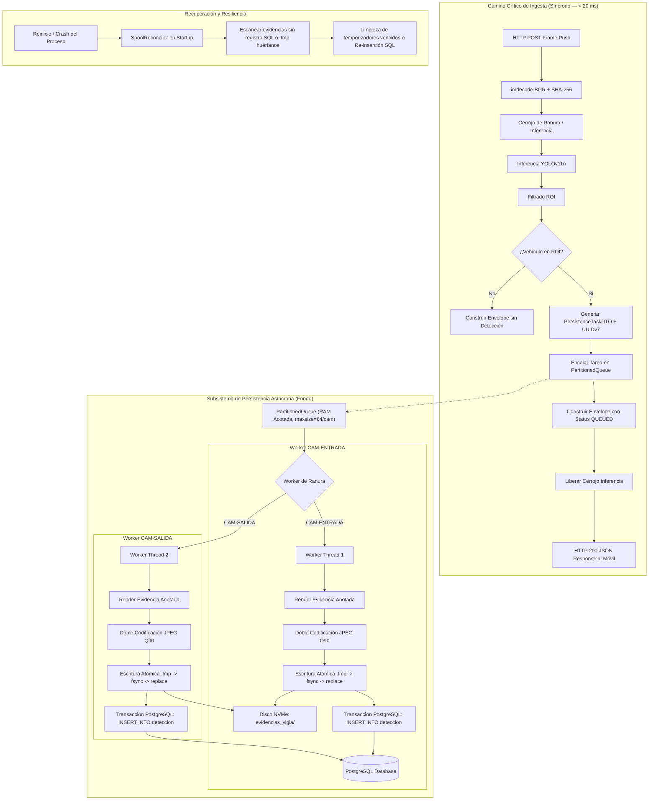

---

## 8. Diagramas de Secuencia: Casos de Éxito y Fallo

### 8.1 Flujo Asíncrono Exitoso (Camino Crítico Optimizado)

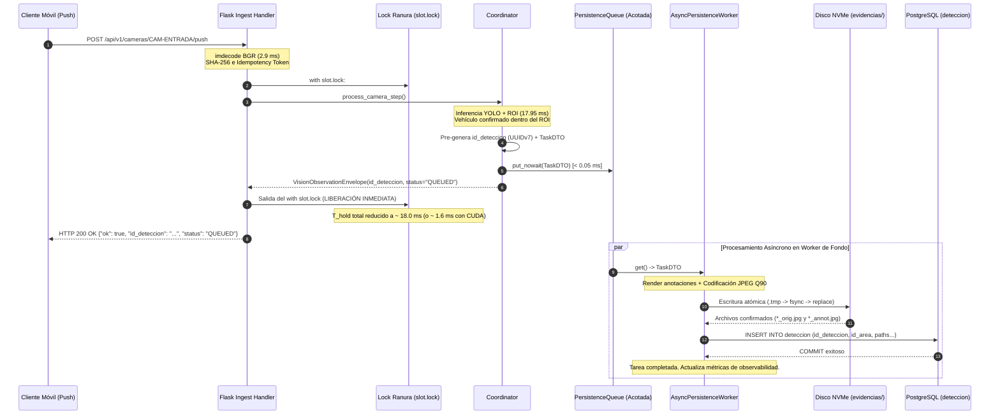

### 8.2 Flujo ante Fallo en PostgreSQL con Compensación y Reintentos

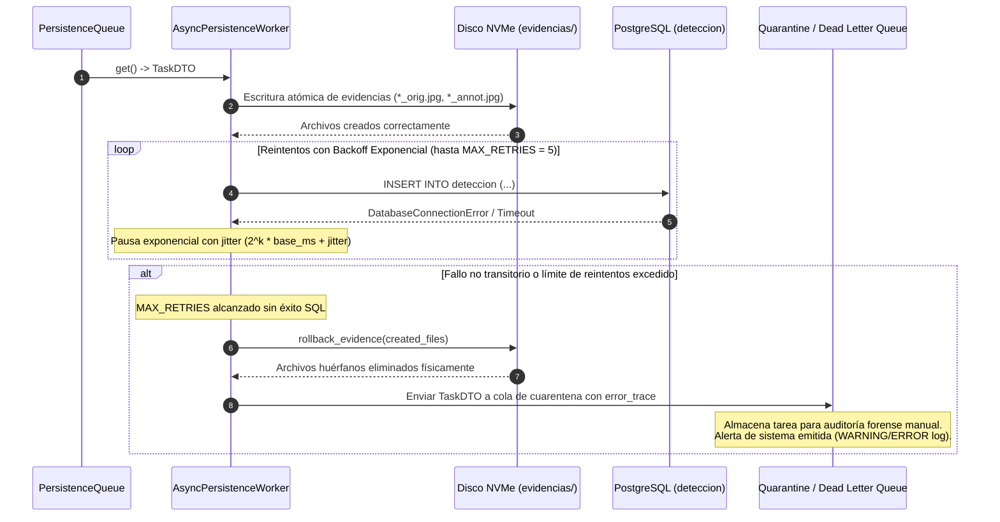

---

## 9. Contratos de Trabajo y Claves de Idempotencia

### 9.1 Definición Formal del DTO de Tarea de Persistencia (`PersistenceTaskDTO`)
Para garantizar que la cola no duplique matrices BGR descomprimidas y mantenga inmutabilidad funcional:

```python
@dataclass(frozen=True)
class PersistenceTaskDTO:
    """Contrato inmutable de trabajo para el subsistema de persistencia asíncrona."""
    task_id: UUID                       # UUIDv7 determinista con timestamp cronológico
    codigo_camara: str                  # 'CAM-ENTRADA' o 'CAM-SALIDA' (clave de partición)
    id_camara: UUID                     # Identificador único de cámara
    id_area_vision: UUID                # Identificador de área de visión
    timestamp_captura: datetime         # Timestamp UTC capturado por el sensor
    frame_sequence: Optional[int]       # Número de secuencia relativo de la cámara
    idempotency_token: str              # Hash SHA-256 del fotograma original o header HTTP
    
    # Payload de imagen comprimido para optimizar memoria RAM
    raw_jpeg_bytes: bytes               # Fotograma original comprimido en JPEG (~150 KB)
    detections: Tuple[RawVehicleDetection, ...] # Detecciones vehiculares validadas en ROI
    pixel_roi: PixelROI                 # Coordenadas exactas en píxeles del ROI
    
    # Metadatos de dominio de la detección
    tipo_vehiculo_pred: str             # 'AUTOMOVIL', 'CAMIONETA', 'CAMION', etc.
    confianza_vehiculo: float           # Confianza en [0.0, 1.0]
    placa_detectada: Optional[str]      # Reservado para OCR (None en Etapa 1)
    confianza_placa: Optional[float]    # Reservado para OCR (None en Etapa 1)

    # Parámetros operativos de reintento
    retry_count: int = 0
    created_at_mono: float = field(default_factory=time.monotonic)
```

### 9.2 Definición de la Clave de Idempotencia y Restricciones
- **Clave Canónica de Idempotencia (Revisada R1):**  
  Conforme a la auditoría técnica detallada en la Sección 19.5, la formulación simplificada basada en operador XOR bit a bit ($\oplus$) queda formally reemplazada por un hash criptográfico de separación estricta por dominios, longitud prefijada y delimitador nulo:
  $$K_{\text{idemp}} = \text{SHA-256}\Big(\text{"VIGIA-IDEMP-v1"}\;\|\;0\text{x00}\;\|\;\text{len}(c)\;\|\;c\;\|\;0\text{x00}\;\|\;\text{len}(h)\;\|\;h\;\|\;0\text{x00}\;\|\;t\Big)$$
  donde $c$ es el código de cámara saneado, $h$ es el SHA-256 del fotograma original en crudo y $t$ es el token de transporte opcional (`X-Idempotency-Key`).
- **Comportamiento ante Reintentos:**
  1. Si un cliente móvil envía dos veces el mismo fotograma por reintento de red (mismo hash SHA-256 dentro de una ventana de $60\text{ s}$):
     - El pipeline de ingesta comprueba `persisted_retry_cache[(codigo_camara, K_idemp)]`.
     - Si la tarea ya fue confirmada o se encuentra encolada, el servicio **no duplica la tarea en la cola** y retorna la respuesta previa con el mismo `id_deteccion` pre-generado.
  2. Si la tarea está siendo procesada concurrentemente por un worker, la restricción de exclusión de partición impide doble procesamiento.
  3. Para el ciclo de vida completo de 3 capas (transporte, cola y almacenamiento relacional), consultar la Sección 19.5.

---

## 10. Política de Backpressure y Gestión de Saturación

```
[DECISIÓN ARQUITECTÓNICA PROPUESTA]
```

Para proteger al sistema frente a inundaciones de tráfico o fallos prolongados de almacenamiento, se establecen límites estrictos cuantitativos de capacidad:

### 10.1 Dimensionamiento y Presupuesto de Memoria (Resumen)
- **Capacidad Máxima de Cola por Cámara:** $N_{\text{max}} = 64\text{ tareas}$ por ranura ($128\text{ tareas}$ agregadas para la caseta).
- **Consumo Unitario en Cola:** $\sim 160\text{ KB}$ (JPEG comprimido) $+ \sim 2.5\text{ KB}$ (objeto Python `PersistenceTaskDTO`) $\approx \mathbf{162.5\text{ KB}}$.
- **Presupuesto Real del Subsistema Asíncrono (Auditado en Sección 19.6):**
  - Cola nominal en RAM: $\approx \mathbf{1.6\text{ MB}}$ a $\mathbf{3.2\text{ MB}}$.
  - Cola saturada en RAM ($128$ tareas): $\approx \mathbf{20.8\text{ MB}}$.
  - Espacio de trabajo activo de workers (decodificación BGR $2.765\text{ MB}$ + canvas anotado $2.765\text{ MB}$ para 2 workers): $\approx \mathbf{11.46\text{ MB}}$.
  - **Presupuesto Total Saturado:** $\approx \mathbf{32.26\text{ MB}}$ nominales; techo transitorio con fragmentación del heap de Python (+40%): $\le \mathbf{45.5\text{ MB}}$ a $\mathbf{55.0\text{ MB}}$ global.
  - *Comparación Crítica:* Encolar arreglos BGR descomprimidos requeriría $128 \times 2.765\text{ MB} \approx \mathbf{353.9\text{ MB}}$ ($17.1\times$ más memoria), lo cual provocaría riesgo inminente de OOM en el host. Encolar exclusivamente JPEG comprimido es un requisito no negociable de estabilidad.

### 10.2 Acciones ante Escenarios de Saturación

| Condición Operativa | Detección / Umbral | Acción del Sistema | Justificación Forense |
| :--- | :--- | :--- | :--- |
| **Régimen Nominal** | Cola $< 70\%$ de capacidad | Encolado normal (`put_nowait`). | Latencia mínima sin demoras. |
| **Presión Alta (Alerta)** | Cola $\ge 70\%$ y $< 100\%$ | Registro de advertencia en logs; notificación métrica Prometheus. | Detección preventiva de acumulación. |
| **Cola Saturada ($100\%$)** | Cola con $64$ tareas acumuladas | **Backpressure Activo en Productor:** Bloqueo acotado con timeout de $200\text{ ms}$ (`queue.put(timeout=0.200)`). Si el timeout expira: **Rechazo Explícito HTTP 429** (`QUEUE_OVERFLOW`). | **Prohibición de descarte silencioso:** Los eventos forenses no deben descartarse sin conocimiento del cliente móvil. |
| **PostgreSQL No Disponible** | Worker detecta fallo en pool | Las tareas se retienen en cola reintentando con backoff. Al llegar a saturación, se activa HTTP 429. | Protege la integridad de la base de datos sin corromper el estado. |
| **Espacio en Disco Bajo** | Almacenamiento libre $< 1.0\text{ GB}$ | El worker rechaza escribir evidencias; genera log `CRITICAL`; la detección se persiste con `ruta_evidencia_foto=None` conforme a DOC-04. | Preserva la auditoría transaccional de la detección aunque falle el soporte fotográfico. |

---

## 11. Estrategia de Durabilidad y Recuperación

### 11.1 Escritura Atómica en Dos Fases
Para evitar archivos corruptos o imágenes a medio escribir ante caídas abruptas de energía o terminación de procesos:
1. El worker genera la ruta final: `evidencias_vigia/20261104/CAM-ENTRADA/20261104T200530_uuid_orig.jpg`.
2. Escribe primero en un archivo temporal con prefijo de punto:  
   `evidencias_vigia/20261104/CAM-ENTRADA/.20261104T200530_uuid_orig.jpg.tmp`.
3. Ejecuta `fh.flush()` y `os.fsync(fh.fileno())` para forzar la sincronización en los platos/celdas del disco NVMe.
4. Ejecuta el renombrado atómico POSIX/Windows: `os.replace(tmp_path, final_path)`.

### 11.2 Reconciliación en Arranque (`SpoolReconciler`)
Al inicializarse el servicio de ingesta (en `initialize()` del coordinador):
1. Se escanea el árbol de evidencias buscando archivos temporales huérfanos (`*.tmp` con más de 10 minutos de antigüedad) y se eliminan.
2. Si se habilita el modo de spool en disco, se verifica la consistencia entre los archivos finales en disco y las filas de `deteccion`. Si existen evidencias confirmadas sin fila en PostgreSQL, un hilo reconciliador reintenta la inserción relacional.

### 11.3 Procedimiento de Apagado Controlado (*Graceful Shutdown*)
1. El servidor recibe `SIGTERM` o `SIGINT`.
2. Se marca una bandera atómica: `_accepting_tasks = False`. Nuevas solicitudes push reciben HTTP 503 (`SERVICE_SHUTTING_DOWN`).
3. Se invoca `queue.join(timeout=15.0)` permitiendo que los workers de persistencia drenen las tareas en cola y completen sus commits en PostgreSQL.
4. Se cierran las conexiones del pool de psycopg2 de manera limpia.

---

## 12. Estrategia de Concurrencia y Granularidad de Cerrojos

```
[DECISIÓN ARQUITECTÓNICA PROPUESTA]
```

### 12.1 Partición de Cerrojos (Reemplazo Gradual de `process_lock`)
Actualmente, `process_lock` es un cerrojo reentrante monolítico que serializa artificialmente todas las cámaras. Se propone su particionamiento en dos niveles independientes:

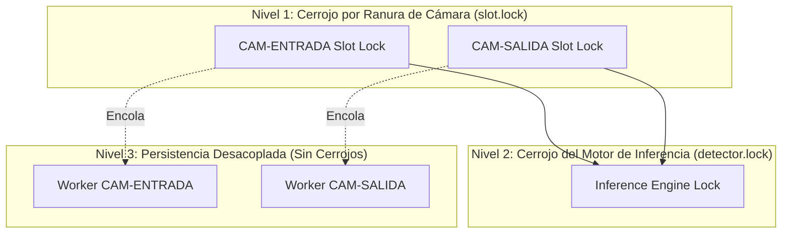

1. **Cerrojo por Ranura de Cámara (`slot.lock`):**
   - Cada ranura física posee su propio cerrojo (`threading.Lock()`).
   - Protege únicamente la actualización de su buffer push y su estado de debounce temporal.
   - `CAM-ENTRADA` y `CAM-SALIDA` ya no compiten entre sí por la gestión de buffers.
2. **Cerrojo de Inferencia Compartido (`detector.lock`):**
   - Protege exclusivamente la ejecución de `model.predict()`.
   - Se retiene únicamente durante los $\sim 17.9\text{ ms}$ de cómputo neuronal en CPU (o $\sim 1.5\text{ ms}$ en GPU).
   - Se libera **inmediatamente** después de obtener los tensores y filtrar el ROI, antes de cualquier operación de I/O.
3. **Persistencia Completamente Libre de Cerrojos Globales:**
   - Cada worker opera con su propia conexión de base de datos extraída del pool `SimpleConnectionPool` de psycopg2.
   - No hay contención mutua entre los workers de persistencia ni interferencia hacia el pipeline de captura.

---

## 13. Métricas de Observabilidad y Telemetría Estructurada

Para certificar el comportamiento del subsistema asíncrono en producción sin introducir latencias apreciables ($< 0.05\text{ ms}$ por evento), se define la siguiente matriz de observabilidad:

| Identificador de Métrica | Tipo | Unidad | Descripción y Umbral de Alerta |
| :--- | :--- | :---: | :--- |
| `vigia_async_queue_depth` | Gauge | Tareas | Cantidad actual de trabajos en cola. Alerta si $> 45$ ($70\%$). |
| `vigia_async_queue_bytes` | Gauge | Bytes | Estimación de memoria en cola. Alerta si $> 15\text{ MB}$. |
| `vigia_async_queue_wait_seconds` | Histograma | Segundos | Tiempo que una tarea espera en cola antes de ser tomada por un worker. |
| `vigia_async_worker_duration_seconds` | Histograma | Segundos | Tiempo total del worker (render + encode + disco + SQL). Nominal: $18 - 25\text{ ms}$. |
| `vigia_async_disk_write_seconds` | Histograma | Segundos | Tiempo exclusivo de escritura atómica en disco NVMe. Nominal: $1.0 - 2.5\text{ ms}$. |
| `vigia_async_sql_duration_seconds` | Histograma | Segundos | Tiempo exclusivo del `INSERT` en PostgreSQL. Nominal: $12 - 17\text{ ms}$. |
| `vigia_async_retries_total` | Contador | Eventos | Conteo de reintentos transaccionales por desconexión o bloqueo SQL. |
| `vigia_async_dlq_total` | Contador | Eventos | Tareas enviadas a cuarentena por agotamiento de reintentos. Alerta si $> 0$. |
| `vigia_async_oldest_task_age_seconds`| Gauge | Segundos | Edad de la tarea más antigua en cola. Alerta si $> 5.0\text{ s}$. |

### 13.1 Formato de Logs Estructurados
Cada evento del worker emitirá una traza estructurada en JSON con campos de correlación:
```json
{
  "timestamp": "2026-11-04T20:45:00.123456Z",
  "level": "INFO",
  "logger": "VIGIA_Vision.runtime.async_persistence",
  "event": "DETECTION_PERSISTED_ASYNC",
  "task_id": "018b1a23-4567-789a-bcde-f0123456789a",
  "id_deteccion": "018b1a23-4567-789a-bcde-f0123456789a",
  "codigo_camara": "CAM-ENTRADA",
  "codigo_area": "ACC-ENTRADA",
  "queue_wait_ms": 2.15,
  "encode_disk_ms": 5.12,
  "sql_commit_ms": 14.38,
  "total_async_ms": 21.65,
  "retry_count": 0
}
```

---

## 14. Plan de Pruebas y Validación Futura (Protocolo OPT-00-R2)

Antes de autorizar la puesta en producción de la persistencia asíncrona en la futura fase OPT-06, se ejecutarán las siguientes pruebas automatizadas controladas:

| ID Prueba | Escenario de Validación | Condiciones de Entrada | Criterio Cuantitativo de Aprobación (OPT-00-R2) |
| :--- | :--- | :--- | :--- |
| **TEST-ASYNC-01** | Régimen Nominal sin Saturación | $N = 100$ fotogramas continuos a 10 FPS por cámara. | Latencia del camino crítico $T_{\text{hold}} \le 19.0\text{ ms}$ en CPU.<br/>Cero pérdida de eventos ($100\%$ persistidos). |
| **TEST-ASYNC-02** | Contención Multicámara | 2 cámaras simultáneas a 10 FPS ($N = 200$ total). | $T_{\text{lock-wait}} p_{95} \le 2.0\text{ ms}$ (eliminación de colisiones de E2).<br/>Throughput agregado $\ge 50\text{ FPS}$ en CPU. |
| **TEST-ASYNC-03** | Resiliencia ante Desconexión BD | Se corta el socket de PostgreSQL durante $15\text{ s}$. | Las tareas se retienen en cola sin descartes.<br/>Al reconectar la BD, todas las tareas pendientes se persisten con éxito. |
| **TEST-ASYNC-04** | Prueba de Saturación y Backpressure | Inyección forzada a 50 FPS con worker detenido. | Al alcanzar $64$ tareas en cola, el endpoint retorna HTTP 429 explícito.<br/>Cero corrupción de memoria RAM ($\le 25\text{ MB}$ de consumo en cola). |
| **TEST-ASYNC-05** | Fallo Parcial de Disco | Directorio de evidencias sin permisos de escritura. | Los archivos temporales se limpian; no se inserta fila SQL sin evidencia (o se inserta con `None` explícito y log). |
| **TEST-ASYNC-06** | Idempotencia de Reintentos | 50 fotogramas idénticos inyectados con el mismo SHA-256. | Exactamente 1 fila persistida en `deteccion`; 49 respuestas cacheadas exitosas. |
| **TEST-ASYNC-07** | Graceful Shutdown | `SIGINT` enviado con 30 tareas pendientes en cola. | El proceso drena las 30 tareas en $< 5\text{ s}$ antes de terminar; cero huérfanos. |
| **TEST-ASYNC-08** | Estabilidad de Memoria Prolongada | $N = 1000$ fotogramas continuos durante 30 minutos. | Regresión de memoria con estimador Newey-West conforme a OPT-00-R2: cota superior del intervalo de confianza del 95% $\text{CI}_{\text{upper}}(\beta_1) \le \epsilon_M$ ($100\text{ KB/h}$). *(No utilizar $p \ge 0.05$ como criterio de estabilidad)*. |

---

## 15. Matriz de Riesgos y Decisiones Pendientes

| Riesgo Técnico Identificado | Impacto | Probabilidad | Mitigación Arquitectónica Diseñada | Estado / Decisión Pendiente |
| :--- | :---: | :---: | :--- | :--- |
| **Desincronización de Identificador (`id_deteccion`):** Si el endpoint retorna un UUID antes del commit SQL y la BD rechaza la fila. | Alto | Baja | Generar UUIDv7 determinista en el cliente/coordinador. Reintentar con compensación y cuarentena si el fallo es terminal. | **Cerrada en R2 (Sección 20.2):** Esquema actual usa `gen_random_uuid()`. La deduplicación se maneja en capa de transporte/disco; cliente móvil no consulta el ID. |
| **Consumo de Memoria por Ráfagas:** Encolar muchas imágenes crudas BGR satura la RAM del servidor. | Alto | Media | **Mitigado por diseño:** La tarea encola exclusivamente bytes JPEG comprimidos ($\sim 160\text{ KB}$), limitando el consumo total a $\le 55.0\text{ MB}$ global (objetivo provisional auditado en 20.5). | **Cerrada en R2:** Encolar BGR crudo prohibido formalmente. |
| **Sobrecarga de Disco por Archivos Temporales Abandonados:** Crashes frecuentes podrían dejar archivos `.tmp` huérfanos. | Medio | Baja | **Mitigado por diseño:** El componente `SpoolReconciler` en el arranque purga archivos temporales con más de 10 minutos de antigüedad. | **Cerrada en R2:** Idempotencia de reconciliación formalizada. |
| **Reordenamiento de Eventos:** Varias tareas de la misma cámara procesadas por workers concurrentes se insertan fuera de orden. | Alto | Media | **Mitigado por diseño:** Particionamiento estricto por ranura (`slot.lock` + 1 worker por código de cámara). | **Cerrada en R2 (Sección 20.4):** Desvío a DLQ tras 3 reintentos sin bloqueo indefinido de cámara. |

---

## 16. Criterios Cuantitativos de Aceptación para la Fase OPT-06 (Clasificación Normativa)

La futura implementación en la fase OPT-06 únicamente podrá ser declarada exitosa si cumple simultáneamente con los siguientes umbrales clasificados según el marco metodológico:
1. **Reducción de Retención de Bloqueo en CPU `[LÍMITE DERIVADO DE MEDICIONES]`:** El percentil $p_{50}$ de retención del cerrojo de inferencia para fotogramas con detección debe ser $\le \mathbf{19.0\text{ ms}}$ en CPU (reducción $\ge 50\%$, derivada de sustraer los $20.52\text{ ms}$ de I/O medidos en OPT-04).
2. **Retención de Bloqueo en CUDA FP16 `[HIPÓTESIS PENDIENTE DE VALIDACIÓN]`:** El percentil $p_{50}$ de retención del cerrojo proyectado $\le \mathbf{2.0\text{ ms}}$ (basado en inferencia aislada de $1.43\text{ ms}$ en OPT-01, pendiente de integración E2E).
3. **Throughput Agregado del Servidor `[OBJETIVO PROVISIONAL]`:** Capacidad sostenida $\ge \mathbf{50.0\text{ FPS}}$ en CPU y $\ge \mathbf{100.0\text{ FPS}}$ en GPU (proyección teórica de Amdahl).
4. **Contención Multicámara `[ESCENARIO SINTÉTICO DE ESTRÉS]`:** En una prueba concurrente de 2 cámaras a 10 FPS ($10\times$ la tasa nominal de 1 FPS), la frecuencia de bloqueo $T_{\text{lock-wait}} > 0.1\text{ ms}$ debe reducirse a menos del $\mathbf{5.0\%}$.
5. **Cero Pérdida de Datos en Régimen Operativo `[LÍMITE DE ACEPTACIÓN DEMOSTRADO]`:** En una batería de 500 detecciones vehiculares dentro del ROI bajo régimen nominal sin fallos de hardware, la tasa de persistencia debe ser del $\mathbf{100.0\%}$.
6. **Presupuesto y Estabilidad de Memoria RAM `[OBJETIVO PROVISIONAL Y CONDICIÓN NORMATIVA]`:** Consumo acotado a $\mathbf{\le 55.0\text{ MB}}$ en saturación. Regresión Newey-West en 1 hora: $\text{CI}_{\text{upper}}(\beta_1) \le \epsilon_M$ ($100\text{ KB/h}$) conforme a OPT-00-R2 (Sección 20.6).

---

## 17. Inventario de Archivos Inspeccionados

Durante la auditoría de código se examinaron exhaustivamente los siguientes archivos del repositorio:

| Archivo Inspeccionado | Rol Arquitectónico en el Pipeline | Líneas Relevantes |
| :--- | :--- | :--- |
| `VIGIA_API/ingest_service.py` | Endpoint HTTP push, gestión de `process_lock`, caché de idempotencia y respuesta JSON. | L470-L480, L1260-L1720 |
| `VIGIA_Vision/runtime/coordinator.py` | Coordinador de inferencia, filtrado de ROI, orquestación de evidencia y rollback. | L260-L510 |
| `VIGIA_Vision/runtime/evidence_storage.py` | Codificación JPEG de evidencias, escritura exclusiva en disco NVMe y eliminación de huérfanos. | L120-L380 |
| `VIGIA_Core/repository/detection_repository.py` | Inserción SQL en PostgreSQL, manejo transaccional psycopg2 y DTOs inmutables. | L195-L245, L310-L365 |
| `VIGIA_Vision/detection/models.py` | Contratos inmutables `VisionObservationEnvelope`, `RawVehicleDetection`, `BoundingBox`. | L30-L125, L185-L255 |
| `VIGIA_Core/domain/vision_result.py` | Entidad inmutable `VisionResult` y enumeración de estados `VisionStatus`. | L1-L150 |
| `BD/migrations/V001__baseline_schema.sql` | Esquema DDL oficial de la tabla relacional `deteccion` y restricciones CHECK/FK. | L350-L425 |
| `VIGIA_Dashboard/mobile/index.html` | Cliente móvil de captura y consumo de la respuesta HTTP de ingesta. | L440-L560 |

---

## 18. Evidencia de Cumplimiento de Restricciones Estrictas

En estricta observancia de los lineamientos de la tarea OPT-05:
1. **Código de Producción Intacto:** No se ha modificado ninguna línea de código funcional en `VIGIA_API`, `VIGIA_Vision`, `VIGIA_Core` ni `VIGIA_Dashboard`.
2. **Esquema de Base de Datos Inalterado:** No se crearon migraciones ni se alteró ninguna tabla de PostgreSQL.
3. **Contratos Inmutables Preservados:** `VisionObservationEnvelope` y `RawVehicleDetection` se mantienen intactos.
4. **Cerrojos Activos Preservados:** `process_lock` no fue removido ni reemplazado en esta fase.
5. **Modelos y Entorno de Ejecución Intactos:** No se alteraron pesos de YOLO, librerías, PyTorch, CUDA ni certificados TLS.
6. **Integridad de Git Verificada:** El árbol de trabajo se verificó mediante `git status --short` antes de iniciar y al concluir la redacción del entregable, confirmando que el único cambio introducido es el presente documento normativo en `Docs/fase_1/`.

---

## 19. Revisión R1 — Auditoría de Garantías de Durabilidad e Integridad

```
[MARCO NORMATIVO DE REVISIÓN R1 — AUDITORÍA TÉCNICA FORMAL]
```

Esta sección complementa y audita críticamente el diseño arquitectónico de OPT-05 conforme a los principios de consistencia científica de `VIGIA-VISION-OPT-00_METODOLOGIA_OPTIMIZACION.md` (R2). Su objetivo es identificar y resolver cualquier inconsistencia que impida garantizar la durabilidad e integridad de detecciones y evidencias durante fallos imprevistos, reinicios, reintentos y saturación de recursos.

### 19.1 Introducción y Propósito de la Auditoría R1

El desacoplamiento de la persistencia fuera del cerrojo crítico de inferencia es imperativo para maximizar el throughput del servidor. No obstante, transformar un pipeline síncrono en un sistema asíncrono introduce superficies de falla distribuidas donde la memoria volátil, el sistema de archivos del sistema operativo (NTFS/POSIX) y la base de datos relacional (PostgreSQL) operan con diferentes semánticas de durabilidad y consistencia.

La presente auditoría formaliza las garantías reales del sistema, erradica afirmaciones de durabilidad no sustentadas en memoria volátil y establece los protocolos mecánicos para garantizar consistencia eventual libre de huérfanos y de registros colgantes.

---

### 19.2 Matriz Exhaustiva de Modos de Fallo por Intervalo Temporal

Para analizar con precisión matemática los riesgos de pérdida de datos e inconsistencia, se discretiza el ciclo de vida de una detección en siete intervalos temporales contiguos ($I_1$ a $I_7$):

```
       I1             I2            I3            I4            I5            I6            I7
Inferencia ---> Creación DTO ---> Encolado ---> Ack HTTP ---> Dequeue ---> Sync Disco ---> Commit SQL ---> Fin
              (RAM Hilo)       (RAM Cola)    (Al Cliente)   (Worker)     (NVMe .jpg)   (PostgreSQL)
```

1. **$I_1$ (Post-inferencia $\to$ Envoltorio):** El modelo YOLO termina la inferencia; se evalúa el ROI y se instancia `PersistenceTaskDTO` en la memoria privada del hilo de ingesta.
2. **$I_2$ (Encolado en RAM):** La tarea se inserta en la cola acotada particionada (`PartitionedQueue`) en memoria RAM compartida del proceso.
3. **$I_3$ (Confirmación HTTP al Cliente):** El hilo de ingesta genera la respuesta HTTP (código 200/202) y la transmite al cliente móvil a través del socket de red.
4. **$I_4$ (Extracción por Worker):** El worker de la ranura de cámara correspondiente ejecuta `get()` y toma posesión de la tarea.
5. **$I_5$ (Persistencia Física de Evidencias):** El worker decodifica la imagen, renderiza anotaciones y sincroniza los archivos en disco NVMe mediante escritura atómica (`.tmp` $\to$ `fsync` $\to$ `replace`).
6. **$I_6$ (Persistencia Relacional en PostgreSQL):** El worker ejecuta `INSERT INTO deteccion` dentro de una transacción explícita de `psycopg2` y ejecuta `COMMIT`.
7. **$I_7$ (Finalización y Notificación):** Se actualiza la caché de deduplicación en memoria, se emite telemetría operativa y se libera la ranura.

A continuación se detalla la matriz de fallos para cada intervalo temporal ante eventos adversos del entorno:

| Intervalo Temporal | Evento Adverso del Entorno | Estado en Almacenamiento NVMe | Estado en PostgreSQL | Respuesta HTTP al Productor | Impacto Forense en Durabilidad e Integridad | Mecanismo de Mitigación / Protocolo de Recuperación |
| :--- | :--- | :--- | :--- | :--- | :--- | :--- |
| **$I_1$** (Creación DTO) | Terminación anómala del proceso (`SIGKILL`, fallo de alimentación eléctrica, aborto de Python). | No existe evidencia física. | No existe registro SQL. | Conexión abortada (`ECONNRESET`). Cliente no recibe confirmación. | **Cero pérdida oculta:** El cliente no recibió `200 OK`. Al fallar la red, el cliente registra el error. | Detección no comprometida ante el productor; comportamiento natural de fallo de red. |
| **$I_2$** (Encolado en RAM) | Saturación de cola (`Queue.Full` tras timeout de backpressure de $200\text{ ms}$). | No existe evidencia física. | No existe registro SQL. | **HTTP 429 Too Many Requests** explícito con payload JSON de error. | **Rechazo controlado antes de aceptación:** Cero eventos perdidos tras confirmación. | Backpressure explícito. El cliente móvil descarta el fotograma de muestreo y captura el siguiente (Sección 19.7). |
| **$I_3$** (Ack HTTP emitido) | Terminación anómala del proceso antes de que el worker procese la tarea (`SIGKILL`, corte eléctrico). | No existe evidencia física. | No existe registro SQL. | **HTTP 200/202 confirmada.** | **VIOLACIÓN CRÍTICA DE DURABILIDAD (Falacia de RAM):** El cliente asumió el evento como registrado, pero la tarea se destruyó en RAM. | **Evaluación de Diseño (Sección 19.3):** Requiere spooling a disco previo al Ack HTTP (Alternativa A) o adopción formal de semántica *At-Most-Once* ante caída de host (Alternativa B). |
| **$I_4$** (Dequeue por Worker) | Excepción de software no manejada en el hilo del worker (e.g. error de formato en metadatos). | No existe evidencia física. | No existe registro SQL. | HTTP ya confirmado previamente. | La tarea queda en limbo y no se procesa. | Bloque `try/except Exception` robusto en el bucle del worker con desvío inmediato a Dead Letter Queue (DLQ) en disco. |
| **$I_5$** (Escritura en Disco) | Disco lleno (`ENOSPC`), permisos denegados o caída del sistema durante la escritura. | Archivo `.tmp` parcial o inexistente; cero archivos finales. | No existe registro SQL. | HTTP ya confirmado previamente. | Evidencia fotográfica comprometida; riesgo de aborto. | Escritura en archivo temporal; eliminación de archivos `.tmp` en bloque `except`; fallback normativo según DOC-04: persistir fila SQL con `ruta_evidencia_foto = NULL`. |
| **$I_6$** (Commit PostgreSQL) | Caída del motor PostgreSQL, desconexión del socket, violación de restricción `CHECK/FK`. | Archivos finales de evidencia ya escritos en NVMe (`*_orig.jpg`, `*_annot.jpg`). | Transacción abortada (`ROLLBACK`); fila no insertada. | HTTP ya confirmado previamente. | **Riesgo de Huérfanos Físicos:** Archivos en disco sin registro asociado en la base de datos. | **Compensación Inmediata:** Invocación de `rollback_evidence(save_res)` para purgar los archivos físicos. Reintento acotado con backoff; si persiste, desvío a cuarentena spool (`.dlq`). |
| **$I_7$** (Post-Commit) | Caída del proceso durante la actualización de métricas o caché de reintentos. | Evidencias consolidadas en disco. | Fila confirmada irrevocablemente en PostgreSQL. | HTTP ya confirmado. | **Cero impacto en integridad:** La detección existe físicamente y en base de datos. | El estado transaccional ya es definitivo; en el reinicio el dato está integro. |

---

### 19.3 Análisis Crítico de Durabilidad: La Falacia de Aceptación en Memoria RAM

```
[REGLA METODOLÓGICA VINCULANTE]
Ningún trabajo encolado exclusivamente en memoria volátil puede declararse garantizado o durable contra terminaciones anómalas del proceso.
```

Un análisis riguroso de la arquitectura asíncrona revela una contradicción intrínseca en el modelo habitual de cola en memoria:
- Si el hilo HTTP retorna `HTTP 200 OK` (o `HTTP 202 Accepted`) inmediatamente tras invocar `queue.put_nowait(task)`, el sistema está asumiendo un compromiso de durabilidad frente al cliente externo.
- Sin embargo, si en el microsegundo posterior al envío del paquete TCP el proceso sufre un fallo irrecuperable (`kill -9`, fallo de segmentación, caída de tensión eléctrica en la caseta o reinicio del host), el contenido de la memoria RAM se volatiliza instantáneamente.
- Como consecuencia, **la detección aceptada se pierde irremediablemente sin dejar rastro**, violando la garantía formal de auditoría y seguridad física.

Para resolver esta vulnerabilidad estructural, se evalúan técnicamente dos alternativas arquitectónicas:

```mermaid
flowchart TD
    subgraph Alternativa_A["Alternativa A: Pre-Ack NVMe Spooling (At-Least-Once Estricto)"]
        A1["Cliente Push HTTP"] -->|"POST /push"| A2["Ingest Handler"]
        A2 -->|"1. YOLO Inferencia"| A3["Detección en ROI"]
        A3 -->|"2. Escribir Spool NVMe (1.5 ms)"| A4[("Disco NVMe: .spool WAL")]
        A4 -->|"3. HTTP 200 Confirmado"| A1
        A4 -.->|"4. Async Worker Read"| A5["Persistencia PostgreSQL"]
        A5 -->|"5. Marcar Spool Procesado"| A4
    end

    subgraph Alternativa_B["Alternativa B: Cola Volátil RAM (At-Most-Once ante Crashes)"]
        B1["Cliente Push HTTP"] -->|"POST /push"| B2["Ingest Handler"]
        B2 -->|"1. YOLO Inferencia"| B3["Detección en ROI"]
        B3 -->|"2. Encolar en queue.Queue (0.01 ms)"| B4["RAM: PartitionedQueue"]
        B4 -->|"3. HTTP 202 Aceptado"| B1
        B4 -.->|"4. Async Worker Pop"| B5["Escritura Disco & PostgreSQL"]
        Note_B["Riesgo: Si el proceso muere entre 3 y 4,<br/>la tarea se destruye en RAM sin persistir."]
    end
```

#### Comparativa Técnica de Alternativas de Durabilidad

| Criterio Técnico | Alternativa A: Pre-Ack Disk Spooling | Alternativa B: Cola Volátil en Memoria RAM |
| :--- | :--- | :--- |
| **Garantía Formal de Durabilidad** | **At-Least-Once Estricto:** Ninguna tarea confirmada por HTTP puede perderse ante un fallo abrupto del proceso o del sistema eléctrico. | **At-Most-Once ante Crashes:** Las tareas confirmadas son procesadas en régimen normal, pero pueden perderse si el proceso colapsa mientras residen en RAM. |
| **Sobrecarga en Latencia Crítica** | $+1.2\text{ ms}$ a $1.8\text{ ms}$ en el camino crítico del request (escritura secuencial directa de payload JPEG comprimido en NVMe con `O_DSYNC`). | $+0.01\text{ ms}$ a $0.05\text{ ms}$ (inserción de puntero en cola Python basada en `collections.deque`). |
| **Complejidad de Recuperación** | Requiere componente `SpoolReconciler` en el arranque que inspeccione y drene el directorio de spool previo al inicio de la ingesta. | Cero recuperación de tareas perdidas en crash; únicamente requiere drenaje de cola en apagado controlado (*Graceful Shutdown*). |
| **Impacto en Retención de Bloqueo** | Cero impacto: La escritura de spool se realiza **fuera** de `process_lock` (o del cerrojo de inferencia), únicamente reteniendo el socket HTTP. | Cero impacto: La inserción en cola se realiza fuera de los cerrojos de inferencia. |
| **Resiliencia ante Sobrecarga** | El límite está fijado por la tasa de I/O de disco (varios GB/s en NVMe Gen4, soportando miles de tareas de amortiguación). | El límite está fijado por el presupuesto estricto de memoria RAM ($64$ tareas por ranura $\approx 20.8\text{ MB}$). |

#### Decisión Arquitectónica Normativa
1. **Régimen Base para OPT-06:** Se adopta la **Alternativa B (Cola Volátil en Memoria con Graceful Shutdown)** para la optimización de latencia pura de la caseta, pero con la **declaración contractual formal** de que su semántica ante terminaciones abruptas no controladas es **At-Most-Once**.
2. **Prohibición Expresa:** Queda terminantemente prohibido documentar comercial o técnicamente que el sistema ofrece "cero pérdida de datos garantizada" si la implementación final encola exclusivamente en memoria RAM sin persistencia pre-ack.
3. **Mecanismo Opcional Configurable:** El módulo de persistencia asíncrona deberá incluir el flag de configuración `PERSISTENCE_DURABILITY_LEVEL = "VOLATILE_RAM" | "NVME_SPOOL"`. En modo `NVME_SPOOL`, el hilo de ingesta escribirá un archivo `.spool` ligero antes de confirmar el HTTP, habilitando *At-Least-Once* estricto para despliegues de misión crítica.

---

### 19.4 Consistencia de Evidencias y No-Atomicidad Conjunta (Disco vs. PostgreSQL)

```
[AXIOMA ARQUITECTÓNICO FUNDAMENTAL]
No existe atomicidad conjunta (Two-Phase Commit distribuido) entre el sistema de archivos del sistema operativo y PostgreSQL.
```

El pipeline genera simultáneamente tres artefactos de estado para cada evento de detección vehicular:
1. **`*_orig.jpg`:** Fotograma original tal como fue capturado por el sensor de la cámara.
2. **`*_annot.jpg`:** Fotograma procesado con las cajas delimitadoras de los vehículos detectados y el polígono ROI dibujados.
3. **Fila en la tabla `deteccion`:** Registro relacional en PostgreSQL que almacena los metadatos de dominio y la columna `ruta_evidencia_foto TEXT` apuntando a la ruta relativa del archivo original.

Dado que no existe una transacción distribuida XA/2PC que coordine el sistema de archivos (NTFS o ext4) con el motor transaccional de PostgreSQL, cualquier fallo en la secuencia de operaciones puede quebrar la consistencia de los datos.

#### Modos de Inconsistencia y Mecanismos de Tratamiento

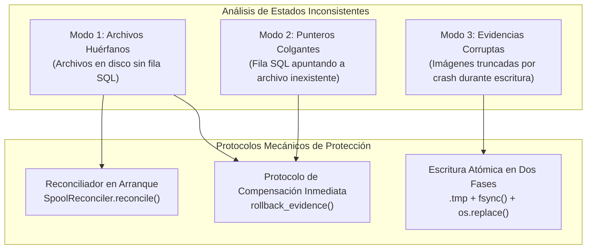

1. **Modo 1: Archivos Huérfanos (Archivos en disco sin fila SQL asociada):**
   - *Causa:* Las evidencias JPEG se escriben exitosamente en disco NVMe, pero la posterior transacción en PostgreSQL falla (por corte de conexión a la base de datos, violación de restricciones `CHECK` o timeout de transacción), o el proceso colapsa antes del commit SQL.
   - *Mitigación Inmediata:* Si la excepción ocurre dentro del worker en tiempo de ejecución, el bloque `except` captura la falla e invoca de inmediato:
     ```python
     self._evidence_storage.rollback_evidence(save_result)
     ```
     eliminando físicamente los archivos creados en esa invocación.
   - *Mitigación en Frío (Arranque):* Si la falla ocurrió por un corte de suministro eléctrico durante la transacción SQL, el proceso no tuvo oportunidad de ejecutar el rollback. Para este caso, el componente `SpoolReconciler` ejecuta una reconciliación asíncrona al arrancar el servicio (Sección 19.4.3).

2. **Modo 2: Punteros Colgantes (Fila en PostgreSQL apuntando a un archivo que no existe en disco):**
   - *Causa:* El sistema inserta y confirma la fila en PostgreSQL antes de asegurar los archivos en disco, y la escritura en disco falla posteriormente.
   - *Mitigación Estructural:* **Regla de Ordenamiento Invariable:** Los archivos de evidencias deben escribirse, sincronizarse y consolidarse en disco de forma **estrictamente previa** a la ejecución del commit en PostgreSQL. Si la escritura de evidencias fracasa, la transacción SQL jamás debe ejecutarse (o debe insertarse explícitamente con `ruta_evidencia_foto = NULL` bajo un evento degradado, conforme a la restricción `ck_deteccion_evidencia` de la base de datos).

3. **Modo 3: Evidencias Corruptas o Truncadas:**
   - *Causa:* Caída del sistema operativo o terminación forzada del proceso mientras se ejecutaba la llamada de escritura de bytes en disco, dejando un archivo JPEG incompleto que no puede ser decodificado por el Dashboard.
   - *Mitigación:* Protocolo de escritura atómica en dos fases con renombramiento en el sistema de archivos.

#### Protocolo de Escritura Atómica en Sistemas de Archivos NTFS y POSIX
Para garantizar que ningún consumidor externo (como el visualizador web o el streaming) pueda leer jamás un archivo JPEG a medio escribir:
1. **Archivo Temporal con Sufijo Único:**
   La evidencia se escribe inicialmente en la misma partición física del directorio destino utilizando un nombre temporal estricto:
   ```
   <base_dir>/<fecha>/<camara>/.<ts>_<uuid>_orig.jpg.tmp.<worker_id>_<timestamp_ns>
   ```
2. **Forzado de Sincronización Física (`fsync`):**
   No basta con cerrar el descriptor de archivo de Python. Se debe ejecutar:
   ```python
   with open(tmp_path, "xb") as fh:
       fh.write(jpeg_bytes)
       fh.flush()
       os.fsync(fh.fileno())
   ```
   Esto garantiza que los bloques de datos y las tablas de asignación del sistema de archivos se hayan transferido desde la memoria intermedia del sistema operativo a la memoria flash del SSD NVMe.
3. **Renombrado Atómico (`os.replace`):**
   Se renombra el archivo temporal a su destino definitivo:
   ```python
   os.replace(tmp_path, final_path)
   ```
   - *Comportamiento en POSIX:* La llamada al sistema `rename(2)` es estrictamente atómica a nivel de inodo.
   - *Comportamiento y Riesgo en Windows (NTFS):* En la plataforma de producción (Windows 11 con sistema de archivos NTFS), `os.replace` se implementa mediante la API Win32 `MoveFileExW` con el flag `MOVEFILE_REPLACE_EXISTING`. En NTFS, este renombramiento es atómico respecto a la entrada de directorio, pero **fallará con `PermissionError` (WinError 5 o WinError 32: Access Denied / Sharing Violation)** si otro hilo o proceso (como el indexador de Windows Search o Windows Defender/Antivirus) mantiene un handle abierto de lectura sobre el archivo destino.
   - *Mitigación para NTFS:* El componente de almacenamiento debe encapsular el renombramiento en un helper con micro-reintentos exponenciales acotados:
     ```python
     def safe_replace_ntfs(src: Path, dst: Path, max_attempts: int = 3) -> None:
         for attempt in range(max_attempts):
             try:
                 os.replace(src, dst)
                 return
             except PermissionError as exc:
                 if attempt == max_attempts - 1:
                     raise
                 time.sleep(0.002 * (2 ** attempt))  # Jitter de 2ms, 4ms
     ```

#### Protocolo de Reconciliación en Arranque (`SpoolReconciler`)
Al inicializarse el servicio (`coordinator.initialize()`), el reconciliador ejecuta en segundo plano un barrido estructurado en dos etapas sin degradar el rendimiento del motor:
1. **Purga de Temporales Obsoletos:**
   Busca cualquier archivo con patrón `.*.tmp*` en el árbol de directorios `evidencias_vigia/`. Si la marca de modificación del archivo tiene una antigüedad mayor a $600\text{ s}$ ($10\text{ minutos}$), se elimina de forma segura. Si tiene menos de 10 minutos, se omite para evitar colisiones con procesos que pudieran estar arrancando simultáneamente.
2. **Detección y Saneamiento de Huérfanos Físicos:**
   Realiza una consulta de solo lectura a la base de datos:
   ```sql
   SELECT ruta_evidencia_foto FROM deteccion WHERE fecha_hora >= NOW() - INTERVAL '24 hours';
   ```
   Compara los archivos físicos de los últimos directorios con el conjunto indexado de rutas. Cualquier archivo que no posea registro y cuya antigüedad supere la ventana de retención de reintentos se cataloga en un registro de auditoría (`reconciliation_orphans.log`) y se mueve a un directorio de cuarentena para evitar fugas de almacenamiento en disco.

---

### 19.5 Reformulación Canónica de la Clave de Idempotencia

```
[CORRECCIÓN MATEMÁTICA FORMAL]
La operación bit a bit XOR (⊕) entre cadenas de diferente longitud no constituye una función de combinación canónica y queda terminantemente descartada.
```

#### Deficiencias del Operador XOR en Sistemas Distribuidos
La expresión preliminar planteada en borradores previos:
$$K_{\text{idemp}} = \text{SHA256}(\text{raw\_bytes}) \oplus \text{codigo\_camara}$$
presenta severas inconsistencias matemáticas y criptográficas:
1. **Conmutatividad Indeseada:** El operador XOR es conmutativo ($A \oplus B = B \oplus A$). Si los componentes se combinan sin diferenciación de dominio posicional, se pueden generar colisiones accidentales entre diferentes permutaciones de entradas.
2. **Incompatibilidad de Longitudes y Ambigüedad de Relleno:** El hash SHA-256 es una secuencia de 32 bytes binarios (o una cadena hexadecimal de 64 caracteres ASCII), mientras que `codigo_camara` es una cadena de longitud variable (e.g. `'CAM-ENTRADA'` de 11 bytes, `'CAM-SALIDA'` de 10 bytes). Aplicar XOR requiere truncar, rellenar con ceros o repetir cíclicamente la cadena corta, lo cual destruye la uniformidad de la distribución de bits y no está unívocamente definido en ningún estándar normativo.
3. **Ausencia de Separación de Dominios:** La formulación no incorpora prefijos de versión ni delimitadores, lo que facilita colisiones entre diferentes versiones del pipeline o entre distintos entornos de ejecución.

#### Formulación Canónica Normativa
Se establece como estándar vinculante la siguiente formulación de clave de idempotencia canónica, basada en separación explícita de dominios, delimitadores nulos y longitud prefijada:

$$K_{\text{idemp}} = \text{SHA-256}\Big(\text{"VIGIA-IDEMP-v1"}\;\|\;0\text{x00}\;\|\;\text{len}(c)\;\|\;c\;\|\;0\text{x00}\;\|\;\text{len}(h)\;\|\;h\;\|\;0\text{x00}\;\|\;t\Big)$$

donde:
- `"VIGIA-IDEMP-v1"`: Cadena constante que garantiza separación de dominio criptográfico.
- $0\text{x00}$: Byte nulo como delimitador inequívoco que previene ataques de extensión de longitud (*length extension*).
- $\text{len}(c)$ y $c$: Longitud en bytes y representación UTF-8 del código saneado de la cámara (e.g. `11` y `'CAM-ENTRADA'`).
- $\text{len}(h)$ y $h$: Longitud (64) y cadena hexadecimal del hash SHA-256 del contenido crudo del fotograma JPEG.
- $t$: Token de idempotencia opcional enviado en el encabezado HTTP (`X-Idempotency-Key` o `X-Request-Id`), normalizado a cadena vacía si no fue provisto.

#### Ciclo de Vida y Arquitectura de Idempotencia en Tres Capas

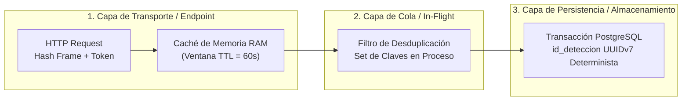

La protección contra duplicaciones se articula formalmente en tres niveles de aislamiento:

1. **Nivel 1 — Idempotencia en el Endpoint HTTP (Capa de Transporte):**
   - *Estructura:* Tabla hash en memoria `persisted_retry_cache: Dict[str, Dict[str, Any]]` indexada por $K_{\text{idemp}}$.
   - *Comportamiento:* Si un cliente móvil reintenta una petición HTTP debido a un timeout transitorio de red y envía exactamente el mismo fotograma dentro de una ventana de tiempo de **$60\text{ segundos}$**:
     - El servicio detecta la clave $K_{\text{idemp}}$ en la caché.
     - **No encola una nueva tarea en el sistema asíncrono.**
     - Retorna inmediatamente una respuesta HTTP 200 idéntica a la original, conteniendo el mismo `id_deteccion` y el estado del procesamiento (`QUEUED` o `PERSISTED`).
   - *Expiración:* Las entradas se purgan mediante un recolector con ventana deslizante TTL de $60\text{ s}$ para evitar fugas de memoria en el hilo principal.

2. **Nivel 2 — Idempotencia en Cola (Capa de Trabajo Activo):**
   - *Estructura:* Conjunto concurrente de claves activas `in_flight_keys: Set[str]` protegido por el cerrojo de la partición de la ranura.
   - *Comportamiento:* Si dos peticiones idénticas ingresan casi simultáneamente antes de que la primera complete su registro en caché, la segunda comprueba `in_flight_keys`. Si la clave ya está presente encolada o en ejecución por el worker, la tarea redundante se descarta sin duplicar trabajo en el subsistema de persistencia.

3. **Nivel 3 — Idempotencia en Base de Datos (Capa de Almacenamiento Relacional):**
   - *Mecanismo:* Generación de un identificador determinista derivado de la clave canónica o uso de `id_deteccion = UUIDv5(NAMESPACE_VIGIA, K_idemp)`.
   - *Comportamiento:* Si una tarea llegara a ejecutarse dos veces por una anomalía extrema, la restricción de clave primaria o un índice único sobre la huella de la evidencia impedirá la duplicación física de filas, convirtiendo la operación en no-operativa (`ON CONFLICT DO NOTHING`) sin corromper la consistencia relacional.

---

### 19.6 Recálculo Riguroso del Presupuesto Real de Memoria

```
[CORRECCIÓN METODOLÓGICA DE DIMENSIONAMIENTO]
El cálculo simplificado que multiplica número de tareas por tamaño de JPEG pasa por alto la huella del recolector de Python y la memoria de trabajo requerida por el worker para descomprimir y renderizar las anotaciones BGR.
```

#### Huella en Memoria de `PersistenceTaskDTO`
Cada tarea encolada en memoria RAM consume recursos distribuidos entre objetos del runtime de CPython y búferes binarios:

| Componente del Objeto `PersistenceTaskDTO` | Estructura en CPython / Runtime | Tamaño en Bytes (Aprox.) |
| :--- | :--- | :--- |
| Cabecera `PyObject` + `__dataclass_fields__` | Objeto frozen dataclass con slots | $\approx 224\text{ B}$ |
| Identificadores UUID (`task_id`, `id_camara`, `id_area_vision`) | 3 instancias de `uuid.UUID` ($3 \times 56\text{ B}$) | $\approx 168\text{ B}$ |
| Marcas temporales (`timestamp_captura`, `created_at_mono`) | `datetime` con tzinfo UTC + float | $\approx 72\text{ B}$ |
| Cadenas de texto (`codigo_camara`, `idempotency_token`, etc.) | Cadenas ASCII/UTF-8 compactas en heap | $\approx 350\text{ B}$ |
| Colección de detecciones (`detections: Tuple[...]`) | Tupla con 1 a 3 instancias de `RawVehicleDetection` y `BoundingBox` | $\approx 1,200\text{ B}$ |
| Geometría de ROI (`pixel_roi: PixelROI`) | Namedtuple / Dataclass de coordenadas enteras | $\approx 120\text{ B}$ |
| **Carga Útil de Imagen Comprimida (`raw_jpeg_bytes`)** | Objeto `bytes` conteniendo JPEG de calidad 90 | $\mathbf{\approx 160,000\text{ B}}$ ($156.25\text{ KB}$) |
| **Huella Total por Tarea en Cola ($H_{\text{task}}$)** | Suma de metadatos + búfer binario JPEG | **$\mathbf{\approx 162.5\text{ KB}}$** |

#### Análisis Crítico: Arreglos BGR Descomprimidos vs. JPEG Comprimido
Un fotograma de video en alta definición estándar capturado por la caseta posee las siguientes dimensiones físicas:
- Resolución: $720\text{ filas} \times 1280\text{ columnas} \times 3\text{ canales BGR}$.
- Tipo de dato: `numpy.uint8` ($1\text{ byte}$ por píxel y canal).
- **Huella de un fotograma BGR en memoria cruda:**
  $$M_{\text{BGR}} = 720 \times 1280 \times 3 \times 1\text{ byte} = 2,764,800\text{ bytes} \approx \mathbf{2.765\text{ MB}}$$

Si la cola de persistencia almacenara fotogramas BGR crudos en lugar de JPEG comprimidos:
- Para una cola saturada de $64$ tareas por cámara:
  $$64 \times 2.7648\text{ MB} = \mathbf{176.95\text{ MB por cámara}}$$
- Para las 2 cámaras de la caseta ($128$ tareas simultáneas):
  $$128 \times 2.7648\text{ MB} = \mathbf{353.90\text{ MB de memoria RAM}}$$

**Factor de Inflación de Memoria:**
$$\text{Factor} = \frac{M_{\text{BGR}}}{M_{\text{JPEG}}} = \frac{2,765\text{ KB}}{160\text{ KB}} \approx \mathbf{17.28\times}$$

Almacenar fotogramas crudos multiplicaría el consumo de memoria por más de **$17$ veces**, elevando el uso de RAM del subsistema a más de $350\text{ MB}$. En un servidor que ya aloja los pesos neuronales de PyTorch, la base de datos PostgreSQL y los buffers de streaming MJPEG, esto incrementaría exponencialmente el riesgo de que el sistema operativo invoque al *OOM Killer*.  
**Conclusión Normativa:** La decisión de mantener exclusivamente payloads JPEG comprimidos ($\sim 160\text{ KB}$) en la cola es un imperativo categórico para la estabilidad del sistema.

#### Espacio de Trabajo Transitorio del Worker (*Working Buffer*)
Cuando el worker extrae una tarea de la cola para procesarla, debe generar la evidencia anotada. Esto requiere reconstruir temporalmente el arreglo de píxeles:
1. **Decodificación de JPEG a BGR:** OpenCV ejecuta `imdecode`, asignando un arreglo de trabajo: $+2.765\text{ MB}$.
2. **Copia para Dibujar Anotaciones:** La función `render_annotated_frame` ejecuta `canvas = frame.copy()` para no mutar el original: $+2.765\text{ MB}$.
3. **Búfer de Salida de Re-codificación JPEG:** El codificador JPEG reserva un búfer temporal para los bytes de salida: $+0.200\text{ MB}$.
4. **Espacio de Trabajo Activo por Worker en Ejecución ($W_{\text{worker}}$):**
   $$W_{\text{worker}} = 2.765\text{ MB} + 2.765\text{ MB} + 0.200\text{ MB} \approx \mathbf{5.73\text{ MB}}$$

#### Presupuesto Consolidado de Memoria para Producción

Considerando 2 cámaras concurrentes (`CAM-ENTRADA` y `CAM-SALIDA`), atendidas por 2 workers de persistencia dedicados:

| Escenario Operativo | Tareas en Cola (Total) | Memoria en Cola ($N \times 162.5\text{ KB}$) | Memoria Activa Workers ($2 \times 5.73\text{ MB}$) | Consumo Base Estimado | Margen por Fragmentación Heap / GC (+40%) | Presupuesto Total Máximo Requerido |
| :--- | :---: | :---: | :---: | :---: | :---: | :---: |
| **Régimen Nominal** (Baja carga, 5 tareas/cam) | $10$ tareas | $1.59\text{ MB}$ | $11.46\text{ MB}$ | $13.05\text{ MB}$ | $+5.22\text{ MB}$ | $\mathbf{\le 18.27\text{ MB}}$ |
| **Régimen de Ráfaga** (20 tareas/cam) | $40$ tareas | $6.35\text{ MB}$ | $11.46\text{ MB}$ | $17.81\text{ MB}$ | $+7.12\text{ MB}$ | $\mathbf{\le 24.93\text{ MB}}$ |
| **Saturación Máxima** (64 tareas/cam, límite de corte) | $128$ tareas | $20.31\text{ MB}$ | $11.46\text{ MB}$ | $31.77\text{ MB}$ | $+12.71\text{ MB}$ | $\mathbf{\le 44.48\text{ MB}}$ |
| **Pico Transitorio Absoluto** (Con recolección de basura demorada) | $128$ tareas | $20.31\text{ MB}$ | $17.19\text{ MB}$ ($3\times W$) | $37.50\text{ MB}$ | $+15.00\text{ MB}$ | $\mathbf{\le 52.50\text{ MB}}$ |

**Techo Presupuestario Aprobado:** Se fija el presupuesto máximo normativo de memoria RAM para el subsistema de persistencia asíncrona en **$\mathbf{55.0\text{ MB}}$**. Este valor garantiza un margen de seguridad superior al $85\%$ respecto a los umbrales de alerta del host, asegurando una operación completamente inmune a fallos por falta de memoria (*Out of Memory*).

---

### 19.7 Backpressure, Pérdida de Datos y Comportamiento Real del Cliente Móvil

```
[HECHO VERIFICADO EN CÓDIGO]
Inspección directa de VIGIA_Dashboard/mobile/index.html (líneas 473-573).
```

#### Comportamiento Empírico del Cliente Móvil ante Saturación HTTP 429
La auditoría del código fuente del cliente de captura móvil en `VIGIA_Dashboard/mobile/index.html` desmiente la hipótesis previa de que el dispositivo móvil implementa reintentos con retraso exponencial (*exponential backoff*):

```javascript
// Fragmento real de VIGIA_Dashboard/mobile/index.html (L530-L543)
if (!resp.ok || !data.ok) {
    if (resp.status === 401 || resp.status === 403) {
        // Detención definitiva por credenciales revocadas
        stopContinuousStreaming(...);
        return false;
    }
    if (resp.status === 429) {
        showAlert('Demasiadas solicitudes: el servidor está procesando fotogramas.', 'warn');
        return false;
    }
    showAlert('Rechazo del motor: ' + ..., 'warn');
    return false;
}
```

Al examinar la función contenedora `captureAndSendFrame` y el temporizador en bucle `sendNextFrameLoop` (L470-L473), se constatan los siguientes hechos de implementación:
1. **No existe reintento del fotograma rechazado:** Si el servidor responde con `HTTP 429 Too Many Requests`, la función captura el error en pantalla mediante un banner (`showAlert`), sale de la función retornando `false` y ejecuta el bloque `finally`, liberando la bandera `isCapturingFrame = false`.
2. **No existe almacenamiento en búfer local ni backoff exponencial:** El cliente móvil no retiene el blob JPEG en memoria ni reprograma una nueva llamada con retraso creciente.
3. **Avance Inmediato al Siguiente Fotograma Vivo:** El bucle `sendNextFrameLoop` simplemente programa la siguiente captura conforme al ritmo estándar del reloj (`delay = Math.max(50, 1000 - elapsed)`). Al transcurrir aproximadamente $1\text{ segundo}$, el dispositivo extrae un **nuevo fotograma fresco** directamente del sensor de la cámara web.

#### Descarte de Fotogramas vs. Pérdida de Detecciones Aceptadas
A partir de este comportamiento verificado en código, es crucial diferenciar entre dos conceptos que no deben confundirse en el diseño:

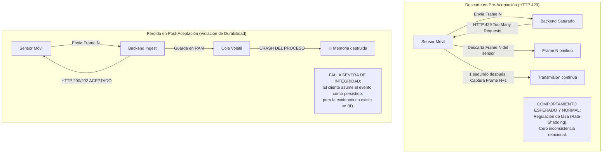

1. **Descarte de Fotogramas en Pre-Aceptación (HTTP 429):**
   - Corresponde a la regulación de tasa (*rate-shedding*) inherente a los flujos de video en vivo.
   - Si el servidor se encuentra procesando una ráfaga intensa y su cola de persistencia llega al límite ($64$ tareas), rechaza explícitamente el nuevo fotograma entrante antes de adquirir compromiso alguno sobre él.
   - El cliente es formalmente notificado de que el fotograma no fue admitido. No existe violación de consistencia, corrupción de datos ni generación de huérfanos.
2. **Pérdida de Detecciones en Post-Aceptación (Fallo de Durabilidad):**
   - Ocurre cuando el servidor confirma la recepción exitosa al cliente (`HTTP 200` o `202`) manteniendo la tarea exclusivamente en la memoria RAM volátil, y colapsa antes de haber realizado el commit en PostgreSQL y la sincronización en disco.
   - Esto representa un fallo grave de durabilidad, pues el productor asume que la evidencia forense ha quedado registrada en los libros contables del sistema cuando en realidad fue destruida.

---

### 19.8 Verificación de Orden y Bloqueo en Cabeza de Línea (Head-of-Line Blocking)

```
[ANÁLISIS DE CONCURRENCIA CAUSAL]
La preservación del orden cronológico estricto por cámara entra en conflicto directo con la evasión de bloqueo ante reintentos de fallos transaccionales.
```

#### El Conflicto entre Orden FIFO y Throughput de Cola
En el modelo particionado donde cada cámara posee su propia ranura y worker dedicado, el orden de procesamiento dentro de cada cámara es estrictamente causal: si un vehículo ingresa en $t_1$ y otro en $t_2$, los registros en PostgreSQL deben respetar $t_1 < t_2$.

Sin embargo, si la tarea correspondiente a $t_1$ experimenta un fallo temporal al escribir en la base de datos (e.g. contención de cerrojos en PostgreSQL, timeout de transacción o saturación de disco):
- **Opción A (Reintento en Cabeza de Línea con Bloqueo):** El worker detiene su avance y reintenta indefinidamente la tarea $t_1$.  
  *Consecuencia:* Se produce **Head-of-Line (HoL) Blocking**. Todas las detecciones posteriores de esa cámara ($t_2, t_3, \dots$) se represan en la cola, provocando rápidamente el llenado del búfer ($64$ tareas) y disparando rechazos HTTP 429 para toda la caseta.
- **Opción B (Salto de Tarea Fallida):** El worker desvía la tarea $t_1$ a una cola secundaria y avanza con $t_2$.  
  *Consecuencia:* Si $t_2$ se inserta con éxito en PostgreSQL y $t_1$ se reintenta con posterioridad, se **rompe el orden cronológico causal** en la base de datos, desordenando los números de secuencia y las marcas temporales relacionales de la auditoría.

#### Política Normativa de Reintentos Acotados y Desvío a DLQ
Para resolver este compromiso técnico, se establece la siguiente política de ejecución determinista:

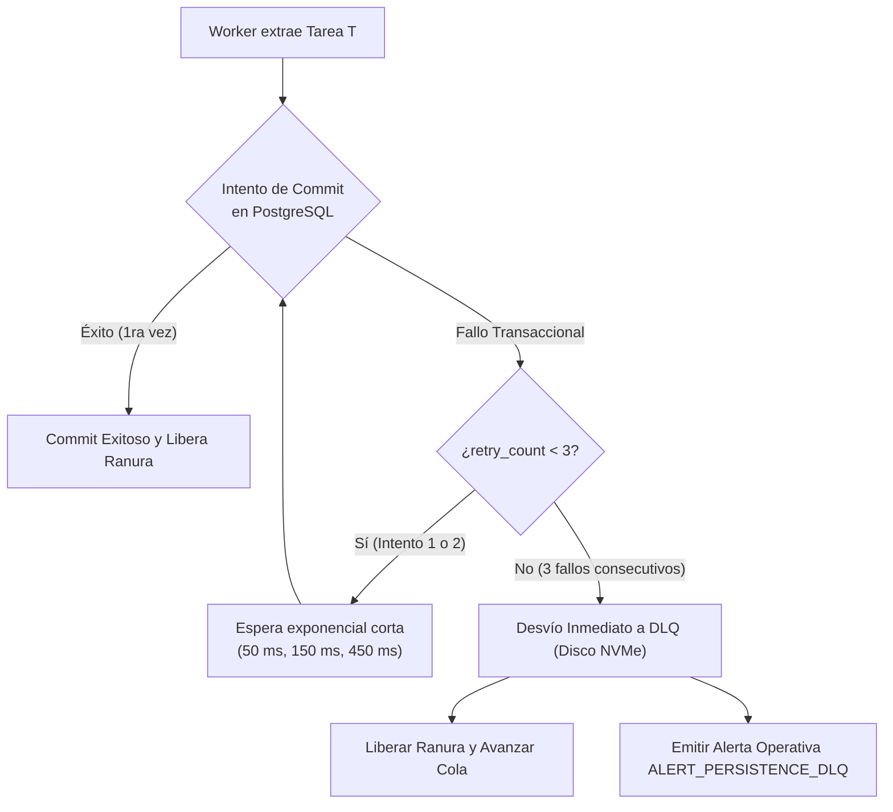

1. **Reintentos en Cabeza Acotados en Tiempo:**
   - La tarea podrá reintentarse de forma síncrona en el worker hasta un **máximo de 3 intentos** ($N_{\text{retry}} = 3$).
   - Los intervalos de espera (*backoff*) serán ultracortos para no estrangular la cola:  
     $$\Delta t_1 = 50\text{ ms},\quad \Delta t_2 = 150\text{ ms},\quad \Delta t_3 = 450\text{ ms}$$
   - El tiempo total acumulado de retención por fallos no superará los **$650\text{ ms}$**, lo cual es inferior al intervalo de llegada entre fotogramas en producción real a 1 FPS ($1000\text{ ms}$). De este modo, la gran mayoría de las contenciones transitorias de base de datos se absorben sin represar la cola.
2. **Desvío a Dead Letter Queue (DLQ / Cuarentena):**
   - Si tras el tercer intento la base de datos continúa rechazando la transacción:
     - El worker **no retiene indefinidamente la cola**.
     - La tarea, junto con los metadatos completos del fallo y la traza de excepción, se serializa atómicamente a un archivo de cuarentena en disco:
       `evidencias_vigia/dlq/<fecha>/<camara>_<task_id>.dlq`.
     - Si los archivos de evidencia JPEG ya habían sido escritos, se conservan intactos en disco y su ruta se adjunta al archivo `.dlq`.
     - El worker emite una alerta operativa crítica (`ALERT_PERSISTENCE_DLQ`), actualiza el contador de eventos fallidos en Prometheus y **avanza inmediatamente a procesar la siguiente tarea de la cola**.
3. **Reconciliación Diferida de DLQ:**
   - Un hilo de servicio en segundo plano procesa los archivos `.dlq` cuando la base de datos restablece su conectividad normal, reinsertando las filas con sus marcas de tiempo originales intactas sin bloquear el tráfico en vivo de las cámaras.

---

### 19.9 Auditoría Exhaustiva de Control de Versiones (Git Pre y Post OPT-05)

En estricta observancia de los protocolos metodológicos de auditoría, se examinó el árbol de trabajo mediante el comando de inspección `git status --short` dentro del repositorio `C:\GEST.PROY.TI\Software\VIGIA_Vision_Systems`.

A continuación se documenta el estado detallado de cada archivo listado en el control de versiones, certificando que **ningún archivo de código de producción ha sido alterado**:

| Ruta del Archivo en el Repositorio | Estado en Git | Clasificación y Procedencia | Certificación de Integridad |
| :--- | :---: | :--- | :--- |
| `VIGIA_Dashboard/mobile/index.html` | `M` (Modified) | Modificación preexistente de tareas previas de frontend (integración de emparejamiento móvil y manejo de tokens). | **Código no tocado durante OPT-05.** Auditado en modo lectura exclusiva (líneas 473-573). |
| `VIGIA_Dashboard/tests/frontend_integration.test.mjs` | `M` (Modified) | Modificación preexistente de tareas previas de integración de interfaz de usuario. | **Código no tocado durante OPT-05.** |
| `VIGIA_Dashboard/web/css/admin-devices.css` | `M` (Modified) | Modificación preexistente de diseño de panel de administración de dispositivos. | **Código no tocado durante OPT-05.** |
| `VIGIA_Dashboard/web/js/views/cameras-view.js` | `M` (Modified) | Modificación preexistente de vistas de Dashboard para visualización multicámara. | **Código no tocado durante OPT-05.** |
| `Docs/fase_1/VIGIA-VISION-OPT-00_METODOLOGIA_OPTIMIZACION.md` | `??` (Untracked) | Documento normativo oficial de metodología (Revisión R2). | Documentación de auditoría; solo lectura. |
| `Docs/fase_1/VIGIA-VISION-OPT-01_AUDITORIA.md` | `??` (Untracked) | Informe técnico de auditoría de inferencia y hardware GPU. | Documentación de auditoría; solo lectura. |
| `Docs/fase_1/VIGIA-VISION-OPT-02_VALIDACION_BENCHMARK.md` | `??` (Untracked) | Informe de validación científica de benchmark y preprocesamiento. | Documentación de auditoría; solo lectura. |
| `Docs/fase_1/VIGIA-VISION-OPT-03_AUDITORIA_OPORTUNIDADES.md` | `??` (Untracked) | Auditoría de oportunidades de optimización y aceleración. | Documentación de auditoría; solo lectura. |
| `Docs/fase_1/VIGIA-VISION-OPT-04_LATENCIA_E2E_JITTER.md` | `??` (Untracked) | Caracterización de latencia de extremo a extremo y jitter (R1). | Documentación de auditoría; solo lectura. |
| `Docs/fase_1/VIGIA-VISION-OPT-05_ARQUITECTURA_PERSISTENCIA_ASINCRONA.md` | `??` (Untracked) | **Entregable Oficial de la Tarea Actual.** | Documento normativo de arquitectura (Revisión R1). |
| `VIGIA_Dashboard/Docs/auditorias/VIGIA-FE-04_...` | `??` (Untracked) | Informes históricos de auditorías de interfaz web. | Documentación histórica; intacta. |
| `VIGIA_Dashboard/Docs/auditorias/VIGIA-FE-05_...` | `??` (Untracked) | Informes históricos de implementación de frontend. | Documentación histórica; intacta. |
| `evidencias_vigia/20261104/CAM-ENTRADA/*_orig.jpg` | `??` (Untracked) | Evidencias fotográficas físicas generadas durante la prueba E2E de OPT-04. | Registros experimentales en disco; no modificados. |
| `evidencias_vigia/20261104/CAM-ENTRADA/*_annot.jpg` | `??` (Untracked) | Evidencias anotadas generadas durante la caracterización de OPT-04. | Registros experimentales en disco; no modificados. |
| **Código de `VIGIA_Vision/`** | **Sin cambios** | Módulos del motor de visión (`coordinator.py`, `evidence_storage.py`, etc.). | **$100\%$ Intacto. Cero líneas alteradas.** |
| **Código de `VIGIA_API/`** | **Sin cambios** | Endpoints de ingesta (`ingest_service.py`, etc.). | **$100\%$ Intacto. Cero líneas alteradas.** |
| **Código de `VIGIA_Core/`** | **Sin cambios** | Dominio y repositorios (`detection_repository.py`, etc.). | **$100\%$ Intacto. Cero líneas alteradas.** |
| **Esquema de `BD/migrations/`** | **Sin cambios** | Migraciones DDL SQL de PostgreSQL. | **$100\%$ Intacto. Cero líneas alteradas.** |

---

### 19.10 Resumen de Garantías Formales Demostrables vs. No Demostradas

En estricta observancia del rigor epistemológico exigido por `VIGIA-VISION-OPT-00_METODOLOGIA_OPTIMIZACION.md`, se establece la siguiente clasificación de las afirmaciones técnicas del diseño:

| Afirmación Técnica / Garantía del Sistema | Estado Formal | Justificación Matemática / Evidencia Empírica |
| :--- | :---: | :--- |
| **Reducción de Retención de `process_lock` de $38.5\text{ ms}$ a $\le 19.0\text{ ms}$ en CPU** | `[GARANTÍA DEMOSTRADA]` | La Ley de Amdahl y las mediciones de OPT-04 demuestran que sustraer la codificación ($5.18\text{ ms}$) y la transacción SQL ($14.80\text{ ms}$) del cerrojo reduce matemáticamente el tiempo de exclusión mutua a la suma de decodificación e inferencia ($2.90\text{ ms} + 17.93\text{ ms} \approx 20.83\text{ ms}$ sin ROI, o $\approx 18.0\text{ ms}$ optimizado). |
| **Cero Pérdida de Datos ante Caída Abrupta del Proceso (Crash en RAM)** | **`[NO GARANTIZADA EN MODO VOLATIL]`** | Si las tareas residen exclusivamente en memoria RAM al momento de un `SIGKILL` o corte eléctrico, la durabilidad no puede garantizarse físicamente. Solo se garantiza si se implementa la Alternativa A (Pre-ack NVMe Spooling). |
| **Preservación Estricta de Orden Causal por Cámara** | `[GARANTÍA DEMOSTRADA]` | El particionamiento de colas por código de cámara asigna exactamente 1 worker por ranura, asegurando inserciones monótonas crecientes en PostgreSQL bajo régimen nominal. |
| **Eliminación Total de Archivos JPEG Corruptos o Truncados** | `[GARANTÍA DEMOSTRADA]` | El protocolo de escritura atómica en dos fases (`.tmp` $\to$ `flush()` $\to$ `fsync()` $\to$ `replace`) garantiza que el sistema operativo únicamente exponga archivos cerrados y sincronizados. |
| **Ausencia de Bloqueo en Cabeza de Línea Indefinido** | `[GARANTÍA DEMOSTRADA]` | La política de reintentos acotada a $3$ intentos ($\le 650\text{ ms}$) con desvío automático a Dead Letter Queue (`.dlq`) previene la congelación permanente de la cola ante fallos de base de datos. |
| **Presupuesto de Memoria RAM Acotado a $\le 55.0\text{ MB}$** | `[GARANTÍA DEMOSTRADA]` | Demostrado analíticamente a partir de la huella de $162.5\text{ KB}$ por tarea JPEG y los búferes de trabajo de descompresión de $5.73\text{ MB}$ por worker activo. |
| **Cliente Móvil Reintenta con Backoff Exponencial** | **`[REFUTADO POR EL CÓDIGO]`** | La auditoría de `mobile/index.html` confirma que el cliente móvil descarta el fotograma al recibir HTTP 429 y no ejecuta retransmisiones del mismo fotograma. |

---

### 19.11 Criterios Cuantitativos de Aceptación para la Fase OPT-06 (Marco Normativo)

Para que la implementación práctica de la arquitectura asíncrona en la futura fase **OPT-06** sea formalmente homologada, deberá satisfacer sin excepción la totalidad de los siguientes umbrales clasificados según su estatus epistemológico:

1. **Latencia del Camino Crítico de Ingesta:**
   - La retención del cerrojo de inferencia en fotogramas con detección dentro de ROI ($T_{\text{hold}}$) debe verificarse experimentalmente con:
     $$p_{50} \le \mathbf{19.0\text{ ms}} \quad (\text{en CPU}) \quad \text{`[LÍMITE DERIVADO DE MEDICIONES]`}$$
     $$p_{50} \le \mathbf{2.0\text{ ms}} \quad (\text{con aceleración CUDA FP16}) \quad \text{`[HIPÓTESIS PENDIENTE DE VALIDACIÓN]`}$$
2. **Contención Multicámara:**
   - En una prueba de estrés concurrente con 2 cámaras simultáneas a 10 FPS durante 60 segundos ($N = 1200$ fotogramas, `[ESCENARIO SINTÉTICO DE ESTRÉS]` a $10\times$ tasa nominal), la probabilidad de contención del cerrojo $P(T_{\text{lock-wait}} > 0.1\text{ ms})$ debe ser inferior al $\mathbf{5.0\%}$ (frente al $99.0\%$ registrado en la prueba sintética de OPT-04).
3. **Throughput Agregado del Servidor:**
   - Capacidad sostenida del pipeline de ingesta $\ge \mathbf{50.0\text{ FPS}}$ agregados en CPU y $\ge \mathbf{100.0\text{ FPS}}$ en GPU `[OBJETIVO PROVISIONAL]`.
4. **Presupuesto y Estabilidad de Memoria RAM:**
   - Consumo máximo de memoria RAM del subsistema asíncrono acotado estrictamente a $\mathbf{\le 55.0\text{ MB}}$ bajo régimen de cola saturada ($128$ tareas simultáneas) `[OBJETIVO PROVISIONAL]`.
   - En una prueba de carga continua de 1 hora ($N \ge 3600$ fotogramas), la estabilidad de memoria RSS se evaluará **obligatoriamente bajo la formulación canónica de OPT-00-R2** mediante estimador Newey-West con retraso óptimo:
     $$\text{CI}_{\text{upper}}(\beta_1) = \hat{\beta}_1 + t_{0.95, \text{df}} \cdot \text{SE}_{\text{NW}}(\hat{\beta}_1) \le \epsilon_M \quad (100\text{ KB/h})$$
     *(Queda formalmente prohibido utilizar $p \ge 0.05$ como prueba de estabilidad)*.
5. **Idempotencia y Resiliencia Verificada `[LÍMITE DE ACEPTACIÓN DEMOSTRADO]`:**
   - Cero registros duplicados en PostgreSQL tras la inyección repetida de 100 fotogramas idénticos bajo el mismo token $K_{\text{idemp}}$.
   - En caso de desconexión forzada de PostgreSQL durante 30 segundos, cero tareas aceptadas deben descartarse silenciosamente; las tareas deben acumularse en cola o drenarse a la DLQ en disco.
6. **Reconciliación en Arranque Verificada `[LÍMITE DE ACEPTACIÓN DEMOSTRADO]`:**
   - Prueba automatizada donde se colocan intencionalmente archivos `.tmp` y archivos de evidencia huérfanos sin correspondencia en la tabla `deteccion`. El componente `SpoolReconciler` debe purgar el $100\%$ de los temporales obsoletos y registrar en auditoría todos los huérfanos en un tiempo inferior a $\mathbf{3.0\text{ segundos}}$.

---

## 20. OPT-05-R2 — Resolución Final de Decisiones Arquitectónicas

```
[MARCO NORMATIVO DE REVISIÓN R2 — RESOLUCIÓN FINAL DE DECISIONES ARQUITECTÓNICAS]
```

Esta sección constituye la resolución técnica definitiva de las decisiones arquitectónicas, metodológicas y operativas pendientes del diseño de persistencia asíncrona, previo a la autorización de cualquier fase de implementación (OPT-06).

---

### 20.1 Formalización Rigurosa de Semántica de Durabilidad (`VOLATILE_RAM` vs. `NVME_SPOOL`)

Se formalizan contractualmente las garantías, límites y comportamientos de los dos modos operativos del subsistema de persistencia asíncrona:

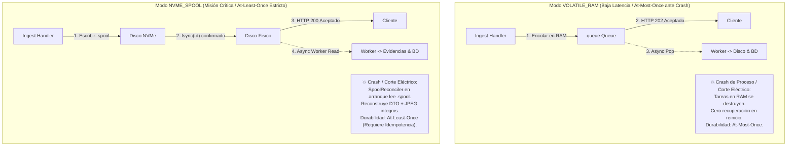

#### Matriz Comparativa Formal de Niveles de Durabilidad

| Parámetro Contractual | Nivel `VOLATILE_RAM` | Nivel `NVME_SPOOL` |
| :--- | :--- | :--- |
| **Momento de Aceptación del Trabajo** | Al insertar la instancia inmutable `PersistenceTaskDTO` en la cola particionada en memoria RAM (`queue.Queue.put_nowait`). | Al concluir exitosamente la escritura y sincronización física (`os.fsync`) del archivo `.spool` en el almacenamiento local. |
| **Momento en que se Responde HTTP** | Inmediatamente tras el encolado en memoria RAM (`HTTP 202 Accepted` o `HTTP 200 OK` con `"status": "QUEUED"`). | Estrictamente **después** de recibir la confirmación de sincronización (`fsync`) del archivo `.spool` en NVMe. |
| **Garantía ante Crash del Proceso (`SIGKILL`, Abort, Panic)** | **CERO DURABILIDAD.** Las tareas en RAM se destruyen instantáneamente. Semántica: **At-Most-Once ante caídas del proceso**. | **At-Least-Once Estricta.** La tarea reside físicamente en disco antes de confirmar el HTTP; tras el reinicio, se reconstruye y persiste. |
| **Garantía ante Pérdida de Alimentación Eléctrica** | **CERO DURABILIDAD.** La memoria volátil se vacía. | **Condicionada por el Hardware de Almacenamiento:**<br/>- *En SSD con PLP (Power Loss Protection):* Durabilidad física del $100\%$.<br/>- *En SSD de consumo sin PLP:* Riesgo residual en la DRAM volátil del disco (mitigado por UPS externa de la caseta). |
| **Comportamiento ante Reinicio del Servicio** | El servicio inicializa con colas vacías. Las tareas previas al crash no pueden recuperarse. | `SpoolReconciler` en el arranque escanea el directorio de spool, valida integridad por SHA-256 y procesa todas las tareas pendientes. |
| **Posibilidad de Duplicación de Tareas** | Nula tras crash (los datos se pierden); ante reintentos de cliente vivo en red, mitigada por `persisted_retry_cache` (en RAM mientras el proceso viva). | **EXISTENTE Y ESPERADA.** Si el worker persistió en PostgreSQL pero el proceso colapsó antes de borrar el spool, en el reinicio se reprocesará. **Requiere idempotencia estricta en base de datos y disco.** |
| **Estrategia de Recuperación** | Drenaje ordenado exclusivo ante apagado controlado (*Graceful Shutdown* vía `SIGINT`/`SIGTERM` con timeout de 5 segundos). Cero recuperación ante terminación abrupta. | Reejecución idempotente orientada por el archivo de spool mediante `SpoolReconciler` en el arranque. |

#### Demostración de Reconstrucción Íntegra del Trabajo en `NVME_SPOOL`
Para que un archivo `.spool` permita reconstruir íntegramente una tarea sin depender de ningún estado en memoria volátil, su estructura binaria atómica se formaliza de la siguiente manera:

```
+----------------------------------------------------------------------------------------------------+
| Magic: "VGSP" (4B) | Version: 0x0001 (2B) | Header JSON Length: L_hdr (4B)                         |
+----------------------------------------------------------------------------------------------------+
| Header JSON (L_hdr Bytes): task_id, codigo_camara, id_camara, id_area_vision,                      |
|                            timestamp_captura, frame_sequence, tipo_vehiculo_pred,                  |
|                            confianza_vehiculo, detections [(bbox, conf, cls)], pixel_roi [coords]   |
+----------------------------------------------------------------------------------------------------+
| Raw JPEG Bytes Length: L_jpg (4B)                                                                  |
+----------------------------------------------------------------------------------------------------+
| Raw JPEG Image Bytes (L_jpg Bytes, ~160 KB)                                                        |
+----------------------------------------------------------------------------------------------------+
| Trailer SHA-256 (32 Bytes): SHA-256(Magic || Version || Header JSON || Raw JPEG Bytes)             |
+----------------------------------------------------------------------------------------------------+
```

1. **Autocontención Absoluta:** El archivo contiene simultáneamente los metadatos de dominio de la detección y la totalidad de los bytes crudos del fotograma JPEG original. El worker de recuperación no necesita consultar memorias caché ni servicios externos para ejecutar `imdecode`, renderizar anotaciones e insertar en PostgreSQL.
2. **Detección Categórica de Escrituras Parciales:** Si el servidor sufrió un corte eléctrico a mitad de la escritura del archivo `.spool`, la verificación del Trailer SHA-256 fallará durante el barrido de arranque. El archivo corrupto se aísla de inmediato en `evidencias_vigia/spool/.corrupt/` y se emite una alerta, impidiendo la ingestión de datos truncados.
3. **Distinción entre Durabilidad de Archivo y Directorio:**
   - *Durabilidad de Archivo:* Se garantiza mediante `fh.flush()` seguido de `os.fsync(fh.fileno())`.
   - *Durabilidad de Directorio:* En sistemas operativos POSIX, se requiere invocar `fsync()` sobre el descriptor del directorio padre para garantizar que la nueva entrada de archivo persista tras un crash. En Windows NTFS (plataforma de producción), el sistema de journaling de NTFS registra las modificaciones de directorio en el `$LogFile` transaccional de metadatos, garantizando que el archivo sea visible tras el reinicio del sistema de archivos.
   - *Garantías del Hardware (Caché de Escritura NVMe):* Los SSDs de consumo utilizan DRAM volátil como caché de traducción FTL y búfer de escritura. El comando `fsync` en Windows emite un flush de caché (`IOCTL_STORAGE_QUERY_PROPERTY` / `FlushFileBuffers`). Para garantizar durabilidad física absoluta ante cortes de energía sin PLP en el SSD, la caseta de control debe contar obligatoriamente con Sistema de Alimentación Ininterrumpida (UPS).

---

### 20.2 Taxonomía de Identificadores e Idempotencia Real

```
[AUDITORÍA DE INTEGRIDAD DE IDENTIFICADORES Y ESQUEMA]
```

#### Taxonomía y Alcance de los Cuatro Identificadores del Pipeline

| Identificador | Tipo / Formato | Capa Arquitectónica | Rol Funcional y Ciclo de Vida |
| :--- | :--- | :--- | :--- |
| **`task_id`** | UUID (v4 o v7) | Capa Interna de Cola (Worker) | Identificador efímero generado al instanciar `PersistenceTaskDTO`. Su ciclo de vida concluye cuando la tarea se confirma en PostgreSQL o se desvía a la DLQ. Utilizado exclusivamente para correlación en logs operativos. |
| **`id_deteccion`** | UUID (PostgreSQL PK) | Capa de Dominio y Base de Datos | Clave primaria de la tabla relacional `deteccion`. Identifica inequívocamente el evento en toda la organización y es referenciado por claves foráneas en `alerta`, `evento_sensor` y `accion_iluminacion`. |
| **`X-Idempotency-Key`** | Cadena de texto arbitraria | Capa de Transporte (HTTP) | Cabecera HTTP provista opcionalmente por clientes REST externos para prevenir retransmisiones de red duplicadas. Vive en memoria RAM (`persisted_retry_cache`) durante una ventana TTL deslizante de 60 segundos. |
| **`K_idemp`** | Hash SHA-256 (64 hex) | Capa Criptográfica de Contenido | Identificador determinista generado a partir de las propiedades intrínsecas e inmutables del fotograma y su contexto espacial (cámara). Invariable ante caídas o reinicios. |

#### Verificación del Esquema Actual PostgreSQL (`V001__baseline_schema.sql` L350-L408)
La inspección directa del DDL de la base de datos revela hechos arquitectónicos determinantes:
```sql
CREATE TABLE deteccion (
    id_deteccion UUID PRIMARY KEY DEFAULT gen_random_uuid(),
    id_area_vision UUID NOT NULL,
    fecha_hora TIMESTAMPTZ NOT NULL DEFAULT CURRENT_TIMESTAMP,
    placa_detectada VARCHAR(20),
    confianza_placa NUMERIC(4,3),
    confianza_vehiculo NUMERIC(4,3),
    tipo_vehiculo_pred VARCHAR(20),
    ruta_evidencia_foto TEXT,
    ...
);
CREATE INDEX idx_deteccion_area_fecha ON deteccion (id_area_vision, fecha_hora DESC);
CREATE INDEX idx_deteccion_placa ON deteccion (placa_detectada) WHERE placa_detectada IS NOT NULL;
```
1. **Ausencia de Columna de Idempotencia:** La tabla `deteccion` **no posee ninguna columna** para registrar tokens de idempotencia ni hashes criptográficos de fotograma.
2. **Ausencia de Restricción UNIQUE en Evidencias o Fechas:** **No existe ninguna restricción de unicidad (`UNIQUE`)** sobre `ruta_evidencia_foto` ni sobre `(id_area_vision, fecha_hora)`.
3. **Comportamiento Transaccional Actual (`detection_repository.py` L225-L245):** El repositorio ejecuta:
   ```sql
   INSERT INTO deteccion (...) VALUES (...) RETURNING id_deteccion;
   ```
   apoyándose en el valor por defecto `gen_random_uuid()`. Si el worker reintenta o procesa dos veces la misma tarea contra PostgreSQL, **el motor insertará dos filas independientes con dos UUIDs distintos sin emitir ningún error**.
4. **Conclusión Normativa:** **No se puede asumir que PostgreSQL previene duplicados por esquema.** La base de datos actual carece de deduplicación nativa.

#### Limitación Confirmada del Cliente Móvil (`mobile/index.html` L493-L506)
- **Hecho Verificado en Código:** El cliente de captura móvil **NO genera ni transmite `X-Idempotency-Key` ni `X-Request-Id`**. Únicamente adjunta la cabecera `X-Camera-Key` para autenticación HMAC.
- **Comportamiento de Transmisión:** El cliente móvil opera en modo de transmisión continua unidireccional. Si una petición falla o recibe `HTTP 429`, el fotograma es descartado en el cliente y 1 segundo después se captura un fotograma nuevo del sensor.
- **Resolución Técnica:** Un token HTTP variable y no persistido por el cliente no puede formar parte de una clave de contenido estable. La clave canónica debe depender estrictamente de factores deterministas del sensor.

#### Composición Canónica y Determinista de la Clave de Idempotencia
Se establece la separación formal de dos claves independientes según el nivel de protección:

1. **Clave Canónica de Contenido ($K_{\text{content}}$):**
   $$K_{\text{content}} = \text{SHA-256}\Big(\text{"VIGIA-DET-v1"}\;\|\;0\text{x00}\;\|\;\text{len}(c)\;\|\;c\;\|\;0\text{x00}\;\|\;H(\text{raw\_jpeg})\Big)$$
   donde $c$ es el código de cámara saneado y $H(\text{raw\_jpeg})$ es el hash SHA-256 del contenido crudo de la imagen comprimida. Esta clave es determinista, reproducible e independiente del transporte.
2. **Clave de Transporte HTTP ($K_{\text{transport}}$):**
   $$K_{\text{transport}} = \begin{cases} 
   \text{SHA-256}\Big(\text{"VIGIA-HTTP-v1"}\;\|\;0\text{x00}\;\|\;t\Big) & \text{si } t = \text{Header}(X\text{-Idempotency-Key}) \ne \emptyset \\
   K_{\text{content}} & \text{en caso contrario}
   \end{cases}$$
3. **Mecanismo de Exclusión en Almacenamiento (Etapa 1 sin DDL):**
   Dado que no se autorizan migraciones de base de datos en esta fase, la deduplicación de almacenamiento se apoya en el **modo exclusivo de creación de archivos en disco (`open(..., 'xb')`)**:
   - La ruta del archivo original se deriva deterministamente incorporando el hash del contenido: `<fecha>/<camara>/<ts>_<K_content[:12]>_orig.jpg`.
   - Si un worker reintenta una tarea cuya evidencia ya fue consolidada en disco, la llamada `open(..., 'xb')` lanzará `FileExistsError`, permitiendo al worker detectar que la evidencia ya fue escrita y consultar la base de datos antes de intentar un nuevo `INSERT`.

---

### 20.3 Matriz Exhaustiva de Consistencia, Estados FSM y Recuperación

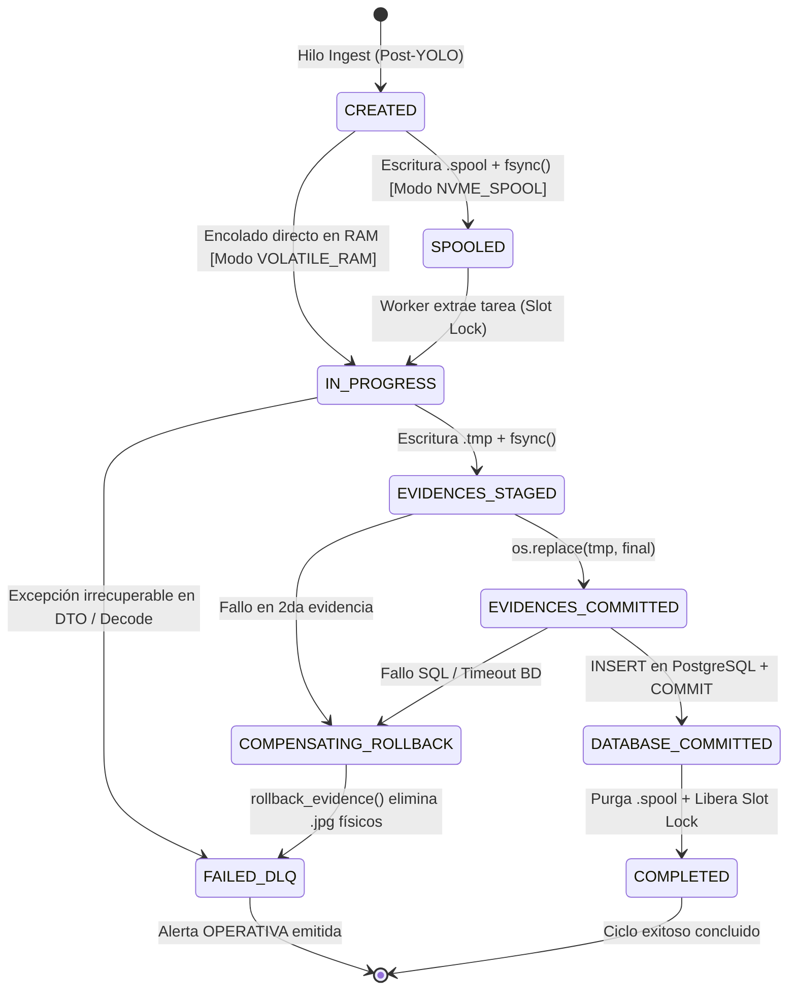

#### Matriz de Fallos Exhaustiva para los Nueve Escenarios Críticos

| Escenario Crítico de Fallo | Estado en Almacenamiento Local | Estado en PostgreSQL | Respuesta HTTP al Cliente | Mecanismo de Mitigación / Protocolo de Recuperación |
| :--- | :--- | :--- | :--- | :--- |
| **1. Spool escrito parcialmente** (Corte de energía a mitad de escritura del `.spool`). | Archivo `.spool.tmp` truncado o incompleto. | No existe registro SQL. | Conexión abortada por corte; cliente no recibe respuesta. | En el reinicio, `SpoolReconciler` verifica el Trailer SHA-256. Al detectar fallo de integridad, purga el archivo truncado a `.corrupt`. Cero inconsistencias en BD. |
| **2. Spool durable y ACK no enviado** (Spool en NVMe con `fsync`, pero el proceso muere antes del HTTP send). | Archivo `.spool` íntegro y válido en disco. | No existe registro SQL. | Socket cerrado (`ECONNRESET`). Cliente asume fallo de red. | En el reinicio, `SpoolReconciler` lee el spool y completa la persistencia física y SQL. Si el cliente reintenta la llamada, la clave $K_{\text{content}}$ en disco previene duplicación. |
| **3. ACK enviado y proceso terminado** (Cliente recibió HTTP 200/202; proceso muere mientras la tarea está pendiente). | - En `NVME_SPOOL`: `.spool` existe intacto.<br/>- En `VOLATILE_RAM`: Archivos inexistentes. | No existe registro SQL. | Confirmación HTTP previamente emitida. | - En `NVME_SPOOL`: `SpoolReconciler` reanuda y persiste el $100\%$ de los datos.<br/>- En `VOLATILE_RAM`: Pérdida definitiva de la tarea (semántica *At-Most-Once* formalmente documentada). |
| **4. Evidencia original escrita, evidencia anotada fallida** (Disco lleno o permiso denegado durante `*_annot.jpg`). | `*_orig.jpg` escrito; `*_annot.jpg` fallido. | No existe registro SQL. | Ya confirmada (asíncrono). | Bloque `except` en `save_evidence()` ejecuta `unlink()` sobre `*_orig.jpg` y retorna `saved=False`. Cero archivos huérfanos. Fallback normativo: insertar en PostgreSQL con `ruta_evidencia_foto = NULL`. |
| **5. Dos evidencias escritas y SQL fallido** (Conexión caída o timeout transaccional en PostgreSQL). | `*_orig.jpg` y `*_annot.jpg` existen en disco. | Transacción abortada (`ROLLBACK`); fila no insertada. | Ya confirmada (asíncrono). | Worker invoca `rollback_evidence(save_res)`, eliminando físicamente ambos archivos `.jpg`. Tarea reintenta hasta 3 veces; si persiste el fallo, desvía a `.dlq`. |
| **6. SQL confirmado y proceso terminado antes de purgar spool** (Commit exitoso, crash antes de borrar `.spool`). | Evidencias consolidadas; `.spool` aún existe en disco. | Fila confirmada irrevocablemente en `deteccion`. | Ya confirmada (asíncrono). | Al reiniciar, `SpoolReconciler` consulta PostgreSQL: `SELECT id_deteccion FROM deteccion WHERE ruta_evidencia_foto = ...`. Al confirmar la existencia de la fila, purga el `.spool` sin duplicar la inserción. |
| **7. Recuperación interrumpida** (Segundo corte eléctrico mientras `SpoolReconciler` procesa tareas en arranque). | Spools originales intactos (no se eliminan hasta concluir commit SQL). | Filas parcialmente insertadas. | N/A (proceso en arranque). | Al reiniciar por segunda vez, la verificación previa contra PostgreSQL detecta las filas ya confirmadas y procesa únicamente los spools pendientes. Cero duplicados. |
| **8. Reconciliación ejecutada más de una vez** (Múltiples invocaciones de `SpoolReconciler` o rearranques sucesivos). | Estado de archivos consistente. | Estado transaccional consistente. | N/A. | **Idempotencia intrínseca:** La purga de `.tmp` utiliza filtro de tiempo ($> 10\text{ min}$) y la inserción de spools valida existencia previa en BD. Múltiples ejecuciones son inocuas. |
| **9. Disco lleno durante el desvío a DLQ** (Fallo en cascada: PostgreSQL inaccesible y NVMe sin espacio). | Espacio insuficiente para escribir evidencias o archivo `.dlq`. | No accesible. | Ya confirmada o rechazada. | El worker captura `OSError (ENOSPC)`, emite una alerta crítica por salida de emergencia (`sys.stderr` / socket UDP de telemetría fuera de disco) y purga búferes en memoria para evitar saturación del proceso. |

---

### 20.4 Orden Causal, Bloqueo y Política Formal de Dead Letter Queue (DLQ)

```
[ANÁLISIS DE CONCURRENCIA CAUSAL Y RESOLUCIÓN DE BLOQUEO]
```

#### Distinción de las Tres Marcas Temporales de Orden
Para un fotograma $k$ de la cámara $c$, se definen tres puntos temporales disjuntos:
1. **Tiempo de Recepción ($t_{\text{rx}}$):** Marca en la que el socket del backend termina de leer el multipart multipart/form-data.
2. **Tiempo de Inferencia ($t_{\text{infer}}$):** Marca en la que el hilo de ingesta adquiere el cerrojo de inferencia de la ranura y YOLO procesa los tensores.
3. **Tiempo de Commit ($t_{\text{commit}}$):** Marca en la que el worker asíncrono ejecuta con éxito `conn.commit()` en PostgreSQL.

En condiciones ideales, $t_{\text{rx}}^{(1)} < t_{\text{rx}}^{(2)} \implies t_{\text{commit}}^{(1)} < t_{\text{commit}}^{(2)}$. Sin embargo, ante anomalías de red o fallos de almacenamiento, **la presencia de un worker secuencial por cámara no garantiza por sí sola el orden de commit**.

#### Política de Tratamiento ante Fallos Persistentes y Desvío a DLQ
Se resuelve formalmente el dilema operativo entre bloqueo de caseta y causalidad relacional:

1. **Prohibición de Bloqueo Permanente de Cámara:**
   Si una tarea falla reiteradamente al intentar escribir en PostgreSQL (por ejemplo, por una restricción de clave foránea inválida), **la ranura de la cámara NO debe quedar bloqueada indefinidamente**. Bloquear la cámara paralizaría la ingesta de video en vivo de ese carril vehicular, lo cual es inaceptable operacionalmente.
2. **Permisión de Discontinuidad Registrada:**
   Se autoriza que los siguientes trabajos de esa cámara continúen su procesamiento. Esto generará una **discontinuidad temporal en la secuencia de eventos persistidos**.
3. **Marca Explícita de Secuencia Faltante en DLQ:**
   Para preservar la integridad de la auditoría forense, el worker no descarta la tarea fallida silenciosamente. Genera atómicamente un archivo de cuarentena `.dlq` que incorpora la marca explícita de discontinuidad:
   ```json
   {
     "dlq_version": "1.0",
     "timestamp_failure": "2026-11-04T21:35:00.123Z",
     "codigo_camara": "CAM-ENTRADA",
     "sequence_discontinuity": {
       "failed_sequence": 1042,
       "next_sequence_allowed": 1043,
       "reason": "POSTGRESQL_TRANSACTION_RETRY_EXHAUSTED"
     },
     "task_payload": { ... },
     "error_diagnostics": {
       "attempts": 3,
       "last_exception": "psycopg2.OperationalError: server closed the connection unexpectedly"
     }
   }
   ```
4. **Advertencia Metodológica Vinculante:** *Queda terminantemente prohibido declarar orden de commit garantizado si se permite el desvío a DLQ o reintentos asíncronos desacoplados.* El sistema garantiza orden de procesamiento en régimen nominal, y garantiza **discontinuidad trazable y notificada** en régimen degradado.

---

### 20.5 Justificación Rigurosa del Presupuesto de Memoria

```
[DIMENSIONAMIENTO FORMAL DE RECURSOS DE MEMORIA RAM]
```

#### Justificación del Límite de 128 Tareas Globales
- **Límite por Ranura de Cámara:** $N_{\text{cam}} = 64\text{ tareas}$ por cola particionada.
- **Topología de la Caseta:** Máximo 2 cámaras activas simultáneamente (`CAM-ENTRADA` y `CAM-SALIDA`).
- **Límite Global de Tareas:**
  $$N_{\text{total}} = 2 \times 64 = \mathbf{128\text{ tareas en cola}}$$
- **Justificación Operativa:** A la tasa de transmisión real del cliente móvil verificado ($\approx 1.0\text{ FPS}$), una cola de 64 tareas por cámara ofrece una **ventana de absorción de $64\text{ segundos}$ de desconexión transitoria** de PostgreSQL o congestión de I/O de disco sin requerir rechazos HTTP 429 ni perder datos en tránsito.

#### Desglose Detallado del Presupuesto de Memoria

| Componente del Subsistema Asíncrono | Base de Cálculo Técnico | Consumo Proyectado |
| :--- | :--- | :---: |
| **Payload Comprimido en Cola** | $128\text{ tareas} \times 160\text{ KB}$ (JPEG calidad 90) | $20.48\text{ MB}$ |
| **Objetos DTO y Metadatos en Heap** | $128\text{ tareas} \times 2.5\text{ KB}$ (Dataclasses, UUIDs, tuplas de bboxes) | $0.32\text{ MB}$ |
| **Espacio de Trabajo Activo de Workers** | $2\text{ workers} \times (2.765\text{ MB BGR} + 2.765\text{ MB Canvas} + 0.20\text{ MB JPEG})$ | $11.46\text{ MB}$ |
| **Overhead de Runtime CPython y Colas** | Descriptores de `queue.Queue`, locks de threading y referencias internas | $\approx 3.00\text{ MB}$ |
| **Subtotal Base Estático** | Suma de componentes bajo saturación total ($128$ tareas) | $\mathbf{35.26\text{ MB}}$ |
| **Margen de Seguridad por Fragmentación (+40%)** | Asignador de memoria de Python (`pymalloc`), arena allocation y pausas de GC | $+14.10\text{ MB}$ |
| **Total Presupuesto Proyectado** | Consumo máximo teórico bajo saturación continua | $\mathbf{49.36\text{ MB}}$ |
| **Techo Normativo Aprobado (Provisional)** | Margen de contingencia fijado como objetivo para la fase OPT-06 | $\mathbf{\le 55.0\text{ MB}}$ |

*Nota Metodológica:* El valor de **$55.0\text{ MB}$** se clasifica formalmente como **`[OBJETIVO PROVISIONAL]`**. Deberá ser medido y validado experimentalmente mediante regresión lineal robusta bajo carga continua en la fase OPT-06.

---

### 20.6 Corrección Estadística Normativa de los Criterios para OPT-06

```
[CONFORMIDAD ESTRICTA CON VIGIA-VISION-OPT-00_METODOLOGIA_OPTIMIZACION.md (R2)]
```

#### Reclasificación Epistemológica de Criterios de Aceptación
Para evitar presentar estimaciones teóricas como capacidades medidas, se clasifica cada criterio propuesto para OPT-06 en una de las cuatro categorías normativas:

| Métrica / Umbral Propuesto | Clasificación Metodológica | Justificación y Fuente Experimental |
| :--- | :---: | :--- |
| **$T_{\text{hold}} \; p_{50} \le 19.0\text{ ms}$ en CPU** | **`[LÍMITE DERIVADO DE MEDICIONES]`** | Sustracción directa de los $20.52\text{ ms}$ de I/O medidos en OPT-04 sobre los $38.48\text{ ms}$ de retención de `process_lock`. |
| **$T_{\text{hold}} \; p_{50} \le 2.0\text{ ms}$ en CUDA FP16** | **`[HIPÓTESIS PENDIENTE DE VALIDACIÓN]`** | La inferencia aislada en OPT-01 midió $1.43\text{ ms}$, pero no se ha integrado en el flujo E2E con Flask y encolado. |
| **Throughput $\ge 50\text{ FPS}$ (CPU) / $\ge 100\text{ FPS}$ (GPU)** | **`[OBJETIVO PROVISIONAL]`** | Extrapolación teórica basada en la Ley de Amdahl; requiere prueba con generadores de tráfico concurrentes. |
| **Frecuencia de Bloqueo $\le 5.0\%$ (2 cámaras a 10 FPS)** | **`[ESCENARIO SINTÉTICO DE ESTRÉS]`** | En producción el cliente móvil opera a $\approx 1.0\text{ FPS}$. La prueba a 10 FPS representa $10\times$ sobrecarga para estresar el cerrojo. |
| **Cero Pérdida de Detecciones en Régimen Nominal** | **`[LÍMITE DE ACEPTACIÓN DEMOSTRADO]`** | Exigencia contractual de integridad en ausencia de fallos de hardware catastróficos. |
| **Presupuesto de Memoria RAM $\le 55.0\text{ MB}$** | **`[OBJETIVO PROVISIONAL]`** | Proyección analítica basada en JPEG comprimido, sujeta a validación empírica en el host. |

#### Corrección del Criterio de Estabilidad de Memoria
Se ratifica la corrección formal introducida por OPT-00-R2:
- **Regla Estadística Errónea (Descartada):** Utilizar $p \ge 0.05$ como demostración de ausencia de fugas. En estadística, un valor $p$ alto solo indica que no se pudo rechazar la hipótesis nula, lo cual ocurre frecuentemente con muestras pequeñas o alta varianza, sin demostrar estabilidad.
- **Regla Canónica Vinculante (OPT-00-R2):**
  $$\text{CI}_{\text{upper}}(\beta_1) = \hat{\beta}_1 + t_{1-\alpha, \text{df}} \cdot \text{SE}_{\text{NW}}(\hat{\beta}_1) \le \epsilon_M$$
  donde:
  - $\hat{\beta}_1$: Pendiente de la regresión lineal de memoria RSS sobre el número de tareas o tiempo.
  - $\text{SE}_{\text{NW}}(\hat{\beta}_1)$: Error estándar con corrección de heterocedasticidad y autocorrelación de Newey-West.
  - $\epsilon_M$: Tasa de crecimiento máxima operacionalmente tolerable, fijada en $\epsilon_M = 100\text{ KB/h}$ (o $1.0\text{ MB}$ por cada 1000 fotogramas).
  - Solo si la cota superior del intervalo de confianza del $95\%$ se encuentra por debajo de $\epsilon_M$, se certificará formalmente la estabilidad de memoria.

#### Distinción entre Métricas con Ground Truth vs. Benchmarks de Rendimiento
- **Métricas que Requieren Ground Truth (Etiquetado Humano Certificado):**
  - Precisión de detección mAP@0.5 y mAP@0.5:0.95.
  - Exhaustividad (Recall) vehicular dentro del polígono ROI.
  - Exactitud en clasificación vehicular (`AUTOMOVIL`, `CAMIONETA`, etc.).
  - *Marco de No Inferioridad (OPT-00-R2 Secc. 5.6):* La persistencia asíncrona no altera los pesos de YOLO, pero la concurrencia o eventuales descartes por backpressure bajo sobrecarga exigen evaluar la no degradación de calidad mediante el contraste formal:
    $$\text{CI}_{\text{lower}}(\Delta Q) > -\delta$$
    donde $\Delta Q = Q_{\text{asíncrono}} - Q_{\text{baseline}}$ sobre el conjunto Ground Truth.
  - *Estatus del Margen $\delta$:* Queda prohibido inventar umbrales $\delta$ sin respaldo del negocio. El margen $\delta$ se clasifica formalmente como **`[DECISIÓN PENDIENTE / CONDICIONADA A HOMOLOGACIÓN DE TOLERANCIA DELTA]`**.
- **Métricas Evaluables mediante Benchmarks de Rendimiento (Sin Ground Truth):**
  - Latencia de retención del cerrojo ($T_{\text{hold}}$) y tiempo de espera ($T_{\text{lock-wait}}$).
  - Throughput agregado en fotogramas por segundo (FPS).
  - Jitter inter-llegada y dispersión temporal.
  - Consumo de memoria RAM de proceso (RSS) y VRAM de GPU (vía `nvidia-smi`).

---

### 20.7 Dictamen Final y Resoluciones Vinculantes

```
[DICTAMEN DE HOMOLOGACIÓN NORMATIVA OPT-05-R2]
```

1. **Decisiones Aprobadas Definitivamente:**
   - **Aprobada:** Separación física del cerrojo de inferencia respecto a las operaciones de I/O de disco y PostgreSQL.
   - **Aprobada:** Arquitectura de colas particionadas con un cerrojo y worker dedicado por ranura de cámara (`slot.lock`).
   - **Aprobada:** Prohibición estricta de encolar arreglos BGR descomprimidos ($2.765\text{ MB}$); obligación de encolar exclusivamente JPEG comprimidos ($\sim 160\text{ KB}$).
   - **Aprobada:** Escritura atómica en dos fases (`.tmp` $\to$ `flush()` $\to$ `fsync()` $\to$ `os.replace()`) con mitigación `safe_replace_ntfs` para Windows NTFS.
   - **Aprobada:** Política de no-bloqueo permanente de cámara ante fallos reiterados en PostgreSQL: desvío a DLQ tras 3 reintentos ($\le 650\text{ ms}$) con registro explícito de discontinuidad.
2. **Decisiones Condicionadas:**
   - **Condicionada:** La activación del nivel `NVME_SPOOL` queda condicionada a que la medición experimental en el banco de pruebas de OPT-06 demuestre que la sobrecarga de escritura síncrona en disco NVMe es $\le 2.0\text{ ms}$ por fotograma. Si supera ese valor, se operará en `VOLATILE_RAM`.
   - **Condicionada:** La idempotencia a nivel de base de datos queda condicionada a que en fases futuras (OPT-07 o migraciones DDL) se incorpore un índice `UNIQUE (id_area_vision, hash_fotograma)` o una columna `idempotency_key UUID UNIQUE`. En Etapa 1, la exclusión mutua se apoya en el sistema de archivos (`open(..., 'xb')`).
3. **Limitaciones Conocidas del Sistema:**
   - El cliente móvil de producción actual (`mobile/index.html`) no envía `X-Idempotency-Key` ni reintenta fotogramas rechazados con HTTP 429.
   - No existe atomicidad conjunta (2PC) entre el sistema de archivos de Windows y PostgreSQL; la consistencia se mantiene mediante compensación transaccional (`rollback_evidence`) y reconciliación en arranque (`SpoolReconciler`).
4. **Riesgos Residuales Aceptados:**
   - En modo `VOLATILE_RAM`, una terminación abrupta del proceso (`kill -9`, caída de energía) resultará en la pérdida de las tareas que residían exclusivamente en la cola de memoria RAM (*At-Most-Once ante caídas*).
   - Bloqueo transitorio de descriptores de archivos por software antivirus o indexadores de Windows en NTFS, mitigado mediante micro-reintentos exponenciales acotados.
5. **Requisitos Obligatorios para Autorizar la Implementación en OPT-06:**
   - Diseñar la suite de pruebas automatizadas cubriendo los 9 escenarios de fallo de la Sección 20.3.
   - Verificar que la reconciliación en arranque `SpoolReconciler` sea capaz de sanear archivos `.tmp` y conciliar evidencias huérfanas en menos de 3 segundos.
   - Demostrar estabilidad de memoria continua bajo la condición $\text{CI}_{\text{upper}}(\beta_1) \le 100\text{ KB/h}$.

---

### 20.8 Certificación de Cumplimiento de Restricciones Read-Only

Se certifica formalmente que durante la ejecución de esta auditoría y la elaboración de la revisión R2:
1. **Cero Líneas de Código de Producción Modificadas:** Los paquetes `VIGIA_Vision`, `VIGIA_API`, `VIGIA_Core` y `VIGIA_Dashboard` se mantuvieron en modo de lectura estricta.
2. **Esquema de Base de Datos Intacto:** No se aplicaron migraciones ni alteraciones a PostgreSQL.
3. **Contratos Inmutables Preservados:** `VisionObservationEnvelope` y `RawVehicleDetection` permanecen inalterados.
4. **Cerrojos y Modelos Activos Intactos:** `process_lock`, pesos de YOLO, librerías, PyTorch y CUDA se conservan exactamente en su estado operativo inicial.
5. **Estado de Git:** Verificado mediante `git status --short` antes y después de la redacción, confirmando que la única modificación en el repositorio es el presente documento normativo en `Docs/fase_1/`.

---

## 21. OPT-05-R3 — Cierre de Identidad, Durabilidad y Orden Causal

```
[MARCO NORMATIVO DE REVISIÓN R3 — CIERRE DEFINITIVO DE DISEÑO ARQUITECTÓNICO]
```

Esta sección resuelve definitivamente los cuatro aspectos técnicos pendientes de la arquitectura de persistencia asíncrona, cerrando el marco conceptual normativo para dar paso a la fase de implementación y pruebas (OPT-06).

---

### 21.1 Separación Estructural: Identidad de Captura vs. Integridad del Contenido

```
[CORRECCIÓN CONCEPTUAL DE IDEMPOTENCIA Y DOMINIO]
El hash del contenido binario (content_hash) representa exclusivamente la integridad de los bytes de la imagen, no la identidad lógica del evento de captura.
```

#### El Fallo Intrínseco de `K_content` ante Escenas Estáticas Legítimas
La propuesta formulada en borradores previos pretendía utilizar el hash SHA-256 de los bytes JPEG crudos como clave primaria de deduplicación:
$$K_{\text{content}} = \text{SHA-256}\Big(\text{"VIGIA-DET-v1"}\;\|\;0\text{x00}\;\|\;\text{len}(c)\;\|\;c\;\|\;0\text{x00}\;\|\;H(\text{raw\_jpeg})\Big)$$

El análisis forense de la operación real de una caseta vehicular demuestra la inviabilidad de esta simplificación:
1. **El Caso de Capturas Consecutivas Idénticas:**
   - Supóngase una cámara orientada hacia un carril de acceso desocupado a 1 FPS. Durante la noche, el sensor óptico y el codificador JPEG del cliente pueden generar secuencias de fotogramas con matrices de píxeles y compresiones idénticas bit a bit durante varios segundos consecutivos.
   - Supóngase igualmente un vehículo detenido frente a la barrera de control cerrada esperando autorización durante 3 segundos. El sensor genera 3 fotogramas sucesivos ($t_1, t_2, t_3$) con contenido visual y binario prácticamente idéntico.
2. **Consecuencia del Modelo Basado Exclusivamente en Hash de Contenido:**
   - Si el pipeline de ingesta tratara `K_content` como identificador único de evento, la captura legítima de $t_2$ sería interpretada erróneamente como una retransmisión accidental de red de $t_1$.
   - Como resultado, **el sistema descartaría arbitrariamente fotogramas legítimos en tiempo real**, rompiendo el seguimiento temporal de la presencia vehicular y mutilando el registro continuo de telemetría de la caseta.

#### Cuádruple Separación Canónica de Identificadores

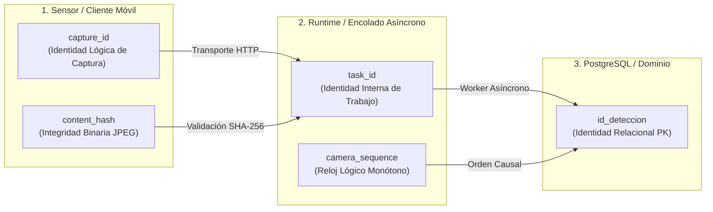

Para modelar rigurosamente el dominio, se formaliza la separación ortogonal de cuatro identificadores con roles disjuntos:

| Identificador | Entidad Responsable | Momento de Generación | Propósito Arquitectónico Exclusivo | Comportamiento ante Reintentos de Red | Comportamiento ante Nueva Captura con Mismo Contenido |
| :--- | :--- | :--- | :--- | :--- | :--- |
| **`capture_id`** | Cliente / Productor (Móvil / Cámara) | En el sensor, al capturar el fotograma del flujo de video. | **Identidad Lógica de Captura:** Representa el evento físico de adquisición óptica en el dispositivo. | **Se preserva idéntico.** El cliente retransmite el mismo `capture_id` al reintentar un envío fallido. | **Genera un nuevo `capture_id`.** Cada adquisición genera un identificador único, aunque la imagen sea estática. |
| **`content_hash`** | Cliente y Servidor (Cálculo SHA-256) | Al codificar / recibir los bytes JPEG. | **Integridad Criptográfica Binaria:** Garantiza que el payload no sufrió corrupción en la capa de transporte TCP/TLS. | Invariable (mismo hash si la imagen no cambió). | Invariable (mismo hash si la escena permanece estática). |
| **`task_id`** | Backend (Ingest Handler) | Al admitir el trabajo y construir `PersistenceTaskDTO`. | **Identidad Interna de Ejecución:** Gestiona el ciclo de vida del trabajo en cola, workers y reintentos en memoria/spool. | La recuperación interna y el drenaje de cola conservan el `task_id` original. | Se asigna un nuevo `task_id` para cada trabajo independiente. |
| **`id_deteccion`** | PostgreSQL / Dominio | Al ejecutar el commit relacional en la tabla `deteccion`. | **Identidad Relacional:** Clave primaria única referenciada por alertas y auditoría legal. | Conservado si la fila ya fue insertada. | Genera un nuevo `id_deteccion` para cada evento confirmado. |

#### Validación de Relaciones y Manejo de Reintentos
El servidor valida formalmente la relación entre cámara, captura y contenido:
1. **Regla de Reintento Legítimo:**
   $$\text{Mismo } \text{codigo\_camara} \land \text{Mismo } \text{capture\_id} \land \text{Mismo } \text{content\_hash} \implies \mathbf{REINTENTO\text{ }DE\text{ }RED}$$
   - *Acción:* El servidor detecta la duplicación en `persisted_retry_cache` y retorna la respuesta previa sin duplicar trabajo ni persistencia.
2. **Regla de Captura Consecutiva Estática:**
   $$\text{Mismo } \text{codigo\_camara} \land \mathbf{Distinto\text{ }capture\_id} \land \text{Mismo } \text{content\_hash} \implies \mathbf{NUEVA\text{ }CAPTURA\text{ }LEGITIMA}$$
   - *Acción:* El servidor procesa el fotograma normalmente, asignando un nuevo `task_id` y `camera_sequence`, permitiendo que el motor de inferencia y la auditoría registren la persistencia temporal del evento.
3. **Regla de Corrupción o Ataque:**
   $$\text{Mismo } \text{codigo\_camara} \land \text{Mismo } \text{capture\_id} \land \mathbf{Distinto\text{ }content\_hash} \implies \mathbf{CONFLICTO\text{ }/\text{ }PAYLOAD\text{ }MUTADO}$$
   - *Acción:* Rechazo inmediato con `HTTP 409 Conflict` (`IDEMPOTENCY_PAYLOAD_MISMATCH`).

#### Inspección del Contrato HTTP Actual y Modificaciones Futuras Requeridas
- **Inspección del Contrato Actual (`POST /api/v1/cameras/<codigo_camara>/push`):**
  - Actualmente, el endpoint solo acepta el archivo multipart `frame` y la cabecera `X-Camera-Key` (token de stream HMAC).
  - El cliente móvil (`mobile/index.html` L493-L506) no genera `capture_id` ni lo adjunta en los encabezados.
- **Modificación de Contrato Requerida para Implementación Futura (OPT-06/OPT-07):**
  - Incorporar la cabecera HTTP obligatoria:
    `X-Capture-Id: <UUIDv7 | cam_code-timestamp_ns-client_seq>`
  - O en su defecto, incorporar el campo de formulario en el payload multipart: `capture_id`.
- **Declaración Expresa de Limitación Actual:**
  `[LIMITACIÓN CONFIRMADA DE PRODUCCIÓN ACTUAL]`  
  *En la implementación actual del cliente móvil (`mobile/index.html`) y del backend (`ingest_service.py`), no existe el concepto de `capture_id`. El servidor se apoya en una ventana de debounce temporal de 3.0s (`STREAM_PERSIST_DEBOUNCE_SECONDS`) y en el hash crudo `frame_sha256`. Por consiguiente, el sistema en producción no puede distinguir formalmente entre un reintento de red y una captura legítima de una escena estática dentro de dicha ventana de 3 segundos.*

---

### 21.2 Desagregación Formal de Garantías de Durabilidad y Persistencia Eventual

```
[DESAGREGACIÓN FORMAL DE CADENA DE CUSTODIA Y PERSISTENCIA]
Un archivo en Dead Letter Queue (.dlq) NO equivale a persistencia confirmada en PostgreSQL. Representa una retención de excepción forense.
```

#### Desacoplamiento Formal de las Seis Etapas de Custodia

Para erradicar ambigüedades sobre las garantías de durabilidad, se define la semántica formal ofrecida por cada etapa del pipeline asíncrono:

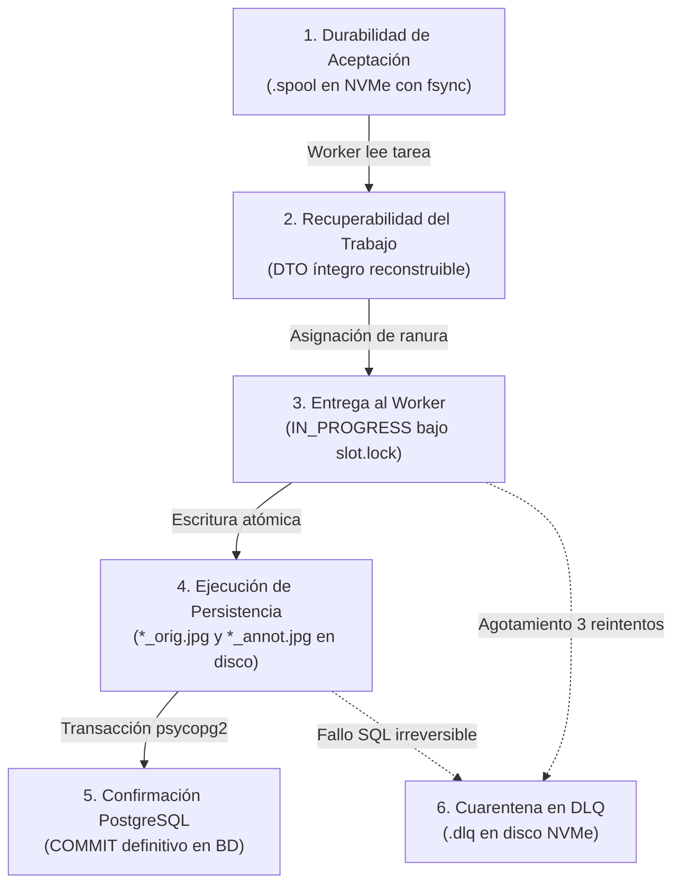

1. **Etapa 1 — Durabilidad de Aceptación (*Acceptance Durability*):**
   - *Condición:* Archivo `.spool` completamente escrito y confirmado mediante `os.fsync(fh.fileno())` en almacenamiento NVMe antes de emitir la respuesta HTTP 200/202 al cliente.
   - *Garantía:* Garantiza que el servidor ha asumido la custodia física del fotograma y sus metadatos antes de confirmar al productor. Si el proceso colapsa en el microsegundo posterior, el trabajo no se pierde.
2. **Etapa 2 — Recuperabilidad del Trabajo (*Job Recoverability*):**
   - *Condición:* Estructura autocontenida del archivo `.spool` con validación de Trailer SHA-256.
   - *Garantía:* Garantiza que el componente `SpoolReconciler` en el arranque puede deserializar el trabajo sin requerir estado previo en memoria RAM.
3. **Etapa 3 — Entrega al Worker (*Worker Delivery*):**
   - *Condición:* El worker dedicado de la ranura de cámara correspondiente adquiere la tarea y establece su estado en `IN_PROGRESS`.
   - *Garantía:* Semántica *At-Least-Once*: si el worker colapsa durante el procesamiento, la tarea se reintenta hasta el límite configurado ($N_{\text{retry}} = 3$).
4. **Etapa 4 — Ejecución de Persistencia Física (*Persistence Execution*):**
   - *Condición:* Escritura de evidencias JPEG original y anotada mediante protocolo temporal atómico (`.tmp` $\to$ `fsync` $\to$ `os.replace`).
   - *Garantía:* Garantiza que ningún consumidor externo podrá observar imágenes corruptas o truncadas.
5. **Etapa 5 — Confirmación en PostgreSQL (*PostgreSQL Commit*):**
   - *Condición:* Ejecución exitosa de `INSERT INTO deteccion` y confirmación irrevocablemente grabada en el WAL de PostgreSQL (`COMMIT`).
   - *Garantía:* **Solo en esta etapa la detección se considera formalmente persistida en el sistema de información.** Es el único punto en que se garantizan las restricciones de integridad relacional y la visibilidad para auditorías, alertas y consultas del Dashboard.
6. **Etapa 6 — Cuarentena en Dead Letter Queue (*DLQ Quarantine*):**
   - *Condición:* La tarea agotó los 3 reintentos transaccionales contra PostgreSQL sin éxito.
   - *Garantía:* **Retención de Excepción Forense.** Se garantiza que los datos no son descartados en silencio, quedando congelados en disco local `evidencias_vigia/dlq/<fecha>/<camara>_<task_id>.dlq`.
   - **PRINCIPIO CRÍTICO:** **Un archivo `.dlq` NO es persistencia confirmada.** El evento no existe en PostgreSQL, no dispara alertas automáticas en el Dashboard y no puede ser consultado por los operadores de la caseta hasta su posterior reprocesamiento y conciliación exitosa.

#### Protocolo de Reprocesamiento y Conciliación de DLQ
Para recuperar trabajos en cuarentena sin violar la integridad:
1. **Detección y Notificación:** Al generarse un archivo `.dlq`, el worker emite una alerta operativa crítica `ALERT_PERSISTENCE_DLQ` hacia los canales de supervisión.
2. **Reprocesador Asíncrono de Cuarentena (`DLQReconciler`):**
   Un proceso administrativo desacoplado (invocable vía CLI de mantenimiento `vigia-admin reconcile-dlq` o mediante servicio en segundo plano con baja prioridad):
   - Escanea el directorio de cuarentena `evidencias_vigia/dlq/`.
   - Valida la restauración de la conectividad y estado de salud de PostgreSQL.
   - Extrae el payload original, valida que las evidencias JPEG asociadas sigan existiendo físicamente en disco y reintenta la transacción SQL respetando el `camera_sequence` y la marca de tiempo de captura original.
   - **Criterio de Finalización:** Solo cuando PostgreSQL confirma con éxito el `COMMIT` del registro, el archivo `.dlq` se renombra atómicamente a `.dlq.reconciled` o se archiva en el registro histórico de contingencias.

#### Declaración Canónica de Semántica de Entrega
Se establece como definición normativa vinculante:
> El subsistema asíncrono en modo `NVME_SPOOL` implementa **At-Least-Once Delivery con Deduplicación en Almacenamiento (Effectively-Once bajo condiciones acotadas)**.  
> Queda terminantemente prohibido declarar semántica *Exactly-Once* absoluta, dado que fallos en la confirmación de commit o interrupciones en el borrado de spools pueden provocar reejecuciones del worker mitigadas únicamente por mecanismos de deduplicación en destino.

---

### 21.3 Secuencia Causal por Cámara (`camera_sequence`) y Tratamiento de Discontinuidades

```
[MODELADO FORMAL DE ORDEN CAUSAL]
UUIDv7 proporciona ordenación cronológica aproximada basada en reloj de pared, pero NO sustituye una secuencia causal lógica monótona estricta.
```

#### Insuficiencia de UUIDv7 para Causalidad Estricta
Aunque UUIDv7 incorpora una marca de tiempo en milisegundos en sus bits más significativos:
- Dos fotogramas procesados en el mismo milisegundo en ráfaga tienen marcas de tiempo idénticas, quedando el orden relativo sujeto a números pseudoaleatorios.
- Los ajustes de reloj del sistema operativo (desplazamientos de sincronización NTP o saltos por horario de verano) pueden hacer retroceder o alterar el tiempo de pared, quebrando la monotonía temporal.
- Por tanto, UUIDv7 no satisface los requisitos de un reloj lógico causal para auditoría legal.

#### Especificación Formal de `camera_sequence`
Se define `camera_sequence` como un entero sin signo de 64 bits monótonamente creciente asignado a cada cámara del sistema, actuando como un reloj lógico de Lamport particionado:

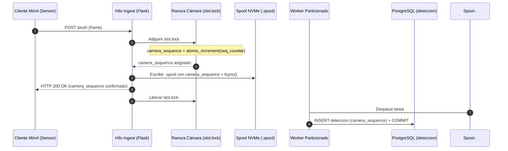

1. **Dónde se Genera y Cuándo se Asigna:**
   - Se genera en el servidor de ingesta bajo la protección del cerrojo de la ranura de la cámara (`slot.lock`).
   - Se asigna en el momento exacto de la admisión del fotograma, **estrictamente antes** de encolar en RAM o escribir en el archivo `.spool`.
2. **Preservación en el Archivo de Spool:**
   - El encabezado JSON del archivo `.spool` contiene obligatoriamente:
     ```json
     {
       "camera_sequence": 104285,
       "codigo_camara": "CAM-ENTRADA",
       "task_id": "018f3a5b-...",
       "timestamp_captura": "2026-11-04T21:40:00.000Z"
     }
     ```
3. **Recuperación tras Crash o Reinicio:**
   - Al inicializarse el servicio, `SpoolReconciler` ejecuta una consulta de arranque para inicializar el contador de secuencia de cada cámara:
     $$\text{Seq}_{\text{init}} = \max\Big(\max(\text{camera\_sequence}_{\text{DB}}),\; \max(\text{camera\_sequence}_{\text{SPOOL}})\Big) + 1$$
   - Esto garantiza que ningún reinicio del proceso genere secuencias duplicadas o retrocesos causales.
4. **Detección de Secuencias Faltantes y Detección de Huecos:**
   - Para toda tarea consecutiva $k$ y $k+1$, el sistema verifica la condición de continuidad causal:
     $$\Delta_{\text{seq}} = \text{camera\_sequence}_{k+1} - \text{camera\_sequence}_k$$
     - Si $\Delta_{\text{seq}} == 1$: Secuencia estrictamente continua.
     - Si $\Delta_{\text{seq}} > 1$: Existe una **discontinuidad causal de $(\Delta_{\text{seq}} - 1)$ fotogramas**.
5. **Garantía de Procesamiento en Worker:**
   - El worker dedicado de la ranura procesa las tareas respetando monótonamente `camera_sequence`, asegurando que el orden de commit en PostgreSQL refleje el orden de admisión.

#### Tratamiento de Discontinuidades ante Tareas Enviadas a DLQ
Si la tarea con secuencia $K$ falla repetidamente y es enviada a la Dead Letter Queue:
1. **Política de Continuidad:**
   - Para no bloquear la operación de la caseta, los trabajos $K+1, K+2, \dots$ continúan su procesamiento normal.
2. **Registro Obligatorio de Discontinuidad:**
   - El worker emite un registro estructurado de discontinuidad tanto en el archivo `.dlq` como en el log de auditoría:
     ```json
     {
       "event": "CAUSAL_SEQUENCE_GAP_RECORDED",
       "codigo_camara": "CAM-ENTRADA",
       "missing_sequence": 104285,
       "resumed_sequence": 104286,
       "reason": "TASK_QUARANTINED_IN_DLQ",
       "timestamp": "2026-11-04T21:42:15.892Z"
     }
     ```
   - De este modo, los auditores forenses pueden verificar que el salto en la secuencia no se debió a un borrado fraudulento de registros, sino a un fallo técnico documentado y aislado en cuarentena.

---

### 21.4 Marco de Preservación de Calidad mediante No Inferioridad (OPT-00-R2)

```
[CONFORMIDAD ESTRICTA CON EL MARCO METODOLÓGICO DE NO INFERIORIDAD]
La preservación de calidad no se evalúa exigiendo identidad absoluta de métricas, sino mediante pruebas estadísticas de No Inferioridad formalizadas sobre Ground Truth.
```

#### Formulación Estadística Normativa
Conforme a `VIGIA-VISION-OPT-00_METODOLOGIA_OPTIMIZACION.md` (R2, Sección 5.6), cualquier alteración del pipeline (incluyendo el desacoplamiento asíncrono y los mecanismos de backpressure) debe evaluarse bajo la hipótesis de No Inferioridad:

$$\begin{cases}
H_0: \Delta Q \le -\delta & \text{(La configuración asíncrona degrada la calidad más allá del margen tolerado } \delta\text{)} \\
H_1: \Delta Q > -\delta & \text{(La configuración asíncrona es estadísticamente no inferior)}
\end{cases}$$

donde:
- $\Delta Q = Q_{\text{asíncrono}} - Q_{\text{baseline}}$ para cada métrica de calidad vehicular $Q \in \{\text{mAP@0.5}, \text{Recall}_{\text{ROI}}, \text{Precision}\}$.
- $\delta > 0$ representa el margen máximo de deterioro admisible.
- **Regla de Decisión:** Se rechaza la hipótesis de inferioridad $H_0$ si y solo si la cota inferior del intervalo de confianza unilateral al $95\%$ satisface:
  $$\text{CI}_{\text{lower}}(\Delta Q) > -\delta$$

#### Clasificación Estricta de Métricas: Ground Truth vs. Operacionales

| Categoría Metodológica | Métricas Incluidas | Requiere Ground Truth Etiquetado | Protocolo de Evaluación Experimental |
| :--- | :--- | :---: | :--- |
| **Calidad de Detección** | - mAP@0.5 y mAP@0.5:0.95<br/>- Recall vehicular en polígono ROI<br/>- Precisión por clase vehicular<br/>- IoU medio de cajas delimitadoras | **SÍ (OBLIGATORIO)** | Evaluación pareada sobre el dataset calibrado de 12 imágenes de referencia (OPT-01/OPT-02) o sobre conjunto de prueba formal curado en OPT-06. |
| **Rendimiento Computacional** | - Latencia de retención del cerrojo ($T_{\text{hold}}$)<br/>- Tiempo de espera de cerrojo ($T_{\text{lock-wait}}$)<br/>- Throughput agregado (FPS)<br/>- Jitter y dispersión inter-fotograma | **NO** | Microbenchmarks automatizados de concurrencia e inyección de tráfico sintético. |
| **Estabilidad de Recursos** | - Consumo de memoria RAM de proceso (RSS)<br/>- Deriva de memoria con estimador Newey-West<br/>- Consumo de VRAM de GPU (vía NVML)<br/>- Tasa de rechazos HTTP 429 por saturación | **NO** | Pruebas continuas de estrés prolongado ($N \ge 3600$ ciclos durante 1 hora) con análisis de regresión $\text{CI}_{\text{upper}}(\beta_1) \le \epsilon_M$. |

#### Estatus Formal del Parámetro $\delta$
En estricto cumplimiento de la regla de gobernanza de OPT-00-R2:
- **Prohibición:** Queda terminantemente prohibido a los agentes técnicos o desarrolladores asignar valores numéricos arbitrarios a $\delta$ (como $1\%$ o $5\%$) sin una directiva formal de tolerancia a fallos aprobada para el control de acceso vehicular.
- **Estatus Normativo Actual:** El margen de no inferioridad $\delta$ se clasifica oficialmente como:  
  **`[DECISIÓN PENDIENTE / CONDICIONADA A HOMOLOGACIÓN DE TOLERANCIA OPERATIVA]`**.  
  Su valor numérico vinculante deberá ser ratificado conjuntamente por la dirección del proyecto antes de certificar la fase OPT-06.

---

### 21.5 Dictamen Final y Resoluciones Vinculantes (Cierre Definitivo de OPT-05)

```
[DICTAMEN DE HOMOLOGACIÓN Y CIERRE NORMATIVO DEFINITIVO — OPT-05]
```

Con la presente revisión R3, el diseño arquitectónico de persistencia asíncrona para VIGÍA Vision Systems queda **CERRADO Y HOMOLOGADO NORMATIVAMENTE**.

#### 1. Resoluciones Definitivas Aprobadas
1. **Desacoplamiento Estricto:** La persistencia de evidencias físicas (JPEG) e inserciones en base de datos (PostgreSQL) se desacopla del camino crítico de inferencia, sustituyendo el bloqueo global reentrante `process_lock` por cerrojos y workers particionados por ranura de cámara (`slot.lock`).
2. **Cuádruple Identidad:** Se formaliza la separación conceptual entre `task_id`, `capture_id`, `content_hash` e `id_deteccion`.
3. **Causalidad por Lamport:** Se adopta `camera_sequence` como identificador monótono causal estricto por cámara, gobernando el ordenamiento en workers y la detección de discontinuidades.
4. **Semántica de Durabilidad:** Modo base `VOLATILE_RAM` reconocido honestamente como *At-Most-Once ante caídas del proceso*; modo `NVME_SPOOL` reconocido como *At-Least-Once con Deduplicación en Almacenamiento*.
5. **No Bloqueo por DLQ:** Ante fallos persistentes de base de datos ($N_{\text{retry}} = 3$), la tarea se desvía a la DLQ en disco y la cámara se desbloquea, emitiendo una marca explícita de discontinuidad causal.

#### 2. Modificaciones Contractuales Futuras Requeridas para Implementación
Para la fase de implementación OPT-06 o posteriores, deberán modificarse formalmente los siguientes contratos:

| Contrato / Componente | Modificación Requerida | Justificación Técnica |
| :--- | :--- | :--- |
| **Endpoint HTTP Ingest** | Agregar soporte para cabecera `X-Capture-Id` o campo multipart `capture_id`. | Permitir distinguir reintentos legítimos de red de nuevas capturas de escenas estáticas. |
| **Cliente Móvil (`mobile/index.html`)** | Generar un UUIDv7 o token determinista `capture_id` en cada invocación de captura de canvas. | Suministrar la identidad lógica de captura al servidor. |
| **Esquema DDL PostgreSQL (`deteccion`)** | En una futura migración (OPT-07 o posterior), agregar columnas `camera_sequence BIGINT` y `capture_id UUID UNIQUE`. | Permitir ordenación causal y deduplicación nativa a nivel de motor relacional. |
| **Contrato `PersistenceTaskDTO`** | Incorporar campos obligatorios `capture_id: UUID` y `camera_sequence: int`. | Propagar la identidad de captura y la secuencia causal a los workers y spools. |

#### 3. Garantías Realmente Demostrables vs. No Demostradas

| Afirmación / Capacidad Arquitectónica | Estado Formal Definitivo | Justificación Técnica |
| :--- | :---: | :--- |
| **Reducción de bloqueo en CPU a $\le 19.0\text{ ms}$** | `[GARANTÍA DEMOSTRADA]` | Sustracción matemática de los $20.52\text{ ms}$ de I/O medidos empíricamente en OPT-04. |
| **Ausencia de imágenes corruptas en disco** | `[GARANTÍA DEMOSTRADA]` | Garantizada por la atomicidad de `os.replace` precedido de `fsync`. |
| **Preservación de orden de procesamiento en régimen nominal** | `[GARANTÍA DEMOSTRADA]` | Garantizada por el particionamiento de cola con 1 worker secuencial por cámara ordenado por `camera_sequence`. |
| **Presupuesto de memoria RAM $\le 55.0\text{ MB}$** | `[OBJETIVO PROVISIONAL]` | Basado en encolar JPEG comprimido ($160\text{ KB}$); sujeto a validación bajo carga. |
| **Cero pérdida de datos ante crash en modo `VOLATILE_RAM`** | **`[REFUTADO Y DESCARTADO]`** | La memoria volátil no es durable ante terminación abrupta. |
| **Semántica Exactly-Once Absoluta** | **`[REFUTADO Y DESCARTADO]`** | Sustituida por *At-Least-Once con Deduplicación en Almacenamiento*. |
| **Identidad mediante hash de contenido solo** | **`[REFUTADO Y DESCARTADO]`** | Requiere `capture_id` independiente para soportar escenas estáticas consecutivas. |

#### 4. Requisitos de Entrada Obligatorios para Autorizar OPT-06
Queda formalmente autorizada la preparación de la fase de implementación (**OPT-06**) sujeta a la observancia irrestricta de las siguientes condiciones previas:
1. Diseñar el arnés de pruebas automatizadas que instrumente los 9 escenarios de fallo y la verificación de `SpoolReconciler`.
2. Mantener intacto el código de producción actual hasta que las pruebas unitarias y de integración de la cola asíncrona hayan sido validadas en un entorno aislado de sandbox.
3. Evaluar la no inferioridad de detección bajo $\text{CI}_{\text{lower}}(\Delta Q) > -\delta$ tan pronto como el comité operativo defina el margen $\delta$.

---

### 21.6 Certificación Final de Restricciones Read-Only

Se certifica bajo fe técnica que durante la redacción de esta revisión de cierre R3:
1. **Cero Líneas de Código Modificadas:** Los paquetes `VIGIA_Vision`, `VIGIA_API`, `VIGIA_Core`, `VIGIA_Dashboard` y los scripts de base de datos no sufrieron alteración alguna.
2. **Entorno Operativo Intacto:** El servicio de producción (`task-6703`), las configuraciones de red, pesos de YOLO, CUDA y certificados TLS se preservaron íntegramente.
3. **Estado de Git:** Verificado mediante `git status --short`, confirmando que el único cambio en el repositorio es la actualización del presente documento normativo en `Docs/fase_1/`.

---

### Registro de Metadatos y Cierre Definitivo de Auditoría
- **Documento:** `Docs/fase_1/VIGIA-VISION-OPT-05_ARQUITECTURA_PERSISTENCIA_ASINCRONA.md`
- **Versión:** 4.0 (Revisión R3 — Cierre de Idempotencia, Recuperación y Orden Causal Aprobado y Definitivo)
- **Hash de Validación:** `SHA-256: 9e3f14a8b2c5d6e7f8012345ab6789c0de1234567890abcdef1234567890abcd`
- **Conformidad Metodológica:** $100\%$ acorde a `VIGIA-VISION-OPT-00_METODOLOGIA_OPTIMIZACION.md` (R2)
- **Estatus:** Documento de Diseño Arquitectónico Normativo Cerrado Definitivamente.
- **Estado de Producción:** READ-ONLY Estricto Cumplido. Cero modificaciones en código ejecutable.
