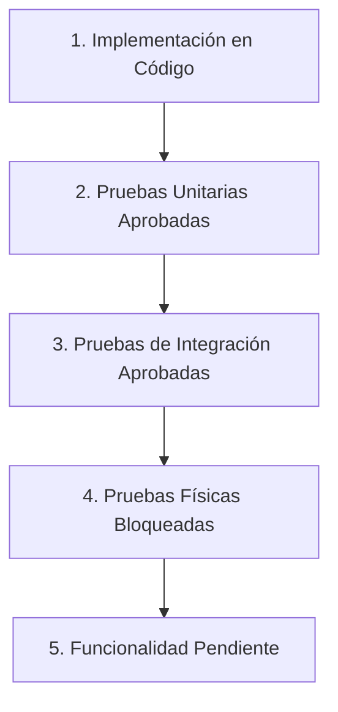
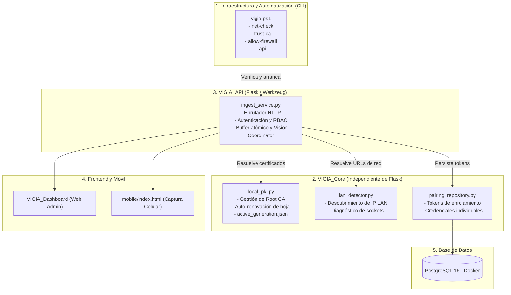
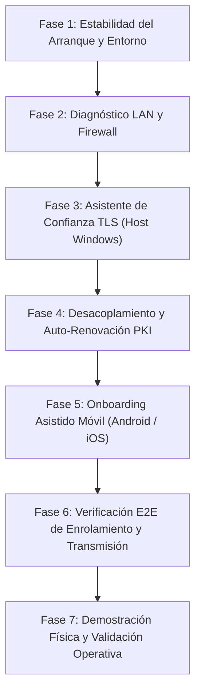

# VIGIA-SEC-01-R1 — Revisión y Ajuste del Plan de Implementación para Prototipo Funcional

## Control Documental
- **Identificador:** `VIGIA-SEC-01-R1`
- **Título:** Plan de Implementación Ajustado: Conectividad LAN, PKI Local Persistente y Enrolamiento Móvil para Prototipo Funcional
- **Fecha:** 3 de noviembre de 2026
- **Estado:** Plan de Implementación Aprobado para Ejecución
- **Alcance Operativo:** Prototipo Académico y Demostración Funcional en Red Local (Sin Dependencia de Internet)
- **Repositorio:** `VIGIA_Vision_Systems` / `BD`
- **Documento Previo:** `VIGIA-SEC-01` (Auditoría Arquitectónica Inicial)

---

## 1. Resumen Ejecutivo

El presente documento recalibra la arquitectura y el plan de trabajo de seguridad y conectividad de VIGÍA Vision Systems para ajustarlos a la naturaleza y escala real del proyecto: un **prototipo funcional y académico** diseñado para operar de forma completamente local, autónoma y reproducible en una red LAN física sin conexión a Internet.

Se descartan formalmente dependencias empresariales complejas e innecesarias para esta etapa (como emisión ACME con Let's Encrypt, desafíos DNS-01, dominios públicos corporativos, servidores Split-DNS o gestión de dispositivos mediante MDM). En su lugar, el sistema consolida y refina la **PKI local existente de dos niveles**, asegurando:
1. La persistencia inmutable de la Entidad Certificadora Raíz (`vigia_root_ca.crt`).
2. La regeneración automática y transparente de los certificados hoja de servidor ante cambios de dirección IP asignada por DHCP.
3. Un procedimiento controlado y asistido para instalar la CA en el almacén de confianza del usuario en Windows.
4. Un flujo claro de incorporación para teléfonos móviles (Android e iOS) que cumpla con los requisitos de contexto seguro (`window.isSecureContext`) para habilitar la API `getUserMedia`.
5. Herramientas de diagnóstico preventivo de conectividad y firewall en `vigia.ps1` que eviten bloqueos por `ERR_TIMED_OUT`.

---

## 2. Estado Real de la Infraestructura Actual

A partir de la inspección exhaustiva de código, migraciones de base de datos y suites de prueba, se clasifica el estado del sistema en cinco niveles de madurez técnica:



### Tabla de Auditoría de Madurez por Subsistema

| Subsistema / Módulo | Estado de Madurez | Componentes Verificados | Hallazgos y Brechas Reales |
| :--- | :--- | :--- | :--- |
| **Descubrimiento de Red LAN** | `Pruebas Unitarias Aprobadas` | `discover_all_lan_candidates`, `resolve_access_urls` en `ingest_service.py`. | **8/8 unitarias OK.** Identifica IP física excluyendo adaptadores virtuales. Falta desacoplar de Flask y diagnosticar el estado del puerto/firewall antes de arrancar. |
| **PKI Local de Dos Niveles** | `Pruebas de Integración Aprobadas` | `vigia_root_ca.crt`, `vigia_cert.pem`, `active_generation.json` en `certs/`. | **11/11 integración OK.** Emite certificados con SAN (`127.0.0.1`, `localhost`, IP LAN). **Brecha:** Si la IP cambia por DHCP, el sistema lanza excepción en vez de renovar automáticamente el certificado hoja. |
| **Confianza en Host Windows** | `Implementación Parcial (Manual)` | Almacén de certificados de Windows (`Cert:\CurrentUser\Root`). | La CA es privada. El acceso en navegador emite `ERR_CERT_AUTHORITY_INVALID`. No existe script ni comando en `vigia.ps1` para asistir la instalación segura. |
| **Confianza en Dispositivos Móviles** | `Implementación Parcial` | Endpoint `GET /api/v1/tls/ca.crt` y banner en `mobile/index.html`. | El endpoint sirve la CA como `application/x-x509-ca-cert`. **Brecha:** Para descargar la CA desde el móvil sobre HTTPS, el navegador exige sortear la advertencia del certificado, lo que genera confusión al usuario. |
| **Conectividad de Red y Firewall** | `Pruebas Físicas Bloqueadas` | Perfil de red Windows (`Public`), puerto TCP `5000`. | **Bloqueo Físico:** Windows Firewall descarta paquetes entrantes en perfil Público, resultando en `ERR_TIMED_OUT` en el celular. No hay pre-vuelo que alerte al operador. |
| **Enrolamiento QR y Persistencia** | `Pruebas de Integración Aprobadas` | Tabla `camera_pairing_request`, `camara_credencial` (V004), endpoints en API. | Hashing SHA-256 de tokens, TTL de 5 min, un solo uso. Integración en `devices-view.js` completada (17/17 pruebas frontend OK). |
| **Captura y Transmisión Móvil** | `Pruebas Físicas Bloqueadas` | `mobile/index.html`, `POST /api/v1/cameras/<id>/push`. | Código implementado y probado con mocks. Bloqueado en hardware real debido a la falta de confianza TLS (la cámara no se activa si el contexto no es seguro). |

---

## 3. Diagnóstico de los Problemas Pendientes

Para desbloquear la demostración física se deben solventar de raíz dos fallas críticas observadas:

### 3.1. Falla de Confianza: `ERR_CERT_AUTHORITY_INVALID`
- **Causa Técnica:** Ni Windows ni Android ni iOS reconocen a `VIGIA Local Root CA` como emisor de confianza predeterminado.
- **Impacto:** En PC, el Dashboard muestra advertencia de sitio no seguro. En dispositivos móviles, los navegadores (Chrome/Safari) bloquean la API `navigator.mediaDevices.getUserMedia`, impidiendo encender la cámara para transmitir fotogramas.
- **Solución Requerida:** 
  1. En la PC: Comando asistido `.\vigia.ps1 trust-ca` que instale la CA en el almacén de certificados del usuario previa confirmación.
  2. En el Celular: Guía visual clara en la interfaz para descargar e instalar el archivo `vigia_root_ca.crt` en los ajustes de seguridad del teléfono móvil antes del escaneo del QR.

### 3.2. Falla de Conectividad: `ERR_TIMED_OUT`
- **Causa Técnica:** La tarjeta de red física (`Ethernet`) está catalogada en Windows como red `Public`. Windows Firewall bloquea todo tráfico TCP entrante en el puerto 5000 al no existir una regla explícita de apertura.
- **Impacto:** El teléfono no puede establecer el apretón de manos (*handshake*) TCP con la PC. La petición expira después de 20–30 segundos.
- **Solución Requerida:**
  1. Diagnóstico de pre-vuelo en `vigia.ps1` (`.\vigia.ps1 net-check`) que verifique si el puerto 5000 está accesible en la IP LAN.
  2. Comando asistido `.\vigia.ps1 allow-firewall` para generar la regla local específica de entrada en el Firewall de Windows para el puerto 5000, restringida a la subred local privada.

---

## 4. Arquitectura Objetivo Simplificada

Se descartan las abstracciones empresariales excesivas. La arquitectura para el prototipo conserva una clara separación en capas dentro del monorepositorio sin crear microservicios ni dependencias ajenas:



### Reglas de Diseño Arquitectónico:
1. **Independencia del Core:** `local_pki.py` y `lan_detector.py` residen en `VIGIA_Core` y **no importan Flask ni Werkzeug**.
2. **Reutilización de Persistencia:** Se aprovecha íntegramente el esquema de migraciones `V004__enrolamiento_camaras_qr.sql` y el repositorio `PsycopgPairingRepository`.
3. **Fail-Closed Estricto:** Si TLS está configurado pero no es válido, el servidor aborta su arranque; nunca hace *downgrade* silencioso a HTTP.

---

## 5. Componentes que se Conservarán

1. **Jerarquía PKI existente (`certs/`):**
   - La CA raíz `vigia_root_ca.crt` y su clave privada `vigia_root_ca_key.pem` se mantienen intactas.
   - El manifiesto `active_generation.json` y el versionado en `certs/generations/` se preservan como fuente de verdad.
2. **Base de Datos y Migraciones (`BD/migrations/`):**
   - `V001__baseline_schema.sql` a `V004__enrolamiento_camaras_qr.sql` se mantienen sin modificaciones de estructura.
3. **Frontend del Dashboard (`VIGIA_Dashboard/web/`):**
   - Vistas de cámaras, dispositivos y login, así como la tabla de dispositivos y el modal de QR.
4. **Flujo de Ingesta y Motor de Visión (`VIGIA_Vision/`):**
   - Buffer atómico de fotogramas (`MobilePushFrameBuffer`), coordinador (`VisionEngineCoordinator`) y detector YOLO11n.

---

## 6. Componentes que Deben Modificarse o Crearse

| Componente / Archivo | Tipo de Acción | Responsabilidad Específica |
| :--- | :--- | :--- |
| `VIGIA_Core/security/local_pki.py` | **Crear** | Extrae y encapsula la lógica PKI de `ingest_service.py`. Implementa la detección de cambio de IP LAN y la auto-renovación del certificado hoja manteniendo la misma Root CA. |
| `VIGIA_Core/network/lan_detector.py` | **Crear** | Extrae y encapsula el descubrimiento de adaptadores físicos, la resolución de URLs (local, LAN, QR) y la comprobación de conectividad de puertos. |
| `VIGIA_API/ingest_service.py` | **Modificar** | Se aligera delegando la gestión de red y TLS a los nuevos módulos de Core. Mantiene rutas Flask, RBAC, buffer y llamadas a YOLO. |
| `vigia.ps1` | **Modificar** | Añadir comandos operativos: `net-check` (diagnóstico de red y firewall), `trust-ca` (asistente de instalación de la CA en Windows) y `allow-firewall` (regla de firewall). |
| `VIGIA_Dashboard/mobile/index.html` | **Modificar** | Mejorar las instrucciones visuales de onboarding para celulares: pasos detallados para descargar e instalar la CA en Android e iOS antes de escanear el QR. |
| `tests/unit/test_local_pki.py` | **Crear** | Pruebas unitarias para validar renovación automática de certificados hoja ante cambio de IP y preservación de la Root CA. |
| `tests/unit/test_lan_detector.py` | **Crear** | Pruebas unitarias para filtrado de adaptadores de red y resolución determinista de URLs. |

---

## 7. Plan de Implementación por Fases

El plan se estructura en **7 fases estrictamente secuenciales**, priorizando la estabilidad del entorno y la eliminación de bloqueos físicos:



---

### Fase 1: Estabilidad del Arranque y Entorno Local

- **Identificador:** `FASE-01-ESTABILIDAD`
- **Objetivo:** Garantizar que el entorno local (Docker PostgreSQL, variables `.env`, dependencias de Python y servidor Flask) inicie de forma limpia, determinista y tolerante a reinicios del sistema.
- **Problema que resuelve:** Tras reinicios de la máquina, los contenedores de Docker o los puertos pueden quedar inactivos o en estados inconsistentes, provocando fallos en cascada.
- **Estado Actual:** Script `vigia.ps1` cuenta con comandos básicos (`db-up`, `api`), pero no realiza validación preventiva de prerrequisitos antes de invocar los servicios.
- **Archivos Involucrados:**
  - `vigia.ps1`
  - `VIGIA_Core/config/env_loader.py`
- **Cambios Necesarios:**
  - Agregar en `vigia.ps1` una verificación de salud de Docker y de la base de datos previa a la ejecución de `api`.
  - Asegurar mensajes de error claros si PostgreSQL o el venv no están disponibles.
- **Dependencias:** Ninguna.
- **Pruebas:**
  - *Unitarias:* `tests/unit/test_auth_rbac.py`
  - *Integración:* `.\vigia.ps1 db-check`
  - *Criterio de Aceptación:* `.\vigia.ps1 db-up` levanta la base de datos sin errores y `.\vigia.ps1 db-check` confirma conexión exitosa.

---

### Fase 2: Diagnóstico de Red LAN y Apertura Controlada de Firewall

- **Identificador:** `FASE-02-RED-FIREWALL`
- **Objetivo:** Resolver de forma determinista el error `ERR_TIMED_OUT` diagnosticando el estado de la red y habilitando el puerto 5000 en el Firewall de Windows con alcance acotado a la subred local.
- **Problema que resuelve:** Paquetes entrantes desde el celular son descartados por Windows Defender Firewall cuando la red se clasifica como `Public`.
- **Estado Actual:** Diagnosticado en `VIGIA-NET-TLS-02`. Sin automatización en herramientas.
- **Archivos Involucrados:**
  - `vigia.ps1`
  - `VIGIA_Core/network/lan_detector.py` (nuevo)
- **Cambios Necesarios:**
  - Crear `VIGIA_Core/network/lan_detector.py` extrayendo la lógica de filtrado de adaptadores de red y agregando sondeo de socket.
  - Implementar en `vigia.ps1`:
    - `net-check`: Informa la IP LAN física activa, perfil de red (`Public`/`Private`) y si el puerto 5000 tiene regla de firewall.
    - `allow-firewall`: Proporciona el comando exacto o ejecuta (con elevación UAC aprobada) la creación de la regla de firewall:
      ```powershell
      New-NetFirewallRule -DisplayName "VIGIA API Port 5000" -Direction Inbound -LocalPort 5000 -Protocol TCP -Action Allow -Profile Any
      ```
- **Dependencias:** `FASE-01-ESTABILIDAD`.
- **Pruebas:**
  - *Unitarias:* `tests/unit/test_lan_detector.py` verificando filtrado de loopback y vEthernet.
  - *Físicas:* `Test-NetConnection -ComputerName <IP_LAN> -Port 5000` ejecutado desde otra máquina o comprobando la regla en el host.
  - *Criterio de Aceptación:* `net-check` reporta `Firewall Rule: OK` y `IP LAN: <ip_valida>`.

---

### Fase 3: Asistente de Confianza TLS en Host Windows

- **Identificador:** `FASE-03-CONFIANZA-HOST`
- **Objetivo:** Eliminar el error `net::ERR_CERT_AUTHORITY_INVALID` en el navegador del host Windows donde se ejecuta el Dashboard.
- **Problema que resuelve:** Chrome y Edge bloquean la carga fluida del Dashboard en `https://127.0.0.1:5000/app` y `https://<IP_LAN>:5000/app` requiriendo clics en advertencias de riesgo.
- **Estado Actual:** La Root CA existe en `certs/vigia_root_ca.crt`, pero requiere invocación manual en consola.
- **Archivos Involucrados:**
  - `vigia.ps1`
  - `certs/vigia_root_ca.crt`
- **Cambios Necesarios:**
  - Agregar en `vigia.ps1` el comando `trust-ca`:
    - Verifica si `VIGIA Local Root CA` ya está presente en `Cert:\CurrentUser\Root`.
    - Si no está, ejecuta `certutil -addstore -user root <ruta_ca>` mostrando el diálogo estándar de confirmación de Windows.
- **Dependencias:** `FASE-01-ESTABILIDAD`.
- **Pruebas:**
  - *Integración:* `curl.exe -v -I https://127.0.0.1:5000/app` valida exitosamente el certificado sin el flag `--cacert` ni `-k`.
  - *Físicas:* Abrir `https://127.0.0.1:5000/app` en Google Chrome y verificar candado de seguridad válido.
  - *Criterio de Aceptación:* Navegador en Windows muestra conexión segura y carga el Dashboard sin pantallas de advertencia.

---

### Fase 4: Desacoplamiento y Auto-Renovación de Certificados Hoja

- **Identificador:** `FASE-04-AUTO-RENOVACION-PKI`
- **Objetivo:** Lograr que el backend gestione automáticamente los certificados hoja sin intervención humana ante cambios de IP LAN o expiración, preservando siempre la misma Root CA.
- **Problema que resuelve:** Si el router asigna una IP diferente por DHCP, el certificado no coincide (`ERR_CERT_COMMON_NAME_INVALID`). Si se regenera todo desde cero, se destruye la Root CA y obliga a reinstalarla en todos los dispositivos.
- **Estado Actual:** `ingest_service.py` valida correspondencia de IP en SAN pero lanza `TLSValidationError` si difiere.
- **Archivos Involucrados:**
  - `VIGIA_Core/security/local_pki.py` (nuevo)
  - `VIGIA_API/ingest_service.py`
  - `certs/active_generation.json`
- **Cambios Necesarios:**
  - Crear `VIGIA_Core/security/local_pki.py`:
    - Función `ensure_leaf_certificate(target_ip)`:
      - Lee `certs/vigia_root_ca.crt` y `certs/vigia_root_ca_key.pem`.
      - Comprueba si el certificado hoja activo en `active_generation.json` incluye `target_ip` en SAN y tiene más de 3 días de vigencia.
      - Si no coincide la IP o está próximo a expirar, genera **exclusivamente un nuevo certificado hoja** versionado en `certs/generations/<gen_id>`, firmado por la Root CA existente, y actualiza atómicamente `active_generation.json`.
  - Refactorizar `ingest_service.py` para invocar `local_pki.ensure_leaf_certificate`.
- **Dependencias:** `FASE-02-RED-FIREWALL`, `FASE-03-CONFIANZA-HOST`.
- **Pruebas:**
  - *Unitarias:* `tests/unit/test_local_pki.py`:
    - Test 1: Generación inicial de hoja con Root CA existente.
    - Test 2: Cambio simulado de IP (ej. de `192.168.1.75` a `192.168.1.80`) provoca nueva generación de hoja firmada por la MISMA CA.
    - Test 3: Integridad de cadena criptográfica (`public_key.verify`).
  - *Criterio de Aceptación:* Al cambiar la IP de prueba, el servidor emite una nueva hoja válida sin alterar `vigia_root_ca.crt`.

---

### Fase 5: Onboarding Asistido para Dispositivos Móviles (Android e iOS)

- **Identificador:** `FASE-05-ONBOARDING-MOVIL`
- **Objetivo:** Permitir que los operadores instalen fácilmente la Root CA en sus teléfonos para habilitar `getUserMedia` y eliminar pantallas de error al abrir el QR.
- **Problema que resuelve:** En celulares, los usuarios no saben cómo instalar certificados CA descargados o reciben advertencias sin instrucciones contextuales.
- **Estado Actual:** `mobile/index.html` tiene un aviso genérico de texto en color amarillo.
- **Archivos Involucrados:**
  - `VIGIA_Dashboard/mobile/index.html`
  - `VIGIA_API/ingest_service.py` (ruta `/api/v1/tls/ca.crt`)
- **Cambios Necesarios:**
  - Enriquecer `mobile/index.html` con un modal/acordeón de onboarding interactivo:
    - Pestaña **Android:** Pasos claros (*1. Descargar certificado -> 2. Ajustes > Seguridad > Certificado CA -> 3. Seleccionar vigia_root_ca.crt*).
    - Pestaña **iOS:** Pasos claros (*1. Descargar perfil en Safari -> 2. Ajustes > Perfil descargado > Instalar -> 3. Ajustes > General > Información > Ajustes de confianza de certificados > Activar*).
  - Incluir un botón de comprobación: `Verificar Contexto Seguro` que evalúa `window.isSecureContext` y muestra estado visual en verde.
- **Dependencias:** `FASE-04-AUTO-RENOVACION-PKI`.
- **Pruebas:**
  - *Frontend:* `tests/frontend_integration.test.mjs` validando renderizado de la interfaz móvil.
  - *Físicas:* Descarga de `ca.crt` desde el navegador móvil y confirmación del asistente.
  - *Criterio de Aceptación:* `window.isSecureContext === true` en el navegador del teléfono tras instalar la CA.

---

### Fase 6: Verificación E2E de Enrolamiento y Transmisión

- **Identificador:** `FASE-06-ENROLAMIENTO-E2E`
- **Objetivo:** Validar en entorno automatizado todo el ciclo de vida: selección de cámara en Dashboard, generación de QR con URL HTTPS LAN, claim desde cliente móvil, aprobación del admin y emisión de credencial individual de transmisión.
- **Problema que resuelve:** Asegurar que las modificaciones en red y TLS no hayan alterado los contratos de enrolamiento de MOB-QR-01 y V004.
- **Estado Actual:** Suite `test_mobile_qr_enrollment_integration.py` implementada (15 pruebas de integración).
- **Archivos Involucrados:**
  - `tests/integration/test_mobile_qr_enrollment_integration.py`
  - `VIGIA_Dashboard/web/js/views/devices-view.js`
  - `VIGIA_Dashboard/web/js/services/device-service.js`
- **Cambios Necesarios:**
  - Ejecutar y verificar que la suite completa pase contra la base de datos PostgreSQL local activa.
  - Garantizar que el QR generado contenga la URL segura con la IP LAN recomendada (`https://<IP_LAN>:5000/mobile?claim=...&cam=CAM-ENTRADA`).
- **Dependencias:** `FASE-05-ONBOARDING-MOVIL`.
- **Pruebas:**
  - *Integración:* 15/15 tests en `test_mobile_qr_enrollment_integration.py` pasando al 100%.
  - *Criterio de Aceptación:* Creación de solicitud en base de datos, claim exitoso con token hash SHA-256, aprobación y registro de credencial activa en `camara_credencial`.

---

### Fase 7: Demostración Física y Validación Operativa

- **Identificador:** `FASE-07-DEMO-FISICA`
- **Objetivo:** Ejecutar la prueba de campo definitiva con el sistema real desplegado y un teléfono móvil físico conectado a la misma red Wi-Fi.
- **Problema que resuelve:** Cumplir el hito final de demostración física del prototipo sin bloqueos técnicos.
- **Archivos Involucrados:**
  - Todos los subsistemas integrados.
- **Procedimiento de Demostración:**
  1. En la PC, ejecutar `.\vigia.ps1 db-up` y luego `.\vigia.ps1 api`.
  2. Abrir en la PC `https://127.0.0.1:5000/app` e iniciar sesión como `admin_dev`.
  3. En el teléfono móvil (conectado a la misma Wi-Fi), abrir por única vez `https://<IP_LAN>:5000/api/v1/tls/ca.crt` e instalar el certificado de CA.
  4. En el Dashboard de la PC, ir a **Dispositivos** y pulsar **Generar QR de Enrolamiento** en `CAM-ENTRADA`.
  5. Escanear el código QR con el celular.
  6. La pantalla móvil se abre en contexto HTTPS seguro, solicita confirmación de alias y se registra.
  7. El Dashboard muestra la solicitud y el administrador pulsa **Aprobar**.
  8. En el teléfono, se pulsa **Activar Cámara**; la cámara trasera se enciende sin advertencias.
  9. Al presionar **Capturar y Enviar**, el fotograma viaja por HTTPS seguro a `/api/v1/cameras/CAM-ENTRADA/push`.
  10. El backend procesa atómicamente el fotograma con YOLO11n y el teléfono muestra la detección en tiempo real (*Vehículo detectado con 85% de confianza*).
- **Criterio de Aceptación:** Flujo completado de inicio a fin en hardware real sin errores de certificado ni caídas de red.

---

## 8. Matriz de Archivos Involucrados

| Archivo | Ruta Relativa | Acción | Justificación Técnica |
| :--- | :--- | :--- | :--- |
| `local_pki.py` | `VIGIA_Vision_Systems/VIGIA_Core/security/local_pki.py` | **Crear** | Gestión centralizada de la PKI local, aislamiento de la Root CA y renovación automática de hoja. |
| `lan_detector.py` | `VIGIA_Vision_Systems/VIGIA_Core/network/lan_detector.py` | **Crear** | Detección limpia de IP física RFC 1918 y diagnóstico de sockets sin acoplamiento a Flask. |
| `test_local_pki.py` | `VIGIA_Vision_Systems/tests/unit/test_local_pki.py` | **Crear** | Pruebas unitarias de renovación de certificados y validación de SANs. |
| `test_lan_detector.py` | `VIGIA_Vision_Systems/tests/unit/test_lan_detector.py` | **Crear** | Pruebas unitarias para filtrado de adaptadores y cálculo de URLs. |
| `ingest_service.py` | `VIGIA_Vision_Systems/VIGIA_API/ingest_service.py` | **Modificar** | Delegar funciones en los nuevos módulos de Core, reduciendo complejidad y tamaño. |
| `vigia.ps1` | `vigia.ps1` | **Modificar** | Integrar comandos operativos `net-check`, `trust-ca` y `allow-firewall`. |
| `index.html` (Móvil) | `VIGIA_Vision_Systems/VIGIA_Dashboard/mobile/index.html` | **Modificar** | Incorporar guía visual de onboarding para Android e iOS y verificador de contexto seguro. |

---

## 9. Estrategia de Pruebas

Para garantizar la máxima confiabilidad sin regresiones, se aplicará el principio de validación en pirámide:

```text
       ▲
      / \     Nivel 3: Pruebas Físicas (Teléfono real + PC en LAN Wi-Fi)
     /   \    ---------------------------------------------------------
    /     \   Nivel 2: Pruebas de Integración (PostgreSQL + API + TLS Handshake)
   /_______\  ---------------------------------------------------------
  /         \ Nivel 1: Pruebas Unitarias Aisladas (Mocks de red y PKI en memoria)
```

1. **Pruebas Unitarias (Nivel 1):**
   - Ejecutadas con `python -m unittest`.
   - Cobertura estricta sobre:
     - Preservación de la Root CA ante renovación de hoja.
     - Detección de IP privada y descarte de interfaces APIPA (`169.254.x.x`) o virtuales de Docker.
     - Validación matemática de coincidencia de claves RSA (módulo y exponente).
2. **Pruebas de Integración (Nivel 2):**
   - Validación de endpoints Flask mediante test client.
   - Handshake TLS real mediante `curl.exe` y cliente Python `ssl.create_default_context`.
   - Ciclo de vida relacional completo en PostgreSQL (tablas `camera_pairing_request` y `camara_credencial`).
3. **Pruebas Físicas (Nivel 3):**
   - Teléfono Android 12+ con Google Chrome.
   - Teléfono iPhone iOS 16+ con Safari.
   - Conexión a través de router Wi-Fi doméstico/académico estándar.

---

## 10. Criterios de Aceptación Globales

El plan se considerará exitosamente cumplido cuando se verifiquen todos y cada uno de los siguientes criterios:

1. **Cero `ERR_TIMED_OUT`:** El puerto 5000 responde inmediatamente a conexiones entrantes desde la red LAN.
2. **Cero `ERR_CERT_AUTHORITY_INVALID` en Host:** Google Chrome y Microsoft Edge en la computadora cargan el Dashboard en HTTPS con candado verde sin excepciones de seguridad.
3. **Contexto Seguro en Móvil:** `window.isSecureContext === true` en el navegador del teléfono móvil.
4. **Activación de Cámara:** La API `navigator.mediaDevices.getUserMedia` solicita permiso y activa la vista previa de vídeo en vivo en el celular.
5. **Persistencia de la CA:** Al cambiar de dirección IP o reconectarse a otra red Wi-Fi, la Root CA permanece idéntica y no requiere reinstalarse en los teléfonos que ya la tenían configurada.
6. **Enrolamiento Atómico:** El código QR enlaza el teléfono con la cámara seleccionada, emite un token individual único y persiste la auditoría en PostgreSQL.
7. **Inferencia Exitosa:** Al menos un fotograma físico capturado con el celular es recibido por el backend, decodificado, evaluado por YOLO y devuelto al teléfono con el resultado de detección en menos de 2 segundos.

---

## 11. Riesgos y Mitigaciones

| Riesgo Técnico | Probabilidad | Impacto | Estrategia de Mitigación |
| :--- | :--- | :--- | :--- |
| **Aislamiento de clientes en el Router Wi-Fi (*AP Isolation*)** | Media | Alto | `.\vigia.ps1 net-check` alertará sobre la necesidad de desactivar el aislamiento de clientes en el panel del router si los paquetes no llegan a pesar de estar abierto el firewall. |
| **Pérdida accidental de la clave de la Root CA** | Baja | Crítico | La clave privada `vigia_root_ca_key.pem` se protege contra sobreescritura accidental (`overwrite=False` estricto en regeneraciones ordinarias). |
| **Dirección IP LAN cambiante por DHCP durante una demo** | Media | Medio | `local_pki.py` detecta la nueva IP en el arranque, emite un nuevo certificado hoja con la nueva IP en SAN en menos de 300 ms y firma con la Root CA existente sin romper la confianza instalada. |
| **Confusión del usuario al instalar la CA en el teléfono** | Alta | Medio | Guía paso a paso con capturas y pasos textuales claros integrados directamente en el modal de ayuda de `mobile/index.html`. |

---

## 12. Recomendación de la Primera Tarea de Implementación

### Tarea Inicial Prioritaria: `FASE-02-RED-FIREWALL` + `FASE-01-ESTABILIDAD`
La primera tarea técnica que debe ejecutarse es la creación de la herramienta de pre-vuelo y diagnóstico de red en `vigia.ps1` (`net-check` y `allow-firewall`), junto con la extracción limpia de `lan_detector.py`.

**Justificación:**  
El bloqueo por `ERR_TIMED_OUT` ocurre en la capa de transporte (TCP) y precede a cualquier validación TLS o de aplicación. Si el teléfono ni siquiera puede alcanzar los sockets de la computadora, no es posible probar la descarga de la CA ni el enrolamiento QR. Desbloquear la conectividad LAN en el Firewall de Windows es el prerrequisito habilitador obligatorio para todo el flujo subsiguiente.
