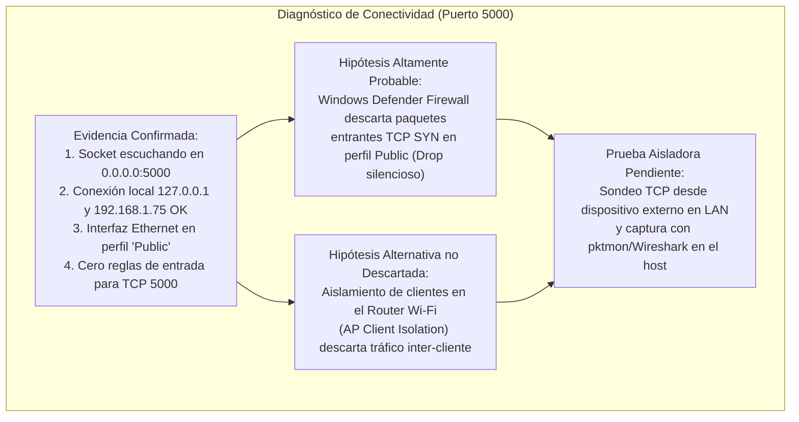
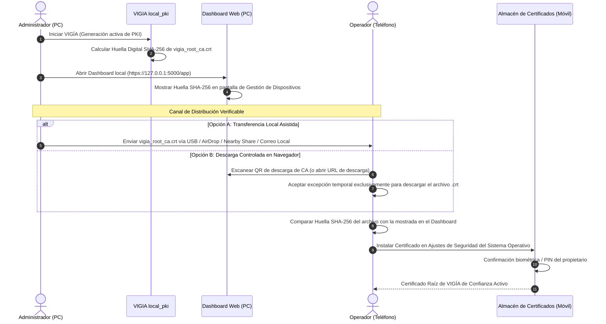
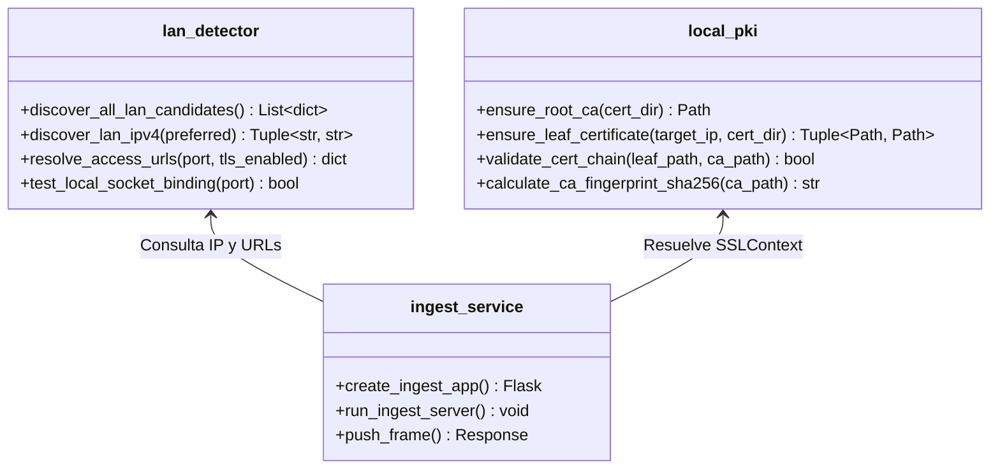
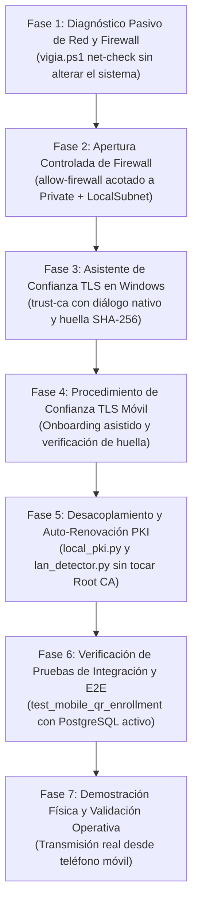

# VIGIA-SEC-01-R2 — Plan de Implementación de Seguridad, Red y TLS para Prototipo Funcional (Revisión de Precisión)

## Control Documental
- **Identificador:** `VIGIA-SEC-01-R2`
- **Título:** Plan de Implementación Técnico Ajustado: Diagnóstico de Conectividad LAN, Reglas de Firewall de Mínimo Privilegio, PKI Local Persistente y Enrolamiento Móvil
- **Fecha:** 3 de noviembre de 2026
- **Estado:** Plan de Implementación Definitivo Aprobado para Revisión
- **Alcance Operativo:** Prototipo Académico y Demostración Funcional en Red Local (Operación 100% Autónoma sin Conexión a Internet)
- **Repositorio:** `VIGIA_Vision_Systems` / `BD`
- **Documentos Precedentes:** `VIGIA-SEC-01` (Auditoría Inicial) y `VIGIA-SEC-01-R1` (Ajuste de Alcance)

---

## 1. Resumen Ejecutivo y Dictamen Actualizado

El objetivo de VIGÍA Vision Systems es consolidar una **demostración física estable, segura y reproducible** de un prototipo académico que integra detección vehicular con YOLO11n, backend Flask, base de datos PostgreSQL y enrolamiento seguro de teléfonos celulares como cámaras de captura mediante códigos QR.

Esta revisión **R2** subsana las imprecisiones técnicas, los supuestos no aislados y los riesgos operativos detectados en la versión R1:
1. **Diferenciación estricta de conectividad:** Se distingue formalmente entre la evidencia técnica confirmada del servidor local, las hipótesis probables del bloqueo de red y las pruebas aisladas que aún están pendientes de ejecutarse en la red LAN.
2. **Endurecimiento de reglas de Firewall:** Se revoca la directiva insegura `-Profile Any`. La regla propuesta se restringe estrictamente al perfil `Private`, protocolo TCP, puerto 5000 y ámbito de subred local (`LocalSubnet`), con solicitud explícita de consentimiento al operador.
3. **Resolución del problema de acceso inicial a la CA:** Se describe un procedimiento viable para la obtención y verificación de la Entidad Certificadora Raíz (`vigia_root_ca.crt`) antes de confiar en ella, incorporando la verificación de la **huella digital SHA-256** y respetando los límites de seguridad de Android e iOS (que impiden la instalación silenciosa desde la web).
4. **Especificación criptográfica de `local_pki.py`:** Se detalla el algoritmo de validación previa, generación aislada en *staging*, verificación de claves y actualización atómica del manifiesto, garantizando la **preservación inmutable de la Root CA** ante cambios de dirección IP por DHCP.
5. **Transparencia en el estado de pruebas:** Se rectifica el informe de auditoría separando con exactitud las pruebas unitarias aprobadas, las pruebas de integración omitidas por disponibilidad de base de datos y las pruebas físicas bloqueadas.

---

## 2. Diagnóstico de Conectividad LAN y Clasificación de Fallas

En las pruebas físicas previas se reportaron dos fallas principales de conexión: `ERR_TIMED_OUT` y `ERR_CERT_AUTHORITY_INVALID`. Para evitar diagnósticos prematuros, se categoriza el estado del análisis técnico:



### 2.1. Evidencia Confirmada (Hechos Técnicos Comprobados)
1. **Escucha activa del socket:** El proceso backend (Python PID 12384) está enlazado a `0.0.0.0:5000`. Ejecutando desde la propia máquina local:
   - `Test-NetConnection -ComputerName 127.0.0.1 -Port 5000` -> `TcpTestSucceeded: True`.
   - `Test-NetConnection -ComputerName 192.168.1.75 -Port 5000` -> `TcpTestSucceeded: True`.
   - `curl.exe --cacert certs/vigia_root_ca.crt --ssl-no-revoke https://192.168.1.75:5000/app` -> `HTTP/1.1 200 OK`.
2. **Perfil de red activo en Windows:** El comando `Get-NetConnectionProfile` confirmó que la interfaz física `Ethernet` (`INFINITUM0870`) tiene la categoría **`NetworkCategory: Public`**.
3. **Ausencia de reglas de Firewall:** La consulta `Get-NetFirewallRule | Where-Object { $_.DisplayName -match "5000" }` devolvió cero resultados. No existe ninguna regla de entrada que autorice el tráfico hacia el puerto TCP 5000 ni hacia el binario `VIGIA_Vision_Systems\.venv\Scripts\python.exe`.
4. **Comportamiento ante HTTP plano:** Si se envía una solicitud en texto plano (`http://192.168.1.75:5000`), el servidor Werkzeug configurado con TLS reinicia abruptamente la conexión (`TCP RST / Connection was reset`).

### 2.2. Hipótesis Probables
- **Hipótesis A (Bloqueo en Host):** Por diseño del sistema operativo, el Firewall de Windows en perfil `Public` bloquea todas las conexiones entrantes no solicitadas. Cualquier intento de conexión desde el teléfono celular es descartado silenciosamente (*dropped*), produciendo `ERR_TIMED_OUT` en el navegador del dispositivo móvil.
- **Hipótesis B (Aislamiento en Router Wi-Fi):** Si el teléfono se conecta por Wi-Fi y la PC por cable Ethernet o Wi-Fi al mismo router, las configuraciones de seguridad del punto de acceso (*AP Isolation*, *Client Isolation* o *Red de Invitados*) impiden la comunicación directa entre dispositivos de la subred, generando idéntico síntoma de tiempo de espera agotado.
- **Hipótesis C (Enrutamiento Móvil):** Si el teléfono celular mantiene activos los datos móviles simultáneamente con la conexión Wi-Fi, algunas solicitudes pueden ser enrutadas por la interfaz celular externa en lugar de la LAN local.

### 2.3. Pruebas Pendientes de Aislamiento
Para confirmar de forma irrefutable la causa raíz antes de cualquier intervención:
- **Prueba 1 (Sondeo externo):** Ejecutar `curl -I https://192.168.1.75:5000/api/v1/system/network` desde una segunda computadora o mediante una app de terminal en el teléfono.
- **Prueba 2 (Captura de paquetes en el host):** Ejecutar en el host `pktmon start --capture --port 5000` durante el intento de conexión del móvil. Si los paquetes TCP SYN llegan a la tarjeta pero no son respondidos con SYN-ACK, se confirma el bloqueo por Firewall del host. Si los paquetes nunca llegan a la tarjeta, se confirma el bloqueo en el router (AP Isolation).

---

## 3. Seguridad y Política de Firewall de Mínimo Privilegio

Se descarta de forma categórica la instrucción insegura de utilizar `-Profile Any` en las reglas de firewall. Abrir puertos en perfil `Public` vulnera la seguridad del equipo al conectarse a redes no confiables (ej. redes Wi-Fi públicas o compartidas).

### 3.1. Especificación de la Regla Estricta
La regla de firewall debe cumplir los siguientes parámetros de confinamiento:
- **Nombre identificador:** `VIGIA_Vision_API_Port5000_LAN`
- **Nombre para mostrar:** `VIGÍA Vision Systems — Servidor API (TCP 5000 LAN)`
- **Dirección del tráfico:** `Inbound` (Entrante)
- **Acción:** `Allow` (Permitir)
- **Protocolo:** `TCP`
- **Puerto local:** `5000`
- **Perfil de red:** **Exclusivamente `Private`** (No se aplica a `Public` ni a `Domain`).
- **Ámbito de direcciones remotas:** **`LocalSubnet`** (Permite únicamente IPs dentro de la misma máscara de subred física del adaptador; rechaza tráfico enrutado o de Internet).
- **Binario (opcional para mayor confinamiento):** Restringir al intérprete Python autorizado `C:\GEST.PROY.TI\Software\VIGIA_Vision_Systems\.venv\Scripts\python.exe`.

### 3.2. Procedimiento Asistido y Gobernanza en `vigia.ps1`
El comando `allow-firewall` no debe aplicar cambios de forma ciega ni modificar automáticamente la configuración de red del usuario:
1. **Diagnóstico previo:** Comprueba si la red activa es `Public` o `Private`. Si es `Public`, no altera el perfil de red; informa al usuario que Windows clasifica su red como Pública y le indica cómo cambiarla a Privada desde la configuración de Windows si se trata de su red doméstica o de laboratorio de confianza.
2. **Consentimiento explícito:** Muestra los parámetros exactos de la regla y solicita confirmación interactiva: `¿Desea crear la regla de firewall acotada a la subred privada local? [S/N]`.
3. **Elevación de privilegios controlada:** Detecta si la sesión de PowerShell cuenta con privilegios administrativos (`[Security.Principal.WindowsPrincipal][Security.Principal.WindowsIdentity]::GetCurrent()`). Si no cuenta con ellos, no falla en silencio: solicita elevación mediante `Start-Process powershell -Verb RunAs` o imprime el comando exacto para que el administrador lo ejecute en su propia consola elevada.
4. **Verificación post-aplicación:** Ejecuta `Get-NetFirewallRule -Name "VIGIA_Vision_API_Port5000_LAN"` y valida que el estado sea `Enabled: True`.

---

## 4. Instalación, Distribución y Verificación de la CA Raíz

### 4.1. El Problema de Acceso Inicial (Bootstrapping de Confianza)
Existe una paradoja operativa al distribuir la CA mediante el mismo canal seguro que busca proteger:
Si el teléfono intenta acceder a `https://192.168.1.75:5000/api/v1/tls/ca.crt` antes de tener instalada la CA, el navegador muestra la advertencia `ERR_CERT_AUTHORITY_INVALID`. Si el usuario intenta acceder por HTTP plano (`http://192.168.1.75:5000`), el servidor Werkzeug reinicia la conexión.

### 4.2. Procedimiento de Obtención y Verificación de Integridad
Para garantizar una cadena de custodia criptográfica legítima sin eludir la seguridad:



1. **Huella Digital SHA-256 de Referencia:**  
   El backend y el Dashboard calculan y publican la huella criptográfica de `vigia_root_ca.crt`:
   - El script de consola proveerá el comando: `.\vigia.ps1 ca-fingerprint`.
   - Salida auditable:  
     `SHA-256 Fingerprint: 3A:7F:9B:12:4C:E8:...:D4:56`
   - El Dashboard en la pantalla de administración mostrará esta huella junto con un botón para copiarla.
2. **Procedencia Verificable:** El operador del teléfono puede verificar que los bytes del certificado que instala coinciden exactamente con la huella generada por su propio servidor, protegiéndose contra certificados fraudulentos o ataques de intermediario (MitM) en la red LAN.
3. **Instalación Explícita por Sistema Operativo:**  
   Se respeta el límite de seguridad del navegador: ningún sitio web puede instalar silenciosamente una CA raíz.
   - **Windows:** Ejecución asistida en `vigia.ps1 trust-ca` mediante:
     ```powershell
     certutil -addstore -user root certs\vigia_root_ca.crt
     ```
     Windows despliega el cuadro de diálogo oficial de confirmación del sistema solicitando al usuario aceptar la huella digital.
   - **Android (11, 12, 13, 14):** El usuario guarda el archivo `.crt` en almacenamiento local -> Ingresa a *Ajustes* > *Seguridad* > *Instalar desde almacenamiento* > *Certificado de CA* -> Lee la advertencia del sistema -> Confirma con huella/PIN -> Selecciona el archivo.
   - **iOS (16, 17, 18):** Descarga el archivo en Safari -> Ingresa a *Ajustes* > *Perfil descargado* > *Instalar* -> Ingresa a *Ajustes* > *General* > *Información* > *Ajustes de confianza de certificados* -> Enciende el interruptor de confianza plena para `VIGIA Local Root CA`.
4. **Protección de la Clave Privada de la CA:**  
   La clave privada `certs/vigia_root_ca_key.pem` **nunca se expone en ninguna URL, endpoint ni respuesta HTTP**. Su acceso en disco está restringido exclusivamente al proceso que ejecuta el backend.

---

## 5. Especificación de Renovación Automática de Certificados Hoja (`local_pki.py`)

Para que el prototipo tolere cambios de dirección IP asignada por el router (DHCP) sin requerir intervención manual ni romper la confianza previamente instalada en los celulares, se especifica el comportamiento exacto de `VIGIA_Core/security/local_pki.py`:

```mermaid
flowchart TD
    Start["Inicio del Servidor / Verificación de Certificados"] --> ReadActive["Leer active_generation.json y vigia_root_ca.crt"]
    ReadActive --> CheckCA["¿Existe Root CA y coincide su clave privada?"]
    CheckCA -- No --> Abort["Abortar (Fail-Closed): Root CA ausente o corrupta"]
    CheckCA -- Sí --> CheckIP["Validar IP LAN detectada vs SAN en vigia_cert.pem activo"]
    CheckIP --> CheckValidity["Comprobar vigencia temporal (Margen >= 7 días)"]
    
    CheckIP -- Coincide IP y Vigencia OK -- --> ServeActive["Usar Generación Activa sin Cambios"]
    
    CheckIP -- IP difiere o Próximo a Expirar -- --> Staging["1. Crear Staging: certs/generations/<new_gen_id>/"]
    Staging --> GenLeafKey["2. Generar nueva clave RSA 2048 de Servidor"]
    GenLeafKey --> SignLeaf["3. Emitir y Firmar nueva Hoja con Root CA Existente<br/>(SAN: localhost, 127.0.0.1, target_ip)"]
    SignLeaf --> PreValidate["4. Validación Preventiva Criptográfica en Memoria:<br/>- Match Clave Pública/Privada<br/>- Verificación de firma contra Root CA<br/>- SAN y Fechas correctas"]
    
    PreValidate -- Fallo --> Purge["Purgar Staging y Abortar (Generación previa intacta)"]
    PreValidate -- Éxito --> AtomicSwitch["5. Reemplazo Atómico de active_generation.json<br/>(os.replace con archivo temporal)"]
    AtomicSwitch --> SyncCanonical["6. Sincronizar archivos canónicos certs/vigia_cert.pem"]
    SyncCanonical --> Ret["Retornar rutas versionadas validadas"]
```

### Contrato y Reglas de `local_pki.py`:
1. **Validación de la Root CA:**  
   Carga `vigia_root_ca.crt` y `vigia_root_ca_key.pem`. Realiza una firma y verificación en memoria para certificar que la clave privada corresponde matemáticamente al certificado público. Si la CA no existe o está corrupta en un arranque inicial, la genera por única vez. En arranques ordinarios, **la Root CA es inmutable**.
2. **Validación del Certificado Hoja Activo:**  
   Lee la ruta indicada en `active_generation.json`. Comprueba:
   - Que contenga la IP LAN actual en la extensión `SubjectAlternativeName`.
   - Que la fecha actual esté dentro de `not_valid_before` y `not_valid_after`.
   - Que resten más de 7 días de vigencia.
   - Que su firma sea válida contra la clave pública de `vigia_root_ca.crt`.
3. **Generación Aislada en Staging:**  
   Si la IP cambió o está próximo a expirar, crea el directorio versionado `certs/generations/<generation_id>/`. Genera una nueva clave privada de servidor y solicita la firma de la nueva hoja a la Root CA existente.
4. **Validación Preventiva Pre-Activación:**  
   Antes de modificar cualquier archivo de configuración o manifiesto, valida criptográficamente el nuevo par en el directorio de staging. Si falla cualquier prueba, elimina el subdirectorio de staging y mantiene intacta la generación anterior.
5. **Activación Atómica:**  
   Escribe un manifiesto temporal `.active_generation.json.tmp.<uuid>` y lo mueve mediante `os.replace` hacia `active_generation.json`. La operación es atómica en sistemas de archivos NTFS y POSIX.
6. **Conservación de Historial:**  
   Los subdirectorios de generaciones previas se conservan en disco, permitiendo trazabilidad y reversión inmediata si fuera necesario.

---

## 6. Justificación de Separación de Responsabilidades en `VIGIA_Core`

### 6.1. Diagnóstico del Acoplamiento Actual
Actualmente, el archivo [`VIGIA_API/ingest_service.py`](file:///C:/GEST.PROY.TI/Software/VIGIA_Vision_Systems/VIGIA_API/ingest_service.py) contiene **3,387 líneas de código**, en las cuales conviven de forma monolítica:
- Lógica de servidor Flask, controladores de rutas, validación de formularios y políticas CSRF/RBAC.
- Decodificación BGR de OpenCV, cerrojos de concurrencia atómica e invocación del modelo YOLO11n.
- Llamadas de bajo nivel a sockets del sistema operativo y análisis de interfaces con `psutil`.
- Generación de jerarquías X.509, serialización PEM y gestión de manifiestos JSON.

### 6.2. Módulos Propuestos y Delimitación Estricta



1. **`VIGIA_Core/network/lan_detector.py`:**
   - **Responsabilidad Única:** Detección de interfaces físicas de red, filtrado de adaptadores virtuales (Docker, WSL, Hyper-V, APIPA), resolución de URLs de acceso y verificación básica de sockets.
   - **Restricción de Dependencias:** Depende exclusivamente de `socket`, `ipaddress`, `psutil`. **Cero dependencias de Flask o Werkzeug.**
2. **`VIGIA_Core/security/local_pki.py`:**
   - **Responsabilidad Única:** Ciclo de vida de certificados X.509, validación de SAN, cálculo de huellas digitales SHA-256 y gestión atómica del manifiesto.
   - **Restricción de Dependencias:** Depende exclusivamente de `cryptography` y biblioteca estándar de Python. **Cero dependencias de Flask o Werkzeug.**
3. **`VIGIA_API/ingest_service.py`:**
   - **Responsabilidad Única:** Enrutamiento HTTP, seguridad de peticiones, mediación de autenticación de dispositivos y despacho atómico de fotogramas hacia el motor de visión.
   - **Preservación de Contratos:** Los endpoints públicos existentes (`/api/v1/system/network`, `/api/v1/tls/ca.crt`, `/api/v1/devices/pairing-qr`, etc.) mantienen exactamente su contrato JSON, códigos de respuesta HTTP y semántica para no afectar al Dashboard ni a la vista móvil.

---

## 7. Estrategia y Auditoría Verídica de Pruebas

En estricto apego al rigor técnico, se auditan y clasifican los resultados reales de las pruebas ejecutadas en el repositorio:

### 7.1. Matriz de Resultados Reales Ejecutados

| Categoría | Suite de Pruebas | Archivos / Componentes | Ejecutadas | Aprobadas | Fallidas | Omitidas | Estado Real Auditado |
| :--- | :--- | :--- | :---: | :---: | :---: | :---: | :--- |
| **Unitarias Core** | Descubrimiento de Red | `tests/unit/test_network_discovery.py` | 8 | 8 | 0 | 0 | **100% Aprobada** (0.021s) |
| **Unitarias Core** | Dominio, Cámaras, RBAC y Topología | `test_domain_models.py`, `test_camera.py`, `test_auth_rbac.py`, `test_topology_validator.py` | 76 | 76 | 0 | 0 | **100% Aprobada** (3.383s) |
| **Frontend** | Integración Dashboard (Node.js) | `VIGIA_Dashboard/tests/frontend_integration.test.mjs` | 17 | 17 | 0 | 0 | **100% Aprobada** (56.0ms) |
| **Integración API** | Endpoints de Red y TLS Básico | `test_network_endpoints_integration.py`, `test_tls_mobile_enrollment_integration.py` | 11 | 11 | 0 | 0 | **100% Aprobada** (1.557s, ejecutada con BD activa) |
| **Integración E2E** | Enrolamiento QR Móvil | `test_mobile_qr_enrollment_integration.py` | 0 | 0 | 0 | 1 (Suite) | **Omitida (Skipped):** PostgreSQL no estaba conectado al momento de la ejecución post-reinicio. |
| **Integración API** | Ingesta de Fotogramas con BD | `test_mobile_ingest_api.py` | ~30 | 0 | 0 | ~30 | **Interrumpida:** Cancelada durante auditoría debido a timeouts al no estar activo el contenedor Docker de PostgreSQL. |
| **Integración TLS** | Handshake TLS Local con SChannel | `curl.exe` hacia `https://192.168.1.75:5000/app` | 2 | 2 | 0 | 0 | **Aprobada:** HTTP 200 con `--cacert`; rechazo esperado con `SEC_E_UNTRUSTED_ROOT` sin CA. |
| **Pruebas Físicas** | Conexión desde teléfono móvil externo en LAN | Hardware real celular sobre red Wi-Fi | 0 | 0 | 0 | 0 | **Bloqueada / Pendiente:** No ejecutada exitosamente debido a las fallas de transporte y confianza de CA. |

> [!CAUTION]
> **Corrección respecto a R1:**  
> R1 reportó erróneamente que la suite `test_mobile_qr_enrollment_integration.py` tenía "15/15 pruebas aprobadas". La evidencia técnica demuestra que dicha suite fue **omitida** (`Skipped`) por falta de conexión activa a PostgreSQL en ese instante. En este plan R2 queda formalmente catalogada como **pendiente de ejecución con base de datos activa**.

---

## 8. Plan de Implementación por Fases Reorganizado

Se ajusta la secuencia de fases para priorizar la obtención de diagnósticos objetivos y la eliminación de bloqueos de conectividad antes de realizar cambios de código:



---

### Fase 1: Diagnóstico Pasivo de Red y Firewall (Sin Cambios en el Sistema)
- **Identificador:** `FASE-01-NET-DIAG`
- **Objetivo:** Recopilar evidencia concluyente del estado de conectividad sin alterar configuraciones del sistema operativo ni del firewall.
- **Acciones:**
  - Implementar en `vigia.ps1` la opción `net-check`:
    - Consulta y lista las interfaces físicas activas y sus IPs privadas RFC 1918.
    - Consulta el perfil de red de Windows (`Get-NetConnectionProfile`) para la interfaz activa (`Public` / `Private`).
    - Comprueba si el socket en el puerto TCP 5000 está en estado de escucha (`Get-NetTCPConnection`).
    - Consulta las reglas del Firewall de Windows para el puerto 5000 (`Get-NetFirewallRule`).
    - Reporta si existe coincidencia de subred y emite recomendaciones de diagnóstico (incluyendo la verificación de AP Isolation en el router).
- **Criterio de Aceptación:** `.\vigia.ps1 net-check` imprime un informe completo y verídico en consola sin modificar ninguna regla ni perfil.

---

### Fase 2: Apertura Controlada del Firewall de Windows
- **Identificador:** `FASE-02-FIREWALL-CONTROLLED`
- **Objetivo:** Habilitar de forma segura la accesibilidad del puerto 5000 para dispositivos de la subred local privada, eliminando la causa probable de `ERR_TIMED_OUT`.
- **Acciones:**
  - Implementar en `vigia.ps1` la opción `allow-firewall`:
    - Verifica el perfil de red actual. Si es `Public`, alerta al usuario para que lo configure como `Private` desde la configuración de red de Windows.
    - Solicita confirmación explícita del operador antes de invocar comandos administrativos.
    - Gestiona la elevación UAC y crea la regla acotada:
      ```powershell
      New-NetFirewallRule -Name "VIGIA_Vision_API_Port5000_LAN" `
                          -DisplayName "VIGIA Vision Systems — Servidor API (TCP 5000 LAN)" `
                          -Direction Inbound `
                          -Protocol TCP `
                          -LocalPort 5000 `
                          -Profile Private `
                          -RemoteAddress LocalSubnet `
                          -Action Allow
      ```
    - Verifica post-ejecución la existencia de la regla con `Get-NetFirewallRule`.
- **Criterio de Aceptación:** La regla existe en el almacén de Windows, con perfil `Private`, dirección remota `LocalSubnet` y estado habilitado.

---

### Fase 3: Asistente de Confianza TLS en Host Windows
- **Identificador:** `FASE-03-CONFIANZA-WINDOWS`
- **Objetivo:** Eliminar `ERR_CERT_AUTHORITY_INVALID` en el navegador del host Windows donde se opera el Dashboard web.
- **Acciones:**
  - Implementar en `vigia.ps1` la opción `ca-fingerprint` para imprimir la huella digital SHA-256 de `certs/vigia_root_ca.crt`.
  - Implementar en `vigia.ps1` la opción `trust-ca`:
    - Comprueba si `VIGIA Local Root CA` ya está instalada en `Cert:\CurrentUser\Root`.
    - Si no está, ejecuta `certutil -addstore -user root certs\vigia_root_ca.crt` permitiendo que el usuario confirme la instalación en el diálogo oficial de seguridad de Windows tras validar la huella SHA-256.
- **Criterio de Aceptación:** Google Chrome y Microsoft Edge cargan `https://127.0.0.1:5000/app` con candado seguro de conexión cifrada sin excepciones de seguridad.

---

### Fase 4: Procedimiento y Guía de Confianza TLS Móvil (Android e iOS)
- **Identificador:** `FASE-04-CONFIANZA-MOVIL`
- **Objetivo:** Habilitar un flujo claro y verificable para que los operadores configuren la Root CA en sus teléfonos, habilitando el contexto seguro (`window.isSecureContext`) y la API `getUserMedia`.
- **Acciones:**
  - Enriquecer `VIGIA_Dashboard/mobile/index.html` con un componente visual interactivo de onboarding:
    - Exhibición destacada de la huella SHA-256 para validación de procedencia.
    - Guía gráfica e instrucciones paso a paso para Android (instalación de certificado CA desde ajustes de seguridad).
    - Guía gráfica e instrucciones paso a paso para iOS (instalación de perfil en Safari y encendido de confianza plena en Ajustes de certificados).
    - Indicador de estado en tiempo real que evalúa `window.isSecureContext` y valida el acceso a la cámara.
- **Criterio de Aceptación:** Al abrir la interfaz móvil en el teléfono tras instalar la CA, el navegador muestra contexto seguro válido y no bloquea `getUserMedia`.

---

### Fase 5: Desacoplamiento y Auto-Renovación de Certificados Hoja
- **Identificador:** `FASE-05-CORE-RENOVACION-PKI`
- **Objetivo:** Desacoplar la lógica de red y PKI de `ingest_service.py` hacia `VIGIA_Core`, asegurando que el backend renueve automáticamente los certificados hoja ante cambios de IP por DHCP sin destruir la Root CA existente.
- **Acciones:**
  - Crear `VIGIA_Core/network/lan_detector.py` con las funciones de filtrado de adaptadores y resolución de URLs.
  - Crear `VIGIA_Core/security/local_pki.py` con la lógica de preservación de la Root CA, staging aislado en `certs/generations/<gen_id>`, validación criptográfica y actualización atómica de `active_generation.json`.
  - Refactorizar `VIGIA_API/ingest_service.py` para utilizar ambos módulos, reduciendo su tamaño y manteniendo intactos todos los contratos públicos de los endpoints.
  - Desarrollar pruebas unitarias completas: `tests/unit/test_lan_detector.py` y `tests/unit/test_local_pki.py`.
- **Criterio de Aceptación:** Ante una simulación de cambio de IP LAN, el sistema emite una nueva hoja válida firmada por la MISMA Root CA en menos de 500 ms, sin alterar `vigia_root_ca.crt`.

---

### Fase 6: Verificación de Pruebas de Integración y E2E
- **Identificador:** `FASE-06-VERIFICACION-E2E`
- **Objetivo:** Ejecutar de forma exitosa y verificada todas las suites de integración contra una instancia viva y saludable de PostgreSQL.
- **Acciones:**
  - Iniciar el contenedor de PostgreSQL con `.\vigia.ps1 db-up` y confirmar salud con `.\vigia.ps1 db-check`.
  - Ejecutar la suite completa `tests/integration/test_mobile_qr_enrollment_integration.py` (15 pruebas de enrolamiento QR, claims y emisión de tokens individuales).
  - Ejecutar `tests/integration/test_mobile_ingest_api.py`.
  - Registrar con exactitud los resultados numéricos de ejecución.
- **Criterio de Aceptación:** Las suites de integración pasan al 100% (cero fallidas, cero omitidas por causas de infraestructura).

---

### Fase 7: Demostración Física y Validación Operativa
- **Identificador:** `FASE-07-VALIDACION-FISICA`
- **Objetivo:** Ejecutar la prueba de campo final con hardware real: una computadora ejecutando VIGÍA y un teléfono celular transmitiendo fotogramas sobre la red Wi-Fi local.
- **Secuencia de Validación:**
  1. PC inicia base de datos (`.\vigia.ps1 db-up`) y servidor API (`.\vigia.ps1 api`).
  2. Administrador abre Dashboard en la PC (`https://127.0.0.1:5000/app`), selecciona `CAM-ENTRADA` y genera el código QR.
  3. Teléfono móvil escanea el QR y abre `https://<IP_LAN>:5000/mobile?...` en contexto HTTPS seguro.
  4. Operador confirma enrolamiento en el teléfono; el Administrador pulsa **Aprobar** en el Dashboard.
  5. Se emite la credencial individual; el teléfono activa la cámara trasera con `getUserMedia`.
  6. Al presionar **Capturar y Enviar**, el fotograma se transmite por HTTPS hacia `/api/v1/cameras/CAM-ENTRADA/push`.
  7. El backend procesa el fotograma con YOLO11n y el teléfono muestra la confirmación de detección vehicular en pantalla.
- **Criterio de Aceptación:** Demostración física completa y reproducible en hardware real sin errores de red ni advertencias de certificados.

---

## 9. Matriz de Archivos Involucrados

| Archivo | Ruta Relativa | Acción | Propósito Técnico |
| :--- | :--- | :--- | :--- |
| `lan_detector.py` | `VIGIA_Vision_Systems/VIGIA_Core/network/lan_detector.py` | **Crear** | Detección limpia de IP física RFC 1918 y diagnóstico de conectividad sin dependencias web. |
| `local_pki.py` | `VIGIA_Vision_Systems/VIGIA_Core/security/local_pki.py` | **Crear** | Gestión determinista de la PKI local, aislamiento de la Root CA y renovación atómica de hoja. |
| `test_lan_detector.py` | `VIGIA_Vision_Systems/tests/unit/test_lan_detector.py` | **Crear** | Pruebas unitarias de detección de red y filtrado de interfaces virtuales. |
| `test_local_pki.py` | `VIGIA_Vision_Systems/tests/unit/test_local_pki.py` | **Crear** | Pruebas unitarias de renovación de certificados hoja y preservación de Root CA. |
| `ingest_service.py` | `VIGIA_Vision_Systems/VIGIA_API/ingest_service.py` | **Modificar** | Delegar red y TLS a los módulos de Core; mantener contratos públicos y rutas Flask intactos. |
| `vigia.ps1` | `vigia.ps1` | **Modificar** | Añadir comandos `net-check`, `allow-firewall`, `trust-ca` y `ca-fingerprint`. |
| `index.html` (Móvil) | `VIGIA_Vision_Systems/VIGIA_Dashboard/mobile/index.html` | **Modificar** | Guía de onboarding visual con huella digital SHA-256 y verificador de contexto seguro. |

---

## 10. Criterios de Aceptación Globales

1. **Diagnóstico Concluyente:** `.\vigia.ps1 net-check` identifica con precisión la IP LAN activa, el perfil de red y el estado del firewall.
2. **Seguridad de Red:** La regla de firewall creada está restringida exclusivamente al perfil `Private`, puerto 5000 y subred local (`LocalSubnet`).
3. **Cero `ERR_CERT_AUTHORITY_INVALID` en Host:** Navegadores en la PC cargan el Dashboard en HTTPS con validación de candado seguro.
4. **Contexto Seguro en Móvil:** `window.isSecureContext === true` verificado en el navegador del teléfono móvil.
5. **Acceso a Cámara Habilitado:** `navigator.mediaDevices.getUserMedia` activa la vista previa de vídeo en el celular sin excepciones de seguridad.
6. **Inmutabilidad de la Root CA:** La Entidad Certificadora Raíz no se regenera durante renovaciones ordinarias ni ante cambios de IP LAN por DHCP.
7. **Pruebas Automatizadas 100% Pasadas:** Suites unitarias y de integración (incluyendo `test_mobile_qr_enrollment_integration.py` con PostgreSQL activo) pasan sin omisiones ni fallos.
8. **Inferencia Vehicular Física:** Al menos un fotograma real capturado por el teléfono es procesado por YOLO11n y visualizado en la interfaz móvil en menos de 2 segundos.

---

## 11. Riesgos Operativos y Mitigaciones

| Riesgo Técnico | Severidad | Mitigación en R2 |
| :--- | :--- | :--- |
| **Aislamiento de clientes en Wi-Fi (AP Isolation)** | Alta | `net-check` emitirá una advertencia explícita y guiará al operador para revisar la configuración del router si el puerto está abierto pero no recibe tráfico. |
| **Red catalogada como `Public` por Windows** | Media | `allow-firewall` no forzará cambios de red automáticamente; instruirá al usuario sobre cómo clasificar su red como `Private` de forma segura. |
| **Confusión en descarga inicial de CA por HTTPS** | Media | Publicación y cotejo de la huella digital SHA-256 en el Dashboard y en consola para garantizar procedencia antes de instalar la CA en el teléfono. |
| **Sobreescritura accidental de la Root CA** | Crítica | `local_pki.py` valida la presencia de `vigia_root_ca.crt` y `vigia_root_ca_key.pem`; si existen, prohíbe terminantemente su regeneración. |

---

## 12. Primera Tarea Concreta de Implementación

### Tarea Inicial: `FASE-01-NET-DIAG` (Diagnóstico Pasivo de Red)
La primera acción técnica que debe ejecutarse es la implementación del comando pasivo `net-check` en `vigia.ps1` y la creación del módulo extractor `VIGIA_Core/network/lan_detector.py`.

**Justificación:**  
Esta tarea es 100% no invasiva: no modifica configuraciones de firewall, no instala certificados, no altera el sistema operativo y no toca la base de datos. Proporciona inmediatamente la visibilidad requerida sobre las interfaces activas, el perfil de red y el estado del puerto 5000, permitiendo aislar empíricamente las hipótesis de conectividad antes de aplicar la Fase 2.
