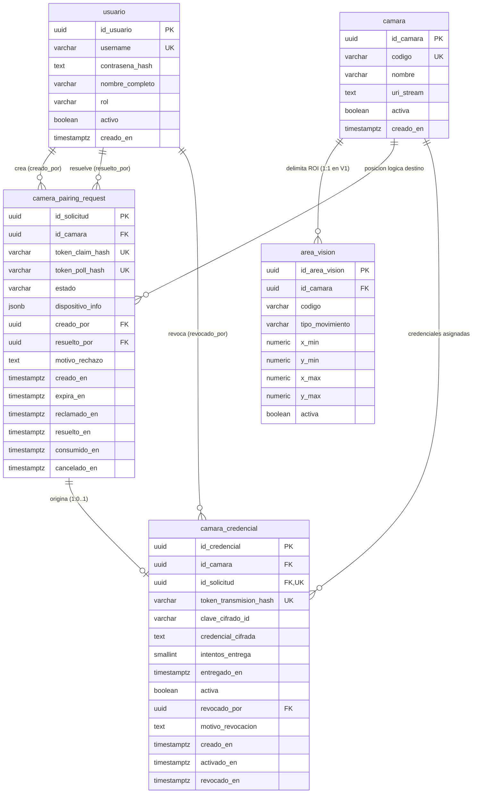
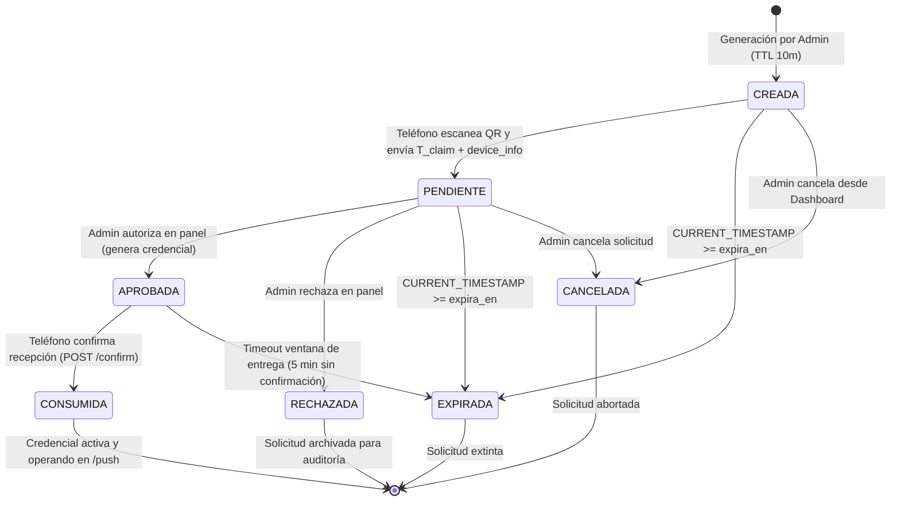
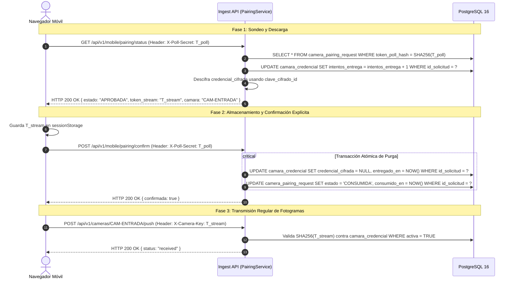

# VIGÍA Vision Systems — ENR-02B-D
## Diseño de Persistencia para Enrolamiento QR de Cámaras (Migración PostgreSQL V004)
### Revisión de Integridad y Ciclo de Vida: ENR-02B-R1

---

## Control del Documento

- **Código:** `ENR-02B-D` (Revisión `ENR-02B-R1`)
- **Fase:** Fase 2 — Enrolamiento de Dispositivos y Control Operativo
- **Fecha:** 30 de octubre de 2026
- **Estado:** Documento de Diseño y Especificación Técnica Revisado (Aprobado para Implementación)
- **Alcance:** Exclusivamente de análisis, diseño y documentación técnica. No aplica migraciones SQL ni modifica la base de datos real.
- **Ubicación:** `Docs/fase_2/ENR-02B_D_diseno_persistencia_enrolamiento_QR.md`

---

## 1. Dictamen de Viabilidad

### Dictamen: **TÉCNICAMENTE VIABLE, ROBUSTO Y COMPATIBLE**

La revisión **ENR-02B-R1** del diseño de persistencia para la migración **V004** resuelve integralmente las inconsistencias de concurrencia, ciclo de vida de solicitudes, redundancia de datos y entrega segura de credenciales identificadas en la auditoría técnica:
1. **Preservación Incondicional de la Topología R1–R8:** Las cámaras lógicas (`CAM-ENTRADA` y `CAM-SALIDA`) y sus áreas de visión asociadas se mantienen inalteradas en el esquema `V001`. El enrolamiento QR asocia y autoriza un dispositivo móvil como fuente transmisora sobre una posición lógica preexistente; **la aprobación no crea, muta ni destruye cámaras lógicas ni áreas de visión**.
2. **Normalización Relacional y Eliminación de Ambigüedades:** Se eliminó la columna redundante `posicion_solicitada` de `camera_pairing_request`. La posición operativa se deriva exclusivamente a través de la relación de clave foránea con `camara(id_camara)`, cuyo campo canónico `camara.codigo` (`CAM-ENTRADA`, `CAM-SALIDA`) gobierna de forma unívoca el carril institucional.
3. **Desbloqueo Seguro de Posición y Expiración Explícita:** Se resuelve la limitación de PostgreSQL respecto a funciones no inmutables en índices parciales (`NOW()` no permitido). La unicidad parcial `uq_pairing_activa_por_camara` se complementa con una transacción de generación que realiza la transición explícita de solicitudes vencidas a `EXPIRADA` bajo bloqueo pesimista de fila en `camara`, garantizando que ninguna solicitud extinta bloquee la generación de nuevos códigos QR.
4. **Protocolo Criptográfico de Confirmación en Dos Pasos y Soporte de Rotación:** La entrega de la credencial efímera incorpora confirmación explícita por parte del cliente móvil (`POST /api/v1/mobile/pairing/confirm`) previo a la purga irreversible de `credencial_cifrada`, tolerando hasta 5 reintentos dentro de una ventana de 5 minutos. Se incorpora el campo `clave_cifrado_id` en `camara_credencial` para permitir rotación de claves maestras de aplicación sin pérdida de trazabilidad.
5. **Garantía Transaccional sin Triggers:** Siguiendo la directriz arquitectónica de `V002` (que eliminó triggers en favor de una persistencia predecible y portable), la consistencia atómica entre la aprobación de la solicitud y la emisión de la credencial activa se confiere a una transacción ACID pesimista en `PairingService`.

---

## 2. Diagnóstico del Esquema Actual

### 2.1. Inspección de `V001__baseline_schema.sql` y PostgreSQL 16
Al auditar las tablas existentes relevantes:
- **`camara` ([L267-L297](file:///c:/GEST.PROY.TI/Software/BD/migrations/V001__baseline_schema.sql#L267-L297)):**
  - PK `id_camara UUID PRIMARY KEY DEFAULT gen_random_uuid()`
  - `codigo VARCHAR(30) UNIQUE NOT NULL` (`CAM-ENTRADA`, `CAM-SALIDA`)
  - `nombre VARCHAR(100) NOT NULL`
  - `uri_stream TEXT NOT NULL` (`push://mobile/cam-entrada`, `push://mobile/cam-salida`)
  - `activa BOOLEAN DEFAULT TRUE`
  - Restricciones: no nulos, trimmed, resolución coherente.
- **`area_vision` ([L307-L345](file:///c:/GEST.PROY.TI/Software/BD/migrations/V001__baseline_schema.sql#L307-L345)):**
  - PK `id_area_vision UUID PRIMARY KEY DEFAULT gen_random_uuid()`
  - FK `id_camara REFERENCES camara(id_camara) ON DELETE RESTRICT`
  - `tipo_movimiento VARCHAR(10) CHECK (tipo_movimiento IN ('ENTRADA', 'SALIDA'))`
  - Restricción `UNIQUE (id_camara, codigo)`
  - Coordenadas normalizadas $[0.0, 1.0]$.
- **`usuario` ([L230-L261](file:///c:/GEST.PROY.TI/Software/BD/migrations/V001__baseline_schema.sql#L230-L261)):**
  - PK `id_usuario UUID PRIMARY KEY DEFAULT gen_random_uuid()`
  - `username VARCHAR(50) UNIQUE NOT NULL` (case-insensitive index)
  - `contrasena_hash TEXT NOT NULL` (Argon2id)
  - `rol VARCHAR(20) CHECK (rol IN ('ADMINISTRADOR', 'OPERADOR', 'AUDITOR'))`
  - `activo BOOLEAN DEFAULT TRUE`

### 2.2. Estado de Datos y Prerrequisitos de la Migración
- Las tablas `camara`, `area_vision` y `usuario` contienen su estructura DDL definida en `V001`.
- Para que la migración `V004` opere correctamente, `CAM-ENTRADA` y `CAM-SALIDA` deben estar registradas formalmente en `camara` (mediante seed o script de inicialización), dado que `camera_pairing_request.id_camara` cuenta con restricción de clave foránea estricta `ON DELETE RESTRICT`.
- La migración V004 no modifica ninguna tabla preexistente de `V001`; únicamente crea las dos nuevas tablas de soporte de enrolamiento y sus índices.

---

## 3. Modelo Entidad-Relación



---

## 4. Diccionario de Datos

### 4.1. Tabla `camera_pairing_request`
Gestiona el ciclo de vida de cada solicitud de enrolamiento por QR desde su generación hasta su resolución o consumo.

| Columna | Tipo de Dato | Nulo | Por Omisión | Descripción y Reglas de Negocio |
| :--- | :--- | :---: | :---: | :--- |
| `id_solicitud` | `UUID` | NO | `gen_random_uuid()` | Identificador primario unívoco de la solicitud. |
| `id_camara` | `UUID` | NO | — | FK a `camara(id_camara)`. Posición lógica asignada (`CAM-ENTRADA` o `CAM-SALIDA`). Determina unívocamente el carril sin requerir columnas redundantes. |
| `token_claim_hash` | `VARCHAR(64)` | NO | — | Digest SHA-256 en hexadecimal del token unívoco codificado en el QR (`T_claim`). Único globalmente. |
| `token_poll_hash` | `VARCHAR(64)` | SÍ | `NULL` | Digest SHA-256 del secreto temporal de sondeo (`T_poll_secret`) emitido al móvil al reclamar el QR. Único cuando no es nulo. |
| `estado` | `VARCHAR(20)` | NO | `'CREADA'` | Estado actual de la solicitud: `CREADA`, `PENDIENTE`, `APROBADA`, `RECHAZADA`, `EXPIRADA`, `CANCELADA`, `CONSUMIDA`. |
| `dispositivo_info` | `JSONB` | SÍ | `NULL` | Metadatos técnicos mínimos no invasivos recolectados en el reclamo (`user_agent`, `ip_origen`, `resolucion_camara`). |
| `creado_por` | `UUID` | NO | — | FK a `usuario(id_usuario)`. Administrador que generó el QR. |
| `resuelto_por` | `UUID` | SÍ | `NULL` | FK a `usuario(id_usuario)`. Administrador que aprobó, rechazó o canceló la solicitud. |
| `motivo_rechazo` | `TEXT` | SÍ | `NULL` | Justificación técnica u operativa ante rechazo o cancelación. |
| `creado_en` | `TIMESTAMPTZ` | NO | `CURRENT_TIMESTAMP` | Marca temporal de creación del código QR. |
| `expira_en` | `TIMESTAMPTZ` | NO | — | Límite temporal de vigencia del QR (`creado_en + 10 minutos`). |
| `reclamado_en` | `TIMESTAMPTZ` | SÍ | `NULL` | Marca temporal en la que el teléfono escaneó el QR y presentó `T_claim`. |
| `resuelto_en` | `TIMESTAMPTZ` | SÍ | `NULL` | Marca temporal de la decisión administrativa (aprobación o rechazo). |
| `consumido_en` | `TIMESTAMPTZ` | SÍ | `NULL` | Marca temporal en la que el móvil confirmó la recepción exitosa de la credencial de transmisión. |
| `cancelado_en` | `TIMESTAMPTZ` | SÍ | `NULL` | Marca temporal de cancelación voluntaria por el Administrador. |

> [!NOTE]
> **Resolución sobre Redundancia:** En la revisión R1 se eliminó la columna `posicion_solicitada` que figuraba en el borrador previo. La posición física está estrictamente vinculada a `camara.codigo` a través de `id_camara`. Mantener un campo redundante como `VARCHAR(10) CHECK ('ENTRADA', 'SALIDA')` abría el riesgo de divergencia semántica (ej. solicitar `ENTRADA` referenciando el `id_camara` de `CAM-SALIDA`).

### 4.2. Tabla `camara_credencial`
Almacena las credenciales criptográficas autorizadas para la transmisión de fotogramas push por cámara lógica.

| Columna | Tipo de Dato | Nulo | Por Omisión | Descripción y Reglas de Negocio |
| :--- | :--- | :---: | :---: | :--- |
| `id_credencial` | `UUID` | NO | `gen_random_uuid()` | Identificador primario de la credencial. |
| `id_camara` | `UUID` | NO | — | FK a `camara(id_camara)`. Cámara lógica a la que se le autoriza la transmisión. |
| `id_solicitud` | `UUID` | NO | — | FK a `camera_pairing_request(id_solicitud)`. Solicitud aprobada origen. Única (relación 1:1 estricta). |
| `token_transmision_hash` | `VARCHAR(64)` | NO | — | Digest SHA-256 del token de transmisión definitivo (`T_stream`). Único globalmente. |
| `clave_cifrado_id` | `VARCHAR(50)` | NO | `'v1-aes256gcm'` | Identificador de la versión/clave maestra de aplicación empleada para cifrar el sobre efímero, posibilitando rotación de claves maestras. |
| `credencial_cifrada` | `TEXT` | SÍ | `NULL` | Carga útil cifrada simétricamente para entrega temporal al móvil. Se purga a `NULL` tras la confirmación de recepción o tras vencer la ventana de entrega (5 min). |
| `intentos_entrega` | `SMALLINT` | NO | `0` | Contador de consultas de entrega realizadas por el móvil. Restringido por CHECK a $[0, 5]$. |
| `entregado_en` | `TIMESTAMPTZ` | SÍ | `NULL` | Marca temporal en la que el dispositivo descargó y confirmó la credencial. |
| `activa` | `BOOLEAN` | NO | `TRUE` | Estado operativo de la credencial. Solo puede existir UNA credencial activa por cámara simultáneamente. |
| `revocado_por` | `UUID` | SÍ | `NULL` | FK a `usuario(id_usuario)`. Administrador que revocó la credencial. |
| `motivo_revocacion` | `TEXT` | SÍ | `NULL` | Causa de la revocación (ej. `'Sustituida por nuevo enrolamiento'`, `'Revocación manual'`). |
| `creado_en` | `TIMESTAMPTZ` | NO | `CURRENT_TIMESTAMP` | Fecha de emisión de la credencial. |
| `activado_en` | `TIMESTAMPTZ` | NO | `CURRENT_TIMESTAMP` | Fecha de entrada en vigor operativa. |
| `revocado_en` | `TIMESTAMPTZ` | SÍ | `NULL` | Fecha de revocación irreversible. |

---

## 5. DDL Propuesto Completo de V004 (Documental)

> [!IMPORTANT]
> El siguiente script DDL es exclusivamente una especificación técnica formal de diseño. **No debe ejecutarse en PostgreSQL ni crearse como archivo de migración en esta fase**.

```sql
-- ============================================================================
-- VIGÍA VISION SYSTEMS
-- V004__enrolamiento_camaras_qr.sql
-- PostgreSQL 16+
--
-- Descripción:
--   Implementa el soporte relacional para el enrolamiento de dispositivos
--   móviles mediante códigos QR y la gestión de credenciales de transmisión
--   por cámara, respetando la topología fija V1 (CAM-ENTRADA / CAM-SALIDA).
--   Revisión ENR-02B-R1:
--     - Eliminación de redundancia de posicion_solicitada.
--     - Soporte de rotación de claves con clave_cifrado_id.
--     - Unificación de intentos_entrega a máximo 5.
--     - Índices de alto rendimiento para Dashboard e Ingesta.
-- ============================================================================

BEGIN;

-- ----------------------------------------------------------------------------
-- 1. TABLA: camera_pairing_request
-- ----------------------------------------------------------------------------

CREATE TABLE camera_pairing_request (
    id_solicitud UUID PRIMARY KEY DEFAULT gen_random_uuid(),
    id_camara UUID NOT NULL,
    token_claim_hash VARCHAR(64) NOT NULL,
    token_poll_hash VARCHAR(64),
    estado VARCHAR(20) NOT NULL DEFAULT 'CREADA',
    dispositivo_info JSONB,
    creado_por UUID NOT NULL,
    resuelto_por UUID,
    motivo_rechazo TEXT,
    creado_en TIMESTAMPTZ NOT NULL DEFAULT CURRENT_TIMESTAMP,
    expira_en TIMESTAMPTZ NOT NULL,
    reclamado_en TIMESTAMPTZ,
    resuelto_en TIMESTAMPTZ,
    consumido_en TIMESTAMPTZ,
    cancelado_en TIMESTAMPTZ,

    -- Claves foráneas (ON DELETE RESTRICT en cumplimiento con V001)
    CONSTRAINT fk_pairing_camara
        FOREIGN KEY (id_camara)
        REFERENCES camara(id_camara) ON DELETE RESTRICT,

    CONSTRAINT fk_pairing_creador
        FOREIGN KEY (creado_por)
        REFERENCES usuario(id_usuario) ON DELETE RESTRICT,

    CONSTRAINT fk_pairing_resolutor
        FOREIGN KEY (resuelto_por)
        REFERENCES usuario(id_usuario) ON DELETE RESTRICT,

    -- Restricciones de Dominio y Formato
    CONSTRAINT ck_pairing_estado
        CHECK (estado IN ('CREADA', 'PENDIENTE', 'APROBADA', 'RECHAZADA', 'EXPIRADA', 'CANCELADA', 'CONSUMIDA')),

    CONSTRAINT ck_pairing_claim_hash_format
        CHECK (
            token_claim_hash = BTRIM(token_claim_hash)
            AND length(token_claim_hash) = 64
            AND token_claim_hash ~* '^[a-f0-9]{64}$'
        ),

    CONSTRAINT ck_pairing_poll_hash_format
        CHECK (
            token_poll_hash IS NULL
            OR (
                token_poll_hash = BTRIM(token_poll_hash)
                AND length(token_poll_hash) = 64
                AND token_poll_hash ~* '^[a-f0-9]{64}$'
            )
        ),

    CONSTRAINT ck_pairing_fechas_coherentes
        CHECK (
            expira_en > creado_en
            AND (reclamado_en IS NULL OR reclamado_en >= creado_en)
            AND (resuelto_en IS NULL OR resuelto_en >= creado_en)
            AND (consumido_en IS NULL OR consumido_en >= creado_en)
            AND (cancelado_en IS NULL OR cancelado_en >= creado_en)
        )
);

-- Unicidad estricta de tokens hash SHA-256
CREATE UNIQUE INDEX uq_pairing_token_claim_hash
    ON camera_pairing_request (token_claim_hash);

CREATE UNIQUE INDEX uq_pairing_token_poll_hash
    ON camera_pairing_request (token_poll_hash)
    WHERE token_poll_hash IS NOT NULL;

-- Regla de Negocio: Máximo una solicitud viva (CREADA o PENDIENTE) por cámara simultáneamente
CREATE UNIQUE INDEX uq_pairing_activa_por_camara
    ON camera_pairing_request (id_camara)
    WHERE estado IN ('CREADA', 'PENDIENTE');

-- Índices de consulta operativa
CREATE INDEX idx_pairing_camara_estado
    ON camera_pairing_request (id_camara, estado);

CREATE INDEX idx_pairing_estado_expira
    ON camera_pairing_request (estado, expira_en);

CREATE INDEX idx_pairing_dashboard_pendientes
    ON camera_pairing_request (creado_en ASC)
    WHERE estado = 'PENDIENTE';

CREATE INDEX idx_pairing_creador
    ON camera_pairing_request (creado_por);

COMMENT ON TABLE camera_pairing_request IS
'Registro auditable del ciclo de vida de solicitudes de enrolamiento QR hacia cámaras lógicas.';


-- ----------------------------------------------------------------------------
-- 2. TABLA: camara_credencial
-- ----------------------------------------------------------------------------

CREATE TABLE camara_credencial (
    id_credencial UUID PRIMARY KEY DEFAULT gen_random_uuid(),
    id_camara UUID NOT NULL,
    id_solicitud UUID NOT NULL,
    token_transmision_hash VARCHAR(64) NOT NULL,
    clave_cifrado_id VARCHAR(50) NOT NULL DEFAULT 'v1-aes256gcm',
    credencial_cifrada TEXT,
    intentos_entrega SMALLINT NOT NULL DEFAULT 0,
    entregado_en TIMESTAMPTZ,
    activa BOOLEAN NOT NULL DEFAULT TRUE,
    revocado_por UUID,
    motivo_revocacion TEXT,
    creado_en TIMESTAMPTZ NOT NULL DEFAULT CURRENT_TIMESTAMP,
    activado_en TIMESTAMPTZ NOT NULL DEFAULT CURRENT_TIMESTAMP,
    revocado_en TIMESTAMPTZ,

    -- Claves foráneas (ON DELETE RESTRICT)
    CONSTRAINT fk_credencial_camara
        FOREIGN KEY (id_camara)
        REFERENCES camara(id_camara) ON DELETE RESTRICT,

    CONSTRAINT fk_credencial_solicitud
        FOREIGN KEY (id_solicitud)
        REFERENCES camera_pairing_request(id_solicitud) ON DELETE RESTRICT,

    CONSTRAINT fk_credencial_revocador
        FOREIGN KEY (revocado_por)
        REFERENCES usuario(id_usuario) ON DELETE RESTRICT,

    -- Restricciones de Integridad
    CONSTRAINT ck_credencial_hash_format
        CHECK (
            token_transmision_hash = BTRIM(token_transmision_hash)
            AND length(token_transmision_hash) = 64
            AND token_transmision_hash ~* '^[a-f0-9]{64}$'
        ),

    CONSTRAINT ck_credencial_clave_cifrado_format
        CHECK (
            clave_cifrado_id = BTRIM(clave_cifrado_id)
            AND length(clave_cifrado_id) >= 3
        ),

    CONSTRAINT ck_credencial_intentos
        CHECK (intentos_entrega >= 0 AND intentos_entrega <= 5),

    CONSTRAINT ck_credencial_revocacion_coherente
        CHECK (
            (activa = TRUE AND revocado_en IS NULL AND revocado_por IS NULL)
            OR
            (activa = FALSE AND revocado_en IS NOT NULL)
        ),

    CONSTRAINT ck_credencial_fechas_coherentes
        CHECK (
            activado_en >= creado_en
            AND (revocado_en IS NULL OR revocado_en >= activado_en)
            AND (entregado_en IS NULL OR entregado_en >= creado_en)
        )
);

-- Unicidad: Una solicitud aprobada genera exactamente una credencial
CREATE UNIQUE INDEX uq_credencial_solicitud
    ON camara_credencial (id_solicitud);

-- Unicidad global del hash de transmisión
CREATE UNIQUE INDEX uq_credencial_transmision_hash
    ON camara_credencial (token_transmision_hash);

-- Invariante Crítica del Negocio: Exactamente UNA credencial activa por cámara lógica
CREATE UNIQUE INDEX uq_camara_credencial_activa
    ON camara_credencial (id_camara)
    WHERE activa = TRUE;

-- Índices de consulta de alto rendimiento para autenticación en /push
CREATE INDEX idx_credencial_activa_lookup
    ON camara_credencial (token_transmision_hash, id_camara)
    WHERE activa = TRUE;

CREATE INDEX idx_credencial_historial_camara
    ON camara_credencial (id_camara, creado_en DESC);

COMMENT ON TABLE camara_credencial IS
'Credenciales criptográficas de transmisión autorizadas por cámara lógica para ingesta push.';

COMMIT;
```

---

## 6. Índices y Restricciones Justificadas

### 6.1. Expiración de Solicitudes y el Índice Parcial `uq_pairing_activa_por_camara`
En PostgreSQL, una expresión condicional de índice parcial debe estar compuesta exclusivamente por funciones **inmutables** (`IMMUTABLE`). Por tanto, una cláusula como `WHERE estado IN ('CREADA', 'PENDIENTE') AND expira_en > NOW()` es formalmente inválida porque `NOW()` y `CURRENT_TIMESTAMP` son funciones dependientes del reloj (`STABLE`).

Para evitar que una solicitud vencida (`expira_en <= NOW()`) que permanezca con estado `CREADA` o `PENDIENTE` bloquee permanentemente la creación de un nuevo QR para esa cámara lógica:
1. **Índice Parcial:** Se mantiene sobre `(id_camara) WHERE estado IN ('CREADA', 'PENDIENTE')`.
2. **Desbloqueo Atómico en Aplicación (*Lazy Expiration Sweep*):** La transacción de generación de QR ejecuta en primer orden:
   ```sql
   UPDATE camera_pairing_request
   SET estado = 'EXPIRADA'
   WHERE id_camara = %(id_camara)s
     AND estado IN ('CREADA', 'PENDIENTE')
     AND expira_en <= CURRENT_TIMESTAMP;
   ```
3. De esta forma, cualquier solicitud previa cuyo tiempo haya expirado pasa formalmente al estado terminal `EXPIRADA`, saliendo del predicado del índice y permitiendo la inserción inmediata del nuevo QR sin conflictos de concurrencia.

### 6.2. Invariante de Emisión Única de Transmisión (`uq_camara_credencial_activa`)
El índice parcial `uq_camara_credencial_activa` garantiza a nivel de motor PostgreSQL que **nunca coexistirán dos credenciales activas para la misma cámara lógica** (`CAM-ENTRADA` o `CAM-SALIDA`). Cualquier intento de activar una credencial sin revocar previamente la anterior generará una violación inmediata de unicidad (`SQLSTATE 23505`), impidiendo interferencias entre dos dispositivos físicos.

### 6.3. Cobertura de Índices frente a Patrones de Consulta Operativa
- **Sondeo de Reclamación (`/claim`):** `uq_pairing_token_claim_hash` (búsqueda B-Tree $O(\log N)$ por digest SHA-256).
- **Sondeo de Estado (`/status`):** `uq_pairing_token_poll_hash` (búsqueda B-Tree $O(\log N)$ por digest SHA-256).
- **Validación en Endpoint `/push`:** `idx_credencial_activa_lookup` (`token_transmision_hash, id_camara WHERE activa = TRUE`). Resuelve la validación de tokens de fotogramas en microsegundos mediante un Index-Only Scan.
- **Bandeja de Pendientes en Dashboard:** `idx_pairing_dashboard_pendientes` (`creado_en ASC WHERE estado = 'PENDIENTE'`). Permite paginar y listar las solicitudes en espera de aprobación humana instantáneamente.
- **Políticas de Integridad `ON DELETE`:** Todas las claves foráneas a `camara` y `usuario` declaran explícitamente `ON DELETE RESTRICT`, garantizando la inmutabilidad de la auditoría y la permanencia de la configuración física.

---

## 7. Máquina de Estados y Transiciones Semánticas

### 7.1. Definiciones Formales de Estado

| Estado | Naturaleza | Precondición y Significado Semántico |
| :--- | :---: | :--- |
| `CREADA` | Transitorio | El código QR fue generado por un Administrador y contiene `T_claim`. Permanece en espera de escaneo móvil. TTL de 10 minutos. |
| `PENDIENTE` | Transitorio | Un dispositivo móvil escaneó el QR, presentó `T_claim` válido, envió su información técnica y recibió el secreto temporal `T_poll_secret`. Aguarda decisión del Administrador. |
| `APROBADA` | Transitorio / Operativo | El Administrador aprobó la solicitud. Se generó la credencial en `camara_credencial` con el sobre cifrado temporal. Aguarda descarga y confirmación móvil. |
| `CONSUMIDA` | Terminal | El dispositivo móvil descargó la credencial, la almacenó localmente y emitió la confirmación explícita. El secreto cifrado en BD ha sido purgado a `NULL`. Preserva toda la información de auditoría (`resuelto_por`, `resuelto_en`, `consumido_en`). |
| `RECHAZADA` | Terminal | El Administrador rechazó explícitamente la solicitud pendiente desde el Dashboard, registrando el motivo. No se genera credencial. |
| `EXPIRADA` | Terminal | La solicitud superó su tiempo límite de validez (`expira_en`) sin ser reclamada o aprobada, o el móvil no recogió la credencial dentro de la ventana de entrega de 5 minutos. |
| `CANCELADA` | Terminal | El Administrador canceló voluntariamente la solicitud desde el Dashboard antes de que concluyera el proceso. |

### 7.2. Diagrama de Transición de Estados



### 7.3. Matriz de Transiciones Permitidas e Inválidas

| Estado Origen | Estado Destino Permitido | Disparador / Evento | Transiciones Inválidas Prohibidas |
| :--- | :--- | :--- | :--- |
| `[Inicio]` | `CREADA` | Generación por Administrador. | Directo a `PENDIENTE`, `APROBADA`, etc. |
| `CREADA` | `PENDIENTE`, `EXPIRADA`, `CANCELADA` | Escaneo móvil, vencimiento de TTL (10m) o cancelación administrativa. | A `APROBADA`, `CONSUMIDA`, `RECHAZADA`. |
| `PENDIENTE` | `APROBADA`, `RECHAZADA`, `EXPIRADA`, `CANCELADA` | Decisión de Admin (aprobar/rechazar), expiración o cancelación. | A `CREADA`, `CONSUMIDA`. |
| `APROBADA` | `CONSUMIDA`, `EXPIRADA` | Confirmación móvil exitosa o abandono de entrega (5m). | A `CREADA`, `PENDIENTE`, `RECHAZADA`, `CANCELADA`. |
| `CONSUMIDA` | *[Terminal]* | Ninguno. Inmutable. | Cualquier transición saliente es rechazada. |
| `RECHAZADA` | *[Terminal]* | Ninguno. Inmutable. | Cualquier transición saliente es rechazada. |
| `EXPIRADA` | *[Terminal]* | Ninguno. Inmutable. | Cualquier transición saliente es rechazada. |
| `CANCELADA` | *[Terminal]* | Ninguno. Inmutable. | Cualquier transición saliente es rechazada. |

> [!IMPORTANT]
> **Trazabilidad de `CONSUMIDA`:** `CONSUMIDA` es el estado final exitoso que sustituye operativamente a `APROBADA`. Al transicionar a `CONSUMIDA`, los campos de auditoría `resuelto_por`, `resuelto_en` y la vinculación foránea unívoca con `camara_credencial` se conservan íntegramente. Esto permite auditar retrospectivamente qué usuario administrador autorizó el dispositivo físico que actualmente ostenta la credencial activa.

---

## 8. Entrega Segura de Credenciales y Protocolo de Confirmación

### 8.1. Principio de Cero Secretos Persistentes (*Zero-Knowledge Storage*)
1. La base de datos PostgreSQL almacena exclusivamente el hash criptográfico SHA-256 (`token_transmision_hash`) para validar fotogramas en tiempo de ejecución.
2. La credencial en texto plano (`T_stream`) debe transferirse al teléfono móvil una única vez para que este la almacene en su `sessionStorage`.
3. Para proteger la entrega ante pérdidas transitorias de paquetes sin almacenar el secreto en texto plano en la base de datos, se emplea un **sobre cifrado temporal** en `camara_credencial.credencial_cifrada`.

### 8.2. Esquema de Cifrado y Rotación de Claves
- **Algoritmo:** Cifrado simétrico autenticado (AES-256-GCM o ChaCha20-Poly1305 / `nacl.secret.SecretBox`).
- **Identificador de Clave:** La columna `camara_credencial.clave_cifrado_id` (ej. `'v1-aes256gcm'`) asocia el registro a una clave maestra específica en el archivo de configuración o variables de entorno del backend (`VIGIA_ENCRYPTION_MASTER_KEY`). Esto permite rotar la clave maestra del servidor sin invalidar procesos de entrega en curso.
- **Payload Cifrado:**
  ```json
  {
    "token_transmision": "v1_sec_9f83b2...",
    "id_camara": "d290f1ee-6c54-4b01-90e6-d701748f0851",
    "codigo_camara": "CAM-ENTRADA",
    "expira_entrega": "2026-10-30T10:15:00Z"
  }
  ```

### 8.3. Protocolo de Confirmación Explícita en Dos Pasos



### 8.4. Manejo de Fallos de Red y Abandono
1. **Pérdida de Paquete en Fase 1:** Si el móvil pierde la conexión mientras descarga la credencial, puede consultar nuevamente `GET /status`. Dado que `credencial_cifrada` aún existe, el backend le vuelve a entregar el payload, incrementando `intentos_entrega`.
2. **Límite de Reintentos:** Se permite un máximo de 5 intentos (`intentos_entrega <= 5`). Al sexto intento, el endpoint rechaza con `429 Too Many Requests` o `410 Gone`.
3. **Abandono y Timeout (5 minutos):** Si transcurren 5 minutos desde la aprobación sin que el móvil haya confirmado (`POST /confirm`), la credencial se considera abandonada. Un worker o la siguiente operación ejecuta la purga:
   - Se revoca la credencial: `activa = FALSE`, `revocado_en = CURRENT_TIMESTAMP`, `motivo_revocacion = 'Abandono: superó TTL de entrega sin confirmación'`.
   - Se borra el sobre cifrado: `credencial_cifrada = NULL`.
   - La solicitud transiciona a `EXPIRADA`.

---

## 9. Análisis de Integridad de Aprobación: Aplicación vs. Triggers

Para garantizar que toda solicitud en estado `APROBADA` o `CONSUMIDA` posea unívocamente una fila correspondiente en `camara_credencial`, se compararon dos estrategias de persistencia:

### Comparativa Técnica

| Criterio | Opción A: Transacción ACID en Aplicación (`PairingService`) | Opción B: Constraint Triggers Diferidos en PostgreSQL |
| :--- | :--- | :--- |
| **Alineación Arquitectónica** | **Totalmente alineada.** La migración `V002` eliminó triggers deliberadamente para simplificar la persistencia y evitar efectos secundarios ocultos en la base de datos. | Contradice la filosofía `V002`, reintroduciendo lógica procedural compleja en PL/pgSQL. |
| **Garantía de Consistencia** | Absoluta. Dentro de una transacción con nivel de aislamiento `READ COMMITTED`, si la inserción en `camara_credencial` falla, se realiza `ROLLBACK` total y la solicitud jamás pasa a `APROBADA`. | Absoluta a nivel de motor mediante restricción diferida al hacer `COMMIT`. |
| **Testabilidad y Mantenimiento** | Altamente testeable mediante pruebas unitarias con mocks (`InMemoryPairingRepository`) y de integración sin depender del motor procedural de base de datos. | Compleja de depurar y rastrear; acopla la lógica de negocio al motor PostgreSQL. |
| **Tratamiento de Errores** | Excepciones estructuradas en Python con códigos de error claros devueltos al cliente HTTP. | Errores genéricos de violación de trigger en SQLSTATE, difíciles de mapear limpiamente en la API. |

### Decisión Adoptada: **Opción A (Transacción ACID en Capa de Aplicación)**
Se adopta formalmente la **Opción A**. La integridad atómica se asegura encapsulando la revocación previa, la inserción en `camara_credencial` y la actualización de `camera_pairing_request` dentro de una única transacción ACID en `PairingService` (utilizando bloqueos pesimistas `SELECT ... FOR UPDATE`). No se implementan triggers en la base de datos.

---

## 10. Transacciones y Control de Concurrencia (Especificación SQL)

Todas las operaciones se implementan mediante sentencias SQL parametrizadas ejecutadas bajo aislamiento transaccional estricto:

### 10.1. Generación de Código QR (Administrador)
```sql
BEGIN;
-- 1. Bloquear la cámara para serializar administradores concurrentes en la misma posición
SELECT id_camara, codigo 
FROM camara 
WHERE id_camara = %(id_camara)s 
FOR UPDATE;

-- 2. Transición explícita: Marcar como EXPIRADA cualquier solicitud vencida de esta cámara
UPDATE camera_pairing_request
SET estado = 'EXPIRADA'
WHERE id_camara = %(id_camara)s
  AND estado IN ('CREADA', 'PENDIENTE')
  AND expira_en <= CURRENT_TIMESTAMP;

-- 3. Cancelar solicitudes vivas previas no expiradas si el Admin decide emitir un QR nuevo
UPDATE camera_pairing_request
SET estado = 'CANCELADA',
    cancelado_en = CURRENT_TIMESTAMP,
    resuelto_por = %(admin_id)s,
    motivo_rechazo = 'Sustituida por nueva generación voluntaria de QR'
WHERE id_camara = %(id_camara)s
  AND estado IN ('CREADA', 'PENDIENTE');

-- 4. Insertar la nueva solicitud viva
INSERT INTO camera_pairing_request (
    id_camara,
    token_claim_hash,
    estado,
    creado_por,
    creado_en,
    expira_en
) VALUES (
    %(id_camara)s,
    %(token_claim_hash)s,
    'CREADA',
    %(admin_id)s,
    CURRENT_TIMESTAMP,
    CURRENT_TIMESTAMP + INTERVAL '10 minutes'
) RETURNING id_solicitud, expira_en;

COMMIT;
```

### 10.2. Reclamación Móvil del QR (`/claim`)
```sql
BEGIN;
-- Transición atómica condicionada anti-carreras:
-- Solo puede reclamar si la solicitud está estrictamente CREADA y vigente en tiempo
UPDATE camera_pairing_request
SET estado = 'PENDIENTE',
    token_poll_hash = %(token_poll_hash)s,
    dispositivo_info = %(dispositivo_info)s,
    reclamado_en = CURRENT_TIMESTAMP
WHERE token_claim_hash = %(token_claim_hash)s
  AND estado = 'CREADA'
  AND expira_en > CURRENT_TIMESTAMP
RETURNING id_solicitud, id_camara;

-- Si retorna 0 filas afectadas:
-- Se realiza SELECT para diagnosticar si fue 404 (no existe), 409 (ya reclamada) o 410 (expirada).
COMMIT;
```

### 10.3. Aprobación Administrativa con Revocación Atómica (`/approve`)
```sql
BEGIN;
-- 1. Bloquear la solicitud para impedir dobles aprobaciones concurrentes
SELECT id_solicitud, id_camara, estado, expira_en
FROM camera_pairing_request
WHERE id_solicitud = %(id_solicitud)s
FOR UPDATE;

-- Validar en código: estado == 'PENDIENTE' y expira_en > CURRENT_TIMESTAMP. Si no, abortar con ROLLBACK.

-- 2. Bloquear la cámara lógica para evitar carreras de asignación
SELECT id_camara FROM camara WHERE id_camara = %(id_camara)s FOR UPDATE;

-- 3. Revocar atómicamente cualquier credencial previa activa en esta cámara
UPDATE camara_credencial
SET activa = FALSE,
    revocado_en = CURRENT_TIMESTAMP,
    revocado_por = %(admin_id)s,
    motivo_revocacion = 'Sustituida por nueva autorización de enrolamiento'
WHERE id_camara = %(id_camara)s
  AND activa = TRUE;

-- 4. Registrar la nueva credencial con el sobre cifrado y versión de clave
INSERT INTO camara_credencial (
    id_camara,
    id_solicitud,
    token_transmision_hash,
    clave_cifrado_id,
    credencial_cifrada,
    activa,
    creado_en,
    activado_en
) VALUES (
    %(id_camara)s,
    %(id_solicitud)s,
    %(token_transmision_hash)s,
    %(clave_cifrado_id)s,
    %(credencial_cifrada)s,
    TRUE,
    CURRENT_TIMESTAMP,
    CURRENT_TIMESTAMP
);

-- 5. Pasar la solicitud al estado APROBADA
UPDATE camera_pairing_request
SET estado = 'APROBADA',
    resuelto_por = %(admin_id)s,
    resuelto_en = CURRENT_TIMESTAMP
WHERE id_solicitud = %(id_solicitud)s;

COMMIT;
```

### 10.4. Rechazo Administrativo (`/reject`)
```sql
BEGIN;
UPDATE camera_pairing_request
SET estado = 'RECHAZADA',
    resuelto_por = %(admin_id)s,
    resuelto_en = CURRENT_TIMESTAMP,
    motivo_rechazo = %(motivo_rechazo)s
WHERE id_solicitud = %(id_solicitud)s
  AND estado = 'PENDIENTE';
COMMIT;
```

### 10.5. Descarga de Credencial en Sondeo Móvil (`GET /status`)
```sql
BEGIN;
-- 1. Localizar y bloquear la solicitud por su secreto de sondeo
SELECT r.id_solicitud, r.id_camara, r.estado, c.id_credencial, c.clave_cifrado_id, c.credencial_cifrada, c.intentos_entrega
FROM camera_pairing_request r
LEFT JOIN camara_credencial c ON r.id_solicitud = c.id_solicitud
WHERE r.token_poll_hash = %(token_poll_hash)s
FOR UPDATE OF r;

-- 2. Si estado == 'APROBADA' y c.intentos_entrega < 5:
UPDATE camara_credencial
SET intentos_entrega = intentos_entrega + 1
WHERE id_credencial = %(id_credencial)s;

COMMIT;
-- La aplicación descifra credencial_cifrada en memoria y la envía al móvil.
```

### 10.6. Confirmación de Recepción Móvil y Purga Criptográfica (`POST /confirm`)
```sql
BEGIN;
-- 1. Bloquear y validar que la solicitud esté en APROBADA
SELECT r.id_solicitud, c.id_credencial
FROM camera_pairing_request r
JOIN camara_credencial c ON r.id_solicitud = c.id_solicitud
WHERE r.token_poll_hash = %(token_poll_hash)s
  AND r.estado = 'APROBADA'
FOR UPDATE;

-- 2. Purgar irreversiblemente el material cifrado en camara_credencial
UPDATE camara_credencial
SET credencial_cifrada = NULL,
    entregado_en = CURRENT_TIMESTAMP
WHERE id_credencial = %(id_credencial)s;

-- 3. Marcar la solicitud como formalmente CONSUMIDA
UPDATE camera_pairing_request
SET estado = 'CONSUMIDA',
    consumido_en = CURRENT_TIMESTAMP
WHERE id_solicitud = %(id_solicitud)s;

COMMIT;
```

### 10.7. Revocación Explícita desde Dashboard
```sql
BEGIN;
UPDATE camara_credencial
SET activa = FALSE,
    revocado_en = CURRENT_TIMESTAMP,
    revocado_por = %(admin_id)s,
    motivo_revocacion = %(motivo)s
WHERE id_camara = %(id_camara)s
  AND activa = TRUE;
COMMIT;
```

### 10.8. Barrido de Mantenimiento (*Expired Requests Sweep*)
```sql
BEGIN;
-- Transición masiva de solicitudes extintas
UPDATE camera_pairing_request
SET estado = 'EXPIRADA'
WHERE estado IN ('CREADA', 'PENDIENTE')
  AND expira_en <= CURRENT_TIMESTAMP;

-- Inactivación de credenciales aprobadas pero abandonadas (> 5 minutos sin confirmar)
UPDATE camara_credencial c
SET activa = FALSE,
    revocado_en = CURRENT_TIMESTAMP,
    motivo_revocacion = 'Abandono: superó ventana de entrega de 5 minutos sin confirmación',
    credencial_cifrada = NULL
FROM camera_pairing_request r
WHERE c.id_solicitud = r.id_solicitud
  AND r.estado = 'APROBADA'
  AND r.resuelto_en <= CURRENT_TIMESTAMP - INTERVAL '5 minutes'
  AND c.activa = TRUE;

UPDATE camera_pairing_request
SET estado = 'EXPIRADA'
WHERE estado = 'APROBADA'
  AND resuelto_en <= CURRENT_TIMESTAMP - INTERVAL '5 minutes';

COMMIT;
```

---

## 11. Integración con Arquitectura de Visión y RBAC

### 11.1. Ingesta Push (`VIGIA_API/ingest_service.py`)
Cuando un teléfono transmite fotogramas a `/api/v1/cameras/<codigo_camara>/push`:
1. Extrae el token de la cabecera `X-Camera-Key: <token>`.
2. Calcula `hash_recibido = hashlib.sha256(token.encode()).hexdigest()`.
3. Valida en la base de datos contra el índice rápido `idx_credencial_activa_lookup`:
   ```sql
   SELECT c.codigo, cc.id_credencial
   FROM camara_credencial cc
   JOIN camara c ON cc.id_camara = c.id_camara
   WHERE cc.token_transmision_hash = %(hash)s
     AND cc.activa = TRUE
     AND c.codigo = %(codigo_camara)s;
   ```
4. Si la consulta devuelve 0 filas, rechaza inmediatamente con `401 Unauthorized` sin decodificar el JPEG ni sobrecargar el buffer de frames.

### 11.2. Autorización RBAC (ENR-02A)
- Endpoints de generación, listado, aprobación, rechazo y revocación (`/admin/pairing/*`) están protegidos estrictamente con `@require_rbac("ADMINISTRADOR")`.
- Guardias (`OPERADOR`) y observadores (`AUDITOR`) reciben `403 Forbidden`.
- Las rutas del móvil (`/mobile/pairing/claim`, `/mobile/pairing/status`, `/mobile/pairing/confirm`) no requieren credenciales de usuario del sistema; su acceso está autenticado mediante los secretos criptográficos de alta entropía (`T_claim` y `T_poll_secret`).

---

## 12. Matriz de Verificación y Casos de Prueba de Diseño

| ID | Escenario de Prueba | Condición de Entrada | Resultado Esperado en PostgreSQL / API |
| :--- | :--- | :--- | :--- |
| **CP-PERS-01** | Generación QR exitosa | Admin genera QR para `CAM-ENTRADA` | Se inserta fila en `camera_pairing_request` con `estado='CREADA'`, hash SHA-256 de 64 chars y `expira_en = NOW() + 10m`. |
| **CP-PERS-02** | Sustitución de QR previo | Existe solicitud `CREADA` previa; Admin genera nuevo QR | La transacción transiciona la previa a `CANCELADA` e inserta la nueva sin violar `uq_pairing_activa_por_camara`. |
| **CP-PERS-03** | Desbloqueo por QR vencido | Existe solicitud `CREADA` con `expira_en < NOW()` | La transacción transiciona la previa a `EXPIRADA` e inserta el nuevo QR satisfactoriamente. |
| **CP-PERS-04** | Reclamación móvil exitosa | Móvil envía `T_claim` vigente | Actualización atómica condicional a `estado='PENDIENTE'`, registra `token_poll_hash`, metadatos de dispositivo y `reclamado_en`. |
| **CP-PERS-05** | Carrera de reclamación doble | Dos móviles escanean el mismo QR al unísono | Exactamente uno actualiza la fila a `PENDIENTE` (1 fila afectada); el segundo obtiene 0 filas y recibe `409 Conflict`. |
| **CP-PERS-06** | Reclamación extinta | Móvil escanea QR tras vencer el TTL (10 min) | La condición `expira_en > NOW()` no se cumple (0 filas afectadas); API responde `410 Gone`. |
| **CP-PERS-07** | Aprobación con sustitución | Admin aprueba solicitud para cámara que ya tenía teléfono activo | Transacción atómica: Credencial previa pasa a `activa=FALSE`, `revocado_en=NOW()`; nueva credencial se inserta con `activa=TRUE` y sobre cifrado. Solicitud pasa a `APROBADA`. |
| **CP-PERS-08** | Invariante de credencial única | Intento de insertar segunda credencial `activa=TRUE` sin revocar la previa | PostgreSQL aborta con error de violación de restricción única en `uq_camara_credencial_activa`. |
| **CP-PERS-09** | Carrera de aprobación concurrente | Dos administradores aprueban simultáneamente | `SELECT FOR UPDATE` serializa; el primero aprueba y el segundo detecta que ya no está en `PENDIENTE`, retornando `409 Conflict`. |
| **CP-PERS-10** | Sondeo de estado y límite de intentos | Móvil consulta `GET /status` reiteradamente | Retorna la credencial e incrementa `intentos_entrega`. Al superar 5 intentos, el endpoint bloquea peticiones subsecuentes. |
| **CP-PERS-11** | Confirmación explícita y purga | Móvil envía `POST /confirm` tras almacenar el token | `camera_pairing_request` pasa a `CONSUMIDA` con `consumido_en=NOW()`; `camara_credencial.credencial_cifrada` pasa a `NULL` y `entregado_en=NOW()`. |
| **CP-PERS-12** | Abandono de entrega | Móvil nunca confirma y transcurren 5 minutos | Barrido periódico marca credencial como inactiva/revocada por abandono, purga `credencial_cifrada` a `NULL` y marca solicitud como `EXPIRADA`. |
| **CP-PERS-13** | Rechazo administrativo | Admin rechaza solicitud pendiente | `estado='RECHAZADA'`, se registra `resuelto_por`, `resuelto_en` y `motivo_rechazo`. No se crea credencial. |
| **CP-PERS-14** | Inviolabilidad de estados terminales | Intento de reactivar o mutar solicitud `CONSUMIDA` o `RECHAZADA` | La aplicación y las restricciones de máquina de estados impiden cualquier transición saliente. |
| **CP-PERS-15** | Integridad referencial FK | Intento de crear solicitud con `id_camara` inexistente | PostgreSQL rechaza por violación de clave foránea `fk_pairing_camara` (`ON DELETE RESTRICT`). |

---

## 13. Sección de Decisiones Revisadas (Auditoría ENR-02B-R1)

Esta sección consolida formalmente las decisiones y modificaciones introducidas respecto a la versión inicial de `ENR-02B-D`:

| Punto de Revisión | Decisión Adoptada en R1 | Justificación Técnica y Beneficio de Integridad |
| :--- | :--- | :--- |
| **1. Expiración y Unicidad de Solicitudes** | Se mantiene el índice parcial `WHERE estado IN ('CREADA', 'PENDIENTE')` y se implementa una transacción de generación que realiza la transición explícita de solicitudes vencidas a `EXPIRADA` bajo bloqueo de fila de cámara. | PostgreSQL no admite funciones no inmutables como `NOW()` en índices parciales. La limpieza atómica en la transacción de generación impide que un QR vencido bloquee la creación de nuevos códigos. |
| **2. Eliminación de Redundancia de Posición** | Se eliminó la columna `posicion_solicitada` de `camera_pairing_request`. La posición se resuelve vía FK contra `camara.codigo`. | Normalización relacional. Elimina el riesgo de divergencia donde una solicitud referenciara el UUID de `CAM-SALIDA` pero registrara `'ENTRADA'` en texto. |
| **3. Protocolo de Entrega en Dos Pasos** | Introducción del endpoint `POST /api/v1/mobile/pairing/confirm` antes de purgar `credencial_cifrada` y transicionar a `CONSUMIDA`. | Elimina la pérdida irreversible de credenciales ante caídas de conexión durante la respuesta HTTP del sondeo. El secreto solo se borra cuando el móvil confirma su recepción. |
| **4. Soporte para Rotación de Claves Criptográficas** | Incorporación de la columna `clave_cifrado_id VARCHAR(50) NOT NULL` en `camara_credencial`. | Permite cambiar la clave maestra de aplicación del servidor (`VIGIA_ENCRYPTION_MASTER_KEY`) sin corromper la capacidad de descifrar sobres temporales que estén en proceso de entrega. |
| **5. Unificación de Límites de Reintento** | Modificación de la restricción `ck_credencial_intentos` a `CHECK (intentos_entrega >= 0 AND intentos_entrega <= 5)`. | Resuelve la contradicción detectada entre el texto del documento previo (5 reintentos) y el DDL anterior (que permitía hasta 10). |
| **6. Semántica de Estados y Trazabilidad** | Formalización estricta de `CONSUMIDA` como estado terminal de éxito que preserva íntegramente los campos de resolución (`resuelto_por`, `resuelto_en`) y la relación 1:1 con la credencial emitida. | Garantiza una auditoría completa del ciclo de vida: se conoce exactamente qué administrador aprobó la credencial que un dispositivo físico está utilizando actualmente. |
| **7. Consistencia sin Triggers (Opción A vs Opción B)** | Adopción formal de la transacción ACID única en `PairingService` (Opción A). | Respeta la decisión arquitectónica de `V002` de erradicar triggers, manteniendo la lógica en código testeable y modular sin comprometer la atomicidad. |
| **8. Índices Operativos Especializados** | Adición del índice parcial `idx_pairing_dashboard_pendientes` (`WHERE estado = 'PENDIENTE'`) y optimización de `idx_credencial_activa_lookup`. | Asegura latencias submilisegundo en la bandeja de entrada del Dashboard y en la ingesta continua de fotogramas en `/push`. |

---

## 14. Riesgos Identificados y Mitigaciones Operativas

1. **Desincronización de Caché en Memoria vs. Base de Datos:**
   - *Riesgo:* Si el endpoint `/push` almacena credenciales en memoria y ocurre una revocación en base de datos, podría haber una ventana donde el teléfono revocado siga enviando frames.
   - *Mitigación:* Con el índice rápido `idx_credencial_activa_lookup`, la consulta directa a PostgreSQL tarda menos de 0.2 ms. Si se usa caché en RAM, `PairingService` invalidará la entrada de la cámara en el diccionario en memoria en la misma función de revocación.
2. **Abandono Silencioso del Dispositivo Móvil:**
   - *Riesgo:* El móvil escanea el QR pero el usuario cierra el navegador antes de que el administrador apruebe o confirme.
   - *Mitigación:* Se implementa la expiración a los 10 minutos para solicitudes no resueltas y a los 5 minutos para credenciales aprobadas no confirmadas, purgadas automáticamente mediante el barrido periódico documentado en 10.8.
3. **Prerrequisito de Datos Base:**
   - *Condición Obligatoria:* Antes de ejecutar cualquier prueba o migración V004, `CAM-ENTRADA` y `CAM-SALIDA` deben estar presentes en `camara` para satisfacer `fk_pairing_camara`.

---

## 15. Orden de Implementación Recomendado (Fase ENR-03)

1. **Paso 1: Migración V004:** Implementar el archivo `Software/BD/migrations/V004__enrolamiento_camaras_qr.sql` con el DDL formal revisado.
2. **Paso 2: Seed de Cámaras:** Asegurar que `camara` y `area_vision` posean los registros base requeridos para `CAM-ENTRADA` y `CAM-SALIDA`.
3. **Paso 3: Capa de Persistencia y Dominio en `VIGIA_Core`:**
   - Implementar `PairingRequestDTO` y `CameraCredentialDTO`.
   - Implementar `PairingRepository` con transacciones atómicas bajo `psycopg`.
4. **Paso 4: Módulo de Cifrado y Servicios en `VIGIA_API`:**
   - Implementar `PairingService` con sobre cifrado temporal y rotación de claves.
   - Implementar endpoints `/api/v1/admin/pairing/*` y `/api/v1/mobile/pairing/*`.
   - Actualizar autenticación de `/push` en `ingest_service.py` para validar contra `camara_credencial`.
5. **Paso 5: Frontend y Mobile:**
   - Dashboard: Vista modal de QR y bandeja de solicitudes pendientes.
   - Móvil: Protocolo de escaneo, sondeo y confirmación en dos pasos.
6. **Paso 6: Pruebas Automatizadas:** Implementar la suite de pruebas unitarias y de integración cubriendo la matriz CP-PERS-01 a CP-PERS-15.

---
*Fin del Documento de Diseño ENR-02B-D (Revisión ENR-02B-R1).*
