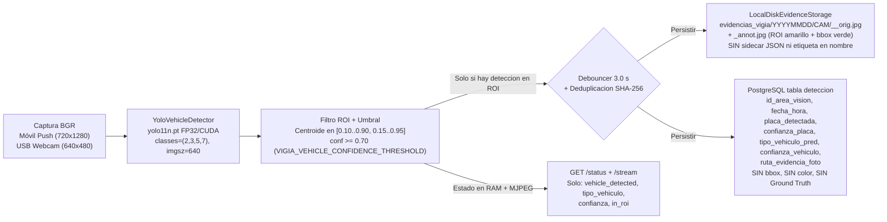
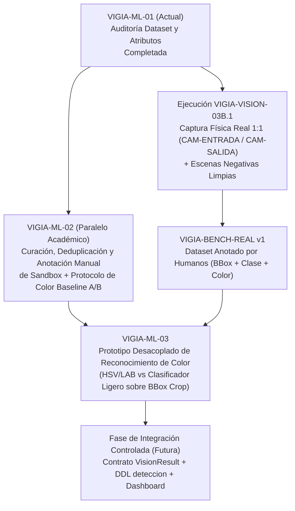

# VIGIA-ML-01 — Auditoría del Dataset de Evidencias y Capacidades de Análisis de Atributos

**Proyecto:** VIGÍA Vision Systems  
**Fase:** VIGIA-ML-01 (Auditoría Técnica, Documental y Estadística de Dataset y Atributos Visuales)  
**Fecha de Emisión:** 14 de Noviembre de 2026  
**Alcance Primario:** [`evidencias_vigia\20261111`](file:///C:/GEST.PROY.TI/Software/VIGIA_Vision_Systems/evidencias_vigia/20261111), [`evidencias_vigia\20261114`](file:///C:/GEST.PROY.TI/Software/VIGIA_Vision_Systems/evidencias_vigia/20261114), contratos de persistencia, pipeline de visión (`YOLO11n`), API y Dashboard.  
**Modalidad:** Auditoría de solo lectura (cero modificaciones a código de producción, base de datos, pesos, umbrales o evidencias).  
**Propósito Estratégico:** Evaluar la viabilidad real del corpus histórico para entrenar o validar modelos supervisados de Machine Learning / reconocimiento de atributos (incluyendo color vehicular) y establecer un marco experimental riguroso para colaboración académica con estudiante de Inteligencia Artificial.

---

## Resumen Ejecutivo

1. **Integridad Física vs. Pobreza Semántica del Dataset:** El subconjunto auditado (`20261111` + `20261114`) suma **156 pares íntegros** (`156 _orig.jpg` + `156 _annot.jpg` = **312** archivos `.jpg`), sin archivos corruptos ni duplicados exactos por SHA-256. Sin embargo, el **100%** del subconjunto pertenece a dominios de laboratorio artificiales: `20261111` (`11` pares) corresponde íntegramente a **recaptura de pantalla** (`SCREEN_RECAPTURE`: teléfono apuntando a un monitor con miniaturas de Google Imágenes) y `20261114` (`145` pares) corresponde íntegramente a **modelos a escala / juguetes sobre escritorio o sostenidos con la mano** (`SCALE_MODEL_LAB`), con severa redundancia temporal (`61/129` transiciones consecutivas en `CAM-SALIDA` tienen `MAD < 8`) y desenfoque extremo (varianza Laplaciana mediana `7.1`).
2. **Reconocimiento de Color — Estado A (`No implementado`):** No existe ningún módulo de extracción, clasificación o estimación visual de color (ni HSV, ni CIELAB, ni segmentación, ni red clasificadora) en [`VIGIA_Vision`](file:///C:/GEST.PROY.TI/Software/VIGIA_Vision_Systems/VIGIA_Vision), [`VIGIA_Core`](file:///C:/GEST.PROY.TI/Software/VIGIA_Vision_Systems/VIGIA_Core), [`VIGIA_API`](file:///C:/GEST.PROY.TI/Software/VIGIA_Vision_Systems/VIGIA_API), [`VIGIA_Dashboard`](file:///C:/GEST.PROY.TI/Software/VIGIA_Vision_Systems/VIGIA_Dashboard) ni [`VR_Semaforo`](file:///C:/GEST.PROY.TI/Software/VIGIA_Vision_Systems/VR_Semaforo). La única columna llamada `color` en la base de datos (`vehiculo.color VARCHAR(30) NULL` en [`VIGIA_V1_DDL.sql`](file:///C:/GEST.PROY.TI/Software/VIGIA_Vision_Systems/Docs/BD/VIGIA_V1_DDL.sql#L63)) pertenece al padrón estático de vehículos registrados, no a la tabla de inferencia óptica [`deteccion`](file:///C:/GEST.PROY.TI/Software/VIGIA_Vision_Systems/Docs/BD/VIGIA_V1_DDL.sql#L172-L190).
3. **Vacío de Metadatos en Disco y Persistencia:** Las imágenes `*_orig.jpg` no tienen sidecar JSON ni etiqueta en nombre de archivo; tampoco se persisten en disco los bounding boxes ni el `Ground Truth`. La tabla [`deteccion`](file:///C:/GEST.PROY.TI/Software/VIGIA_Vision_Systems/VIGIA_Core/repository/detection_repository.py#L225-L244) únicamente almacena `tipo_vehiculo_pred` (mapeando `AUTOBUS -> OTRO` en DDL V1) y `confianza_vehiculo`, sin coordenadas `[x1, y1, x2, y2]` ni atributos visuales.
4. **Dictamen de Viabilidad ML:** El corpus actual **NO es viable** para entrenar ni certificar modelos de producción (ni detección vehicular real ni color en vía pública), aunque sí es útil como **sandbox metodológico** para que un estudiante de IA aprenda curación, partición por sesión (`GroupKFold`), protocolo de anotación humana y prototipado de extractores de atributos/color bajo métricas rigurosas, previo a la captura real 1:1 ([`VIGIA-VISION-03B.1_PROTOCOLO_CAPTURA.md`](file:///C:/GEST.PROY.TI/Software/VIGIA_Vision_Systems/Docs/fase_vision/VIGIA-VISION-03B.1_PROTOCOLO_CAPTURA.md)).

---

## 1. Inventario del Dataset

### 1.1 Contexto Global en [`evidencias_vigia`](file:///C:/GEST.PROY.TI/Software/VIGIA_Vision_Systems/evidencias_vigia) y [`dataset_dudoso`](file:///C:/GEST.PROY.TI/Software/VIGIA_Vision_Systems/dataset_dudoso)

Antes de aislar las fechas solicitadas, se inventarió la raíz de evidencias para dimensionar el repositorio completo:

| Carpeta | Pares `_orig.jpg` / `_annot.jpg` | Total `.jpg` | Estado respecto a `VIGIA-ML-01` |
|---|---|---|---|
| `20261101` | 1 / 1 | 2 | Histórica previa |
| `20261102` | 1 / 1 | 2 | Histórica previa |
| `20261104` | 10 / 10 | 20 | Histórica previa |
| `20261105` | 412 / 412 | 824 | Histórica previa |
| `20261106` | 14 / 14 | 28 | Histórica previa |
| `20261110` | 10 / 10 | 20 | Histórica previa |
| **`20261111`** | **11 / 11** | **22** | **Dentro de alcance auditado** |
| **`20261114`** | **145 / 145** | **290** | **Dentro de alcance auditado** |
| **Total Global `evidencias_vigia`** | **604 / 604** | **1,208** | Subconjunto auditado = **25.8%** (156/604) |
| `dataset_dudoso` (legacy `VR_Semaforo`) | 0 archivos | 0 | Directorio vacío (`Shadow Mode` inactivo) |

### 1.2 Inventario Detallado del Alcance (`20261111` y `20261114`)

| Métrica de Inventario | `20261111` | `20261114` (`CAM-ENTRADA`) | `20261114` (`CAM-SALIDA`) | Total Alcance |
|---|---|---|---|---|
| Cámaras presentes | `CAM-ENTRADA` | `CAM-ENTRADA` | `CAM-SALIDA` | 2 cámaras |
| Imágenes originales (`*_orig.jpg`) | 11 | 15 | 130 | **156** |
| Imágenes anotadas (`*_annot.jpg`) | 11 | 15 | 130 | **156** |
| Otros archivos / extensiones distintas a `.jpg` | 0 | 0 | 0 | **0** |
| Emparejamiento 1:1 (`orig` ↔ `annot`) | 100% (0 huérfanos) | 100% (0 huérfanos) | 100% (0 huérfanos) | **100%** |
| Archivos `_orig.jpg` corruptos (`cv2.imread`) | 0 | 0 | 0 | **0** |
| Archivos `_annot.jpg` corruptos (`cv2.imread`) | 0 | 0 | 0 | **0** |
| `_annot.jpg` idénticos píxel a píxel a `_orig.jpg` | 0 | 0 | 0 | **0** |
| Hashes SHA-256 únicos (`_orig.jpg`) | 11 / 11 | 15 / 15 | 130 / 130 | **156 / 156** |
| Resoluciones (`Ancho × Alto`) | `720×1280` (11) | `640×480` (1), `720×1280` (14) | `640×480` (130) | Mixta (`640×480` y `720×1280`) |
| Tamaño de archivo `_orig.jpg` (KB: mín / med / máx) | 163.5 / 186.8 / 228.2 | 30.0 / 127.0 / 142.9 | 17.5 / 31.1 / 37.3 | 17.5 KB – 228.2 KB |
| Sesiones temporales (brecha > 60 s) | 1 (`22:40:42Z–22:41:13Z`) | 3 (`00:47:11Z–00:58:46Z`) | 3 (`00:49:45Z–01:01:19Z`) | **7 sesiones discretas** |

### 1.3 Cómo se Generan y Almacenan Imágenes y Metadatos en Código

El flujo completo de generación y persistencia observado en [`evidence_storage.py`](file:///C:/GEST.PROY.TI/Software/VIGIA_Vision_Systems/VIGIA_Vision/runtime/evidence_storage.py#L1-L170), [`coordinator.py`](file:///C:/GEST.PROY.TI/Software/VIGIA_Vision_Systems/VIGIA_Vision/runtime/coordinator.py#L431-L485), [`detection_repository.py`](file:///C:/GEST.PROY.TI/Software/VIGIA_Vision_Systems/VIGIA_Core/repository/detection_repository.py#L58-L245) e [`ingest_service.py`](file:///C:/GEST.PROY.TI/Software/VIGIA_Vision_Systems/VIGIA_API/ingest_service.py#L264-L322) se ilustra a continuación:

**Trazabilidad exacta de metadatos:**
- **En disco (`_orig.jpg` / `_annot.jpg`):** El nombre sigue `<YYYYMMDD>T<HHMMSS>_<uuuuuu>Z_<12hex>_orig.jpg`. No existe ningún archivo `.json`, `.txt`, `.xml` o etiqueta EXIF con clase, confianza, bounding box o color. La imagen `_annot.jpg` únicamente dibuja el rectángulo ROI amarillo (`BGR (0, 215, 255)`) y las cajas verdes (`BGR (0, 220, 0)`) vía [`render_annotated_frame`](file:///C:/GEST.PROY.TI/Software/VIGIA_Vision_Systems/VIGIA_Vision/runtime/evidence_storage.py), sin texto impreso.
- **En `VisionResult` ([`vision_result.py`](file:///C:/GEST.PROY.TI/Software/VIGIA_Vision_Systems/VIGIA_Core/domain/vision_result.py#L1-L145)):** Transporta únicamente `status`, `timestamp`, `vehicle_detected`, `vehicle_confidence`, `vehicle_type_pred`, `plate_located`, `plate_text`, `plate_confidence`, `evidence_path` y `error_message`. No contiene `color` ni `bbox`.
- **En PostgreSQL ([`VIGIA_V1_DDL.sql`](file:///C:/GEST.PROY.TI/Software/VIGIA_Vision_Systems/Docs/BD/VIGIA_V1_DDL.sql#L172-L190) y [`detection_repository.py`](file:///C:/GEST.PROY.TI/Software/VIGIA_Vision_Systems/VIGIA_Core/repository/detection_repository.py#L59-L114)):** La tabla `deteccion` persiste únicamente `(id_area_vision, fecha_hora, placa_detectada, confianza_placa, confianza_vehiculo, tipo_vehiculo_pred, ruta_evidencia_foto)`. Además, [`map_tipo_vehiculo_ddl_v1`](file:///C:/GEST.PROY.TI/Software/VIGIA_Vision_Systems/VIGIA_Core/repository/detection_repository.py#L68-L181) convierte `'AUTOBUS'` $\to$ `'OTRO'` para satisfacer el `CHECK` de DDL V1 (`AUTOMOVIL`, `CAMIONETA`, `CAMION`, `MOTOCICLETA`, `OTRO`), lo que destruye la granularidad original de la clase COCO `bus` al persistir.
- **Nota sobre consulta en vivo a PostgreSQL:** Al momento de esta auditoría el servicio PostgreSQL en `127.0.0.1:5434` se encontraba detenido (`Connection refused`), y conforme a las restricciones de solo lectura (no iniciar ni reiniciar servicios) no se consultaron conteos en vivo de la tabla `deteccion` o `vehiculo`. Todo el análisis estadístico siguiente se obtuvo directamente de los archivos físicos en disco y de re-inferencia controlada con [`yolo11n.pt`](file:///C:/GEST.PROY.TI/Software/VIGIA_Vision_Systems/yolo11n.pt).

---

## 2. Estadísticas por Fecha, Cámara y Clase (Inferencia `yolo11n.pt` — NO Ground Truth)

> [!IMPORTANT]
> Las siguientes cifras provienen de ejecutar [`yolo11n.pt`](file:///C:/GEST.PROY.TI/Software/VIGIA_Vision_Systems/yolo11n.pt) (Ultralytics / PyTorch `2.6.0+cu124`, GPU `cuda:0`) sobre los **156** archivos `*_orig.jpg` originales, únicamente con fines diagnósticos. **NO deben tratarse como Ground Truth.**

### 2.1 Distribución General por Fecha y Cámara

| Fecha / Cámara | `orig` | Frames Hit (`ROI + conf ≥ 0.70`) | Frames Hit (`conf ≥ 0.25`) | Cajas Vehículo (`conf ≥ 0.25`) | Cajas Vehículo (`conf ≥ 0.70`) | Cajas en ROI (`conf ≥ 0.70`) | Confianza `0.25+` (mín / med / media / máx) |
|---|---|---|---|---|---|---|---|
| **`20261111` / `CAM-ENTRADA`** | 11 | 11 / 11 | 11 / 11 | **78** (`car`: 74, `motorcycle`: 4) | **39** (`car`: 39) | **34** (`car`: 34) | `0.268 / 0.697 / 0.658 / 0.919` |
| **`20261114` / `CAM-ENTRADA`** | 15 | 15 / 15 | 15 / 15 | **15** (`car`: 15) | **15** (`car`: 15) | **15** (`car`: 15) | `mean = 0.863` |
| **`20261114` / `CAM-SALIDA`** | 130 | 114 / 130 | 130 / 130 | **194** (`car`: 132, `truck`: 35, `bus`: 27) | **130** (`car`: 93, `truck`: 11, `bus`: 26) | **118** (`car`: 81*, `truck`: 11, `bus`: 26) | `mean = 0.705` |
| **Total `20261114`** | **145** | **129 / 145** | **145 / 145** | **209** (`car`: 147, `truck`: 35, `bus`: 27) | **145** (`car`: 108, `truck`: 11, `bus`: 26) | **133** (`car`: 96, `truck`: 11, `bus`: 26) | `0.277 / 0.756 / 0.716 / 0.935` |

*\*En `20261114/CAM-SALIDA` algunas imágenes contienen simultáneamente más de un modelo a escala visible (p. ej. autobús escolar amarillo + auto rojo en la parte superior del encuadre).*

### 2.2 Desglose por Sesión Temporal y Confianza

| Fecha / Cámara | Sesión | Horario UTC | Duración | `n` | Resolución | `Y` medio | Laplaciana media | Cajas `conf ≥ 0.25` | Cajas `conf ≥ 0.70` | Contenido visual verificado |
|---|---|---|---|---|---|---|---|---|---|---|
| `20261111` `CAM-ENTRADA` | S1 | `22:40:42–22:41:13` | 31.0 s | 11 | `720×1280` | 121.6 | 305.1 | `car`: 74, `motorcycle`: 4 | `car`: 39 | Monitor mostrando búsqueda Google Imágenes `"vehiculos"` |
| `20261114` `CAM-ENTRADA` | S1 | `00:47:11` | 0.0 s | 1 | `640×480` | 71.3 | 5.9 | `car`: 1 | `car`: 1 | Auto a escala rojo sostenido con mano (fondo oscuro) |
| `20261114` `CAM-ENTRADA` | S2 | `00:49:23–00:49:37` | 14.0 s | 5 | `720×1280` | 40.0 | 13.0 | `car`: 5 | `car`: 5 | Auto a escala sobre escritorio con luz ambiental verdosa tenue |
| `20261114` `CAM-ENTRADA` | S3 | `00:58:14–00:58:46` | 31.9 s | 9 | `720×1280` | 92.4 | 29.5 | `car`: 9 | `car`: 9 | Auto a escala sobre escritorio mejor iluminado |
| `20261114` `CAM-SALIDA` | S1 | `00:49:45–00:50:07` | 21.7 s | 32 | `640×480` | 26.5 | 4.4 | `car`: 32 | `car`: 25 | Auto a escala rojo sobre teclado oscuro (desenfocado) |
| `20261114` `CAM-SALIDA` | S2 | `00:56:11–00:57:01` | 50.1 s | 15 | `640×480` | 145.7 | 6.2 | `car`: 15 | `car`: 10 | Auto a escala rojo bajo iluminación intensa y reflejo |
| `20261114` `CAM-SALIDA` | S3 | `00:58:54–01:01:19` | 145.0 s | 83 | `640×480` | 129.9 | 9.7 | `car`: 85, `truck`: 35, `bus`: 27 | `car`: 58, `truck`: 11, `bus`: 26 | Ráfagas de autobús escolar amarillo a escala, auto rojo y auto vino |

### 2.3 Hallazgo de Deriva por Recompresión / Umbral Históricos (`16/145` frames en `20261114`)

Aunque `.env` actualmente fija `VIGIA_VEHICLE_CONFIDENCE_THRESHOLD=0.70`, **16** de los **130** frames de `20261114/CAM-SALIDA` obtienen confianza `< 0.70` al re-inferir `yolo11n.pt` sobre el archivo `*_orig.jpg` (rango `0.425` a `0.697`, p. ej. `20261114T005003_523916Z_903f75714aa8_orig.jpg` con `0.425` y `20261114T005951_971358Z_5b021e7a12a5_orig.jpg` con `bus 0.599`), mientras que sus respectivos `*_annot.jpg` **sí contienen el bounding box verde del ROI**. Esto evidencia que durante esas pruebas de captura el umbral activo era menor a `0.70` o que la recompresión JPEG (`Q90`) posterior a la inferencia en vivo degradó ligeramente los puntajes borderline (`0.68–0.69` vs `0.70`). Adicionalmente, la comparación `CPU` vs `CUDA` sobre esas imágenes muestra variaciones menores (`0.6911` GPU vs `0.6923` CPU; `0.5995` GPU vs `0.6068` CPU).

---

## 3. Calidad y Diversidad de Imágenes

### 3.1 Métricas Cuantitativas de Señal Visual

| Subconjunto | Resolución | Varianza Laplaciana (mín / med / máx) | Luminancia `Y` (mín / med / máx) | Similitud Consecutiva `MAD < 5` | Similitud Consecutiva `MAD < 8` | Área relativa BBox `%` (mín / med / máx) |
|---|---|---|---|---|---|---|
| `20261111` (`CAM-ENTRADA`, n=11) | `720×1280` | 129.7 / 280.2 / 452.0 | 110.6 / 125.2 / 129.9 | 0 / 10 (0%) | 0 / 10 (0%) | `0.10% / 1.08% / 18.88%` |
| `20261114` (`CAM-ENTRADA`, n=15) | `640×480` (1), `720×1280` (14) | 5.9 / 26.5 / 35.7 | 37.1 / 86.0 / 100.1 | 1 / 14 (7.1%) | 2 / 14 (14.3%) | `0.79% / 7.99% / 24.78%` (global 20261114) |
| `20261114` (`CAM-SALIDA`, n=130) | `640×480` | **2.0 / 7.1 / 25.0** | 13.7 / 125.7 / 159.3 | **41 / 129 (31.8%)** | **61 / 129 (47.3%)** | (incluido arriba) |

### 3.2 Diversidad de Escenarios, Dominio, Iluminación y Clases

1. **Brecha crítica de dominio (`Domain Gap`):** Ninguna de las 156 imágenes corresponde a vehículos reales 1:1 en caseta o carril vial. El 100% de `20261111` es recaptura de monitor (`SCREEN_RECAPTURE`, bordes de navegador, texto `"vehiculos"`, efecto moiré y cuadrículas de miniaturas) y el 100% de `20261114` son juguetes/modelos a escala sobre escritorio/teclado o sostenidos con dedos (`SCALE_MODEL_LAB`).
2. **Desbalance extremo de instancias y colores:** Solo aparecen **3–4 objetos físicos distintos** repetidos en `20261114` (un coupé deportivo rojo, un autobús escolar amarillo a escala, un coupé vino/guinda oscuro), cero motocicletas reales, cero camiones pesados reales, cero escenas nocturnas en exteriores reales y cero fondos viales (asfalto, señalización, barreras).
3. **Condiciones extremas de iluminación y desenfoque:**
   - **Subexposición severa:** `CAM-SALIDA` S1 tiene `Y_mean = 26.5` (mínimo `13.7`), haciendo casi indiscernible el color real de la carrocería roja sobre el teclado negro.
   - **Tinte cromático artificial:** `CAM-ENTRADA` S2 muestra fuerte dominante verdosa/tenue (`Y_mean = 40.0`), desplazando matices rojos/oscuros en espacio HSV.
   - **Deslumbramiento especular (`glare`):** `CAM-SALIDA` S2 (`Y_mean = 145.7`) y `20261111` generan reflejos saturados (`>10%` de píxeles con `V > 240` en `30/78` crops de `20261111` y `20/209` crops de `20261114`).
   - **Desenfoque severo en USB:** El `100%` de `CAM-SALIDA` (`n=130`) presenta varianza Laplaciana entre `2.0` y `25.0` (frente a `129.7–452.0` en `20261111`), producto de foco cercano sin autofocus adecuado o movimiento de mano (`debounce` cada 3 s capturando ráfagas casi estáticas).

---

## 4. Problemas, Sesgos y Limitaciones Estructurales

1. **Alto riesgo de Fuga de Datos (`Data Leakage`) por Ráfagas Temporales:** El debouncer actual ([`ingest_service.py`](file:///C:/GEST.PROY.TI/Software/VIGIA_Vision_Systems/VIGIA_API/ingest_service.py), [`usb_worker.py`](file:///C:/GEST.PROY.TI/Software/VIGIA_Vision_Systems/VIGIA_API/usb_worker.py)) guarda un frame cada ~3 segundos aunque la cámara apunte al mismo objeto quieto. En `CAM-SALIDA`, `47.3%` de pares consecutivos tienen `MAD < 8`. Un split aleatorio frame-a-frame filtraría el mismo objeto, ángulo, iluminación y fondo simultáneamente en *train* y *test*, inflando artificialmente las métricas (`Accuracy`/`mAP > 95%` ilusorio).
2. **Alucinaciones de Contexto y Confusión de Clases en `yolo11n.pt`:**
   - Ejecutado sin filtro de clases (`conf ≥ 0.25`) sobre `20261114`, YOLO detecta contexto de escritorio (`keyboard`: 55 veces, `person`/dedos: 46, `cell phone`: 4, `laptop`: 1, `remote`: 1, `bed`: 1, `dining table`: 1, `chair`: 1, `boat`: 1, `bicycle`: 2). Aunque [`YoloVehicleDetector`](file:///C:/GEST.PROY.TI/Software/VIGIA_Vision_Systems/VIGIA_Vision/detection/yolo_detector.py#L38-L43) filtra estrictamente `classes=(2,3,5,7)` en producción, esto confirma que el contexto de fondo es completamente ajeno a un acceso vehicular.
   - En `20261114/CAM-SALIDA` S3, el mismo autobús escolar amarillo a escala oscila entre `bus` (`27` cajas) y `truck` (`35` cajas), además de perder la clase `'AUTOBUS'` al persistirse como `'OTRO'` en PostgreSQL.
3. **Ausencia de Etiquetas Reales y Coordenadas Guardadas:** Sin anotación humana y sin persistencia de `bbox`, no es posible entrenar modelos supervisados directamente desde la BD ni calcular `Precision/Recall/IoU/F1` sin anotar manualmente primero.
4. **Nula presencia de clases negativas limpias (`Hard Negatives`):** Como `evidence_storage` solo graba cuando el detector dispara `vehicle_detected=True` dentro del ROI, **no existen fotogramas sin vehículos guardados en `evidencias_vigia`** para medir tasa de falsos positivos sobre fondos vacíos (solo aparecen falsos positivos si otro vehículo disparó el frame).

---

## 5. Diagnóstico del Reconocimiento de Color

### 5.1 Dictamen Formal de Estado Actual

De acuerdo con la inspección exhaustiva del código fuente en Python, JavaScript y SQL:

> **Estado del Reconocimiento de Color: `A. No implementado`.**

Evidencia directa verificada:
1. [`VIGIA_Vision`](file:///C:/GEST.PROY.TI/Software/VIGIA_Vision_Systems/VIGIA_Vision): Búsqueda completa de símbolos (`color`, `hsv`, `cvtColor`, `BGR2HSV`, `BGR2LAB`, `mask`, `dominant`, `segment`) confirma **0** algoritmos o módulos de análisis cromático visual. Solo existen constantes `bgr_color` para dibujar rectángulos OpenCV en [`evidence_storage.py`](file:///C:/GEST.PROY.TI/Software/VIGIA_Vision_Systems/VIGIA_Vision/runtime/evidence_storage.py).
2. [`VIGIA_Core/domain/vision_result.py`](file:///C:/GEST.PROY.TI/Software/VIGIA_Vision_Systems/VIGIA_Core/domain/vision_result.py#L1-L145) y [`detection_repository.py`](file:///C:/GEST.PROY.TI/Software/VIGIA_Vision_Systems/VIGIA_Core/repository/detection_repository.py#L78-L114): `VisionResult` y `DetectionInsertDTO` no contemplan ningún atributo `color`.
3. [`VIGIA_V1_DDL.sql`](file:///C:/GEST.PROY.TI/Software/VIGIA_Vision_Systems/Docs/BD/VIGIA_V1_DDL.sql#L63): La tabla `vehiculo` (lista blanca administrativa) posee `color VARCHAR(30) NULL`, que es un **dato administrativo de padrón**, mientras que la tabla de inferencia visual [`deteccion`](file:///C:/GEST.PROY.TI/Software/VIGIA_Vision_Systems/Docs/BD/VIGIA_V1_DDL.sql#L172-L190) **carece de columna `color`**.
4. [`VIGIA_API/ingest_service.py`](file:///C:/GEST.PROY.TI/Software/VIGIA_Vision_Systems/VIGIA_API/ingest_service.py#L1900-L2185) y [`VIGIA_Dashboard/web/js/views/cameras-view.js`](file:///C:/GEST.PROY.TI/Software/VIGIA_Vision_Systems/VIGIA_Dashboard/web/js/views/cameras-view.js#L631-L656): Los endpoints `/status` y `/live` solo exponen `tipo_vehiculo` y `confianza`, y el frontend únicamente renderiza `DETECTADO: <TIPO> (<PCT>%)` + badge `EN ZONA ROI`. Toda coincidencia de `"color"` en Dashboard JS corresponde únicamente a estilos CSS (`#ffffff`, `currentColor`).
5. [`VR_Semaforo/vision/processor.py`](file:///C:/GEST.PROY.TI/Software/VIGIA_Vision_Systems/VR_Semaforo/vision/processor.py#L1-L106): El prototipo heredado tampoco implementó reconocimiento de color vehicular.

### 5.2 Factibilidad Técnica Empírica de Extracción de Color sobre `20261111` y `20261114`

Para evaluar objetivamente la factibilidad de prototipar reconocimiento de color sobre los recortes actuales, se midieron estadísticas HSV sobre el 60% central de las cajas detectadas (`conf ≥ 0.25`):

- **`20261111` (`n=78` crops):** `S_mean = 48.6` (`48/78` = **61.5%** con baja saturación `S < 45` por lavado de pantalla/compresión), `V_mean = 170.2`, y **38.5%** (`30/78`) con reflejo extremo (`>10%` de píxeles con `V > 240`). El muestreo sobre monitor introduce sesgo gamma y de subpíxeles RGB.
- **`20261114` (`n=209` crops):** `S_mean = 119.3`, `V_mean = 121.4`, pero **`50/209` (23.9%) presentan subexposición severa (`V < 60`, mínimo `12.0`)**, **`20/209` (9.6%) presentan deslumbramiento (`>10%` con `V > 240`)**, y **`16/209` (7.7%) baja saturación (`S < 45`)**, además del tinte verdoso ambiental en `CAM-ENTRADA` S2 y contaminación del fondo/llantas/parabrisas dentro del bounding box rectangular.

**Implicación técnica:** Si se intenta estimar color directamente promediando todo el bounding box rectangular (`HSV mean/histogram` ingenuo), fallará sistemáticamente ante fondos de teclado oscuro, parabrisas/ventanas negras, luz verdosa, reflejos blancos especulares y sombras (`Y < 30`). Un prototipo serio deberá combinar **supresión de acromáticos/especulares**, **muestreo restringido a zonas de carrocería o segmentación (`GrabCut`/máscara)**, espacio perceptual (**HSV + CIELAB $\Delta E$** o clasificador CNN ligero con balance de blancos), y **cuantificación de incertidumbre / rechazo (`INDETERMINADO`)** cuando `V` sea insuficiente.

---

## 6. Viabilidad del Dataset para Machine Learning

| Caso de Uso ML / IA | Viabilidad con `20261111` + `20261114` actuales | Justificación Técnica Directa |
|---|---|---|
| **1. Entrenar detector YOLO para producción vehicular real** | **NO VIABLE** | 100% son pantallas o juguetes (`domain gap` extremo); solo `~3-4` objetos físicos en `20261114`; `0` vehículos 1:1 en carril real; `0` negativos limpios. Entrenar aquí destruiría la generalización de `yolo11n.pt` COCO. |
| **2. Validar/calibrar umbrales de producción** | **NO VIABLE** | No representa escala real, ángulo ni distancias de caseta. Solo sirve para verificar la mecánica de código del evaluador offline. |
| **3. Prototipar clasificador/extractor de color vehicular (offline académico)** | **PARCIAL / SANDBOX METODOLÓGICO** | Factible **únicamente** como ejercicio académico controlado en subconjuntos curados de `20261114` (p. ej. comparar heurística HSV/CIELAB vs modelo supervisado ligero para rojo/amarillo/oscuro), **explicitando** la limitación de 3 objetos base y la obligación de re-validar sobre `VIGIA-BENCH-REAL` cuando exista captura 1:1. |
| **4. Entrenar módulo de aprendizaje de partición temporal y deduplicación (`GroupKFold`, dedup por `MAD`/pHash)** | **ALTAMENTE VIABLE (Didáctico)** | Los problemas reales de ráfagas (`47.3% MAD < 8`), desenfoque (`Lap < 10`) y subexposición (`Y=13.7`) convierten a `20261114` en un caso de estudio ideal para enseñar higiene de datasets y control de *data leakage*. |
| **5. Detección / OCR de placas (`ANPR`)** | **NO VIABLE** | Ninguna imagen contiene matrículas vehiculares reales legibles (`placa_detectada` ausente). |

---

## 7. Propuesta de Anotación Manual (Esquema Canónico Mínimo)

Para que el estudiante de IA convierta el corpus en un dataset auditado (sin tocar producción), se recomienda generar un manifiesto externo en JSON/CSV (p. ej. `annotations_ml01_sandbox.json`, compatible en estructura con [`VIGIA-VISION-03B_BENCHMARK.md`](file:///C:/GEST.PROY.TI/Software/VIGIA_Vision_Systems/Docs/fase_vision/VIGIA-VISION-03B_BENCHMARK.md)) separando estrictamente **atributos del fotograma** y **atributos de cada instancia anotada por humano**:

### 7.1 Esquema por Fotograma (`frame_metadata`)
- `sample_id`: Identificador único inmutable + `sha256` del `*_orig.jpg`.
- `relative_path`, `camera_code`, `captured_at_utc`, `session_id` (agrupación estricta para splits).
- `domain_type`: `REAL_1_TO_1` | `SCALE_MODEL_LAB` | `SCREEN_RECAPTURE` | `SYNTHETIC`.
- `lighting_condition`: `NORMAL` | `LOW_LIGHT` (`Y < 50`) | `GLARE` | `COLOR_CAST`.
- `blur_grade`: `SHARP` | `MODERATE_BLUR` | `SEVERE_BLUR`.
- `duplicate_cluster_id`: ID de clúster visual (`MAD < 8`) para evitar sobre-representación en evaluación.

### 7.2 Esquema por Instancia Vehicular (`ground_truth_objects[]`)
- `bbox_xyxy`: `[x1, y1, x2, y2]` trazado manualmente (Label Studio / CVAT / Roboflow local sin nube pública si aplica privacidad, exportado a COCO JSON o YOLO).
- `domain_vehicle_class`: `AUTOMOVIL` | `CAMIONETA` | `CAMION` | `AUTOBUS` | `MOTOCICLETA` | `OTRO`.
- `primary_color_canonical`: Taxonomía cerrada de **8–10 colores operativos** (`ROJO`, `AMARILLO`, `AZUL`, `BLANCO`, `NEGRO`, `GRIS_PLATA`, `VERDE`, `CAFE_VINO`, `NARANJA`, `INDETERMINADO`).
  - *Regla estricta de calidad:* Usar `INDETERMINADO` cuando la subexposición (`V < 45`) o el reflejo impidan a un anotador humano distinguir el color sin adivinar por memoria de la sesión.
- `occlusion_level`: `NONE` (`<10%`) | `PARTIAL` (`10–50%`) | `HEAVY` (`>50%`).
- `annotator_id` y `reviewed_by` (doble revisión en >= 20% de muestras para calcular acuerdo inter-anotador $\kappa$ de Cohen).

**Regla de oro:** Prohibido convertir salidas de `yolo11n.pt` en Ground Truth sin revisión y corrección humana explícita de coordenadas, clase y color.

---

## 8. Propuesta de Metodología Experimental para Colaboración Académica

1. **Deduplicación previa y control estricto de fugas (`Anti-Leakage`):**
   - Calcular similitud entre frames consecutivos (`MAD` o `pHash`) dentro de cada sesión.
   - Asignar `session_id` + `object_instance_group` a cada muestra y particionar **siempre por grupo (`GroupKFold` / `StratifiedGroupKFold`)**, garantizando que frames de una misma ráfaga temporal o del mismo juguete/iluminación nunca aparezcan divididos entre entrenamiento y prueba.
2. **Separación por dominios:**
   - Excluir `20261111` (`SCREEN_RECAPTURE`) del entrenamiento/validación de color físico por su distorsión RGB de monitor, usándolo solo como prueba de estrés o análisis cualitativo de artefactos.
   - Para el módulo de color sobre `20261114` (`145` frames), establecer un **subconjunto de evaluación fijo congelado** y entrenar/ajustar exclusivamente con aumento de datos fotométrico conservador (evitando alteraciones de `Hue` agresivas que conviertan rojo en verde/azul en la etiqueta).
3. **Comparativa de líneas base (de menor a mayor complejidad):**
   - *Baseline A (Reglas deterministas sin ML):* Conversión BGR $\to$ HSV + CIELAB sobre recorte central al 50% del bbox, filtrado de píxeles acromáticos/especulares y votación por histograma/distancia $\Delta E_{2000}$ hacia centroides canónicos.
   - *Baseline B (ML clásico tabular/histograma):* Descriptor concatenado de histogramas HSV/LAB + características estadísticas (`p25, p50, p75`) con `RandomForest` o `SVM` + calibración de confianza y umbral de rechazo `INDETERMINADO`.
   - *Baseline C (Deep Learning ligero):* Fine-tuning / feature extraction con `MobileNetV3-Small` o `ResNet18` congelado (solo viable cuando se integren muestras reales de [`VIGIA-BENCH-REAL`](file:///C:/GEST.PROY.TI/Software/VIGIA_Vision_Systems/Docs/fase_vision/VIGIA-VISION-03B.1_PROTOCOLO_CAPTURA.md) y suficientes instancias distintas por clase cromática).
4. **Métricas obligatorias de evaluación:**
   - **Clasificación de Color:** Matriz de confusión por clase, `Macro-F1`, `Balanced Accuracy`, tasa de abstención (`% INDETERMINADO`), análisis estratificado por nivel de luminancia (`Y < 50` vs `Y ≥ 50`) y latencia de inferencia por recorte (`ms/crop` en CPU y GPU).
   - **Detección (cuando exista GT):** `mAP@50`, `mAP@50:95`, `Recall` y `Precision` al umbral operativo (`0.70` y barrido `[0.30..0.75]`).
5. **Reproducibilidad:** Toda corrida experimental debe vivir en una carpeta de experimentos aislada fuera del runtime productivo, fijar semillas aleatorias (`random`, `numpy`, `torch`), registrar hash del manifiesto utilizado y guardar reportes en JSON/Markdown sin modificar archivos de [`VIGIA_Vision`](file:///C:/GEST.PROY.TI/Software/VIGIA_Vision_Systems/VIGIA_Vision) ni [`VIGIA_API`](file:///C:/GEST.PROY.TI/Software/VIGIA_Vision_Systems/VIGIA_API).

---

## 9. Delimitación de Responsabilidades (Arquitectura VIGÍA vs. Colaboración Académica)

Para proteger la estabilidad operacional, la seguridad y los contratos de [`VIGIA_Vision_Systems`](file:///C:/GEST.PROY.TI/Software/VIGIA_Vision_Systems), los límites quedan definidos explícitamente así:

| Ámbito | Responsable: **Equipo de Ingeniería VIGÍA** | Responsable: **Estudiante de IA (Colaboración Académica)** |
|---|---|---|
| **Código de Producción (`VIGIA_Core`, `VIGIA_Vision`, `VIGIA_API`, `VIGIA_Dashboard`)** | Dueño exclusivo: contratos API, concurrencia, hilos, FSM temporal, SQL, UI y seguridad TLS/mTLS. | **Acceso de solo lectura** (o consumo vía interfaz desacoplada offline). Prohibido editar archivos productivos directamente. |
| **Infraestructura y Captura Real** | Ejecuta captura física 1:1 según [`VIGIA-VISION-03B.1_PROTOCOLO_CAPTURA.md`](file:///C:/GEST.PROY.TI/Software/VIGIA_Vision_Systems/Docs/fase_vision/VIGIA-VISION-03B.1_PROTOCOLO_CAPTURA.md) y provee copias exportadas sanitizadas del dataset. | Recibe copias inmutables (`read-only`) de imágenes; no manipula cámaras físicas, PostgreSQL productivo ni certificados. |
| **Anotación y Curación de Datos** | Define taxonomía oficial compatible con DDL (`AUTOMOVIL`, `CAMIONETA`, `CAMION`, `AUTOBUS`, `MOTOCICLETA`, paleta de colores) y audita muestra de control. | Realiza curación, deduplicación, anotación manual de bounding boxes/colores en manifiesto versionado y reporte estadístico de calidad. |
| **Investigación y Prototipado ML (Color / Atributos)** | Define presupuesto de latencia (`< 3-5 ms` por vehículo en GPU/CPU) e invariante de salida (`color_pred`, `color_conf`, `INDETERMINADO`). | Diseña, entrena y compara Baselines A/B/C en entorno aislado (`experiments/` o paquete autónomo Python `predict_color(crop_bgr) -> ColorPrediction`), entrega pesos/código reproducible y métricas completas. |
| **Integración Final a VIGÍA** | Revisa PR, evalúa no-inferioridad, decide si pasa a `VIGIA_Vision` y diseña migración DDL si se agrega `color_vehiculo_pred` a `deteccion`. | Documenta requisitos de entrada/salida, supuestos, fallos conocidos y guía de inferencia para que ingeniería lo encapsule. |

---

## 10. Próximas Fases Recomendadas

1. **Inmediata (Ingeniería VIGÍA — fuera de entrenamiento):** Ejecutar la captura controlada de vehículos reales 1:1 descrita en [`VIGIA-VISION-03B.1_PROTOCOLO_CAPTURA.md`](file:///C:/GEST.PROY.TI/Software/VIGIA_Vision_Systems/Docs/fase_vision/VIGIA-VISION-03B.1_PROTOCOLO_CAPTURA.md) para romper la dependencia de juguetes y recapturas de pantalla.
2. **`VIGIA-ML-02` (Colaboración Académica — Datos y Anotación):** Construir el manifiesto curado y deduplicado con anotación humana de cajas, clases y color (`INDETERMINADO` incluido) + definición formal de partición por grupos (`GroupKFold`).
3. **`VIGIA-ML-03` (Colaboración Académica — Extractor de Color Offline):** Implementar y evaluar en paquete aislado el extractor/clasificador de color sobre recortes (`Baseline A` HSV/CIELAB con rechazo de sombras/reflejos vs `Baseline B` ML clásico), midiendo latencia y `Macro-F1` por nivel de iluminación antes de proponer cualquier cambio al contrato [`VisionResult`](file:///C:/GEST.PROY.TI/Software/VIGIA_Vision_Systems/VIGIA_Core/domain/vision_result.py) o al DDL [`deteccion`](file:///C:/GEST.PROY.TI/Software/VIGIA_Vision_Systems/Docs/BD/VIGIA_V1_DDL.sql#L172-L190).

---

## Criterios de Aceptación — Respuestas Directas Verificadas

| Pregunta de Aceptación | Respuesta Respaldada por Evidencia Directa |
|---|---|
| **1. ¿Cuántas imágenes existen en `20261111` y `20261114` y cómo están estructuradas?** | Exactamente **312** archivos `.jpg` (**156** pares `1:1` de `*_orig.jpg` + `*_annot.jpg`, 0 corruptos, 0 duplicados SHA-256): **`20261111`** tiene **22** archivos (**11** pares en `CAM-ENTRADA`, `720×1280`); **`20261114`** tiene **290** archivos (**15** pares en `CAM-ENTRADA` y **130** pares en `CAM-SALIDA`, resoluciones `640×480` y `720×1280`). |
| **2. ¿Qué metadatos y etiquetas están disponibles actualmente?** | **Solo marca temporal UTC en el nombre de archivo y carpeta de cámara.** No existen sidecars JSON, bounding boxes en disco ni Ground Truth. En PostgreSQL, la tabla [`deteccion`](file:///C:/GEST.PROY.TI/Software/VIGIA_Vision_Systems/Docs/BD/VIGIA_V1_DDL.sql#L172-L190) solo guarda `id_area_vision`, `fecha_hora`, `placa_detectada`, `confianza_placa`, `tipo_vehiculo_pred` (con `AUTOBUS -> OTRO` en DDL V1), `confianza_vehiculo` y `ruta_evidencia_foto`. *(PostgreSQL en `127.0.0.1:5434` estaba detenido durante la auditoría).* |
| **3. ¿Existe actualmente reconocimiento de color vehicular?** | **No (Estado `A. No implementado`).** No existe lógica HSV/LAB/CNN ni campo de color en [`VIGIA_Vision`](file:///C:/GEST.PROY.TI/Software/VIGIA_Vision_Systems/VIGIA_Vision), `VisionResult`, `deteccion`, `VIGIA_API` o [`cameras-view.js`](file:///C:/GEST.PROY.TI/Software/VIGIA_Vision_Systems/VIGIA_Dashboard/web/js/views/cameras-view.js). Solo existe `vehiculo.color` como campo administrativo estático del padrón autorizado. |
| **4. ¿Cuál es la calidad y representatividad real del dataset actual?** | **Baja para producción.** `20261111` es `100%` recaptura de monitor (Google Imágenes) y `20261114` es `100%` modelos a escala sobre escritorio/mano (`3–4` objetos), con desenfoque extremo en `CAM-SALIDA` (`Laplaciana 2.0–25.0`), `47.3%` de transiciones redundantes (`MAD < 8`) y zonas de subexposición extrema (`Y=13.7`) o reflejos especulares. |
| **5. ¿Es viable construir un dataset supervisado válido con este material?** | **No para producción** (detección real ni color en vía pública); **sí como sandbox metodológico** tras deduplicación por sesión, exclusión de recapturas de pantalla y anotación humana de cajas y color (`INDETERMINADO` incluido), mientras se capturan datos reales 1:1 (`VIGIA-VISION-03B.1`). |
| **6. ¿Qué metodología debería seguir el estudiante de IA?** | (1) Anotación humana obligatoria sin usar predicciones YOLO como GT; (2) Deduplicación temporal (`MAD`/pHash) y partición estricta `GroupKFold` por sesión/instancia; (3) Comparar `Baseline A` (HSV/CIELAB + filtrado acromático/especular) vs `Baseline B` (ML clásico calibrado con clase `INDETERMINADO`); (4) Medir `Macro-F1` estratificado por luminancia y latencia en paquete aislado. |
| **7. ¿Qué alcance y límites quedan claramente definidos?** | El estudiante trabaja **offline y aislado** sobre copias inmutables de datos (anotación, experimentación y reporte de métricas); el equipo de ingeniería **VIGÍA** mantiene ownership exclusivo de código productivo, cámara física, PostgreSQL, contratos `VisionResult`/API y validación previa a cualquier integración. |
