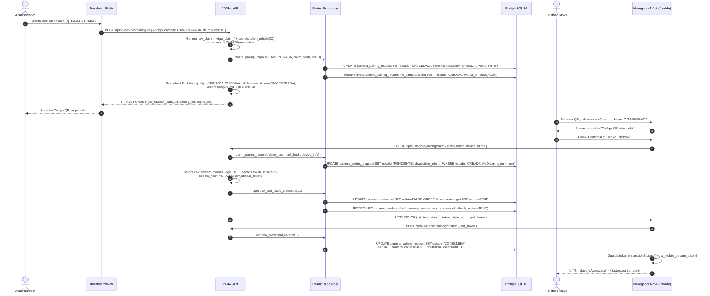
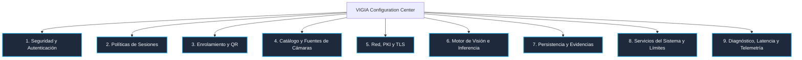
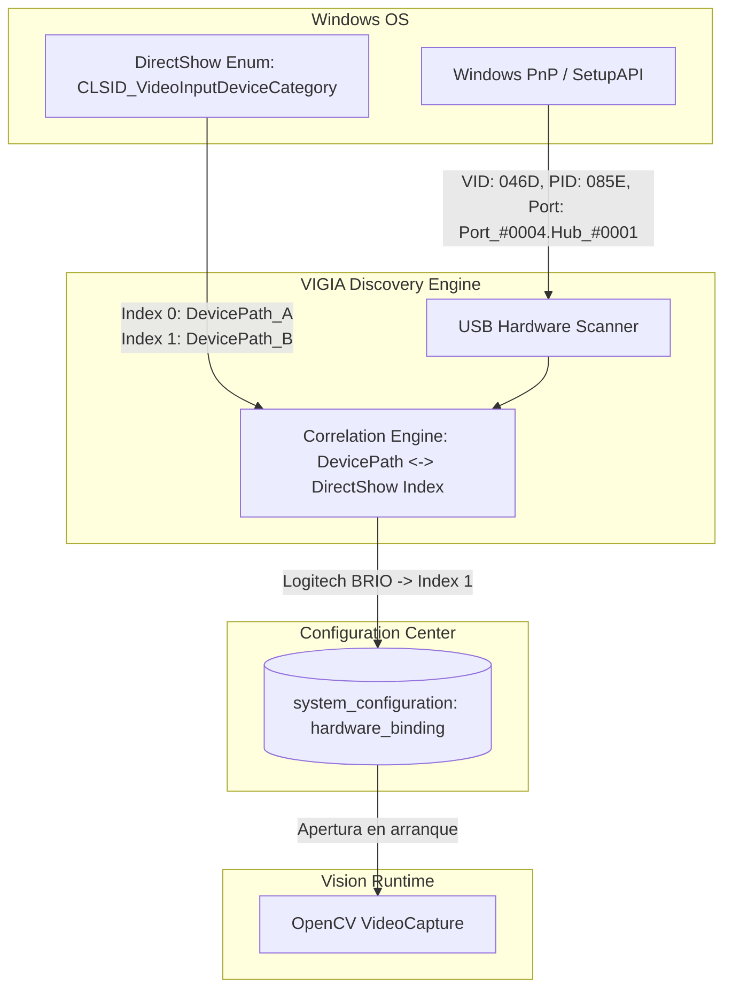
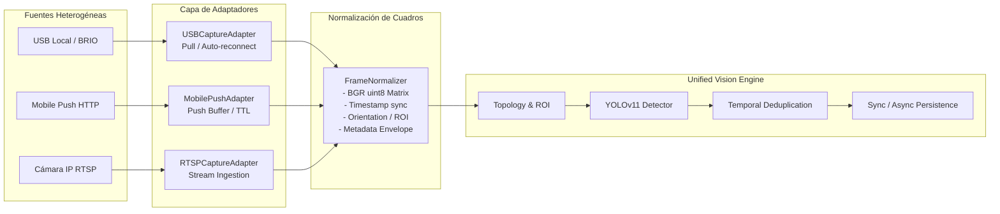
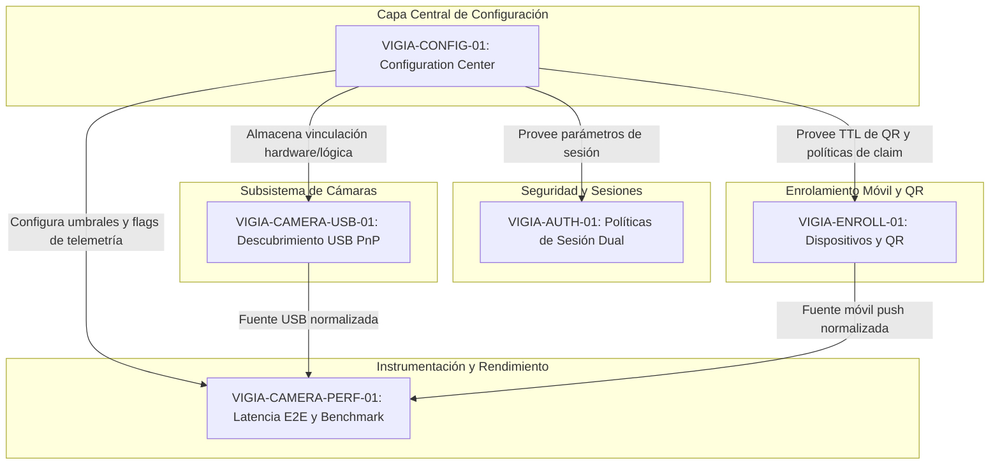

# VIGIA-PLATFORM-01 — Auditoría Integral de Seguridad, Enrolamiento y Arquitectura Centralizada de Configuración

**Proyecto:** VIGÍA Vision Systems — Fase de Evolución de Plataforma  
**Documento:** `Docs/fase_vision/VIGIA-PLATFORM-01_AUDITORIA.md`  
**Fecha de Emisión:** 2026-11-08  
**Tipo de Documento:** Auditoría Técnica y Especificación de Diseño de Plataforma  
**Modalidad de Auditoría:** **ESTRICTAMENTE DE LECTURA (READ-ONLY AUDIT)**  
**Dictamen Final:** **APROBADO PARA DISEÑO**

---

## 1. Resumen Ejecutivo

VIGÍA Vision Systems ha completado satisfactoriamente sus etapas fundacionales de ingestión vehicular móvil, validación estricta de topología operativa (Reglas R1–R8) e inferencia con modelos Ultralytics YOLOv11 en GPU/CPU. No obstante, el crecimiento del sistema ha generado una acumulación dispersa de configuraciones entre variables de entorno (`Software/.env`), tablas de catálogo relacional en PostgreSQL (`camara`, `area_vision`, `usuario`), parámetros hardcodeados en Python (`session_manager.py`, `ingest_service.py`), scripts de PowerShell (`vigia.ps1`) y lógica de interfaz en JavaScript (`app.js`, `cameras-view.js`).

Esta auditoría técnica evalúa de forma no destructiva la arquitectura actual del sistema en siete frentes críticos:

1. **Autenticación y Sesiones:** Determinación de duraciones efectivas, ciclo de vida de tokens opacos y cookies HttpOnly, y vulnerabilidades de exposición visual tras la expiración.
2. **Ciclo de Vida de Códigos QR y Credenciales Móviles:** TTL real de las solicitudes de enrolamiento, consumo de claims, persistencia de credenciales criptográficas y desacoplamiento de dispositivos.
3. **Inventario Exhaustivo de Configuración:** Mapeo formal de 35+ parámetros del sistema, identificando duplicidades, contradicciones operativas y parámetros expuestos.
4. **Diseño de VIGIA Configuration Center:** Propuesta de arquitectura desacoplada para la administración centralizada de 9 dominios operativos desde una interfaz unificada gobernada por el backend.
5. **Captura y Enrolamiento de Cámaras USB en Windows:** Análisis de hardware real conectado (webcam integrada `USB2.0 HD UVC WebCam` y Logitech BRIO `VID_046D&PID_085E` en `Port_#0004.Hub_#0001`), limitantes del backend `cv2.VideoCapture` de OpenCV y diseño de un vinculador de hardware persistente.
6. **Arquitectura Unificada de Fuentes de Video:** Diseño de una cadena desacoplada `CAMERA SOURCE -> SOURCE ADAPTER -> FRAME NORMALIZATION -> UNIFIED VISION PIPELINE` que soporte indistintamente fuentes móviles push, USB locales y futuras cámaras RTSP IP.
7. **Instrumentación y Latencia de Captura Móvil:** Diagnóstico de la medición actual de tiempos y definición de los 7 puntos de instrumentación para comparar con rigor científico la cámara móvil frente a la Logitech BRIO en condiciones equivalentes.

---

## 2. Arquitectura de Autenticación Actual

### 2.1 Componentes del Subsistema de Autenticación

El subsistema de autenticación de VIGÍA opera en el backend `VIGIA_API` apoyado en contratos y repositorios de `VIGIA_Core`:

*   **Validador de Contraseñas:** [`password_hasher.py`](file:///C:/GEST.PROY.TI/Software/VIGIA_Vision_Systems/VIGIA_Core/security/password_hasher.py) utiliza el algoritmo criptográfico **Argon2id** (`time_cost=2`, `memory_cost=65536 KiB`, `parallelism=1`). Implementa mitigación de ataques de enumeración por temporización mediante `DUMMY_ARGON2ID_HASH` (`auth_service.py:18, 62, 71, 76`).
*   **Repositorio de Usuarios:** [`PsycopgUserRepository`](file:///C:/GEST.PROY.TI/Software/VIGIA_Vision_Systems/VIGIA_Core/repository/user_repository.py:133) consulta la tabla `usuario` en PostgreSQL 16. Mapea el rol relacional `OPERADOR` al rol funcional `GUARDIA` a través del DTO inmutable [`UserDTO`](file:///C:/GEST.PROY.TI/Software/VIGIA_Vision_Systems/VIGIA_Core/domain/user.py:90-99).
*   **Gestor de Sesiones:** [`SessionManager`](file:///C:/GEST.PROY.TI/Software/VIGIA_Vision_Systems/VIGIA_API/security/session_manager.py:52) almacena las sesiones activas en un diccionario volátil en memoria (`self._sessions: Dict[str, UserSession]`), protegido por un cerrojo reentrante [`threading.RLock`](file:///C:/GEST.PROY.TI/Software/VIGIA_Vision_Systems/VIGIA_API/security/session_manager.py:61).
*   **Emisión y Transporte:** Los tokens son cadenas opacas generadas mediante [`secrets.token_urlsafe(32)`](file:///C:/GEST.PROY.TI/Software/VIGIA_Vision_Systems/VIGIA_API/security/session_manager.py:83) (256 bits de entropía). Se transportan exclusivamente al navegador en la cookie HTTP `vigia_session` con banderas `HttpOnly=True`, `SameSite='Strict'`, `Path='/'` y `Secure=request.is_secure` ([`ingest_service.py:973-981`](file:///C:/GEST.PROY.TI/Software/VIGIA_Vision_Systems/VIGIA_API/ingest_service.py#L973-L981)).
*   **Control de Acceso (RBAC):** Implementado mediante los decoradores `@require_session_auth` y `@require_rbac(*allowed_roles)` ([`ingest_service.py:838-905`](file:///C:/GEST.PROY.TI/Software/VIGIA_Vision_Systems/VIGIA_API/ingest_service.py#L838-L905)).

```mermaid
sequenceDiagram
    autonumber
    actor User as Usuario (Admin / Guardia)
    participant UI as VIGIA Dashboard (web)
    participant API as VIGIA_API (Flask)
    participant AuthSvc as AuthService
    participant SessMgr as SessionManager (In-Memory)
    participant DB as PostgreSQL (usuario)

    User->>UI: Ingresa username y password
    UI->>API: POST /api/v1/auth/login { username, password }
    API->>AuthSvc: authenticate(username, password)
    AuthSvc->>DB: SELECT * FROM usuario WHERE username = clean_user
    DB-->>AuthSvc: UserDTO (id, hash Argon2id, rol)
    AuthSvc->>AuthSvc: verify_password(hash, password)
    AuthSvc->>SessMgr: create_session(user, ttl_seconds=None)
    SessMgr->>SessMgr: token = secrets.token_urlsafe(32)<br/>expires_at = now + 8h<br/>_sessions[token] = UserSession
    SessMgr-->>AuthSvc: UserSession
    AuthSvc-->>API: UserSession
    API-->>UI: HTTP 200 OK<br/>Set-Cookie: vigia_session=token; HttpOnly; SameSite=Strict; Max-Age=28800<br/>{ ok: true, user: { ... }, expires_at }
    UI->>UI: currentUser = user<br/>navigateToRoute('cameras')
```

---

## 3. Duraciones Reales de Sesiones y Diagnóstico Técnico

### 3.1 Respuestas Obligatorias a la Investigación A

| # | Pregunta Obligatoria | Hallazgo Técnico | Clasificación | Evidencia en Código / Archivos |
|---|---|---|---|---|
| **1** | ¿Cuánto dura actualmente una sesión de administrador? | **8 horas (28,800 segundos)** | `[CONFIRMADO]` | [`session_manager.py:28`](file:///C:/GEST.PROY.TI/Software/VIGIA_Vision_Systems/VIGIA_API/security/session_manager.py#L28): `DEFAULT_SESSION_TTL_SECONDS = 8 * 60 * 60`. `auth_login()` ([`ingest_service.py:946`](file:///C:/GEST.PROY.TI/Software/VIGIA_Vision_Systems/VIGIA_API/ingest_service.py#L946)) no envía `ttl_seconds`, usando el valor por defecto. |
| **2** | ¿Cuánto dura actualmente una sesión de guardia? | **8 horas (28,800 segundos)** | `[CONFIRMADO]` | Idem anterior. El endpoint de login no discrimina por rol al crear la sesión. |
| **3** | ¿Son iguales o tienen políticas independientes? | **Son exactamente iguales.** No existe política independiente por rol. | `[CONFIRMADO]` | [`session_manager.py:68-101`](file:///C:/GEST.PROY.TI/Software/VIGIA_Vision_Systems/VIGIA_API/security/session_manager.py#L68-L101): `create_session` aplica `self._default_ttl` sin consultar `user.rol`. |
| **4** | ¿La duración se calcula desde el login o desde la última actividad? | **Desde el login (`created_at`).** | `[CONFIRMADO]` | [`session_manager.py:84-85`](file:///C:/GEST.PROY.TI/Software/VIGIA_Vision_Systems/VIGIA_API/security/session_manager.py#L84-L85): `expires_at = now + timedelta(seconds=ttl)`. `get_session()` no actualiza esta fecha. |
| **5** | ¿Existe expiración por inactividad (*idle timeout*)? | **NO existe.** | `[CONFIRMADO]` | La clase `UserSession` carece de atributo `last_activity`. |
| **6** | ¿Existe expiración absoluta? | **SÍ.** | `[CONFIRMADO]` | Es la única implementada: vence a los 28,800 segundos exactos de haber iniciado sesión. |
| **7** | ¿Hay renovación automática (*sliding session*)? | **NO existe.** | `[CONFIRMADO]` | No existen refresh tokens ni endpoints de actualización de sesión en backend ni frontend. |
| **8** | ¿Qué sucede cuando vence el token de sesión? | **Purga perezosa inmediata y respuesta HTTP 401.** | `[CONFIRMADO]` | [`session_manager.py:117-120`](file:///C:/GEST.PROY.TI/Software/VIGIA_Vision_Systems/VIGIA_API/security/session_manager.py#L117-L120): `get_session()` detecta `session.is_expired()`, elimina el token del diccionario y retorna `None`. Los endpoints protegidos retornan `HTTP 401 UNAUTHORIZED`. |
| **9** | ¿Qué sucede cuando vence el refresh token? | **No aplica.** | `[CONFIRMADO]` | No existen tokens JWT ni refresh tokens en la arquitectura. |
| **10** | ¿El logout invalida realmente las credenciales? | **SÍ, en el servidor y en el cliente.** | `[CONFIRMADO]` | [`ingest_service.py:984-1008`](file:///C:/GEST.PROY.TI/Software/VIGIA_Vision_Systems/VIGIA_API/ingest_service.py#L984-L1008): `auth_logout()` ejecuta `sess_mgr.revoke_session(tok)` eliminando la entrada de memoria y emite `response.delete_cookie("vigia_session")`. |
| **11** | ¿Un reinicio del backend invalida las sesiones? | **SÍ, invalida el 100% de las sesiones activas.** | `[CONFIRMADO]` | Las sesiones solo existen en la memoria RAM del proceso Python (`SessionManager._sessions`). No hay persistencia en PostgreSQL ni en Redis. |
| **12** | ¿El frontend puede mantener una interfaz aparentemente autenticada después de expirar la sesión? | **SÍ, de manera indefinida en la vista de cámaras.** | `[CONFIRMADO]` | **Hallazgo Crítico:** Ver análisis detallado en la subsección 3.2. |

### 3.2 Vulnerabilidad de Persistencia Visual en Frontend (Hallazgo Crítico)

Se ha confirmado que la interfaz gráfica web puede mostrar de forma indefinida un estado aparentemente operativo y autenticado aun cuando la sesión haya expirado o el servidor se haya reiniciado:

1.  **Estado Volátil Desacoplado en Cliente:** En [`app.js:36`](file:///C:/GEST.PROY.TI/Software/VIGIA_Vision_Systems/VIGIA_Dashboard/web/js/app.js#L36), la variable `currentUser` se conserva en memoria tras el login.
2.  **Endpoints de Video Desprotegidos:** 
    *   `GET /api/v1/cameras/<codigo>/stream` ([`ingest_service.py:1844`](file:///C:/GEST.PROY.TI/Software/VIGIA_Vision_Systems/VIGIA_API/ingest_service.py#L1844)) **NO** posee los decoradores `@require_session_auth` ni `@require_rbac`. La etiqueta HTML `` continúa recibiendo cuadros MJPEG sin validar cookies.
    *   `GET /api/v1/cameras/<codigo>/status` ([`ingest_service.py:1912`](file:///C:/GEST.PROY.TI/Software/VIGIA_Vision_Systems/VIGIA_API/ingest_service.py#L1912)) **NO** posee verificación de sesión.
3.  **Supresión de Errores en Polling:** En [`cameras-view.js:547-553`](file:///C:/GEST.PROY.TI/Software/VIGIA_Vision_Systems/VIGIA_Dashboard/web/js/views/cameras-view.js#L547-L553), la llamada periódica de actualización operativa (cada 3 segundos) captura silenciosamente cualquier excepción con un bloque `try { ... } catch (_) { continue; }`, omitiendo cualquier notificación de sesión vencida.
4.  **Ausencia de Heartbeat de Sesión:** No existe un temporizador que consulte periódicamente `GET /api/v1/auth/me`. La sesión solo se revalida si el usuario navega a `#devices` o recarga la página completamente con F5.

### 3.3 Propuesta de Política Futura de Sesiones (VIGIA-AUTH-01)

*   **Administrador:**
    *   *Duración configurable:* Por defecto 30 minutos (rango admisible: 15 a 480 minutos).
    *   *Expiración por inactividad:* Cierre forzoso tras 15 minutos sin interacción del ratón/teclado.
    *   *Expiración absoluta:* 8 horas improrrogables desde el login.
*   **Guardia / Operador de Caseta:**
    *   *Duración fija:* Ligada a la jornada operativa continua (por defecto 8 horas fijas, configurable hasta 12 horas para turnos especiales).
    *   *Sin expiración por inactividad:* La pantalla de caseta debe permanecer activa durante todo el turno sin desconectarse por falta de clics.
    *   *Revocación administrativa:* El administrador puede expulsar inmediatamente la sesión del guardia desde el Configuration Center.
*   **Persistencia de Sesiones en PostgreSQL:** Mapear sesiones en tabla `sesion_usuario` para que un reinicio del backend no desautentique a los guardias en servicio.
*   **Protección de Endpoints de Video:** Proteger `/stream`, `/live` y `/status` con verificación de sesión válida.
*   **Interceptor Global de Autenticación en Frontend:** Centralizar en `api-service.js` un disparador que, ante cualquier respuesta HTTP 401, limpie `currentUser`, cierre sockets/streams y transicione la pantalla a la vista de login con un mensaje explícito.

---

## 4. Ciclo de Vida del Código QR y Enrolamiento Móvil

### 4.1 Respuestas Obligatorias a la Investigación B

| # | Pregunta Obligatoria | Hallazgo Técnico | Clasificación | Evidencia en Código / Archivos |
|---|---|---|---|---|
| **1** | ¿Cuál es el TTL real del QR? | **10 minutos (600 segundos)** | `[CONFIRMADO]` | [`ingest_service.py:2016-2018`](file:///C:/GEST.PROY.TI/Software/VIGIA_Vision_Systems/VIGIA_API/ingest_service.py#L2016-L2018): `ttl_minutes = int(data.get("ttl_minutes", 10))`. Límite permitido en payload: [1, 60] minutos. |
| **2** | ¿Dónde se configura? | **Hardcodeado en backend y repositorio.** No está en `.env` ni en BD. | `[CONFIRMADO]` | [`ingest_service.py:2016`](file:///C:/GEST.PROY.TI/Software/VIGIA_Vision_Systems/VIGIA_API/ingest_service.py#L2016) y valor por omisión en [`pairing_repository.py:63`](file:///C:/GEST.PROY.TI/Software/VIGIA_Vision_Systems/VIGIA_Core/repository/pairing_repository.py#L63). |
| **3** | ¿El vencimiento se aplica al claim o a otra credencial? | **Se aplica exclusivamente al claim (`camera_pairing_request.expira_en`).** | `[CONFIRMADO]` | [`V004__enrolamiento_camaras_qr.sql:28`](file:///C:/GEST.PROY.TI/Software/BD/migrations/V004__enrolamiento_camaras_qr.sql#L28). La tabla `camara_credencial` **NO** tiene columna de expiración temporal. |
| **4** | ¿Cuándo se consume el claim? | **En dos etapas: al reclamar (APROBADA) y al confirmar el almacenamiento (CONSUMIDA).** | `[CONFIRMADO]` | [`pairing_repository.py:148, 210, 343`](file:///C:/GEST.PROY.TI/Software/VIGIA_Vision_Systems/VIGIA_Core/repository/pairing_repository.py#L148). |
| **5** | ¿Abrir el enlace consume el claim o solamente iniciar el enrolamiento? | **Abrir el enlace NO consume el claim.** | `[CONFIRMADO]` | [`mobile/index.html:238-245`](file:///C:/GEST.PROY.TI/Software/VIGIA_Vision_Systems/VIGIA_Dashboard/mobile/index.html#L238-L245) solo lee `?claim=...` de la URL y presenta la UI. Se consume solo al hacer clic en *"Confirmar y Enrolar Teléfono"*. |
| **6** | ¿El claim puede reutilizarse? | **NO. Estrictamente de un solo uso.** | `[CONFIRMADO]` | [`pairing_repository.py:153`](file:///C:/GEST.PROY.TI/Software/VIGIA_Vision_Systems/VIGIA_Core/repository/pairing_repository.py#L153): El query exige `estado = 'CREADA'`. Cualquier intento posterior falla con `INVALID_STATE_...`. |
| **7** | ¿Qué ocurre cuando dos dispositivos intentan utilizar el mismo QR? | **El primero triunfa; el segundo es rechazado con HTTP 400/409.** | `[CONFIRMADO]` | Transacción atómica en PostgreSQL con índice único [`uq_pairing_token_claim_hash`](file:///C:/GEST.PROY.TI/Software/BD/migrations/V004__enrolamiento_camaras_qr.sql#L76). El segundo intento arroja 0 filas actualizadas y error `TOKEN_EXPIRED` o `INVALID_STATE`. |
| **8** | ¿Qué sucede cuando vence el QR durante el proceso? | **Rechazo inmediato con HTTP 409 Conflict (`TOKEN_EXPIRED`).** | `[CONFIRMADO]` | [`pairing_repository.py:154, 174`](file:///C:/GEST.PROY.TI/Software/VIGIA_Vision_Systems/VIGIA_Core/repository/pairing_repository.py#L154): La cláusula `expira_en > CURRENT_TIMESTAMP` aborta la operación. |
| **9** | ¿El dispositivo conserva su enrolamiento después de reiniciar el servidor? | **SÍ. Totalmente persistente.** | `[CONFIRMADO]` | La credencial activa se almacena en PostgreSQL (`camara_credencial.token_transmision_hash`) y en el teléfono en `sessionStorage`. |
| **10** | ¿La credencial utilizada para enviar frames tiene vencimiento? | **NO. Vigencia permanente hasta revocación explícita.** | `[CONFIRMADO]` | La tabla `camara_credencial` carece de fecha de caducidad. Solo evalúa `activa = TRUE`. |
| **11** | ¿Qué sucede si esa credencial es revocada? | **Rechazo HTTP 401 en `/push` y detención inmediata de transmisión en el móvil.** | `[CONFIRMADO]` | [`ingest_service.py:1364-1373`](file:///C:/GEST.PROY.TI/Software/VIGIA_Vision_Systems/VIGIA_API/ingest_service.py#L1364-L1373) y [`mobile/index.html:531-536`](file:///C:/GEST.PROY.TI/Software/VIGIA_Vision_Systems/VIGIA_Dashboard/mobile/index.html#L531-L536). |
| **12** | ¿El vencimiento del QR afecta a un dispositivo previamente enrolado? | **NO. Desacoplamiento total.** | `[CONFIRMADO]` | Una vez emitida la credencial, el registro de solicitud (`camera_pairing_request`) puede expirar o transicionar a `CONSUMIDA` sin alterar `camara_credencial`. |

### 4.2 Evaluación de la Separación Conceptual

| Concepto Requerido | Implementación Actual en VIGÍA | Diagnóstico Técnico |
|---|---|---|
| **EnrollmentChallenge** *(Autorización temporal)* | Tabla `camera_pairing_request` y DTO `PairingRequestDTO`. | `[CONFIRMADO]` **Completamente modelado.** Posee TTL, hash SHA-256 de claim, estado FSM y auditoría de resolución. |
| **CameraDevice** *(Dispositivo registrado)* | Atributo JSONB `dispositivo_info` en `camera_pairing_request` y DTO `ActiveDeviceDTO`. | `[OBSERVADO]` **Entidad ausente como tabla relacional.** No existe tabla `dispositivo_camara`. Los datos del teléfono (nombre, User-Agent, IP) viven anidados en la solicitud y se desnormalizan mediante vistas/queries. Debe formalizarse como entidad propia en la evolución de arquitectura. |
| **CameraCredential** *(Autorización de comunicación)* | Tabla `camara_credencial` y DTO `CameraCredentialDTO`. | `[CONFIRMADO]` **Completamente modelado.** Token `vigia_st_...` con hash SHA-256, sobre cifrado temporal, unicidad por cámara activa (`uq_camara_credencial_activa`) y trazabilidad de revocación. |

### 4.3 Diagrama de Secuencia del Enrolamiento Actual



---

## 5. Inventario de Configuración Existente

A continuación se presenta el relevamiento sistemático de las configuraciones distribuidas en todo el repositorio.

| Parámetro | Dominio | Valor Efectivo | Ubicación | Tipo | Modificable | Responsable Actual | Dependencias | Aplicación | Riesgo |
|---|---|---|---|---|---|---|---|---|---|
| `POSTGRES_DB` | Base de Datos | `vigia_db` | `Software/.env:5` | String | Sí | `env_loader.py` | Docker compose, Psycopg | Requiere reinicio | Disponibilidad |
| `POSTGRES_USER` | Base de Datos | `vigia_admin` | `Software/.env:6` | String | Sí | `env_loader.py` | Docker compose, Psycopg | Requiere reinicio | Disponibilidad |
| `POSTGRES_PASSWORD` | Base de Datos / Seguridad | `5452196FB26C...` | `Software/.env:7` | Secret (Hex) | Sí | `env_loader.py` | Docker compose, Repositorios | Requiere reinicio | Seguridad (Crítico) |
| `POSTGRES_HOST` | Base de Datos | `127.0.0.1` | `Software/.env:8` | IP String | Sí | `env_loader.py` | `resolve_database_dsn` | Requiere reinicio | Disponibilidad |
| `POSTGRES_PORT` | Base de Datos | `5433` | `Software/.env:9` | Integer | Sí | `env_loader.py` | Docker compose, Repositorios | Requiere reinicio | Disponibilidad |
| `VIGIA_ALLOW_IN_MEMORY` | Entorno / Pruebas | `0` (Estricto relacional) | `Software/.env:12` | Boolean (0/1) | Sí | `ingest_service.py:431` | `build_default_user_repository` | Requiere reinicio | Integridad |
| `VIGIA_ENABLE_FRONTEND_DEMO` | Frontend | `0` (Datos reales BD) | `Software/.env:13` | Boolean (0/1) | Sí | `app.js` / HTML | `devices-view.js` | Requiere reinicio | Integridad |
| `VIGIA_CAMERA_KEY` | Seguridad / Ingesta | `jY3mSVrz6yLWpp...` | `Software/.env:15` | Secret (Base64) | Sí | `ingest_service.py:400` | `push_camera_frame` (fallback) | Requiere reinicio | Seguridad (Crítico) |
| `VIGIA_DEV_HOST` | Red / Servidor | `0.0.0.0` | `Software/.env:18` | IP String | Sí | `ingest_service.py:3847` | Socket de Flask / Waitress | Requiere reinicio | Conectividad |
| `VIGIA_DEV_PORT` | Red / Servidor | `5000` (8443 en TLS) | `Software/.env:19` | Integer | Sí | `ingest_service.py:424` | Servidor Web y URLs QR | Requiere reinicio | Conectividad |
| `VIGIA_ENABLE_TLS` | Red / Seguridad | `1` (HTTPS activo) | `Software/.env:23` | Boolean (0/1) | Sí | `ingest_service.py:3850` | SSLContext, CA local | Requiere reinicio | Seguridad |
| `VIGIA_REGENERATE_CERT` | PKI / Certificados | `0` | `Software/.env:24` | Boolean (0/1) | Sí | `ingest_service.py:3851` | Generador de certificados | Requiere reinicio | Disponibilidad |
| `VIGIA_CRL_HTTP_PORT` | Red / PKI | `5080` | `Software/.env:25` | Integer | Sí | `ingest_service.py:2567` | Servidor CRL HTTP puro | Requiere reinicio | Conectividad |
| `VIGIA_ENABLE_VISION_ENGINE` | Motor de Visión | `1` (Motor activo) | `Software/.env:30` | Boolean (0/1) | Sí | `ingest_service.py:477` | `VisionEngineCoordinator` | Requiere reinicio | Disponibilidad |
| `VIGIA_INFERENCE_DEVICE` | Visión / Cómputo | `auto` | `Software/.env:31` | String enum | Sí | `yolo_detector.py:54` | Ultralytics / PyTorch | Requiere reinicio | Rendimiento |
| `VIGIA_VEHICLE_CONFIDENCE_THRESHOLD` | Visión / Inferencia | `0.70` | `Software/.env:32` | Float [0.0-1.0] | Sí | `engine_settings.py:51` | `filter_detections_by_roi` | Requiere reinicio | Calidad de Visión |
| `VIGIA_MOBILE_FRAME_TTL_SECONDS` | Ingesta / Visión | `3.0` | `Software/.env:33` | Float (> 0) | Sí | `engine_settings.py:52` | `MobilePushFrameBuffer` | Requiere reinicio | Conectividad |
| `VIGIA_EXTRA_CAMERAS` | Cámaras / Topología | `CAM-03,CAM-04` | `Software/.env:36` | CSV String | Sí | `ingest_service.py:261` | `register_slot` (bypassa R4) | Requiere reinicio | **Inconsistencia** |
| `DEFAULT_SESSION_TTL_SECONDS` | Seguridad / Sesiones | `28800` (8 horas) | `session_manager.py:28` | Integer | **No** (Hardcoded) | `SessionManager` | Todas las sesiones web | Código fuente | Seguridad |
| `QR_CLAIM_TTL_MINUTES` | Enrolamiento QR | `10` minutos | `ingest_service.py:2016` | Integer | Parcial (payload) | `ingest_service.py` | `camera_pairing_request` | Código / Request | Disponibilidad |
| `DEFAULT_MAX_CONTENT_LENGTH` | Seguridad / API | `8388608` (8 MiB) | `ingest_service.py:116` | Integer (bytes) | **No** (Hardcoded) | `ingest_service.py` | Límites Flask / Push | Código fuente | Seguridad (DoS) |
| `DEFAULT_MAX_WIDTH` | Seguridad / Ingesta | `3840` (4K UHD) | `ingest_service.py:117` | Integer (px) | **No** (Hardcoded) | `ingest_service.py` | `validate_bgr_frame` | Código fuente | Rendimiento |
| `DEFAULT_MAX_HEIGHT` | Seguridad / Ingesta | `2160` (4K UHD) | `ingest_service.py:118` | Integer (px) | **No** (Hardcoded) | `ingest_service.py` | `validate_bgr_frame` | Código fuente | Rendimiento |
| `DEFAULT_RETRY_DEDUP_TTL_SECONDS`| Ingesta / Persistencia | `30.0` segundos | `ingest_service.py:119` | Float | **No** (Hardcoded) | `ingest_service.py` | Deduplicación idempotente | Código fuente | Integridad |
| `STREAM_PERSIST_DEBOUNCE_SECONDS`| Ingesta / Persistencia | `3.0` segundos | `ingest_service.py:1571` | Float | **No** (Hardcoded) | `ingest_service.py` | Frecuencia de guardado BD | Código fuente | Rendimiento |
| `DEFAULT_ROI_COORDINATES` | Topología / Áreas | `(0.1, 0.2, 0.9, 0.8)` | PostgreSQL `area_vision` | Coordenadas ROI | Sí (SQL) | `provision_topology.py` | Proyección geométrica | Inmediata en BD | Calidad de Visión |
| `CAMERA_STATUS_POLL_INTERVAL` | Frontend / Monitoreo | `3000` ms (3 seg) | `cameras-view.js:630` | Integer (ms) | **No** (Hardcoded) | Frontend Web | `updateOperationalStatus` | Recarga navegador | Rendimiento red |
| `MOBILE_CAPTURE_RESOLUTION` | Móvil / Captura | `1280x720` (ideal) | `mobile/index.html:373` | WxH ideal | **No** (Hardcoded) | Cliente Móvil | `getUserMedia` | Recarga navegador | Rendimiento red |
| `MOBILE_JPEG_QUALITY` | Móvil / Codificación | `0.90` (90%) | `mobile/index.html:488` | Float [0-1] | **No** (Hardcoded) | Cliente Móvil | `canvas.toBlob` | Recarga navegador | Latencia / Ancho banda |
| `MOBILE_PUSH_TIMEOUT_MS` | Móvil / Red | `6000` ms | `mobile/index.html:309` | Integer (ms) | **No** (Hardcoded) | Cliente Móvil | `AbortController` | Recarga navegador | Disponibilidad |
| `MOBILE_MAX_CONSECUTIVE_ERRORS` | Móvil / Resiliencia | `5` errores | `mobile/index.html:308` | Integer | **No** (Hardcoded) | Cliente Móvil | Bucle de transmisión | Recarga navegador | Disponibilidad |
| `MOBILE_TARGET_FPS` | Móvil / Cadencia | `1` FPS | `mobile/index.html:469` | Integer (FPS) | **No** (Hardcoded) | Cliente Móvil | `sendNextFrameLoop` | Recarga navegador | Rendimiento |
| `YOLO_CONFIDENCE_THRESHOLD` | Inferencia Cruda | `0.25` | `yolo_detector.py:181` | Float [0-1] | **No** (Hardcoded) | `YoloDetectorConfig` | Ultralytics predict | Código fuente | Rendimiento |
| `YOLO_IOU_THRESHOLD` | Inferencia Cruda | `0.45` | `yolo_detector.py:184` | Float [0-1] | **No** (Hardcoded) | `YoloDetectorConfig` | Non-Maximum Suppression | Código fuente | Exactitud |
| `YOLO_IMGSZ` | Inferencia Cruda | `640` px | `yolo_detector.py:183` | Integer | **No** (Hardcoded) | `YoloDetectorConfig` | Ultralytics preprocessing | Código fuente | Rendimiento GPU |

---

## 6. Diagnóstico de Configuraciones Problemáticas

### 6.1 Parámetros Duplicados y Contradictorios
*   `[CONFIRMADO]` **Umbral de Confianza Vehicular:** Existe una discrepancia técnica entre tres capas:
    1.  `YoloDetectorConfig.confidence_threshold = 0.25` (hardcodeado en [`yolo_detector.py:181`](file:///C:/GEST.PROY.TI/Software/VIGIA_Vision_Systems/VIGIA_Vision/detection/yolo_detector.py#L181)).
    2.  `VisionEngineSettings.vehicle_confidence_threshold = 0.70` (por omisión en [`engine_settings.py:51`](file:///C:/GEST.PROY.TI/Software/VIGIA_Vision_Systems/VIGIA_Vision/config/engine_settings.py#L51)).
    3.  `VIGIA_VEHICLE_CONFIDENCE_THRESHOLD = 0.70` (en `.env:32`).
    En [`ingest_service.py:245`](file:///C:/GEST.PROY.TI/Software/VIGIA_Vision_Systems/VIGIA_API/ingest_service.py#L245), se fuerza `confidence_threshold = min(0.25, resolved_settings.vehicle_confidence_threshold)`. Esta duplicidad genera confusión en diagnósticos sobre si un vehículo fue descartado por el detector YOLO o por el filtrado del coordinador.
*   `[CONFIRMADO]` **VIGIA_EXTRA_CAMERAS vs TopologyValidator (Contradicción Crítica):**
    El archivo `.env` declara `VIGIA_EXTRA_CAMERAS=CAM-03,CAM-04`. Sin embargo, [`topology_validator.py:189-199`](file:///C:/GEST.PROY.TI/Software/VIGIA_Vision_Systems/VIGIA_Vision/config/topology_validator.py#L189-L199) impone la **Regla R4**, que falla fatalmente si existen más o menos de 2 áreas activas en PostgreSQL. Para sortear esta contradicción, [`ingest_service.py:261-284`](file:///C:/GEST.PROY.TI/Software/VIGIA_Vision_Systems/VIGIA_API/ingest_service.py#L261-L284) inyecta las cámaras auxiliares *después* de haber corrido la validación, asignándoles IDs volátiles con `uuid.uuid4()` sin registro en base de datos.

### 6.2 Valores Hardcodeados Inflexibles
*   `[CONFIRMADO]` **Duración de Sesiones:** El TTL de 8 horas (`DEFAULT_SESSION_TTL_SECONDS = 28800`) está fijado en código y no puede modificarse sin editar archivos Python.
*   `[CONFIRMADO]` **TTL del Código QR:** 10 minutos hardcodeados en el backend, sin posibilidad de ajuste por el administrador al momento de enrolar guardias o cámaras.
*   `[CONFIRMADO]` **Calidad de Compresión y Stream:** Calidad JPEG de transmisión en vivo fija en 80% ([`ingest_service.py:1723`](file:///C:/GEST.PROY.TI/Software/VIGIA_Vision_Systems/VIGIA_API/ingest_service.py#L1723)) y de evidencia fija en 90% ([`engine_settings.py:55`](file:///C:/GEST.PROY.TI/Software/VIGIA_Vision_Systems/VIGIA_Vision/config/engine_settings.py#L55)).
*   `[CONFIRMADO]` **Control de Cadencia y Resolución en Frontend:** El cliente móvil define rígidamente 1 FPS, resolución ideal 720p y compresión JPEG de 90%, sin que el backend pueda instruir adaptabilidad según la calidad del enlace Wi-Fi.

### 6.3 Parámetros de Seguridad Expuestos
*   `[CONFIRMADO]` **Clave Compartida Transitoria:** `VIGIA_CAMERA_KEY` reside en `.env` en texto plano. Aunque está ignorado en Git, su uso en cabecera HTTP `X-Camera-Key` constituye un secreto precompartido estático vulnerable a filtración si un dispositivo es desatendido. Debe ser retirado en favor del enrolamiento individualizado por dispositivo.

---

## 7. Propuesta de Arquitectura: VIGIA Configuration Center

### 7.1 Principios Rectores de Diseño
1.  **Backend como Autoridad Canónica:** Ninguna configuración operacional es dictada por el cliente web ni por variables dispersas sin validación.
2.  **Segregación de Secretos Operativos vs. Configuración Administrable:**
    *   *Variables de Entorno (`.env`):* Exclusivamente secretos bootstrap de infraestructura (contraseña de PostgreSQL, claves privadas de CA, puertos bind del sistema operativo).
    *   *Base de Datos (`system_configuration`):* Todos los parámetros operativos del sistema, organizados por dominios funcionales, tipados, validados y auditables.
3.  **No Monolito Relacional:** No se creará una tabla gigante ni una sola fila JSON desestructurada. Se implementará una arquitectura basada en **adaptadores de dominio** con tipado estricto.
4.  **Trazabilidad y Auditoría:** Cada cambio de configuración registrará quién lo modificó (`id_usuario`), cuándo, valor anterior, valor nuevo y justificación técnica.
5.  **Clasificación de Aplicabilidad:** Identificación formal de parámetros de *aplicación en caliente (hot-reload)* vs. *requieren reinicio del servicio (requires_restart)*.

### 7.2 Esquema Relacional Propuesto para PostgreSQL

```sql
-- Dominio y catálogo de configuración centralizada
CREATE TABLE IF NOT EXISTS configuracion_dominio (
    id_dominio VARCHAR(30) PRIMARY KEY,
    nombre VARCHAR(100) NOT NULL,
    descripcion TEXT
);

CREATE TABLE IF NOT EXISTS configuracion_sistema (
    clave VARCHAR(80) PRIMARY KEY,
    id_dominio VARCHAR(30) NOT NULL REFERENCES configuracion_dominio(id_dominio),
    valor_actual JSONB NOT NULL,
    valor_por_defecto JSONB NOT NULL,
    tipo_dato VARCHAR(20) NOT NULL CHECK (tipo_dato IN ('STRING', 'INTEGER', 'FLOAT', 'BOOLEAN', 'JSON', 'LIST')),
    requiere_reinicio BOOLEAN NOT NULL DEFAULT FALSE,
    es_secreto BOOLEAN NOT NULL DEFAULT FALSE,
    descripcion TEXT NOT NULL,
    validador_regex TEXT,
    rango_min NUMERIC,
    rango_max NUMERIC,
    actualizado_en TIMESTAMPTZ NOT NULL DEFAULT CURRENT_TIMESTAMP,
    actualizado_por UUID REFERENCES usuario(id_usuario)
);

CREATE TABLE IF NOT EXISTS auditoria_configuracion (
    id_auditoria UUID PRIMARY KEY DEFAULT gen_random_uuid(),
    clave VARCHAR(80) NOT NULL,
    valor_anterior JSONB NOT NULL,
    valor_nuevo JSONB NOT NULL,
    modificado_por UUID NOT NULL REFERENCES usuario(id_usuario),
    modificado_en TIMESTAMPTZ NOT NULL DEFAULT CURRENT_TIMESTAMP,
    motivo_cambio TEXT NOT NULL
);
```

### 7.3 Mapeo de los 9 Dominios Operativos



1.  **Seguridad y Autenticación:** Algoritmo de hashing (Argon2id), parámetros de costo de memoria y tiempo, política de contraseñas complejas, bloqueo por intentos fallidos.
2.  **Políticas de Sesiones:** TTL de Administrador (minutos), TTL de Guardia (horas fijas), timeout de inactividad de admin, política de revocación masiva.
3.  **Enrolamiento y QR:** TTL por omisión de solicitudes QR (1–60 min), URL base pública o LAN preferida, límite de reintentos de claim por IP.
4.  **Catálogo y Fuentes de Cámaras:** Registro de cámaras lógicas (`CAM-ENTRADA`, `CAM-SALIDA`, `CAM-AUX`), tipo de fuente (`usb_local`, `mobile_push`, `rtsp`), asignación de áreas ROI y vinculación de hardware físico.
5.  **Red, PKI y TLS:** Modo HTTPS activo, puertos de servicio (API y CRL), orígenes permitidos en CORS, vigencia de certificados y lista de revocación (CRL).
6.  **Motor de Visión e Inferencia:** Dispositivo de cómputo (`auto`, `cuda:0`, `cpu`), umbral mínimo de confianza vehicular (0.10–1.00), resolución de inferencia (`imgsz=640`), IoU para NMS, pesos del modelo (`yolo11n.pt`).
7.  **Persistencia y Evidencias:** Directorio de evidencias (`evidencias_vigia`), calidad JPEG (1–100), modo síncrono vs. asíncrono (activación del piloto OPT-05), retención máxima de imágenes en disco (días/GB).
8.  **Servicios del Sistema y Límites:** Tamaño máximo de carga (MiB), dimensiones máximas de fotogramas (px), ventanas de deduplicación de reintentos HTTP, flags de aislamiento (prohibir repositorios en memoria).
9.  **Diagnóstico, Latencia y Telemetría:** Nivel de logging (`INFO`, `DEBUG`), frecuencia de muestreo de métricas, activación de instrumentación de latencia granular en cabeceras `X-Server-Timing`.

---

## 8. Investigación E — Descubrimiento y Captura de Cámaras USB en Windows

### 8.1 Resultados de la Inspección de Hardware Real en el Entorno

Se ejecutaron diagnósticos de introspección física sobre el subsistema PnP de Windows 11 en el equipo de desarrollo:

1.  **Cámara Integrada Actual (Conectada y Activa):**
    *   *FriendlyName:* `USB2.0 HD UVC WebCam`
    *   *InstanceId:* `USB\VID_13D3&PID_5458&MI_00\7&139903B1&0&0000`
    *   *Status:* `OK` (Presente = `True`)
    *   *Comportamiento OpenCV:* Responde en el índice `0` con backends `cv2.CAP_DSHOW` y `cv2.CAP_MSMF`.
2.  **Cámara Objetivo de Caseta — Logitech BRIO (Historial Físico Registrado):**
    *   *FriendlyName:* `Logitech BRIO`
    *   *InstanceId:* `USB\VID_046D&PID_085E\722180A9`
    *   *Hardware IDs:* `USB\VID_046D&PID_085E&REV_0017`, `USB\VID_046D&PID_085E` (VID: `046D`, PID: `085E`, Serial: `722180A9`)
    *   *LocationInfo:* **`Port_#0004.Hub_#0001`** `[CONFIRMADO]`
    *   *LocationPaths:* `PCIROOT(0)#PCI(0201)#PCI(0000)#PCI(0200)#PCI(0000)#USBROOT(0)#USB(4)`
    *   *Driver Provider / Version:* Logitech / `1.2.75.34` (`LogiHubUVC15_USB3.Dev.NT`)
    *   *Última Desconexión Registrada:* 2026-11-08 08:30:59 AM (Status actual: `Unknown`, Presente = `False`).

### 8.2 Limitantes Técnicas de OpenCV en Windows

*   `[CONFIRMADO]` **Ceguera de Hardware en `cv2.VideoCapture`:**
    OpenCV opera exclusivamente mediante un índice numérico entero (`cv2.VideoCapture(0, cv2.CAP_DSHOW)`). La librería **no provee ninguna función nativa** para consultar el nombre de la cámara, el número de serie, el identificador VID/PID ni el puerto USB físico donde está conectada.
*   `[CONFIRMADO]` **Volatilidad de Índices:**
    En Windows, la asignación del índice `0`, `1`, etc., por DirectShow o Media Foundation es dinámica. Si la Logitech BRIO se conecta en otro puerto, o si el equipo arranca con un periférico adicional, la BRIO puede pasar del índice `0` al `1` o viceversa. Un sistema en producción **no puede asumir índices fijos**.

### 8.3 Solución Arquitectónica: Resolutor Persistente de Hardware

Para asociar una cámara física con una posición lógica (`CAM-ENTRADA`), se debe implementar un componente de descubrimiento en el Configuration Center:



1.  **Enumeración de Dispositivos DirectShow:** Mediante COM (`ICreateDevEnum`), se obtienen las categorías de captura de video en el mismo orden determinista que utiliza OpenCV `CAP_DSHOW`. De cada dispositivo se extrae el `DevicePath` y `FriendlyName`.
2.  **Correlación PnP:** Se asocia el `DevicePath` con los datos de Windows SetupAPI para extraer el `VID/PID`, número de serie y `LocationInfo` (`Port_#0004.Hub_#0001`).
3.  **Vinculación Lógica Persistente:** En el Configuration Center, el administrador selecciona la "Logitech BRIO en Port_#0004.Hub_#0001" y la asigna a `CAM-ENTRADA`.
4.  **Resolución Dinámica en Arranque:** Al inicializar el motor de visión, el sistema busca en qué índice DirectShow se encuentra actualmente la cámara cuyo identificador de hardware coincide con la configuración guardada, garantizando apertura sin fallos aunque los índices hayan cambiado.

---

## 9. Arquitectura Unificada de Fuentes de Video

### 9.1 Diagnóstico de la Arquitectura Actual
Actualmente, el sistema cuenta con el contrato [`IFrameCaptureSource`](file:///C:/GEST.PROY.TI/Software/VIGIA_Vision_Systems/VIGIA_Vision/capture/sources.py:35) y dos implementaciones:
*   `OpenCVCaptureSource`: Modo pull para fuentes locales (USB, RTSP, archivos).
*   `MobilePushFrameBuffer`: Modo push de ranura única en memoria con TTL para teléfonos móviles.

Sin embargo, el pipeline está estrechamente acoplado en [`ingest_service.py`](file:///C:/GEST.PROY.TI/Software/VIGIA_Vision_Systems/VIGIA_API/ingest_service.py) y [`coordinator.py`](file:///C:/GEST.PROY.TI/Software/VIGIA_Vision_Systems/VIGIA_Vision/runtime/coordinator.py), requiriendo validaciones de tipo `isinstance(slot.source, MobilePushFrameBuffer)` en el endpoint HTTP de push ([`ingest_service.py:1515`](file:///C:/GEST.PROY.TI/Software/VIGIA_Vision_Systems/VIGIA_API/ingest_service.py#L1515)), lo que impide la intercambiabilidad limpia entre fuentes USB y móviles.

### 9.2 Cadena Unificada Objetivo



### 9.3 Contrato de Cuadro Normalizado (`NormalizedFrame`)

```python
@dataclass(frozen=True)
class FrameMetadata:
    source_type: str         # 'usb_local', 'mobile_push', 'rtsp_ip'
    codigo_camara: str       # 'CAM-ENTRADA', 'CAM-SALIDA'
    frame_sequence: int      # Monótono incremental
    captured_at: datetime    # Timestamp original en dispositivo o sensor
    ingested_at: datetime    # Timestamp de arribo al backend
    dimensions: Tuple[int, int] # (width, height)

@dataclass(frozen=True)
class NormalizedFrame:
    bgr_matrix: np.ndarray   # Matriz OpenCV uint8 garantizada
    metadata: FrameMetadata
```

Con este desacoplamiento, el motor de visión (`coordinator.py`) ejecuta exactamente la misma lógica matemática, proyección de ROI e inferencia vehicular, sin importar si el fotograma provino de un sensor USB o de una red Wi-Fi móvil.

---

## 10. Diagnóstico de Latencia de Captura Móvil e Instrumentación

### 10.1 Estado Actual de las Mediciones

Se ha confirmado que actualmente el sistema mide la latencia de forma **incompleta y agregada**:

1.  **En el Cliente Móvil (`mobile/index.html:507, 527`):**
    Calcula `latency = Math.round(performance.now() - tHttp)`. Esta métrica es un único número agregado que engloba: subida de red + recepción Flask + parseo multipart + decodificación JPEG con OpenCV + espera del lock de cámara + inferencia YOLO + almacenamiento en disco + guardado en BD + renderizado de anotación + bajada de respuesta HTTP.
2.  **En el Backend (`ingest_service.py:1312`):**
    Registra `start_push_time = time.time()`, pero este dato **no se desglosa** ni se devuelve en la respuesta HTTP.
3.  **En el Coordinador de Visión (`coordinator.py:351`):**
    Ejecuta `self._detector.detect(frame)` sin medir de forma aislada los milisegundos de GPU/CPU consumidos.
4.  **Ausencia de Marcas Temporales de Captura:** El cliente móvil no envía la marca temporal en que el sensor del teléfono tomó la fotografía (`captured_at`). El servidor asume como hora de captura el momento en que se procesa en Python.

### 10.2 Desglose de los 7 Puntos de Instrumentación Requeridos

```mermaid
gantt
    title Desglose de Latencia E2E en Captura Móvil
    dateFormat X
    axisFormat %s ms
    section Móvil
    1. Captura Sensor / Canvas       :active, m1, 0, 15
    2. Codificación JPEG en Navegador :active, m2, 15, 45
    3. Transmisión Wi-Fi / LAN       :active, m3, 45, 95
    section Servidor
    4. Recepción y Parseo HTTP        :crit, s1, 95, 105
    5. Decodificación OpenCV BGR     :crit, s2, 105, 120
    6. Inferencia Vehicular YOLOv11  :crit, s3, 120, 155
    7. Persistencia Disco / PostgreSQL:crit, s4, 155, 185
```



| Etapa | Punto de Medición | Tecnología / Métrica | Estado Actual |
|---|---|---|---|
| **1. Captura** | Móvil: Antes de `canvas.drawImage` | `performance.now()` | `[PENDIENTE]` No se mide |
| **2. Codificación** | Móvil: Duración de `canvas.toBlob(..., 'image/jpeg')` | `performance.now()` delta | `[PENDIENTE]` No se mide |
| **3. Transmisión** | Red: Tránsito desde `fetch` hasta primer byte de servidor | Delta tiempo cliente vs. servidor | `[PENDIENTE]` Agregado en HTTP E2E |
| **4. Recepción** | Backend: Arribo a Flask hasta buffer en memoria | `time.perf_counter()` | `[OBSERVADO]` Variable local no expuesta |
| **5. Decodificación** | Backend: Ejecución de `cv2.imdecode(np_arr)` | `time.perf_counter()` delta | `[PENDIENTE]` No se mide |
| **6. Inferencia** | Backend: Invocación `detector.detect(frame)` | `time.perf_counter()` delta | `[PENDIENTE]` No se mide |
| **7. Persistencia** | Backend: Escritura en disco + `INSERT` en PostgreSQL | `time.perf_counter()` delta | `[OBSERVADO]` Existe en piloto asíncrono, no en síncrono |

### 10.3 Metodología de Comparación Equivalente: Móvil vs. Logitech BRIO

Para comparar el rendimiento de ambos tipos de cámaras con rigor científico:

1.  **Condiciones Idénticas de Resolución:** Ambas fuentes deben fijarse en resolución idéntica (720p: 1280x720).
2.  **Entorno de Inferencia Idéntico:** Mismo backend, mismo modelo (`yolo11n.pt`) y mismo dispositivo de cómputo (GPU CUDA).
3.  **Diferencia Estructural de Arquitectura:**
    *   *Logitech BRIO (USB):* Las etapas 1, 2, 3, 4 y 5 se reducen al paso directo de memoria hardware a búfer (`cv2.VideoCapture.read()`). Latencia esperada de adquisición: **~15–33 ms**.
    *   *Cámara Móvil (Push HTTP):* Requiere codificación JPEG en el teléfono, tránsito Wi-Fi, parseo HTTP multipart y decodificación `imdecode`. Latencia esperada de adquisición: **~60–140 ms**.
4.  **Métrica Canónica de Comparación:** Se adoptará la métrica **Motion-to-Decision Latency (MtDL)**: tiempo transcurrido desde el instante de adquisición física del cuadro hasta la emisión del resultado de detección listo para el operador.

---

## 11. Matriz de Riesgos Técnicos y de Seguridad

| ID | Riesgo Identificado | Severidad | Probabilidad | Impacto | Estrategia de Mitigación en Diseño |
|---|---|---|---|---|---|
| **RSK-SEC-01** | Sesión expirada mantiene stream y estado visual activo indefinidamente en frontend. | **Alta** | **Alta** | Operadores pueden visualizar áreas restringidas creyendo tener sesión válida; fallos silenciosos ante comandos. | Proteger `/stream` y `/status` con verificación de sesión; incorporar interceptor 401 en frontend. |
| **RSK-SEC-02** | Credencial de transmisión móvil (`camara_credencial`) sin fecha de expiración. | **Media** | **Alta** | Un dispositivo enrolado conserva acceso ilimitado hasta que se revoque manualmente. | Incorporar TTL de vigencia a credenciales móviles con renovación automática o re-enrolamiento periódico. |
| **RSK-SEC-03** | Pérdida de todas las sesiones de usuarios al reiniciar el proceso backend. | **Alta** | **Alta** | Desconexión intempestiva de guardias en caseta ante reinicios o despliegues. | Persistir sesiones en tabla PostgreSQL `sesion_usuario` con verificación eficiente. |
| **RSK-CFG-01** | Contradicción operativa entre `VIGIA_EXTRA_CAMERAS` y `TopologyValidator` (Regla R4). | **Alta** | **Alta** | La configuración multicámara omite la validación formal de topología mediante un parche volátil en RAM. | Evolucionar `TopologyValidator` en el Configuration Center para validar $N$ cámaras y $M$ áreas dinámicas. |
| **RSK-HW-01** | Reordenamiento de índices de dispositivos USB en Windows tras desconexión/reinicio. | **Alta** | **Alta** | Apertura de cámara equivocada en caseta o fallo total del motor de visión al no encontrar el índice. | Implementar el Resolutor Persistente PnP/DirectShow basado en `Port_#0004.Hub_#0001` y VID/PID. |

---

## 12. Archivos y Componentes Involucrados

### 12.1 Backend y Dominio (`VIGIA_Core` / `VIGIA_Vision_Systems`)
*   [`VIGIA_API/security/auth_service.py`](file:///C:/GEST.PROY.TI/Software/VIGIA_Vision_Systems/VIGIA_API/security/auth_service.py): Orquestación de login, hash Argon2id y temporización.
*   [`VIGIA_API/security/session_manager.py`](file:///C:/GEST.PROY.TI/Software/VIGIA_Vision_Systems/VIGIA_API/security/session_manager.py): Gestor volátil de sesiones en memoria y TTL de 8 horas.
*   [`VIGIA_API/ingest_service.py`](file:///C:/GEST.PROY.TI/Software/VIGIA_Vision_Systems/VIGIA_API/ingest_service.py): Endpoints de autenticación, ingesta push, generación de QR, reclamo y streaming MJPEG.
*   [`VIGIA_Core/domain/user.py`](file:///C:/GEST.PROY.TI/Software/VIGIA_Vision_Systems/VIGIA_Core/domain/user.py): DTOs de usuarios y normalización de roles funcionales.
*   [`VIGIA_Core/domain/pairing.py`](file:///C:/GEST.PROY.TI/Software/VIGIA_Vision_Systems/VIGIA_Core/domain/pairing.py): Modelos de solicitudes QR, credenciales y dispositivos.
*   [`VIGIA_Core/repository/pairing_repository.py`](file:///C:/GEST.PROY.TI/Software/VIGIA_Vision_Systems/VIGIA_Core/repository/pairing_repository.py): Persistencia relacional de enrolamiento en PostgreSQL.
*   [`VIGIA_Vision/capture/sources.py`](file:///C:/GEST.PROY.TI/Software/VIGIA_Vision_Systems/VIGIA_Vision/capture/sources.py): Implementaciones `OpenCVCaptureSource` y `MobilePushFrameBuffer`.
*   [`VIGIA_Vision/capture/registry.py`](file:///C:/GEST.PROY.TI/Software/VIGIA_Vision_Systems/VIGIA_Vision/capture/registry.py): Registro de ranuras acopladas de cámaras.
*   [`VIGIA_Vision/config/topology_validator.py`](file:///C:/GEST.PROY.TI/Software/VIGIA_Vision_Systems/VIGIA_Vision/config/topology_validator.py): Reglas deterministas R1 a R8.
*   [`VIGIA_Vision/config/engine_settings.py`](file:///C:/GEST.PROY.TI/Software/VIGIA_Vision_Systems/VIGIA_Vision/config/engine_settings.py): Parámetros inmutables del motor de visión.
*   [`VIGIA_Vision/detection/yolo_detector.py`](file:///C:/GEST.PROY.TI/Software/VIGIA_Vision_Systems/VIGIA_Vision/detection/yolo_detector.py): Configuración de Ultralytics YOLOv11 y resolución de dispositivo CUDA/CPU.
*   [`VIGIA_Vision/runtime/coordinator.py`](file:///C:/GEST.PROY.TI/Software/VIGIA_Vision_Systems/VIGIA_Vision/runtime/coordinator.py): Coordinador principal del ciclo de percepción visual.

### 12.2 Base de Datos (`Software/BD`)
*   [`BD/migrations/V001__baseline_schema.sql`](file:///C:/GEST.PROY.TI/Software/BD/migrations/V001__baseline_schema.sql): Tablas `usuario`, `camara`, `area_vision`.
*   [`BD/migrations/V003__seed_data.sql`](file:///C:/GEST.PROY.TI/Software/BD/migrations/V003__seed_data.sql): Usuarios semilla (`admin_dev`, `guardia_dev`).
*   [`BD/migrations/V004__enrolamiento_camaras_qr.sql`](file:///C:/GEST.PROY.TI/Software/BD/migrations/V004__enrolamiento_camaras_qr.sql): Tablas `camera_pairing_request`, `camara_credencial`.
*   [`BD/scripts/provision_topology.py`](file:///C:/GEST.PROY.TI/Software/BD/scripts/provision_topology.py): Aprovisionamiento nominal de topología.

### 12.3 Frontend Web y Móvil (`Software/VIGIA_Vision_Systems/VIGIA_Dashboard`)
*   [`web/js/app.js`](file:///C:/GEST.PROY.TI/Software/VIGIA_Vision_Systems/VIGIA_Dashboard/web/js/app.js): Ciclo de vida y almacenamiento de sesión en cliente.
*   [`web/js/services/api-service.js`](file:///C:/GEST.PROY.TI/Software/VIGIA_Vision_Systems/VIGIA_Dashboard/web/js/services/api-service.js): Cliente HTTP con `credentials: 'include'`.
*   [`web/js/views/cameras-view.js`](file:///C:/GEST.PROY.TI/Software/VIGIA_Vision_Systems/VIGIA_Dashboard/web/js/views/cameras-view.js): Renderizado de tarjetas de cámaras, streaming MJPEG y polling de estado.
*   [`web/js/views/devices-view.js`](file:///C:/GEST.PROY.TI/Software/VIGIA_Vision_Systems/VIGIA_Dashboard/web/js/views/devices-view.js): Interfaz administrativa de generación de QR y revocación.
*   [`mobile/index.html`](file:///C:/GEST.PROY.TI/Software/VIGIA_Vision_Systems/VIGIA_Dashboard/mobile/index.html): Aplicación web móvil de captura de cámara, reclamo de QR y push HTTP.

---

## 13. Dependencias entre Módulos y Mapa de Impacto



---

## 14. Plan de Implementación Recomendado

Se establece el orden secuencial de los paquetes de trabajo técnicos para las fases de diseño y desarrollo:

### Fase 1: Núcleo de Plataforma y Gobernanza de Configuración
1.  **VIGIA-CONFIG-01 — Configuration Center (Prerrequisito Fundamental):**
    *   Diseño y modelado del repositorio relacional de configuración (`configuracion_sistema`, `auditoria_configuracion`).
    *   Servicio backend de configuración desacoplado con adaptadores por dominio.
    *   API administrativa REST de consulta y actualización de parámetros.
    *   Vista administrativa en frontend para el Configuration Center.

### Fase 2: Robustecimiento de Seguridad y Enrolamiento
2.  **VIGIA-AUTH-01 — Políticas de Sesión Segura y Persistente:**
    *   Implementación del modelo dual de sesión (Admin configurable + inactividad / Guardia fijo).
    *   Persistencia de sesiones en base de datos para resistir reinicios del backend.
    *   Protección estricta de rutas de video (`/stream`, `/status`).
    *   Manejador global de expulsión por 401 en frontend.
3.  **VIGIA-ENROLL-01 — Ciclo de Vida del QR y Entidad CameraDevice:**
    *   Formalización de la entidad relacional `dispositivo_camara`.
    *   TTL configurable para códigos QR desde el Configuration Center.
    *   Políticas de expiración y rotación periódica para credenciales móviles `vigia_st_...`.

### Fase 3: Adquisición de Video y Rendimiento
4.  **VIGIA-CAMERA-USB-01 — Descubrimiento y Enrolamiento de Cámaras USB:**
    *   Módulo de introspección de hardware en Windows (DirectShow + SetupAPI / PnP).
    *   Mecanismo de correlación para `Port_#0004.Hub_#0001` y VID/PID (`Logitech BRIO`).
    *   Interfaz administrativa para descubrir cámaras físicas y probar preview temporal.
    *   Resolutor dinámico de índices de OpenCV en tiempo de arranque.
5.  **VIGIA-CAMERA-PERF-01 — Instrumentación y Comparación de Latencia:**
    *   Instrumentación granular de los 7 puntos de latencia en cliente móvil y servidor.
    *   Exposición de telemetría mediante cabeceras estándar `Server-Timing`.
    *   Prueba de benchmark comparativo formal: Cámara Móvil vs. Logitech BRIO en 720p.

---

## 15. Dictamen Final

Tras la exhaustiva inspección técnica de código, esquemas relacionales, configuración de hardware PnP en Windows y flujos de frontend:

### **DICTAMEN: APROBADO PARA DISEÑO**

**Justificación Técnica:**
*   La arquitectura base del sistema cuenta con bases sólidas de tipado inmutable y contratos desacoplados (`VIGIA_Core` y `VIGIA_Vision`).
*   Los cuellos de botella identificados (dispersión de parámetros, vulnerabilidad de persistencia visual en frontend, acoplamiento de índices USB en Windows y medición agregada de latencia) son perfectamente subsanables mediante los cinco paquetes de trabajo formulados sin requerir rediseños traumáticos de la lógica de negocio ni de la inferencia YOLOv11.
*   El sistema se encuentra en un estado óptimo para iniciar formalmente la especificación detallada de los paquetes técnicos sin alterar el código ni la base de datos hasta que el diseño sea formalmente aprobado.
