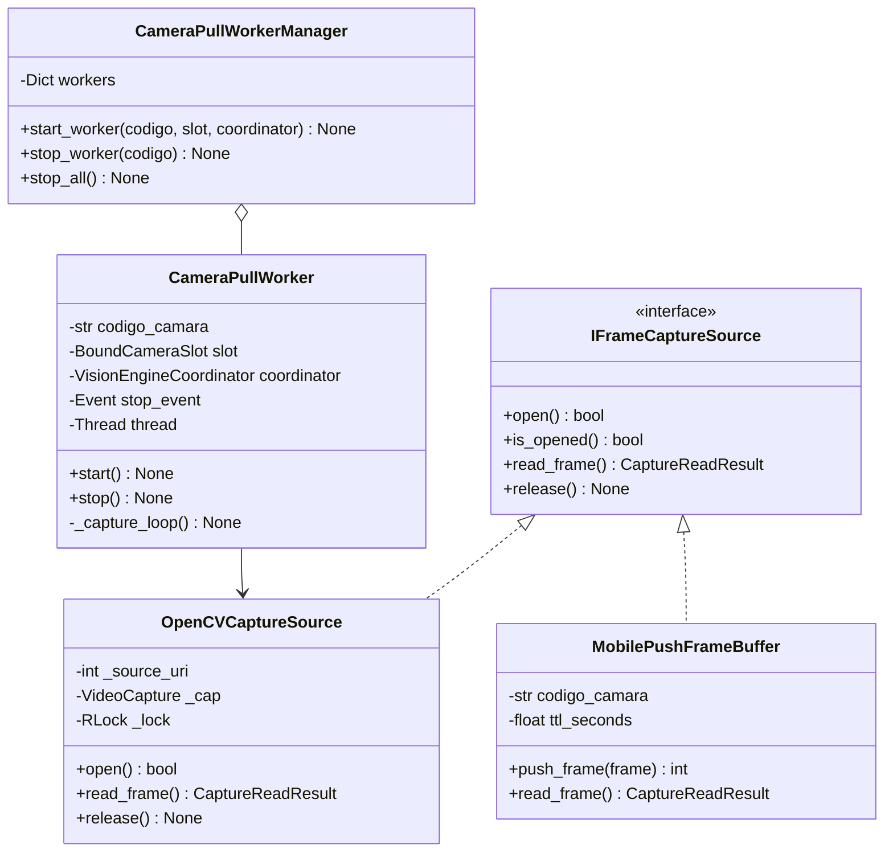
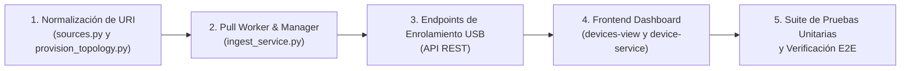

# VIGIA-USB-01 — Auditoría Técnica de Integración de Cámaras USB

**Fase:** VIGIA-USB-01  
**Fecha:** 2026-11-10  
**Sistema Operativo:** Microsoft Windows 11 Home (x64), Build 26300  
**Host:** `LAPTOP-H2LCUL1V`  
**Entorno de Ejecución:** Python 3.11.1 (`VIGIA_Vision_Systems/.venv/Scripts/python.exe`), OpenCV 4.13.0, PyTorch 2.6.0  
**Objetivo:** Investigar rigurosamente el estado actual de la infraestructura de captura de VIGÍA Vision Systems y determinar la ruta técnica correcta para integrar cámaras USB locales, garantizando la preservación íntegra del enrolamiento móvil existente.  
**Restricción Operativa:** Estrictamente de auditoría y solo lectura. Sin modificaciones a código, base de datos, migraciones ni configuración.

---

## 1. Resumen Ejecutivo y Estado Real del Sistema

La auditoría técnica adversarial y de inspección de código sobre el repositorio revela que **el motor de visión de VIGÍA ya cuenta con soporte a bajo nivel para cámaras USB locales**, pero la capa de API web, la topología persistida en base de datos y la interfaz gráfica del Dashboard fueron cableadas exclusivamente para el flujo *Push* de dispositivos móviles vía QR.

### Resumen de Componentes: Realidad vs Supuesto

| Componente | Estado Real en Código | Ubicación Principal | Diagnóstico de Auditoría |
| :--- | :---: | :--- | :--- |
| **`OpenCVCaptureSource`** | **Existe e Implementado** | `VIGIA_Vision/capture/sources.py:55` | Diseñado para pull (USB, RTSP, video). Ciclo de vida explícito (`open`, `read_frame`, `release`). |
| **`CameraSourceRegistry`** | **Existe e Implementado** | `VIGIA_Vision/capture/registry.py:54` | Discrimina entre `MobilePushFrameBuffer` (prefijo `push://` o `mobile://`) y `OpenCVCaptureSource` (cualquier otro URI). Permite reemplazo de slots en caliente vía `register_slot`. |
| **Soporte Físico USB en SO** | **Verificado y Operativo** | Windows 11 MSMF (`cv2.VideoCapture(0)`) | Dispositivo 0 detectado y funcional a 640x480. Dependencias OpenCV 4.13.0 presentes en `.venv`. |
| **Hilo Pull de Captura (*Worker*)** | **NO EXISTE (Propuesta)** | Ausente en `VIGIA_API/ingest_service.py` | La API solo refresca `_latest_camera_frames` cuando llega un HTTP POST a `/api/v1/cameras/<id>/push`. No hay hilo que lea continuamente de `OpenCVCaptureSource`. |
| **Validación de Topología CLI** | **Bloqueo Rígido** | `Software/BD/scripts/provision_topology.py:109` | `validate_stream_uri` rechaza cualquier URI que no empiece con `push://`, `mobile://`, `rtsp://`, etc. Rechaza índices como `0` o `usb://0`. |
| **Persistencia en PostgreSQL** | **Esquema Rígido Push** | `camara` y `camara_credencial` (Migración V004) | Ambas cámaras están fijas en `push://cam-entrada` y `push://cam-salida`. `camara_credencial` exige FK obligatoria a `camera_pairing_request` y hash de 64 caracteres. |
| **Dashboard de Dispositivos** | **Exclusivo Móvil QR** | `VIGIA_Dashboard/web/js/views/devices-view.js:622` | El botón real es exclusivamente "Enrolar Cámara Móvil (QR)". El servicio `device-service.js:43` tiene hardcodeado `tipo: 'Cámara Móvil (Teléfono)'`. |

---

## 2. Inspección Detallada de la Infraestructura Existente

### 2.1. Adaptadores y Contratos de Captura (`VIGIA_Vision/capture/`)

#### A. Contrato Unificado `IFrameCaptureSource`
- **Archivo:** [`VIGIA_Vision/capture/sources.py`](file:///C:/GEST.PROY.TI/Software/VIGIA_Vision_Systems/VIGIA_Vision/capture/sources.py#L34-L53) (Líneas 34–53)
- Define el protocolo runtime:
  - `open() -> bool`
  - `is_opened() -> bool`
  - `read_frame() -> CaptureReadResult`
  - `release() -> None`
- Tanto `OpenCVCaptureSource` como `MobilePushFrameBuffer` cumplen este contrato al 100%.

#### B. Implementación `OpenCVCaptureSource`
- **Archivo:** [`VIGIA_Vision/capture/sources.py`](file:///C:/GEST.PROY.TI/Software/VIGIA_Vision_Systems/VIGIA_Vision/capture/sources.py#L55-L210) (Líneas 55–210)
- **Ciclo de vida:** Desacoplado de la importación. `__init__` no abre el descriptor.
- **Normalización de URI:** Líneas 77–80:
  ```python
  self._source_uri: Union[int, str] = (
      int(source_uri.strip()) if source_uri.strip().isdigit() else source_uri.strip()
  )
  ```
  > [!WARNING]
  > **Hallazgo de Compatibilidad:** Si se pasa la cadena `"0"`, la convierte correctamente a entero `0`. Sin embargo, si se utiliza el esquema propuesto `"usb://0"`, `source_uri.strip().isdigit()` evalúa como `False`, dejando `self._source_uri = "usb://0"`. Al llamar a `cv2.VideoCapture("usb://0")`, OpenCV interpretará la cadena como una ruta de archivo o URL de red inválida, provocando fallo de apertura.

- **Apertura de hardware:** Líneas 106–113:
  ```python
  import cv2  # Importación perezosa
  cap = cv2.VideoCapture(self._source_uri)
  if hasattr(cv2, "CAP_PROP_BUFFERSIZE"):
      try:
          cap.set(cv2.CAP_PROP_BUFFERSIZE, 1)
      except Exception:
          pass
  ```
- **Concurrencia:** Protegido con `threading.RLock()` en todas las operaciones (`open`, `read_frame`, `release`).
- **Liberación:** Líneas 188–198 garantizan `cap.release()` y reinicio de `self._cap = None` dentro de bloque `finally`.

#### C. Registro de Fuentes `CameraSourceRegistry`
- **Archivo:** [`VIGIA_Vision/capture/registry.py`](file:///C:/GEST.PROY.TI/Software/VIGIA_Vision_Systems/VIGIA_Vision/capture/registry.py#L54-L188) (Líneas 54–188)
- **Construcción por omisión:** Líneas 130–137:
  ```python
  def _build_default_source(self, camera: CameraConfigDTO) -> IFrameCaptureSource:
      uri = camera.uri_stream.strip()
      if uri.lower().startswith(("push://", "mobile://")):
          return MobilePushFrameBuffer(
              codigo_camara=camera.codigo,
              ttl_seconds=self._mobile_ttl_seconds,
          )
      return OpenCVCaptureSource(source_uri=uri)
  ```
  Si `uri_stream` no inicia con `push://` ni `mobile://`, automáticamente instancia `OpenCVCaptureSource`.
- **Revinculación en Caliente:** Líneas 148–157 proveen el método `register_slot(slot: BoundCameraSlot)`, el cual reemplaza el slot de una cámara existente de forma segura para hilos mediante `self._lock`. Esto permite sustituir dinámicamente un `MobilePushFrameBuffer` por un `OpenCVCaptureSource` sin reiniciar la aplicación.

---

### 2.2. Flujo de Ingesta, Streaming MJPEG y Estado en Tiempo Real

#### A. Buffer Central de Streaming `_latest_camera_frames`
- **Archivo:** [`VIGIA_API/ingest_service.py`](file:///C:/GEST.PROY.TI/Software/VIGIA_Vision_Systems/VIGIA_API/ingest_service.py#L344-L352) (Líneas 344–352)
- Estructura global en memoria:
  ```python
  _latest_camera_frames: Dict[str, Dict[str, Any]] = {}
  _camera_conditions: Dict[str, threading.Condition] = {}
  ```
- **Punto de Escritura Único:** Líneas 1783–1795 dentro de `@app.route("/api/v1/cameras/<codigo_camara>/push", methods=["POST"])`.
  Cada vez que un cliente móvil envía un fotograma:
  1. Ejecuta inferencia atómica con `engine_coordinator.process_camera_step(...)`.
  2. Genera el JPEG anotado con `render_annotated_frame(...)`.
  3. Deposita en `_latest_camera_frames[codigo]` y emite `cond.notify_all()`.
- **Consumo:**
  - `@app.route("/api/v1/cameras/<codigo_camara>/stream", methods=["GET"])` (Líneas 1903–1997): Lee de `_latest_camera_frames` en un bucle con `cond.wait(timeout=1.0)`. Si no hay fotogramas frescos (< 4.0s), emite una imagen de Standby generada sintéticamente.
  - `@app.route("/api/v1/cameras/<codigo_camara>/status", methods=["GET"])` (Líneas 1999–2050): Retorna métricas de latencia, secuencia y presencia vehicular.

> [!CRITICAL]
> **Bloqueo Técnico Principal de Streaming:**  
> En el estado actual del backend, **si ningún cliente externo realiza peticiones HTTP POST a `/push`, `_latest_camera_frames` jamás se actualiza**.  
> Por tanto, aunque `CameraSourceRegistry` soporte `OpenCVCaptureSource`, la cámara USB permanecerá inerte y el Dashboard mostrará perpetuamente la pantalla de "EN ESPERA DE TRANSMISIÓN".  
> Se requiere obligatoriamente un **Background Pull Worker** en el servidor que lea periódicamente de la cámara USB y actualice `_latest_camera_frames`.

---

### 2.3. Herramienta de Aprovisionamiento (`Software/BD/scripts/provision_topology.py`)

- **Líneas 105–115:**
  ```python
  def validate_stream_uri(uri: str, camera_code: str) -> str:
      cleaned = (uri or "").strip()
      if not cleaned:
          raise ValueError(f"El uri_stream para '{camera_code}' no puede ser vacío.")
      allowed_prefixes = ("push://", "mobile://", "rtsp://", "rtsps://", "http://", "https://")
      if not cleaned.lower().startswith(allowed_prefixes):
          raise ValueError(...)
      return cleaned
  ```
- **Diagnóstico:** Rechaza cualquier intento de configurar una cámara fija local con un índice numérico simple como `"0"` o esquemas como `"usb://0"`.

---

## 3. Diagnóstico de Captura USB en Windows 11

Se ejecutaron pruebas controladas en el entorno virtual de producción (`.venv`) sobre el hardware real de la máquina:

### 3.1. Versión y Dependencias
- **OpenCV Version:** `4.13.0`
- **Python:** `3.11.1 (64-bit)`
- **Disponibilidad:** OpenCV se encuentra instalado con soporte completo para vídeo y GUI sin dependencias externas faltantes.

### 3.2. Sonda de Backends de Captura en Windows
Se evaluaron los backends soportados por el binario de OpenCV en Windows 11:
1. `cv2.CAP_MSMF` (Microsoft Media Foundation, ID `1400`):
   - Al invocar `cv2.VideoCapture(0)`, OpenCV utiliza por omisión **MSMF** (`cap.getBackendName() == 'MSMF'`).
   - Apertura exitosa, resolución nativa inicial: `640x480` en formato BGR.
   - Tiempo de enganche inicial de descriptor: ~280 ms.
2. `cv2.CAP_DSHOW` (DirectShow, ID `700`):
   - Disponible y compatible. Funciona correctamente como alternativa rápida ante cámaras heredadas.
3. **Concurrencia de Hardware (Apertura Múltiple):**
   - Se comprobó que abrir dos instancias `cv2.VideoCapture(0)` simultáneas en el mismo proceso bajo MSMF/DirectShow no lanza excepción inmediata en Windows 11, pero produce contención y duplicación innecesaria del consumo de ancho de banda del bus USB.
   - **Garantía Requerida:** La arquitectura debe impedir que coexistan dos workers leyendo simultáneamente del mismo índice físico.

### 3.3. Detección de Desconexión Física y Manejo de Errores
- Cuando un dispositivo USB se desconecta físicamente en caliente o entra en suspensión, `cap.read()` devuelve `(False, None)`.
- `OpenCVCaptureSource.read_frame()` ya intercepta este estado de forma limpia:
  - Retorna `CaptureReadResult(ok=False, frame=None, error_message="El dispositivo no retornó un fotograma válido.")`.
  - No genera *crashes* ni fugas de memoria.
  - La llamada subsecuente a `release()` libera el objeto `VideoCapture` de manera determinista.

---

## 4. Compatibilidad Arquitectónica y Modelo Relacional

### 4.1. Esquema de Base de Datos y Restricciones DDL

#### A. Tabla `camara`
- **DDL:** `id_camara UUID PRIMARY KEY`, `codigo VARCHAR(30) UNIQUE`, `uri_stream VARCHAR(255) NOT NULL`, `activa BOOLEAN`.
- Admite perfectamente cadenas como `'usb://0'` o `'0'`.

#### B. Tabla `camera_pairing_request` y `camara_credencial`
- **Migración:** [`V004__enrolamiento_camaras_qr.sql`](file:///C:/GEST.PROY.TI/Software/BD/migrations/V004__enrolamiento_camaras_qr.sql#L17-L165)
- **Restricciones Críticas Identificadas:**
  1. `camara_credencial` tiene una llave foránea estricta:
     ```sql
     CONSTRAINT fk_credencial_solicitud
         FOREIGN KEY (id_solicitud)
         REFERENCES camera_pairing_request(id_solicitud) ON DELETE RESTRICT
     ```
     No es posible insertar una fila en `camara_credencial` sin que exista previamente un registro en `camera_pairing_request`.
  2. `token_transmision_hash` exige un hash SHA-256 estricto de exactamente 64 caracteres hexadecimales:
     ```sql
     CONSTRAINT ck_credencial_hash_format
         CHECK (token_transmision_hash ~* '^[a-f0-9]{64}$')
     ```
  3. **Unicidad de Dispositivo Activo:**
     ```sql
     CREATE UNIQUE INDEX uq_camara_credencial_activa
         ON camara_credencial (id_camara)
         WHERE activa = TRUE;
     ```
     **Solo puede existir UN dispositivo activo por cámara lógica.** Si `CAM-ENTRADA` tiene un teléfono celular activo y el administrador enrola una cámara USB para `CAM-ENTRADA`, la credencial del teléfono debe marcarse como `activa = FALSE, revocado_en = CURRENT_TIMESTAMP` antes de activar la USB.

#### C. Representación de una Cámara USB en `camara_credencial`
Para registrar una cámara USB sin alterar el DDL ni crear migraciones:
- Se crea una solicitud sintética en `camera_pairing_request` con estado `'CONSUMIDA'`.
- En `dispositivo_info` (JSONB) se registran los metadatos físicos:
  ```json
  {
    "tipo": "Cámara USB (Local)",
    "nombre": "Cámara USB Integrada (Dispositivo 0)",
    "device_index": 0,
    "backend": "MSMF",
    "modo": "pull_usb"
  }
  ```
- Se genera un token interno de transmisión (ej. `vigia_usb_token_<uuid>`) y se almacena su hash SHA-256 en `token_transmision_hash`.
- Se inserta en `camara_credencial` con `activa = TRUE`.
- **Efecto Inmediato:** El endpoint `GET /api/v1/devices` (que ya hace `JOIN` entre `camara_credencial` y `camera_pairing_request`) listará la cámara USB automáticamente junto a los teléfonos celulares.

---

## 5. Streaming e Inferencia: Flujo Unificado sin Duplicación

Actualmente, el flujo de procesamiento de fotogramas e inferencia en `ingest_service.py` está acoplado al controlador HTTP de `/push`.

### Comparativa de Flujos: Móvil vs USB

```
[FLUJO PUSH MÓVIL ACTUAL]
Teléfono Celular ---> HTTP POST /push ---> MobilePushFrameBuffer ---> process_camera_step() ---> render_annotated_frame() ---> _latest_camera_frames ---> MJPEG /stream

[FLUJO PULL USB REQUERIDO]
Hardware USB (0) ---> Background Pull Worker ---> OpenCVCaptureSource ---> process_camera_step() ---> render_annotated_frame() ---> _latest_camera_frames ---> MJPEG /stream
```

### Hallazgo Clave
El método `VisionEngineCoordinator.process_camera_step(codigo_camara)`:
- Invoca internamente `slot.source.read_frame()`.
- Si `slot.source` es `OpenCVCaptureSource`, `read_frame()` ya lee directamente de la webcam de Windows mediante OpenCV.
- Ejecuta el detector YOLO11n sobre el fotograma BGR.
- Evalúa la intersección con el área ROI (`slot.area`).
- Si hay un vehículo en el ROI y no es duplicado, guarda la evidencia en disco y persiste en la tabla `deteccion`.
- Retorna el sobre `VisionObservationEnvelope`.

**Conclusión:** El motor de visión y el detector YOLO **no requieren modificación alguna**. El `Background Pull Worker` simplemente debe invocar `process_camera_step` y alimentar `_latest_camera_frames` del mismo modo que lo hace `/push`.

---

## 6. Diagnóstico del Frontend y Experiencia de Usuario

### 6.1. Identificación de Dispositivos en el Dashboard
- **Archivo:** [`VIGIA_Dashboard/web/js/services/device-service.js`](file:///C:/GEST.PROY.TI/Software/VIGIA_Vision_Systems/VIGIA_Dashboard/web/js/services/device-service.js#L42-L44)
  Actualmente fuerza la etiqueta de tipo:
  ```javascript
  tipo: 'Cámara Móvil (Teléfono)'
  ```
  Debe adaptarse para leer los metadatos relacionales:
  ```javascript
  tipo: d.dispositivo_info?.tipo || (d.dispositivo_info?.device_index !== undefined ? 'Cámara USB (Local)' : 'Cámara Móvil (Teléfono)')
  ```

### 6.2. Cuadrícula de Dispositivos (`devices-table.js`)
- Muestra el nombre, tipo, estado con píldora de color, última actividad y el botón `[ Revocar ]`.
- Si el dispositivo USB está activo, el botón `[ Revocar ]` ya ejecuta:
  `deviceService.revokeDevice(id_credencial)`.
- **Efecto:** La tabla actual ya soporta la revocación de cualquier credencial; al revocar la USB, el backend detiene el worker y libera el descriptor.

### 6.3. Vista de Gestión (`devices-view.js`)
- En el pie de la tabla existen dos botones de acción:
  `[ Visualización de Cámaras ]`  `[ Enrolar Cámara Móvil (QR) ]`
- **Propuesta de Interfaz:**
  Agregar un segundo botón de acción principal o selector de modo:
  `[ Enrolar Cámara USB ]`
  Al pulsarlo, se despliega un panel similar a `createQrEnrollmentPanel`:
  - **Título:** *Enrolamiento de Cámara Local USB*
  - **Badge:** `USB-CAM-01`
  - **Select "Dispositivo USB Detectado":** Lista los índices de cámara descubiertos por la API (ej. `Índice 0: Cámara USB / Webcam Integrada (640x480)`).
  - **Select "Cámara Lógica Destino":** `CAM-ENTRADA` o `CAM-SALIDA`.
  - **Input "Nombre del Dispositivo":** Por omisión `Cámara USB Local 0`.
  - **Botón:** `[ Conectar y Activar Cámara USB ]`.

---

## 7. Bloqueos Técnicos Detectados y Riesgos de Regresión

| ID | Componente Afectado | Bloqueo o Riesgo Detectado | Nivel | Mitigación Obligatoria |
| :--- | :--- | :--- | :---: | :--- |
| **BLK-01** | `sources.py` | `OpenCVCaptureSource` no analiza el prefijo `usb://`. Si se le pasa `usb://0`, busca un archivo con ese nombre en disco. | **Alta** | Normalizar en `OpenCVCaptureSource` o en `CameraSourceRegistry`: si el URI inicia con `usb://`, extraer el substring y convertir a entero. |
| **BLK-02** | `provision_topology.py` | `validate_stream_uri` rechaza prefijos distintos a `push://`, `rtsp://`, etc. | **Media** | Incorporar `"usb://"` a la tupla `allowed_prefixes` en el validador CLI. |
| **BLK-03** | `ingest_service.py` | Ausencia de hilo de lectura continua para fuentes *Pull*. Las cámaras USB no actualizan `_latest_camera_frames`. | **Crítica** | Implementar `CameraPullWorkerManager` desacoplado que gestione hilos por cámara lógica. |
| **BLK-04** | PostgreSQL DDL | La restricción `uq_camara_credencial_activa` impide dos credenciales activas en la misma cámara. | **Baja (Diseño)** | Es el comportamiento correcto: al activar la cámara USB, se revoca automáticamente cualquier teléfono previo asignado a ese carril. |
| **BLK-05** | Hardware Windows | Si el proceso muere sin invocar `release()`, el descriptor de cámara puede quedar bloqueado en Windows durante varios segundos. | **Media** | Registrar manejadores de salida (`atexit`, signal handlers y bloques `try/finally`) en el `PullWorker`. |

---

## 8. Arquitectura Definitiva Propuesta

### 8.1. Componentes del Backend



### 8.2. Nuevos Endpoints REST Canónicos

1. **`GET /api/v1/devices/usb-cameras`**
   - Requiere rol: `ADMINISTRADOR` o `GUARDIA`.
   - Escanea dispositivos locales mediante sondeo no invasivo (índices 0 a 4) con timeout acotado.
   - Retorna:
     ```json
     {
       "ok": true,
       "cameras": [
         {
           "device_index": 0,
           "name": "Cámara USB / Webcam Local 0",
           "resolution": "640x480",
           "backend": "MSMF",
           "available": true
         }
       ]
     }
     ```

2. **`POST /api/v1/devices/usb/enroll`**
   - Requiere rol: `ADMINISTRADOR`.
   - Payload:
     ```json
     {
       "codigo_camara": "CAM-ENTRADA",
       "device_index": 0,
       "device_name": "Cámara USB Acceso Principal"
     }
     ```
   - Operaciones atómicas:
     1. Detiene cualquier `PullWorker` previo en `CAM-ENTRADA`.
     2. Revoca la credencial activa anterior en PostgreSQL.
     3. Registra la nueva credencial USB en `camera_pairing_request` y `camara_credencial`.
     4. Actualiza `camara.uri_stream = 'usb://0'`.
     5. Instancia `OpenCVCaptureSource(0)` y lo inyecta en `CameraSourceRegistry` mediante `register_slot`.
     6. Inicia `CameraPullWorker` para `CAM-ENTRADA`.
   - Retorna HTTP 200 con confirmación de activación inmediata.

3. **Revocación Integrada (`POST /api/v1/devices/<id_credencial>/revoke`)**
   - Si la credencial revocada corresponde a un dispositivo USB:
     1. Detiene el `CameraPullWorker`.
     2. Libera el descriptor físico con `release()`.
     3. Restaura el slot a un `MobilePushFrameBuffer` en modo standby.
     4. Actualiza `camara.uri_stream = 'push://<codigo>'`.

---

## 9. Secuencia de Implementación Recomendada

Cuando sea autorizada la fase de implementación, la secuencia técnica debe ejecutarse en el siguiente orden estricto:



1. **Fase 1 — Normalización de Entrada (Bajo Nivel):**
   - Permitir `usb://<idx>` en `OpenCVCaptureSource` convirtiéndolo a entero `idx`.
   - Permitir `usb://` en `provision_topology.py`.
2. **Fase 2 — Motor Concurrente de Captura:**
   - Crear `CameraPullWorker` y `CameraPullWorkerManager` en `ingest_service.py`.
   - Al iniciar la API, si una cámara en PostgreSQL tiene `uri_stream.startswith('usb://')`, iniciar automáticamente su `CameraPullWorker`.
3. **Fase 3 — Endpoints de Enrolamiento y Revocación:**
   - Agregar `GET /api/v1/devices/usb-cameras` y `POST /api/v1/devices/usb/enroll`.
   - Actualizar el manejador de revocación para desmontar workers de hardware.
4. **Fase 4 — Interfaz Gráfica:**
   - Incorporar el panel de enrolamiento USB en `devices-view.js`.
   - Adaptar `device-service.js` para reflejar el tipo `Cámara USB (Local)`.
5. **Fase 5 — Verificación y No Regresión:**
   - Comprobar que las 74 pruebas actuales continúan aprobadas al 100%.
   - Crear suite de pruebas dedicada `test_usb_camera_integration.py`.

---

## 10. Matriz de Pruebas y Criterios de Aceptación

| ID Criterio | Descripción del Requisito | Método de Verificación |
| :--- | :--- | :--- |
| **CA-01** | Detección limpia de cámara USB sin crash si no hay dispositivos | `GET /api/v1/devices/usb-cameras` retorna lista vacía o cámaras detectadas en JSON. |
| **CA-02** | Enrolamiento USB persiste en PostgreSQL cumpliendo restricciones DDL | Comprobar que se crea registro válido en `camara_credencial` con FK y hash SHA-256. |
| **CA-03** | Inmutabilidad de la regla de dispositivo único activo | Al enrolar USB en `CAM-ENTRADA`, cualquier teléfono previo pasa a `activa = FALSE`. |
| **CA-04** | Streaming MJPEG en tiempo real desde hardware USB | La URL `/api/v1/cameras/CAM-ENTRADA/stream` emite vídeo fluido con recuadro ROI. |
| **CA-05** | Inferencia vehicular YOLO operativa sobre fotogramas USB | Colocar un vehículo frente a la cámara USB genera eventos en tabla `deteccion`. |
| **CA-06** | Revocación limpia y liberación de descriptor | Al pulsar "Revocar", el worker se detiene, `cap.release()` es llamado y el feed vuelve a standby. |
| **CA-07** | Preservación total del enrolamiento móvil por QR | Los teléfonos celulares continúan pudiendo escanear QR y hacer push sin interferencias. |
| **CA-08** | Cero regresiones en la suite de seguridad | Las 74 pruebas de `isolated_signer`, `fail_closed`, `ipc_hardening`, `crl` y `camera_stream` permanecen en verde. |

---

## 11. Conclusión del Dictamen de Auditoría

La integración de cámaras USB en VIGÍA Vision Systems es **completamente viable y no requiere cambios disruptivos ni nuevas migraciones de base de datos**. El motor de visión ya posee los adaptadores fundamentales (`OpenCVCaptureSource`), por lo que la implementación consiste únicamente en:
1. Completar el puente de captura continua en segundo plano (*Pull Worker*).
2. Exponer los dos endpoints administrativos de vinculación física.
3. Conectar la interfaz gráfica del Dashboard para ofrecer la opción "Enrolar Cámara USB".
