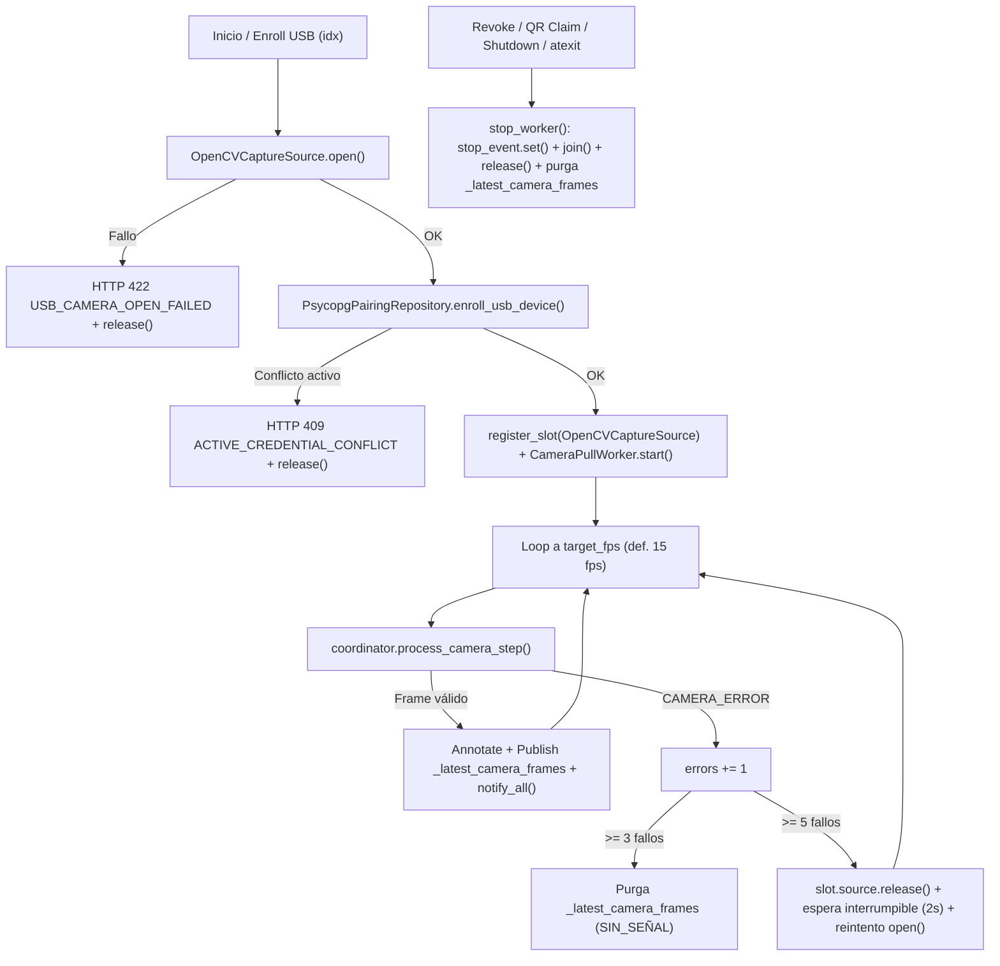

# VIGIA-USB-02 — Implementación Backend de Captura USB Local

**Fase:** VIGIA-USB-02  
**Fecha:** 2026-11-11  
**Sistema Operativo:** Microsoft Windows 11 Home (x64), Build 26300  
**Host:** `LAPTOP-H2LCUL1V`  
**Entorno de Ejecución:** Python 3.11.1 (`VIGIA_Vision_Systems/.venv/Scripts/python.exe`), OpenCV 4.13.0, PyTorch 2.6.0 (CPU en este entorno)  
**Predecesor:** [`VIGIA-USB-01_AUDITORIA_INTEGRACION_USB.md`](file:///C:/GEST.PROY.TI/Software/VIGIA_Vision_Systems/Docs/fase_vision/VIGIA-USB-01_AUDITORIA_INTEGRACION_USB.md)  
**Restricción de Alcance Respetada:** Exclusivamente backend, persistencia, pruebas automatizadas y utilería CLI de topología. Sin modificaciones en `VIGIA_Dashboard/` ni nuevas migraciones SQL.

---

## 1. Resumen Ejecutivo e Inventario de Cambios

Se completó la integración backend de cámaras USB locales en **VIGÍA Vision Systems**, resolviendo los cinco bloqueos arquitectónicos diagnosticados en `VIGIA-USB-01` (`BLK-01` a `BLK-05`), reutilizando íntegramente `VisionEngineCoordinator`, el motor YOLO11, proyección geométrica de ROI, almacenamiento compensatorio de evidencias, persistencia PostgreSQL y el pipeline de streaming MJPEG/JPEG (`/live`, `/stream`, `/status`) mientras se preserva intacto el flujo móvil por código QR.

### Archivos Creados, Modificados y Eliminados

| Estado | Archivo | Propósito Principal | Símbolos Clave |
| :---: | :--- | :--- | :--- |
| **Modificado** | [`VIGIA_Vision_Systems/VIGIA_Vision/capture/sources.py`](file:///C:/GEST.PROY.TI/Software/VIGIA_Vision_Systems/VIGIA_Vision/capture/sources.py) | Normalización `usb://<índice>`, sondeo no invasivo con exclusión de activos y caché thread-safe de último frame | `parse_usb_source_uri`, `probe_local_usb_cameras`, [`OpenCVCaptureSource`](file:///C:/GEST.PROY.TI/Software/VIGIA_Vision_Systems/VIGIA_Vision/capture/sources.py#L205-L427) |
| **Modificado** | [`VIGIA_Vision_Systems/VIGIA_Vision/capture/__init__.py`](file:///C:/GEST.PROY.TI/Software/VIGIA_Vision_Systems/VIGIA_Vision/capture/__init__.py) | Exportación pública de utilidades USB de captura | `parse_usb_source_uri`, `probe_local_usb_cameras` |
| **Modificado** | [`VIGIA_Vision_Systems/VIGIA_Vision/runtime/coordinator.py`](file:///C:/GEST.PROY.TI/Software/VIGIA_Vision_Systems/VIGIA_Vision/runtime/coordinator.py) | Restauración del contrato único síncrono de captura/inferencia (`process_camera_step`) sin bifurcaciones | [`VisionEngineCoordinator.process_camera_step`](file:///C:/GEST.PROY.TI/Software/VIGIA_Vision_Systems/VIGIA_Vision/runtime/coordinator.py#L261) |
| **Modificado** | [`BD/scripts/provision_topology.py`](file:///C:/GEST.PROY.TI/Software/BD/scripts/provision_topology.py) | Aceptación y normalización de índices numéricos y esquema `usb://` en aprovisionamiento CLI | [`validate_stream_uri`](file:///C:/GEST.PROY.TI/Software/BD/scripts/provision_topology.py#L105-L124) |
| **Modificado** | [`VIGIA_Vision_Systems/VIGIA_Core/repository/pairing_repository.py`](file:///C:/GEST.PROY.TI/Software/VIGIA_Vision_Systems/VIGIA_Core/repository/pairing_repository.py) | Enrolamiento USB transaccional compatible con DDL `V004`, bloqueo de sustitución silenciosa, revocación con restauración de carril y exclusión de tokens `/push` | [`ActiveCredentialConflictError`](file:///C:/GEST.PROY.TI/Software/VIGIA_Vision_Systems/VIGIA_Core/repository/pairing_repository.py#L36-L41), [`PsycopgPairingRepository`](file:///C:/GEST.PROY.TI/Software/VIGIA_Vision_Systems/VIGIA_Core/repository/pairing_repository.py#L51-L871) |
| **Creado** | [`VIGIA_Vision_Systems/VIGIA_API/usb_worker.py`](file:///C:/GEST.PROY.TI/Software/VIGIA_Vision_Systems/VIGIA_API/usb_worker.py) | Worker demonio por carril (`CameraPullWorker`) y gestor concurrente (`CameraPullWorkerManager`) | [`CameraPullWorker`](file:///C:/GEST.PROY.TI/Software/VIGIA_Vision_Systems/VIGIA_API/usb_worker.py#L35-L355), [`CameraPullWorkerManager`](file:///C:/GEST.PROY.TI/Software/VIGIA_Vision_Systems/VIGIA_API/usb_worker.py#L358-L477) |
| **Eliminado** | `VIGIA_Vision_Systems/VIGIA_API/pull_worker.py` | Remoción de prototipo incompleto previo para evitar código huérfano o referencias ambiguas | *(Eliminado del árbol de trabajo)* |
| **Modificado** | [`VIGIA_Vision_Systems/VIGIA_API/ingest_service.py`](file:///C:/GEST.PROY.TI/Software/VIGIA_Vision_Systems/VIGIA_API/ingest_service.py) | Endpoints USB (`/usb-cameras`, `/usb/enroll`), recuperación en arranque, integración con `/revoke` y `/mobile/pairing/claim`, y hooks `atexit`/`finally` | [`create_ingest_app`](file:///C:/GEST.PROY.TI/Software/VIGIA_Vision_Systems/VIGIA_API/ingest_service.py#L397-L691), [`list_local_usb_cameras`](file:///C:/GEST.PROY.TI/Software/VIGIA_Vision_Systems/VIGIA_API/ingest_service.py#L2421-L2446), [`enroll_local_usb_camera`](file:///C:/GEST.PROY.TI/Software/VIGIA_Vision_Systems/VIGIA_API/ingest_service.py#L2448-L2716) |
| **Creado** | [`VIGIA_Vision_Systems/tests/unit/test_usb_camera_integration.py`](file:///C:/GEST.PROY.TI/Software/VIGIA_Vision_Systems/tests/unit/test_usb_camera_integration.py) | Suite integral (15 pruebas unitarias, Flask E2E y hardware físico USB índice `0`) | [`TestRealPhysicalUsbWebcam`](file:///C:/GEST.PROY.TI/Software/VIGIA_Vision_Systems/tests/unit/test_usb_camera_integration.py#L1147-L1264) |

---

## 2. Decisiones Arquitectónicas y Diseño Técnico

### 2.1. Normalización de URI y Selección Controlada del Backend Windows (`DSHOW` vs `MSMF`)

- **Parser unificado (`parse_usb_source_uri`):** Normaliza de forma estricta enteros no negativos (`0` -> `(0, True)`), cadenas numéricas (`"0"` -> `(0, True)`) y esquema explícito (`"usb://0"` o `"USB://0/"` -> `(0, True)`). Rechaza valores booleanos, negativos, vacíos o malformados (`"usb://"`, `"usb://abc"`) con `ValueError`, dejando pasar sin alterar flujos `rtsp://` y rutas de video (`(uri, False)`).
- **Medición empírica de backend Windows en `LAPTOP-H2LCUL1V` (cámara física índice `0`, `640x480` BGR):**

| Backend OpenCV | Apertura (`isOpened`) | Lectura de Frame | Tiempo de Apertura (`open_ms`) | Tiempo al Primer Frame (`first_frame_ms`) |
| :--- | :---: | :---: | :---: | :---: |
| **`CAP_DSHOW` (DirectShow)** | `True` | `True` (`(480, 640, 3)`) | **658.9 ms** | **842.8 ms** |
| **`CAP_MSMF` (Media Foundation)** | `True` | `True` (`(480, 640, 3)`) | **1,440.0 ms** | **1,895.0 ms** |

- **Decisión implementada:** En Windows (`sys.platform == "win32"`), tanto `probe_local_usb_cameras` como `OpenCVCaptureSource.open()` intentan primero `cv2.CAP_DSHOW` y hacen fallback a `cv2.CAP_MSMF`, configurando `CAP_PROP_BUFFERSIZE = 1` para evitar fotogramas encolados obsoletos. El orden puede ajustarse mediante la variable de entorno `VIGIA_USB_OPENCV_BACKEND` (`dshow`, `msmf`, `auto`). En mediciones locales, `DSHOW` redujo en **~55%** la latencia de inicialización frente a `MSMF`.

### 2.2. Reutilización Exacta de `VisionEngineCoordinator` vía `get_last_frame()`

Para cumplir la restricción de **no duplicar YOLO, ROI ni persistencia**, se descartó extraer la lectura fuera de `VisionEngineCoordinator`:
1. `OpenCVCaptureSource.read_frame()` almacena bajo `threading.RLock` el fotograma BGR capturado y su secuencia monótona (`self._last_frame`, `self._sequence`), liberándolos deterministamente en `release()`.
2. [`CameraPullWorker`](file:///C:/GEST.PROY.TI/Software/VIGIA_Vision_Systems/VIGIA_API/usb_worker.py#L35-L355) adquiere el mismo lock por cámara que `/push` (`get_camera_process_lock(codigo_camara)`), calcula `persist_as_new_event` con el mismo algoritmo de *debounce* temporal (`STREAM_PERSIST_DEBOUNCE_SECONDS`, por defecto `3.0s`) + transición de llegada (`new_arrival`), e invoca directamente `coordinator.process_camera_step(codigo_camara, persist_as_new_event=persist_flag)`.
3. A partir del [`VisionObservationEnvelope`](file:///C:/GEST.PROY.TI/Software/VIGIA_Vision_Systems/VIGIA_Vision/detection/models.py#L200) retornado y del frame recuperado vía `slot.source.get_last_frame()`, el worker proyecta el ROI con `project_normalized_roi()`, dibuja anotaciones con `render_annotated_frame()`, codifica JPEG (`calidad=80`), actualiza `_latest_camera_frames[codigo_camara]` y emite `cond.notify_all()` para alimentar `/live`, `/stream` y `/status` de forma idéntica al streaming móvil.

### 2.3. Ciclo de Vida del Worker, Reconexión y Liberación Determinista



---

## 3. Contratos REST, RBAC y Códigos de Respuesta

### 3.1. `GET /api/v1/devices/usb-cameras`

- **Autorización:** Sesión activa con rol `ADMINISTRADOR` o `GUARDIA` (`@require_rbac("ADMINISTRADOR", "GUARDIA")`). Sin sesión retorna `401`; con rol distinto (`AUDITOR`) retorna `403`.
- **Parámetros opcionales:** `max_index` (entero acotado a `[1, 10]`, por defecto `4`).
- **Prevención de doble apertura:** Consulta `usb_worker_manager.get_active_usb_map()` y omite llamar a `cv2.VideoCapture(idx)` sobre cualquier índice ya gestionado por un `CameraPullWorker` en ejecución, retornando sus metadatos reales y `"in_use_by_camera"`. Los demás índices son sondeados en `try ... finally` con liberación inmediata.
- **Respuesta nominal (`200 OK`):**
  ```json
  {
    "ok": true,
    "cameras": [
      {
        "device_index": 0,
        "uri": "usb://0",
        "name": "Cámara USB / Webcam Local (0)",
        "width": 640,
        "height": 480,
        "resolution": "640x480",
        "backend": "DSHOW",
        "available": true,
        "in_use_by_camera": null
      }
    ],
    "total": 1
  }
  ```

### 3.2. `POST /api/v1/devices/usb/enroll`

- **Autorización:** Exclusivo `ADMINISTRADOR` (`@require_rbac("ADMINISTRADOR")`).
- **Cuerpo JSON aceptado:**
  - `codigo_camara` (o alias `codigo`): código lógico destino (ej. `"CAM-ENTRADA"`).
  - `device_index` (o alias `index` / `uri`): acepta entero `>= 0`, cadena `"0"` o URI `"usb://0"`. Se valida explícitamente antes de cualquier truthiness check para que el índice `0` sea aceptado correctamente mientras booleanos, negativos o vacíos retornen `400 INVALID_DEVICE_INDEX`.
  - `device_name` (opcional, alias `nombre`): truncado a 60 caracteres.
  - `confirm_replace` (opcional, alias `replace_active`, booleano): obligatorio en `true` si el carril ya posee credencial activa.
- **Matriz de respuestas:**

| Código HTTP | Error (`error`) | Condición Disparadora | Garantía de Seguridad |
| :---: | :--- | :--- | :--- |
| **`201`** | — | USB abierta, persistida y `CameraPullWorker` iniciado | Si estaba en móvil, su token anterior queda revocado y se purgan frames viejos. |
| **`400`** | `MISSING_CAMERA_CODE` / `INVALID_DEVICE_INDEX` | Falta código de cámara o índice no es entero `>= 0` / `usb://<N>` válido | No toca hardware ni BD. |
| **`401` / `403`** | `UNAUTHORIZED` / `FORBIDDEN` | Sesión ausente o rol distinto de `ADMINISTRADOR` | RBAC + validación de cookie `vigia_session` y Origin CSRF. |
| **`404`** | `CAMERA_NOT_FOUND` | Cámara lógica inexistente o inactiva en topología | No toca hardware ni BD. |
| **`409`** | `USB_DEVICE_IN_USE` | El índice físico está activo en *otro* carril (runtime o `dispositivo_info`) | Rechaza incluso si `confirm_replace=true`; exige revocar explícitamente el otro carril primero. |
| **`409`** | `ACTIVE_CREDENTIAL_CONFLICT` | El carril destino ya tiene dispositivo activo y `confirm_replace` es `false` | Aborta sin revocar ni detener el dispositivo vigente (ni SQL ni runtime). |
| **`422`** | `USB_CAMERA_OPEN_FAILED` | `new_source.open()` falla en hardware antes de persistir | Libera descriptor en `finally`; preserva credencial móvil/USB previa intacta. |
| **`500`** | `USB_ENROLL_FAILED` / `WORKER_START_FAILED` | Error inesperado en PostgreSQL o arranque de worker | Ejecuta `new_source.release()` para evitar fugas de descriptor. |

### 3.3. Revocación Unificada y Transición Bidireccional USB ↔ Móvil QR

- **`POST /api/v1/devices/<uuid:id_credencial>/revoke`:** Al detectar que la credencial pertenece a una fuente USB (`clave_cifrado_id == 'usb-local-pull'`, `uri_stream` `usb://` o `modo == 'pull_usb'`), detiene el `CameraPullWorker`, ejecuta `revoke_credential_and_restore_lane()` (que marca `activa = FALSE` y restaura `camara.uri_stream = 'push://<codigo>'`), reinyecta un `MobilePushFrameBuffer` mediante `_reset_slot_to_push()` y purga `_latest_camera_frames[cam_code]` notificando a los clientes MJPEG.
- **`POST /api/v1/mobile/pairing/claim`:** Si el administrador genera un código QR sobre un carril que tenía activa una cámara USB y un teléfono reclama el código, el endpoint detiene el `CameraPullWorker` activo del carril, limpia `camera_persist_states`, restaura `camara.uri_stream = 'push://<codigo>'` con `restore_push_uri()` y sustituye el slot del coordinador por `MobilePushFrameBuffer`, permitiendo que el móvil comience a enviar fotogramas a `/push` sin reiniciar la API.
- **Recuperación automática al arranque (`create_ingest_app`):** Al inicializar la aplicación Flask (cuando `start_pull_workers=True`), recorre las ranuras cargadas en `coordinator.registry` y arranca automáticamente un `CameraPullWorker` para cada `OpenCVCaptureSource(is_usb=True)` persistido en base de datos, evitando trabajadores duplicados si dos carriles apuntaran erróneamente al mismo índice físico.

---

## 4. Persistencia Relacional y Cumplimiento Estricto del DDL V001 / V004

El método [`PsycopgPairingRepository.enroll_usb_device`](file:///C:/GEST.PROY.TI/Software/VIGIA_Vision_Systems/VIGIA_Core/repository/pairing_repository.py#L382-L547) cumple íntegramente con las restricciones de [`BD/migrations/V001__baseline_schema.sql`](file:///C:/GEST.PROY.TI/Software/BD/migrations/V001__baseline_schema.sql) y [`BD/migrations/V004__enrolamiento_camaras_qr.sql`](file:///C:/GEST.PROY.TI/Software/BD/migrations/V004__enrolamiento_camaras_qr.sql) sin alterar el esquema:

1. **Bloqueo pesimista sin revocación silenciosa:** Ejecuta `SELECT ... FROM camara_credencial cc ... WHERE cc.id_camara = %s AND cc.activa = TRUE FOR UPDATE OF cc`. Si existe una credencial vigente y `replace_active=False`, lanza [`ActiveCredentialConflictError`](file:///C:/GEST.PROY.TI/Software/VIGIA_Vision_Systems/VIGIA_Core/repository/pairing_repository.py#L36-L41) sin emitir `UPDATE` ni `INSERT`.
2. **Respeta índices únicos parciales:** Cancela cualquier solicitud QR pendiente (`CREADA`, `PENDIENTE`) del mismo carril para respetar `uq_pairing_activa_por_camara`, y revoca únicamente con confirmación explícita la credencial activa previa para respetar `uq_camara_credencial_activa`.
3. **Auditoría relacional en `camera_pairing_request`:** Inserta una solicitud sintética en estado `'CONSUMIDA'` (cumpliendo `ck_pairing_estado`, hashes SHA-256 hexadecimales de 64 caracteres y coherencia temporal `expira_en = CURRENT_TIMESTAMP + interval '10 minutes' > creado_en`) con metadatos en `dispositivo_info` JSONB (`nombre`, `modo="pull_usb"`, `tipo="USB_LOCAL"`, `device_index`, `uri_stream`, `backend`, `ip_origen`).
4. **Emisión en `camara_credencial`:** Inserta la credencial con `clave_cifrado_id = 'usb-local-pull'` (cumple `ck_credencial_clave_cifrado_format`, `credencial_cifrada = NULL`, `entregado_en = CURRENT_TIMESTAMP` consistente con `ck_credencial_fechas_coherentes` dentro de la misma transacción) y actualiza `camara.uri_stream = 'usb://<índice>'`.
5. **Aislamiento de autenticación `/push`:** [`validate_stream_token`](file:///C:/GEST.PROY.TI/Software/VIGIA_Vision_Systems/VIGIA_Core/repository/pairing_repository.py#L723-L757) incorpora `AND cc.clave_cifrado_id <> 'usb-local-pull'`, impidiendo que un identificador hash sintético de cámara USB pueda usarse jamás en el endpoint de ingesta HTTP móvil (`/api/v1/cameras/<id>/push`).

---

## 5. Protecciones Contra Conflictos, Concurrencia y Fugas de Hardware

- **Exclusión de dispositivo físico entre carriles:** Tanto `CameraPullWorkerManager.start_worker()` (runtime) como `/api/v1/devices/usb/enroll` (runtime + lista de credenciales activas en repositorio) rechazan asignar un índice físico `N` a un carril si ya se encuentra activo en otro carril (`HTTP 409 USB_DEVICE_IN_USE`).
- **Prevención de doble apertura durante el sondeo (`probe_local_usb_cameras`):** Los índices administrados por `CameraPullWorker` nunca son reabiertos con `cv2.VideoCapture` durante `GET /api/v1/devices/usb-cameras`, evitando errores de exclusividad del driver en Windows 11.
- **Liberación determinista al cierre o fallo:**
  - `atexit.register(_cleanup_usb_workers_on_exit)` con `weakref.ref` sobre el gestor.
  - Bloques `try ... finally` en `run_ingest_server()` y en las dos rutas de arranque `__main__` (HTTPS y HTTP).
  - Captura de `stop_event` en `CameraPullWorker`, `thread.join(timeout=5.0)` y bloque `finally` en `_run_loop()` invocando `_release_slot_source()`.
  - Liberación inmediata del `OpenCVCaptureSource` recién abierto si falla la persistencia en PostgreSQL o el arranque del worker dentro de `/api/v1/devices/usb/enroll`.

---

## 6. Resultados de Pruebas Automatizadas y Evidencia Hardware Real

Todas las pruebas se ejecutaron el **2026-11-11** con el intérprete `VIGIA_Vision_Systems\.venv\Scripts\python.exe` (`PYTHONPATH="C:\GEST.PROY.TI\Software\VIGIA_Vision_Systems;C:\GEST.PROY.TI\Software"`, `VIGIA_ALLOW_IN_MEMORY="1"`).

> [!IMPORTANT]
> **Estado de PostgreSQL Docker en esta sesión:** El contenedor Docker `vigia-db` (puerto `127.0.0.1:5434`) no estaba iniciado durante esta ejecución, por lo que la suite E2E Flask de endpoints USB se validó usando `InMemoryPairingRepo` (implementación en memoria fiel a los estados y unicidad de `V004`) y pruebas unitarias dedicadas sobre el SQL real emitido por [`PsycopgPairingRepository`](file:///C:/GEST.PROY.TI/Software/VIGIA_Vision_Systems/VIGIA_Core/repository/pairing_repository.py#L382-L757) mediante mocks de cursor. La ejecución integrada contra PostgreSQL real requiere iniciar la base de datos con `./vigia.ps1 db-up`.

### 6.1. Evidencia de Prueba End-to-End con Cámara USB Física Real (Índice `0`)

La prueba [`TestRealPhysicalUsbWebcam.test_real_usb_webcam_end_to_end_if_present`](file:///C:/GEST.PROY.TI/Software/VIGIA_Vision_Systems/tests/unit/test_usb_camera_integration.py#L1153-L1263) se ejecutó contra el hardware USB físico real conectado al host Windows (`device_index=0`, `640x480`, backend `DSHOW`):
1. `probe_local_usb_cameras(max_index=4)` detectó realmente la webcam en índice `0` con resolución `640x480` y liberó el descriptor.
2. `POST /api/v1/devices/usb/enroll` asignó la cámara física a `CAM-ENTRADA` (`201 Created`) y arrancó el `CameraPullWorker` real.
3. El worker capturó fotogramas reales del sensor físico y alimentó el coordinador sin errores durante una ventana máxima de 6s.
4. `GET /api/v1/cameras/CAM-ENTRADA/status` respondió `200` con `operational_state: "TRANSMITIENDO"` y `sequence` activo.
5. `GET /api/v1/cameras/CAM-ENTRADA/live` entregó una imagen JPEG válida (`b"\xff\xd8..."`, tamaño `> 1000` bytes).
6. `GET /api/v1/cameras/CAM-ENTRADA/stream` entregó el primer fragmento multiparte `--frame` con `Content-Type: image/jpeg`.
7. `GET /api/v1/devices/usb-cameras` durante la transmisión reportó `"in_use_by_camera": "CAM-ENTRADA"` sin provocar doble apertura sobre el dispositivo `0`.
8. `POST /api/v1/devices/<id_credencial>/revoke` detuvo el worker (`is_running=False`), cerró el descriptor físico (`is_opened=False`), purgó `_latest_camera_frames` y dejó el dispositivo `0` inmediatamente disponible para una nueva llamada exitosa a `probe_local_usb_cameras()`.

### 6.2. Resumen Completo de Ejecución de Suites Unitarias (351 pruebas descubiertas)

Ejecución dedicada USB (`python -m unittest -v tests.unit.test_usb_camera_integration`): **15/15 OK (7.794s)**.  
Descubrimiento completo (`python -m unittest discover -s VIGIA_Vision_Systems\tests\unit -p "test_*.py" -v`, 351 pruebas en 113.866s): **349 aprobadas, 1 omitida (CUDA), 1 fallo ambiental de red preexistente no relacionado**.

| Módulo de Pruebas | Total | Aprobadas | Fallos | Omitidas | Observaciones Directas |
| :--- | :---: | :---: | :---: | :---: | :--- |
| **`test_usb_camera_integration`** | **15** | **15** | 0 | 0 | Incluye captura E2E real sobre cámara física USB índice `0` |
| **`test_camera`** | 12 | 12 | 0 | 0 | Sin regresiones en `OpenCVCaptureSource` ni `MobilePushFrameBuffer` |
| **`test_camera_stream_and_backend`** | 19 | 19 | 0 | 0 | Streaming MJPEG, debounce, ROI, concurrencia e aislamiento |
| **`test_mobile_ingest_api`** | 49 | 49 | 0 | 0 | Flujo móvil `/push`, validación de bytes y gestión TLS |
| **`test_vision_pipeline`** | 8 | 8 | 0 | 0 | Pipeline coordinador, rollbacks compensatorios de evidencia y ROI |
| **`test_isolated_signer`** | 12 | 12 | 0 | 0 | Sin regresiones de firma aislada |
| **`test_signer_fail_closed`** | 12 | 12 | 0 | 0 | Sin regresiones de política fail-closed |
| **`test_ipc_hardening`** | 16 | 16 | 0 | 0 | Sin regresiones en Named Pipe HMAC/SID |
| **`test_crl_management`** | 15 | 15 | 0 | 0 | Sin regresiones en CRL/CDP |
| `test_async_persistence_pilot` | 14 | 14 | 0 | 0 | NVMe Spool & DLQ |
| `test_auth_rbac` | 31 | 31 | 0 | 0 | Sesión, Argon2id, CSRF y RBAC |
| `test_auth_stream_protection` | 12 | 12 | 0 | 0 | Protección de cookies y expiración MJPEG |
| `test_detection_repository` | 29 | 29 | 0 | 0 | DTOs y mapeo DDL V1 |
| `test_domain_models` | 16 | 16 | 0 | 0 | `VisionResult` y `AccessDecision` |
| `test_lan_detector` | 7 | 7 | 0 | 0 | Descubrimiento de red local |
| `test_network_discovery` | 8 | 8 | 0 | 0 | Reglas de URLs públicas y Wi-Fi |
| `test_topology_validator` | 17 | 17 | 0 | 0 | Reglas R1–R8 de topología |
| `test_vision_stage1_components` | 16 | 16 | 0 | 0 | Almacenamiento de evidencias y cero acoplamiento heredado |
| `test_yolo_detector` | 22 | 21 | 0 | **1** | `test_pu_yolo_16_real_inference_on_cuda` omitida (PyTorch sin CUDA en este host) |
| `test_trust_ca_logic` | 21 | 20 | **1** | 0 | `test_16_strict_check_reports_modalidad_a_and_b` falló por esperar servidor HTTPS vivo en puerto `5000` (`[WinError 10061] / timed out`); ajeno a USB |
| **TOTAL GLOBAL** | **351** | **349** | **1** | **1** | **100% de suites USB, Cámara, Visión, Auth y Seguridad criptográfica en verde** |

---

## 7. Verificación de Restricciones e Higiene del Repositorio

- **Frontend intacto:** `git -C VIGIA_Vision_Systems status -s -- VIGIA_Dashboard` confirmó cero cambios en `VIGIA_Dashboard/`.
- **Hardware libre tras pruebas:** La verificación posterior con `probe_local_usb_cameras(max_index=2)` confirmó índice `0` libre y reabrible (`available: True`, `in_use_by_camera: None`, `backend: 'DSHOW'`).
- **Compilación sintáctica:** Todos los módulos Python modificados superaron `py_compile` sin advertencias ni referencias huérfanas a `pull_worker`, `get_credential_by_id` o `reset_uri_stream`.

---

## 8. Siguientes Pasos Pendientes (Fuera del Alcance VIGIA-USB-02)

1. **Integración E2E con PostgreSQL Real (`vigia-db`):** Levantar el servicio PostgreSQL de contenedores (`./vigia.ps1 db-up`) y validar de punta a punta el ciclo `enroll -> detección YOLO real con vehículo -> INSERT en deteccion -> revoke` sin `VIGIA_ALLOW_IN_MEMORY=1`.
2. **Fase Frontend Dashboard (`VIGIA-USB-03` sugerida):** Implementar en `VIGIA_Dashboard/web/js/services/device-service.js` y `VIGIA_Dashboard/web/js/views/devices-view.js` el botón/panel *"Enrolar Cámara USB"*, el selector alimentado por `GET /api/v1/devices/usb-cameras`, el diálogo explícito de confirmación cuando `POST /api/v1/devices/usb/enroll` retorne `409 ACTIVE_CREDENTIAL_CONFLICT`, y la etiqueta visual diferenciada `Cámara USB (Local)` en la tabla de dispositivos.
