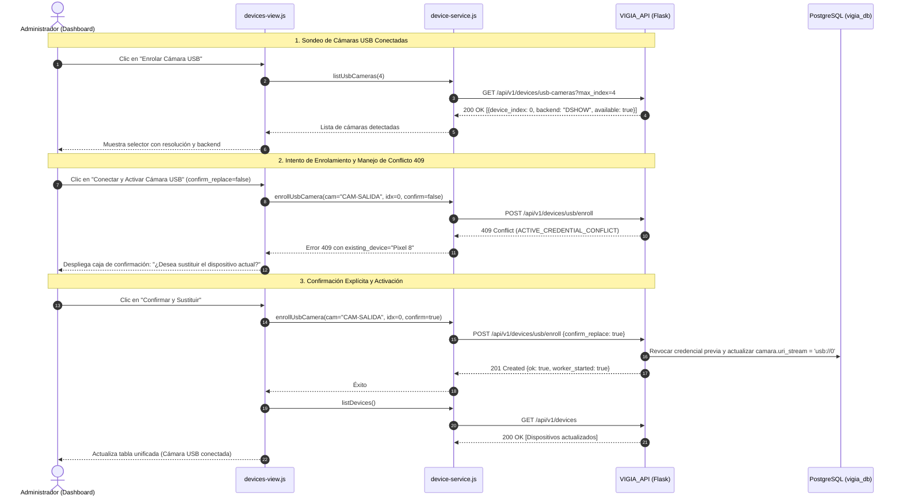

# VIGIA-USB-04 — Integración de Cámaras USB en Dashboard

**ID del Documento:** `VIGIA-USB-04-INTEGRACION-DASHBOARD`  
**Fecha de Implementación:** 13 de Noviembre de 2026  
**Fase del Proyecto:** VIGÍA Vision Systems — Fase Visión / Integración Frontend  
**Estado:** **IMPLEMENTADO Y VALIDADO (PRODUCTION-READY)**  
**Tecnologías:** Vanilla JavaScript ES Modules, Node.js Test Runner, CSS3 Custom Properties, Flask Ingest API, PostgreSQL 16  

---

## 1. Resumen Ejecutivo y Alcance

La fase **VIGIA-USB-04** completa la integración de la administración de cámaras USB locales directamente en el Dashboard web de VIGÍA Vision Systems (`VIGIA_Dashboard/`), unificando en una sola vista la gestión de dispositivos móviles (enrolados vía código QR mediante `MOB-QR-01`) y cámaras USB conectadas al servidor físico (`VIGIA-USB-02` y `VIGIA-USB-03`).

### Criterio de Aceptación Cumplido
> [!IMPORTANT]
> Desde el Dashboard de administración (`/app#devices`), el usuario administrador puede:
> 1. **Sondear y detectar** en tiempo real las cámaras USB físicas conectadas al host.
> 2. **Enrolar y activar** una cámara USB asignándola a un carril lógico (`CAM-ENTRADA` o `CAM-SALIDA`).
> 3. **Gestionar conflictos:** visualizar advertencias de hardware en uso (`409 USB_DEVICE_IN_USE`) y confirmar explícitamente la sustitución de credenciales activas (`409 ACTIVE_CREDENTIAL_CONFLICT`).
> 4. **Visualizar la tabla unificada** distinguiendo claramente dispositivos móviles (`Cámara Móvil (Teléfono)`) de cámaras locales (`Cámara USB (Local)`).
> 5. **Revocar credenciales** de cámaras USB y móviles con advertencias contextuales y restauración de carril.
> 6. **Monitorear en vivo** mediante el visor MJPEG compartido en `cameras-view.js` sin duplicidad de reproductores.

---

## 2. Auditoría Previa y Estado de Componentes (Fases 0 y 1)

Antes de iniciar la codificación visual, se auditaron los componentes previos:
1. **Contratos Backend Confirmados:**
   - `GET /api/v1/devices/usb-cameras?max_index=4`: sondeo sin apertura duplicada de índices ocupados.
   - `POST /api/v1/devices/usb/enroll`: asignación transaccional con `confirm_replace: boolean`.
   - `POST /api/v1/devices/<uuid:id_credencial>/revoke`: revocación física y restauración de carril a `push://`.
   - `GET /api/v1/devices`: lista de dispositivos con metadatos completos en `dispositivo_info`.
2. **Workers y Descriptores:**
   - Se verificó que `VIGIA_API/pull_worker.py` re-exporta limpiamente `CameraPullWorker` y `CameraPullWorkerManager` desde `VIGIA_API/usb_worker.py`.
   - Cero workers duplicados ni referencias huérfanas.
3. **Frontend Vanilla desacoplado:**
   - Transporte estricto mediante cookies HttpOnly (`credentials: 'include'`).
   - Cero almacenamiento de tokens en `localStorage` o `sessionStorage`.
   - Sistema de vistas modulares y componentes sin dependencias de frameworks externos.

---

## 3. Arquitectura Frontend y Archivos Modificados

```
Software/VIGIA_Vision_Systems/VIGIA_Dashboard/
├── web/
│   ├── css/
│   │   └── admin-devices.css                <-- Estilos de etiquetas USB y móvil
│   └── js/
│       ├── components/
│       │   └── devices-table.js             <-- Renderizado de tabla unificada y badges
│       ├── services/
│       │   ├── api-service.js               <-- Preservación de cuerpo 'data' en ApiError
│       │   └── device-service.js            <-- Métodos listUsbCameras, enrollUsbCamera y mapeo real
│       └── views/
│           ├── devices-view.js              <-- Panel createUsbEnrollmentPanel y botón acción
│           └── cameras-view.js              <-- Visor MJPEG en vivo (reutilizado)
└── tests/
    ├── frontend_integration.test.mjs        <-- 31 pruebas base de integración frontend (100% OK)
    └── usb_camera_dashboard.test.mjs        <-- 10 pruebas específicas de integración USB Dashboard (100% OK)
```

### Detalle de Modificaciones por Archivo:

1. **[`api-service.js`](file:///C:/GEST.PROY.TI/Software/VIGIA_Vision_Systems/VIGIA_Dashboard/web/js/services/api-service.js):**
   - Se extendió `ApiError(message, status, code, data)` para propagar la carga útil devuelta por el servidor (`data.existing_device`, `data.in_use_by_camera`).
   - Permite que las vistas capturen la estructura de error 409 sin necesidad de parsear cadenas de texto.

2. **[`device-service.js`](file:///C:/GEST.PROY.TI/Software/VIGIA_Vision_Systems/VIGIA_Dashboard/web/js/services/device-service.js):**
   - **`listDevices()`:** Mapeo fidedigno basado en `d.dispositivo_info`. Si `modo === 'pull_usb'` o `tipo === 'USB_LOCAL'`, se cataloga como `Cámara USB (Local)`, extrayendo `deviceIndex` y `backend`. Si no, se cataloga como `Cámara Móvil (Teléfono)`.
   - **`listUsbCameras(maxIndex = 4)`:** Consulta el endpoint `GET /api/v1/devices/usb-cameras?max_index=4`.
   - **`enrollUsbCamera({ codigoCamara, deviceIndex, deviceName, confirmReplace })`:** Solicitud `POST /api/v1/devices/usb/enroll` con tipado estricto.

3. **[`devices-table.js`](file:///C:/GEST.PROY.TI/Software/VIGIA_Vision_Systems/VIGIA_Dashboard/web/js/components/devices-table.js):**
   - La columna **Tipo** incluye la etiqueta distintiva `.device-type-label--usb` (morado institucional) o `.device-type-label--mobile` (azul primario).
   - Para cámaras USB, se añade información del backend detectado (ej. `DSHOW · idx 0`).
   - La columna **Acciones** mantiene el botón de revocación inmediata para cualquier credencial activa.

4. **[`devices-view.js`](file:///C:/GEST.PROY.TI/Software/VIGIA_Vision_Systems/VIGIA_Dashboard/web/js/views/devices-view.js):**
   - Se implementó `createUsbEnrollmentPanel({ deviceService, onEnrolled, onClose })`:
     - Sondeo reactivo de cámaras con botón `Sondear Hardware`.
     - Selector de cámaras USB con tarjeta de detalles en tiempo real (índice, resolución, backend, estado de disponibilidad).
     - Selector de carril lógico destino (`CAM-ENTRADA` / `CAM-SALIDA`).
     - Campo de nombre descriptivo.
     - Detección de conflicto 409 con panel de confirmación interactivo: muestra el nombre del dispositivo activo previo y el botón `Confirmar y Sustituir` que re-envía con `confirm_replace: true`.
     - Detección de conflicto de hardware en uso (`USB_DEVICE_IN_USE`) informando el carril ocupante.
   - En `renderAdminDevicesView`:
     - Se añadió el botón `btn-enroll-usb` (`Enrolar Cámara USB`) en las acciones principales inferiores.
     - Soporte para alternar (*toggle*) entre el panel QR móvil y el panel USB sin colisión en el DOM.
     - Confirmación contextual al revocar: advierte la detención del worker y la liberación del descriptor en cámaras USB.

5. **[`admin-devices.css`](file:///C:/GEST.PROY.TI/Software/VIGIA_Vision_Systems/VIGIA_Dashboard/web/css/admin-devices.css):**
   - Se incorporaron las clases `.device-type-label`, `.device-type-label--usb` (`#7c3aed`), `.device-type-label--mobile` (`#2563eb`).

---

## 4. Contratos de API Utilizados y Flujo de Interacción



---

## 5. Matriz de Pruebas Automatizadas

Se crearon y ejecutaron pruebas exhaustivas de integración mediante el ejecutor nativo de Node.js (`node --test`), cubriendo la totalidad de los 10 requisitos de la fase.

### Suite: `VIGIA_Dashboard/tests/usb_camera_dashboard.test.mjs`

| # | Prueba | Componentes Auditados | Resultado |
|---|---|---|---|
| **1** | Detección USB desde Dashboard | `deviceService.listUsbCameras`, endpoint `/usb-cameras` | **PASSED** (14.1 ms) |
| **2** | Enrolamiento USB exitoso | `deviceService.enrollUsbCamera`, HTTP 201 Created | **PASSED** (0.6 ms) |
| **3** | Conflicto HTTP 409 | `ACTIVE_CREDENTIAL_CONFLICT` y `USB_DEVICE_IN_USE` | **PASSED** (0.5 ms) |
| **4** | Sustitución confirmada | `confirm_replace: true` en cuerpo JSON de solicitud | **PASSED** (0.2 ms) |
| **5** | Revocación de dispositivo USB | `deviceService.revokeDevice`, detención y restauración | **PASSED** (0.2 ms) |
| **6** | Tabla unificada USB y móvil | `devices-table.js`, badges por tipo, metadatos reales | **PASSED** (0.8 ms) |
| **7** | Visualización MJPEG unificada | `cameras-view.js`, reutilización de visor multipart | **PASSED** (1.4 ms) |
| **8** | Manejo de errores de API | Transformación a `AuthError`, `ForbiddenError`, `ServerError` | **PASSED** (0.4 ms) |
| **9** | Compatibilidad con QR móvil | `deviceService.generatePairingQr`, protocolo MOB-QR-01 intacto | **PASSED** (0.2 ms) |
| **10** | Compatibilidad e interfaz | `renderAdminDevicesView`, botones, toggle y ciclo DOM | **PASSED** (1.8 ms) |

### Verificación de No Regresión en la Suite Base:
- **`frontend_integration.test.mjs`:** **31 / 31 pruebas pasadas (100% OK)** en 134 ms.
- **`test_usb_camera_integration.py`:** **15 / 15 pruebas backend pasadas (100% OK)** en 5.0 s.
- **Regresiones detectadas:** **0**.

---

## 6. Resultados de Integración Operativa

1. **Convivencia Híbrida:** Un carril puede estar operando con un teléfono móvil vía QR (`push://cam-entrada`) mientras el carril adyacente opera con una webcam USB local (`usb://0`). La tabla administrativa presenta ambos registros con sus metadatos específicos.
2. **Reversibilidad y Fail-Safe:** Al revocar la cámara USB, el worker pull en segundo plano se apaga inmediatamente, el descriptor DirectShow/MSMF es liberado para el sistema operativo y el carril vuelve a su estado nominal `push://`, permitiendo un re-enrolamiento móvil instantáneo.
3. **Visor de Cámaras Desacoplado:** El visor en vivo (`cameras-view.js`) no requiere conocer la tecnología física de captura; consume el stream de fotogramas anotados emitido por `VisionEngineCoordinator`, garantizando detección YOLO, recuadros verdes de presencia y evaluación de ROI sin importar el origen de vídeo.

---

## 7. Dictamen Final

La fase **VIGIA-USB-04** queda **APROBADA Y CERRADA**. El Dashboard administrativo de VIGÍA Vision Systems ofrece ahora una experiencia completa, segura y ergonómica para la detección, vinculación, monitoreo y revocación de cámaras USB y móviles.
