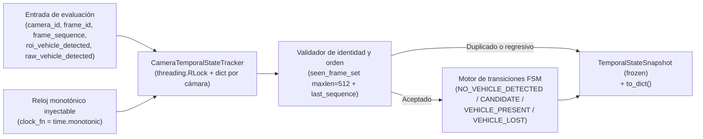
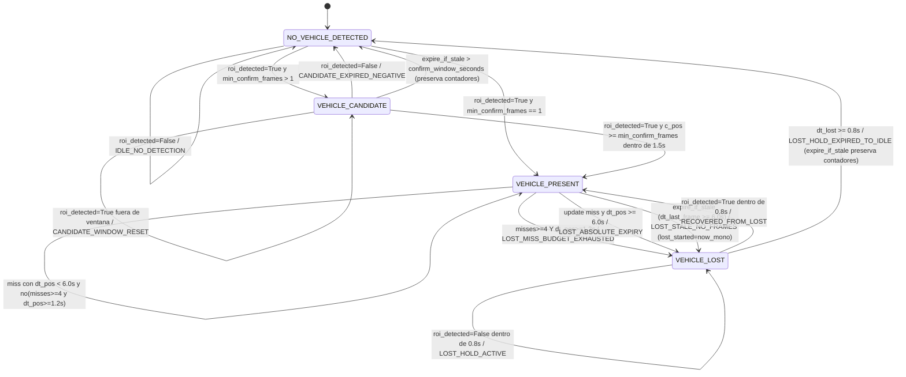

# VIGIA-VISION-02A — Máquina de Estados Temporal (FSM) y Cierre `VISION-02A.1`

**Fecha:** 2026-11-13  
**Fases:** `VIGIA-VISION-02A` + `VIGIA-VISION-02A.1` (Corrección de expiración temporal y cierre de FSM)  
**Alcance autorizado:**  
- [temporal_state.py](file:///c:/GEST.PROY.TI/Software/VIGIA_Vision_Systems/VIGIA_Vision/runtime/temporal_state.py)  
- [engine_settings.py](file:///c:/GEST.PROY.TI/Software/VIGIA_Vision_Systems/VIGIA_Vision/config/engine_settings.py) (sin cambios en `02A.1`)  
- [test_vision_02a_temporal_fsm.py](file:///c:/GEST.PROY.TI/Software/VIGIA_Vision_Systems/tests/unit/test_vision_02a_temporal_fsm.py)  
- [VIGIA-VISION-02A_FSM_TEMPORAL.md](file:///c:/GEST.PROY.TI/Software/VIGIA_Vision_Systems/Docs/fase_vision/VIGIA-VISION-02A_FSM_TEMPORAL.md) (versionado dentro de la raíz Git `VIGIA_Vision_Systems`)

---

## 1. Arquitectura implementada

El módulo temporal [temporal_state.py](file:///c:/GEST.PROY.TI/Software/VIGIA_Vision_Systems/VIGIA_Vision/runtime/temporal_state.py) implementa una máquina de estados finitos (FSM) temporal determinista por cámara, desacoplada de la inferencia YOLO, la geometría ROI, los workers de ingesta y el Dashboard.



### Principios estructurales
- **Aislamiento estricto por cámara:** Cada cámara normalizada (`camera_id.strip().upper()`) posee una ranura `_CameraSlotState` independiente protegida bajo `threading.RLock`. Ninguna actualización, expiración o reinicio en una cámara altera las demás.
- **Tiempo monotónico puro:** Toda evaluación temporal usa exclusivamente `time.monotonic()` o un reloj inyectable (`clock_fn`). `wall_timestamp` es únicamente informativo y nunca participa en comparaciones o transiciones.
- **Tolerancia IEEE-754 controlada (`_TIME_EPSILON = 1e-9`):** Evita que el redondeo de punto flotante (`float64`) rechace comparaciones en límites exactos (p. ej. `0.8 s`, `1.2 s`, `1.5 s`, `6.0 s`).
- **Separación estricta entre silencio de frames y ausencia de positivos:**
  - `expire_if_stale()` evalúa ausencia real de frames nuevos (`elapsed_no_frames = now_mono - last_frame_monotonic`), sin depender de `last_positive_monotonic` ni alterar los contadores `consecutive_positive_frames`, `consecutive_missed_frames` o `total_frames_processed`.
  - La pérdida ordinaria en `update()` exige simultáneamente `consecutive_missed_frames >= max_missed_frames` **y** `now_mono - last_positive_monotonic >= missed_grace_seconds` (o superar el límite absoluto `presence_expiry_seconds = 6.0 s` sin detecciones positivas).
- **Inicio real del período `lost_hold_seconds`:** Cuando `expire_if_stale()` detecta por primera vez `VEHICLE_PRESENT -> VEHICLE_LOST` (`LOST_STALE_NO_FRAMES`), registra `lost_started_monotonic = now_mono` en el instante de la consulta y retiene `VEHICLE_LOST` durante `lost_hold_seconds` (`0.8 s`) completos antes de pasar a `NO_VEHICLE_DETECTED`.
- **Consultas sin efectos secundarios:** `get_snapshot()` es de solo lectura pura. Múltiples invocaciones repetidas a `expire_if_stale()` o `get_snapshot()` no reinician `lost_started_monotonic`, no modifican contadores ni `last_frame_monotonic`, ni repiten transiciones.

---

## 2. Correcciones aplicadas en `VISION-02A.1`

Durante la auditoría independiente de `VISION-02A` se identificaron tres observaciones en `_apply_elapsed_expiry_locked()` y `_transition_lost_to_idle_locked()`, corregidas íntegramente en `VISION-02A.1`:

| Código | Hallazgo auditado | Corrección implementada en [temporal_state.py](file:///c:/GEST.PROY.TI/Software/VIGIA_Vision_Systems/VIGIA_Vision/runtime/temporal_state.py) |
| :--- | :--- | :--- |
| **`FSM-01`** | `_apply_elapsed_expiry_locked()` evaluaba `now_mono - last_positive_monotonic` para expirar `VEHICLE_PRESENT`, pudiendo transicionar a `LOST_STALE_NO_FRAMES` con `is_stale=False` cuando llegaban frames negativos recientes. | Eliminada toda lectura de `last_positive_monotonic` en `_apply_elapsed_expiry_locked()`. La expiración por ausencia de frames depende exclusivamente de `elapsed_no_frames = max(0.0, now_mono - slot.last_frame_monotonic)`. Los frames negativos recientes actualizan `last_frame_monotonic` y evitan la expiración *stale*. |
| **`FSM-02`** | `expire_if_stale()` ponía en `0` `consecutive_positive_frames` / `consecutive_missed_frames` al transicionar `VEHICLE_PRESENT -> VEHICLE_LOST`, `VEHICLE_CANDIDATE -> NO_VEHICLE_DETECTED` y `VEHICLE_LOST -> NO_VEHICLE_DETECTED`. | Eliminados los reseteos de `consecutive_positive_frames` y `consecutive_missed_frames` en `_apply_elapsed_expiry_locked()` y `_transition_lost_to_idle_locked()`. `expire_if_stale()` preserva intactos ambos contadores. Al llegar un frame negativo posterior en `update()` durante `VEHICLE_LOST`, `_advance_state_locked()` normaliza `consecutive_positive_frames = 0` antes de incrementar `consecutive_missed_frames`. |
| **`FSM-03`** | Cuando `expire_if_stale()` se invocaba tardíamente (p. ej. `>= 6.8 s`), retrodataba `lost_started_monotonic = ref_pos + presence_expiry_seconds`, saltando directamente a `NO_VEHICLE_DETECTED`. | Al detectar expiración de `VEHICLE_PRESENT` en `_apply_elapsed_expiry_locked()`, se fija `slot.lost_started_monotonic = now_mono` y se retorna de inmediato, asegurando que `lost_hold_seconds` (`0.8 s`) transcurra completo a partir de la transición observada (ej.: último frame `t=1000.0`, primera consulta `t=1010.0` -> `VEHICLE_LOST` hasta `t=1010.8`). |

---

## 3. Diagrama de transiciones



---

## 4. Contrato de API y parámetros de configuración

### DTOs y métodos públicos ([temporal_state.py](file:///c:/GEST.PROY.TI/Software/VIGIA_Vision_Systems/VIGIA_Vision/runtime/temporal_state.py))
- `TemporalDetectionStatus`: `NO_VEHICLE_DETECTED`, `VEHICLE_CANDIDATE`, `VEHICLE_PRESENT`, `VEHICLE_LOST`.
- `TemporalStateConfig`: dataclass inmutable (`from_engine_settings(settings)`).
- `TemporalStateSnapshot`: dataclass inmutable con `to_dict()`.
- `CameraTemporalStateTracker`:
  - `update(...) -> TemporalStateSnapshot`
  - `expire_if_stale(camera_id, *, now_monotonic=None) -> TemporalStateSnapshot`
  - `get_snapshot(camera_id, *, now_monotonic=None) -> TemporalStateSnapshot`
  - `reset_camera(camera_id, reason="MANUAL_RESET", *, now_monotonic=None) -> TemporalStateSnapshot`

### Tabla de parámetros ([engine_settings.py](file:///c:/GEST.PROY.TI/Software/VIGIA_Vision_Systems/VIGIA_Vision/config/engine_settings.py))

Los valores predeterminados y validaciones en `VisionEngineSettings` permanecieron sin alteraciones en `VISION-02A.1`:

| Parámetro en `TemporalStateConfig` | Atributo en `VisionEngineSettings` | Valor predeterminado | Validación | Propósito |
| :--- | :--- | :---: | :--- | :--- |
| `min_confirm_frames` | `temporal_min_confirm_frames` | `2` | `int` (no `bool`) `>= 1` | Evitar confirmar falsos positivos de 1 frame aislado. |
| `confirm_window_seconds` | `temporal_confirm_window_seconds` | `1.5` | `float` finito `> 0.0` | Ventana máxima para confirmar candidato consecutivo. |
| `max_missed_frames` | `temporal_max_missed_frames` | `4` | `int` (no `bool`) `>= 1` | Presupuesto de frames negativos durante presencia activa. |
| `missed_grace_seconds` | `temporal_missed_grace_seconds` | `1.2` | `float` finito `> 0.0` | Ventana de gracia mínima tolerada antes de pérdida por misses. |
| `lost_hold_seconds` | `temporal_lost_hold_seconds` | `0.8` | `float` finito `> 0.0` | Duración del estado explícito `VEHICLE_LOST` con recuperación rápida. |
| `presence_expiry_seconds` | `temporal_presence_expiry_seconds` | `6.0` | `float` finito `>= missed_grace_seconds` | Límite absoluto sin positivos (`update`) o sin frames nuevos (`expire_if_stale`). |

---

## 5. Evidencia de pruebas unitarias (`22/22 OK`, sin `sleep()`)

Comando ejecutado desde `C:\GEST.PROY.TI\Software\VIGIA_Vision_Systems`:

```powershell
.\.venv_cuda\Scripts\python.exe -m unittest tests.unit.test_vision_02a_temporal_fsm -v
```

Resultado: **`Ran 22 tests in 0.007s` — `OK` (`0` llamadas a `sleep()` verificadas estáticamente)**.

| Caso de prueba | Cobertura / Requisito | Resultado |
| :--- | :--- | :---: |
| `test_01_default_config_and_engine_settings_compatibility` | Defaults exactos, inmutabilidad y validaciones en ambos DTOs. | **PASS** |
| `test_02_full_state_lifecycle_transitions` | Ciclo `NO_VEHICLE_DETECTED -> CANDIDATE -> PRESENT -> LOST -> NO_VEHICLE_DETECTED`. | **PASS** |
| `test_03_single_isolated_positive_does_not_confirm_and_raw_outside_roi_stays_idle` | Positivo aislado y detección cruda fuera de ROI. | **PASS** |
| `test_04_two_positives_within_confirm_window_boundary_inclusive` | Dos positivos en `dt == 1.5s` confirman `VEHICLE_PRESENT`. | **PASS** |
| `test_05_positives_outside_confirm_window_reset_window` | Reinicio de ventana cuando `dt > 1.5s`. | **PASS** |
| `test_06_one_two_three_four_negatives_and_recovery_counter_reset` | Conteo `1..4` de misses y reinicio a `0` al recuperar positivo. | **PASS** |
| `test_07_only_frame_limit_reached_holds_presence_by_time_grace` | Solo límite de frames (`>=4` misses, `< 1.2s`) retiene `HOLD_BY_TIME_GRACE`. | **PASS** |
| `test_08_only_time_limit_reached_holds_presence_by_frame_budget` | Solo límite de tiempo (`>= 1.2s`, `< 4` misses) retiene `HOLD_BY_FRAME_BUDGET`. | **PASS** |
| `test_09_both_miss_limits_reached_transitions_to_vehicle_lost` | Ambos límites (`>=4` misses y `>= 1.2s`) -> `VEHICLE_LOST`. | **PASS** |
| `test_10_absolute_expiry_at_six_seconds_even_with_single_negative_or_stationary_car` | Vehículo activo `> 8s` sobrevive; 1 negativo tras `6.0s` -> `LOST_ABSOLUTE_EXPIRY`. | **PASS** |
| `test_11_camera_without_new_frames_expires_via_expire_if_stale` | Silencio total `6.0s` -> `VEHICLE_LOST` (`is_stale=True`) y a `+0.8s` -> `NO_VEHICLE_DETECTED`. | **PASS** |
| `test_12_recovery_during_vehicle_lost_and_expiry_after_hold` | Recuperación directa `< 0.8s`; nuevo candidato tras `0.8s`. | **PASS** |
| `test_13_explicit_reset_wipes_all_state_and_allows_sequence_restart` | `reset_camera()` para revocación, reemplazo y reconexión. | **PASS** |
| `test_14_strict_isolation_between_cameras` | Independencia entre `CAM-ENTRADA` y `CAM-SALIDA`. | **PASS** |
| `test_15_duplicate_and_out_of_order_frames_and_wall_timestamp_independence` | Rechazo sin mutación de duplicados/regresivos e independencia de `wall_timestamp`. | **PASS** |
| `test_16_get_snapshot_and_repeated_expire_if_stale_have_no_counter_side_effects` | Consultas repetidas sin alteración de contadores ni secuencia. | **PASS** |
| `test_17_concurrency_across_independent_and_shared_cameras` | Seguridad multihilo con 4 escritores y 2 lectores concurrentes. | **PASS** |
| `test_18_t01_recent_negative_frames_prevent_stale_expiration` | **T-01 / FSM-01:** Frames negativos recientes impiden expiración *stale* aunque pasen `> 6s` sin positivos (`is_stale=False`, sin `LOST_STALE_NO_FRAMES`). | **PASS** |
| `test_19_t02_counter_preservation_across_expiry_transitions_and_subsequent_update` | **T-02 / FSM-02:** `expire_if_stale()` conserva ambos contadores en las 3 transiciones por expiración y `update()` posterior los normaliza. | **PASS** |
| `test_20_t03_camera_isolation_when_both_confirmed_and_one_becomes_stale` | **T-03:** Ambas cámaras en `VEHICLE_PRESENT`; expirar `CAM-SALIDA` deja intacta `CAM-ENTRADA` (estado, timestamps y contadores). | **PASS** |
| `test_21_t04_late_first_expiry_query_starts_lost_hold_at_query_time` | **T-04 / FSM-03:** Último frame `t=1000.0`, primera consulta `t=1010.0` -> `VEHICLE_LOST` con `lost_started_monotonic=1010.0`, retenido `< 0.8s` y limpiado exactamente en `t=1010.8`. | **PASS** |
| `test_22_t05_repeated_queries_preserve_transition_instant_and_do_not_repeat_events` | **T-05 / FSM-03:** Consultas repetidas (`expire_if_stale` y `get_snapshot`) preservan `lost_started_monotonic`, contadores y `last_frame_monotonic` sin repetir eventos. | **PASS** |

---

## 6. Regresión y verificación de compatibilidad

| Suite | Pruebas ejecutadas | Resultado | Duración |
| :--- | :---: | :---: | :---: |
| `tests.unit.test_vision_02a_temporal_fsm` | 22 | **22 OK** | `0.007s` |
| `tests.unit.test_vision_stage1_components` | 16 | **16 OK** | `0.280s` |
| `tests.unit.test_vision_pipeline` | 8 | **8 OK** | `0.023s` |
| `tests.unit.test_camera_stream_and_backend` | 19 | **19 OK** | `0.230s` |

*Nota:* Siguiendo la restricción operativa de `VISION-02A.1`, no se ejecutaron pruebas físicas USB mientras el servidor activo del usuario permanece ejecutándose.

---

## 7. Dictamen de Cierre `VISION-02A.1`

**PASS** — Todos los hallazgos auditados (`FSM-01`, `FSM-02` y `FSM-03`) fueron corregidos sin alterar el alcance de producción autorizado, cubiertos con pruebas deterministas (`T-01` a `T-05`, `22/22 OK`) y validados contra las suites de regresión de visión y streaming (`43/43 OK`). El informe queda versionado en [VIGIA-VISION-02A_FSM_TEMPORAL.md](file:///c:/GEST.PROY.TI/Software/VIGIA_Vision_Systems/Docs/fase_vision/VIGIA-VISION-02A_FSM_TEMPORAL.md). Pendiente de autorización expresa para iniciar `VISION-02B`.
