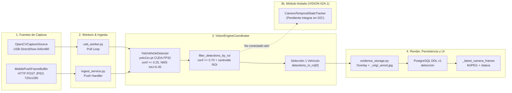

# VIGIA-VISION-03A — Auditoría de Capacidad y Precisión de Detección Vehicular

- **Proyecto:** VIGÍA Vision Systems  
- **Fase:** `VIGIA-VISION-03A` (Diagnóstico integral de solo lectura del subsistema YOLO)  
- **Fecha:** 2026-11-13  
- **Naturaleza:** Auditoría técnica y benchmarking aislado (sin modificación de código de producción, pesos, resolución ni configuración CUDA)  
- **Dictamen Final:** **`READY FOR OPTIMIZATION`** (con observaciones técnicas sobre sesgo del corpus histórico y acoplamiento requerido con `VISION-02B` y `VISION-02C`)

---

## 1. Arquitectura actual

El subsistema de visión de VIGÍA procesa streams heterogéneos (cámaras USB locales por *pull* y dispositivos móviles por *push* HTTP) mediante un bucle de inferencia unificado alrededor de `VisionEngineCoordinator`, `YoloVehicleDetector`, la validación geométrica ROI y la persistencia dual en disco y PostgreSQL.

### Componentes principales inspeccionados

| Componente | Archivo y líneas de referencia | Responsabilidad actual en producción |
| :--- | :--- | :--- |
| Fuente USB (`pull`) | [sources.py](file:///C:/GEST.PROY.TI/Software/VIGIA_Vision_Systems/VIGIA_Vision/capture/sources.py#L260-L350) | Abre `cv2.VideoCapture(index, cv2.CAP_DSHOW)` con `BUFFERSIZE=1`, sin negociar resolución, códec ni exposición. |
| Buffer móvil (`push`) | [sources.py](file:///C:/GEST.PROY.TI/Software/VIGIA_Vision_Systems/VIGIA_Vision/capture/sources.py#L385-L520) | Almacena el último JPEG decodificado con `ttl_seconds=3.0` en un slot único por dispositivo. |
| Worker USB | [usb_worker.py](file:///C:/GEST.PROY.TI/Software/VIGIA_Vision_Systems/VIGIA_API/usb_worker.py#L194-L243) | Captura frames, calcula `persist_flag` con TTL de debounce (`3.0s`) y ejecuta `process_camera_step()`. |
| Ingesta móvil y wiring YOLO | [ingest_service.py](file:///C:/GEST.PROY.TI/Software/VIGIA_Vision_Systems/VIGIA_API/ingest_service.py#L250-L350), [ingest_service.py](file:///C:/GEST.PROY.TI/Software/VIGIA_Vision_Systems/VIGIA_API/ingest_service.py#L1712-L1755) | Carga `yolo11n.pt`, fija `vehicle_confidence_threshold=0.70` y `confidence_threshold=min(0.25, 0.70)`. |
| Coordinador de visión | [coordinator.py](file:///C:/GEST.PROY.TI/Software/VIGIA_Vision_Systems/VIGIA_Vision/runtime/coordinator.py#L74-L93), [coordinator.py](file:///C:/GEST.PROY.TI/Software/VIGIA_Vision_Systems/VIGIA_Vision/runtime/coordinator.py#L319-L485) | Orquesta inferencia, filtrado ROI, mapeo a tipo de dominio, render/persistencia síncrona y publicación MJPEG. |
| Detector YOLO | [yolo_detector.py](file:///C:/GEST.PROY.TI/Software/VIGIA_Vision_Systems/VIGIA_Vision/detection/yolo_detector.py#L38-L186), [yolo_detector.py](file:///C:/GEST.PROY.TI/Software/VIGIA_Vision_Systems/VIGIA_Vision/detection/yolo_detector.py#L280-L424) | Envuelve `ultralytics.YOLO` con `RLock`, resuelve `cuda:0`, ejecuta `model.predict()` y convierte coordenadas a enteros. |
| Validador geométrico ROI | [roi_and_preprocess.py](file:///C:/GEST.PROY.TI/Software/VIGIA_Vision_Systems/VIGIA_Vision/detection/roi_and_preprocess.py#L177-L213) | Filtra detecciones aplicando `confidence >= min_confidence` (`0.70`) y `pixel_roi.contains_bbox_centroid(det.bbox)`. |
| FSM temporal (aislada) | [temporal_state.py](file:///C:/GEST.PROY.TI/Software/VIGIA_Vision_Systems/VIGIA_Vision/runtime/temporal_state.py) | Implementada y verificada en `VISION-02A` / `02A.1` (`22/22` tests OK); aún no integrada en workers ni coordinador (`VISION-02C`). |
| Evidencia visual | [evidence_storage.py](file:///C:/GEST.PROY.TI/Software/VIGIA_Vision_Systems/VIGIA_Vision/runtime/evidence_storage.py#L84-L162) | Dibuja polígono ROI y bounding boxes; persiste pares `*_orig.jpg` y `*_annot.jpg`. |
| Repositorio SQL | [detection_repository.py](file:///C:/GEST.PROY.TI/Software/VIGIA_Vision_Systems/VIGIA_Core/repository/detection_repository.py#L59-L181) | Adapta el tipo de vehículo al DDL v1 (`map_tipo_vehiculo_ddl_v1`) y persiste en la tabla `deteccion`. |

---

## 2. Modelo y pesos reales

### 2.1 Arquitectura exacta verificada

Mediante inspección directa del objeto cargado con Ultralytics `8.4.171` y PyTorch `2.6.0+cu124`:

- **Framework / clase:** `ultralytics.nn.tasks.DetectionModel` (`task="detect"`)
- **Definición arquitectónica:** `yolo11n.yaml`, escala `'n'` (`[depth=0.50, width=0.25, max_channels=1024]`)
- **Topología:** `24` módulos (`Conv`, `C3k2`, `SPPF`, `C2PSA`, `Upsample`, `Concat`, `Detect`)
- **Parámetros totales:** **`2,624,080`** (`0` entrenables tras la carga)
- **Strides de detección:** `[8.0, 16.0, 32.0]` (cabezales multiescala `P3/8`, `P4/16`, `P5/32`)
- **Clases del checkpoint:** `nc = 80` (clases estándar de COCO)
- **Precisión almacenada en checkpoint:** `torch.float32` (FP32)

### 2.2 Archivos de pesos en disco

Se verificaron exactamente **3 copias binarias idénticas** de `yolo11n.pt` en el workspace (`5,613,764` bytes, prefijo SHA-256 `0ebbc80d4a7680d1`):

1. [yolo11n.pt](file:///C:/GEST.PROY.TI/Software/VIGIA_Vision_Systems/yolo11n.pt) — archivo activo cargado por defecto en [ingest_service.py](file:///C:/GEST.PROY.TI/Software/VIGIA_Vision_Systems/VIGIA_API/ingest_service.py#L295) cuando `VIGIA_YOLO_WEIGHTS` no está definida.
2. [yolo11n.pt](file:///C:/GEST.PROY.TI/Software/VIGIA_Vision_Systems/VR_Semaforo/yolo11n.pt) — copia heredada del módulo previo.
3. [yolo11n.pt](file:///C:/GEST.PROY.TI/Software/yolo11n.pt) — copia en la raíz del proyecto superior.

> [!NOTE]
> No existen otros pesos YOLO en disco (`yolo11s.pt`, `yolo11m.pt`, `yolo11l.pt`), ni exportaciones en formato `.onnx` o TensorRT `.engine`.

### 2.3 Mapeo real de clases en 3 etapas (COCO → Dominio → PostgreSQL DDL v1)

| Etapa | Fuente en código | Clases admitidas / transformación | Observación comprobada |
| :--- | :--- | :--- | :--- |
| **1. COCO (Detector)** | [yolo_detector.py](file:///C:/GEST.PROY.TI/Software/VIGIA_Vision_Systems/VIGIA_Vision/detection/yolo_detector.py#L38-L43), [yolo_detector.py](file:///C:/GEST.PROY.TI/Software/VIGIA_Vision_Systems/VIGIA_Vision/detection/yolo_detector.py#L185) | `classes = (2, 3, 5, 7)`: `2:'car'`, `3:'motorcycle'`, `5:'bus'`, `7:'truck'` | Excluye `1:'bicycle'` y `6:'train'`. |
| **2. Dominio (Coordinator)** | [coordinator.py](file:///C:/GEST.PROY.TI/Software/VIGIA_Vision_Systems/VIGIA_Vision/runtime/coordinator.py#L74-L93) | `'car'/'2' -> 'AUTOMOVIL'` `'motorcycle'/'3' -> 'MOTOCICLETA'` `'bus'/'5' -> 'AUTOBUS'` `'truck'/'7' -> 'CAMION'` `'pickup'/'suv'/'van'/'camioneta' -> 'CAMIONETA'` | Las entradas `'pickup'`, `'suv'`, `'van'`, `'camioneta'` son código inalcanzable con pesos COCO de 80 clases; los SUV/pickup son clasificados por COCO como `car` o `truck`. |
| **3. Persistencia (DDL v1)** | [detection_repository.py](file:///C:/GEST.PROY.TI/Software/VIGIA_Vision_Systems/VIGIA_Core/repository/detection_repository.py#L59-L70), [detection_repository.py](file:///C:/GEST.PROY.TI/Software/VIGIA_Vision_Systems/VIGIA_Core/repository/detection_repository.py#L170-L181) | `ck_deteccion_tipo_vehiculo` solo admite `('AUTOMOVIL', 'CAMIONETA', 'CAMION', 'MOTOCICLETA', 'OTRO')`. `_TIPO_VEHICULO_DDL_SAFE = {"AUTOBUS": "OTRO"}` | **No existe bug de código `bus -> CAMION`.** Cuando un autobús aparece registrado como `CAMION` (`9` casos en `ROI-SAL` y `1` en `ROI-ENT`), es porque `yolo11n.pt` predijo directamente la clase `7` (`truck`) con `conf >= 0.70`, o emitió cajas superpuestas `bus` + `truck` (`14` colisiones multiclase con `IoU > 0.5` en los 212 frames reales) al tener `agnostic_nms=False`. |

### 2.4 Parámetros efectivos de inferencia en producción

Verificados en [yolo_detector.py](file:///C:/GEST.PROY.TI/Software/VIGIA_Vision_Systems/VIGIA_Vision/detection/yolo_detector.py#L180-L186), [yolo_detector.py](file:///C:/GEST.PROY.TI/Software/VIGIA_Vision_Systems/VIGIA_Vision/detection/yolo_detector.py#L340-L350), [engine_settings.py](file:///C:/GEST.PROY.TI/Software/VIGIA_Vision_Systems/VIGIA_Vision/config/engine_settings.py#L87) e [ingest_service.py](file:///C:/GEST.PROY.TI/Software/VIGIA_Vision_Systems/VIGIA_API/ingest_service.py#L267):

- `confidence_threshold` (detector): **`0.25`** (`min(0.25, resolved_settings.vehicle_confidence_threshold)`)
- `vehicle_confidence_threshold` (coordinador / ROI): **`0.70`**
- `iou_threshold` (NMS): **`0.45`**
- `agnostic_nms`: **`False`** (no se pasa a `model.predict()`, queda en valor por defecto de Ultralytics)
- `imgsz`: **`640`**
- `device`: **`'cuda:0'`** (resuelto por `resolve_inference_device("auto")`)
- `precision`: **FP32 (`torch.float32`)** (`half=False`)
- `augment` (TTA): **`False`**
- `max_det`: **`300`** (valor por defecto de Ultralytics)

---

## 3. Pipeline completo (y diferenciación de las 5 etapas de detección)

### 3.1 Trazado paso a paso desde captura hasta UI

1. **Captura / recepción:** `OpenCVCaptureSource` lee un frame BGR `640x480` por DirectShow ([sources.py](file:///C:/GEST.PROY.TI/Software/VIGIA_Vision_Systems/VIGIA_Vision/capture/sources.py#L296-L323)), o `MobilePushFrameBuffer` recibe JPEG HTTP `720x1280` y lo decodifica con `cv2.imdecode` ([ingest_service.py](file:///C:/GEST.PROY.TI/Software/VIGIA_Vision_Systems/VIGIA_API/ingest_service.py#L1712-L1755)).
2. **Preprocesamiento (`DetectionPredictor.pre_transform`):** Al recibir un único `np.ndarray` sin parámetro explícito `rect`, Ultralytics evalúa `same_shapes=True` y `rect=True` para modelos `.pt`, aplicando **`LetterBox(640, auto=True, stride=32)`**:
   - USB `640x480` $\rightarrow$ `480x640` (`0%` padding).
   - Móvil vertical `720x1280` $\rightarrow$ escala por `r = 640 / 1280 = 0.5` a `360x640`, rellenando `12 px` a cada lado hasta `384x640` (compresión horizontal del `50%` en píxeles lineales y `75%` en área).
   - *Hallazgo clave:* Forzar `rect=False` (cuadrado `640x640`) **empeora** severamente la detección en el corpus real, cayendo de `196/212` (`92.45%`) a `151/212` (`71.23%`, `-45` frames).
3. **Inferencia GPU serializada:** `YoloVehicleDetector.detect()` adquiere `with self._lock:` ([yolo_detector.py](file:///C:/GEST.PROY.TI/Software/VIGIA_Vision_Systems/VIGIA_Vision/detection/yolo_detector.py#L339)) y ejecuta `model.predict(source=frame, imgsz=640, conf=0.25, iou=0.45, classes=[2,3,5,7], device='cuda:0')`.
4. **Reescalado y redondeo de cajas:** `scale_boxes` devuelve coordenadas float al tamaño original `(W, H)` y [yolo_detector.py](file:///C:/GEST.PROY.TI/Software/VIGIA_Vision_Systems/VIGIA_Vision/detection/yolo_detector.py#L403-L406) las redondea mediante `int(round(...))` aplicando `clamp` (`x_min in [0, W-1]`, `y_min in [0, H-1]`, `x_max in [0, W]`, `y_max in [0, H]`).
5. **Filtrado ROI y segundo umbral (`0.70`):** `filter_detections_by_roi()` ([roi_and_preprocess.py](file:///C:/GEST.PROY.TI/Software/VIGIA_Vision_Systems/VIGIA_Vision/detection/roi_and_preprocess.py#L177-L213)) descarta cualquier candidato con `confidence < 0.70` antes de evaluar `pixel_roi.contains_bbox_centroid(det.bbox)`.
6. **Selección de detección primaria:** [coordinator.py](file:///C:/GEST.PROY.TI/Software/VIGIA_Vision_Systems/VIGIA_Vision/runtime/coordinator.py#L413) ordena por `(confidence, area)` y toma únicamente `primary = detections_in_roi[0]` para `VisionResult`.
7. **Renderizado, persistencia síncrona y publicación:** [coordinator.py](file:///C:/GEST.PROY.TI/Software/VIGIA_Vision_Systems/VIGIA_Vision/runtime/coordinator.py#L430-L473) genera el overlay (`evidence_storage.py`), guarda `*_orig.jpg` + `*_annot.jpg` e inserta en PostgreSQL **antes** de actualizar `_latest_camera_frames` para MJPEG y `/status`.

### 3.2 Diferenciación explícita de las 5 etapas de detección

| Etapa | Nombre canónico | Qué entra / qué se filtra | Dónde ocurre en código | Estado / Volumen medido en corpus |
| :--- | :--- | :--- | :--- | :--- |
| **A** | **Raw detections** | Predicciones de las `80` clases COCO tras NMS interno (`8400` anclas). | `DetectionPredictor` (Ultralytics interno, previo a filtro de `classes`) | En `604` `_orig.jpg` (`conf >= 0.10`): `person=1678`, `car=468`, `bus=433`, `dog=392`, `keyboard=80`, `truck=43`, `dining table=26`, `mouse=12`, `tv=12`, `laptop=10`, `book=9`, `cell phone=9`, `skateboard=7`, `motorcycle=7`. |
| **B** | **Vehicle detections** | Filtro a clases `(2, 3, 5, 7)` con `confidence >= 0.25` (`raw_candidates`). | [yolo_detector.py](file:///C:/GEST.PROY.TI/Software/VIGIA_Vision_Systems/VIGIA_Vision/detection/yolo_detector.py#L424) / `ObservationMetrics.total_detected_in_frame` ([coordinator.py](file:///C:/GEST.PROY.TI/Software/VIGIA_Vision_Systems/VIGIA_Vision/runtime/coordinator.py#L383)) | Incluye `171` detecciones en `[0.25, 0.70)` que después desaparecen de las métricas ROI. |
| **C** | **ROI accepted detections** | Doble filtro simultáneo: `confidence >= 0.70` **Y** centroide de bbox dentro del polígono ROI. | [roi_and_preprocess.py](file:///C:/GEST.PROY.TI/Software/VIGIA_Vision_Systems/VIGIA_Vision/detection/roi_and_preprocess.py#L177-L213) (`in_roi_now`) | En `212` capturas físicas reales: `196/212` (`92.45%`) pasan `conf >= 0.70`; solo el candidato top `detections_in_roi[0]` pasa a `VisionResult`. |
| **D** | **Temporally confirmed detections** | Histéresis temporal (`min_confirm_frames=2` en `1.5s`, `max_missed_frames=4` y `1.2s`, `lost_hold=0.8s`, `expiry=6.0s`). | [temporal_state.py](file:///C:/GEST.PROY.TI/Software/VIGIA_Vision_Systems/VIGIA_Vision/runtime/temporal_state.py) | **Desconectado en producción actual** (`VISION-02C`). Hoy 1 solo frame negativo convierte el estado en `Sin vehículos detectados`. |
| **E** | **Persisted detections** | Grabación en disco + SQL condicionada a `persist_flag = has_persistence and (time_elapsed_ok or new_arrival)`. | [usb_worker.py](file:///C:/GEST.PROY.TI/Software/VIGIA_Vision_Systems/VIGIA_API/usb_worker.py#L238), [ingest_service.py](file:///C:/GEST.PROY.TI/Software/VIGIA_Vision_Systems/VIGIA_API/ingest_service.py#L1748) | Cada micro-corte por debajo de `0.70` reinicia `had_vehicle=False`, disparando `new_arrival=True` (`108/129` intervalos `< 3.0s` en `CAM-SALIDA` el `2026-11-14`). |

---

## 4. Problemas comprobados

| ID | Severidad | Hallazgo comprobado | Evidencia técnica y empírica |
| :--- | :--- | :--- | :--- |
| **DET-01** | `CRITICAL` | **Umbral secundario excesivamente restrictivo (`0.70`) sin histéresis de confianza ni memoria temporal activa.** | En las `212` capturas físicas reales (todas con vehículo visible), `0.70` rechaza `16` frames reales (`7.55%` de pérdida incluso sobre frames ya capturados). Bajar el umbral a `0.60` recupera `208/212` (`98.11%`, `+12` frames) y a `0.55` recupera **`211/212` (`99.53%`, `+15/16`)**. Sin FSM activa (`02C`), cualquier frame que caiga a `0.68` vuelve instantáneamente `vehicle_detected=False` y dispara eventos duplicados al recuperarse (`108/129` intervalos `< 3.0s`). |
| **DET-02** | `HIGH` | **Desenfoque severo (*motion blur* / defocus) y subexposición en cámara USB (`640x480`) por ausencia de configuración de captura.** | En los `212` frames reales, la nitidez mediana (varianza del Laplaciano) es apenas **`10.7`** (`p10 = 3.6`, `min = 2.0`), con `135/212` (`63.7%`) `< 20.0`, y `37/212` (`17.5%`) subexpuestos (`Y < 60.0`, llegando a `Y = 13.7` y `conf=0.6029` en `20261114T005002_611469Z_64574c990aea_orig.jpg`; `Y = 14.1` y `conf=0.4248` en `20261114T005003_523916Z_903f75714aa8_orig.jpg`). Los `16` fallos `< 0.70` ocurren en `CAM-SALIDA (640x480)` con `Laplacian` de `2.0` a `9.5`. [sources.py](file:///C:/GEST.PROY.TI/Software/VIGIA_Vision_Systems/VIGIA_Vision/capture/sources.py#L296-L323) no configura `CAP_PROP_FRAME_WIDTH`, `HEIGHT`, `FOURCC` ni exposición/foco. |
| **DET-03** | `HIGH` | **Política geométrica ROI exclusivamente por centroide (`contains_bbox_centroid`).** | Vehículos que ingresan por bordes superior/inferior/lateral con `40%–49%` de área dentro del ROI son rechazados. Ejemplo comprobado: `20261114T010027_320345Z_b4a57572eb3e_orig.jpg` (`car` en `[405, 71, 539, 116]`, `conf=0.8496`, `IoA=44.44%`, rechazado porque `cy=93.5 < 96.0`), además de vehículos frontales cercanos en `720x1280` con `cy > 1024`. |
| **DET-04** | `HIGH` | **`agnostic_nms=False` + brecha de dominio COCO en vehículos a escala y planos cercanos.** | `yolo11n.pt` emite simultáneamente cajas superpuestas `bus` + `truck` o `car` + `truck` sobre el mismo vehículo (`14` colisiones con `IoU > 0.5` en los `212` frames reales), explicando el etiquetado inconsistente entre `OTRO` (`AUTOBUS`) y `CAMION` (`truck`). Además, objetos de escritorio (`keyboard=71`, `mouse=12`, `laptop=6` a `conf >= 0.25`) y manos (`person=1651`) compiten en la escena cuando se prueban vehículos a escala. Activar `agnostic_nms=True` lleva las colisiones a **`0`** y reduce `-0.62 ms` la latencia. |
| **DET-05** | `MEDIUM` | **Hueco contable en `ObservationMetrics` para detecciones en `[0.25, 0.70)`.** | En [roi_and_preprocess.py](file:///C:/GEST.PROY.TI/Software/VIGIA_Vision_Systems/VIGIA_Vision/detection/roi_and_preprocess.py#L204-L210), `if det.confidence < min_confidence: continue` omite `171` candidatos vehiculares antes de clasificarlos como dentro/fuera del ROI, rompiendo la suma `total_detected_in_frame == in_roi_now + excluded_outside_roi`. |
| **DET-06** | `MEDIUM` | **Compresión horizontal en móvil vertical (`720x1280 -> 384x640`) y degradación al subir `imgsz` sobre frames borrosos.** | Al escalar `1280 -> 640`, la anchura útil del móvil cae de `720 px` a `360 px`. Por otro lado, subir `imgsz` a `800` o `960` sobre capturas USB `640x480` borrosas **empeora** la confianza media (`0.7972` $\rightarrow$ `0.6527` en `800` $\rightarrow$ `0.5959` en `960`) al amplificar el desenfoque fuera del campo receptivo óptimo de `P3/P4/P5`. |
| **DET-07** | `LOW` | **Truncamiento a un solo vehículo en `VisionResult`.** | [coordinator.py](file:///C:/GEST.PROY.TI/Software/VIGIA_Vision_Systems/VIGIA_Vision/runtime/coordinator.py#L413) descarta los vehículos secundarios en el ROI (`detections_in_roi[1:]`) del objeto de respuesta estructurado `VisionResult`, aunque sí puedan dibujarse en la imagen. |
| **DET-08** | `INFORMATIONAL` | **Desfase taxonómico entre COCO (`80` clases) y esquema SQL (`DDL v1`).** | `AUTOBUS` se degrada a `OTRO` en SQL y `CAMIONETA` es inalcanzable con pesos COCO sin reentrenamiento o mapeo heurístico por área/clase. |

---

## 5. Hipótesis pendientes de validar

1. **H-01 — Tasa real de falsos negativos (`FN`) y falsos positivos (`FP`) en stream continuo no sesgado:** Debido a que `evidencias_vigia/` solo conserva frames donde alguna vez se superó el filtro `>= 0.70` (o frames sintéticos de test), falta cuantificar cuántos vehículos reales pasan sin activar jamás ni un frame a `>= 0.70` y cuántos `FP` aparecerían con fondos vacíos/manos al bajar el umbral a `0.55–0.60`.
2. **H-02 — Negociación hardware de la cámara USB física (`1280x720` MJPG vs `640x480` YUY2):** Validar en entorno físico controlado (fuera de esta auditoría) si el driver de la cámara USB soporta `CAP_PROP_FOURCC = MJPG` a `1280x720 @ 30 FPS` bajo DirectShow (`CAP_DSHOW`) o Media Foundation (`CAP_MSMF`) sin caer a `5 FPS` ni bloquear la exposición automática.
3. **H-03 — Ganancia real de `yolo11s.pt` (`~9.4M` params) frente a `yolo11n.pt` (`2.62M` params):** Comprobar en laboratorio sobre un dataset etiquetado local si `yolo11s.pt` reduce significativamente los falsos negativos en ángulos oblicuos/vehículos a escala manteniendo una latencia cómodamente `< 20 ms` en la RTX 4050.

---

## 6. Limitaciones del hardware

### 6.1 Perfil medido de la GPU (`NVIDIA GeForce RTX 4050 Laptop GPU`)

- **Arquitectura:** Ada Lovelace, Compute Capability `8.9`, `20` SMs
- **VRAM:** `6141 MiB` totales (`1413 MiB` en uso por SO + servidor API activo PID `38160`; **`4728 MiB` libres**)
- **Driver / Runtime:** Driver `566.36` (CUDA Driver API `12.7`), PyTorch `2.6.0+cu124` (CUDA `12.4`, cuDNN `90100`), Ultralytics `8.4.171`
- **Estado térmico/energético durante daemon:** `48°C`, estado `P5`, `8W / 124W`

### 6.2 Capacidad medida y cuello de botella del sistema

| Escenario medido en RTX 4050 | Latencia media / frame | Capacidad bruta | VRAM asignada / reservada | Observación técnica |
| :--- | :--- | :--- | :--- | :--- |
| `PROD_DEFAULT_640` (`FP32`, `auto=True`) | **`10.40 ms`** (`11.48 ms` USB `640x480`, `12.54 ms` Móvil `720x1280`) | **`96.1 FPS`** | `77.53 MB` / `100.0 MB` (`1.6%`) | Margen computacional amplísimo en GPU. |
| `PROD_AGNOSTIC_NMS_640` (`FP32`, `agnostic_nms=True`) | **`9.78 ms`** | **`102.2 FPS`** | `~77.5 MB` / `100.0 MB` | Más rápido y elimina solapamientos multiclase. |
| `FP16_640` (`half=True` con `batch=1`) | `11.15 ms` | `89.7 FPS` | `59.04–65.73 MB` | Con `batch=1` en modo eager es ~`0.75 ms` más lento que FP32 y emite deprecación de argumento `half` en Ultralytics `8.4.171`. |
| `TTA_AUGMENT_640` (`augment=True`) | `27.98 ms` | `35.7 FPS` | Mayor uso | Triplica la latencia y reduce la confianza media (`0.7610` vs `0.7972`). |

**Escalabilidad multicámara bajo `YoloVehicleDetector._lock`:**
- **1 cámara @ `15 FPS`:** `~156 ms/s` de GPU (`15.6%` de ocupación).
- **2 cámaras @ `15 FPS`:** `~312 ms/s` de GPU (`31.2%` de ocupación).
- **4 cámaras @ `15 FPS`:** `~624 ms/s` de GPU (`62.4%` de ocupación) usando `< 150 MB` de VRAM.

> [!IMPORTANT]
> **La GPU RTX 4050 NO es el cuello de botella.** El límite real de latencia y fluidez proviene de: (1) la captura USB sin configurar (`640x480` con exposición lenta que genera *motion blur*) y (2) la persistencia síncrona a disco + PostgreSQL (`~48 ms`) bloqueando la publicación de `_latest_camera_frames`.

---

## 7. Métricas disponibles (y ausencia de Ground Truth)

### 7.1 Inventario auditado de `evidencias_vigia/`

- **Total en disco:** `604` imágenes `*_orig.jpg` + `604` `*_annot.jpg` (`1,208` archivos JPEG), `0` videos (`.mp4`/`.avi`) y **`0` archivos de etiquetas Ground Truth** (`.txt`/`.json`/`.xml`).
- **Composición real comprobada:**
  - **`392` (`64.9%`) son imágenes sintéticas de prueba** generadas el `2026-11-05` (`640x480`, varianza Laplaciana constante de `4487.308`; `CAM-ENTRADA`: `158`, `CAM-SALIDA`: `120`, `CAM-03`: `76`, `CAM-04`: `38`).
  - **`212` (`35.1%`) son capturas físicas reales:**
    - `CAM-SALIDA`: **`131`** (`130` en USB `640x480` del `2026-11-14` + `1` en `810x1080` del `2026-11-05`).
    - `CAM-ENTRADA`: **`80`** (`2026-11-01`: 1, `11-02`: 1, `11-04`: 10, `11-05`: 18, `11-06`: 14, `11-10`: 10, `11-11`: 11, `11-14`: 15).
    - `CAM-03`: **`1`** (`810x1080` del `2026-11-05`).

### 7.2 Por qué NO se reportan métricas `mAP50`, `mAP50-95`, `Precision` o `F1`

En cumplimiento estricto de rigor técnico (*no inventar métricas cuando no existe Ground Truth*):
1. No existen anotaciones manuales (`bounding boxes` de referencia) contra las cuales calcular `IoU` de Ground Truth ni `mAP`.
2. El corpus de `212` capturas físicas presenta **sesgo de selección positiva**: únicamente almacena frames donde el sistema en vivo ya había detectado un vehículo con `conf >= 0.70` y centroide en ROI, por lo que **no contiene verdaderos negativos (`TN`) ni falsos negativos puros (`FN`) de vehículos no capturados**.

### 7.3 Métricas proxy empíricas verificadas sobre las `212` capturas físicas reales (`PROD_DEFAULT_640`)

- **Distribución de confianza máxima por frame:** media **`0.7972`**, mediana **`0.8180`**, `p10 = 0.7131`, mínimo **`0.3694`**.
- **Tasa de re-detección condicional por umbral de confianza (clases `(2, 3, 5, 7)`):**
  - `conf >= 0.70`: **`196 / 212` (`92.45%`)** (`16` pérdidas reales sobre frames ya capturados)
  - `conf >= 0.65`: **`203 / 212` (`95.75%`)** (`+7` recuperados)
  - `conf >= 0.60`: **`208 / 212` (`98.11%`)** (`+12` recuperados)
  - `conf >= 0.55`: **`211 / 212` (`99.53%`)** (`+15` de `16` recuperados)
  - `conf >= 0.35`: **`212 / 212` (`100.00%`)** (`+16` recuperados)
- **Colisiones multiclase (`IoU > 0.5` sobre un mismo objeto):** **`14`** frames (`6.60%` de los 212 frames reales).
- **Calidad óptica medida:** `135/212` (`63.7%`) con `Laplacian < 20.0` (mediana `10.7`) y `37/212` (`17.5%`) con `Y < 60.0`.

### 7.4 Especificación del dataset objetivo para evaluación real (`VIGIA-BENCH-v1`)

Antes de cerrar cualquier cambio en modelos/pesos durante `VISION-03B`, se requiere recolectar y etiquetar manualmente **`240–300` frames estratificados**:
- `60+` frames negativos reales (`TN`: calle/mesa vacía, personas pasando, manos, teclado/ratón/lámpara sin vehículo).
- `60+` frames USB con vehículos reales/escala en iluminación normal y baja (`Y < 60`).
- `60+` frames móviles verticales `720x1280` (frontales cercanos, traseros y oblicuos).
- `60+` frames de vehículo entrando/saliendo parcialmente en bordes del ROI (`IoA` `15%–50%`).

---

## 8. Experimentos recomendados

### 8.1 Resultados de los 7 experimentos ejecutados en aislamiento (`212` capturas físicas reales)

Todos los experimentos se ejecutaron instanciando un objeto `YOLO('yolo11n.pt')` limpio por variante sobre la RTX 4050 en aislamiento total de las cámaras activas:

| Variante experimental | Configuración | Detección `>= 0.70` (en 212 reales) | Confianza media | Colisiones multiclase (`IoU > 0.5`) | Latencia / frame | Observación |
| :--- | :--- | :--- | :--- | :--- | :--- | :--- |
| **`PROD_DEFAULT_640`** (Línea base) | `FP32`, `imgsz=640`, `rect=True (auto)`, `agnostic_nms=False` | `196 / 212` (`92.45%`) | **`0.7972`** | `14` | `10.40 ms` | Referencia actual de producción. |
| **`PROD_AGNOSTIC_NMS_640`** | Igual a base + `agnostic_nms=True` | `196 / 212` (`92.45%`) | `~0.7972` | **`0`** | **`9.78 ms`** | **Ganador inmediato:** elimina 100% de cajas dobles `bus/truck` y ahorra `-0.62 ms`. |
| **`SQUARE_RECT_FALSE_640`** | `imgsz=640`, `rect=False` (cuadrado) | `151 / 212` (`71.23%`) | Descenso severo | `17` | N/D | **Descartado:** pierde `45` frames frente al `LetterBox` rectangular automático. |
| **`FP16_640`** | `half=True`, `batch=1`, `imgsz=640` | Comparable a base | Comparable a base | Similar a base | `11.15 ms` | **No aporta en `batch=1`:** más lento que FP32 en eager y `half` dispara deprecación en Ultralytics `8.4.171`. |
| **`IMGSZ_800`** | `FP32`, `imgsz=800` | `130 / 212` (`61.32%`) | `0.6527` | N/D | Mayor | **Descartado para USB 640x480:** amplificar imágenes borrosas hunde la confianza. |
| **`IMGSZ_960`** | `FP32`, `imgsz=960` | `113 / 212` (`53.30%`) | `0.5959` | N/D | Mayor | **Descartado:** pérdida del `39.15%` adicional frente a `imgsz=640`. |
| **`TTA_AUGMENT_640`** | `FP32`, `imgsz=640`, `augment=True` | Inferior a base | `0.7610` | N/D | `27.98 ms` | **Descartado:** `2.7x` más lento y menor confianza media. |

*(En `PROD_DEFAULT_640`, el barrido de umbral muestra salto de re-detección de `92.45%` en `0.70` $\rightarrow$ `95.75%` en `0.65` $\rightarrow$ `98.11%` en `0.60` $\rightarrow$ **`99.53%` en `0.55`** $\rightarrow$ `100.0%` en `0.35`.)*

### 8.2 Matriz de experimentos: Laboratorio (Offline) vs Candidatos a Producción (`VISION-03B`)

| ID | Categoría | Experimento propuesto | Hipótesis / Métrica de éxito | Impacto si es favorable |
| :--- | :--- | :--- | :--- | :--- |
| **EXP-L1** | **Laboratorio** | Evaluar `yolo11s.pt` vs `yolo11n.pt` sobre `VIGIA-BENCH-v1` | Ganancia de Recall en vehículos difíciles con latencia GPU `< 18 ms`. | Evaluar migración opcional de pesos en `VISION-03C`. |
| **EXP-L2** | **Laboratorio** | Comparar políticas ROI `centroid` vs `hybrid` (`VISION-02B`) sobre frames con vehículo parcial | Recuperar casos como `IoA=44.44%` sin aumentar `FP` en bordes. | Habilitar `hybrid` tras validación con dataset real. |
| **EXP-L3** | **Laboratorio** | Probar `CLAHE` / ajuste gama condicional solo si `Y < 50` (nunca blind sharpening sobre blur extremo) | Medir si mejora confianza en frames oscuros (`Y=14`) sin introducir ruido artificial. | Mantener en lab hasta demostrar ganancia neta en `F1`. |
| **EXP-P1** | **Prod (`VISION-03B`)** | Activar `agnostic_nms=True` en `YoloDetectorConfig` | `0` colisiones multiclase (`14 -> 0`) y `<= 10 ms` por frame. | **Incorporar de inmediato en `03B`.** |
| **EXP-P2** | **Prod (`VISION-03B`)** | Umbral calibrado `0.55–0.60` + histéresis (`enter=0.60`, `keep=0.45`) con FSM `02A.1`/`02C` | Re-detección `>= 98%–99.5%` con `0` parpadeos UI gracias a `min_confirm_frames=2`. | **Incorporar en `03B` acoplado a `02C`.** |
| **EXP-P3** | **Prod (`VISION-03B`)** | Negociación opcional `1280x720` (`FOURCC=MJPG`) + control de exposición en USB | Elevar mediana `Laplacian > 30` y mantener `>= 15 FPS` estables en `CAM-SALIDA`. | **Incorporar con fallback automático a `640x480`.** |

---

## 9. Propuesta de implementación `VISION-03B`

La optimización debe ejecutarse de forma incremental, desacoplada y reversible en **5 bloques**, respetando el orden de integración con `VISION-02B` (política ROI) y `VISION-02C` (conexión de la FSM temporal ya verificada en `02A.1`):

1. **`VISION-03B.1` — Calibración de confianza con histéresis y acoplamiento FSM (`engine_settings.py`, `coordinator.py`, `temporal_state.py`):**
   - Bajar `vehicle_confidence_threshold` de `0.70` a **`0.55` o `0.60`** (configurable por cámara), incorporando opcionalmente histéresis de confianza (*entrada* `>= 0.60`, *mantenimiento* `>= 0.45` mientras la cámara esté en `VEHICLE_PRESENT` en `CameraTemporalStateTracker`).
   - Esto evita bajar ciegamente la barrera a falsos positivos de 1 frame, pues `min_confirm_frames=2` de la FSM filtra detecciones espurias aisladas mientras recupera hasta el `99.53%` de los vehículos reales con caídas momentáneas de confianza.
2. **`VISION-03B.2` — Activación de `agnostic_nms=True` (`yolo_detector.py`):**
   - Añadir `agnostic_nms: bool = True` en `YoloDetectorConfig` y propagarlo a `model.predict(..., agnostic_nms=self.config.agnostic_nms)`.
   - Elimina de raíz la duplicidad `bus` + `truck` / `car` + `truck` sobre el mismo vehículo y mejora la velocidad en `-0.62 ms/frame`.
3. **`VISION-03B.3` — Corrección contable de métricas ROI (`roi_and_preprocess.py`) + apoyo a política `hybrid` (`VISION-02B`):**
   - Contabilizar explícitamente `rejected_low_confidence` en `filter_detections_by_roi()` / `ObservationMetrics` para restaurar la invariante `total_detected_in_frame == in_roi_now + excluded_outside_roi + rejected_low_confidence`.
   - Mantener `centroid` como predeterminado hasta validar la comparativa real `CAM-ENTRADA` / `CAM-SALIDA` con `hybrid` (`VISION-02B`).
4. **`VISION-03B.4` — Configuración segura de captura USB (`sources.py`, `engine_settings.py`):**
   - Permitir configurar opcionalmente en `OpenCVCaptureSource.open()` la resolución objetivo (`1280x720`), `CAP_PROP_FOURCC` (`MJPG`) y parámetros de autoexposición/enfoque con **verificación inmediata del frame real capturado** y fallback automático a `640x480` si la cámara o DirectShow rechazan la negociación.
5. **`VISION-03B.5` — Arnés offline de regresión y benchmark (`scripts/benchmark_vision_03.py`):**
   - Script de solo lectura que evalúe modelos, `imgsz`, `agnostic_nms`, umbrales y políticas ROI contra directorios etiquetados locales (`VIGIA-BENCH-v1`) antes de aprobar cambios a producción.

---

## 10. Riesgos, criterios de aceptación y dictamen final

### 10.1 Riesgos principales y mitigación

| Riesgo | Probabilidad | Impacto | Mitigación obligatoria |
| :--- | :--- | :--- | :--- |
| Aumento de falsos positivos en oficinas/escenas vacías al bajar umbral de `0.70` a `0.55–0.60`. | Media | Medio | **Condicionar** la reducción del umbral a la activación conjunta de la FSM temporal (`min_confirm_frames=2` en `VISION-02C`) y validar falsos positivos contra `60+` frames `TN` en `VIGIA-BENCH-v1`. |
| Degradación de FPS USB (`30 -> 5 FPS`) si el driver DirectShow cae a YUY2 sin compresión en `1280x720`. | Media | Alto | Forzar negociación `MJPG` primero, medir FPS efectivos al abrir y aplicar fallback automático a `640x480` si falla. |
| Sobreescritura de eventos repetidos en SQL si no se desconecta `new_arrival` del frame instantáneo. | Alta | Alto | Alimentar `persist_flag` con el estado estabilizado de `CameraTemporalStateTracker` (`VISION-02C`), nunca con frames individuales. |

### 10.2 Criterios de aceptación para aprobar `VISION-03B`

1. **Integridad de clase única:** `0` colisiones multiclase (`IoU > 0.5`) en los `212` frames reales de regresión gracias a `agnostic_nms=True`.
2. **Recall / estabilidad:** Re-detección `>= 98%` en las `212` capturas físicas reales y eliminación de caídas instantáneas de 1 frame en `/status` y Dashboard mediante la integración de `CameraTemporalStateTracker`.
3. **Presupuesto de falsos positivos:** Tasa de falsos positivos `< 2%` tras confirmación temporal (`2` frames consecutivos) en el set negativo de `VIGIA-BENCH-v1`.
4. **Rendimiento en GPU:** Latencia media de inferencia `<= 12 ms/frame` en RTX 4050 (`FP32`, `imgsz=640`, `rect=True`) y cero regresiones en la suite unitaria existente (`65/65` tests previos intactos).

### 10.3 Dictamen Final

**Dictamen:** **`READY FOR OPTIMIZATION`**

El subsistema de inferencia cuenta con hardware GPU sobradamente capaz (`RTX 4050`, `10.40 ms/frame`, `1.6%` de VRAM usada) y una máquina de estados temporal lista (`VISION-02A.1`). La causa raíz de la intermitencia y omisión de vehículos observada en producción **no es un cuello de botella de GPU ni un bug de mapeo de clases**, sino la combinación de: (a) un umbral secundario rígido de `0.70` aplicado frame a frame sin histéresis ni memoria temporal, (b) captura USB sin configurar (`640x480` con severo desenfoque y subexposición), (c) `agnostic_nms=False`, y (d) validación ROI puramente por centroide. Se autoriza avanzar hacia **`VISION-02B`/`02C`** y **`VISION-03B`** bajo los criterios de aceptación establecidos.
