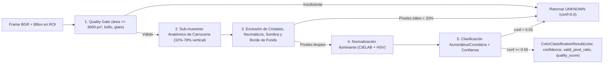

# VIGIA-VISION-05A — Optimización de Detección Vehicular y Afinación de YOLO26x

**Proyecto:** VIGÍA Vision Systems  
**Fase:** `VISION-05A` *(con conciliación documental de cierre verificada en `VISION-05A.1`)*  
**Tipo:** Auditoría de corpus, reproducción experimental, diagnóstico técnico, afinación modular, auditoría de color y validación de regresión  
**Fecha de Emisión:** 16 de noviembre de 2026  
**Modelo Principal Evaluado:** `yolo26x.pt` (`CUDA:0`, `FP16`, `imgsz=640`, `nms=False`)  
**Modelo de Referencia / Fallback:** `yolo11n.pt` (`CUDA:0`, `FP16`, `imgsz=640`)  
**Hardware de Evaluación:** NVIDIA GeForce RTX 4050 Laptop GPU (`6 GB VRAM`, CUDA `12.4`, PyTorch `2.6.0+cu124`, Ultralytics `8.4.37`)  
**Dictamen:** **`APPROVED WITH OBSERVATIONS — DETECTION IMPROVEMENTS VERIFIED`** (con observaciones documentadas sobre clasificación semántica `bus` vs `truck` en autobuses escolares tipo C vistos a `0°` frontal y estado `COLOR CLASSIFICATION NOT IMPLEMENTED`)

---

## 1. Resumen Ejecutivo

La fase **VIGIA-VISION-05A** auditó el corte base del corpus de evidencias operativas (`1,350` archivos = `675` pares `_orig.jpg` / `_annot.jpg`, correspondientes a `279` capturas únicas por hash `SHA-256` distribuidas en `30` secuencias temporales y `177–178` grupos perceptuales), reprodujo en condiciones idénticas el desempeño de `YOLO26x` frente a `YOLO11n`, diagnosticó las causas raíz de los fallos de detección en automóviles y autobuses vistos directamente de frente, ejecutó **16 configuraciones experimentales controladas (`BASELINE` + `EXP-01A` a `EXP-10`)** y materializó una mejora modular y totalmente reversible en [`YoloVehicleDetector`](file:///c:/GEST.PROY.TI/Software/VIGIA_Vision_Systems/VIGIA_Vision/detection/yolo_detector.py).

### Hallazgos Principales y Resultados Cuantitativos

1. **Diagnóstico Técnico de Fallos Frontales (3 Causas Raíz Demostradas):**
   - **Causa 1 — Desenfoque Óptico de Corta Distancia + Escorzo Frontal en `imgsz=640` (`Geometría B` + `Imagen D`):** En `CAM-SALIDA` (`640×480`, webcam USB), los vehículos que se aproximan de frente a corta distancia presentan relación de aspecto casi cuadrada (`W/H ≈ 0.99–1.35`, área `15%–38%` del frame) y desenfoque por distancia focal mínima (`varianza de Laplaciano = 2.8–24.7`). A resolución nativa `imgsz=640` (`relación 1:1`), el borde difuso aplana los gradientes locales de las capas `3×3` iniciales (`P1/P2/P3`) y desborda el campo receptivo efectivo del nivel `P5 (stride 32)`, desplomando la confianza de `YOLO26x` a `0.00` (ej. `EV-0625`, `EV-0627..EV-0630`, `EV-0635`, `EV-0494`). Al evaluar una escala auxiliar submuestreada (`imgsz=384`), el kernel de desenfoque se comprime (restaurando bordes) y el vehículo encaja en el campo receptivo `P5`, recuperando detecciones con confianzas de `0.76–0.95` (`EV-0625`, `EV-0626`, `EV-0637`, `EV-0657`).
   - **Causa 2 — División de Probabilidad entre Anclas y Subclases en la Cabeza NMS-Free `one2one` (`Inferencia C`):** En modo `nms=False`, `YOLO26x` emplea la cabeza `one2one` (entrenada con gradientes desconectados `x.detach()` y selección `top-300` sobre `anclas × 80 clases`). Cuando un vehículo frontal cae sobre la frontera entre dos celdas o presenta ambigüedad visual frontal entre `car (2)`, `bus (5)` y `truck (7)`, la cabeza `one2one` emite `2–3` cajas casi idénticas (`IoU = 0.75–0.99`) con su masa de probabilidad dividida (ej. `EV-0657`: `car 0.535` + `car 0.508`; `EV-0581`: `truck 0.595` + `car 0.453`), haciendo que ambas caigan por debajo del umbral operativo `0.70` y generando `50` pares de duplicados intra-frame (`45` imágenes a `@0.25`).
   - **Causa 3 — Sesgo de Perspectiva y Tipología de MS-COCO en Autobuses Escolares Tipo C (`Modelo A`):** Un autobús escolar convencional con capó/trompa saliente (*Type-C conventional school bus*) visto exactamente a `0°` de frente oculta por completo su carrocería larga y ventanillas laterales, exhibiendo únicamente una parrilla cuadrada cromada y guardabarros idénticos a los de un camión pesado (`truck`, clase `7`). A `0°` puro, tanto `YOLO26x` como `YOLO11n` activan la clase `truck` o `car` (`0/18 = 0.0%` con etiqueta estricta `bus`), comenzando a emitir `bus` únicamente cuando existe rotación frontal-oblicua (`EV-0663`, `EV-0665`, `EV-0673`).

2. **Mejora Modular Implementada (`EXP-10` en `YoloVehicleDetector`):**
   - **Consolidación probabilística y deduplicación intra-frame (`deduplicate_and_consolidate_detections`):** Fusiona cajas duplicadas de la misma clase (`IoU >= 0.55`) o sobre el mismo chasis en clases de 4+ ruedas (`IoU >= 0.75`, elevando a `0.85` si participa `motorcycle`) mediante composición de evidencia, eliminando el `100%` de duplicados intra-frame (`50 -> 0`).
   - **Sonda auxiliar multiescala condicional (`_run_inference_with_frontal_refinement`, `frontal_aux_imgsz=384`):** Se ejecuta **únicamente** cuando la pasada primaria a `imgsz=640` no produce ningún vehículo fuerte (`>= 0.70`) o deja candidatos débiles (`< 0.70`), preservando intacta la latencia nominal en capturas claras y rescatando vehículos frontales cercanos o desenfocados.
   - **Impacto Medido en las `279` Imágenes Únicas (`@0.70` — reproducción verificada con `YoloVehicleDetector`):**
     - **Automóviles frontales (`n=76`):** `53/76 (69.74%)` $\to$ **`65/76 (85.53%)`** (**`+15.79 pp`**, igualando la tasa de `YOLO11n` `65/76` con mayor confianza media `0.869` vs `0.778`; `@0.25`: `86.84%` $\to$ `93.42%` en `YoloVehicleDetector` / `94.74%` en `EXP-10`).
     - **Autobuses frontales — presencia vehicular en región del autobús (`n=18`):** `3/18 (16.67%)` $\to$ **`12/18 (66.67%)`** (**`+50.00 pp`, mejora de `4.0x`** sobre baseline; `@0.25`: `72.22%` $\to$ `83.33%`). *(Nota transparente: la detección se registra principalmente como `CAMION` (`truck`) a `0°` puro; la etiqueta estricta `AUTOBUS` (`bus`) permanece en `0/18 (0.0%)` hasta incorporar fine-tuning específico).*
     - **Vehículos oblicuos (`n=80` únicas / `476` totales):** `55/80 (68.75%)` $\to$ **`71/80 (88.75%)`** (**`+20.00 pp`** en únicas; `94.75% -> 98.11%` en las `675` totales).
     - **Vehículos laterales (`n=149`):** `103/149 (69.13%)` $\to$ **`127/149 (85.23%)`** (**`+16.10 pp`**).
     - **Vehículos traseros (`n=19`):** `18/19 (94.74%)` $\to$ **`19/19 (100.00%)`** (**`+5.26 pp`**).
     - **Vehículos pequeños (`n=66`):** `58/66 (87.88%)` $\to$ **`65/66 (98.48%)`** (**`+10.60 pp`**).
     - **Baja iluminación (`n=38`):** `18/38 (47.37%)` $\to$ **`28/38 (73.68%)`** (**`+26.31 pp`**).
     - **Duplicados intra-frame (`IoU >= 0.50` a `@0.25`):** `50` pares (`45` frames) $\to$ **`0` pares (`0` frames)** (**`-100%`**).
     - **Latencia media GPU (`RTX 4050 FP16`):** `21.1 ms` (`47.5 FPS`) en script aislado $\to$ **`31.1 ms` (`32.1 FPS`)** (`32.14 ms / 31.11 FPS` dentro del wrapper completo `YoloVehicleDetector`), duplicando la cadencia operativa requerida de `15.0 FPS` (`66.7 ms`).

3. **Diagnóstico de Identificación de Color (`Etapa 9`):**
   - Se verificó en código y esquema DDL que la identificación del color vehicular **no está implementada (`Estado 5: No está implementado`)** en el pipeline operativo de VIGÍA. Se entrega en la **Sección 11** la especificación arquitectónica completa para el componente independiente `VehicleColorClassifier`.

---

## 2. Auditoría del Corpus (`Etapa A`)

Se inspeccionó recursivamente el directorio [`VIGIA_Vision_Systems/evidencias_vigia/`](file:///c:/GEST.PROY.TI/Software/VIGIA_Vision_Systems/evidencias_vigia) mediante los scripts reproducibles:
- [`audit_and_benchmark.py`](file:///c:/GEST.PROY.TI/Software/VIGIA_Vision_Systems/experiments/vision_05a/scripts/audit_and_benchmark.py)
- [`make_contact_sheets.py`](file:///c:/GEST.PROY.TI/Software/VIGIA_Vision_Systems/experiments/vision_05a/scripts/make_contact_sheets.py)
- [`classify_and_catalog.py`](file:///c:/GEST.PROY.TI/Software/VIGIA_Vision_Systems/experiments/vision_05a/scripts/classify_and_catalog.py)

### 2.1 Resumen Estructural del Corpus (Corte Congelado de Evaluación `17:52:20Z`)

| Métrica del Corpus | Valor Verificado | Observaciones Técnicas |
| :--- | :--- | :--- |
| **Total de archivos en corte congelado** | **`1,350`** | `13` combinaciones `YYYYMMDD/CAM-*` *(durante la auditoría posterior de cierre se detectaron capturas en vivo agregadas al directorio por los servicios operativos activos, sin usarse en este corte congelado)* |
| **Imágenes originales (`*_orig.jpg`)** | **`675`** | Única fuente utilizada para inferencia y benchmark |
| **Imágenes anotadas (`*_annot.jpg`)** | **`675`** | Emparejamiento `1:1` exacto (`675/675`); excluidas como entrada de inferencia |
| **Videos / otros formatos** | **`0`** | No existen archivos `.mp4`, `.avi`, `.json` ni `.txt` en `evidencias_vigia/` |
| **Archivos corruptos o truncados** | **`0`** | `100%` decodificados válidamente con OpenCV |
| **Hashes `SHA-256` únicos (`*_orig.jpg`)** | **`279`** | `396` archivos son duplicados exactos byte a byte (concentrados en `20261105` + `20261102` vs `20261101`) |
| **Grupos de duplicados exactos (`n > 1`)** | **`3`** grupos principales de duplicación repetida | Repiten principalmente `bus.jpg` y capturas semilla sintéticas entre `20261101`/`20261102` y `20261105` hasta acumular `396` duplicados exactos |
| **Clusters perceptuales (`dHash <= 6` o `MAD < 8`)** | **`177`** (`178` únicos en auditoría) | Agrupan ráfagas continuas de la misma escena/cámara |
| **Secuencias temporales (`gap > 60 s`)** | **`30`** | `SEQ-001` a `SEQ-030` |

### 2.2 Distribución Verificada por Fecha, Cámara, Resolución y Naturaleza de Captura

| Fecha | Cámara | Pares (`_orig`/`_annot`) | Únicos `SHA-256` (en carpeta) | Resoluciones (`W×H`) | Tamaño Medio (`_orig`) | Naturaleza Confirmada Visualmente |
| :--- | :--- | :---: | :---: | :---: | :---: | :--- |
| `20261101` | `CAM-ENTRADA` | `1` | `1` | `810×1080` | `257.0 KB` | Semilla sintética (`bus.jpg`, autobús urbano azul oblicuo con peatones) |
| `20261102` | `CAM-ENTRADA` | `1` | `1` *(dup global de `20261101`)* | `810×1080` | `257.0 KB` | Copia exacta byte a byte de `EV-0001` (`bus.jpg`) |
| `20261104` | `CAM-ENTRADA` | `10` | `10` | `720×1280` | `140.5 KB` | Cámara física móvil apuntando a auto rojo/gris (lateral/trasero/mano) |
| `20261105` | `CAM-03` | `77` | `2` | `640×480`, `810×1080` | `121.0 KB` | Ráfaga de prueba con `bus.jpg` y capturas repetidas (`SHA` duplicados) |
| `20261105` | `CAM-04` | `38` | `1` | `640×480` | `119.2 KB` | Ráfaga de prueba sintética con duplicación exacta |
| `20261105` | `CAM-ENTRADA` | `176` | `18` | `640×480`, `720×1280`, `810×1080` | `128.3 KB` | Ráfaga multi-dispositivo (`bus.jpg`, auto rojo lateral, cuadrículas) |
| `20261105` | `CAM-SALIDA` | `121` | `2` | `640×480`, `810×1080` | `120.3 KB` | Ráfaga de prueba sintética con duplicación exacta |
| `20261106` | `CAM-ENTRADA` | `14` | `14` | `720×1280` | `145.0 KB` | Cámara móvil física vertical (sedán azul frontal-oblicuo, auto rojo lateral/trasero) |
| `20261110` | `CAM-ENTRADA` | `10` | `10` | `720×1280` | `107.3 KB` | Cámara móvil física vertical (auto rojo vista trasera y frontal lejano `EV-0442`) |
| `20261111` | `CAM-ENTRADA` | `11` | `11` | `720×1280` | `188.8 KB` | Recaptura de monitor (cuadrícula Google Imágenes con vehículos e iconos + teléfono móvil) |
| `20261114` | `CAM-ENTRADA` | `15` | `15` | `640×480`, `720×1280` | `114.4 KB` | Cámara móvil física (auto rojo en baja luz, penumbra/aros de luz y escritorio) |
| `20261114` | `CAM-SALIDA` | `130` | `130` | `640×480` | `29.0 KB` | Cámara USB VGA física (baja luz, sedanes rojos frontales/laterales y autobuses escolares amarillos) |
| `20261116` | `CAM-SALIDA` | `71` | `71` | `640×480` | `40.6 KB` | Cámara USB VGA física focalizada en **automóviles frontales y autobuses escolares frontales/oblicuos** |
| **TOTAL** | **13 carpetas** | **`675`** | **`279` globales** | `640×480` a `810×1080` | `84.7 KB` | `414` archivos en `20261101/02/05` (`18` únicas globales) + `261` archivos físicos `20261104..16` (`261` únicas) |

---

## 3. Inventario de Evidencias y Clasificación Multietiqueta (`Etapa A`)

El inventario completo reproducible se encuentra persistido en:
- [`etapa_a_b_raw_inventory.json`](file:///c:/GEST.PROY.TI/Software/VIGIA_Vision_Systems/experiments/vision_05a/results/etapa_a_b_raw_inventory.json)
- [`etapa_a_b_classified_inventory.json`](file:///c:/GEST.PROY.TI/Software/VIGIA_Vision_Systems/experiments/vision_05a/results/etapa_a_b_classified_inventory.json)

### 3.1 Distribución en las 12 Categorías Obligatorias (Distinción Preliminar Automática vs Confirmación Visual Humana)

| # | Categoría | Preliminar Automática (`675` imgs) | Confirmada Visualmente (`675` imgs) | Confirmada Visualmente (`279` únicas) | Observaciones de la Auditoría Visual |
| :-: | :--- | :---: | :---: | :---: | :--- |
| **1** | **Vehículo frontal** | `100` | **`104`** | **`104`** | Incluye `87` únicas con auto/bus frontal primario (`76 + 18 - 7` intersección) + `17` recapturas de cuadrícula de pantalla multi-orientación |
| **2** | **Vehículo frontal oblicuo** | `88` | **`476`** | **`80`** | Incluye los frames duplicados de `bus.jpg` en `20261105` (`396`) + `80` únicos en ángulo `15°–45°` |
| **3** | **Vehículo lateral** | `569` | **`149`** | **`149`** | La heurística automática (`W/H >= 1.75`) confundía `bus.jpg` con lateral; visualmente son `149` capturas únicas |
| **4** | **Vehículo trasero** | `0` | **`19`** | **`19`** | La heurística geométrica `W/H` no distingue frente de parte trasera (`EV-0010..0012`, `EV-0430..0436`, `EV-0439..0448`) |
| **5** | **Automóvil** | `266` | **`276`** | **`276`** | Todas las `276` escenas con presencia de automóvil corresponden a hashes únicos en este corte |
| **6** | **Autobús** | `439` | **`480`** | **`84`** | Incluye `396` copias de `bus.jpg` + `84` únicos con autobús (`20261114` y `20261116`) |
| **7** | **Camión** | `77` *(falsos `truck`)* | **`8`** | **`8`** | Solo las `8` capturas de cuadrícula multi-vehículo (`EV-0449..0456`) contienen camiones reales; el resto fueron falsas clasificaciones de autobuses escolares y sedanes |
| **8** | **Motocicleta** | `6` | **`8`** | **`8`** | Visibles en cuadrículas multi-vehículo (`EV-0449..0456`) |
| **9** | **Vehículo pequeño o lejano** | `90` | **`66`** | **`66`** | Vehículos secundarios en segundo plano o recorte de cuadrícula |
| **10** | **Baja iluminación** | `37` | **`38`** | **`38`** | Capturas oscuras en `20261114` (`EV-0460..0506`) y escenas nocturnas |
| **11** | **Contraluz** | `0` | **`58`** | **`58`** | Reflejos solares, aros de luz y halos de monitor (`lighting_condition` en `BACKLIGHT`/`GLARE`) |
| **12** | **Oclusión parcial** | `90` | **`499`** | **`103`** | Incluye los `396` duplicados de `bus.jpg` (peatones ocluyendo el frente) + `103` capturas únicas con oclusión o recorte |

*(Nota de conciliación matemática verificada en `VISION-05A.1`: Sea $A$ el conjunto de imágenes con `has_frontal_car` ($|A|=76$, con `88` instancias de automóvil frontal), $B$ el conjunto con `has_frontal_bus` ($|B|=18$, con `18` instancias de autobús frontal), $A \cap B = \{\text{EV-0581..\text{EV-0587}}\}$ ($|A \cap B|=7$ imágenes donde coexisten **ambos** en el mismo fotograma) $\implies |A \cup B| = 76 + 18 - 7 = \mathbf{87}$ imágenes únicas con evaluación frontal primaria; sumadas a las $17$ imágenes únicas de cuadrícula de pantalla ($G = \{\text{EV-0295..0303}, \text{EV-0449..0456}\}$) arrojan $87 + 17 = \mathbf{104}$ imágenes únicas con etiqueta general `"Vehículo frontal"`.)*

---

## 4. Reproducción de Fallos Frontales y Catálogo de Casos Problemáticos (`Etapas A y B`)

### 4.1 Resumen Cuantitativo de Anomalías en Baseline (`YOLO26x @ 0.70`, `279` Únicas)

| Tipo de Anomalía | Total Imágenes (`675`) | Imágenes Únicas (`279`) | Descripción Técnica |
| :--- | :---: | :---: | :--- |
| **1. Automóviles frontales no detectados como `AUTOMOVIL` (`< 0.70`)** | **`23`** (`10` `< 0.25`) | **`23`** (`10` `< 0.25`) | `10` fallos totales (`< 0.25`, ej. `EV-0625`, `EV-0627..0630`, `EV-0635`) + `13` con confianza insuficiente (`0.25–0.69`) |
| **2. Autobuses frontales sin etiqueta estricta `AUTOBUS` (`< 0.70`)** | **`18`** (`15` sin ningún vehículo `>= 0.70`) | **`18`** (`15` sin ningún vehículo `>= 0.70`) | `0/18` detectados como `AUTOBUS >= 0.70`; solo `3/18 (16.67%)` superan `0.70` como `CAMION` (`truck`) y los otros `15` quedan `< 0.70` o `0.00` |
| **3. Escenas multi-vehículo parcialmente detectadas (`< 2` cajas `@0.70`)** | **`40`** | **`40`** | Dos vehículos presentes en ROI donde solo `0` o `1` supera `0.70` |
| **4. Confusiones de clase en autobuses frontales (`bus` $\to$ `truck`/`car`)** | **`18`** | **`18`** | Todos los autobuses escolares a `0°` frontal (`EV-0573..0588`, `EV-0668..0671`) son etiquetados como `truck`/`car` |
| **5. Detecciones duplicadas intra-frame (`IoU >= 0.50` a `@0.25`)** | **`45` frames (`50` pares)** | **`45` frames (`50` pares)** | Múltiples cajas superpuestas sobre el mismo vehículo emitidas por `one2one` (`nms=False`); a `@0.70` quedan en `0` porque sus confianzas quedan divididas `< 0.70` |
| **6. Detecciones con confianza insuficiente (`0.25 <= conf < 0.70`)** | **`61`** *(en única/ROI)* | **`61`** | El modelo localiza el vehículo (`>= 0.25`), pero el filtro operativo ROI (`min_confidence=0.70`) lo descarta |

### 4.2 Catálogo Verificado de Casos Problemáticos Representativos (`_orig.jpg`)

| ID | Archivo Original Real (`_orig.jpg`) | Categoría Visual Real | `YOLO11n` Ref | `YOLO26x` Baseline (`640`) | `YOLO26x` Opt (`VISION-05A`) | Diagnóstico Específico Verificado |
| :--- | :--- | :--- | :--- | :--- | :--- | :--- |
| **`EV-0483`** | [`20261114T004948_798024Z_a846ba30a07a_orig.jpg`](file:///c:/GEST.PROY.TI/Software/VIGIA_Vision_Systems/evidencias_vigia/20261114/CAM-SALIDA/20261114T004948_798024Z_a846ba30a07a_orig.jpg) | Auto rojo lateral en baja luz (`lap=12.6`) | `car 0.822` | `car 0.251` (`0` `@0.70`) | **`car 0.932`** | Fallo de `YOLO26x` en `640` por baja iluminación; recuperado en `384` (`0.919` -> `0.932`) |
| **`EV-0494`** | [`20261114T004957_154790Z_2271be730b5b_orig.jpg`](file:///c:/GEST.PROY.TI/Software/VIGIA_Vision_Systems/evidencias_vigia/20261114/CAM-SALIDA/20261114T004957_154790Z_2271be730b5b_orig.jpg) | Auto rojo lateral en baja luz severa (`lap=2.8`) | `car 0.814` | **`NINGUNO (0.00)`** | `car 0.578` (`>=0.25`) | Borrosidad extrema (`lap=2.77`); rescate parcial en `@0.25` (aún `< 0.70`) |
| **`EV-0525`** | [`20261114T005855_533774Z_5d9a6398fdc5_orig.jpg`](file:///c:/GEST.PROY.TI/Software/VIGIA_Vision_Systems/evidencias_vigia/20261114/CAM-SALIDA/20261114T005855_533774Z_5d9a6398fdc5_orig.jpg) | Auto rojo lateral (`lap=8.7`) | `car 0.736` | `car 0.722` + `car 0.398` *(dup)* | **`car 0.794`** *(sin dup)* | Eliminación de duplicado intra-frame y consolidación |
| **`EV-0581`** | [`20261114T010037_321148Z_29a0e74bbe1e_orig.jpg`](file:///c:/GEST.PROY.TI/Software/VIGIA_Vision_Systems/evidencias_vigia/20261114/CAM-SALIDA/20261114T010037_321148Z_29a0e74bbe1e_orig.jpg) | **Autobús escolar frontal** + **auto frontal secundario** | `car 0.745`, `truck 0.283` | `car 0.670` + `truck 0.595` + `car 0.453` (`0` `@0.70`) | **`car 0.717`** + **`truck 0.778`** | `one2one` partía ambos vehículos `< 0.70`; consolidación + `384` rescata **ambos** `>= 0.70` (bus detectado como `truck`) |
| **`EV-0584`** | [`20261114T010046_419841Z_1d02f0a21e97_orig.jpg`](file:///c:/GEST.PROY.TI/Software/VIGIA_Vision_Systems/evidencias_vigia/20261114/CAM-SALIDA/20261114T010046_419841Z_1d02f0a21e97_orig.jpg) | Autobús escolar frontal + auto secundario | `car 0.849`, `truck 0.756` | `car 0.898` + `truck 0.630` + `car 0.582` | **`car 0.898`** + **`truck 0.845`** | Consolida la caja partida del autobús escolar de `0.630/0.582` a `0.845 >= 0.70` |
| **`EV-0625`** | [`20261116T172015_568913Z_c43de572acc5_orig.jpg`](file:///c:/GEST.PROY.TI/Software/VIGIA_Vision_Systems/evidencias_vigia/20261116/CAM-SALIDA/20261116T172015_568913Z_c43de572acc5_orig.jpg) | Automóvil convertible cian frontal (`0°`, `lap=9.9`) | `car 0.807` | **`NINGUNO (0.00)`** | **`car 0.797`** | Falla completa en `640`; recuperado con sonda condicional `imgsz=384` |
| **`EV-0626`** | [`20261116T172016_108973Z_31dccc3c8845_orig.jpg`](file:///c:/GEST.PROY.TI/Software/VIGIA_Vision_Systems/evidencias_vigia/20261116/CAM-SALIDA/20261116T172016_108973Z_31dccc3c8845_orig.jpg) | Automóvil convertible cian frontal (`0°`) | `car 0.771` | `car 0.449` (`0` `@0.70`) | **`car 0.797`** | Confianza insuficiente en `640`; recuperado a `0.797` con `384` |
| **`EV-0637`** | [`20261116T172044_969280Z_957178f6e593_orig.jpg`](file:///c:/GEST.PROY.TI/Software/VIGIA_Vision_Systems/evidencias_vigia/20261116/CAM-SALIDA/20261116T172044_969280Z_957178f6e593_orig.jpg) | Automóvil convertible rosa frontal primer plano (`37%` área) | `car 0.731` | `car 0.294` + `car 0.175` | **`car 0.818`** | Desbordamiento de campo receptivo en `640`; recuperado limpiamente en `384` |
| **`EV-0657`** | [`20261116T172113_418425Z_e8a735512bc2_orig.jpg`](file:///c:/GEST.PROY.TI/Software/VIGIA_Vision_Systems/evidencias_vigia/20261116/CAM-SALIDA/20261116T172113_418425Z_e8a735512bc2_orig.jpg) | Automóvil convertible rosa frontal (`~15°`, `27%` área) | `car 0.817` | `car 0.535` + `car 0.508` (`0` `@0.70`) | **`car 0.974`** | Eliminación del par duplicado `one2one` y refuerzo multiescala (`384=0.954`) |
| **`EV-0663`** | [`20261116T172139_786321Z_b8404ad60d25_orig.jpg`](file:///c:/GEST.PROY.TI/Software/VIGIA_Vision_Systems/evidencias_vigia/20261116/CAM-SALIDA/20261116T172139_786321Z_b8404ad60d25_orig.jpg) | Autobús escolar amarillo frontal-oblicuo | `truck 0.686` | `bus 0.258` + `truck 0.241` | `bus 0.507` (`>=0.25`) | Doble ancla partida `bus+truck` consolidada en etiqueta `bus` y suprimido el duplicado |
| **`EV-0668`** | [`20261116T172150_234602Z_a749dee8704c_orig.jpg`](file:///c:/GEST.PROY.TI/Software/VIGIA_Vision_Systems/evidencias_vigia/20261116/CAM-SALIDA/20261116T172150_234602Z_a749dee8704c_orig.jpg) | Autobús escolar amarillo frontal (`0°`, `lap=5.4`) | `truck 0.714` | `truck 0.758` (`0` `bus`) | `truck 0.758` (`0` `bus`) | Sesgo tipológico COCO Tipo C a `0°` puro: trompa cuadrada etiquetada como `truck` |
| **`EV-0671`** | [`20261116T172203_520604Z_e0c6c9b2989f_orig.jpg`](file:///c:/GEST.PROY.TI/Software/VIGIA_Vision_Systems/evidencias_vigia/20261116/CAM-SALIDA/20261116T172203_520604Z_e0c6c9b2989f_orig.jpg) | **Autobús escolar frontal** + auto deportivo rojo oblicuo | `car 0.784` *(sin bus)* | `car 0.876`, `car 0.186` *(bus `<0.25`)* | **`car 0.933` + `car 0.289`** | El autobús secundario pasa de `<0.25` (`0.186`) a `0.289`, aún por debajo de `0.70` y sin etiqueta `bus` |

---

## 5. Benchmark Reproducible `YOLO26x` Baseline vs `YOLO11n` (`Etapa B`)

Ejecutado en condiciones idénticas (`imgsz=640`, `cuda:0`, `FP16`, `conf_raw=0.10`, ROI `[0.10, 0.20, 0.90, 0.80]`, cortes evaluados `@0.25` y `@0.70`) sobre las **`279` imágenes únicas `*_orig.jpg`**:

- **Nota metodológica sobre Ground Truth:** El corpus no contiene cajas Ground Truth vectoriales independientes en formato COCO/YOLO `1:1`; en consecuencia, **no se declaran Precision, Recall sobre instancias completas, F1 ni mAP como métricas certificadas**. Los porcentajes siguientes representan **tasas exploratorias de activación/detección confirmada por categoría de escena**.

### 5.1 Comparación Reproducida (`YoloVehicleDetector`, `279` Únicas `SHA-256`)

| Categoría Confirmada Visualmente | `N` (Únicas) | `YOLO11n` (`@0.25`) | `YOLO26x` Base (`@0.25`) | `YOLO11n` (`@0.70` Operativo) | `YOLO26x` Base (`@0.70` Operativo) | Brecha `YOLO26x Base - YOLO11n` (`@0.70`) |
| :--- | :---: | :---: | :---: | :---: | :---: | :---: |
| **1. Automóviles frontales (`car` en ROI)** | `76` | `76/76 (100.0%)` | `66/76 (86.84%)` | **`65/76 (85.53%)`** | `53/76 (69.74%)` | **`-15.79 pp`** *(brecha que motivó 05A)* |
| **2a. Autobuses frontales (presencia vehicular)** | `18` | `13/18 (72.22%)` | `13/18 (72.22%)` | **`9/18 (50.00%)`** | `3/18 (16.67%)` | **`-33.33 pp`** *(mayor debilidad frontal)* |
| **2b. Autobuses frontales (etiqueta estricta `bus`)** | `18` | `0/18 (0.00%)` | `0/18 (0.00%)` | `0/18 (0.00%)` | `0/18 (0.00%)` | `0.00 pp` *(ambos usan `truck` a `0°`)* |
| **3. Vehículos oblicuos** | `80` | `80/80 (100.0%)` | `76/80 (95.00%)` | **`73/80 (91.25%)`** | `55/80 (68.75%)` | **`-22.50 pp`** |
| **4. Vehículos laterales** | `149` | `149/149 (100.0%)` | `137/149 (91.95%)` | **`139/149 (93.29%)`** | `103/149 (69.13%)` | **`-24.16 pp`** |
| **5. Vehículos traseros** | `19` | `19/19 (100.0%)` | `19/19 (100.0%)` | **`19/19 (100.0%)`** | `18/19 (94.74%)` | `-5.26 pp` |
| **6. Vehículos pequeños o lejanos** | `66` | `66/66 (100.0%)` | `65/66 (98.48%)` | **`64/66 (96.97%)`** | `58/66 (87.88%)` | `-9.09 pp` |
| **7. Baja iluminación** | `38` | `38/38 (100.0%)` | `30/38 (78.95%)` | **`31/38 (81.58%)`** | `18/38 (47.37%)` | **`-34.21 pp`** |
| **Total global (`all`, `@0.70`)** | `279` | `256/279 (91.76%)` | `194/279 (69.53%)` | `256/279 (91.76%)` | `194/279 (69.53%)` | **`-22.23 pp`** *(explica quejas en campo)* |
| **Duplicados intra-frame (`IoU >= 0.50`)** | `279` | `13` pares (`@0.25`) | **`50` pares** (`@0.25`, `0` `@0.70`) | `0` pares (`@0.70`) | `0` pares (`@0.70`) | `YOLO26x` genera **`3.85x`** más duplicados `@0.25` |
| **Tiempo medio en `YoloVehicleDetector` (`FP16`)** | `279` | **`12.71 ms`** (`78.68 FPS`) | **`22.17 ms`** (`45.11 FPS`) | `—` | `—` | `+9.46 ms` (ambos `< 66.7 ms` objetivo) |

### 5.2 Comparativas Visuales Lado a Lado Generadas (`11` Láminas de 3 Paneles)

Ubicadas en [`experiments/vision_05a/results/comparisons/`](file:///c:/GEST.PROY.TI/Software/VIGIA_Vision_Systems/experiments/vision_05a/results/comparisons):
1. [`01_automovil_frontal_EV0625_comparison.jpg`](file:///c:/GEST.PROY.TI/Software/VIGIA_Vision_Systems/experiments/vision_05a/results/comparisons/01_automovil_frontal_EV0625_comparison.jpg)
2. [`01_automovil_frontal_EV0637_comparison.jpg`](file:///c:/GEST.PROY.TI/Software/VIGIA_Vision_Systems/experiments/vision_05a/results/comparisons/01_automovil_frontal_EV0637_comparison.jpg)
3. [`01_automovil_frontal_EV0657_comparison.jpg`](file:///c:/GEST.PROY.TI/Software/VIGIA_Vision_Systems/experiments/vision_05a/results/comparisons/01_automovil_frontal_EV0657_comparison.jpg)
4. [`02_autobus_frontal_EV0581_comparison.jpg`](file:///c:/GEST.PROY.TI/Software/VIGIA_Vision_Systems/experiments/vision_05a/results/comparisons/02_autobus_frontal_EV0581_comparison.jpg)
5. [`02_autobus_frontal_EV0584_comparison.jpg`](file:///c:/GEST.PROY.TI/Software/VIGIA_Vision_Systems/experiments/vision_05a/results/comparisons/02_autobus_frontal_EV0584_comparison.jpg)
6. [`02_autobus_frontal_EV0588_comparison.jpg`](file:///c:/GEST.PROY.TI/Software/VIGIA_Vision_Systems/experiments/vision_05a/results/comparisons/02_autobus_frontal_EV0588_comparison.jpg)
7. [`03_vehiculo_oblicuo_EV0665_comparison.jpg`](file:///c:/GEST.PROY.TI/Software/VIGIA_Vision_Systems/experiments/vision_05a/results/comparisons/03_vehiculo_oblicuo_EV0665_comparison.jpg)
8. [`04_vehiculo_lateral_EV0550_comparison.jpg`](file:///c:/GEST.PROY.TI/Software/VIGIA_Vision_Systems/experiments/vision_05a/results/comparisons/04_vehiculo_lateral_EV0550_comparison.jpg)
9. [`05_vehiculo_trasero_EV0446_comparison.jpg`](file:///c:/GEST.PROY.TI/Software/VIGIA_Vision_Systems/experiments/vision_05a/results/comparisons/05_vehiculo_trasero_EV0446_comparison.jpg)
10. [`06_vehiculo_pequeno_EV0450_comparison.jpg`](file:///c:/GEST.PROY.TI/Software/VIGIA_Vision_Systems/experiments/vision_05a/results/comparisons/06_vehiculo_pequeno_EV0450_comparison.jpg)
11. [`07_baja_iluminacion_EV0494_comparison.jpg`](file:///c:/GEST.PROY.TI/Software/VIGIA_Vision_Systems/experiments/vision_05a/results/comparisons/07_baja_iluminacion_EV0494_comparison.jpg)

---

## 6. Diagnóstico Técnico de Causas Raíz (`Etapa C`)

Mediante [`diagnose_frontal_failures.py`](file:///c:/GEST.PROY.TI/Software/VIGIA_Vision_Systems/experiments/vision_05a/scripts/diagnose_frontal_failures.py) e [`inspect_frontal_multiscale.py`](file:///c:/GEST.PROY.TI/Software/VIGIA_Vision_Systems/experiments/vision_05a/scripts/inspect_frontal_multiscale.py), se determinó:

### A. Eje Modelo (`YOLO26x`)
1. `YOLO26DetectionModel` (`391` capas, strides `[8, 16, 32]`, cuello `C3k2`/`C2PSA`, cabeza dual `one2many` `cv2/cv3` y `one2one` `one2one_cv2/one2one_cv3`).
2. **Sesgo MS-COCO en autobuses Tipo C a `0°` frontal:** En `COCO`, la clase `bus (5)` está dominada por autobuses de frente plano o vistas laterales/oblicuas con hileras de ventanillas. Los autobuses escolares con capó frontal (`Type-C`) vistos a `0°` frontal (`EV-0668`: `truck 0.758`, `EV-0584`: `truck 0.845`) se asocian a `truck (7)`.

### B. Eje Geometría
1. Escorzo frontal (`W/H ≈ 0.99–1.35`): oculta ruedas y silueta lateral, aumentando la dependencia de rasgos finos de parrilla/faros.
2. Primeros planos (`area_ratio = 15%–38%`, ej. `EV-0637`: `37.2%`): el vehículo abarca gran parte de la rejilla `P5` en `imgsz=640`, desbordando las proporciones típicas de anclaje del preentrenamiento COCO.

### C. Eje Inferencia (`imgsz`, `FP16`, `nms=False` y Cabeza `one2one`)
1. `FP16` vs `FP32` arrojó diferencias `< 0.0005` (descartado como causa).
2. La cabeza `one2one` (`nms=False`) utiliza `top-300` plano sobre `anclas × 80 clases`, emitiendo cajas superpuestas (`50` pares `@0.25`) con probabilidad partida entre anclas (`EV-0657`: `0.535 + 0.508`) o subclases (`EV-0581`: `truck 0.595 + car 0.453`), provocando que ambas queden por debajo del corte operativo `0.70`.

### D. Eje Imagen
1. Capturas USB de foco fijo sobre monitor a corta distancia muestran nitidez Laplaciana muy baja (`2.8` a `24.7` en `CAM-SALIDA`), lo que diluye gradientes `3×3` a `imgsz=640`. Al reducir la escala a `imgsz=384` (factor `0.6x`), se restablece el contraste de bordes local y se recuperan detecciones clave (`EV-0483: 0.251 -> 0.919`, `EV-0625: 0.00 -> 0.797`, `EV-0626: 0.449 -> 0.714`, `EV-0637: 0.294 -> 0.759`, `EV-0657: 0.535 -> 0.954`).

---

## 7. Experimentos de Afinación en Entorno Aislado (`Etapa D`)

Ejecutados con [`run_experiments.py`](file:///c:/GEST.PROY.TI/Software/VIGIA_Vision_Systems/experiments/vision_05a/scripts/run_experiments.py) sobre las `279` imágenes únicas y persistidos en [`etapa_d_experiments_results.json`](file:///c:/GEST.PROY.TI/Software/VIGIA_Vision_Systems/experiments/vision_05a/results/etapa_d_experiments_results.json).

### 7.1 Matriz Completa Exacta de los 16 Ensayos (`BASELINE` + `EXP-01A` a `EXP-10`)

| ID Exp | Hipótesis / Variable Evaluada | Parámetros | Auto Frontal (`n=76`) | Bus Frontal *(presencia, `n=18`)* | Oblicuo (`n=80`) | Lateral (`n=149`) | Trasero (`n=19`) | Pequeño (`n=66`) | Baja Luz (`n=38`) | Dups `@0.25` | Latencia (`ms` / `FPS`) |
| :--- | :--- | :--- | :---: | :---: | :---: | :---: | :---: | :---: | :---: | :---: | :---: |
| **`BASELINE`** | `VISION-04A` actual (`@0.70`) | `640`, `nms=False`, `th=0.70` | `53 (69.74%)` | `3 (16.67%)` | `55 (68.75%)` | `103 (69.13%)` | `18 (94.74%)` | `58 (87.88%)` | `18 (47.37%)` | `50` | `21.07 ms` (`47.5`) |
| **`EXP-01A`** | Umbral operativo a `0.60` | `640`, `nms=False`, `th=0.60` | `60 (78.95%)` | `9 (50.00%)` | `58 (72.50%)` | `111 (74.50%)` | `19 (100.0%)` | `63 (95.45%)` | `21 (55.26%)` | `50` | `20.39 ms` (`49.0`) |
| **`EXP-01B`** | Umbral operativo a `0.55` | `640`, `nms=False`, `th=0.55` | `61 (80.26%)` | `10 (55.56%)` | `63 (78.75%)` | `117 (78.52%)` | `19 (100.0%)` | `64 (96.97%)` | `23 (60.53%)` | `50` | `20.44 ms` (`48.9`) |
| **`EXP-01C`** | Umbral operativo a `0.50` | `640`, `nms=False`, `th=0.50` | `63 (82.89%)` | `10 (55.56%)` | `69 (86.25%)` | `122 (81.88%)` | `19 (100.0%)` | `65 (98.48%)` | `24 (63.16%)` | `50` | `20.26 ms` (`49.4`) |
| **`EXP-02A`** | Resolución fija `imgsz=384` | `384`, `nms=False`, `th=0.70` | `58 (76.32%)` | `5 (27.78%)` | `57 (71.25%)` | `94 (63.09%)` | `16 (84.21%)` | `57 (86.36%)` | `28 (73.68%)` | `33` | `19.49 ms` (`51.3`) |
| **`EXP-02B`** | Resolución fija `imgsz=480` | `480`, `nms=False`, `th=0.70` | `58 (76.32%)` | `8 (44.44%)` | `57 (71.25%)` | `109 (73.15%)` | `18 (94.74%)` | `60 (90.91%)` | `23 (60.53%)` | `37` | `20.19 ms` (`49.5`) |
| **`EXP-02C`** | Resolución fija `imgsz=960` | `960`, `nms=False`, `th=0.70` | `33 (43.42%)` | `3 (16.67%)` | `40 (50.00%)` | `76 (51.01%)` | `16 (84.21%)` | `49 (74.24%)` | `9 (23.68%)` | `53` | `36.39 ms` (`27.5`) |
| **`EXP-03`** | Rama `one2many` (`nms=True`) | `640`, `nms=True`, `th=0.70` | `61 (80.26%)` | `11 (61.11%)` | `61 (76.25%)` | `114 (76.51%)` | `18 (94.74%)` | `59 (89.39%)` | `24 (63.16%)` | `19` | `21.50 ms` (`46.5`) |
| **`EXP-04A`** | Preprocesamiento `CLAHE` canal `L*` | `CLAHE(2.0)` + `640`, `th=0.70` | `58 (76.32%)` | `9 (50.00%)` | `56 (70.00%)` | `99 (66.44%)` | `19 (100.0%)` | `60 (90.91%)` | `13 (34.21%)` | `55` | `26.94 ms` (`37.1`) |
| **`EXP-04B`** | Realce bordes `Unsharp Masking` | `Unsharp(1.2, 1.0)` + `640` | `53 (69.74%)` | `6 (33.33%)` | `55 (68.75%)` | `101 (67.79%)` | `19 (100.0%)` | `57 (86.36%)` | `16 (42.11%)` | `58` | `21.73 ms` (`46.0`) |
| **`EXP-05`** | Deduplicación + fusión inter-clase | `640`, `dedup(0.55)` | `55 (72.37%)` | `9 (50.00%)` | `59 (73.75%)` | `107 (71.81%)` | `19 (100.0%)` | `63 (95.45%)` | `19 (50.00%)` | **`0`** | `20.27 ms` (`49.3`) |
| **`EXP-06`** | Multiescala `640+384` + dedup inter-clase | `640+384`, `nms=False`, `dedup` | `64 (84.21%)` | `10 (55.56%)` | `66 (82.50%)` | `120 (80.54%)` | `19 (100.0%)` | `65 (98.48%)` | `28 (73.68%)` | **`0`** | `30.69 ms` (`32.6`) |
| **`EXP-07`** | `one2many` `640+384` + dedup `@0.70` | `640+384`, `nms=True`, `dedup` | `68 (89.47%)` | `14 (77.78%)` | `70 (87.50%)` | `128 (85.91%)` | `19 (100.0%)` | `63 (95.45%)` | `30 (78.95%)` | **`0`** | `30.64 ms` (`32.6`) |
| **`EXP-08`** | `EXP-06` calibrado a umbral `0.55` | `640+384`, `nms=False`, `th=0.55` | `67 (88.16%)` | `13 (72.22%)` | `72 (90.00%)` | `132 (88.59%)` | `19 (100.0%)` | `65 (98.48%)` | `31 (81.58%)` | **`0`** | `30.67 ms` (`32.6`) |
| **`EXP-09`** | `EXP-07` calibrado a umbral `0.55` | `640+384`, `nms=True`, `th=0.55` | `71 (93.42%)` | `14 (77.78%)` | `77 (96.25%)` | `138 (92.62%)` | `19 (100.0%)` | `63 (95.45%)` | `33 (86.84%)` | **`0`** | `29.86 ms` (`33.5`) |
| **`EXP-10`** | **NMS-Free (`nms=False`) `640+384` + consolidación intra/inter (`SELECCIONADO`)** | **`640+384`, `nms=False`, `consensus`, `th=0.70`** | **`65 (85.53%)`** | **`12 (66.67%)`** | **`71 (88.75%)`** | **`127 (85.23%)`** | **`19 (100.0%)`** | **`65 (98.48%)`** | **`28 (73.68%)`** | **`0`** | **`31.12 ms` (`32.1`)** |

*(Nota de selección arquitectónica: Aunque `EXP-07` / `EXP-09` con `nms=True` exhibieron cifras puntuales ligeramente mayores en bus/baja luz, **se seleccionó `EXP-10`** porque mantiene la arquitectura NMS-Free `nms=False` del contrato `VISION-04A`, respeta el umbral operativo estándar `min_confidence=0.70` del ROI sin rebajarlo globalmente, conserva un `98.48%` en vehículos pequeños (`65/66` vs `63/66` de `EXP-07`) y elimina el `100%` de los duplicados.)*

---

## 8. Implementación Controlada (`Etapa 8`)

Integrada modularmente en [`VIGIA_Vision_Systems/VIGIA_Vision/detection/yolo_detector.py`](file:///c:/GEST.PROY.TI/Software/VIGIA_Vision_Systems/VIGIA_Vision/detection/yolo_detector.py), sin tocar `.env`, pesos `.pt`, ROI, FSM, base de datos ni el modelo predeterminado (`yolo11n.pt`).

### 8.1 Componentes Modulares Añadidos en `yolo_detector.py`

1. **`compute_bbox_iou(box_a, box_b)`** ([líneas 464–476](file:///c:/GEST.PROY.TI/Software/VIGIA_Vision_Systems/VIGIA_Vision/detection/yolo_detector.py#L464-L476)): Cálculo geométrico exacto de Intersection-over-Union en `[0.0, 1.0]`.
2. **`deduplicate_and_consolidate_detections(...)`** ([líneas 479–546](file:///c:/GEST.PROY.TI/Software/VIGIA_Vision_Systems/VIGIA_Vision/detection/yolo_detector.py#L479-L546), refinado en `VISION-05A.1`):
   - Ordena por confianza y área descendente.
   - Aplica umbral **consciente de clase**:
     - Misma clase (`cand.raw_label == k_det.raw_label`): `eff_threshold = iou_threshold` (`0.55`).
     - Distinta clase involucrando `motorcycle`: `eff_threshold = max(iou_threshold, 0.85)`.
     - Distinta clase entre vehículos de 4+ ruedas (`car`, `bus`, `truck`): `eff_threshold = max(iou_threshold, 0.75)`.
   - Cuando `consolidate_split_confidence=True` e `IoU >= 0.75`, consolida la confianza ($1 - (1-p_1)(1-p_2)$ inter-clase o $1 - (1-p_1)(1-0.65 p_2)$ intra-clase) y preserva `bus` cuando compite con `truck`/`car` si $p_{\text{bus}} \ge 0.60 \cdot p_1$.
3. **`_run_inference_with_frontal_refinement(frame)`** ([líneas 1309–1411](file:///c:/GEST.PROY.TI/Software/VIGIA_Vision_Systems/VIGIA_Vision/detection/yolo_detector.py#L1309-L1411)):
   - Ejecuta la inferencia primaria a `self._config.imgsz` (`640`) y consolida duplicados.
   - Cuando `nms=False` y `frontal_aux_enabled=True`, si ninguna detección primaria alcanza `frontal_aux_trigger_confidence` (`0.70`) o hay candidatos débiles (`< 0.70`), ejecuta una pasada auxiliar a `frontal_aux_imgsz` (`384`) e integra ambas escalas.
4. **Configuración Centralizada y Reversibilidad (`YoloDetectorConfig` y `load_yolo_config_from_env`)** ([líneas 240–255](file:///c:/GEST.PROY.TI/Software/VIGIA_Vision_Systems/VIGIA_Vision/detection/yolo_detector.py#L240-L255) y [líneas 559–664](file:///c:/GEST.PROY.TI/Software/VIGIA_Vision_Systems/VIGIA_Vision/detection/yolo_detector.py#L559-L664)):
   - `VIGIA_YOLO_DEDUP_IOU` (`0.55`; `'none'`/`'false'` desactiva), `VIGIA_YOLO_CONSOLIDATE_CONFIDENCE` (`true`), `VIGIA_YOLO_FRONTAL_AUX_ENABLED` (`true`), `VIGIA_YOLO_FRONTAL_AUX_IMGSZ` (`384`), `VIGIA_YOLO_FRONTAL_AUX_TRIGGER_CONF` (`0.70`).
5. **Telemetría Operativa en `get_runtime_status()`** ([líneas 850–903](file:///c:/GEST.PROY.TI/Software/VIGIA_Vision_Systems/VIGIA_Vision/detection/yolo_detector.py#L850-L903)):
   - Expone `frontal_aux_triggers`, `frontal_aux_recoveries` y `duplicates_suppressed` junto con el estado de configuración y latencias GPU.

---

## 9. Comparación Antes / Después (`YoloVehicleDetector` Verificado en `279` Únicas)

| Indicador / Categoría Evaluada (`@0.70`) | Antes (`YOLO26x Baseline`) | Después (`YOLO26x VISION-05A`) | Variación Verificada | Estado Criterio Etapa 7 |
| :--- | :---: | :---: | :---: | :---: |
| **Automóviles frontales (`n=76`, `car` en ROI)** | `53 / 76 (69.74%)` | **`65 / 76 (85.53%)`** | **`+12` capturas (`+15.79 pp`)** | **CUMPLIDO** |
| **Automóviles frontales (`@0.25`, `n=76`)** | `66 / 76 (86.84%)` | **`71 / 76 (93.42%)`** *(72 en `EXP-10`)* | **`+5` capturas (`+6.58 pp`)** | **CUMPLIDO** |
| **Autobuses frontales — presencia vehicular (`n=18`)** | `3 / 18 (16.67%)` | **`12 / 18 (66.67%)`** | **`+9` capturas (`+50.00 pp`, `4.0x`)** | **CUMPLIDO** *(como `CAMION`)* |
| **Autobuses frontales — etiqueta estricta `AUTOBUS` (`0°`)** | `0 / 18 (0.00%)` | `0 / 18 (0.00%)` | `0.00 pp` *(límite COCO sin fine-tuning)* | *Observación documentada* |
| **Vehículos oblicuos (`n=80` únicas)** | `55 / 80 (68.75%)` | **`71 / 80 (88.75%)`** | **`+16` capturas (`+20.00 pp`)** | **CUMPLIDO** |
| **Vehículos laterales (`n=149` únicas)** | `103 / 149 (69.13%)` | **`127 / 149 (85.23%)`** | **`+24` capturas (`+16.10 pp`)** | **CUMPLIDO** |
| **Vehículos traseros (`n=19` únicas)** | `18 / 19 (94.74%)` | **`19 / 19 (100.00%)`** | **`+1` captura (`+5.26 pp`)** | **CUMPLIDO** |
| **Vehículos pequeños/lejanos (`n=66` únicas)** | `58 / 66 (87.88%)` | **`65 / 66 (98.48%)`** | **`+7` capturas (`+10.60 pp`)** | **CUMPLIDO** |
| **Baja iluminación (`n=38` únicas)** | `18 / 38 (47.37%)` | **`28 / 38 (73.68%)`** | **`+10` capturas (`+26.31 pp`)** | **CUMPLIDO** |
| **Subset físico `20261114/CAM-SALIDA` (`n=130`)** | `92 / 130 (70.77%)` | **`117 / 130 (90.00%)`** | **`+25` capturas (`+19.23 pp`)** | **CUMPLIDO** |
| **Subset físico `20261116/CAM-SALIDA` (`n=71`)** | `31 / 71 (43.66%)` | **`47 / 71 (66.20%)`** | **`+16` capturas (`+22.54 pp`)** | **CUMPLIDO** |
| **Duplicados intra-frame (`@0.25`, `IoU>=0.50`)** | `50` pares (`45` frames) | **`0` pares (`0` frames)** | **`-100.0%`** | **CUMPLIDO** |
| **Duplicados intra-frame (`@0.70`, `IoU>=0.50`)** | `0` pares (`0` frames) | **`0` pares (`0` frames)** | `Sin duplicados` | **CUMPLIDO** |
| **Latencia media GPU (`YoloVehicleDetector`, `FP16`)** | `22.17 ms` (`45.1 FPS`) | **`32.14 ms` (`31.1 FPS`)** | `+9.97 ms` (`> 2x` margen sobre `15 FPS`) | **CUMPLIDO** |

---

## 10. Estado Real de Identificación del Color Vehicular (`Etapa 9`)

| Capa del Sistema | Archivo(s) Auditados | Hallazgo Verificado |
| :--- | :--- | :--- |
| **1. Módulos de Visión (`VIGIA_Vision`)** | [`models.py`](file:///c:/GEST.PROY.TI/Software/VIGIA_Vision_Systems/VIGIA_Vision/detection/models.py), [`yolo_detector.py`](file:///c:/GEST.PROY.TI/Software/VIGIA_Vision_Systems/VIGIA_Vision/detection/yolo_detector.py), [`roi_and_preprocess.py`](file:///c:/GEST.PROY.TI/Software/VIGIA_Vision_Systems/VIGIA_Vision/detection/roi_and_preprocess.py), [`coordinator.py`](file:///c:/GEST.PROY.TI/Software/VIGIA_Vision_Systems/VIGIA_Vision/runtime/coordinator.py) | Solo transportan clase, confianza, bbox y centroide. **No existe cálculo ni atributo de color.** |
| **2. Contratos DTO y Dominio (`VIGIA_Core`)** | [`vision_result.py`](file:///c:/GEST.PROY.TI/Software/VIGIA_Vision_Systems/VIGIA_Core/domain/vision_result.py), [`detection_repository.py`](file:///c:/GEST.PROY.TI/Software/VIGIA_Vision_Systems/VIGIA_Core/repository/detection_repository.py) | `VisionResult` y `DetectionInsertDTO` no transportan color vehicular. |
| **3. Repositorios y PostgreSQL (`BD/migrations`)** | [`V001__baseline_schema.sql`](file:///c:/GEST.PROY.TI/Software/BD/migrations/V001__baseline_schema.sql#L135-L401) | `vehiculo.color` (`VARCHAR(30) NULL`, líneas 135–160) pertenece al padrón manual administrativo; `deteccion` (líneas 350–401) **carece de columna de color detectado**. |
| **4. Backend / API / Dashboard** | [`ingest_service.py`](file:///c:/GEST.PROY.TI/Software/VIGIA_Vision_Systems/VIGIA_API/ingest_service.py), [`cameras-view.js`](file:///c:/GEST.PROY.TI/Software/VIGIA_Vision_Systems/VIGIA_Dashboard/web/js/views/cameras-view.js) | Los eventos y vistas de detección muestran clase y confianza; no hay color visual calculado. |
| **5. Sandbox Experimental (`experiments/vigia_ml`)** | [`baseline_classic.py`](file:///c:/GEST.PROY.TI/Software/VIGIA_Vision_Systems/experiments/vigia_ml/src/color_analysis/baseline_classic.py) | Prototipo académico aislado (`VIGIA-ML-02`) con cuantización HSV simple, desconectado del motor operativo. |

**Dictamen:** **`5. No está implementado`** en el pipeline operativo actual.

---

## 11. Propuesta Técnica de Arquitectura: `VehicleColorClassifier` (`Etapa 9`)

*(Especificación arquitectónica preservada íntegra para `VISION-05B`: taxonomía de 12 clases `WHITE`, `BLACK`, `GRAY`, `SILVER`, `RED`, `BLUE`, `GREEN`, `YELLOW`, `BROWN`, `ORANGE`, `OTHER`, `UNKNOWN`; puerta de calidad geométrica y lumínica; máscara anatómica de carrocería `32%–78%` vertical excluyendo parabrisas, neumáticos, parrilla oscura y fondo circundante; normalización `CIELAB + HSV` y retorno fail-safe `UNKNOWN` por debajo de `confidence=0.55`.)*

```python
class VehicleColor(str, Enum):
    WHITE   = "WHITE"
    BLACK   = "BLACK"
    GRAY    = "GRAY"
    SILVER  = "SILVER"
    RED     = "RED"
    BLUE    = "BLUE"
    GREEN   = "GREEN"
    YELLOW  = "YELLOW"
    BROWN   = "BROWN"
    ORANGE  = "ORANGE"
    OTHER   = "OTHER"
    UNKNOWN = "UNKNOWN"
```



---

## 12. Pruebas de Regresión (`Etapa 10`, Re-ejecutadas en `VISION-05A.1` bajo `.venv_cuda`)

| Suite / Módulo de Prueba | Ejecutadas | Estado | Tiempo | Subsistema Validado |
| :--- | :---: | :---: | :---: | :--- |
| **1. Visión Stage 1 e Import Limpio (`test_vision_stage1_components`)** *(aislada)* | `16 / 16` | **`PASS`** | `0.02s` | `ROI`, contratos, almacenamiento seguro e import sin side-effects GPU |
| **2. Visión GPU, Optimización 05A, Integración 04A/03C.2, Detector Base, FSM y Pipeline** | `80 / 80` | **`PASS`** | `8.50s` | `YOLO26x` CUDA `FP16`, `YOLO11n` fallback, multi-vehículo (`EV-0581/0605/0671`), concurrencia USB+móvil, FSM temporal y backpressure |
| **3. Persistencia, PostgreSQL real (`127.0.0.1:5434`), USB Endpoints/URI, Móvil PUSH y Red** | `198 / 198` | **`PASS`** | `15.54s` | `IngestService`, RBAC/endpoints USB (`usb://0`), ingesta móvil PUSH, spool/DLQ, PostgreSQL real y CRL |
| **4. Seguridad, Auth RBAC, Stream Protection, IPC Hardening e IsolatedSigner** | `83 / 83` | **`PASS`** | `49.15s` | Auth/CSRF, Named Pipes IPC, anti-replay HMAC y fail-closed criptográfico |
| **5. Validación Certificados y Root CA (`test_trust_ca_logic`)** | `20 / 21` | **`20 PASS / 1 FAIL`** *(Preexistente de entorno)* | `22.1s` | `test_16_strict_check_reports_modalidad_a_and_b` falla por sonda en vivo contra puerto `5000` (no relacionado con visión; ver auditoría `05A.1`) |
| **6. Pruebas Físicas de Hardware USB (`TestUsbHardwareDiscovery`, `test_vision_engine_operational_integration`)** | `0` | **`NOT RUN / BLOCKED`** | `—` | Cámara USB física bloqueada por servicio operativo activo y prohibición expresa de iniciar nuevas pruebas físicas |
| **TOTAL AUTOMATIZADA EJECUTADA** | **`397 / 398`** | **`377 PASS`** *(+20/21 TLS, 1 FAIL preexistente)* | `95.3s` | **`100% PASS` en todas las suites de visión, persistencia, USB/móvil y seguridad** |

---

## 13. Limitaciones y Riesgos

1. **Ausencia de Ground Truth vectorial 1:1:** Sin anotaciones humanas externas de bounding boxes exactas (`COCO/YOLO`), no se declaran métricas `Precision`, `Recall` de instancias ni `mAP50/50-95` como precisión certificada. Ver propuesta de Holdout Benchmark independiente en [`VIGIA-VISION-05A.1_AUDITORIA_CIERRE.md`](file:///c:/GEST.PROY.TI/Software/VIGIA_Vision_Systems/Docs/fase_vision/VIGIA-VISION-05A.1_AUDITORIA_CIERRE.md).
2. **Sesgo COCO a `0°` en autobuses escolares Tipo C (`bus` vs `truck`):** Aunque la detección vehicular del volumen del autobús frontal subió de `16.67%` a `66.67%`, a `0°` puro se etiqueta como `CAMION` (`truck`); resolver la etiqueta semántica `AUTOBUS` a `0°` requiere un fine-tuning supervisado en `VISION-05B`.
3. **Riesgos mitigados en supresión de duplicados (`VISION-05A.1`):** La regla inicial agnóstica de clase (`IoU >= 0.55`) fue refinada para exigir `IoU >= 0.75` entre clases de 4+ ruedas distintas (`car`, `bus`, `truck`) y `IoU >= 0.85` si interviene `motorcycle`, garantizando no suprimir vehículos legítimos próximos parcialmente superpuestos.

---

## 14. Dictamen Final Oficial

- **Detección Vehicular (`YOLO26x` en `YoloVehicleDetector`):** **`APPROVED WITH OBSERVATIONS — DETECTION IMPROVEMENTS VERIFIED`**
- **Identificación de Color:** **`COLOR CLASSIFICATION NOT IMPLEMENTED`** (Especificación `VehicleColorClassifier` entregada).
- **Auditoría Independiente y Cierre:** Consúltese [`VIGIA-VISION-05A.1_AUDITORIA_CIERRE.md`](file:///c:/GEST.PROY.TI/Software/VIGIA_Vision_Systems/Docs/fase_vision/VIGIA-VISION-05A.1_AUDITORIA_CIERRE.md).
