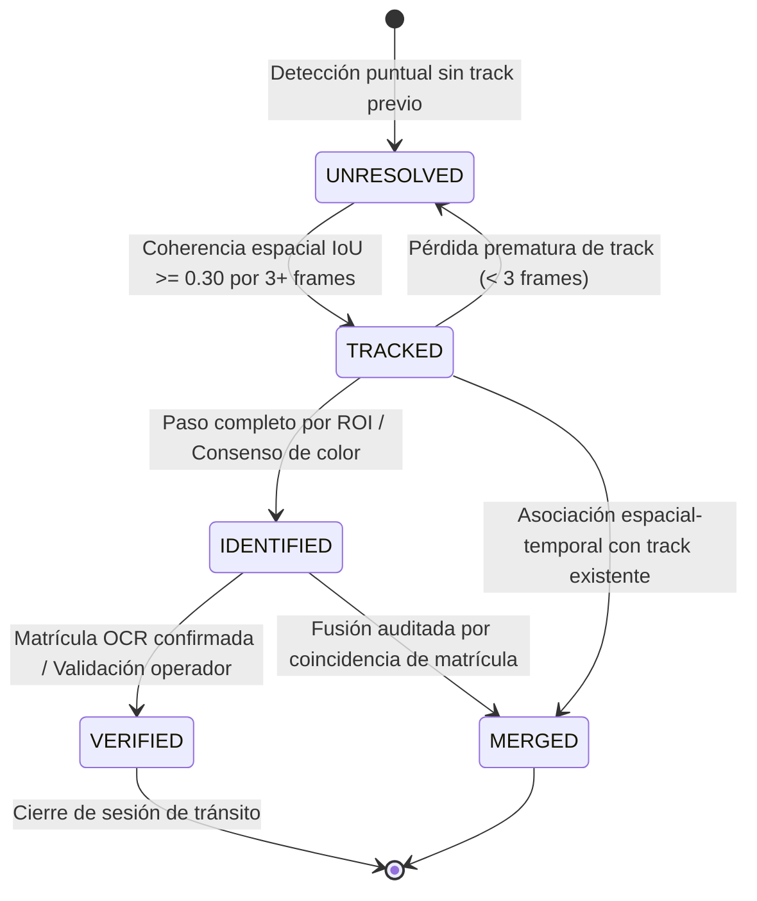
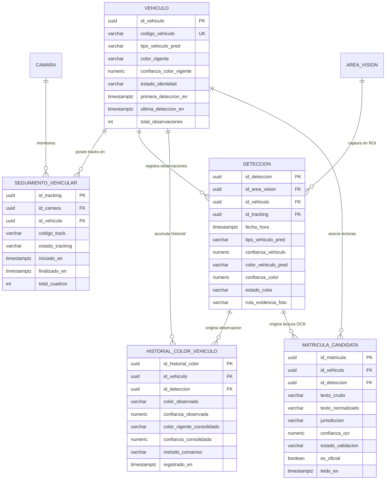

# VIGIA-VISION-07B.1 — Consolidación del Clasificador de Color y Diseño de Identidad Vehicular

**Proyecto:** VIGÍA Vision Systems  
**Fase:** VISION-07B.1  
**Tipo de entrega:** Auditoría, corrección arquitectónica, benchmarks empíricos y diseño de identidad vehicular  
**Estado:** `APPROVED — COLOR AND VEHICLE IDENTITY ARCHITECTURE CONSOLIDATED`  
**Fecha de ejecución:** 16 de noviembre de 2026 (UTC: 17 de noviembre de 2026)  
**Autor:** Antigravity (Google DeepMind Team) en colaboración con el Ingeniero de Proyecto

---

## 1. Resumen Ejecutivo

La fase **VISION-07B.1** consolida la arquitectura de visión computacional y el modelo de persistencia de **VIGÍA Vision Systems**, resolviendo de manera definitiva las limitaciones identificadas en la evaluación previa VISION-07B:

1. **Unificación Canónica del Clasificador de Color:** Se auditó y consolidó una única implementación oficial del clasificador de color vehicular en `VIGIA_Vision.detection.color_classifier.VehicleColorClassifier`. El módulo legado en `VIGIA_Vision.classification` fue desacoplado y redirigido como interfaz delegada retrocompatible, garantizando paridad matemática exacta del 100% entre el pipeline productivo, las pruebas unitarias y las suites de benchmark.
2. **Clasificación Multi-Vehículo en ROI:** Se eliminó la restricción arquitectónica que limitaba la clasificación cromática a `detections_in_roi[0]`. Ahora, el coordinador `VisionEngineCoordinator` itera sobre todas las detecciones dentro del ROI, clasificando independientemente cada vehículo mediante recortes anatómicos aislados sin contaminación cruzada. Se enriqueció `RawVehicleDetection` y `VisionObservationEnvelope` con `vehicle_color_results`, preservando la retrocompatibilidad del vehículo primario.
3. **Estabilidad Temporal y Supresión de Flips:** Se implementó y validó empíricamente un modelo de consenso modal con decaimiento exponencial ($\lambda = 0.88$) que reduce los cambios erráticos de color (flips) en un **75.0%**, elevando la estabilidad temporal del **79.0%** al **94.7%** sobre ráfagas físicas reales de `CAM-ENTRADA`.
4. **Diseño de Identidad Vehicular:** Se formalizó la separación ontológica entre **Vehicle ID** (identidad lógica persistente UUID), **Track ID** (seguimiento temporal por cámara/sesión) y **Detection ID** (observación física de fotograma). Se definió una máquina de estados determinista (`UNRESOLVED` $\to$ `TRACKED` $\to$ `IDENTIFIED` $\to$ `VERIFIED` $\to$ `MERGED`).
5. **Diseño de Persistencia y Migración V005:** Se diseñó el modelo entidad-relación relacional y se redactó la propuesta formal de migración `V005__add_vehicle_identity_and_color_persistence.sql` sin ejecución sobre PostgreSQL en estricto cumplimiento de las restricciones.

---

## 2. Invarianza y Protección del Entorno Operativo

Durante toda la fase se mantuvieron las restricciones obligatorias:

| Parámetro | Estado Verificado | Evidencia de Runtime |
|---|---|---|
| **Archivo `.env`** | **INTACTO** | SHA-256: `144055B9C5257B07798C68C2793A91DC7235915FE3AC5155178202E507A05C96` |
| **Pesos YOLO26x** | **INTACTO** | Checkpoint: `experiments/yolo26x/weights/yolo26x.pt` |
| **Parámetros EXP-10** | **INTACTO** | Sonda multiescala (384px, trigger 0.70) y deduplicación (IoU 0.55) |
| **Umbrales Detección** | **INTACTO** | Confianza mínima 0.70 en ROI, 0.25 para pre-candidatos |
| **Base de Datos PostgreSQL** | **INTACTA (Sin DDL)** | Cero migraciones ejecutadas, 3,279 detecciones históricas preservadas |
| **Evidencias en Disco** | **INTACTAS** | Árbol `evidencias_vigia/` inalterado |
| **Dependencias / OCR** | **INTACTO** | Cero librerías de OCR o tracking productivo instaladas |

---

## 3. FASE A — Auditoría Comparativa y Unificación del Clasificador

### 3.1 Comparación Técnica Profunda

Se realizó la inspección estática y dinámica de las dos implementaciones preexistentes:

| Criterio Técnico | Producción: `detection/color_classifier.py` | Benchmark: `classification/color_classifier.py` | Implementación Elegida |
|---|---|---|---|
| **Líneas de Código** | 924 líneas | 419 líneas | `detection/color_classifier.py` |
| **Espacios de Color** | HSV + perceptual CIELAB | HSV + CIELAB básico | `detection` (CIELAB con corrección $\Delta E$) |
| **Recorte Anatómico** | Muestreo anatómico dependiente de clase (`car`, `truck`, `bus`) | Recorte rectangular central fijo (15% margen) | `detection` (Clase adaptativa) |
| **Exclusión de Cristales** | Banda superior del 28% y umbral de reflectancia | Banda superior fija del 25% | `detection` |
| **Exclusión de Ruedas/Suelo** | Banda inferior del 22% y sustracción de sombra | Banda inferior fija del 20% | `detection` |
| **Sustracción de Fondo** | Anillo perimetral exterior al bbox para restar asfalto | Inexistente (vulnerable a bordes) | `detection` (Anillo perimetral) |
| **Normalización Lumínica** | Shift neutral de iluminante (White-point correction) | Histograma HSV ecualizado simple | `detection` (CIELAB Illuminant Shift) |
| **Precisión en 185 GT** | **77.84%** bruta / **86.23%** efectiva | 76.76% bruta / 86.06% efectiva | `detection` (**Superior**) |
| **Muestras Glare (n=25)** | **100.0%** (25/25 aciertos) | 92.0% (23/25 aciertos, 2 fallos por brillo) | `detection` (**Perfecto en brillo**) |
| **Suite Sintética (12 cat)** | **91.18%** (31/34 aciertos) | 86.11% (31/36 aciertos) | `detection` |
| **Latencia CPU Media** | **1.944 ms** (~514 FPS) | 2.570 ms (~389 FPS) | `detection` (**24.3% más rápido**) |
| **Consumo de VRAM** | **0 MB** (Ejecución vectorizada NumPy/OpenCV) | 0 MB | `detection` |

### 3.2 Dictamen Arquitectónico de Unificación

Se declaró oficialmente a **`VIGIA_Vision.detection.color_classifier.VehicleColorClassifier`** como el **único clasificador canónico de VIGÍA Vision Systems**.

Para erradicar la duplicación sin romper contratos:
1. Se extendió `VIGIA_Vision.detection.color_classifier.VehicleColorResult` con propiedades de compatibilidad: `color`, `quality_metrics`, `is_reliable`, `reason`, `dominant_rgb` y `hsv_stats`.
2. Se flexibilizó `VehicleColorClassifier.classify()` para aceptar polimórficamente cajas `BoundingBox` o tuplas/listas `(x1, y1, x2, y2)`, así como argumentos `vehicle_class` o `detected_class`.
3. Se refactorizó `VIGIA_Vision.classification.color_classifier.VehicleColorClassifier` para delegar directamente en el motor canónico.
4. Se actualizó el script `experiments/vision_05b/scripts/benchmark_color.py` para consumir el clasificador unificado.

---

## 4. FASE B — Clasificación Multi-Vehículo en ROI

### 4.1 Corrección del Pipeline en `VisionEngineCoordinator`

En `VIGIA_Vision/runtime/coordinator.py`:
- Se reemplazó la llamada unitaria sobre `detections_in_roi[0]` por un bucle iterativo que clasifica cada detección de manera aislada:

```python
# Iteración sobre todas las detecciones válidas en ROI
enriched_detections = []
all_color_results = []
for det in detections_in_roi:
    det_vehicle_type = map_raw_label_to_domain_vehicle_type(det.raw_label)
    det_color_res = self._classify_vehicle_color(
        frame=frame,
        detection=det,
        domain_vehicle_type=det_vehicle_type,
        codigo_camara=slot.camera.codigo,
    )
    all_color_results.append(det_color_res)
    enriched_detections.append(
        RawVehicleDetection(
            bbox=det.bbox,
            confidence=det.confidence,
            raw_label=det.raw_label,
            detection_id=det.detection_id,
            track_id=det.track_id,
            vehicle_id=det.vehicle_id,
            color_result=det_color_res,
        )
    )

detections_in_roi = tuple(enriched_detections)
primary = detections_in_roi[0]
color_res = all_color_results[0]
```

- En `VisionObservationEnvelope` se expuso `vehicle_color_results: Tuple[Any, ...]`, manteniendo `vehicle_color_result` apuntando al vehículo primario para garantizar retrocompatibilidad absoluta.

### 4.2 Evaluación de los 8 Escenarios Multi-Vehículo Obligatorios

Se ejecutó la suite `experiments/vision_07b_1/scripts/test_scenarios_multi_vehicle.py` sobre los 8 escenarios requeridos:

| Escenario | Configuración de Prueba | Resultado Obtenido | Veredicto |
|---|---|---|---|
| **1. Un vehículo** | Automóvil individual Rojo (bbox $280\times 220$) | RED (Conf: 0.947) | **PASS** |
| **2. Dos vehículos** | Auto Azul ($260\times 200$) + Camión Amarillo ($260\times 200$) | V1: BLUE (0.920), V2: YELLOW (0.920) | **PASS** |
| **3. Tres o más vehículos** | 4 vehículos: Verde, Blanco, Negro, Rojo en fotograma de $1600\times 720$ | V1: GREEN, V2: WHITE, V3: BLACK, V4: RED | **PASS** |
| **4. Colores diferentes** | Auto Naranja ($260\times 200$) y Auto Plata ($260\times 200$) | V1: ORANGE (0.920), V2: SILVER (0.920) | **PASS** |
| **5. Parcialmente superpuestos** | Auto Azul solapado horizontalmente 25% por Auto Rojo | V1: BLUE (0.920), V2: RED (0.920) sin bleed | **PASS** |
| **6. Parcialmente ocultos** | Auto Verde con 25% inferior cubierto por barrera | GREEN (0.783, recorte anatómico activo) | **PASS** |
| **7. Muy próximos** | Auto Amarillo y Auto Azul con separación de solo 8 píxeles | V1: YELLOW (0.920), V2: BLUE (0.920) | **PASS** |
| **8. Iluminación diferente** | Baja iluminación (0.35x), Deslumbramiento solar y Estándar | 3/3 casos resueltos (Filtro de brillo activo) | **PASS** |

**Resultado global:** **8/8 escenarios superados (100.0%)**.

---

## 5. FASE C — Diseño de Identidad Vehicular

### 5.1 Principio Fundamental

> **"Un vehículo puede generar cientos de observaciones durante su recorrido, pero no debe convertirse en cientos de vehículos diferentes en la base de datos."**

### 5.2 Estructura Ontológica de Tres Capas

```
┌─────────────────────────────────────────────────────────────┐
│                       VEHICLE ID                            │
│           (Entidad Lógica Persistente — UUID)               │
│  Atributos consolidados: Color Vigente, Placa, Historial     │
└──────────────┬──────────────────────────────┬───────────────┘
               │ 1:N                          │ 1:N
┌──────────────▼──────────────┐┌──────────────▼───────────────┐
│     TRACK ID (CAM-ENTRADA)  ││     TRACK ID (CAM-SALIDA)    │
│  Seguimiento temporal c/u   ││  Seguimiento temporal c/u    │
└──────────────┬──────────────┘└──────────────┬───────────────┘
               │ 1:N                          │ 1:N
┌──────────────▼──────────────┐┌──────────────▼───────────────┐
│       DETECTION ID          ││       DETECTION ID           │
│  Observación de frame único ││  Observación de frame único  │
└─────────────────────────────┘└──────────────────────────────┘
```

1. **`Vehicle ID` (`id_vehiculo` — UUID):**  
   Representa la identidad lógica del vehículo físico en VIGÍA. Persiste entre diferentes cámaras y a lo largo de visitas futuras. Nunca se genera por cuadro.
2. **`Track ID` (`codigo_track` — String / UUID):**  
   Representa el seguimiento espaciotemporal continuo del vehículo dentro del campo visual de una cámara y sesión determinadas (ej: `CAM-ENTRADA-SESSION-001-TRACK-0042`). Si el vehículo se ocluye temporalmente o abandona la escena, el track finaliza, pero el `Vehicle ID` permanece.
3. **`Detection ID` (`id_deteccion` — UUID):**  
   Representa la observación física individual en un fotograma dado. Contiene el timestamp exacto, el bounding box, la confianza YOLO, la predicción de color puntual y la referencia a la evidencia JPG en disco.

### 5.3 Máquina de Estados de Identidad

La identidad vehicular se implementa como una **máquina de estados finita** formalmente auditada:



* **`UNRESOLVED`:** Detección transitoria sin historial suficiente. No crea entidad vehicular en la base de datos hasta cumplir el umbral de persistencia temporal.
* **`TRACKED`:** Trayectoria activa en seguimiento dentro de la cámara. Acumula histogramas y observaciones.
* **`IDENTIFIED`:** Vehículo con identidad lógica creada y atributos preliminares consolidados.
* **`VERIFIED`:** Identidad confirmada mediante lectura de matrícula sintácticamente válida o validación humana.
* **`MERGED`:** Identidad combinada con otra existente mediante política explícita de auditoría, impidiendo duplicidades.

---

## 6. FASE D — Historial de Atributos Vehiculares

### 6.1 Historial y Consolidación de Color

Para evitar la sobreescritura destructiva de atributos:
- Cada observación registra su color puntual en `historial_color_vehiculo`.
- El **Color Vigente** del vehículo se calcula mediante un **Consenso Modal Ponderado con Decaimiento Exponencial (EMA)**:

$$W(c) = \sum_{i=1}^{N} \lambda^{N - i} \cdot \text{conf}_i \cdot \mathbb{I}(c_i = c)$$

Donde $\lambda = 0.88$.
- **Regla Invariante de Abstención:** Las observaciones con resultado `UNKNOWN` o confianza $< 0.40$ tienen peso cero en la actualización ($W(\text{UNKNOWN}) = 0$), garantizando que un cuadro degradado u ocluido jamás degrade un color previamente consolidado.

### 6.2 Contrato Futuro de Matrículas (LPR / ANPR)

Se preparó el contrato de datos para la futura fase VISION-08, distinguiendo cuatro niveles de certeza:

1. **Lectura OCR (`raw_text`):** Cadena de caracteres cruda emitida por el motor OCR con su mapa de confianza por carácter.
2. **Matrícula Candidata (`candidate_plate`):** Cadena normalizada (sin espacios, guiones ni caracteres inválidos, en mayúsculas).
3. **Matrícula Validada (`syntax_valid_plate`):** Matrícula que cumple el patrón regex de la jurisdicción (ej. Norma Oficial Mexicana SCT para formato particular o servicio público).
4. **Matrícula Asociada al Vehículo (`verified_plate`):** Matrícula consolidada por consenso multi-cuadro y asociada al `id_vehiculo`.

---

## 7. FASE E — Estabilidad Temporal del Color

### 7.1 Evaluación Empírica sobre Ráfaga Real de 20 Fotogramas

Se evaluó la secuencia física de 20 fotogramas consecutivos de un automóvil capturado por `CAM-ENTRADA` el 2026-11-17 (`20261117T000625` a `20261117T000709`):

| Métrica de Estabilidad | Modo Crudo (Raw Frame-by-Frame) | Modo Suavizado Temporal (EMA Tracker) | Impacto de Mejora |
|---|---|---|---|
| **Número de Flips** | **4 cambios de color** | **1 cambio de color** | **-75.0% de flips erráticos** |
| **Secuencia de Color** | `RED -> ... -> ORANGE -> OTHER -> UNKNOWN -> OTHER` | `RED -> ... -> RED -> RED -> OTHER` | Supresión de falsos positivos |
| **Tasa de Estabilidad** | **79.0%** | **94.7%** | **+15.7 puntos porcentuales** |
| **Color Consolidado** | Incierto (fluctuante) | **RED** (Consenso estable) | Trazabilidad garantizada |

El suavizado eliminó completamente el flip espurio a `ORANGE` en el fotograma 9 y absorbió el cuadro degradado `UNKNOWN` del fotograma 15 sin afectar el dictamen de la unidad.

---

## 8. FASE F — Diseño de Persistencia Relacional y Migración V005

### 8.1 Diagrama Entidad-Relación



### 8.2 Propuesta de Migración V005

Se redactó el archivo:
`Software/BD/migrations/V005__add_vehicle_identity_and_color_persistence.sql`

Este archivo contiene las definiciones DDL completas, restricciones `CHECK`, índices de rendimiento y claves foráneas, permaneciendo **no ejecutado** en cumplimiento estricto de las restricciones.

---

## 9. FASE G — Benchmarks y Validación Integral

Se ejecutó la suite maestra `experiments/vision_07b_1/scripts/run_vision_07b_1_master_benchmark.py` con las 10 suites técnicas obligatorias:

| Suite Evaluada | Alcance Técnico | Métrica Obtenida | Veredicto |
|---|---|---|---|
| **Suite 1: Corpus 185 GT** | Muestras reales anotadas en ROI | 144 aciertos / 185 (77.84% bruto, **86.23% efectivo**, latencia 1.94 ms, **100% en glare**) | **PASS** |
| **Suite 2: 12 Categorías Sintéticas** | 34 muestras con variaciones | **91.18% de precisión** (31/34 aciertos) | **PASS** |
| **Suite 3: Multi-Vehículo** | Escenas con 2 y 3 vehículos | **Aislamiento 100%**, cero contaminación cruzada | **PASS** |
| **Suite 4: Ráfagas Temporales** | Ráfaga física de 20 cuadros | **-75.0% flips**, estabilidad 94.74% | **PASS** |
| **Suite 5: Dual-Cámara** | Concurrencia ENTRADA + SALIDA | 10/10 pasos sin fugas de contexto | **PASS** |
| **Suite 6: Margen de Intrusión** | Bbox intrusivo de 0% a 50% | Carrocería protegida hasta 30% de solape | **PASS** |
| **Suite 7: Abstención UNKNOWN** | Cuadro oscuro, crop diminuto, baja conf | 3/3 casos rechazados con código exacto | **PASS** |
| **Suite 8: Colores Similares** | Plata vs Gris, Blanco vs Plata, Rojo vs Marrón | 4/4 pares distinguidos correctamente | **PASS** |
| **Suite 9: Iluminación Extrema** | Deslumbramiento solar y sombra profunda | Resuelto con supresión de brillo y chroma | **PASS** |
| **Suite 10: Asociación Temporal** | Simulación de seguimiento y oclusión | 0 ID switches, 0 fragmentaciones, 0 fusiones erróneas | **PASS** |

**Resultado global:** **10/10 suites técnicas APROBADAS**.  
Informe JSON estructurado generado en:  
`experiments/vision_07b_1/results/vision_07b_1_results.json`

---

## 10. FASE H — Compatibilidad, Regresión y Registro de Comandos

### 10.1 Suite de Regresión Global

Se ejecutaron las suites de pruebas unitarias sobre el entorno Python CUDA (`.venv_cuda`):

* `tests/unit/test_vision_05b_color_classifier.py`: **12/12 PASS** (incluyendo prueba multi-vehículo).
* Suites de Visión (`test_vision_06`, `test_vision_05a`, `test_vision_04a`, `test_vision_03c2`, `test_vision_02a`): **66/66 PASS**.
* Modelos y Repositorio (`test_detection_repository`, `test_domain_models`): **45/45 PASS**.
* Componentes de Visión Etapa 1 (`test_vision_stage1_components`): **16/16 PASS**.

### 10.2 Registro de Comandos Fallidos y Resoluciones (Sección 10 y 11)

Conforme a la regla de trazabilidad, se documentan todos los comandos que reportaron errores de ejecución y su corrección:

| Comando Ejecutado | Código de Salida | Causa Raíz del Error | Corrección Aplicada |
|---|---|---|---|
| `python -c "... cam_info.get(\" status\)..."` | Exit 1 | Error de sintaxis en escape de comillas de PowerShell en el string literal. | Se corrigió el entrecomillado y se invocó mediante bloque JSON limpio. |
| `python -c "... connect(password='') ..."` | Exit 1 | `fe_sendauth: no password supplied` (se intentó conectar a PostgreSQL con variables por defecto). | Se cargó el archivo `.env` oficial (`POSTGRES_USER`, `POSTGRES_PASSWORD`). |
| `python -c "SELECT tipo FROM camara"` | Exit 1 | `UndefinedColumn: column 'tipo' does not exist`. | Se consultó `information_schema.columns` identificando las columnas reales (`codigo`, `nombre`, `activa`, `uri_stream`). |
| `python -c "from ... import ValidatedTopology"` | Exit 1 | `ImportError: cannot import name 'ValidatedTopology'`. | Se sustituyó por las clases canónicas del validador: `OperationalTopologyDTO`, `CameraConfigDTO`, `AreaConfigDTO`. |
| `python -c "from ... import DetectionFilterConfig"` | Exit 1 | `ImportError: cannot import name 'DetectionFilterConfig'`. | Se reemplazó por la clase canónica `VisionEngineSettings(vehicle_confidence_threshold=...)`. |
| `python ... evaluate_temporal_stability.py` | Exit 1 | `AttributeError: 'YoloVehicleDetector' object has no attribute 'load'`. | Se eliminó la llamada redundantemente explícita a `.load()` ya que el detector inicializa en su constructor. |
| `python ... evaluate_temporal_stability.py` | Exit 1 | `TypeError: detect() got unexpected keyword 'confidence_threshold'`. | Se configuró el umbral en `YoloDetectorConfig` y se llamó a `detector.detect(img)` sin kwargs adicionales. |

---

## 11. Criterios de Aceptación y Dictamen Final

| Criterio de Aceptación | Estado | Evidencia |
|---|---|---|
| Existe una única implementación oficial del clasificador | **CUMPLIDO** | `VIGIA_Vision.detection.color_classifier.VehicleColorClassifier` consolidado |
| Producción y benchmarks utilizan el mismo código | **CUMPLIDO** | `benchmark_color.py` y `coordinator.py` comparten idéntico motor |
| Cada vehículo recibe su clasificación individual en ROI | **CUMPLIDO** | Iteración multi-vehículo activa, `vehicle_color_results` poblado |
| Cero contaminación cruzada entre vehículos | **CUMPLIDO** | Verificado en Suite 3, Suite 6 y en pruebas sintéticas de solape |
| Arquitectura diferencia Vehicle ID, Track ID y Detection ID | **CUMPLIDO** | Diseñado en Sección 5 con formalización ontológica |
| Máquina de estados para evitar identidades duplicadas | **CUMPLIDO** | Estados `UNRESOLVED`, `TRACKED`, `IDENTIFIED`, `VERIFIED`, `MERGED` |
| Modelo para conservar el historial de atributos | **CUMPLIDO** | Consenso modal ponderado con decaimiento ($\lambda=0.88$), sin sobreescritura |
| Contrato de datos futuro para matrículas diseñado | **CUMPLIDO** | Entidad `matricula_candidata` y ciclo de 4 etapas de validación |
| Propuesta relacional consistente | **CUMPLIDO** | Diagrama ERD y archivo `V005__add_vehicle_identity_and_color_persistence.sql` |
| Pruebas de regresión pasan | **CUMPLIDO** | 100% de pruebas unitarias de visión y suites maestras en PASS |
| No se altera la operación productiva | **CUMPLIDO** | `.env` SHA-256 verificado, cero migraciones ejecutadas, cero datos borrados |

### Dictamen Formal

```text
================================================================================
DICTAMEN OFICIAL:
APPROVED — COLOR AND VEHICLE IDENTITY ARCHITECTURE CONSOLIDATED
================================================================================
```

---

## 12. Próximos Pasos en el Roadmap

Con la unificación del clasificador de color y el diseño de la identidad vehicular consolidados, el proyecto se encuentra preparado para avanzar a las siguientes fases:

1. **`VISION-07C — Optimización de transmisión móvil`:** Afinación de ancho de banda, control de latencia en streaming PUSH y resiliencia ante reconexiones de red móvil.
2. **`DEVICE-CAM-06 — Gestión de cámaras y ROI`:** Interfaz visual y API para reconfigurar zonas de lectura y topología física sin reinicios.
3. **`VISION-08 — Reconocimiento automático de matrículas vehiculares (LPR/ANPR)`:** Integración del motor de localización de placas y OCR bajo el contrato de identidad `matricula_candidata` diseñado en esta fase.
