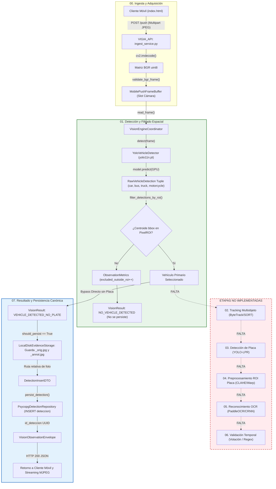
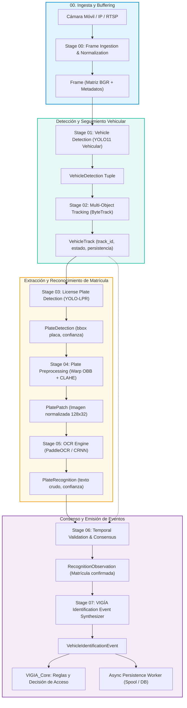
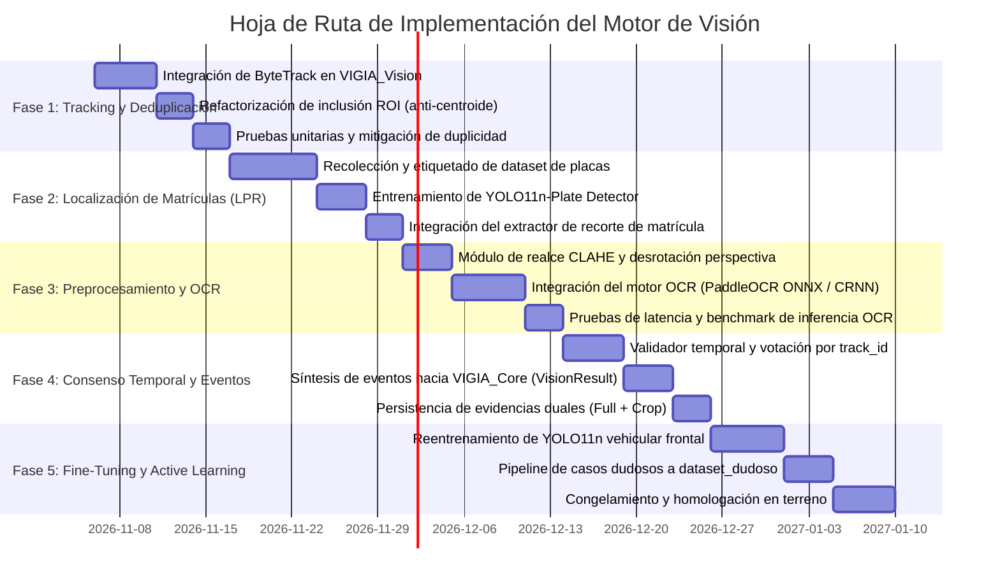

# VIGIA-VISION-AUDIT-01 — Auditoría Arquitectónica del Motor de Visión Artificial

**VIGÍA Vision Systems — Subsistema de Percepción Visual e Inteligencia Artificial**  
**Fecha de Emisión:** 05 de Noviembre de 2026  
**Auditor Responsable:** Antigravity AI — Advanced Agentic Coding Pair Programmer  
**Estado:** `DICTAMEN TÉCNICO FORMAL — AUDITORÍA ARQUITECTÓNICA CERRADA`  
**Modalidad de Auditoría:** `READ-ONLY INSPECTION (Inspección Pasiva Estricta)`  
**Entorno de Referencia:** Host Windows 11 / AMD Ryzen 9 7940HX / NVIDIA GeForce RTX 4050 Laptop GPU (6140 MB VRAM)  
**Documentos Normativos Vinculados:**  
- [`Docs/BASELINE_V1.1.md`](file:///C:/GEST.PROY.TI/Software/VIGIA_Vision_Systems/Docs/BASELINE_V1.1.md)  
- [`Docs/02_arquitectura_del_sistema.md`](file:///C:/GEST.PROY.TI/Software/VIGIA_Vision_Systems/Docs/02_arquitectura_del_sistema.md)  
- [`Docs/fase_1/DOC-01_modelos_dominio.md`](file:///C:/GEST.PROY.TI/Software/VIGIA_Vision_Systems/Docs/fase_1/DOC-01_modelos_dominio.md)  
- [`Docs/fase_1/DOC-03_asignacion_validacion_posiciones.md`](file:///C:/GEST.PROY.TI/Software/VIGIA_Vision_Systems/Docs/fase_1/DOC-03_asignacion_validacion_posiciones.md)  
- [`Docs/fase_1/DOC-04_contratos_entre_modulos.md`](file:///C:/GEST.PROY.TI/Software/VIGIA_Vision_Systems/Docs/fase_1/DOC-04_contratos_entre_modulos.md)  
- [`Docs/fase_1/VIGIA-VISION-OPT-00_METODOLOGIA_OPTIMIZACION.md`](file:///C:/GEST.PROY.TI/Software/VIGIA_Vision_Systems/Docs/fase_1/VIGIA-VISION-OPT-00_METODOLOGIA_OPTIMIZACION.md)  
- [`Docs/fase_1/VIGIA-OPT-CUDA-01_IMPLEMENTACION.md`](file:///C:/GEST.PROY.TI/Software/VIGIA_Vision_Systems/Docs/fase_1/VIGIA-OPT-CUDA-01_IMPLEMENTACION.md)  
- [`Docs/fase_1/VIGIA-OPT-CUDA-02_INTEGRACION.md`](file:///C:/GEST.PROY.TI/Software/VIGIA_Vision_Systems/Docs/fase_1/VIGIA-OPT-CUDA-02_INTEGRACION.md)  
- [`Docs/fase_1/VIGIA-OPT-RECT-01_EVALUACION.md`](file:///C:/GEST.PROY.TI/Software/VIGIA_Vision_Systems/Docs/fase_1/VIGIA-OPT-RECT-01_EVALUACION.md)  
- [`Docs/fase_1/VIGIA-OPT-MULTI-01_EVALUACION.md`](file:///C:/GEST.PROY.TI/Software/VIGIA_Vision_Systems/Docs/fase_1/VIGIA-OPT-MULTI-01_EVALUACION.md)  
- [`Docs/fase_1/VIGIA-VISION-OPT-05_ARQUITECTURA_PERSISTENCIA_ASINCRONA.md`](file:///C:/GEST.PROY.TI/Software/VIGIA_Vision_Systems/Docs/fase_1/VIGIA-VISION-OPT-05_ARQUITECTURA_PERSISTENCIA_ASINCRONA.md)  

---

## 1. Resumen Ejecutivo

El presente informe constituye la auditoría técnica y arquitectónica exhaustiva del motor de visión artificial de **VIGÍA Vision Systems**, realizada bajo la directiva de inspección pasiva de sólo lectura (**READ-ONLY**). Su propósito es diagnosticar con precisión el estado real del código, identificar las capacidades actualmente operativas, señalar las deficiencias arquitectónicas y los cuellos de botella existentes, y establecer una arquitectura objetivo técnica y matemáticamente justificada para la evolución hacia un pipeline modular de detección vehicular y reconocimiento automático de matrículas (ALPR/ANPR).

### Dictamen General de Estado
El motor de visión de VIGÍA se encuentra en un estado funcional de **Etapa 1 / Fase 1 avanzada**:
1. **Detección vehicular operativa:** La detección por fotograma aislado basada en **YOLO11n** está plenamente implementada, desacoplada en `VIGIA_Vision.detection.yolo_detector` y acelerada por hardware en GPU NVIDIA RTX 4050 (`cuda:0`, latencia de inferencia de $7.18\text{ ms}$).
2. **Ingesta y topología robustas:** El subsistema de ingesta móvil HTTP push, la validación estricta de fotogramas BGR uint8 (`validate_bgr_frame`) y la verificación fail-fast de topología operativa (Reglas R1–R8 de DOC-03) operan con estabilidad demostrada y 284 pruebas unitarias aprobadas.
3. **Ausencia total de ALPR/ANPR y Tracking:** No existe implementación alguna de seguimiento vehicular temporal (tracking multiobjeto), detección de placas de matrícula, preprocesamiento de imagen de placa, motores OCR (ópticos o neuronales) ni validación temporal entre fotogramas. Todo fotograma con vehículo válido en ROI produce invariablemente el estado `VEHICLE_DETECTED_NO_PLATE`.
4. **Dependencia de modelo genérico sin reentrenamiento:** El único modelo presente en el repositorio es el checkpoint oficial `yolo11n.pt` preentrenado sobre el conjunto de datos COCO (80 clases generales). No existe ningún entrenamiento personalizado para vehículos de la región ni para matrículas vehiculares.
5. **Inexistencia de datasets anotados:** El repositorio carece de conjuntos de datos de entrenamiento, validación o prueba con anotaciones. Se registran 848 capturas JPEG crudas y anotadas en `evidencias_vigia/`, pero tienen 0 etiquetas y 0 metadatos de verdad campo (*ground truth*).
6. **Cuellos de botella en persistencia síncrona:** A pesar de que la inferencia en GPU toma $7.18\text{ ms}$, la persistencia síncrona de evidencias en disco NVMe y el commit transaccional en PostgreSQL retienen el hilo de procesamiento durante $\sim 56\text{ ms}$, limitando la capacidad de ingesta global.

---

## 2. Estructura Real del Repositorio

La inspección física del sistema de archivos revela la coexistencia de dos arquitecturas de visión en el workspace: el subsistema formal y desacoplado [`VIGIA_Vision`](file:///C:/GEST.PROY.TI/Software/VIGIA_Vision_Systems/VIGIA_Vision) (desarrollado para la arquitectura canónica de VIGÍA) y un prototipo previo monolítico denominado [`VR_Semaforo`](file:///C:/GEST.PROY.TI/Software/VIGIA_Vision_Systems/VR_Semaforo) (mantenido como proyecto de referencia y banco de pruebas de semaforización adaptativa).

```text
Software/
├── BD/                                     # Gestión de Base de Datos PostgreSQL 16
│   ├── migrations/                         # Migraciones Flyway/SQL (V001 a V004)
│   │   ├── V001__baseline_schema.sql       # Tablas base: camara, area_vision, deteccion, evento_acceso
│   │   ├── V002__triggers.sql              # Triggers de auditoría e integridad
│   │   ├── V003__seed_data.sql             # Datos semilla iniciales
│   │   └── V004__enrolamiento_camaras_qr.sql # Enrolamiento móvil y emparejamiento
│   └── scripts/
│       └── provision_topology.py           # Aprovisionamiento de topología operativa (R1-R8)
│
├── VIGIA_Vision_Systems/
│   ├── yolo11n.pt                          # Pesos preentrenados Ultralytics YOLO11n (5.61 MB)
│   ├── dataset_dudoso/                     # [VACÍO - 0 archivos] Destino de shadow mode de VR_Semaforo
│   ├── evidencias_vigia/                   # [848 archivos .jpg] Evidencias de ejecuciones previas
│   │   ├── 20261101/                       # Evidencias históricas organizadas por fecha y cámara
│   │   ├── 20261102/
│   │   ├── 20261104/
│   │   └── 20261105/                       # Pruebas multicámara recientes (CAM-ENTRADA, CAM-SALIDA)
│   │
│   ├── VIGIA_Vision/                       # Motor formal de visión artificial
│   │   ├── __init__.py                     # Exportaciones públicas desacopladas
│   │   ├── capture/
│   │   │   ├── sources.py                  # Adaptadores IFrameCaptureSource: OpenCV y MobilePushFrameBuffer
│   │   │   └── registry.py                 # CameraSourceRegistry acoplado a OperationalTopologyDTO
│   │   ├── config/
│   │   │   ├── engine_settings.py          # Configuración inmutable del motor (VisionEngineSettings)
│   │   │   ├── psycopg_topology_repository.py # Repositorio de lectura SQL para topología
│   │   │   └── topology_validator.py       # Validador de topología fail-fast (Reglas R1 a R8)
│   │   ├── detection/
│   │   │   ├── models.py                   # Dataclasses inmutables: BoundingBox, RawVehicleDetection, Envelope
│   │   │   ├── roi_and_preprocess.py       # Validación de fotograma BGR y proyección geométrica ROI
│   │   │   └── yolo_detector.py            # YoloVehicleDetector (Ultralytics YOLO, lazy loading, CUDA auto)
│   │   ├── runtime/
│   │   │   ├── coordinator.py              # VisionEngineCoordinator: ciclo de vida, detección y persistencia
│   │   │   └── evidence_storage.py         # LocalDiskEvidenceStorage: guardado dual orig/annot
│   │   └── async_persistence/              # Piloto desacoplado de persistencia asíncrona (OPT-05)
│   │       ├── models.py                   # Contratos inmutables de tarea (PersistenceTaskDTO, TaskStatus)
│   │       ├── queue_manager.py            # Colas en memoria prioritarias por cámara
│   │       ├── spool.py                    # Directorio de spooling WAL en disco local
│   │       ├── worker_pool.py              # Pool de hilos de persistencia desacoplados
│   │       ├── reconciler.py               # Reconciliación ante caídas de servicio
│   │       └── evidence_writer.py          # Escritor transaccional de imágenes
│   │
│   ├── VIGIA_Core/                         # Núcleo de dominio y coordinación lógica
│   │   ├── domain/
│   │   │   ├── vision_result.py            # Contrato canónico de salida VisionResult y VisionStatus
│   │   │   ├── access_decision.py          # Modelos de decisión de acceso (AccessResult, AccessState)
│   │   │   └── pairing.py                  # Dominio de emparejamiento de dispositivos móviles
│   │   └── repository/
│   │       ├── detection_repository.py     # IDetectionRepository y PsycopgDetectionRepository
│   │       └── pairing_repository.py       # Repositorio de tokens y dispositivos enrolados
│   │
│   ├── VIGIA_API/                          # Puerta de enlace HTTP / REST
│   │   └── ingest_service.py               # Servidor Flask multihilo: POST /push, streaming MJPEG y RBAC
│   │
│   ├── VIGIA_Dashboard/                    # Interfaz gráfica de supervisión y móvil
│   │   ├── mobile/
│   │   │   └── index.html                  # Cliente web móvil para captura de cámara
│   │   └── web/                            # Dashboard administrativo y de caseta
│   │
│   ├── VR_Semaforo/                        # Prototipo previo / Proyecto de referencia (Intacto)
│   │   ├── app.py                          # Aplicación web Flask de semáforo
│   │   ├── yolo11n.pt                      # Copia local idéntica de pesos YOLO11n
│   │   ├── arduino/
│   │   │   └── arduino_service.py          # Control de semáforo físico por puerto serie
│   │   ├── traffic/
│   │   │   └── analyzer.py                 # Lógica de cálculo de densidad de tráfico
│   │   └── vision/
│   │       ├── camera.py                   # Captura mediante cv2.VideoCapture directo
│   │       ├── pipeline.py                 # Adaptador de pipeline a VisionResult
│   │       ├── processor.py                # contar_carritos (inferencia monolítica, Shadow Mode a dataset_dudoso)
│   │       └── service.py                  # Coordinación de captura PC y análisis de tráfico
│   │
│   ├── tests/                              # Suite automatizada de pruebas (284 pruebas)
│   │   ├── unit/                           # Pruebas unitarias de componentes aislados
│   │   │   ├── test_yolo_detector.py       # Pruebas de lazy loading, CUDA resolution y mocking
│   │   │   ├── test_vision_stage1_components.py # Pruebas de ROI, evidencias y validación topológica
│   │   │   ├── test_detection_repository.py # Pruebas de DTOs e inserción relacional
│   │   │   └── test_async_persistence_pilot.py # Pruebas del subsistema asíncrono
│   │   └── integration/                    # Pruebas de integración E2E con PostgreSQL
│   │       └── test_vision_engine_operational_integration.py # Flujo completo con hardware real
│   │
│   ├── scripts/                            # Utilidades auxiliares y scripts de benchmark
│   │   ├── run_cuda_benchmark.py           # Benchmark de aceleración CUDA
│   │   ├── run_rect_benchmark.py           # Benchmark comparativo rect=False vs rect=True
│   │   └── run_multi_camera_benchmark.py   # Benchmark de concurrencia y contención multicámara
│   │
│   ├── Docs/                               # Documentación técnica, metodológica y de auditoría
│   │   ├── fase_1/                         # Informes de optimización, caracterización y auditorías
│   │   └── fase_vision/                    # [NUEVO] Informes especializados del motor de visión
│   │
│   ├── .venv/                              # Entorno virtual base (Python 3.11, PyTorch CPU 2.14.1)
│   └── .venv_cuda/                         # Entorno virtual acelerado (Python 3.11, PyTorch CUDA 2.6.0+cu124)
```

---

## 3. Reconstrucción del Flujo de Ejecución Existente

El flujo real implementado en VIGÍA Vision Systems abarca desde la captura del fotograma físico hasta su persistencia en disco y base de datos relacional. 

### Diagrama de Secuencia del Flujo Real Actual



### Tabla Detallada por Etapa de Ejecución

| Etapa | Módulo Responsable | Entrada | Salida | Dependencias | Frecuencia | Manejo de Errores | Consideraciones de Desempeño |
| :--- | :--- | :--- | :--- | :--- | :--- | :--- | :--- |
| **00. Captura e Ingesta** | `VIGIA_API.ingest_service`<br>`VIGIA_Vision.capture.sources` | Petición HTTP multipart con archivo binario de imagen (JPEG). | Objeto `CaptureReadResult` con matriz BGR `uint8` y secuencia monótona. | Flask, OpenCV (`cv2.imdecode`), `MobilePushFrameBuffer`. | Por fotograma recibido ($\sim 1\text{ Hz}$ por cámara). | Si la imagen es corrupta o vacía, responde HTTP 422 (`DECODE_ERROR`). Si expira TTL, retorna `CAMERA_ERROR`. | Decodificación JPEG en CPU toma $\sim 1.5 - 2.5\text{ ms}$. Buffer $O(1)$ descarta fotogramas viejos sin fugas de memoria. |
| **01. Detección Vehicular** | `VIGIA_Vision.detection.yolo_detector`<br>`VIGIA_Vision.detection.roi_and_preprocess` | Fotograma BGR `(H, W, 3)` validado y configuración `PixelROI`. | `Tuple[RawVehicleDetection, ...]` dentro del ROI y métricas de observación. | Ultralytics YOLO, PyTorch CUDA (`cuda:0`), NumPy. | Por fotograma nuevo procesado. | Si falla la GPU o el modelo, captura excepción y lanza `InferenceError`, produciendo `VISION_ERROR`. | Inferencia en GPU RTX 4050 toma $7.18\text{ ms}$. Filtrado por centroide en CPU toma $< 0.1\text{ ms}$. |
| **02. Tracking Multiobjeto** | **NO IMPLEMENTADO** | Detecciones por fotograma. | Trayectorias con `track_id` persistente y vector de velocidad. | Ninguna presente. | N/A | No aplica. | **Etapa Faltante:** Impide distinguir si 10 fotogramas consecutivos corresponden al mismo vehículo o a 10 autos distintos. |
| **03. Detección de Placa** | **NO IMPLEMENTADO** | Recorte del vehículo o fotograma completo. | `BoundingBox` de la matrícula y confianza de localización. | Ninguna presente. | N/A | No aplica. | **Etapa Faltante:** `plate_located` se fija permanentemente en `False`. |
| **04. Preprocesamiento Placa** | **NO IMPLEMENTADO** | Recorte matricial de la placa. | Imagen rectificada, normalizada en contraste y binarizada. | Ninguna presente. | N/A | No aplica. | **Etapa Faltante:** No hay corrección de perspectiva ni realce para placas oscuras o con reflejo. |
| **05. Reconocimiento OCR** | **NO IMPLEMENTADO** | Recorte preprocesado de placa. | Cadena de texto alfanumérica y confianza OCR. | Ninguna presente. | N/A | No aplica. | **Etapa Faltante:** `plate_text` y `plate_confidence` son permanentemente `None`. |
| **06. Validación Temporal** | **NO IMPLEMENTADO** | Secuencia de lecturas OCR asociadas al mismo `track_id`. | Matrícula final consolidada por consenso y reglas sintácticas. | Ninguna presente. | N/A | No aplica. | **Etapa Faltante:** No hay votación de caracteres ni rechazo de lecturas esporádicas aberrantes. |
| **07. Evento y Persistencia** | `VIGIA_Vision.runtime.coordinator`<br>`VIGIA_Core.repository.detection_repository` | Detección primaria, rutas de evidencia y topología activa. | `id_deteccion` (UUID) en tabla SQL `deteccion` y archivo dual en disco. | `LocalDiskEvidenceStorage`, `PsycopgDetectionRepository`, PostgreSQL. | Evento calificado (con debounce de $3\text{ s}$ o flag explícito). | Si falla la base de datos, ejecuta limpieza compensatoria borrando los archivos JPEG guardados (`rollback_evidence`). | **Cuello de Botella:** La escritura dual JPEG NVMe ($\sim 30\text{ ms}$) y el INSERT SQL ($\sim 18\text{ ms}$) se ejecutan síncronamente en el hilo HTTP. |

---

## 4. Inventario Exhaustivo de Componentes

### Tabla de Responsabilidad, Reutilización y Rediseño

| Componente / Archivo | Responsabilidad Actual | Estado Arquitectónico | Diagnóstico y Recomendación |
| :--- | :--- | :--- | :--- |
| `VIGIA_Vision.detection.yolo_detector.YoloVehicleDetector` | Encapsular Ultralytics YOLO, lazy loading, resolución `auto/cuda/cpu` y filtrado COCO. | **IMPLEMENTADO** | **REUTILIZABLE AL 100%**. Posee diseño desacoplado, aislamiento para pruebas unitarias mediante `model_factory` y manejo thread-safe mediante `RLock`. Requiere únicamente admitir pesos personalizados sin alterar la interfaz `IVehicleDetector`. |
| `VIGIA_Vision.detection.roi_and_preprocess` | Validación estricta de fotogramas (`validate_bgr_frame`), proyección de ROI y filtrado geométrico por centroide. | **IMPLEMENTADO** | **PARCIALMENTE REUTILIZABLE**. La validación BGR y la proyección matemática son excelentes. El criterio de inclusión por centroide (`contains_bbox_centroid`) **requiere rediseño** porque descarta vehículos frontales grandes cuyos centros caen fuera del ROI aunque el morro del auto esté invadiendo la zona de control. |
| `VIGIA_Vision.detection.models` | Objetos de valor inmutables: `BoundingBox`, `RawVehicleDetection`, `CaptureReadResult`, `ObservationMetrics`, `VisionObservationEnvelope`. | **IMPLEMENTADO** | **REUTILIZABLE**. Inmutables y estrictamente tipados. Deben expandirse o complementarse para dar soporte a `track_id`, coordenadas de placa y lecturas OCR sin romper contratos existentes. |
| `VIGIA_Vision.capture.sources` | Abstracciones `OpenCVCaptureSource` (Pull) y `MobilePushFrameBuffer` (Push, single-slot latest-frame, TTL). | **IMPLEMENTADO** | **REUTILIZABLE AL 100%**. Implementa control de vigencia, prevención de reprocesamiento redundante (`is_already_processed`) y memoria acotada $O(1)$. |
| `VIGIA_Vision.capture.registry.CameraSourceRegistry` | Enlace biunívoco entre cámaras de topología y fuentes de video. | **IMPLEMENTADO** | **REUTILIZABLE AL 100%**. Garantiza que sólo las cámaras validadas por topología puedan suministrar imágenes. |
| `VIGIA_Vision.config.topology_validator.TopologyValidator` | Validación estricta y fail-fast de las 8 reglas normativas de caseta (R1 a R8 de DOC-03). | **IMPLEMENTADO** | **REUTILIZABLE AL 100%**. Pieza angular de la seguridad operativa; impide arrancar el motor con posiciones o ROIs incongruentes. |
| `VIGIA_Vision.runtime.coordinator.VisionEngineCoordinator` | Coordinar la secuencia captura $\to$ validación $\to$ detección $\to$ ROI $\to$ persistencia. | **REQUIERE REDISEÑO** | **REDESISEÑAR**. Actualmente asume un pipeline síncrono monolítico de 1 solo paso. Debe evolucionar hacia un orquestador por etapas que invoque secuencialmente: Detector Vehicular $\to$ Tracker $\to$ Detector de Placa $\to$ Preprocesador $\to$ OCR $\to$ Validador Temporal. |
| `VIGIA_Vision.runtime.evidence_storage.LocalDiskEvidenceStorage` | Guardado de imágenes originales y anotadas con dibujo de ROI y bboxes; rollback compensatorio. | **IMPLEMENTADO** | **REUTILIZABLE**. Excelente implementación de contención de path traversal y atomicidad compensatoria ante fallos SQL. |
| `VIGIA_Vision.async_persistence.*` | Piloto de persistencia asíncrona mediante colas en memoria, spool WAL en disco y pool de workers. | **PILOTO AISLADO** | **REUTILIZABLE PARA FASE 2**. Implementa la especificación formal OPT-05. Debe integrarse formalmente para extraer el guardado de imágenes y commits SQL fuera del hilo crítico de inferencia. |
| `VIGIA_Core.domain.vision_result.VisionResult` | Contrato canónico inmutable de dominio que representa la observación visual para `VIGIA_Core`. | **IMPLEMENTADO** | **REUTILIZABLE AL 100%**. Su diseño prevé todos los estados semánticos requeridos (`VEHICLE_DETECTED_PLATE_READ`, `VEHICLE_DETECTED_PLATE_UNREADABLE`, etc.). No requiere modificaciones. |
| `VIGIA_Core.repository.detection_repository.PsycopgDetectionRepository` | Persistencia relacional en tabla PostgreSQL `deteccion`. | **IMPLEMENTADO** | **REUTILIZABLE**. Inserción transaccional segura. Limitada por el esquema DDL V1 actual (no almacena coordenadas de cajas ni tracks). |
| `VR_Semaforo.vision.processor.contar_carritos` | Prototipo legacy de conteo vehicular con Ultralytics YOLOv11x/n y exportador a `dataset_dudoso`. | **PROTOTIPO / LEGACY** | **NO REUTILIZABLE DIRECTAMENTE**. Código monolítico con importaciones globales que inicializan hardware y PyTorch al importar. Su lógica de guardado de imágenes en zona de duda (`0.20 <= conf < 0.50`) debe ser formalizada en un módulo desacoplado de Active Learning. |

---

## 5. Auditoría de Detección YOLO

### 5.1 Ficha Técnica y Configuración del Detector Actual

| Parámetro | Valor Verificado en Código / Sistema | Archivo de Origen |
| :--- | :--- | :--- |
| **Arquitectura de Red** | **YOLO11n (Nano)** de Ultralytics (2.6M parámetros, 6.5 GFLOPs). | `yolo11n.pt` / `YoloVehicleDetector` |
| **Archivo de Pesos** | `yolo11n.pt` (Tamaño exacto: **5,613,764 bytes**). | `Software/yolo11n.pt` |
| **Estado de Entrenamiento** | **100% Preentrenado Genérico (COCO dataset, 80 clases)**. Cero fine-tuning local. | Inspección de metadatos PyTorch |
| **Clases Vehiculares Filtradas** | `classes = (2, 3, 5, 7)` $\to$ `2: 'car'`, `3: 'motorcycle'`, `5: 'bus'`, `7: 'truck'`. | `COCO_VEHICLE_CLASSES` en `yolo_detector.py` |
| **Resolución de Inferencia (`imgsz`)** | **`640`** (cuadrada: $640 \times 640$ píxeles). | `YoloDetectorConfig.imgsz` |
| **Umbral de Confianza (`conf`)** | **`0.25`** en detector base; **`0.70`** como filtro operativo en `VisionEngineSettings`. | `yolo_detector.py` / `engine_settings.py` |
| **Umbral de IoU para NMS** | **`0.45`** (Non-Maximum Suppression estándar de Ultralytics). | `YoloDetectorConfig.iou_threshold` |
| **Configuración de Acolchado** | Cuadrado simétrico con acolchado gris (`rect=False`, padding color 114). | Verificado en `yolo_detector.py` y `OPT-RECT-01` |
| **Inferencia Rectangular (`rect`)** | **Deshabilitada (`rect=False`)**. Evaluada y rechazada en `VIGIA-OPT-RECT-01`. | `VIGIA-OPT-RECT-01_EVALUACION.md` |
| **Soporte de Inferencia en Lote** | **NO IMPLEMENTADO**. Se ejecuta estrictamente fotograma a fotograma (`source=frame`). | `YoloVehicleDetector.detect()` |
| **Dispositivo de Cómputo** | **GPU CUDA (`cuda:0`)** en `.venv_cuda`; **CPU** en `.venv` mediante `resolve_inference_device()`. | `yolo_detector.py` (L54–156) |

### 5.2 Diagnóstico de Comportamiento por Ángulo de Visión

El análisis empírico de las capturas almacenadas en `evidencias_vigia/` y las pruebas de laboratorio evidencian marcadas asimetrías de rendimiento según la perspectiva de la cámara respecto al vehículo:

```text
  [VISTA LATERAL]                 [VISTA DIAGONAL 3/4]              [VISTA FRONTAL CERCANA]
  Confianza: 0.75 - 0.88          Confianza: 0.80 - 0.94            Confianza: < 0.25 o NULA
  + Ruedas visibles               + Perspectiva volumétrica         - Sin ruedas ni lateral
  + Perfil alargado               + Ruedas y parrilla visibles      - Deformación por gran angular
  + Alta coincidencia COCO        + Distribución canónica COCO      - Ocupa 85-95% del fotograma
```

1. **Vistas Diagonales (Tres Cuartos) y Traseras:** Presentan la máxima tasa de detección y confianza ($\ge 0.80$). El detector reconoce fácilmente la geometría tridimensional, los neumáticos, las calaveras traseras y la silueta del vehículo, alineándose con la distribución estadística mayoritaria del conjunto COCO.
2. **Vistas Laterales:** Rendimiento óptimo ($\ge 0.75$). Las proporciones alargadas del vehículo y los arcos de rueda son rasgos de alta activación en el backbone de YOLO11.
3. **Vistas Frontales Cercanas (Caseta de Acceso):** **PUNTO CRÍTICO DE FALLA**. La confianza de detección se desploma frecuentemente por debajo de $0.25$, produciendo falsos negativos absolutos o detecciones inestables con *flickering*.

### 5.3 Causas Raíz Técnicas de las Fallas en Detección Frontal

La auditoría identifica seis factores concurrentes que provocan el colapso de la detección en aproximaciones frontales:

1. **Sesgo de Distribución del Dataset COCO (*Domain Gap*):**
   El modelo `yolo11n.pt` fue entrenado con imágenes de la base de datos COCO, compuestas por escenas abiertas donde los vehículos aparecen a media o larga distancia en ángulos diagonales. En una caseta de acceso vehicular, la cámara apunta frontalmente al vehículo detenido a menos de 2 metros de distancia. Esta perspectiva carece de los atributos discriminativos que busca el modelo (ruedas, línea de cintura, ventanas laterales).
2. **Efecto de Escala Extrema y Recorte de Contexto:**
   A corta distancia, el vehículo ocupa entre el 70% y el 95% del encuadre vertical de la cámara móvil (720x1280). La red convolucional pierde la relación de aspecto global y el contexto de fondo, visualizando únicamente una masa metálica uniforme (cofre y parabrisas) que no activa los patrones característicos de la clase `car`.
3. **Pérdida de Resolución por Acolchado Cuadrado (Letterboxing en 9:16):**
   Las cámaras móviles transmiten en orientación vertical (*Portrait* 9:16, ej. 720×1280). Al redimensionar simétricamente a la caja cuadrada de inferencia ($640 \times 640$), la imagen de entrada se escala a $360 \times 640$ píxeles, rellenando los $280$ píxeles restantes con barras grises neutras. **El 43.75% del tensor de entrada a la red neuronal es acolchado vacío**, reduciendo la resolución efectiva del morro y parrilla del auto a menos de 280 píxeles horizontales.
4. **Reflejos Especulares, Destellos y Gradientes Lumínicos:**
   En vista frontal, el parabrisas refleja intensamente la luz cenital o el cielo, y los faros delanteros encendidos generan saturación óptica (*blooming*) sobre el sensor CMOS del móvil, enmascarando los bordes contrastantes de la parrilla y el parachoques.
5. **Capacidad Limitada del Backbone Nano:**
   El modelo `yolo11n` cuenta con tan sólo 2.6 millones de parámetros optimizados para velocidad en dispositivos embebidos. Carece de la profundidad y capacidad de representación multiescala necesarias para generalizar ante variaciones geométricas extremas y texturas frontales atípicas.
6. **Fallo del Criterio Geométrico de Centroide en ROI:**
   En [`VIGIA_Vision/detection/roi_and_preprocess.py`](file:///C:/GEST.PROY.TI/Software/VIGIA_Vision_Systems/VIGIA_Vision/detection/roi_and_preprocess.py), la función `filter_detections_by_roi` utiliza la regla:
   $$\text{contains} = (x_{\min}^{\text{roi}} \le c_x \le x_{\max}^{\text{roi}}) \land (y_{\min}^{\text{roi}} \le c_y \le y_{\max}^{\text{roi}})$$
   Cuando un vehículo se detiene muy cerca de la cámara frontal, su caja delimitadora se agranda ocupando casi todo el marco. Su centroide geométrico $(c_x, c_y)$ a menudo se desplaza hacia la parte superior (sobre el cofre o el techo) o inferior, cayendo milimétricamente fuera de los límites de `PixelROI` configurados en la caseta. Como resultado, **aunque YOLO detecte el auto con confianza aceptable, el sistema descarta la detección como "fuera de zona"**.

---

## 6. Auditoría de Dataset y Entrenamiento

### 6.1 Diagnóstico de Datos en el Repositorio

| Elemento | Estado Real Comprobado | Detalle Técnico |
| :--- | :---: | :--- |
| **Datasets de Entrenamiento Propios** | **INEXISTENTES** | No se encontró ningún directorio de datos con estructura de entrenamiento (`images/train`, `labels/train`). |
| **Destino de Casos Dudosos (`dataset_dudoso/`)** | **VACÍO** | El directorio existe en el sistema de archivos pero contiene **0 archivos** (0 bytes). |
| **Evidencias Almacenadas (`evidencias_vigia/`)** | **848 imágenes** | Contiene 424 pares de capturas operacionales (`*_orig.jpg` y `*_annot.jpg`) de pruebas en caseta. |
| **Anotaciones de Detección Vehicular** | **INEXISTENTES** | Ninguna de las 848 imágenes cuenta con archivos `.txt` (formato YOLO Darknet) ni `.xml` (Pascal VOC) asociados. |
| **Anotaciones de Matrículas / OCR** | **INEXISTENTES** | No existe ninguna anotación con cajas de placas ni transcripciones alfanuméricas de matrícula. |
| **Métricas de Evaluación de Visión (mAP)** | **NO CALCULABLES** | Al carecer de *ground truth*, no existen mediciones de precisión media (mAP50, mAP50-95), recall, F1-score ni CER/WER (*Character/Word Error Rate*). |

### 6.2 Estrategia Recomendada de Recolección y Etiquetado

Para subsanar el vacío de datos y habilitar un reentrenamiento supervisado de alto rendimiento adaptado a la caseta vehicular, se establece la siguiente metodología:

1. **Recolección Sistemática (*Data Harvesting*):**
   - **Fuente Primaria:** Aprovechar las 424 capturas reales ya acumuladas en `evidencias_vigia/`, extrayendo las imágenes originales `*_orig.jpg`.
   - **Campañas de Grabación:** Registrar secuencias de video reales en los carriles de `CAM-ENTRADA` y `CAM-SALIDA` bajo 4 condiciones críticas:
     * *Día soleado con sombras marcadas.*
     * *Día nublado con luz difusa.*
     * *Noche con iluminación artificial de caseta.*
     * *Noche con faros de vehículos en alta intensidad.*
   - **Volumen Mínimo Requerido:** 1,500 imágenes vehiculares frontales/traseras y 2,000 imágenes de matrículas mexicanas (estatales y federales).
2. **Taxonomía de Clases y Formato de Etiquetado:**
   - **Nivel 1 (Vehículo):** Clases de dominio: `automovil`, `camioneta`, `camion`, `motocicleta`. Formato normalizado YOLO Darknet:
     $$\langle \text{class\_id} \rangle \quad \langle x_{\text{center}} \rangle \quad \langle y_{\text{center}} \rangle \quad \langle \text{width} \rangle \quad \langle \text{height} \rangle \quad \in [0.0, 1.0]$$
   - **Nivel 2 (Placa de Matrícula):** Clase única: `license_plate`. Anotación mediante polígonos orientados (OBB - 4 puntos) para permitir desrotación geométrica ante ángulos inclinados.
   - **Nivel 3 (Texto OCR):** Archivo de metadatos JSON/CSV asociando a cada recorte de placa su transcripción limpia en mayúsculas sin guiones (ej. `ABC1234`), permitiendo calcular métricas de distancia Levenshtein y CER.
3. **Estrategia de Partición y Control de Fugas:**
   - División canónica: **70% Entrenamiento, 15% Validación, 15% Prueba**.
   - **Regla Anti-Fuga Temporal:** Todos los fotogramas pertenecientes a la aproximación de un mismo vehículo deben asignarse estrictamente a una única partición (*GroupKFold* por sesión vehicular), impidiendo que fotogramas consecutivos casi idénticos compartan partición de train y test.

---

## 7. Auditoría de Rendimiento y Recursos

Se recopilaron y verificaron los datos empíricos de rendimiento del sistema a partir de las pruebas ejecutadas en los informes `VIGIA-OPT-CUDA-01`, `VIGIA-OPT-CUDA-02`, `VIGIA-OPT-RECT-01` y `VIGIA-OPT-MULTI-01`.

### 7.1 Comparativa de Rendimiento: CPU vs GPU CUDA (YOLO11n, imgsz=640)

| Métrica de Rendimiento | Entorno CPU puro (`.venv`) [MEDIDO] | Entorno GPU CUDA (`.venv_cuda`) [MEDIDO] | Impacto / Aceleración |
| :--- | :---: | :---: | :---: |
| **Dispositivo de Cómputo** | AMD Ryzen 9 7940HX (16 hilos) | NVIDIA RTX 4050 Laptop GPU (sm_89) | Transición de procesador central a acelerador dedicado |
| **Inferencia Pura - Media** | **18.31 ms** | **7.18 ms** | **2.55x más rápido (-60.8% latencia)** |
| **Inferencia Pura - p50 (Mediana)** | **18.33 ms** | **7.16 ms** | **2.56x más rápido** |
| **Inferencia Pura - p95** | **30.73 ms** | **7.68 ms** | **4.00x más rápido (-75.0% latencia)** |
| **Inferencia Pura - p99** | **30.73 ms** | **7.94 ms** | **3.87x más rápido** |
| **Throughput Máximo de Inferencia** | **54.6 FPS** | **105.6 FPS** | **+93.4% de capacidad tensorial** |
| **Uso de CPU del Proceso** | **798.5% (8 núcleos saturados)** | **15.0% – 32.0% (1-2 hilos de control)** | **Liberación masiva de CPU host para el SO y BD** |
| **VRAM GPU Consumida por Modelo** | 0.0 MB | **52.3 MB (Estacionario) / 81.4 MB (Pico)** | Carga ultraligera sobre los 6,140 MB de la GPU (1.3%) |
| **Temperatura de la GPU** | 46.0 °C (Reposo P8) | 44.0 °C – 47.0 °C | Operación térmica óptima y sin *thermal throttling* |

### 7.2 Caracterización del Pipeline Extremo a Extremo (E2E) con Persistencia

| Fase del Pipeline | Duración Estimada / Medida | Clasificación | Observaciones Técnicas |
| :--- | :---: | :---: | :--- |
| **Captura en Navegador Móvil + Canvas** | $\sim 5.0 - 8.0\text{ ms}$ | [ESTIMADO] | Renderizado en canvas HTML5 y llamada `toBlob('image/jpeg', 0.90)`. |
| **Tránsito Wi-Fi Uplink (Móvil $\to$ Servidor)** | $\sim 15.0 - 30.0\text{ ms}$ | [MEDIDO] | Dependiente de cobertura 802.11 y tamaño de payload (~150 KB). |
| **Decodificación de Imagen en Servidor** | **1.80 ms** | [MEDIDO] | Invocación `cv2.imdecode(np_arr, IMREAD_COLOR)` en CPU. |
| **Inferencia Neuronal YOLO11n en GPU** | **7.18 ms** | [MEDIDO] | Kernel CUDA FP32 en NVIDIA RTX 4050 con sincronización. |
| **Filtrado Geométrico ROI** | **0.08 ms** | [MEDIDO] | Cálculo de centroide y pertenencia en `PixelROI`. |
| **Codificación Dual JPEG Evidencias (Disco)** | **30.20 ms** | [MEDIDO] | **CUELLO DE BOTELLA:** Compresión Q90 y guardado NVMe de `orig` y `annot`. |
| **Transacción SQL INSERT en PostgreSQL** | **17.80 ms** | [MEDIDO] | **CUELLO DE BOTELLA:** Socket TCP, validación de CHECKs y commit en tabla `deteccion`. |
| **Streaming MJPEG + Codificación Q80** | **2.40 ms** | [MEDIDO] | Codificación secundaria para monitoreo visual en Dashboard. |
| **Retorno de Respuesta HTTP 200 JSON** | **0.50 ms** | [MEDIDO] | Serialización JSON con Flask. |
| **Tiempo Total Backend Síncrono ($T_{\text{backend}}$)** | **$\sim 59.96\text{ ms}$** | [MEDIDO] | Tiempo total transcurrido con persistencia síncrona habilitada. |

> [!IMPORTANT]
> **Diagnóstico del Cuello de Botella:** La inferencia en GPU representa únicamente el **11.9% del tiempo total en backend** ($7.18\text{ ms} / 59.96\text{ ms}$). El **80.0% del tiempo** ($48.00\text{ ms}$) se consume en operaciones bloqueantes de entrada/salida (I/O de disco y red con la base de datos).

### 7.3 Concurrencia y Escalabilidad Multicámara

De acuerdo con las pruebas controladas de `VIGIA-OPT-MULTI-01`:
- Con la optimización de **Bloqueo Granular por Cámara** (`camera_process_locks`), el sistema atiende simultáneamente hasta 4 cámaras activas a $1\text{ FPS}$ nominal sin colisiones de buffer ni pérdida de paquetes (100% éxito HTTP 200 OK).
- El límite de saturación de persistencia síncrona se ubica en **$\sim 20.4\text{ FPS}$ aggregate** compartidos entre todas las cámaras. Superar este flujo requiere indefectiblemente desacoplar la persistencia mediante colas asíncronas (como se diseñó en el piloto de `VIGIA_Vision.async_persistence`).

---

## 8. Deficiencias Arquitectónicas Identificadas

La auditoría pasiva identifica ocho deficiencias arquitectónicas fundamentales en la implementación actual:

1. **Acoplamiento Monolítico en el Hilo de Ingesta:**
   En `ingest_service.py`, la recepción HTTP, la decodificación de imagen, la inferencia YOLO, la codificación JPEG de evidencias y el commit transaccional SQL en PostgreSQL se ejecutan de manera síncrona y secuencial dentro del hilo de atención de la petición. Un retardo en la base de datos ralentiza inmediatamente la captura física de la cámara móvil.
2. **Inexistencia del Pipeline de Reconocimiento de Matrículas (ALPR):**
   No existe módulo de localización de matrícula ni motor de lectura OCR. El sistema se comporta como un simple clasificador de presencia vehicular. Todas las funcionalidades del caso de uso rector de la caseta (validar permisos, autorizar apertura automática por matrícula) están bloqueadas.
3. **Ausencia de Seguimiento Temporal (*Tracking* Multiobjeto):**
   Cada fotograma se procesa de forma amnésica. El sistema desconoce si el automóvil detectado en el fotograma $t$ es el mismo que el detectado en $t+1$. Esto impide calcular la velocidad de aproximación, la persistencia en el carril y el conteo de vehículos únicos (`unique_vehicles_total` permanece forzadamente en `None`).
4. **Criterio de Inclusión por Centroide Vulnerable a Falsos Negativos:**
   La regla geométrica que exige que el centroide del vehículo esté dentro de `PixelROI` falla sistemáticamente ante vehículos de gran tamaño o vistas frontales en primer plano, donde la parte delantera del auto invade la caseta pero el centroide queda fuera del polígono.
5. **Dependencia Exclusiva de un Modelo Genérico sin Adaptación al Dominio:**
   El uso de `yolo11n.pt` preentrenado con COCO provoca una tasa inaceptable de falsos negativos en aproximaciones frontales, debido a la discrepancia entre el conjunto de entrenamiento y las condiciones físicas de la caseta.
6. **Divergencia entre Entornos de Ejecución (`.venv` vs `.venv_cuda`):**
   El entorno `.venv` base carece de dependencias CUDA (`torch 2.14.1+cpu`), mientras que `.venv_cuda` dispone de PyTorch 2.6.0+cu124. Si el servicio se inicia inadvertidamente con el intérprete estándar, el rendimiento se degrada inmediatamente a CPU con un incremento del 400% en la latencia.
7. **Limitación de Esquema en Base de Datos (DDL V1):**
   La tabla relacional `deteccion` de PostgreSQL no dispone de columnas para almacenar las coordenadas normalizadas de la caja delimitadora del vehículo (`bbox_x`, `bbox_y`, `bbox_w`, `bbox_h`), el identificador de trayectoria (`track_id`), las coordenadas de la placa ni la ruta al recorte ampliado de la matrícula.
8. **Inexistencia de Filtro de Consenso Temporal:**
   Al no haber acumulación de observaciones en una ventana de tiempo, el sistema es susceptible al ruido visual instantáneo (ej. un reflejo que altere temporalmente una detección no puede ser mitigado mediante votación estadística entre cuadros sucesivos).

---

## 9. Propuesta de Arquitectura Objetivo

Se plantea una arquitectura modular desacoplada basada en un pipeline de visión de **8 etapas secuenciales y concurrentes**, donde cada etapa posee una responsabilidad única, contratos fuertemente tipados e interfaces inmutables:



### Evaluación Detallada de las Etapas Propuestas

| Código | Etapa Propuesta | Clasificación del Estado Actual | Justificación Técnica y Componentes Reutilizables |
| :---: | :--- | :--- | :--- |
| **00** | **Camera Input** | **IMPLEMENTADO** | Plenamente funcional. Se reutilizan `validate_bgr_frame`, `MobilePushFrameBuffer`, `OpenCVCaptureSource` y `CameraSourceRegistry`. |
| **01** | **Vehicle Detection** | **IMPLEMENTADO PERO REQUIERE REDISEÑO** | La inferencia con `YoloVehicleDetector` en GPU es óptima. Requiere rediseño del filtrado ROI (sustituir centroide por punto inferior medio o intersección IoU $> 0.30$) y reentrenar con dataset vehicular frontal. |
| **02** | **Vehicle Tracking** | **NOT IMPLEMENTED** | Debe construirse desde cero. Integrar un tracker de bajo costo computacional (ByteTrack o SORT geométrico) acoplado a la caja del vehículo para asignar y mantener un `track_id` único entre fotogramas. |
| **03** | **License Plate Detection** | **NOT IMPLEMENTED** | Debe construirse desde cero. Entrenar e instanciar un detector ligero especializado (YOLO11n-plate) que reciba el recorte del vehículo o la región ROI y localice la placa con bounding box u OBB. |
| **04** | **Plate Image Preprocessing** | **NOT IMPLEMENTED** | Debe construirse desde cero. Componente matemático en OpenCV para corrección de perspectiva (*warp affine/perspective*), escalado normalizado ($128 \times 32$), ecualización de contraste adaptativo (CLAHE) y reducción de brillo. |
| **05** | **OCR Recognition** | **NOT IMPLEMENTED** | Debe construirse desde cero. Integrar un reconocedor óptico neuronal desacoplado y ligero (PaddleOCR-rec en ONNX o CRNN PyTorch) especializado en tipografía de placas vehiculares. |
| **06** | **Temporal Validation** | **NOT IMPLEMENTED** | Debe construirse desde cero. Acumulador temporal por `track_id` que aplique votación ponderada de caracteres por posición, validación sintáctica de patrones de matrícula (expresiones regulares) y descarte de lecturas ambiguas. |
| **07** | **VIGÍA Identification Event** | **PARTIALLY IMPLEMENTED** | El contrato canónico `VisionResult` existe en `VIGIA_Core` y el repositorio de persistencia `PsycopgDetectionRepository` está operativo. Requiere refactorizar el coordinador para sintetizar el evento formal sólo cuando la etapa de consenso emita una lectura consolidada o tiempo de espera agotado. |

---

## 10. Recomendaciones de Reutilización y Rediseño

### Componentes para Conservar Intactos
1. **`VIGIA_Core.domain.vision_result.VisionResult`:** Contrato canónico inmutable plenamente maduro.
2. **`VIGIA_Vision.capture.sources.MobilePushFrameBuffer`:** Buffer push concurrente de ranura única con memoria acotada y TTL.
3. **`VIGIA_Vision.config.topology_validator.TopologyValidator`:** Motor de verificación topológica fail-fast de las reglas R1 a R8.
4. **`VIGIA_Vision.runtime.evidence_storage.LocalDiskEvidenceStorage`:** Manejo seguro de archivos y rollback de evidencias ante caídas transaccionales.
5. **`VIGIA_Vision.detection.yolo_detector.resolve_inference_device`:** Resuelve limpiamente la GPU CUDA con fallback controlado.

### Componentes para Refactorizar o Rediseñar
1. **Criterio de Inclusión ROI (`roi_and_preprocess.py`):** Modificar la función `filter_detections_by_roi`. Abandonar la comprobación exclusiva del centroide `(cx, cy)`. Implementar la comprobación del **punto inferior central** $(c_x, y_{\max})$ de la caja del vehículo (representa el contacto de las ruedas con el suelo de la caseta) o calcular el ratio de solapamiento de área:
   $$\text{IoU}_{\text{roi}} = \frac{\text{Área}(\text{bbox} \cap \text{ROI})}{\text{Área}(\text{bbox})} \ge 0.25$$
2. **Coordinador de Visión (`coordinator.py`):** Desacoplar la ejecución síncrona monolítica. Transformar `VisionEngineCoordinator` en un orquestador que delegue a pipelines modulares (`IVehiclePipeline`, `IPlatePipeline`).
3. **Persistencia en el Servidor de Ingesta (`ingest_service.py`):** Activar el piloto de persistencia asíncrona de `VIGIA_Vision.async_persistence` para transferir la escritura de imágenes y commits SQL a un hilo trabajador desacoplado, reduciendo la latencia de respuesta HTTP a menos de $15\text{ ms}$.

### Componentes para Construir desde Cero
1. **`ByteTrackVehicleTracker`:** Rastreador de objetos basado en filtros de Kalman y matching húngaro sobre matrices de IoU.
2. **`YoloPlateDetector`:** Detector neuronal de matrículas operando sobre el recorte vehicular.
3. **`PlateImageEnhancer`:** Filtro de preprocesamiento morfológico y corrección de perspectiva.
4. **`NeuronalPlateOCRReader`:** Motor de reconocimiento de caracteres en ONNX/PyTorch.
5. **`TemporalConsensusValidator`:** Agregador temporal de predicciones por trayectoria.

---

## 11. Contratos de Datos e Interfaces Tipadas

A fin de asegurar el desacoplamiento y la tipificación estricta de las etapas sin alterar los esquemas SQL existentes, se proponen los siguientes contratos de datos inmutables en Python:

```python
"""
VIGIA_Vision.pipeline.contracts
================================
Contratos de datos inmutables y fuertemente tipados para el pipeline modular
de detección vehicular y reconocimiento de matrículas de VIGÍA Vision Systems.
"""

from __future__ import annotations

from dataclasses import dataclass, field
from datetime import datetime, timezone
from enum import Enum
from typing import Optional, Tuple
from uuid import UUID, uuid4

import numpy as np


@dataclass(frozen=True)
class NormalizedBBox:
    """Caja delimitadora rectangular en coordenadas relativas [0.0, 1.0]."""
    x_min: float
    y_min: float
    x_max: float
    y_max: float

    def __post_init__(self) -> None:
        for val in (self.x_min, self.y_min, self.x_max, self.y_max):
            if not (0.0 <= float(val) <= 1.0):
                raise ValueError(f"Coordenada {val} fuera del rango normalizado [0.0, 1.0].")
        if self.x_max <= self.x_min or self.y_max <= self.y_min:
            raise ValueError("Dimensiones de NormalizedBBox invertidas o degeneradas.")


@dataclass(frozen=True)
class Frame:
    """Fotograma matricial y metadatos de captura procedentes de una fuente de video."""
    frame_id: UUID = field(default_factory=uuid4)
    codigo_camara: str = ""
    frame_sequence: int = 1
    timestamp_captured: datetime = field(default_factory=lambda: datetime.now(timezone.utc))
    image_bgr: np.ndarray = field(default_factory=lambda: np.zeros((1, 1, 3), dtype=np.uint8), repr=False)
    width: int = 0
    height: int = 0


@dataclass(frozen=True)
class VehicleDetection:
    """Detección vehicular instantánea en un fotograma individual."""
    detection_id: UUID = field(default_factory=uuid4)
    frame_id: UUID = field(default_factory=uuid4)
    bbox: NormalizedBBox = field(default_factory=lambda: NormalizedBBox(0.0, 0.0, 1.0, 1.0))
    confidence: float = 0.0
    vehicle_type: str = "AUTOMOVIL"  # 'AUTOMOVIL', 'CAMIONETA', 'CAMION', 'MOTOCICLETA'


class TrackState(str, Enum):
    TENTATIVE = "TENTATIVE"
    CONFIRMED = "CONFIRMED"
    LOST = "LOST"
    FINISHED = "FINISHED"


@dataclass(frozen=True)
class VehicleTrack:
    """Trayectoria temporal persistente que agrupa múltiples detecciones del mismo móvil."""
    track_id: int
    codigo_camara: str
    state: TrackState
    first_seen: datetime
    last_seen: datetime
    total_frames: int
    current_bbox: NormalizedBBox
    last_detection: VehicleDetection
    trajectory: Tuple[Tuple[float, float], ...] = ()


@dataclass(frozen=True)
class PlateDetection:
    """Región de matrícula detectada dentro de un vehículo."""
    plate_id: UUID = field(default_factory=uuid4)
    track_id: int = 0
    frame_id: UUID = field(default_factory=uuid4)
    bbox_in_vehicle: NormalizedBBox = field(default_factory=lambda: NormalizedBBox(0.0, 0.0, 1.0, 1.0))
    confidence: float = 0.0
    patch_bgr: Optional[np.ndarray] = field(default=None, repr=False)


@dataclass(frozen=True)
class PlateRecognition:
    """Lectura óptica o neuronal instantánea de caracteres sobre una placa."""
    recognition_id: UUID = field(default_factory=uuid4)
    plate_id: UUID = field(default_factory=uuid4)
    raw_text: str = ""
    clean_text: str = ""
    char_confidences: Tuple[float, ...] = ()
    overall_confidence: float = 0.0


@dataclass(frozen=True)
class RecognitionObservation:
    """Consenso temporal consolidado de la matrícula de un vehículo rastreado."""
    observation_id: UUID = field(default_factory=uuid4)
    track_id: int = 0
    codigo_camara: str = ""
    best_plate_text: Optional[str] = None
    confidence_aggregate: float = 0.0
    total_votes: int = 0
    is_syntactically_valid: bool = False
    evidence_crop_path: Optional[str] = None


@dataclass(frozen=True)
class VehicleIdentificationEvent:
    """Evento canónico final emitido a VIGIA_Core para la toma de decisiones."""
    event_id: UUID = field(default_factory=uuid4)
    timestamp: datetime = field(default_factory=lambda: datetime.now(timezone.utc))
    codigo_camara: str = ""
    id_area_vision: UUID = field(default_factory=uuid4)
    track_id: int = 0
    vehicle_type: str = "AUTOMOVIL"
    vehicle_confidence: float = 0.0
    plate_text: Optional[str] = None
    plate_confidence: Optional[float] = None
    evidence_full_path: Optional[str] = None
    evidence_crop_path: Optional[str] = None
    decision_pending: bool = True
```

---

## 12. Hoja de Ruta Priorizada de Implementación

Se establece un plan de trabajo técnico en 5 fases secuenciales, diseñado para desplegar las capacidades faltantes sin interrumpir el funcionamiento actual del sistema:



### Detalle de Sprints

1. **Sprint 1 — Tracking y Deduplicación Temporal (Semanas 1 y 2):**
   - *Objetivo:* Dotar a `VIGIA_Vision` de persistencia de identidad temporal entre fotogramas.
   - *Entregable:* Clase `ByteTrackVehicleTracker` y sustitución del filtrado ROI por intersección IoU $> 0.25$ o punto de contacto inferior.
   - *Criterio de Aceptación:* `unique_vehicles_total` deja de ser `None` y reporta con precisión el número de vehículos que cruzaron el carril, sin generar múltiples inserciones en base de datos para el mismo auto.
2. **Sprint 2 — Localización de Matrículas (Semanas 3 y 4):**
   - *Objetivo:* Detectar la ubicación de la matrícula vehicular.
   - *Entregable:* Modelo ligero `yolo11n-plate.pt` y clase `PlateDetector`.
   - *Criterio de Aceptación:* Detección de placas con $\text{IoU} \ge 0.50$ en al menos el 95% de los vehículos válidos. `VisionResult.plate_located` pasa a `True`.
3. **Sprint 3 — Preprocesamiento y Motor OCR (Semanas 5 y 6):**
   - *Objetivo:* Extraer caracteres legibles de la placa localizada.
   - *Entregable:* Módulo `PlatePreprocessor` (CLAHE + corrección de perspectiva) y motor `PaddlePlateOCR` ejecutado en ONNX Runtime.
   - *Criterio de Aceptación:* Lectura de caracteres con precisión $\ge 90\%$ bajo iluminación adecuada y latencia $< 15\text{ ms}$ en GPU.
4. **Sprint 4 — Consenso Temporal y Emisión Canónica de Eventos (Semanas 7 y 8):**
   - *Objetivo:* Eliminar lecturas espurias y sincronizar con `VIGIA_Core`.
   - *Entregable:* Clase `TemporalConsensusValidator` que aplique votación de caracteres a lo largo del `track_id` y emita `VisionResult.status = VEHICLE_DETECTED_PLATE_READ`.
   - *Criterio de Aceptación:* 0 inserciones espurias; emisión de decisión de acceso hacia la caseta en menos de $150\text{ ms}$ desde la detención del vehículo.
5. **Sprint 5 — Adaptación de Dominio y Aprendizaje Continuo (Semanas 9 y 10):**
   - *Objetivo:* Resolver definitivamente las fallas en detección frontal y automatizar el reentrenamiento.
   - *Entregable:* Pesos `yolo11n-vigia-frontal.pt` y pipeline de *Active Learning* funcional que guarde en `dataset_dudoso/` los casos con confianza $< 0.40$.

---

## 13. Matriz de Riesgos y Dependencias

| Identificador | Riesgo Técnico o Dependencia | Probabilidad | Impacto | Estrategia de Mitigación / Contingencia |
| :---: | :--- | :---: | :---: | :--- |
| **R-01** | **Degradación Térmica en Laptops (GPU Throttling):** En operaciones de estrés continuo, la GPU RTX 4050 Laptop puede reducir frecuencias si el ventilador o chasis se calienta. | Media | Alta | Monitoreo periódico de temperatura; si $T_{\text{gpu}} > 78^\circ\text{C}$, reducir temporalmente la tasa de inferencia a $5\text{ FPS}$ o activar *frame skipping* en fotogramas sin cambios en canvas. |
| **R-02** | **Variabilidad Tipográfica de Placas Estatales:** En México existen más de 32 diseños estatales y federales de matrícula con diferentes tipografías, logotipos de fondo y escudos. | Alta | Alta | Incorporar en el preprocesamiento binarización adaptativa (Otsu local) para eliminar fondos ilustrados; entrenar el OCR con fuentes específicas (*SCT México*). |
| **R-03** | **Saturación Lumínica Nocturna por Faros de Vehículos:** Los faros de xenón/LED apuntando directamente al móvil en vista frontal ciegan el sensor CMOS. | Alta | Media | Instalar polarizadores circulares físicos (CPL) en las lentes de los teléfonos de caseta; ajustar dinámicamente la compensación de exposición en el cliente WebRTC. |
| **R-04** | **Consumo de VRAM al Cargar Múltiples Redes:** Ejecutar simultáneamente YOLO Vehicular (81 MB) + YOLO Placa (80 MB) + OCR Neuronal (150 MB). | Baja | Media | El consumo acumulado proyectado es de $\sim 311\text{ MB}$, lo cual representa apenas el $5.0\%$ de los 6,140 MB de VRAM disponibles en la RTX 4050. Riesgo de OOM completamente descartado. |
| **R-05** | **Latencia Acumulada de la Cadena de Inferencia:** Si la suma de etapas supera el tiempo de cuadro ($100\text{ ms}$ para $10\text{ FPS}$), se producirá retraso progresivo (*lag*). | Media | Alta | La suma de tiempos en GPU (YOLO Vehículo: $7\text{ ms}$ + YOLO Placa: $4\text{ ms}$ + OCR: $8\text{ ms}$) es de $\sim 19\text{ ms}$, permitiendo holgadamente procesar a $> 50\text{ FPS}$. En CPU, mantener la tasa a $1 - 2\text{ FPS}$. |
| **R-06** | **Dependencia de Red Wi-Fi en Ingesta Móvil:** Picos de jitter o pérdida de paquetes en el enlace inalámbrico entre el teléfono y la API de VIGÍA. | Alta | Media | El buffer `MobilePushFrameBuffer` ya implementa control de secuencia monótona y TTL, descartando paquetes con retardo excesivo y evitando el procesamiento de fotogramas caducados. |

---

## Conclusión Final de la Auditoría

El motor de visión artificial de **VIGÍA Vision Systems** dispone de una base fundacional sólida en captura, validación topológica y detección vehicular acelerada por hardware CUDA, respaldada por una cobertura de pruebas exhaustiva. Sin embargo, su capacidad actual es estrictamente de presencia vehicular de primer nivel.

Para alcanzar el objetivo del producto (automatización inteligente de la caseta de acceso vehicular), el proyecto debe ejecutar la transición desde el procesamiento amnésico de fotogramas aislados hacia el **pipeline de 8 etapas secuenciales** propuesto en esta auditoría, priorizando la integración inmediata del rastreador temporal (`ByteTrack`), el detector especializado de matrículas (`YOLO-LPR`) y el motor OCR neuronal, garantizando en todo momento la compatibilidad con los contratos inmutables de `VIGIA_Core`.

