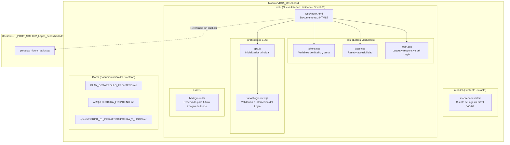

# Arquitectura del Frontend — `VIGIA_Dashboard`

**Proyecto:** VIGÍA Vision Systems  
**Módulo:** `VIGIA_Dashboard`  
**Versión:** 1.0 (Sprint 01)

---

## 1. Arquitectura General del Frontend

`VIGIA_Dashboard` se estructura como una aplicación web modular construida íntegramente con tecnologías estándar del navegador (**HTML5**, **CSS3** y **JavaScript Vanilla ES6 con ES Modules**).

Este diseño responde a tres principios fundamentales del proyecto:

1. **Simplicidad operativa y cero dependencias de compilación:** No requiere `Node.js`, `npm`, transpilers ni bundlers. Los archivos fuente son directamente interpretables por cualquier navegador moderno y servibles por el backend en Python/Flask cuando se aborde su integración.
2. **Interfaz única responsiva:** Una sola base de código en `VIGIA_Dashboard/web/` se adapta dinámicamente a teléfonos móviles, tabletas y computadoras de escritorio, evitando mantener implementaciones duplicadas por tipo de dispositivo.
3. **Preservación de herramientas operativas previas:** El cliente de captura móvil existente en `VIGIA_Dashboard/mobile/index.html` (utilizado para enviar fotogramas desde cámaras de teléfonos hacia `VIGIA_API`) se mantiene aislado e intacto en su propio subdirectorio.



---

## 2. Separación entre HTML, CSS y JavaScript

A diferencia del cliente puntual de pruebas `mobile/index.html` (que concentra estilos y scripts en un único archivo para portabilidad de diagnóstico), la aplicación principal en `web/` aplica una separación estricta de responsabilidades:

- **HTML (`web/index.html`):** Define exclusivamente la estructura semántica (`<main>`, `<section>`, `<h1>`, `<form>`, `<label>`, `<input>`, `<button>`), los atributos de accesibilidad (`aria-labelledby`, `aria-live`, `role`, `autocomplete`, `required`) y las referencias a hojas de estilo y al módulo JavaScript principal. No incluye estilos en línea (`style="..."`) ni manejadores de eventos incrustados (`onclick="..."`).
- **CSS (`web/css/`):** Organizado en capas progresivas:
  1. `tokens.css`: centraliza todas las variables de diseño (`--login-bg-color`, `--login-bg-image`, `--card-bg-color`, `--brand-circle-bg`, colores de estado y medidas).
  2. `base.css`: normaliza el modelo de cajas (`box-sizing: border-box`), configura la tipografía base sans-serif y provee utilidades de accesibilidad (`.sr-only`, `:focus-visible`, `[hidden]`).
  3. `login.css`: implementa la composición específica del diseño aprobado de inicio de sesión y sus reglas `@media` para móvil, tableta y escritorio.
- **JavaScript (`web/js/`):** Estructurado mediante módulos nativos ES6 (`import` / `export`):
  1. `app.js`: actúa como punto de entrada que aguarda la carga del DOM e inicializa la vista activa.
  2. `views/login-view.js`: encapsula el comportamiento del formulario de inicio de sesión, las validaciones de campos obligatorios, el estado visual de carga y los mensajes informativos accesibles.

---

## 3. Responsabilidad de cada Directorio

| Ruta | Responsabilidad |
| :--- | :--- |
| `VIGIA_Dashboard/mobile/` | Contiene el cliente de captura móvil `index.html` para pruebas de ingesta de video (`VO-03`). Se conserva sin modificaciones. |
| `VIGIA_Dashboard/web/` | Contiene la aplicación web responsiva para los usuarios del sistema (Inicio de Sesión y, en futuros sprints, vistas de Guardia y Administrador). |
| `VIGIA_Dashboard/web/assets/backgrounds/` | Espacio reservado para alojar la futura imagen de fondo de la pantalla de inicio de sesión cuando sea entregada. |
| `VIGIA_Dashboard/web/css/` | Hojas de estilo modulares separadas en tokens, estilos base y estilos por vista/componente. |
| `VIGIA_Dashboard/web/js/` | Lógica de cliente en JavaScript Vanilla ES6, organizada en un inicializador raíz (`app.js`) y controladores de vista (`views/`). |
| `VIGIA_Dashboard/Docs/` | Documentación técnica, plan de desarrollo y reportes de sprint exclusivos del frontend. |

---

## 4. Organización de Vistas

En el **Sprint 01**, únicamente existe e interviene la vista de **Inicio de Sesión** (`views/login-view.js`), cumpliendo con la restricción de no adelantar vistas cuyos requisitos detallados pertenecen a sprints posteriores:

- **Vista implementada en Sprint 01:**
  - `login-view.js`: gestiona el formulario `#login-form`, valida que el identificador de usuario y la contraseña no estén vacíos ni contengan espacios inválidos en el usuario, controla el estado `aria-busy` del botón `Iniciar Sesión`, informa claramente que la autenticación aún no está conectada al servidor y atiende la acción del enlace `¿Olvidaste la contraseña?`.
- **Evolución prevista para Sprints 02 a 04 (No implementado aún):**
  - En los siguientes sprints se añadirán dentro de `web/js/views/` los módulos correspondientes al Guardia (`OPERADOR`) y al Administrador (`ADMINISTRADOR`), junto con un módulo cliente HTTP para comunicarse con `VIGIA_API`.

---

## 5. Estrategia Responsive

La interfaz aplica un enfoque **Mobile-First** gobernado por `CSS Grid` (`.login-viewport` con `display: grid; place-items: center`) y `Flexbox` (`.login-card` y `.login-form` en disposición vertical centrada), evaluando tres rangos de pantalla explícitos:

1. **Móvil (`< 640px`):**
   - La tarjeta `.login-card` ocupa el `100%` del ancho útil del contenedor con un relleno exterior de `1rem` (`16px`), evitando cualquier desbordamiento horizontal incluso en pantallas de `320px`.
   - El círculo del logotipo adopta un diámetro de `120px` (`--brand-circle-size-mobile`).
   - Los campos de entrada tipo píldora tienen una altura mínima de `48px` y tamaño de fuente de `1rem` (`16px`), previniendo el zoom automático forzado en navegadores móviles y facilitando la pulsación táctil.
2. **Tableta (`640px – 1023px`):**
   - El relleno del contenedor aumenta a `2rem` y el relleno interno de la tarjeta a `2.25rem 2rem`.
   - El círculo del logotipo crece a `136px` (`--brand-circle-size-tablet`) manteniendo la proporción vertical.
3. **Escritorio (`>= 1024px`):**
   - La tarjeta conserva su ancho máximo de `400px` (`--card-max-width: 400px`) centrada tanto vertical como horizontalmente en el viewport.
   - El círculo del logotipo alcanza `148px` (`--brand-circle-size-desktop`) y el espaciado interno se amplía a `2.5rem 2.25rem`.

---

## 6. Uso de Recursos Visuales Oficiales y Futura Imagen de Fondo

### 6.1. Logotipos Oficiales SVG
Los recursos gráficos oficiales residen en `Docs/GEST_PROY_SOFT/02_Logos_accesibilidad/svg/`:

- `producto_figura.svg` (trazo `#000000`, `viewBox="0 0 489 415"`): isotipo del producto VIGÍA para fondos claros.
- `producto_figura_dark.svg` (trazo `#FFFFFF`, `viewBox="0 0 489 415"`): isotipo del producto VIGÍA para fondos oscuros.
- `producto_nombre.svg` / `producto_nombre_dark.svg` (`viewBox="0 0 1254 320"`): logotipo tipográfico de VIGÍA para fondos claros y oscuros.

Para el contenedor circular gris oscuro (`--brand-circle-bg: #3A3A3A`) de la pantalla de inicio de sesión se seleccionó **`producto_figura_dark.svg`**, ya que su relleno blanco (`#FFFFFF`) proporciona un contraste óptimo sobre el círculo oscuro y sustituye limpiamente el marcador de posición del wireframe original. El archivo se sirve a través de la ruta controlada de Flask `/assets/brand/producto_figura_dark.svg` directamente desde su ubicación oficial (`Docs/GEST_PROY_SOFT/02_Logos_accesibilidad/svg/producto_figura_dark.svg`) sin duplicarlo ni alterarlo.

---

## 6.3. Integración de Visualización con Flask en Red Local (Extensión Sprint 01)

Para permitir la inspección visual y responsive del Dashboard desde la estación de desarrollo y desde dispositivos móviles en la misma red local sin alterar el alcance funcional del Sprint 01, `create_ingest_app()` en `VIGIA_API/ingest_service.py` expone tres rutas de solo lectura que coexisten con las rutas existentes (`GET /`, `GET /mobile` y `POST /api/v1/cameras/<codigo_camara>/push`):

| Ruta Flask | Recurso Físico Servido | Mecanismo de Control y Seguridad |
| :--- | :--- | :--- |
| `GET /app` | `VIGIA_Dashboard/web/index.html` | Entrega mediante `send_from_directory` del documento raíz (`text/html`). |
| `GET /dashboard-assets/<path:filename>` | Activos de `VIGIA_Dashboard/web/` (`css/tokens.css`, `css/base.css`, `css/login.css`, `js/app.js`, `js/views/login-view.js`) | Validación contra lista blanca explícita (`ALLOWED_DASHBOARD_ASSETS`) y verificación de contención (`relative_to`) dentro de `VIGIA_Dashboard/web/`. |
| `GET /assets/brand/<filename>` | SVG oficiales en `Docs/GEST_PROY_SOFT/02_Logos_accesibilidad/svg/` | Validación contra lista blanca estricta de los 8 SVG oficiales (`ALLOWED_BRAND_SVGS`), rechazo de separadores de ruta (`/`, `\`, `..`) y verificación `relative_to`. |

### Parámetros de Ejecución en Red Local (Desarrollo)
- **Comando de arranque:** `.\.venv\Scripts\python.exe -m VIGIA_API.ingest_service`
- **Host de escucha:** `0.0.0.0` (configurable mediante `VIGIA_DEV_HOST`), con `use_debugger=False` y `use_reloader=False`.
- **Puerto de escucha:** `5000` (configurable mediante `VIGIA_DEV_PORT`).
- **Dirección IPv4 LAN verificada en el equipo:** `192.168.1.75` (interfaz `Ethernet`, red `INFINITUM0870`).
- **URL de acceso en computadora:** `http://127.0.0.1:5000/app` o `http://192.168.1.75:5000/app`.
- **URL de acceso desde teléfono móvil en la misma red Wi-Fi:** `http://192.168.1.75:5000/app`.
- **Limitaciones:** Esta ejecución corresponde a un servidor de desarrollo local para validación visual del frontend; no implementa aún sesiones ni endpoints de autenticación de usuarios, ni debe emplearse como servidor expuesto a redes públicas.

### 6.2. Preparación para la Futura Imagen de Fondo
Mientras la imagen de fondo definitiva no esté disponible, `tokens.css` define:

```css
:root {
  --login-bg-color: #FFFFFF;
  --login-bg-image: none;
  --login-bg-position: center center;
  --login-bg-size: cover;
}
```

Cuando se entregue el recurso gráfico en un sprint posterior, bastará con colocarlo en `VIGIA_Dashboard/web/assets/backgrounds/` y actualizar el valor de `--login-bg-image` en `tokens.css`, manteniendo `--login-bg-color: #FFFFFF` como color de respaldo inmediato.

---

## 7. Principios de Comunicación Futura con la API

Aunque la integración con `VIGIA_API` corresponde al **Sprint 02**, la arquitectura establecida en el Sprint 01 respeta los siguientes principios de seguridad y diseño:

- **Cero simulación de sesiones:** En el Sprint 01 el formulario no inventa usuarios, no acepta contraseñas de prueba ni guarda datos en `localStorage` o `sessionStorage`. Al enviar el formulario con campos válidos, limpia inmediatamente el campo de contraseña y muestra un aviso claro indicando que la autenticación aún no está integrada con el servidor.
- **Autorización delegada al backend:** En los siguientes sprints, toda decisión sobre validez de credenciales, estado activo de la cuenta y asignación de vista por rol (`OPERADOR` vs. `ADMINISTRADOR`) provendrá exclusivamente de la respuesta verificada del backend.

---

## 8. Límites de Responsabilidad respecto a los demás Módulos

- **`VIGIA_Dashboard` NO modifica ni accede directamente a `BD/`:** desconoce cadenas de conexión SQL y parámetros internos de hashing Argon2id.
- **`VIGIA_Dashboard` NO interviene en `VIGIA_Vision/` ni `VIGIA_IoT/`:** solo presentará la información operativa que `VIGIA_API` exponga en sprints futuros.
- **`VIGIA_Dashboard` NO altera contratos de `VIGIA_Core/` ni rutas de `VIGIA_API/` durante el Sprint 01:** todo su alcance permanece confinado al directorio `VIGIA_Dashboard/`.

