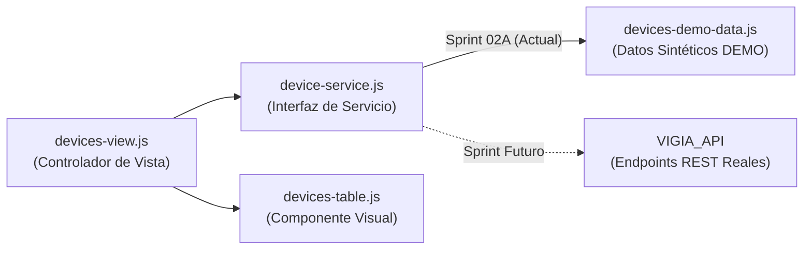

# Modo DEMO y Previsualización de Desarrollo — `VIGIA_Dashboard`

**Proyecto:** VIGÍA Vision Systems  
**Módulo:** `VIGIA_Dashboard`  
**Módulos asociados:** [`web/js/data/devices-demo-data.js`](../web/js/data/devices-demo-data.js), [`web/js/services/device-service.js`](../web/js/services/device-service.js)  
**Versión:** 1.0 (Sprint 02A)

---

## 1. Propósito del Modo DEMO

Durante el **Sprint 02A**, el objetivo es construir y validar la estructura visual, modular y responsive de la pantalla **Gestión de Dispositivos (Administrador)** antes de conectar el frontend con la base de datos PostgreSQL o con endpoints administrativos de `VIGIA_API`.

El **Modo DEMO** permite inspeccionar la interfaz con datos sintéticos realistas manteniendo una frontera estricta entre los datos de demostración y la futura integración con la API.

---

## 2. Origen y Estructura de los Datos Sintéticos

- Todos los registros sintéticos se encuentran aislados en el módulo [`web/js/data/devices-demo-data.js`](../web/js/data/devices-demo-data.js).
- Ningún dato DEMO está escrito de forma fija (hardcoded) dentro de `web/index.html` ni mezclado dentro del componente de tabla [`devices-table.js`](../web/js/components/devices-table.js).
- Se incluyen **7 registros DEMO** identificables de forma explícita mediante el prefijo `[DEMO]` en su nombre y el código `DEMO-DEV-001` a `DEMO-DEV-007`, cubriendo distintas combinaciones de:
  - **Tipo:** `Cámara IP LPR`, `Cámara IP PTZ`, `Actuador de Barrera (IoT)`, `Reflector Inteligente`, `Sensor Inductivo` y `Terminal Móvil de Ingesta`.
  - **Estado:** `Conectado` (`CONECTADO`), `Desconectado` (`DESCONECTADO`) y `En mantenimiento` (`EN_MANTENIMIENTO`).
  - **Última Actividad:** marcas de tiempo de demostración en formato `YYYY-MM-DD HH:MM:SS`.

---

## 3. Separación entre Modo DEMO y Futura Integración con API

La comunicación entre la vista [`devices-view.js`](../web/js/views/devices-view.js) y los datos se realiza exclusivamente a través del servicio [`createDeviceService()`](../web/js/services/device-service.js):



- `devices-table.js` recibe únicamente un arreglo de objetos `devices` por parámetro y emite eventos de usuario (`onDeviceAction`).
- Cuando se implementen los endpoints reales en `VIGIA_API`, solo se sustituirá la implementación interna de `device-service.js` sin reconstruir la tabla ni la vista.

---

## 4. Restricciones de Persistencia y Seguridad

1. **Sin conexión a PostgreSQL:** No se realizan consultas a la base de datos ni se modifica el esquema SQL.
2. **Sin llamadas a endpoints inventados:** El Modo DEMO no ejecuta `fetch()` ni `XMLHttpRequest` hacia rutas inexistentes.
3. **Sin persistencia local:** Los registros validados en el formulario provisional de `Agregar Dispositivos` viven únicamente en la memoria volátil de la pestaña actual y desaparecen al recargar la página (`F5`). No se utiliza `localStorage`, `sessionStorage` ni `IndexedDB`.
4. **Sin autenticación falsa:** La pantalla de **Inicio de Sesión** (`/app` o `/app#login`) no acepta usuarios ni contraseñas inventadas para entrar al panel administrativo.

---

## 5. Control Explícito de Seguridad y Mecanismo de Previsualización (`VO-02A-R1`)

### 5.1. Modo DEMO Deshabilitado por Defecto
Por seguridad arquitectónica, el modo de previsualización DEMO se encuentra **deshabilitado por defecto** tanto en el archivo versionado [`web/index.html`](../web/index.html) (`data-demo-enabled="false"`) como en `create_ingest_app()` dentro de [`VIGIA_API/ingest_service.py`](../../VIGIA_API/ingest_service.py).

- Cuando DEMO está deshabilitado (`VIGIA_ENABLE_FRONTEND_DEMO` no definido o `0`/`false`):
  - Ni el hash `#devices` ni el parámetro `?demo=admin` habilitan el modo DEMO por sí mismos.
  - Cualquier intento de abrir `/app#devices`, `/app#cameras` o `/app?demo=admin` es interceptado por [`router.js`](../web/js/router.js) y [`app.js`](../web/js/app.js), regresando inmediatamente a `#login` y mostrando el aviso accesible:
    > *«El modo de previsualización DEMO está deshabilitado por defecto. Inicia sesión o habilita VIGIA_ENABLE_FRONTEND_DEMO=1 en el entorno de desarrollo.»*

### 5.2. Cómo Habilitar y Deshabilitar el Modo DEMO en Desarrollo Local y LAN

Para habilitar la previsualización DEMO en la computadora y en teléfonos conectados a la misma red Wi-Fi (`192.168.1.75`):

1. **Habilitar DEMO y arrancar Flask en PowerShell:**
   ```powershell
   cd c:\GEST.PROY.TI\Software\VIGIA_Vision_Systems
   $env:VIGIA_ENABLE_FRONTEND_DEMO = "1"
   .\.venv\Scripts\python.exe -m VIGIA_API.ingest_service
   ```
2. **Comprobar que DEMO está activo:**
   - Al consultar `GET /app`, el elemento raíz `<html lang="es" data-theme="light" data-demo-enabled="true">` contendrá `data-demo-enabled="true"`.
3. **URLs de acceso con DEMO habilitado:**
   - **Inicio de Sesión (Sprint 01):**
     - Computadora: `http://127.0.0.1:5000/app` (o `http://127.0.0.1:5000/app#login`)
     - Teléfono móvil (red local): `http://192.168.1.75:5000/app`
   - **Gestión de Dispositivos — Modo Claro (Sprint 02A):**
     - Computadora: `http://127.0.0.1:5000/app#devices` (o `http://127.0.0.1:5000/app?demo=admin`)
     - Teléfono móvil (red local): `http://192.168.1.75:5000/app#devices`
   - **Gestión de Dispositivos — Modo Oscuro (`[data-theme="dark"]`):**
     - Computadora: `http://127.0.0.1:5000/app?theme=dark#devices`
     - Teléfono móvil (red local): `http://192.168.1.75:5000/app?theme=dark#devices`
4. **Deshabilitar DEMO (volver al estado seguro por defecto):**
   ```powershell
   $env:VIGIA_ENABLE_FRONTEND_DEMO = $null
   .\.venv\Scripts\python.exe -m VIGIA_API.ingest_service
   ```

---

## 6. Comportamiento de las Acciones Provisionales y Salida de DEMO

- **Botón `Salir de DEMO / Ir al Inicio de Sesión` (`#btn-exit-demo`):** Ubicado de forma visible y accesible junto a la insignia `MODO DEMO` en la cabecera de la tarjeta administrativa. Al pulsarlo, limpia cualquier registro temporal en memoria (`createDeviceService()`), oculta `#admin-root`, limpia mensajes previos y regresa a `#login` sin simular el cierre de una sesión real.
- **Botón `Detalle (Provisional)` en cada fila de la tabla:** Muestra un aviso accesible dentro de la tarjeta indicando los datos DEMO del dispositivo seleccionado y recordando que la edición/diagnóstico real se integrará en sprints posteriores.
- **Botón `Agregar Dispositivos`:** Abre un panel provisional claramente etiquetado como `Modo DEMO — Sprint 02A: sin persistencia en backend`. Valida que el nombre del dispositivo no esté vacío y emite una confirmación DEMO en línea.

