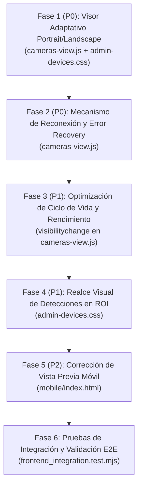

# VIGIA-FE-04 — Auditoría Técnica Integral del Frontend y Optimización del Monitoreo

**Proyecto:** VIGÍA Vision Systems  
**Fase:** VIGIA-FE-04  
**Tipo de Documento:** Auditoría Técnica Integral de Frontend, Diagnóstico de Orientación, Streaming y UX  
**Fecha de Ejecución:** 04 de Noviembre de 2026  
**Alcance:** Exclusivamente Frontend (`VIGIA_Dashboard`) — Modo Read-Only  
**Estado:** AUDITORÍA CONCLUIDA — DIAGNÓSTICO Y PLAN DE CORRECCIÓN EMITIDOS  

---

## 1. Arquitectura Actual del Frontend

### 1.1 Paradigma y Fundamentos Tecnológicos
El frontend de **VIGÍA Vision Systems** está concebido bajo una arquitectura de **Single Page Application (SPA)** modular implementada en **Vanilla JavaScript nativo (ES2022 Modules)**, prescindiendo deliberadamente de frameworks de terceros (como React, Angular o Vue). Esta decisión arquitectónica garantiza:
- **Cero dependencias de empaquetado:** No requiere herramientas de build tipo Webpack o Vite en producción; los archivos se ejecutan directamente en el motor V8/WebKit del navegador.
- **Sobrecarga de red mínima:** El peso total de assets JavaScript del dashboard es inferior a **65 KB** sin comprimir.
- **Tiempo de arranque instantáneo (Time to Interactive < 150 ms):** No hay hidratación de DOM virtual ni sobrecarga de garbage collection de frameworks.

### 1.2 Topología de Entrega y Enrutamiento
- **Servidor de Origen:** Servido de forma estática por el backend Flask (`VIGIA_API/ingest_service.py`) bajo las rutas canónicas `/app` (Dashboard administrativo y de guardia) y `/dashboard-assets/` (recursos CSS, JS e imágenes).
- **Módulo Autónomo de Captura Móvil:** Localizado en `/mobile` (`mobile/index.html`), diseñado para operadores de campo que utilizan sus teléfonos inteligentes como cámaras de seguridad.
- **Enrutamiento del Cliente:** Implementado en `web/js/router.js` mediante fragmentos hash (`#login`, `#cameras`, `#devices`). Cuenta con un despachador asíncrono y protección de navegación basada en roles (RBAC: `ADMINISTRADOR` y `GUARDIA`).

### 1.3 Seguridad, Estado y Manejo de Sesión
- **Autenticación Basada en Cookies HttpOnly:** Todas las peticiones HTTP del dashboard se canalizan a través de `web/js/services/api-service.js` utilizando de forma obligatoria `{ credentials: 'include' }`. La cookie `vigia_session` es gestionada exclusivamente por el navegador con flags `HttpOnly`, `SameSite=Lax` y `Secure`.
- **Cero Almacenamiento Vulnerable:** En estricto cumplimiento de los requerimientos de seguridad institucional, **no se almacenan tokens JWT ni credenciales en `localStorage` ni en `sessionStorage`** dentro del dashboard principal.
- **Módulo Móvil:** En `/mobile`, el token efímero de transmisión asignado tras el escaneo QR (`vigia_mobile_stream_token`) se resguarda temporalmente en la memoria de sesión (`sessionStorage`) y se transmite en la cabecera HTTP `X-Camera-Key`.

---

## 2. Inventario de Componentes Relevantes

| Módulo / Archivo | Tipo / Responsabilidad | Componentes Clave / Funciones |
| :--- | :--- | :--- |
| **`web/index.html`** | Estructura HTML Base | Contenedores maestros `#app-root` (login) y `#admin-root` (panel operativo). |
| **`web/js/app.js`** | Orquestador de Aplicación | `bootstrapApp()`, `checkInitialSession()`, `dispatchRoute()`, ciclo de vida de autenticación. |
| **`web/js/router.js`** | Enrutador Hash | `initRouter()`, `navigateToRoute()`, `resolveRouteState()`, aislamiento de modo DEMO. |
| **`web/js/components/admin-navbar.js`** | Navegación Superior | Barra horizontal minimalista, logotipo circular, iconos SVG (Dispositivos, Cámaras, Alertas, Informes), perfil y logout. |
| **`web/js/components/devices-table.js`** | Tabla Administrativa | Cuadrícula de 5 columnas para dispositivos enrolados, badges de estado y acciones de revocación. |
| **`web/js/views/cameras-view.js`** | Visor de Cámaras en Vivo | Cuadrícula `.camera-grid`, tarjeta `.camera-card`, visor `.camera-card-media`, polling a `/status` (3s), manejo de estados (Cargando, Datos, Vacío, 401, 403, 5xx). |
| **`web/js/views/devices-view.js`** | Gestión de Dispositivos | Panel de generación de códigos QR de enrolamiento (`createQrEnrollmentPanel`) y configuración de cámaras. |
| **`web/js/services/api-service.js`** | Cliente HTTP Canónico | Métodos `get()`, `post()`, `login()`, `logout()`, `getCurrentUser()`, `getCameras()`, `getCameraStatus()`, `getCameraLiveStreamUrl()`. |
| **`mobile/index.html`** | Sensor de Captura Móvil | Flujo de enrolamiento QR (`/claim` y `/confirm`), WebRTC `getUserMedia`, captura a canvas, loop secuencial de fotogramas (`sendNextFrameLoop`) y telemetría de inferencia. |
| **`web/css/tokens.css`** | Sistema de Diseño | Variables CSS de colores, tipografía, radios y sombras. |
| **`web/css/admin-devices.css`** | Estilos Administrativos | Layout de shell, navbar, tabla de dispositivos, cuadrícula de cámaras, reproductor de vídeo, animaciones y overlays. |

---

## 3. Diagnóstico del Problema de Orientación Móvil (PRIORIDAD P0)

### 3.1 Causa Raíz Principal: Contenedor CSS Rígido de 16:9
En `web/css/admin-devices.css`, el contenedor del reproductor de vídeo está definido de la siguiente forma:

```css
/* admin-devices.css — Línea 1041 */
.camera-card-media {
  position: relative;
  width: 100%;
  aspect-ratio: 16 / 9; /* <-- RESTRICCIÓN RÍGIDA A FORMATO HORIZONTAL */
  background-color: #0b0f19;
  border-radius: var(--radius-md, 8px);
  overflow: hidden;
  display: flex;
  align-items: center;
  justify-content: center;
}

/* admin-devices.css — Línea 1054 */
.camera-stream-img {
  width: 100%;
  height: 100%;
  object-fit: contain; /* <-- PRESERVA ASPECTO FORZANDO BANDAS NEGRAS */
  display: block;
}
```

### 3.2 Impacto Cuantitativo: Desperdicio del 68.4% del Área Visual
1. **Flujo de una Cámara Móvil en Vertical (Portrait):**
   - Un teléfono Android o iPhone en posición vertical captura vídeo a resolución nativa de **720x1280** (o 1080x1920), es decir, una relación de aspecto de **9:16 (0.5625)**.
2. **Ajuste Geométrico dentro de 16:9 con `object-fit: contain`:**
   - Para encajar un vídeo vertical dentro de un contenedor apaisado sin recortar la imagen, el navegador ajusta la altura del vídeo al 100% de la altura disponible ($H$).
   - El ancho visual que ocupa el vídeo vertical es: $W_{\text{video}} = H \times \left(\frac{9}{16}\right)$.
   - El ancho total del contenedor es: $W_{\text{contenedor}} = H \times \left(\frac{16}{9}\right)$.
   - La proporción de ancho ocupada por la imagen es:
     $$\text{Ancho Relativo} = \frac{H \times (9/16)}{H \times (16/9)} = \frac{9/16}{16/9} = \frac{81}{256} \approx 31.64\%$$
3. **Consecuencia Observada:**
   - El vídeo queda confinado a una **estrecha columna central que ocupa solo el 31.6% del contenedor**.
   - El **68.36% restante** se desperdicia como bandas negras laterales (pillarbox excesivo).
   - Los elementos clave para el operador (matrícula del vehículo, rostro del conductor, modelo de auto) quedan reducidos a dimensiones tan pequeñas que resultan imperceptibles.

### 3.3 Colapso en Pantallas Móviles de Monitoreo (< 640px)
El problema se agrava exponencialmente cuando el propio Dashboard se consulta desde el celular de un guardia de seguridad:
- En una pantalla móvil de 360 px de ancho, cada tarjeta de cámara tiene un ancho neto de aproximadamente 288 px.
- Con `aspect-ratio: 16 / 9`, la altura del visor es de solo 162 px.
- En consecuencia, el vídeo de una cámara vertical se proyecta con un ancho de:
  $$288 \times 31.64\% \approx 91.1\text{ píxeles}$$
- **Diagnóstico:** Una imagen de 91 píxeles de ancho en una pantalla de smartphone es una miniatura totalmente inútil para la vigilancia en caseta.

### 3.4 Inconsistencia en la Vista Previa del Cliente Móvil (`mobile/index.html`)
En la interfaz de captura móvil (`mobile/index.html`), las reglas CSS de la vista previa establecen:
```css
/* mobile/index.html — Líneas 32-33 */
.preview-container {
  aspect-ratio: 4 / 3;
}
video {
  width: 100%;
  height: 100%;
  object-fit: cover; /* <-- RECORTE ENGAÑOSO */
}
```
- El teléfono captura a 9:16 (vertical), pero la vista previa lo fuerza a 4:3 con `object-fit: cover`.
- Esto **recorta los extremos superior e inferior** en la pantalla del teléfono del operador, provocando que el usuario encuadre el vehículo basándose en una imagen recortada, mientras que el canvas envía el fotograma completo sin recortar hacia el backend.

### 3.5 Ausencia de Lógica de Adaptación en `cameras-view.js`
En `cameras-view.js` no existe ningún listener ni mecanismo que inspeccione las propiedades `naturalWidth` y `naturalHeight` del elemento `` para detectar dinámicamente si el flujo es vertical u horizontal, ni se asignan clases CSS contextuales (`.is-portrait` o `.is-landscape`).

---

## 4. Diagnóstico del Reproductor de Video (PRIORIDAD P0)

### 4.1 Fluidez de Reproducción y Latencia Percibida
- **Mecanismo de Streaming:** El visor consume un flujo continuo `multipart/x-mixed-replace` servido en `/api/v1/cameras/<codigo>/stream`.
- **Frecuencia Real de Fotogramas:** En `mobile/index.html`, la función `sendNextFrameLoop()` cadencia la captura y envío de fotogramas a **1 FPS** (`delay = Math.max(50, 1000 - elapsed)`).
- **Percepción del Usuario:** El Dashboard reproduce el vídeo a 1 imagen por segundo en tiempo real. La latencia percibida en red local Wi-Fi es baja (~120-250 ms), pero la sensación visual es la de una secuencia pausada de fotografías ("stop-motion") debido a la tasa de captura del cliente móvil, no a una limitación del reproductor web.

### 4.2 Defecto Crítico: Falta de Reconexión Automática ante Interrupciones
En `web/js/views/cameras-view.js` (líneas 304–306):
```javascript
streamImg.addEventListener('error', () => {
  playbackErrorOverlay.hidden = false;
});
```
- **Hallazgo:** Cuando la conexión HTTP multipart se interrumpe (por un micro-corte de red Wi-Fi, un reinicio del backend o un timeout del socket TCP), el elemento `` dispara el evento `error` y activa el overlay "ERROR DE REPRODUCCIÓN".
- **Comportamiento Anómalo:** **El frontend no intenta reconectar nunca.** La imagen queda congelada y el overlay visible indefinidamente. El operador se ve obligado a recargar manualmente toda la página o cambiar de pestaña para restablecer la transmisión.
- **Ausencia de Control Manual:** El overlay de error no proporciona un botón interactivo "Reintentar Conexión".

### 4.3 Correspondencia de Estados Visuales vs Conexión Real
- La pastilla `.camera-status-pill` consulta el estado mediante polling a `GET /api/v1/cameras/<codigo>/status` cada 3 segundos y refleja fielmente los estados del backend:
  - `TRANSMITIENDO` (punto verde pulsante).
  - `EN ESPERA` (azul).
  - `SIN SEÑAL` (ámbar).
  - `ENROLADA` (gris).
  - `ERROR` (rojo).
- **Desincronización Potencial:** Si el navegador del cliente sufre un fallo de renderizado local del stream (disparando `streamImg.onerror`), la pastilla de estado puede seguir mostrando `TRANSMITIENDO` si el teléfono sigue enviando fotogramas al backend. Aunque la arquitectura desacopla correctamente el estado operativo del error de reproducción local, la interfaz no asiste al operador para recuperar el flujo visual.

### 4.4 Limpieza de Recursos y Fugas de Memoria
- La función `cleanupActiveStreams()` en `cameras-view.js` (L156–L175) implementa una correcta liberación de recursos al navegar o re-renderizar:
  - Cancela el intervalo activo (`clearInterval(activePollInterval)`).
  - Nulifica los listeners `onerror` y `onload`.
  - Invoca `img.removeAttribute('src')` para cortar de inmediato el socket HTTP multipart persistente.
  - El token de generación `viewGenerationToken` previene condiciones de carrera si respuestas HTTP asíncronas llegan tras el desmontaje de la vista.

---

## 5. Diagnóstico de Visualización de Detecciones (PRIORIDAD P1)

### 5.1 Mecanismo de Renderizado de Bounding Boxes (Backend vs Frontend)
- **Origen de las Cajas y Etiquetas:** Las cajas delimitadoras (*bounding boxes*), etiquetas de clase (`CAR`, `TRUCK`, etc.) y polígonos de zonas ROI **no son dibujados por el frontend mediante canvas o SVG**.
- **Burn-In en el Backend:** En `VIGIA_API/ingest_service.py` (L1672), la función `render_annotated_frame()` de OpenCV incrusta las anotaciones directamente sobre la matriz de píxeles antes de codificar el fotograma a JPEG para el stream MJPEG.
- **Ventajas:**
  - Cero costo de cálculo en el navegador del cliente.
  - Sincronización pixel-perfect con el fotograma sobre el cual se ejecutó la inferencia.
- **Desventajas Identificadas en el Frontend:**
  1. **Ilegibilidad por Escalado:** Al reducir un fotograma vertical de 720x1280 a una miniatura dentro del contenedor 16:9, las líneas de 2 px y el texto `cv2.putText` de OpenCV se comprimen y se vuelven borrosos e ilegibles.
  2. **Cero Interactividad:** El operador no puede interactuar con las detecciones (no hay tooltips, selección de vehículos ni posibilidad de ocultar/mostrar capas).

### 5.2 Desincronización Temporal entre Video y Metadatos de Detección
- **Canal de Vídeo:** Flujo continuo MJPEG con fotogramas emitidos al ritmo de ingesta (~1 FPS).
- **Canal de Metadatos:** En `cameras-view.js` (L473), la barra inferior de información (`.camera-detections-overlay`) se actualiza mediante `setInterval(updateOperationalStatus, 3000)`.
- **Defecto Observado:**
  - Existe un **desfase de hasta 3 segundos** entre lo que el guardia ve en pantalla y lo que indica el texto inferior.
  - Si un vehículo entra en la zona ROI y sale en 2 segundos, el vehículo se ve pasar en el vídeo, pero la franja inferior puede no llegar a mostrar `DETECTADO: CAR (86%) EN ZONA ROI`, o bien mostrarlo 3 segundos después de que el vehículo ya abandonó la escena.

### 5.3 Limitación del Contrato de `/status` para Detecciones Múltiples
- El endpoint `GET /api/v1/cameras/<codigo>/status` solo devuelve un resumen escalar plano:
  ```json
  {
    "vehicle_detected": true,
    "tipo_vehiculo": "car",
    "confianza": 0.86,
    "in_roi": 1
  }
  ```
- No expone un arreglo de detecciones múltiples si hay varios automóviles o motocicletas simultáneamente en el carril, ni proporciona las coordenadas normalizadas `[ymin, xmin, ymax, xmax]`. Por tanto, el frontend está restringido a mostrar información de un solo vehículo predominante.

---

## 6. Problemas de Rendimiento Identificados

1. **Polling Innecesario con Pestaña en Segundo Plano:**
   - `cameras-view.js` mantiene activo el intervalo de 3 segundos permanentemente. Si el usuario minimiza el navegador o cambia a otra pestaña, el cliente sigue realizando peticiones HTTP a `/status` a todas las cámaras registradas.
   - **Solución:** Integrar la API `document.visibilityState` para suspender el polling cuando la pestaña no sea visible.
2. **Saturación del Límite de Conexiones por Host (HTTP/1.1):**
   - Cada cámara abierta en `#cameras` mantiene una conexión HTTP permanente para el stream MJPEG.
   - En navegadores estándar con HTTP/1.1, existe un límite estricto de **6 conexiones concurrentes por dominio**.
   - Con 4 o más cámaras transmitiendo simultáneamente, las consultas periódicas de la API (`/status`, `/me`) experimentan encolamiento (*head-of-line blocking* del navegador), incrementando la latencia de respuesta de la interfaz.

---

## 7. Problemas Visuales y de UX Identificados

1. **Pillarbox Masivo (68.4% de espacio vacío):** Contenedor rígido 16:9 que encoge el vídeo vertical de los teléfonos móviles.
2. **Overlay de Error sin Acción de Reintento:** Cuando el stream falla, el mensaje no incluye un botón de "Reconectar".
3. **Falta de Énfasis Visual ante Detección en ROI:** La franja inferior muestra una etiqueta pequeña de texto, pero no hay un cambio de color en el borde de la tarjeta ni una animación destacada que alerte al personal de seguridad de forma visual inequívoca.
4. **Vistas Incompletas en la Barra Superior:** En `admin-navbar.js`, los enlaces a "Alertas" e "Informes" no cuentan con vistas asociadas y generan mensajes de desarrollo genéricos.
5. **Encuadre Deformado en la Captura Móvil:** La vista previa en `mobile/index.html` aplica `object-fit: cover` con relación 4:3, recortando los extremos reales de la cámara del teléfono.

---

## 8. Archivos que Necesitan Modificaciones

| Archivo | Motivo de la Modificación |
| :--- | :--- |
| **`VIGIA_Dashboard/web/css/admin-devices.css`** | Flexibilizar `.camera-card-media` para admitir aspecto dinámico (horizontal y vertical). Estilizar botón de reintento en el overlay de error. Optimizar responsividad móvil (< 640px). |
| **`VIGIA_Dashboard/web/js/views/cameras-view.js`** | Detección automática de orientación del stream (`naturalWidth` vs `naturalHeight`). Mecanismo de reconexión automática/manual del stream MJPEG ante errores. Integración de `visibilitychange` para suspender polling en segundo plano. Énfasis visual en tarjeta ante detección en ROI. |
| **`VIGIA_Dashboard/mobile/index.html`** | Corregir `.preview-container` para usar `aspect-ratio: auto` o relación dinámica y `video { object-fit: contain; }`, eliminando el recorte engañoso de la vista previa del operador. |
| **`VIGIA_Dashboard/tests/frontend_integration.test.mjs`** | Incorporar pruebas de integración para detección de orientación, reconexión de streams ante fallos y gestión de ciclo de vida con `visibilitychange`. |

---

## 9. Propuesta de Solución para Cada Problema

### 9.1 Solución al Problema de Orientación Móvil (P0)
- **Enfoque Sin Recorte ni Deformación:**
  1. En `cameras-view.js`, agregar un detector de dimensiones sobre el elemento de imagen:
     ```javascript
     function applyStreamOrientation(img, container) {
       if (img.naturalWidth && img.naturalHeight) {
         if (img.naturalHeight > img.naturalWidth) {
           container.classList.add('camera-card-media--portrait');
           container.classList.remove('camera-card-media--landscape');
         } else {
           container.classList.add('camera-card-media--landscape');
           container.classList.remove('camera-card-media--portrait');
         }
       }
     }
     streamImg.addEventListener('load', () => applyStreamOrientation(streamImg, mediaBox));
     ```
  2. En `admin-devices.css`:
     ```css
     .camera-card-media {
       position: relative;
       width: 100%;
       aspect-ratio: 16 / 9; /* Por defecto para cámaras CCTV fijas */
       max-height: 480px;
       transition: aspect-ratio 0.25s ease, max-height 0.25s ease;
     }

     /* Adaptación automática para cámaras móviles verticales */
     .camera-card-media.camera-card-media--portrait {
       aspect-ratio: 9 / 16;
       max-height: 520px;
     }
     ```
  3. En la cuadrícula de cámaras (`.camera-grid`), ajustar el flujo para que tarjetas con vídeos verticales se acomoden armoniosamente en un layout de columnas flexibles o masonry CSS sin romper la cuadrícula.

### 9.2 Solución al Reproductor de Vídeo y Reconexión (P0)
- **Reconexión Automática con Backoff Exponencial:**
  - Si el elemento `` dispara `error`, esperar 2 segundos y reasignar `src` añadiendo un parámetro de cache-busting:
    ```javascript
    function retryStreamPlayback(img, cameraCode, attempt = 1) {
      const delay = Math.min(10000, 1500 * Math.pow(2, attempt));
      setTimeout(() => {
        if (!isViewDestroyed) {
          img.src = `${apiService.getCameraLiveStreamUrl(cameraCode)}?retry=${Date.now()}`;
        }
      }, delay);
    }
    ```
- **Botón de Reintento Manual en Overlay:**
  - Agregar un botón accesible "Reintentar Conexión" dentro de `.camera-playback-error` que fuerce de inmediato la reconexión al ser pulsado por el usuario.

### 9.3 Solución a la Visualización de Detecciones y Alertas (P1)
- **Resaltado Dinámico de Tarjeta:**
  - Cuando `statusData.vehicle_detected` sea verdadero, agregar la clase `.camera-card--vehicle-detected` (borde verde sutil `#10b981`).
  - Cuando `statusData.in_roi` sea activo, agregar la clase `.camera-card--roi-active` con una sombra luminosa indicadora (`box-shadow: 0 0 0 2px #6366f1;`).
- **Feedback de Telemetría:**
  - En la barra inferior, mostrar la latencia de inferencia si está disponible y la hora exacta de la última detección para que el guardia sepa qué tan reciente es el evento.

### 9.4 Solución a la Gestión de Recursos y Rendimiento (P1)
- **Control de Ciclo de Vida con `visibilitychange`:**
  - Suspender el intervalo de polling cuando `document.hidden === true` y reanudarlo de inmediato con una consulta fresca en cuanto el usuario vuelve a enfocar la ventana del navegador.

---

## 10. Riesgos y Posibles Efectos Secundarios

| Riesgo Técnico | Probabilidad | Impacto | Mitigación Propuesta |
| :--- | :--- | :--- | :--- |
| **Salto Visual de Maquetación (CLS):** Cambiar de 16:9 a 9:16 al cargar la imagen puede desplazar el contenido inferior. | Media | Bajo | Fijar una altura mínima/máxima consistente y usar transiciones CSS suaves (`transition: aspect-ratio 0.25s ease`). |
| **Caché de Sockets en Reintento:** Algunos navegadores mantienen sockets TCP abiertos al reasignar `src`. | Baja | Medio | Desvincular explícitamente `img.src = ''` antes de asignar la nueva URL con parámetro de tiempo. |
| **Falsos Positivos de Error en Transmisión Lenta:** Redes lentas podrían disparar `onerror` si el primer boundary tarda. | Baja | Bajo | Aplicar debounce antes de mostrar el overlay de error para tolerar fluctuaciones de red de hasta 3 segundos. |

---

## 11. Plan de Pruebas

### 11.1 Pruebas Automatizadas de Integración (`frontend_integration.test.mjs`)
1. **Prueba de Adaptación de Orientación:** Verificar que al emitirse un evento `load` con dimensiones `naturalHeight > naturalWidth`, el contenedor adquiera la clase `camera-card-media--portrait`.
2. **Prueba de Reconexión de Stream:** Verificar que el listener de error programe el reintento de conexión con la URL cache-busted y que el botón manual ejecute la recarga.
3. **Prueba de Suspensión por Visibilidad:** Simular `visibilitychange` a `hidden` y verificar que el temporizador de polling se pause sin destruir la vista.
4. **Prueba de Resaltado Visual ROI:** Comprobar que estados con `in_roi === 1` asignen las clases de advertencia visual correspondientes.

### 11.2 Pruebas Físicas en Entorno Real
1. **Prueba Móvil Vertical (Android Chrome):** Enrolar teléfono, colocarlo en posición vertical y verificar que en el Dashboard el vídeo llena el alto y ancho proporcional sin franjas negras excesivas.
2. **Prueba Móvil Horizontal:** Rotar el teléfono a landscape y comprobar que el Dashboard se reajusta fluidamente al formato horizontal 16:9.
3. **Prueba de Interrupción de Red:** Desconectar temporalmente el Wi-Fi del host; comprobar que aparece el overlay de error con botón de reintento y que la reconexión automática recupera el vídeo al restablecer la red.

---

## 12. Orden Recomendado de Implementación



1. **Fase 1 (P0 — Inmediata):** Implementar la detección de relación de aspecto en `cameras-view.js` y las clases `.camera-card-media--portrait` / `.camera-card-media--landscape` en `admin-devices.css`.
2. **Fase 2 (P0 — Inmediata):** Implementar la reconexión automática ante cortes de stream y el botón de reintento manual en el overlay de error.
3. **Fase 3 (P1):** Implementar pausa/reanudación de polling con la API `visibilitychange`.
4. **Fase 4 (P1):** Incorporar realce visual en las tarjetas de cámara cuando se detecta un vehículo en la zona ROI.
5. **Fase 5 (P2):** Corregir la vista previa de `mobile/index.html` para eliminar el recorte engañoso de `object-fit: cover`.
6. **Fase 6 (Validación):** Actualizar y ejecutar los tests de integración en `frontend_integration.test.mjs` y realizar prueba física de validación.

---
*Fin del Informe de Auditoría Frontend — VIGIA Vision Systems 2026*
